# Arweqah Platform

Internal ERP for Arweqah Alreyadah: one place for people, organization, requests, projects, tickets and finance tracking. This repository currently contains the **foundation** every business module is built on. Business modules are added one at a time from a written description of each feature (see [Adding a feature](#adding-a-feature)).

## 1. Overview

**Organization.** Arweqah Alreyadah (أروقة الريادة), a Saudi company with 1,000–5,000 employees across several branches.

**Problem.** Employee data, approvals, projects and tickets live in separate tools (Airtable, Google Sheets, email). Nobody has one view, approvals are slow to chase, and sensitive data (national IDs, salaries) is spread across files.

**Solution.** A bilingual (Arabic RTL / English) web platform where every employee signs in with Microsoft 365 or a work e-mail, always confirmed by a code from an authenticator app (no passwords), sees only what their role and position in the organization allow, and where every sensitive action is recorded.

**Main journeys in the foundation**

1. The startup administrator (`s.magdy@arweqah.sa`, created by the seeder) signs in with Microsoft, scans the QR code once to link an authenticator app, and from then on enters the 6-digit code at every sign-in.
2. An administrator builds each company's structure with forms: levels (sector / department / section / unit by default), units under any level, and job titles (mandatory on units that accept employees). Changing levels that hold data shows the impact and needs confirmation.
3. HR creates an employee from the 40-field form; the system creates a sign-in account and e-mails an activation link. The employee also gets the link on their first sign-in attempt (the e-mail step recognizes a first time and sends the QR link), scans the QR code and enters the code.
4. An administrator builds roles from the permission catalog and chooses how far each permission reaches (own → unit → subtree → company → all).
5. Every person has a profile page: they pick the light or dark theme and the language, and edit their personal phone, personal e-mail and English name; the rest of their record is HR's.
6. A user receives notifications in the app (and by e-mail); an auditor reviews the audit log; an administrator follows every e-mail the platform sent (sent / failed and why).

**In scope now:** passwordless authentication (Microsoft + authenticator app), tasks (my tasks, my team, matrix, table and Kanban, approval, objection, reminders, archive), companies, dynamic organization structure, employees, dynamic roles and scoped permissions, audit log, notifications (in-app, email, SMS adapter), file storage, workflow engine, messaging (outbox + RabbitMQ + durable scheduled jobs), sent-e-mail log, bilingual UI shell with grouped navigation.

**Out of scope now (planned modules):** attendance, leaves, requests, projects (tasks already exist on their own; project tasks, the project manager's approval and Gantt come with that module), tickets with SLA, expenses / advances / invoices tracking, payroll records, dashboards, two-way Airtable / Google Sheets sync. Out of scope for version 1 entirely: double-entry accounting, e-invoicing (ZATCA), GOSI / Mudad / WPS integrations.

## 2. Vision

A unified digital workplace that runs all of the company's resources efficiently and transparently.

## 3. Mission

Bring employee, project and request management into one secure platform that speeds up decisions and removes manual work.

## 4. Functional requirements

| ID | Requirement | Actor | Priority | Covered by |
|---|---|---|---|---|
| FR-01 | Sign in with the work e-mail and the 6-digit code of an authenticator app; no passwords, no self sign-up; one generic error; 5/min rate limit; lock after 5 wrong codes; a code cannot be reused; deactivated accounts refused | All users | Must | `apps/api/test/auth.e2e-spec.ts`, `apps/web/src/features/auth/pages/login-page.test.tsx` |
| FR-02 | The authenticator app is mandatory for everyone: no protected route works before it is linked and the session is code-verified | All users | Must | `apps/api/test/mfa.e2e-spec.ts`, `apps/api/test/access.e2e-spec.ts` |
| FR-03 | Sign in with Microsoft Entra ID, company tenant only, pre-provisioned employees only; the code is still required after Microsoft | All users | Must | `apps/api/src/config/env.schema.spec.ts`, `apps/api/test/mfa.e2e-spec.ts` (manual check against the real tenant before go-live) |
| FR-04 | Employees: create (also creates the sign-in account), update, activate / deactivate (ends sessions), terminate, assign roles, resend the activation link, reset the authenticator | HR / admin | Must | `apps/api/test/employees.e2e-spec.ts` |
| FR-05 | Dynamic roles built from a permission catalog; system roles cannot be deleted | Admin | Must | `apps/api/test/access.e2e-spec.ts`, `apps/web/src/features/roles/role-editor.test.tsx` |
| FR-06 | Every permission is scoped (own / unit / subtree / company / all); lists and records outside the scope are hidden (404) | All | Must | `apps/api/src/core/access/application/access.spec.ts`, `apps/api/test/security.e2e-spec.ts` |
| FR-07 | Replaced by FR-13 and FR-24 (companies, levels, units, job titles) | Admin | — | see FR-13, FR-24 |
| FR-08 | In-app notifications with unread count; email (and SMS) delivered in the background through the outbox | All | Must | `apps/api/test/platform.e2e-spec.ts` (Notifications) |
| FR-09 | Upload files (PDF, PNG, JPEG ≤ 10 MB) checked by content; only the owner can read them | All | Should | `apps/api/test/platform.e2e-spec.ts` (Files) |
| FR-10 | Workflow engine: persisted state machines with history, optimistic locking and durable timeouts (escalations) | Feature modules | Must | `apps/api/test/platform.e2e-spec.ts` (Workflow engine) |
| FR-11 | Audit log of sign-ins and sensitive changes, secrets redacted, readable by auditors only | Auditor | Must | `apps/api/test/platform.e2e-spec.ts` (Audit log), `apps/api/src/core/audit/application/audit.service.spec.ts` |
| FR-12 | Arabic (RTL) and English interface, switchable at any time | All | Must | `apps/web/src/core/i18n/i18n.test.ts` |
| FR-13 | The code is required in every session, also after Microsoft (the session is blocked until it is verified) | All users | Must | `apps/api/test/mfa.e2e-spec.ts`, `apps/web/src/features/auth/pages/verify-page.test.tsx`, `apps/web/src/features/org/org-page.test.tsx` |
| FR-14 | The startup administrator is created by the seeder (no password) and belongs to «أروقة الريادة» | System | Must | `apps/api/test/seeds.e2e-spec.ts` |
| FR-15 | No self sign-up and no password routes exist | All | Must | `apps/api/test/auth.e2e-spec.ts` |
| FR-16 | Activation link (QR code, first code, backup codes), one use, 72 h; the e-mail step recognizes a first sign-in and e-mails the link (one per minute per address) | Employee | Must | `apps/api/test/mfa.e2e-spec.ts`, `apps/web/src/features/auth/pages/login-page.test.tsx` |
| FR-17 | Employee form with 40 fields in 6 sections and conditional rules | HR | Must | `apps/api/test/employees.e2e-spec.ts`, `apps/web/src/features/employees/employee-form-page.test.tsx` |
| FR-18 | ID validation by type (national ID and iqama: 10 digits, 1 / 2 prefix and a Luhn check digit) and by nationality for home-country and GCC IDs (rules are seeded data; one shared rule for the API and for the form, which shows the message while typing); unique type + number (searchable through an HMAC blind index) | HR | Must | `apps/api/test/employees.e2e-spec.ts`, `apps/api/src/modules/employees/domain/rules/id-number.rules.spec.ts`, `apps/web/src/features/employees/employee-form-page.test.tsx` |
| FR-19 | Companies (10 seeded), levels, units, job titles with deletion and move rules | Admin | Must | `apps/api/test/org.e2e-spec.ts` |
| FR-20 | Scopes own / unit / subtree / company / all with 404 outside the scope | All | Must | `apps/api/test/employees.e2e-spec.ts` |
| FR-21 | ID number, IBAN and salary are encrypted and masked without `employees.view_sensitive` | HR | Must | `apps/api/test/employees.e2e-spec.ts` |
| FR-22 | Arabic / English for every lookup (`Accept-Language`) | All | Must | `apps/api/test/lookups.e2e-spec.ts` |
| FR-23 | Two-step sign-in page: work e-mail, then the code boxes (with a first-time notice) | All users | Must | `apps/web/src/features/auth/pages/login-page.test.tsx`, `apps/api/test/auth.e2e-spec.ts` |
| FR-24 | Dynamic organization built by forms; impact warning and confirmation when levels that hold data change (transfer employees with job-title mapping, or delete by typing the count) | Admin | Must | `apps/api/test/org.e2e-spec.ts` |
| FR-25 | Idempotent seeders: lookups, countries, 10 companies with the default levels (+ optional sample units in development) | System | Must | `apps/api/test/seeds.e2e-spec.ts` |
| FR-26 | Sent-e-mail log: every e-mail with status (pending / sent / failed), reason and server reply, never the body; filters; permission `notifications.email_log` | Admin | Should | `apps/api/test/email-log.e2e-spec.ts`, `apps/web/src/features/email-log/email-log-page.test.tsx` |
| FR-27 | Every list has an **Actions** column as its last column holding every action on the row as an **icon** with its name as tooltip and accessible name (view, edit, delete, activate… `RowAction`), and a click anywhere on a row (outside its buttons and links) opens the row's view: its page, its dialog, or, for log entries (audit, sent e-mails), a details dialog (`DataTable` props `actions` and `onRowClick`). Every list offers search, filters on every attribute that can be filtered (applied filters shown as removable chips), and a choice between a table and cards (remembered per list; phones start with cards). Employees: company, status, relation type, unit, job title, contract type, nationality, gender, work mode, marital and residency status, contract start range, ID / contract needing attention. Audit log: search, action, record type, actor, date range. E-mail log: search, status, type, address, date range. Notifications: search, read / unread, date range. Companies and roles: search plus status, type or holders | All | Must | `apps/api/test/employees.e2e-spec.ts`, `apps/api/test/platform.e2e-spec.ts`, `apps/api/test/email-log.e2e-spec.ts`, `apps/web/src/shared/ui/list-toolbar.test.tsx` |
| FR-28 | Export from every list: choose the scope (rows on the page, or all results of the current search and filters), the columns, and the file type (Excel or CSV); formulas are neutralized | All | Must | `apps/web/src/shared/data-exchange/data-exchange.test.ts`, `apps/web/src/shared/data-exchange/dialogs.test.tsx` |
| FR-29 | Import employees and companies from Excel or CSV: download a template whose drop-downs carry the system's lists (companies, units and job titles, countries, statuses, contract types…), preview the rows with their errors, import the valid ones, download an error report; every row goes through the same validation and API as the form | HR / admin | Must | `apps/web/src/shared/data-exchange/*.test.ts(x)`, `apps/web/src/features/employees/employees-import-rows.test.ts`, `apps/web/src/features/companies/companies-import.test.ts`, `apps/api/test/lookups.e2e-spec.ts` (org reference) |
| FR-30 | The 401, 403 and 404 pages share one design (picture, what happened, what to do, one button): 404 for an unknown address, 403 when a route needs a permission the person lacks (route guard from the navigation item's permission), 401 when the session ends while working (a visitor without a session goes straight to sign-in) | All | Must | `apps/web/src/app/error-pages.test.tsx`, `e2e/tests/navigation.spec.ts` |
| FR-31 | Organization page: choose the company, then see its structure as a chart (company card, one brand color per level with a legend, open / close nodes, open all, search, zoom, fit to screen, drag), as a horizontal **icicle** (the company as a block on the start side, one column per level, each unit a block beside its parent as tall as the units below it, every name written whole, any block with units under it opens and closes, open all, close all, same colors, legend, search and zoom) or as a table (search, filters on level, status, employees and manager, export; every unit's row has its actions as icons — view, edit, add a unit below, move, delete — and the forms and the confirmation open as popups); selecting a unit shows its details beside it; the choice of chart, icicle or table is remembered | Admin / HR | Must | `apps/web/src/features/org/org-page.test.tsx`, `e2e/tests/org.spec.ts` |
| FR-32 | Messages are colored by meaning, with an icon and a start rule, the same four colors for alerts, toasts and badges (`shared/ui/message-tones.ts`): information **blue**, warning **yellow**, error **red**, success **green**; text stays dark | All | Must | `apps/web/src/shared/ui/alert.test.tsx` |
| FR-33 | Light and dark theme (or follow the device): a toggle in the header and a choice on the profile page, saved in the browser and on the account; and an own profile page where a person changes the language, the theme and three contact details (personal phone, personal e-mail, English name) while the job details stay read-only; everything else belongs to HR | All users | Must | `apps/api/test/profile.e2e-spec.ts`, `apps/web/src/core/theme/theme.test.tsx`, `apps/web/src/features/profile/profile-page.test.tsx`, `e2e/tests/profile.spec.ts` |
| FR-34 | Platform admin mode: people with an administrative capability (permission `admin_mode.use`, later e.g. a desk manager) work as ordinary employees until they switch the mode on in the header with a **fresh** authenticator code (a code already used is refused without counting as a failed attempt, backup codes are not accepted, wrong codes share the sign-in lock); it is kept on the session, enforced by the API for routes marked `@RequireAdminMode()` (403 `ADMIN_MODE_REQUIRED`; used by the ticket setup and figures, the companies, the audit log, the e-mail log, and role changes with the permission catalog; listing roles stays open because the employee screens assign them), switches itself off after 30 minutes without admin activity and on sign-out, and every switch is audited | Platform manager | Must | `apps/api/test/admin-mode.e2e-spec.ts`, `apps/api/src/core/access/domain/admin-mode.rules.spec.ts`, `apps/web/src/core/admin-mode/admin-mode-toggle.test.tsx`, `e2e/tests/admin-mode.spec.ts` |
| FR-35 | Every unit of the organization has the day it **started working** (required when adding, editable, shown in the unit's details; from 1980 up to two years ahead; existing units were filled with their creation date), and every level remembers which default level it came from (`org_levels.template_code`: sector, department, section, unit; kept through renaming, reordering and copying; null for levels a company added) so features can address "the departments" | Admin | Must | `apps/api/test/org.e2e-spec.ts`, `apps/web/src/features/org/org-page.test.tsx` |
| FR-36 | Ticket setup (platform admin mode, desk manager or `tickets.administer`): every **department** (org level with `template_code = department`) can become a desk with a reception status (active / paused / stopped), a manager, minimum lead days and the durations, all in days (completion in working days, auto-close, reopen window, stale), plus the **kinds of ticket** it takes (name, description, expected days, optional default assignee, personal flag); a desk cannot be activated without a manager and nothing is accepted before the desk start date; the page has separate **Reception** and **Durations** sections, a prominent "Add type" button, and a department that takes tickets (active or paused) or has open tickets cannot be moved or deleted in the organization structure (`ORG_NODE_HAS_TICKETS`) | Platform manager, desk manager | Must | `apps/api/test/tickets.e2e-spec.ts`, `e2e/tests/tickets.spec.ts` |
| FR-37 | Any employee sends a ticket to a desk: a two-step dialog (search "what do you need?" or browse departments, then title, details, needed-by date, urgent flag, up to 5 files, Ctrl+Enter sends); blocked when the desk is paused, stopped, not started or has no manager; the needed-by date respects the desk's lead days; the ticket gets a number (TKT-000123) and a snapshot of the assignee | All users | Must | `apps/api/test/tickets.e2e-spec.ts`, `apps/web/src/features/tickets/new-ticket/new-ticket-dialog.test.tsx` |
| FR-38 | Visibility follows the relation to the ticket (sender, assignee, desk manager); **personal** tickets are hidden from the desk manager and from platform admins; out-of-scope tickets are 404; lists have tabs, search, filters and grouping; attachments download only for people who may see the ticket | All users | Must | `apps/api/test/tickets.e2e-spec.ts`, `e2e/tests/tickets.spec.ts` |
| FR-39 | Ticket life cycle: the assignee or manager answers and asks to close, the sender confirms or declines, the sender can close or reopen within the reopen window, reassignment, optimistic `revision` (409 on conflict); every step is a timeline event and a notice (in-app, e-mail for important ones) that carries only the ticket number and department, never its text | Sender, assignee, manager | Must | `apps/api/test/tickets.e2e-spec.ts`, `apps/api/src/modules/tickets/domain/rules/ticket.rules.spec.ts` |
| FR-40 | Figures page (admin mode, with a department filter on top that lists every department of the organization structure, set up for tickets or not; with "all departments" the figures are added up and the tables get a department column, with one department they are that department only): last 30 days, counts only (open, closed, overdue, average completion in working days); personal tickets enter the totals but never a list | Platform manager, desk manager | Should | `apps/api/test/tickets.e2e-spec.ts`, `e2e/tests/tickets.spec.ts` |
| FR-41 | Time-driven steps: a close request not answered within the desk's days closes the ticket by itself (durable `scheduled_jobs`, idempotent consumer), and a daily job (Asia/Riyadh) marks tickets with no activity as stale | System | Must | `apps/api/test/tickets.e2e-spec.ts` |
| FR-42 | The name in the header opens a **My account** menu (profile, notifications, security, sign-out) instead of a sidebar group; and a **Page visibility** admin page (permission `pages.manage`, platform admin mode) where an administrator picks, per **role**, the pages that role does not see (employees, organization, companies, roles, audit log, e-mail log, tickets, ticket setup, ticket figures): a hidden page leaves the menu, shows the 403 page and its API answers 403 `PAGE_HIDDEN`; a person loses a page only when **every** role of theirs hides it, a role that manages page visibility cannot have pages hidden (`ROLE_PAGES_LOCKED`) and its members always see everything; home, profile, security and notifications cannot be hidden; every change is audited (`role.pages_updated`, page names only) | Platform manager | Must | `apps/api/test/page-visibility.e2e-spec.ts`, `apps/web/src/features/page-visibility/page-visibility-page.test.tsx`, `apps/web/src/app/app-layout.test.tsx`, `e2e/tests/page-visibility.spec.ts`, `e2e/tests/profile.spec.ts` |
| FR-43 | Roles carry **how they are assigned** (`assignment`: automatic or manual) and a note (the description); the owner's list of 28 roles is created once (the two seeded roles are kept, the other 27 start with no permissions that an administrator sets from the roles page, which also edits the note and the assignment). Two roles are kept up to date by the system (`auto_rule`): **Employee** goes to everyone with an employee record (never taken away) and **Direct manager** goes exactly to people someone reports to; this runs after every employee change and every night; a role with a rule cannot become manual and is not offered in the employee role pickers | System Admin | Must | `apps/api/test/auto-roles.e2e-spec.ts`, `apps/api/test/seeds.e2e-spec.ts`, `e2e/tests/list-settings.spec.ts` |
| FR-44 | **List management** admin page (permission `lists.manage`, platform admin mode): for every table of the platform (employees, organization, companies, roles, audit log, e-mail log, tickets, notifications) an administrator chooses which **columns** appear and which **filters** are offered; one setting for everyone, carried by `GET /api/me` (`listSettings`); the first column of a list always stays, only the list's own columns and filters can be hidden (`LIST_SETTING_INVALID`); exports keep all columns; every change is audited (`list.settings_updated`, names only) | Platform manager | Must | `apps/api/test/list-settings.e2e-spec.ts`, `apps/web/src/features/list-settings/list-settings-page.test.tsx`, `apps/web/src/shared/ui/data-table-list-settings.test.tsx`, `e2e/tests/list-settings.spec.ts` |
| FR-45 | **A permission for everything:** every page has a view key and every button or action its own key (add, edit, delete, move, approve, reject, export, import, reply, close…), declared in `packages/shared/src/permissions/keys.ts`, enforced by the API (`@RequirePermission`, 403) and by the web (navigation, routes, `Can` around buttons, `ExchangeButtons permissions`); the coarse keys `roles.manage`, `companies.manage` and `org.manage` were split and removed from the roles (nothing is granted automatically; an administrator chooses); sending and following tickets and the own-account pages are keys held by the Employee role from the start | System Admin | Must | `apps/api/test/security.e2e-spec.ts`, `apps/api/test/access.e2e-spec.ts`, `apps/api/test/employees.e2e-spec.ts`, `apps/web/src/app/app-layout.test.tsx` |
| FR-46 | **Groups of roles and groups of people:** a *group of roles* bundles roles and is given to a person, who then holds every role inside it (and the permissions placed on the group); a *group of people* is a set of chosen people who all get the permissions placed on the group. Both are added, edited and deleted from the permissions page itself (no separate pages), each action with its own key; a person may be given groups of roles from the employee page (`employees.assign_groups`, never beyond what the giver holds); page hiding counts the roles inside groups | System Admin | Must | `apps/api/test/role-groups.e2e-spec.ts`, `apps/web/src/features/permissions/permissions-page.test.tsx`, `e2e/tests/permissions.spec.ts` |
| FR-47 | **The permissions page** (`permissions.view`, platform admin mode): one page where an administrator places permissions on a **role, a group of roles, one person or a group of people** (each kind with its own save key), sees what already reaches the target from elsewhere, and can **select all** or clear all; nobody places more than they hold at the same or a wider scope; every change is audited (`permissions.updated`, key names only); roles are also edited from the roles page with the same matrix | System Admin | Must | `apps/api/test/role-groups.e2e-spec.ts`, `apps/web/src/features/roles/permission-matrix.test.tsx`, `apps/web/src/features/permissions/permissions-page.test.tsx`, `e2e/tests/permissions.spec.ts` |
| FR-48 | **My tasks** (`tasks.view`): the employee's page with three tabs — *assigned to me*, *assigned by me*, *following* — and a fourth, *my team*, for managers — opening on open tasks ordered by due date. **New task** popup (a dialog over the list, like editing a task; no page of its own): title, assignee (default: me), due date (default: today), priority (default: medium; low / medium / high), expected time, tag, recurrence. Assigning is limited: a manager to anyone below them, an employee to their department's manager, people on the same ticket to each other, project members (deferred, see below); assigning to yourself needs approval and the form says who approves before saving. Every task has a number (TSK-000123), follow / unfollow, time entries (back-dating up to 7 days), and a timeline of who changed what | Employees given the keys | Must | `apps/api/test/tasks.e2e-spec.ts`, `apps/api/src/modules/tasks/domain/rules/task-assignment.rules.spec.ts`, `apps/web/src/features/tasks/my-tasks/my-tasks-page.test.tsx`, `apps/web/src/features/tasks/new-task/new-task-dialog.test.tsx`, `e2e/tests/tasks.spec.ts` |
| FR-49 | **My team** (`tasks.team_view`, scope unit or unit and below) is a **tab of my tasks** and the **matrix** (`tasks.matrix_view`) is a **section of the home page**: a manager sees the tasks of direct reports or of everyone below them, filters by person, and views the same tasks in four squares (high priority or not × urgent or not); a task is urgent when due within the policy days (default 2), overdue, or marked urgent by hand; out-of-scope tasks are 404 | Managers | Must | `apps/api/test/tasks.e2e-spec.ts`, `apps/api/src/modules/tasks/domain/rules/task-reach.rules.spec.ts`, `apps/api/src/modules/tasks/domain/rules/task-flags.rules.spec.ts`, `apps/web/src/features/tasks/matrix/matrix-section.test.tsx`, `apps/web/src/features/tasks/my-tasks/my-tasks-page.test.tsx`, `e2e/tests/tasks.spec.ts` |
| FR-50 | **Table and board** on my tasks and my team: a switch (remembered per user) between a table (sortable columns; red *urgent* and grey *stale* marks; grouping by date, status or person) and a Kanban board with six columns (pending approval, to do, in progress, awaiting review, done, **rejected**); the board scrolls horizontally on a phone; team page can split the board into one swimlane per person. A drag is a status change and **the API is the only authority**: one transition service checks who may move a task from where to where (pending approval cannot be dragged; to do → in progress and in progress → done by the assignee, a task that needs review goes to awaiting review; awaiting review → done or back to in progress by the reviewer, who writes a note; done → any column is a reopen by the assigner or a manager; a manager may move the team's tasks within their scope); finishing a task more than 7 days past its due date asks for the real completion date, back-dating is limited to 7 days; every move is recorded (who, when, from, to) and resets the stale counter; a refused move returns the card with the reason | Employees, managers | Must | `apps/api/test/task-transitions.e2e-spec.ts`, `apps/api/src/modules/tasks/domain/rules/task-transitions.rules.spec.ts`, `apps/api/src/modules/tasks/domain/rules/task-dates.rules.spec.ts`, `apps/web/src/features/tasks/board/task-board.test.tsx`, `apps/web/src/shared/ui/data-table-sort.test.tsx`, `e2e/tests/tasks.spec.ts` |
| FR-51 | **Self-approval:** a task you give yourself waits for approval (XState machine `task.self_approval`, first the direct manager, then — for project tasks, deferred — the project manager; a person without a manager is approved automatically); the approver approves or rejects (`tasks.approve`, `tasks.reject`); a rejected task goes to the *rejected* status and its owner may edit and resubmit it (`tasks.resubmit`) | Employees, managers | Must | `apps/api/test/task-approval.e2e-spec.ts`, `apps/api/src/modules/tasks/domain/rules/task-approval.machine.spec.ts` |
| FR-52 | **Objection:** the assignee may object to a task that is still *to do* by choosing one of four fixed reasons; an objection nobody answers lapses after the policy's working days (default 3, Friday and Saturday off) and the task stays with the assignee; an objected task shows a mark on its card, not a column; whoever gave the task answers: rejecting keeps the task with its assignee, accepting gives it to somebody else they choose | Assignees | Must | `apps/api/test/task-objection.e2e-spec.ts`, `apps/api/src/modules/tasks/domain/rules/task-objection.rules.spec.ts` |
| FR-53 | **Time-driven steps** (Asia/Riyadh): a reminder the day before the due date; every Sunday morning each manager gets a digest of overdue tasks in their team; a task with no movement for the policy's stale days (default 30) is marked stale; recurring tasks create the next one when closed; **standalone tasks** (no project, ticket or other link) are **archived** 30 days after they close, leave the normal lists and can be **restored** from the archive tab (`tasks.archive_view`, `tasks.restore`); a task that is a review-required task cannot close without its reviewer | System | Must | `apps/api/test/task-jobs.e2e-spec.ts`, `apps/api/src/modules/tasks/domain/rules/task-recurrence.rules.spec.ts` |
| FR-54 | **Tags and policies:** each department keeps its own tags (`tasks.tags_view`, `tasks.tag_create`, `tasks.tag_update`, `tasks.tag_delete`); the **task policies** admin page (`tasks.policies_view`, `tasks.policies_edit`, platform admin mode) holds every number of the rules (objection days, stale days, back-dating days, urgent days, reminder days, digest weekday, standalone retention) per company, with limits so no value can disable tasks; every change is audited | Platform manager, department managers | Must | `apps/api/test/task-setup.e2e-spec.ts`, `apps/web/src/features/tasks/policies/policies-page.test.tsx`, `apps/web/src/features/tasks/tags/tags-page.test.tsx`, `e2e/tests/tasks.spec.ts` |
| FR-55 | **Leaving employees:** when an employee's service ends (the employees module publishes `employee.terminated` through the outbox) their ordinary open tasks go to their direct manager, and project tasks to the project manager (deferred: no project module yet); every transfer is a timeline event, an audit entry and a notice; the consumer is idempotent | System | Must | `apps/api/test/task-handover.e2e-spec.ts` |
| FR-56 | **Task notices** (in the app, e-mail only for important ones, never carrying the title in e-mail): the assignee when a task is assigned; **the person who assigned it on every status change** and when it is finished; the reviewer when a task awaits review; the assignee and the assigner when the due date passes and when logged time passes the estimate (once each); objection, answer, rejected completion and ownership transfer; nobody is notified of their own change and quick changes to one task within a minute arrive as one notice | All task users | Must | `apps/api/test/task-notices.e2e-spec.ts`, `apps/api/test/task-jobs.e2e-spec.ts` |
| FR-57 | **Home page:** besides the employee counts, a person with the keys sees the **task matrix** (four squares) and **my numbers** (tasks: open, overdue, due in 7 days, finished in 30 days, on-time rate, awaiting my review, awaiting my approval; tickets: sent and still open, awaiting my confirmation, awaiting my reply; for managers the team's overdue, stale and finished-this-week), **my current tasks** (first 5 open, with a split bar by status) and **my tickets** (sent and open, and waiting for my reply); each section appears only with its key and personal tickets count for their owner only | All users | Should | `apps/api/test/home-summary.e2e-spec.ts`, `apps/web/src/features/home/home-page.test.tsx`, `e2e/tests/tasks.spec.ts` |
| FR-58 | **Translation while typing:** when a person types Arabic in a form that has an English twin (names of companies, units, levels, job titles, roles, groups, ticket types and tags, employee full name, descriptions of desks and ticket types), the English field is filled automatically after a short pause through Amazon Translate (`POST /translate`, Arabic to English, up to 1,000 characters). It writes only while the English field is empty or still holds its own translation: English the person typed or edited is never overwritten. No Arabic letters means no call. 30 requests a minute per person; without AWS keys the helper is off and the forms work as before. Any signed-in person may use it (no data is read or stored). The service used is chosen in Translation settings (FR-59). | Any signed-in person | Should | `apps/api/test/translation.e2e-spec.ts`, `apps/web/src/shared/lib/use-auto-english.test.tsx` |
| FR-59 | **Translation services (System administration → Settings, «Translation» tab):** an administrator chooses which service translates while people type (FR-58): Amazon Translate (`@aws-sdk/client-translate`), Google Cloud Translation (`@google-cloud/translate`, service-account key file) or Azure AI Translator (`@azure-rest/ai-translation-text`); one strategy class per service, built from the data saved in the database (`integration_providers`, secrets encrypted). A service is **switched on only when its data is complete and a test with exactly that data has passed** (422 `PROVIDER_INCOMPLETE` / `PROVIDER_NOT_TESTED`); changing the data of the service in use switches it off until it is tried again. **Try:** a popup with an Arabic box and an English box translates while the administrator types, with the data in the form (saved or not), and shows the service's own error. Secrets are never returned (only «saved»), never audited, and removed from error texts. One service in use at a time; with none, the `TRANSLATE_AWS_*` settings of the server's `.env` are the fallback. Keys: `integrations.translation_view/edit/test/activate/export`. |  Platform administrator | Must | `apps/api/test/integrations.e2e-spec.ts`, `apps/web/src/features/integrations/*.test.tsx`, `e2e/tests/integrations.spec.ts` |
| FR-60 | **E-mail services (System administration → Settings, «E-mail» tab):** the same page and rules for how the platform sends e-mail: SMTP (`nodemailer`), Amazon SES API (`@aws-sdk/client-sesv2`), SendGrid (`@sendgrid/mail`) or Microsoft 365 through Microsoft Graph (client credentials, no extra package). **Try:** a popup sends a short message to any address with the data in the form and shows the service's answer or error. Switching on needs complete data and a passed test; the e-mail log (FR-26) and every sender of e-mail are unchanged and use the service in use; with none, the `SMTP_*` and `MAIL_FROM` settings of the server's `.env` are the fallback. Sign-in itself (Microsoft Entra, authenticator code) is untouched. Keys: `integrations.email_view/edit/test/activate/export`. Both lists offer table and cards, search, filters (status, in use) and export; import is not offered because every row is a fixed service, not a record created from a file. |  Platform administrator | Must | `apps/api/test/integrations.e2e-spec.ts`, `apps/web/src/features/integrations/*.test.tsx`, `e2e/tests/integrations.spec.ts` |
| FR-61 | **Notification bell opens a drop-down first:** pressing the bell in the top bar opens a small panel with the newest five notifications (unread in bold, a click opens its link and marks it read), «Mark all as read» for who holds `notifications.mark_read`, and a «View all notifications» link to the full page (FR-notifications list); it no longer jumps straight to the page. The unread count badge stays. |  Every signed-in person | Must | `apps/web/src/features/notifications/notification-bell.test.tsx` |
| FR-62 | **Guide to get each service's data (FR-59, FR-60):** every translation and e-mail service shows a one-line description under its name, and an icon on its row (`How to get the data`) opens a popup with the steps to obtain its keys (AWS, Google, Azure, SMTP, SES, SendGrid, Microsoft 365) and the meaning of every value of its form, plus a reminder to keep keys secret. The text is fixed (ar + en, `help.*` in the integrations i18n), not stored. Same permission as viewing the page. |  Platform administrator | Should | `apps/web/src/features/integrations/providers-page.test.tsx` |
| FR-63 | **Audit log and e-mail log in words, by category (extends FR-11, FR-26):** the audit log shows each action as a sentence a person understands («moved a task to another status») and a **category** (sign-in and security, employees, organization and companies, roles and permissions, tickets, tasks, system settings, other), never the technical action name; the database and the code keep the names (`task.moved`), the sentences and categories live in one shared list (`packages/shared/src/audit/catalog.ts`, Arabic and English). Filters: category, action (the sentences of the chosen category), **person** (name or e-mail of who did it), dates; the search box finds the sentence (either language), the person and the record id. The e-mail log gets categories too (activation invitations, tickets, tasks, general notices, e-mail settings test, other: `EMAIL_PURPOSES`, set by whoever sends: the tickets and tasks notifiers pass theirs), a filter by category, by status, by **person** (e-mail) and by dates. Old e-mail rows keep their old category. |  Auditor, Platform administrator | Must | `apps/api/test/platform.e2e-spec.ts` (Audit log categories), `apps/api/test/email-log.e2e-spec.ts`, `apps/web/src/features/audit/audit-page.test.tsx` |
| FR-64 | **E-mail templates (Settings → «E-mail templates» tab):** an administrator edits every e-mail the platform sends (the account-activation invitation, and the frame that carries each notification e-mailed: tickets, tasks…) in Arabic and English: subject, preview line, body in a rich-text editor (bold, italic, underline, lists, link), the button label, and the header band and button colors from the **seven brand colors only**. Typing **`@`** in the text offers the **variables** that template's code fills (recipient name, activation link, notification title…), inserted as chips and stored as `{{name}}`; a variable the code cannot fill is refused (422 `TEMPLATE_UNKNOWN_VARIABLE`), and the activation link cannot be removed (422 `TEMPLATE_MISSING_VARIABLE`; a button label counts as carrying it). The server sanitizes the HTML (no script, style, image or event attributes; http, https and mailto links only), escapes every filled value, builds the page itself (logo, band, button, footer, right-to-left for Arabic) and adds a plain-text part. Live preview with example values, «Send me a test» (to the administrator's own address; filed as «e-mail settings test» in the e-mail log), «Back to default». Default wording stays in the code and is what is sent when nothing is customised or when a customised message fails to render. Saved in `message_templates` (jsonb). **Approval by a second person** is a switch in the tab (`templates.email_settings`, off at first): while on, a save becomes a pending change, the current wording stays live, and someone else holding `templates.email_approve` approves or rejects it; the author cannot approve (403 `TEMPLATE_SELF_APPROVAL`). Keys: `templates.email_view/edit/reset/test/approve/settings/export`. Audit: `template.saved/submitted/approved/rejected/reset/settings_changed` (key and kind only, never the wording). SMS is not templated yet. Plan: `docs/plans/integration-providers.md`. |  Platform administrator | Should | `apps/api/test/templates.e2e-spec.ts`, `apps/api/src/core/templates/domain/rules/template-rules.spec.ts`, `apps/web/src/features/templates/*.test.ts*`, `e2e/tests/templates.spec.ts` |
| FR-65 | **Notification templates (Settings → «Notification templates» tab):** the same for the title and body of every in-app notice (the bell, and the e-mail copy that goes through the e-mail frame of FR-64) in Arabic and English: the 8 ticket notices and 20 task notices, each with its own variables (`@ticketNumber`, `@deskName`, `@taskNumber`, `@task`, `@status`, `@count`). Notifications are **plain text** (paragraphs and variables; markup is refused, 422 `TEMPLATE_INVALID_CONTENT`) because the bell and later SMS show plain text. Same list, preview, reset, approval switch (`templates.notification_settings`) and audit. The ticket and task notifiers now take their wording from the live template, with today's text as the default. Keys: `templates.notification_view/edit/reset/approve/settings/export`. |  Platform administrator | Should | `apps/api/test/templates.e2e-spec.ts`, `apps/web/src/features/templates/templates-tab.test.tsx` |

Every test suite names the requirement IDs it covers in its `describe(...)` title.

## 5. Non-functional requirements

| ID | Requirement | Target | Verified by |
|---|---|---|---|
| NFR-01 | Performance | p95 < 300 ms for read endpoints at 5,000 users; morning check-in peak of 5,000 requests in 30 min | Load test (k6) to be added with the attendance module; indexes on every filter/foreign key |
| NFR-02 | Security | OWASP Top 10 controls; every non-public route 401 without session and 403 without permission | `apps/api/test/security.e2e-spec.ts` (routes discovered automatically), CI `security` workflow |
| NFR-03 | Input hardening | Unknown fields 400, bodies > 1 MB 413, no stack traces/SQL in errors, literal search | `apps/api/test/security.e2e-spec.ts` |
| NFR-04 | Availability | 99.5 % monthly | `/api/health` checks, `restart: unless-stopped`, deploy smoke test; CloudWatch alarm (to configure) |
| NFR-05 | Accessibility | WCAG 2.1 AA, no serious/critical axe violations | `@axe-core/playwright` in `e2e/` |
| NFR-06 | Localization | Full RTL Arabic and LTR English | `i18n.test.ts`, Playwright RTL checks |
| NFR-07 | Privacy / data residency (PDPL) | Personal data in Saudi Arabia once the AWS Saudi region opens; national IDs and bank data encrypted per field (AES-256-GCM) | `field-cipher.spec.ts`; migration plan in [Hosting](#hosting) |
| NFR-08 | Backup | RPO 24 h, RTO 4 h | RDS automated backups (7 days) + restore drill before go-live |
| NFR-09 | Maintainability | Layer rules enforced, duplication < 3 %, complexity ≤ 10 | ESLint `boundaries`, `npm run dup`, CI `quality` job |
| NFR-10 | Browser support | Last two versions of Chrome, Edge, Safari, Firefox; mobile | Playwright desktop + Pixel 7 projects |

## 6. ERD

Tables from the migrations in `apps/api/src/database/migrations`. Translated names live in `*_translations` tables (`lang` = `ar` | `en`; one per entity and per lookup) and the lookup tables (countries, marital / residency statuses, id types and rules, contract types, GOSI systems, termination reasons, relation types) are omitted from the diagram for readability. Messaging tables (`outbox_messages`, `scheduled_jobs`, `processed_messages`) have no foreign keys and are omitted too.

```mermaid
erDiagram
  users {
    uuid id PK
    varchar name
    varchar email UK
    varchar locale
    varchar theme
    bool is_active
  }
  auth_accounts {
    uuid id PK
    uuid user_id FK
    text provider_id
    text account_id
  }
  auth_sessions {
    uuid id PK
    uuid user_id FK
    text token UK
    timestamptz expires_at
    timestamptz mfa_verified_at
    timestamptz admin_mode_enabled_at
    timestamptz admin_mode_last_activity_at
  }
  authenticators {
    uuid user_id PK
    text secret_enc
    timestamptz enabled_at
    bigint last_used_step
    int failed_count
    timestamptz locked_until
  }
  authenticator_backup_codes {
    uuid id PK
    uuid user_id FK
    varchar code_hash
    timestamptz used_at
  }
  enrollment_invites {
    uuid id PK
    uuid user_id FK
    varchar token_hash
    timestamptz expires_at
    timestamptz used_at
  }
  roles {
    uuid id PK
    varchar name_ar
    varchar name_en
    bool is_system
    varchar assignment
    varchar auto_rule
  }
  role_permissions {
    uuid role_id PK
    varchar permission_key PK
    varchar scope
  }
  user_roles {
    uuid user_id PK
    uuid role_id PK
  }
  companies {
    uuid id PK
    varchar code UK
    bool is_active
  }
  org_levels {
    uuid id PK
    uuid company_id FK
    int sort_order
    bool is_assignable
    text template_code
  }
  org_nodes {
    uuid id PK
    uuid company_id FK
    uuid org_level_id FK
    uuid parent_id FK
    uuid manager_id FK
    date start_date
  }
  org_node_closure {
    uuid ancestor_id PK
    uuid descendant_id PK
    int depth
  }
  job_titles {
    uuid id PK
    uuid org_node_id FK
    bool is_active
  }
  employees {
    uuid id PK
    uuid user_id FK
    uuid company_id FK
    uuid org_node_id FK
    uuid job_title_id FK
    uuid manager_id FK
    varchar employee_number UK
    varchar work_email UK
    text id_number_enc
    varchar id_number_hash
    text iban_enc
    text monthly_gross_salary_enc
  }
  email_logs {
    uuid id PK
    varchar to_email
    varchar subject
    varchar purpose
    varchar status
    text error
  }
  notifications {
    uuid id PK
    uuid user_id FK
    varchar title_ar
    varchar title_en
    timestamptz read_at
  }
  files {
    uuid id PK
    uuid owner_id FK
    varchar storage_key UK
    varchar content_type
    int size
  }
  audit_logs {
    uuid id PK
    uuid actor_id
    varchar action
    varchar entity_type
    jsonb changes
  }
  role_groups {
    uuid id PK
    varchar name_ar
    varchar name_en
  }
  role_group_roles {
    uuid group_id PK
    uuid role_id PK
  }
  role_group_permissions {
    uuid group_id PK
    varchar permission_key PK
    varchar scope
  }
  user_role_groups {
    uuid user_id PK
    uuid group_id PK
  }
  user_groups {
    uuid id PK
    varchar name_ar
    varchar name_en
  }
  user_group_members {
    uuid group_id PK
    uuid user_id PK
  }
  user_group_permissions {
    uuid group_id PK
    varchar permission_key PK
    varchar scope
  }
  user_permissions {
    uuid user_id PK
    varchar permission_key PK
    varchar scope
  }
  integration_providers {
    uuid id PK
    varchar kind "translation or email"
    varchar provider_key "aws, google, azure, smtp, ses, sendgrid, graph"
    jsonb config "secret fields encrypted"
    varchar verified_hash "fingerprint of the data that passed a test"
    timestamptz verified_at
    boolean is_active "one per kind"
  }
  list_settings {
    varchar list_key PK
    jsonb hidden_columns
    jsonb hidden_filters
  }
  page_visibility_rules {
    uuid role_id PK
    varchar page_key PK
  }
  workflow_instances {
    uuid id PK
    varchar definition_key
    uuid entity_id
    varchar state
    int revision
  }
  workflow_transitions {
    uuid id PK
    uuid instance_id FK
    varchar event
    varchar to_state
  }
  tasks {
    uuid id PK
    bigint number UK
    uuid company_id FK
    uuid assignee_user_id FK
    uuid creator_user_id FK
    uuid reviewer_user_id FK
    uuid approver_user_id FK
    varchar status
    varchar priority
    date due_date
    int estimate_minutes
    uuid tag_id FK
    bool urgent_manual
    bool needs_review
    varchar recurrence
    varchar source
    uuid project_id
    uuid ticket_id FK
    timestamptz last_activity_at
    timestamptz archived_at
    int revision
  }
  task_events {
    uuid id PK
    uuid task_id FK
    varchar type
    uuid actor_user_id FK
    varchar from_status
    varchar to_status
  }
  task_followers {
    uuid task_id PK
    uuid user_id PK
  }
  task_objections {
    uuid id PK
    uuid task_id FK
    varchar reason_code
    timestamptz expires_at
    varchar status
  }
  task_time_entries {
    uuid id PK
    uuid task_id FK
    int minutes
    date worked_on
  }
  task_tags {
    uuid id PK
    uuid org_node_id FK
    varchar name_ar
    varchar name_en
    bool is_active
  }
  task_policies {
    uuid company_id PK
    int objection_working_days
    int stale_days
    int backdate_days
    int urgent_days
    int reminder_days_before
    int digest_weekday
    int standalone_retention_days
  }
  ticket_desks {
    uuid org_node_id PK
    varchar reception_status
    uuid manager_id FK
    date start_date
  }
  ticket_types {
    uuid id PK
    uuid desk_id FK
    boolean is_personal
    int due_days
  }
  tickets {
    uuid id PK
    bigint number
    uuid type_id FK
    uuid sender_id FK
    uuid assignee_id FK
    varchar status
    int revision
  }
  ticket_events {
    uuid id PK
    uuid ticket_id FK
    varchar kind
  }
  ticket_attachments {
    uuid id PK
    uuid ticket_id FK
    uuid file_id FK
  }
  users ||--o{ auth_accounts : "signs in with"
  users ||--o{ auth_sessions : has
  users ||--o| authenticators : "links one app"
  users ||--o{ authenticator_backup_codes : holds
  users ||--o{ enrollment_invites : "invited by link"
  users ||--o{ user_roles : holds
  roles ||--o{ page_visibility_rules : "hides pages from"
  role_groups ||--o{ role_group_roles : bundles
  roles ||--o{ role_group_roles : "inside"
  role_groups ||--o{ role_group_permissions : holds
  users ||--o{ user_role_groups : "is given"
  role_groups ||--o{ user_role_groups : "given to"
  user_groups ||--o{ user_group_members : has
  users ||--o{ user_group_members : "member of"
  user_groups ||--o{ user_group_permissions : holds
  users ||--o{ user_permissions : "holds alone"
  roles ||--o{ user_roles : "granted via"
  roles ||--o{ role_permissions : contains
  companies ||--o{ org_levels : defines
  companies ||--o{ org_nodes : owns
  org_levels ||--o{ org_nodes : "level of"
  org_nodes ||--o{ org_nodes : "parent of"
  org_nodes ||--o{ org_node_closure : "ancestor of"
  org_nodes ||--o{ job_titles : offers
  users ||--o| employees : "is"
  companies ||--o{ employees : employs
  org_nodes ||--o{ employees : "placed in"
  job_titles ||--o{ employees : "holds title"
  employees ||--o{ employees : "manages"
  users ||--o{ notifications : receives
  users ||--o{ files : owns
  workflow_instances ||--o{ workflow_transitions : records
  org_nodes ||--o| ticket_desks : "can be a desk"
  ticket_desks ||--o{ ticket_types : takes
  ticket_types ||--o{ tickets : "kind of"
  users ||--o{ tickets : sends
  tickets ||--o{ ticket_events : records
  tickets ||--o{ ticket_attachments : holds
  files ||--o{ ticket_attachments : "stored as"
  users ||--o{ tasks : "does or gives"
  companies ||--o{ tasks : owns
  companies ||--|| task_policies : "has the rules of"
  org_nodes ||--o{ task_tags : "keeps"
  task_tags ||--o{ tasks : labels
  tasks ||--o{ tasks : "next repeat"
  tickets ||--o{ tasks : "may link"
  tasks ||--o{ task_events : history
  tasks ||--o{ task_followers : "followed by"
  tasks ||--o{ task_objections : "objected to"
  tasks ||--o{ task_time_entries : "time logged"
```

## 7. Flowcharts

**Task life cycle (FR-48 to FR-53)**

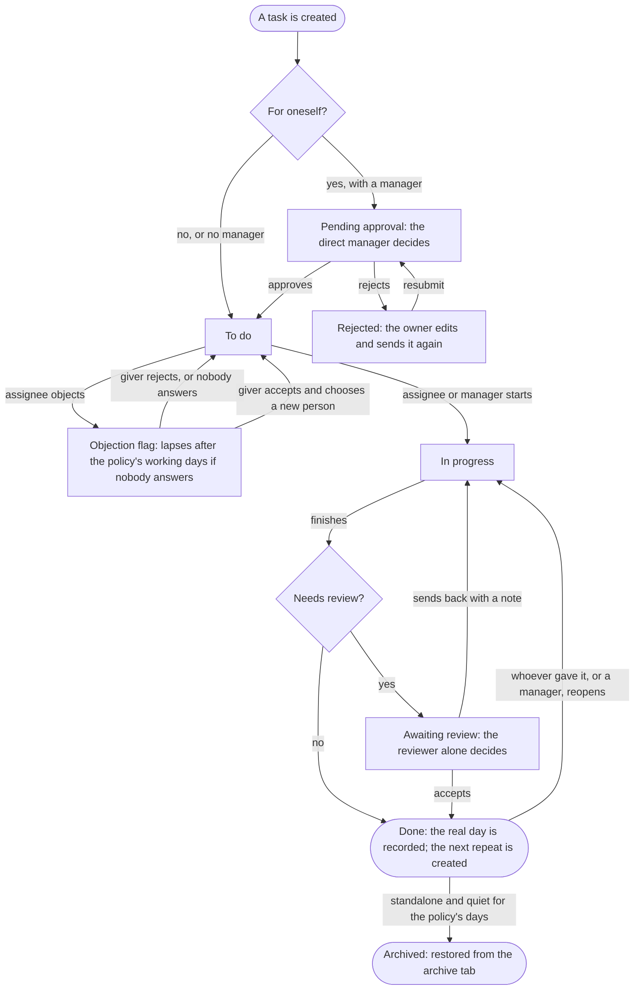

**Ticket life cycle (FR-37 to FR-41)**

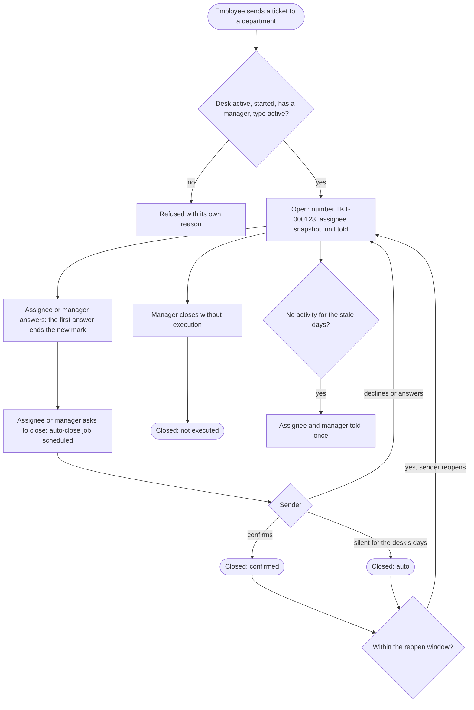

**Who sees a ticket, and how pages and lists are shown (FR-38, FR-42, FR-44)**

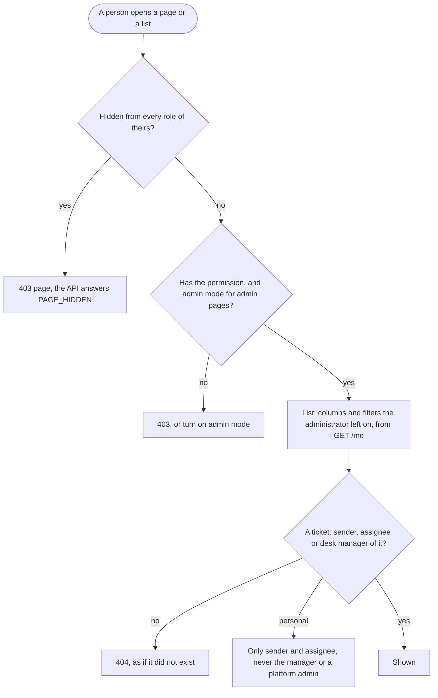

**Sign-in (two steps, no password)**


**Create an employee (HR)**


**Change the levels of a company that holds data**


**Import from a file (employees, companies)**

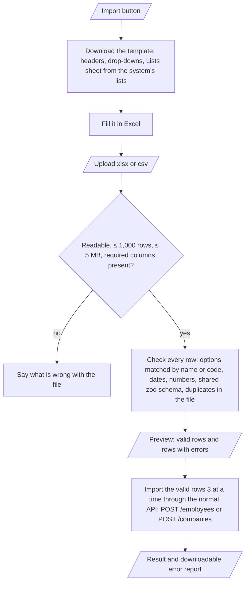

**Build a role**

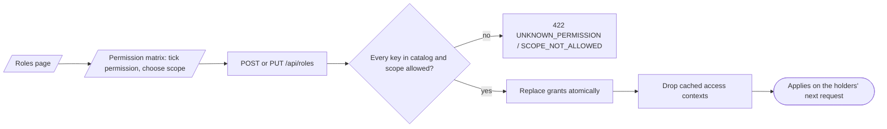

## 8. Sequence diagrams

**E-mail + code sign-in and an authorized request**

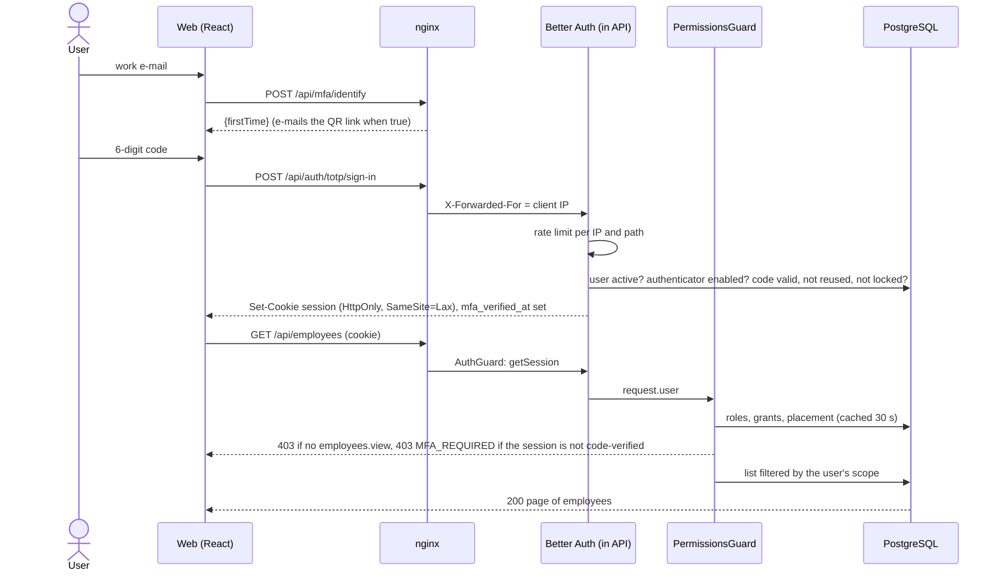

**First sign-in: activation link and QR code**

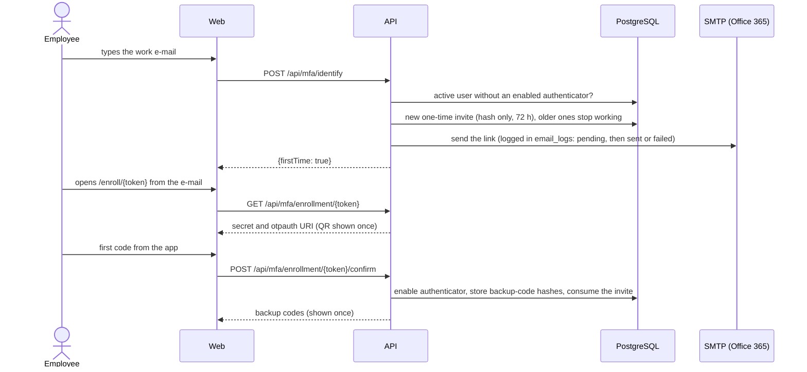

**Workflow transition with a durable timeout**

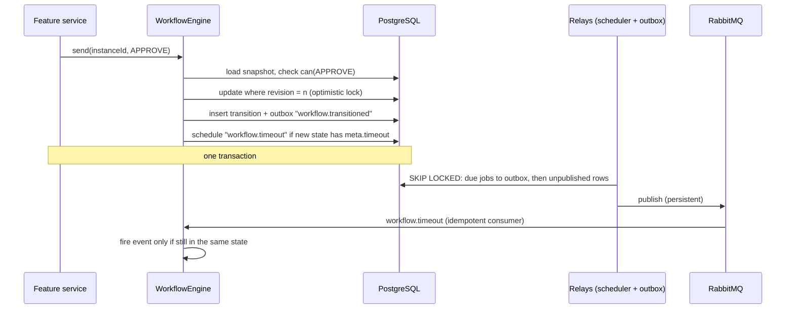

**Notifications by email**

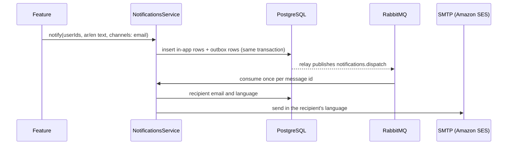

**Microsoft sign-in (Entra ID), then the code**

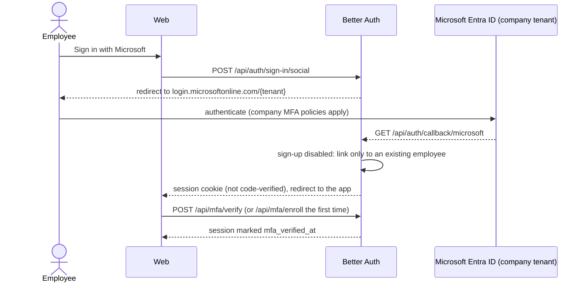

### Moving a task (FR-50, FR-56)

```mermaid
sequenceDiagram
  actor U as Person (board, table or details)
  participant W as Web
  participant A as API (TaskTransitionService)
  participant DB as PostgreSQL
  U->>W: drags the card (or chooses a status)
  W->>A: POST /tasks/:id/transition {to, revision, note?, completedOn?}
  A->>DB: read the task; table of moves decides who may go from where to where
  alt refused
    A-->>W: 422 TASK_TRANSITION_NOT_ALLOWED with the reason
    W-->>U: the card goes back and says why
  else a note or the real completion date is missing
    A-->>W: 422 TASK_NOTE_REQUIRED / TASK_COMPLETION_DATE_REQUIRED
    W-->>U: asks for it, then sends the move again
  else allowed
    A->>DB: revision check, status, last activity reset, event (who, when, from, to), notices, audit (one transaction)
    A-->>W: 200 task
  end
```

### Ticket send and answer (FR-37, FR-39)

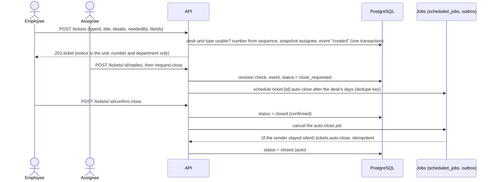

### What a person may do (FR-45 to FR-47)

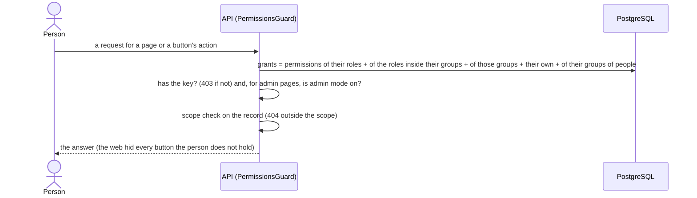

### Automatic roles (FR-43)

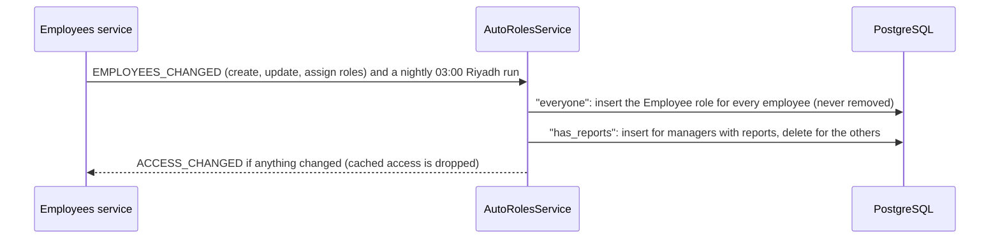

### Platform admin mode (FR-34)

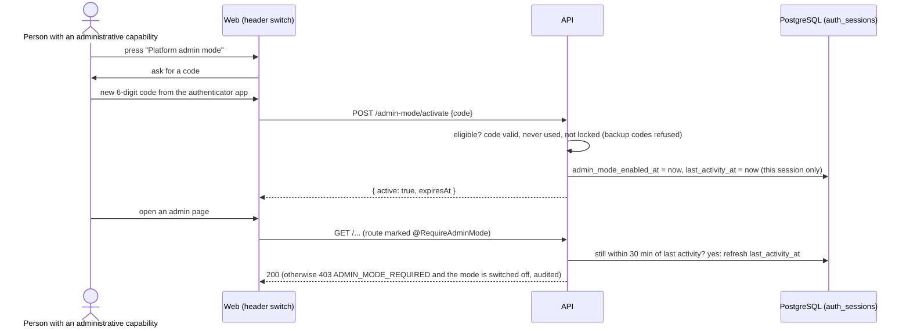

## 9. Stack

| Layer | Technology | Reason / change from team default |
|---|---|---|
| Monorepo | npm workspaces + Turborepo | Team default (Track D) |
| API | NestJS 11.2 + TypeScript 5.9 | NestJS 12 is out but `nestjs-zod` supports up to 11; TypeScript 6/7 not yet supported by `ts-jest`/`typescript-eslint` |
| Database | PostgreSQL 16 + TypeORM 1.1 | Chosen by the team; migrations only |
| Validation | zod 4 schemas in `packages/shared`, `nestjs-zod` | One rule for API and web |
| Auth | Better Auth 1.7 (+ `@thallesp/nestjs-better-auth`), Microsoft Entra ID, custom TOTP sign-in plugin (authenticator app mandatory, no passwords) | Replaces the team's hand-written JWT; HttpOnly session cookie |
| Authorization | Dynamic roles + scoped permissions, CASL 7 for record checks | Requested: roles managed from the admin panel |
| Workflow | XState 5 with state in PostgreSQL | Requested; timeouts stored as jobs (XState timers are not durable) |
| Messaging | RabbitMQ 4 via `amqp-connection-manager`, transactional outbox, scheduled jobs table | Requested RabbitMQ instead of BullMQ/Redis; Redis not used |
| Excel / CSV | `write-excel-file` 4.1.1 + `@onparallel/write-excel-file-data-validation` 1.0.0 (drop-downs in templates), `read-excel-file` 9.3.10; CSV by our own small parser; all in the browser, loaded only when someone exports or imports | `exceljs` was rejected (moderate `uuid` advisory); versions pinned to releases older than 14 days |
| Email / SMS | SMTP adapter (Office 365 `smtp.office365.com:587` STARTTLS; Mailpit available locally) with a sent-e-mail log; SMS adapter placeholder | Saudi SMS provider to be chosen |
| Files | S3 (private bucket, SSE, signed URLs) / local folder in development | |
| Web | React 19 + Vite 8 + React Router 8 + TanStack Query 5 + Tailwind 4 + Radix primitives | Requested React SPA instead of Next.js |
| i18n | i18next + react-i18next, Arabic RTL default | |
| Tests | Vitest (API unit + e2e, web components), MSW 3, Playwright + axe | Vitest instead of Jest because Better Auth is ESM-only |
| CI/CD | GitHub Actions → GHCR → EC2 over SSH | Team default |

## 10. Run and deploy

### Local

Requirements: Node 24+, Docker (Docker Desktop on Windows/macOS). On Windows run the commands in WSL 2 or Git Bash.

**Quick start:** `./scripts/setup.sh` (creates `.env` with fresh secrets, installs, starts Docker services, migrates, seeds), then `npm run dev`.

**Manual steps** (what the script does):

```bash
npm ci                                   # .npmrc sets legacy-peer-deps (see docs/decisions.md)
cp .env.example .env                     # then fill BETTER_AUTH_SECRET, FIELD_ENCRYPTION_KEY, passwords
docker compose up -d                     # PostgreSQL (+ test DB), RabbitMQ, Mailpit
npm run db:migrate
npm run db:seed                          # roles, lookups and countries, 10 companies with levels, the first admin from SEED_ADMIN_*,
                                         # and the organization structure of Arweqah Alreyadah from the owner's sheet (every environment, once, while the company has no units) and, development only (`SEED_DEMO_ORG=true`), demo ticket desks and sample tickets
npm run dev                              # API :3000, web :5173 (proxies /api)
npm run verify                           # end-of-task check: architecture, design, testing, security
```

| URL | What |
|---|---|
| http://localhost:5173 | Web app: sign in with Microsoft, or type `SEED_ADMIN_EMAIL` (the first time you get an e-mail with the QR link, then the code boxes) |
| http://localhost:3000/api/docs | Swagger (disabled in production) |
| http://localhost:8025 | Mailpit (only when `SMTP_HOST` points at it; with Office 365 mail goes out for real and is tracked in the platform's «E-mail log» page) |
| http://localhost:15672 | RabbitMQ management (guest/guest locally) |

### Deploy

- **Trigger:** every push to `main` after CI (quality, API e2e, Playwright, security) passes; or manually (`workflow_dispatch`).
- **Steps:** build `api` and `web` images → Trivy scan → push to GHCR → copy `docker-compose.prod.yml`, `docker/nginx/edge.conf` and `scripts/server/*.sh` to the server → SSH: log in to GHCR with the job's own token (no registry password is stored on the server) → `scripts/server/deploy.sh <sha>` (pull → TypeORM `migration:run` and the compiled seed through `node`, idempotent → `docker compose up -d`; the runtime image has no npm) → smoke test `GET {APP_URL}/api/health`.
- **GitHub secrets:** `EC2_HOST`, `EC2_USER`, `EC2_SSH_KEY` (printed by the bootstrap script). **Variables:** `APP_URL`, `MICROSOFT_ENABLED`. **Environment:** `staging`.
- **Server layout** (`/opt/arweqah-platform`): `.env` (created by `bootstrap.sh` with generated secrets, never in GitHub), `secrets/microsoft.key` (certificate private key), `backups/`. Everything runs in Docker on one host: nginx (HTTPS, one Let's Encrypt certificate for both domains: the web domain proxies `/api` to the API so the browser stays on one origin and cookies stay first-party; the API domain reaches the same API directly for integrations), web, api, PostgreSQL 16, RabbitMQ; data in the volumes `pg_data`, `api_storage` (uploaded files, `FILE_STORAGE=local`) and `rabbitmq_data`.
- **Backups:** `scripts/server/backup.sh` runs daily at 02:30 (cron): database dump and files archive, kept 14 days in `backups/`. Copy that folder off the server too.

**First-time server setup** (Ubuntu 24.04 EC2, security group: 22 from the team, 80 and 443 open, Elastic IP, DNS `A` records of the web domain and the API domain, e.g. `stg-portal.arweqah.sa` and `stg-api-portal.arweqah.sa`, pointing to it)

1. Copy the script and run it: `scp scripts/server/bootstrap.sh ubuntu@<ip>:~` then `ssh ubuntu@<ip> "sudo bash bootstrap.sh"`. It asks for the two domains, certificate e-mail, GitHub owner, first admin e-mail, Microsoft IDs and SMTP; installs Docker and a firewall; writes `.env`; gets the HTTPS certificate (renewed automatically); schedules the backup; and prints the GitHub secrets, including a fresh deploy SSH key.
2. Add the secrets and variables in GitHub and create the `staging` environment (the script prints the exact values).
3. Copy the Microsoft certificate key to `secrets/microsoft.key` and register `https://<web domain>/api/auth/callback/microsoft` under **Web** in Entra ([docs/microsoft-sign-in.md](docs/microsoft-sign-in.md)).
4. Push to `main`. The first deploy creates the database tables and the first admin.

To use Amazon RDS or S3 later: set `DB_HOST`/`DB_SSL` or `FILE_STORAGE=s3` + `S3_BUCKET` in the server `.env` (and drop the `postgres` service for RDS).

**Rollback:** `export TAG=<previous sha> && docker compose -f docker-compose.prod.yml up -d api web`. Migrations are written backward compatible (add first, remove later); revert one with `docker compose -f docker-compose.prod.yml run --rm api node ../../node_modules/typeorm/cli.js -d dist/database/data-source.js migration:revert`.

## 11. Testing

| Type | Command | Covers |
|---|---|---|
| API unit | `npm test -w @arweqah-platform/api` | Scopes and CASL rules, permission catalog, env validation, field encryption, error mapping, redaction |
| API e2e (real PostgreSQL) | `npm run test:e2e:api` | Sign-in and authenticator flows with real TOTP, organization, employees (every filter), lookups, seeders, e-mail log, notifications, audit, IDOR, mass assignment, SQL injection, workflow concurrency |
| Security suite | part of API e2e (`test/security.e2e-spec.ts`) | 401 on every route, 403 on every permission route (discovered from Nest metadata), headers, CORS, 413, forged cookies |
| Web components | `npm test -w @arweqah-platform/web` | DataTable, list toolbar (search, filters, table / cards), export and import dialogs and file readers, employee and company import rules, error pages and the 403 route guard, sign-in steps, org page, role editor (MSW) |
| Full-stack e2e | `npm run test:e2e:web` | Own API on port 3100 against the test database (never a development server), sidebar menus, e-mail + code sign-in and sign-out, 404 / 403 / 401 pages, search, filters, table / cards memory, export to CSV, import template download, company import from a file, no tokens in storage, no secret values in the bundle, axe on each page, desktop + phone (46 tests) |
| Everything, as one gate | `npm run verify` | Architecture, design, testing and security checks, one line each |
| Static and supply chain | CI `security` workflow | npm audit (high), gitleaks, Semgrep (OWASP, Node, TypeScript, secrets), Trivy (fs + images), ZAP baseline + API scan |

Requirement traceability: each `describe` title lists the FR/NFR IDs it covers, and section 4 lists the suites for each requirement.

## 12. Actors

| Actor | Can | Cannot |
|---|---|---|
| Employee (role "Employee") | Sign in with e-mail or Microsoft plus the authenticator code, see and edit own profile (theme, language, personal phone and e-mail, English name), see own notifications, upload own files | See other employees, roles, organization admin, audit or e-mail log unless a role grants it |
| Person given the task keys (custom role) | Work with their tasks (create, follow, log time, object, move their own cards), see the numbers of their tasks and tickets on the home page; with the team keys: the team page, matrix, approvals, moves of the team's cards, archive and restore, within the scope of each key | See or move a task outside their relation or scope (404); change a status outside the table of moves (422); the keys are not part of the Employee role |
| HR (custom role) | Create and update employees, place them in units, assign the roles they hold, resend activation links | Act outside their scope (gets 404), see salary / ID / IBAN without `employees.view_sensitive`, assign more than they hold, change their own roles |
| Line manager (custom role) | What the role grants, limited to their unit or subtree | Act outside their scope |
| System Admin (system role) | Every permission at the widest scope: translation and e-mail services (data, try-out, switch on), companies, levels, units, job titles, roles (with how each is assigned), page visibility per role, list management, audit log, e-mail log, and may switch **platform admin mode** on (`admin_mode.use`) | Delete system roles; use anything before linking the authenticator |
| Desk manager (named in a desk's setup) | Switch admin mode on, set up the desk, see its tickets (not personal ones), answer, reassign, read its figures | See personal tickets, act on other desks |
| Auditor (custom role with `audit.view`) | Read the audit log | See secrets (redacted) |
| Microsoft Entra ID | Authenticate company accounts (setup: `docs/microsoft-sign-in.md`, check: `npm run microsoft:check`) | Create accounts (sign-up disabled) |
| Translation and e-mail services (AWS, Google, Azure, SMTP, SES, SendGrid, Microsoft 365) / SMS provider | Translate text, deliver messages | Read any data beyond the message |
| GitHub Actions | Build, test, deploy | Read production secrets (they live on the server) |

Permission catalog (one key for every **page** (view) and every **button or action**; the API refuses an action without its key and the web hides the button): admin mode `admin_mode.use`; roles `roles.view/create/update/delete/export`; groups of roles `role_groups.view/create/update/delete`; groups of people `user_groups.view/create/update/delete`; the permissions page `permissions.view`, `permissions.role_update/role_group_update/user_update/user_group_update`; pages `pages.view/manage`; lists `lists.view/manage`; audit `audit.view/export`; e-mail log `notifications.email_log`, `notifications.email_log_export`; `lookups.view`; own account `profile.view/update`, `security.view`, `notifications.view/mark_read/export`; companies `companies.view/create/update/delete/export/import`; organization `org.view`, `org.unit_create/update/move/delete`, `org.levels_manage`, `org.titles_manage`, `org.export`; employees `employees.view/create/update/deactivate/terminate/assign_roles/view_sensitive/resend_invite/reset_authenticator/export/import`; tickets `tickets.view/create/reply/request_close/confirm_close` (approve) `/decline_close` (reject) `/close_without_execution/reopen`, `tickets.setup_view/setup_edit/type_create/type_update/type_delete/figures_view`, `tickets.administer` (every department). The **Employee** role starts with the own-account and ticket keys (`EMPLOYEE_DEFAULT_PERMISSIONS`); everything else is given by an administrator from the roles page. Each feature module adds its own keys the same way.

## 13. Constraints

- **Regulatory:** Saudi PDPL. Personal data (national IDs, salaries) must be protected and kept in Saudi Arabia; the interim hosting in Bahrain needs the company's documented legal basis until the move.
- **Hosting:** existing AWS account; AWS Saudi region expected December 2026.
- **Scale:** 1,000–5,000 employees.
- **Budget (estimate):** about USD 350–400 per month (EC2 t3.xlarge, RDS, staging, S3, CloudWatch), around 35 % less with Savings Plans.
- **Technical:** Better Auth is ESM-only (Vitest, Node ≥ 24); `nestjs-zod` pins NestJS 11.
- **Organizational:** each business module starts from a written description by the product owner.

## 14. Assumptions

| Assumption | Impact if wrong | Confirmed by |
|---|---|---|
| 1,000–5,000 employees | Instance and database sizing, partitioning of attendance | Product owner |
| Finance in v1 is tracking and approval only (no accounting, no e-invoicing) | Large new scope (ledger, ZATCA) | Product owner |
| Payroll in v1 records and approves; no automatic GOSI/WPS deductions | Integrations and legal review needed | Proposed, to confirm |
| Airtable / Google Sheets sync is two-way, with a per-field owner and a conflict log | Data loss or overwrites | Product owner (two-way); conflict policy proposed |
| The company has a legal basis to host personal data in Bahrain until the Saudi region opens | Compliance risk; host in KSA immediately | To confirm with legal |
| Microsoft 365 accounts use the company email addresses HR enters | Employees cannot link Microsoft sign-in | To confirm with IT |
| A Saudi SMS provider will be chosen later | SMS channel only logs for now | Open |

## 15. Third parties

| Service | Purpose | Direction / trigger | Env vars | Docs |
|---|---|---|---|---|
| Microsoft Entra ID | Employee sign-in | User-initiated OAuth | `MICROSOFT_CLIENT_ID`, `MICROSOFT_TENANT_ID`, and `MICROSOFT_CLIENT_SECRET` or a certificate (`MICROSOFT_CERT_THUMBPRINT` + `MICROSOFT_CERT_PRIVATE_KEY_FILE`) | https://www.better-auth.com/docs/authentication/microsoft |
| E-mail service (SMTP, Amazon SES, SendGrid or Microsoft Graph, chosen in Settings → E-mail tab, FR-60) | Activation links and notification e-mail | Outbound, from the outbox; every message is recorded in `email_logs`. Keys are entered on the settings page (stored encrypted); the `.env` values below are the fallback when none is switched on | `SMTP_HOST`, `SMTP_PORT`, `SMTP_USER`, `SMTP_PASSWORD`, `SMTP_SECURE`, `MAIL_FROM` (SMTP AUTH must be enabled on the mailbox) | https://learn.microsoft.com/exchange/mail-flow-best-practices/how-to-set-up-a-multifunction-device-or-application-to-send-email-using-microsoft-365-or-office-365 |
| Amazon S3 | File storage | Outbound; signed download URLs (5 min) | `FILE_STORAGE`, `S3_BUCKET`, `S3_REGION` (credentials from the instance role) | https://docs.aws.amazon.com/s3/ |
| Translation service (Amazon Translate, Google Cloud Translation or Azure AI Translator, chosen in Settings → Translation tab, FR-59) | Fills the English field while a person types Arabic (FR-58) | Outbound; text of one field per call, nothing stored. Keys are entered on the settings page (stored encrypted); the Amazon Translate `.env` values below are the fallback | `TRANSLATE_AWS_ACCESS_KEY_ID`, `TRANSLATE_AWS_SECRET_ACCESS_KEY`, `TRANSLATE_AWS_REGION` (us-east-1); IAM user limited to `translate:TranslateText`; empty keys turn it off | https://docs.aws.amazon.com/translate/ |
| Amazon RDS PostgreSQL | Database | — | `DB_HOST`, `DB_PORT`, `DB_NAME`, `DB_USER`, `DB_PASSWORD`, `DB_SSL` | https://docs.aws.amazon.com/rds/ |
| RabbitMQ | Messaging between modules and workers | Internal | `MESSAGE_BUS`, `RABBITMQ_URL` | https://www.rabbitmq.com/docs |
| GitHub Container Registry | Images | Push from CI, pull on EC2 | — | https://docs.github.com/packages |
| Airtable, Google Sheets | Two-way sync (planned module) | Scheduled jobs | to be added with the module | — |
| SMS provider (Saudi) | SMS notifications (planned) | Outbound | to be added | — |

## More

### Project structure

```
apps/
  api/src/
    common/        base entity, domain errors, unit of work, field cipher, error filter
    config/        env validation (zod), typed AppConfig, TypeORM options
    core/          infrastructure every feature uses
      auth/        Better Auth adapter, authenticator app (TOTP), activation links
      access/      roles, permission catalog, scopes, CASL, PermissionsGuard
      audit/       audit log
      messaging/   outbox, RabbitMQ / in-memory bus, scheduled jobs, idempotency
      workflow/    XState engine, registry, history
      notifications/ in-app + channels (email, SMS), sent-e-mail log
      files/       storage strategies, content inspection
    modules/       org (companies, levels, units, job titles), employees, lookups; more are added one at a time
    database/      entities list, migrations, seeds
  web/src/
    app/           composition root: features list, router, layout, providers
    core/          API client, auth/session, permissions, i18n, theme (light / dark provider), feature contract
    shared/ui/     DataTable, ListToolbar, Dialog, FormField, Button…
    shared/lib/    list hooks (useListPage, useServerList, useFilters, useViewMode), fetchAllPages, matchesText
    shared/data-exchange/  export, import and template (xlsx / csv) used by every list
    features/      auth, home, employees, org, companies, roles, audit, email-log, notifications, profile, security
                   (sidebar menus come from each feature's `nav` + `group`)
packages/shared    zod schemas, DTO types, permission scopes (used by api and web)
e2e/               Playwright specs + page objects
docker/            nginx (web + edge), postgres init
```

### Architecture and patterns

Every API module has `domain / application / infrastructure / presentation`, each split into one folder per kind of file (entities, types, errors, contracts, rules, permissions; services, policies, transformers, messages; repositories, adapters, jobs; controllers, dtos), as described in `.claude/skills/module-architecture`; imports only point inward, enforced by `eslint-plugin-boundaries`. Patterns in use, each where its trigger exists: Repository (every aggregate), Adapter (Better Auth, S3, SMTP, RabbitMQ), Strategy (file storage, notification channels, message bus), Registry (permission catalog, workflow definitions, web features), Observer (in-process audit events), Outbox (cross-process events), Unit of Work (`TransactionRunner`), Specification (`applyScope` for list queries), State machine (XState). On the web, pages import features only through their `index.ts`; components use hooks, hooks use the single `apiClient`.

### Adding a feature

1. Describe it: name, goal, users and roles, journeys step by step, data and fields, business rules, approval path, notifications, reports, links to other modules.
2. API: `apps/api/src/modules/<feature>/{domain,application,infrastructure,presentation}`, a `<feature>.permissions.ts` registered on module init, entities added to `database/entities.ts`, a migration (`npm run db:migration:generate --name=<Feature>`), a workflow definition registered in `WorkflowRegistry` if it has approvals, e2e specs named with its FR IDs.
3. Shared: request schemas and DTOs in `packages/shared/src/<feature>/`.
4. Web: `apps/web/src/features/<feature>/` with `index.ts` exporting a `FeatureModule` (lazy routes, nav item with its permission, `i18n/{ar,en}.json`), then one line in `app/features.ts`.
5. Update sections 4, 6, 7, 8 and 12 of this README in the same PR.

### Brand

Official palette: primary 60 % (cream, green, ink) and secondary 35 % (orange, beige, petrol, yellow); yellow never above 5 % of a design. The dashboard itself uses derived cool neutrals for surfaces (approved screens): page `neutral-50`, panels white, borders `neutral-200`; brand `cream` and `beige` stay for the sign-in, e-mails and printed material. Full roles, derived accessible shades and measured contrast are in `.claude/skills/arweqah-design-system/SKILL.md`.

| Token | Value | Share | Use |
|---|---|---|---|
| `cream` (Clarity) | `#FFFCEE` | Primary | Text on dark, e-mails, printed material, the primary button in the dark theme |
| `green-400` (Growth) | `#85BA95` | Primary | Positive states, accents (never text on light) |
| `ink` (Strength) | `#0C2028` | Primary | Text, sidebar, primary buttons, sign-in screen |
| `orange-500` (Ambition) | `#C16426` | Secondary | Highlights, large text only |
| `beige-300` (Balance) | `#D7D2CB` | Secondary | Branded dividers (the dashboard uses `neutral-200`) |
| `petrol-800` (Trust) | `#00415B` | Secondary | Links, selected items, focus ring, avatar |
| `yellow-300` (Light) | `#FBD564` | Secondary, ≤ 5 % | Notification dot only; never text |
| `neutral-50 / 200 / 500 / 700`, `white` | `#F4F5F7` / `#E4E7EB` / `#8B939C` / `#5F6770`, `#FFFFFF` | Derived | Dashboard page, borders, hover borders, muted icons, panels |

**Light and dark theme:** the dashboard has both. Components use semantic colors (`fg` text, `link`, `primary` / `on-primary`, `success`, `warning`, `danger-text`) and the surface tokens (`white`, `neutral-*`, the `*-50` tints, `muted`), which `theme.css` re-points under `html[data-theme=dark]`; the sidebar and the sign-in screen stay `ink`. Measured in dark: text 14.9:1, muted 7.8:1, links 8.9:1, control borders 4.0:1 on the surface. The choice is kept in the browser (`localStorage.theme`, applied before first paint by `public/theme-init.js`) and on the account (`users.theme`).

Typeface: Tajawal only (Arabic and Latin; delivered files in `docs/brand/fonts/`, Regular/Medium/Bold self-hosted from `apps/web/src/assets/fonts/`).

Logo: the delivered set (`PNG.zip` and 8 originals) is in `docs/brand/`; web copies are in `apps/web/public/brand/` (color, color-on-dark, ink and white variants, horizontal and vertical, plus the mark alone and favicons) and are used only through the `BrandLogo` component (the sidebar uses the white variant). Usage rules (which variant on which background, clear space, minimum sizes) are in the design-system skill.

### Hosting

Interim region `me-south-1` (Bahrain). Move to the AWS Saudi region when it opens: create RDS and EC2 there, restore the latest snapshot, copy the S3 bucket, switch DNS, then decommission Bahrain. Plan a short maintenance window.

### Security

See [SECURITY.md](SECURITY.md).

### Decisions

See [docs/decisions.md](docs/decisions.md).

### Conventions

Conventional Commits (`feat(users): …`), branches `feat/*`, `fix/*`, `chore/*`; `main` is protected and deploys on merge. The PR template includes the README checkbox.
