# Arweqah Platform

> Internal ERP for **Arweqah Alreyadah** (أروقة الريادة): people, organization, tasks, tickets and, next, requests, projects and finance tracking. Bilingual (Arabic RTL default, English), passwordless, every action scoped and audited.

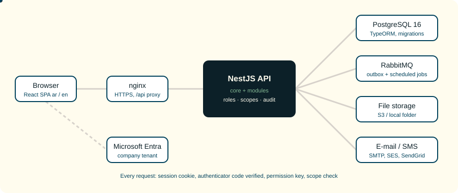

**Quick start:** `./scripts/setup.sh` then `npm run dev` → web http://localhost:5173, API http://localhost:3000/api/docs. Details in [10. Run and deploy](#10-run-and-deploy).

## Table of contents

- [1. Overview](#1-overview)
- [2. Vision and mission](#2-vision-and-mission)
- [3. Modules](#3-modules)
- [4. Functional requirements](#4-functional-requirements)
- [5. Non-functional requirements](#5-non-functional-requirements)
- [6. ERD](#6-erd)
- [7. Flowcharts](#7-flowcharts)
  - [Task life cycle (FR-48 to FR-53)](#task-life-cycle-fr-48-to-fr-53)
  - [Ticket life cycle (FR-37 to FR-41)](#ticket-life-cycle-fr-37-to-fr-41)
  - [Who sees a ticket, and how pages and lists are shown (FR-38, FR-42, FR-44)](#who-sees-a-ticket-and-how-pages-and-lists-are-shown-fr-38-fr-42-fr-44)
  - [Sign-in (two steps, no password)](#sign-in-two-steps-no-password)
  - [Create an employee (HR)](#create-an-employee-hr)
  - [Change the unit types and the parent–child table (one structure for the group)](#change-the-unit-types-and-the-parentchild-table-one-structure-for-the-group)
  - [Import from a file (employees, companies)](#import-from-a-file-employees-companies)
  - [Build a role](#build-a-role)
  - [Welcome tour (FR-67)](#welcome-tour-fr-67)
- [8. Sequence diagrams](#8-sequence-diagrams)
  - [E-mail + code sign-in and an authorized request](#e-mail--code-sign-in-and-an-authorized-request)
  - [First sign-in: activation link and QR code](#first-sign-in-activation-link-and-qr-code)
  - [Workflow transition with a durable timeout](#workflow-transition-with-a-durable-timeout)
  - [Notifications by email](#notifications-by-email)
  - [Microsoft sign-in (Entra ID), then the code](#microsoft-sign-in-entra-id-then-the-code)
  - [Moving a task (FR-50, FR-56)](#moving-a-task-fr-50-fr-56)
  - [Ticket send and answer (FR-37, FR-39)](#ticket-send-and-answer-fr-37-fr-39)
  - [What a person may do (FR-45 to FR-47)](#what-a-person-may-do-fr-45-to-fr-47)
  - [Automatic roles (FR-43)](#automatic-roles-fr-43)
  - [Editing the welcome tour (FR-67)](#editing-the-welcome-tour-fr-67)
  - [Platform admin mode (FR-34)](#platform-admin-mode-fr-34)
  - [Sign in as another employee (FR-85)](#sign-in-as-another-employee-fr-85)
- [9. Stack](#9-stack)
- [10. Run and deploy](#10-run-and-deploy)
  - [Local](#local)
  - [Deploy](#deploy)
- [11. Testing](#11-testing)
- [12. Actors](#12-actors)
- [13. Constraints](#13-constraints)
- [14. Assumptions](#14-assumptions)
- [15. Third parties](#15-third-parties)
- [More](#more)
  - [Project structure](#project-structure)
  - [Architecture and patterns](#architecture-and-patterns)
  - [Adding a feature](#adding-a-feature)
  - [Brand](#brand)
  - [Hosting](#hosting)
  - [Further reading](#further-reading)

## 1. Overview

| | |
|---|---|
| **Organization** | Arweqah Alreyadah, a Saudi company, 1,000–5,000 employees, several branches |
| **Problem** | Employee data, approvals, projects and tickets live in separate tools (Airtable, Google Sheets, e-mail): no single view, slow approvals, sensitive data (national IDs, salaries) spread across files |
| **Solution** | One web platform: sign in with Microsoft 365 or a work e-mail, always confirmed by an authenticator-app code (no passwords); each person sees only what their role and place in the organization allow; every sensitive action is recorded |

## 2. Vision and mission

**Vision.** A unified digital workplace that runs all of the company's resources efficiently and transparently.

**Mission.** Bring employee, project and request management into one secure platform that speeds up decisions and removes manual work.

## 3. Modules

Business modules are added one at a time from a written description of each feature (see [Adding a feature](#adding-a-feature)).

| Status | Modules |
|---|---|
| **Built** | Passwordless authentication (Microsoft + authenticator app) · companies · dynamic organization structure · employees · dynamic roles and scoped permissions · audit log · notifications (in-app, e-mail, SMS adapter) · file storage · workflow engine · messaging (outbox + RabbitMQ + durable scheduled jobs) · sent-e-mail log · **tasks** (my tasks, my team, matrix, table and Kanban, approval, objection, reminders, archive, conversations) · **tickets** (between departments) · admin mode · page visibility · list management · welcome tour · user manual |
| **Planned** | Attendance · leaves · requests engine · projects (project tasks, manager approval, Gantt on top of tasks) · tickets with SLA for customers · expenses / advances / invoices tracking · payroll records + Arabic PDF payslips · dashboards · two-way Airtable / Google Sheets sync |
| **Not in v1** | Double-entry accounting · e-invoicing (ZATCA) · GOSI / Mudad / WPS integrations |

## 4. Functional requirements

| ID | Requirement | Actor | Priority | Covered by |
|---|---|---|---|---|
| FR-01 | Sign in with the work e-mail and the 6-digit code of an authenticator app; no passwords, no self sign-up; one generic error; 5/min rate limit; lock after 5 wrong codes; a code cannot be reused; deactivated accounts refused | All users | Must | `apps/api/test/auth.e2e-spec.ts`, `apps/web/src/features/auth/pages/login-page.test.tsx` |
| FR-02 | The authenticator app is mandatory for everyone: no protected route works before it is linked and the session is code-verified | All users | Must | `apps/api/test/mfa.e2e-spec.ts`, `apps/api/test/access.e2e-spec.ts` |
| FR-03 | Sign in with Microsoft Entra ID, company tenant only, pre-provisioned employees only; the code is still required after Microsoft | All users | Must | `apps/api/src/config/env.schema.spec.ts`, `apps/api/test/mfa.e2e-spec.ts` (manual check against the real tenant before go-live) |
| FR-04 | Employees: create (also creates the sign-in account), update, activate / deactivate (ends sessions), terminate, assign roles, resend the activation link, reset the authenticator | HR / admin | Must | `apps/api/test/employees.e2e-spec.ts` |
| FR-05 | Dynamic roles built from a permission catalog; system roles cannot be deleted | Admin | Must | `apps/api/test/access.e2e-spec.ts`, `apps/web/src/features/roles/role-editor.test.tsx` |
| FR-06 | Every permission is scoped (own / unit / subtree / company / all); lists and records outside the scope are hidden (404) | All | Must | `apps/api/src/core/access/application/access.spec.ts`, `apps/api/test/security.e2e-spec.ts` |
| FR-07 | Replaced by FR-13 and FR-24 (companies, levels, units, job titles) | Admin | — | see FR-13, FR-24 |
| FR-08 | In-app notifications with unread count; email (and SMS) delivered in the background through the outbox | All | Must | `apps/api/test/platform.e2e-spec.ts` (Notifications) |
| FR-09 | Upload files (PDF, PNG, JPEG, Word `.docx`, Excel `.xlsx`, CSV `.csv` ≤ 10 MB) checked by content (a CSV by name and by being text in any encoding Excel writes (UTF-8, Windows-1256, UTF-16) with no control bytes; it only downloads, never shows inline); only the owner can read them | All | Should | `apps/api/test/platform.e2e-spec.ts` (Files) |
| FR-10 | Workflow engine: persisted state machines with history, optimistic locking and durable timeouts (escalations) | Feature modules | Must | `apps/api/test/platform.e2e-spec.ts` (Workflow engine) |
| FR-11 | Audit log of sign-ins and sensitive changes, secrets redacted, readable by auditors only | Auditor | Must | `apps/api/test/platform.e2e-spec.ts` (Audit log), `apps/api/src/core/audit/application/audit.service.spec.ts` |
| FR-12 | Arabic (RTL) and English interface, switchable at any time | All | Must | `apps/web/src/core/i18n/i18n.test.ts` |
| FR-13 | The code is required in every session, also after Microsoft (the session is blocked until it is verified) | All users | Must | `apps/api/test/mfa.e2e-spec.ts`, `apps/web/src/features/auth/pages/verify-page.test.tsx`, `apps/web/src/features/org/org-page.test.tsx` |
| FR-14 | The startup administrator is created by the seeder (no password) and belongs to «أروقة الريادة» | System | Must | `apps/api/test/seeds.e2e-spec.ts` |
| FR-15 | No self sign-up and no password routes exist | All | Must | `apps/api/test/auth.e2e-spec.ts` |
| FR-16 | Activation link (QR code, first code, backup codes), one use, 72 h; the e-mail step recognizes a first sign-in and e-mails the link (one per minute per address) | Employee | Must | `apps/api/test/mfa.e2e-spec.ts`, `apps/web/src/features/auth/pages/login-page.test.tsx` |
| FR-17 | Employee form with 40 fields in 6 sections and conditional rules | HR | Must | `apps/api/test/employees.e2e-spec.ts`, `apps/web/src/features/employees/employee-form-page.test.tsx` |
| FR-18 | ID validation by type (national ID and iqama: 10 digits, 1 / 2 prefix and a Luhn check digit) and by nationality for home-country and GCC IDs (rules are seeded data; one shared rule for the API and for the form, which shows the message while typing); unique type + number (searchable through an HMAC blind index) | HR | Must | `apps/api/test/employees.e2e-spec.ts`, `apps/api/src/modules/employees/domain/rules/id-number.rules.spec.ts`, `apps/web/src/features/employees/employee-form-page.test.tsx` |
| FR-19 | Companies (10 seeded), levels, units, job titles with deletion and move rules | Admin | Must | `apps/api/test/org.e2e-spec.ts` |
| FR-20 | Scopes own / unit / subtree / company / all with 404 outside the scope | All | Must | `apps/api/test/employees.e2e-spec.ts` |
| FR-21 | ID number, IBAN and salary are encrypted and masked without `employees.view_sensitive` | HR | Must | `apps/api/test/employees.e2e-spec.ts` |
| FR-22 | Arabic / English for every lookup (`Accept-Language`) | All | Must | `apps/api/test/lookups.e2e-spec.ts` |
| FR-23 | Two-step sign-in page: work e-mail, then the code boxes (with a first-time notice) | All users | Must | `apps/web/src/features/auth/pages/login-page.test.tsx`, `apps/api/test/auth.e2e-spec.ts` |
| FR-24 | Dynamic organization built by forms; impact warning and confirmation when levels that hold data change (transfer employees with job-title mapping, or delete by typing the count) | Admin | Must | `apps/api/test/org.e2e-spec.ts` |
| FR-25 | Idempotent seeders: lookups, countries, 10 companies with the default levels (+ optional sample units in development) | System | Must | `apps/api/test/seeds.e2e-spec.ts` |
| FR-26 | Sent-e-mail log: every e-mail with status (pending / sent / failed), reason and server reply, never the body; filters; permission `notifications.email_log` | Admin | Should | `apps/api/test/email-log.e2e-spec.ts`, `apps/web/src/features/email-log/email-log-page.test.tsx` |
| FR-27 | Every list has an **Actions** column as its last column holding every action on the row as an **icon** with its name as tooltip and accessible name (view, edit, delete, activate… `RowAction`), and a click anywhere on a row (outside its buttons and links) opens the row's view: its page, its dialog, or, for log entries (audit, sent e-mails), a details dialog (`DataTable` props `actions` and `onRowClick`). Every list offers search, filters on every attribute that can be filtered (applied filters shown as removable chips), and a choice between a table and cards (remembered per list; phones start with cards). Employees: company, status, relation type, unit, job title, contract type, nationality, gender, work mode, marital and residency status, contract start range, ID / contract needing attention. Audit log: search, action, record type, actor, date range. E-mail log: search, status, type, address, date range. Notifications: search, read / unread, date range. Companies and roles: search plus status, type or holders | All | Must | `apps/api/test/employees.e2e-spec.ts`, `apps/api/test/platform.e2e-spec.ts`, `apps/api/test/email-log.e2e-spec.ts`, `apps/web/src/shared/ui/list-toolbar.test.tsx` |
| FR-28 | Export from every list: choose the scope (rows on the page, or all results of the current search and filters), the columns, and the file type (Excel or CSV); formulas are neutralized | All | Must | `apps/web/src/shared/data-exchange/data-exchange.test.ts`, `apps/web/src/shared/data-exchange/dialogs.test.tsx` |
| FR-29 | Import employees and companies from Excel or CSV: download a template whose drop-downs carry the system's lists (companies, units and job titles, countries, statuses, contract types…), preview the rows with their errors, import the valid ones, download an error report; every row goes through the same validation and API as the form | HR / admin | Must | `apps/web/src/shared/data-exchange/*.test.ts(x)`, `apps/web/src/features/employees/employees-import-rows.test.ts`, `apps/web/src/features/companies/companies-import.test.ts`, `apps/api/test/lookups.e2e-spec.ts` (org reference) |
| FR-30 | The 401, 403 and 404 pages share one design (picture, what happened, what to do, one button): 404 for an unknown address, 403 when a route needs a permission the person lacks (route guard from the navigation item's permission), 401 when the session ends while working (a visitor without a session goes straight to sign-in) | All | Must | `apps/web/src/app/error-pages.test.tsx`, `e2e/tests/navigation.spec.ts` |
| FR-31 | Organization page: the whole group's structure as a chart (the group card open only, one brand colour per **type** of unit with a legend and a text badge, open / close nodes, open all, search, zoom, fit to screen, drag), as a horizontal **icicle**, as a table or as cards (one switch, remembered); search over name, code and job titles; filters on type, management type, status, employees and leader; export; every unit's row has its actions as icons (view, add below, change management type, set code, edit, move, delete) and the forms open as popups; selecting a unit shows its details beside it (overview and titles tabs) | Admin / HR | Must | `apps/web/src/features/org/*.test.tsx`, `e2e/tests/org.spec.ts` |
| FR-32 | Messages are colored by meaning, with an icon and a start rule, the same four colors for alerts, toasts and badges (`shared/ui/message-tones.ts`): information **blue**, warning **yellow**, error **red**, success **green**; text stays dark | All | Must | `apps/web/src/shared/ui/alert.test.tsx` |
| FR-33 | Light and dark theme (or follow the device): a toggle in the header and a choice on the profile page, saved in the browser and on the account; and an own profile page where a person changes the language, the theme and three contact details (personal phone, personal e-mail, English name) while the job details stay read-only; everything else belongs to HR | All users | Must | `apps/api/test/profile.e2e-spec.ts`, `apps/web/src/core/theme/theme.test.tsx`, `apps/web/src/features/profile/profile-page.test.tsx`, `e2e/tests/profile.spec.ts` |
| FR-34 | Platform admin mode: people with an administrative capability (permission `admin_mode.use`, later e.g. a desk manager) work as ordinary employees until they switch the mode on in the header with a **fresh** authenticator code (a code already used is refused without counting as a failed attempt, backup codes are not accepted, wrong codes share the sign-in lock); it is kept on the session, enforced by the API for routes marked `@RequireAdminMode()` (403 `ADMIN_MODE_REQUIRED`; used by the ticket setup and figures, the companies, the audit log, the e-mail log, and role changes with the permission catalog; listing roles stays open because the employee screens assign them), switches itself off after 30 minutes without admin activity and on sign-out, and every switch is audited | Platform manager | Must | `apps/api/test/admin-mode.e2e-spec.ts`, `apps/api/src/core/access/domain/admin-mode.rules.spec.ts`, `apps/web/src/core/admin-mode/admin-mode-toggle.test.tsx`, `e2e/tests/admin-mode.spec.ts` |
| FR-35 | Every unit of the organization has the day it **started working** (required when adding, editable, shown in the unit's details; from 1980 up to two years ahead; existing units were filled with their creation date), and every level remembers which default level it came from (`org_levels.template_code`: sector, department, section, unit; kept through renaming, reordering and copying; null for levels a company added) so features can address "the departments" | Admin | Must | `apps/api/test/org.e2e-spec.ts`, `apps/web/src/features/org/org-page.test.tsx` |
| FR-36 | Ticket setup (platform admin mode, desk manager or `tickets.administer`): every **organization unit of any type** (sector, department, section, unit, office or an added type) can become a desk with a reception status (active / paused / stopped), a manager, minimum lead days and the durations, all in days (completion in working days, auto-close, reopen window, stale), plus the **kinds of ticket** it takes (name, description, expected days, optional default assignee, personal flag); a desk cannot be activated without a manager and nothing is accepted before the desk start date; the page has separate **Reception** and **Durations** sections, a prominent "Add type" button, and a department that takes tickets (active or paused) or has open tickets cannot be moved or deleted in the organization structure (`ORG_NODE_HAS_TICKETS`) | Platform manager, desk manager | Must | `apps/api/test/tickets.e2e-spec.ts`, `e2e/tests/tickets.spec.ts` |
| FR-37 | Any employee sends a ticket to a desk: a two-step dialog (search "what do you need?", narrow by department and kind, and see the kinds grouped by department or as one compact list of 30 at a time, then title, details, needed-by date, urgent flag, up to 5 files, Ctrl+Enter sends); blocked when the desk is paused, stopped, not started or has no manager; the needed-by date respects the desk's lead days; the ticket gets a number (TKT-000123) and a snapshot of the assignee | All users | Must | `apps/api/test/tickets.e2e-spec.ts`, `apps/web/src/features/tickets/new-ticket/new-ticket-dialog.test.tsx` |
| FR-38 | Visibility follows the relation to the ticket (sender, assignee, desk manager); **personal** tickets are hidden from the desk manager and from platform admins; out-of-scope tickets are 404; lists have tabs, search, filters and grouping; attachments download only for people who may see the ticket | All users | Must | `apps/api/test/tickets.e2e-spec.ts`, `e2e/tests/tickets.spec.ts` |
| FR-39 | Ticket life cycle: the assignee or manager answers and asks to close, the sender confirms or declines, the sender can close or reopen within the reopen window, reassignment, optimistic `revision` (409 on conflict); every step is a timeline event and a notice (in-app, e-mail for important ones) that carries only the ticket number and department, never its text | Sender, assignee, manager | Must | `apps/api/test/tickets.e2e-spec.ts`, `apps/api/src/modules/tickets/domain/rules/ticket.rules.spec.ts` |
| FR-40 | Figures page (admin mode, with a department filter on top that lists every department of the organization structure, set up for tickets or not; with "all departments" the figures are added up and the tables get a department column, with one department they are that department only): last 30 days, counts only (open, closed, overdue, average completion in working days); personal tickets enter the totals but never a list | Platform manager, desk manager | Should | `apps/api/test/tickets.e2e-spec.ts`, `e2e/tests/tickets.spec.ts` |
| FR-41 | Time-driven steps: a close request not answered within the desk's days closes the ticket by itself (durable `scheduled_jobs`, idempotent consumer), and a daily job (Asia/Riyadh) marks tickets with no activity as stale | System | Must | `apps/api/test/tickets.e2e-spec.ts` |
| FR-42 | The name in the header opens a **My account** menu (profile, notifications, security, sign-out) instead of a sidebar group; and a **Page visibility** admin page (permission `pages.manage`, platform admin mode) where an administrator picks, per **role**, the pages that role does not see (employees, organization, companies, roles, audit log, e-mail log, tickets, ticket setup, ticket figures): a hidden page leaves the menu, shows the 403 page and its API answers 403 `PAGE_HIDDEN`; a person loses a page only when **every** role of theirs hides it, a role that manages page visibility cannot have pages hidden (`ROLE_PAGES_LOCKED`) and its members always see everything; home, profile, security and notifications cannot be hidden; every change is audited (`role.pages_updated`, page names only) | Platform manager | Must | `apps/api/test/page-visibility.e2e-spec.ts`, `apps/web/src/features/page-visibility/page-visibility-page.test.tsx`, `apps/web/src/app/app-layout.test.tsx`, `e2e/tests/page-visibility.spec.ts`, `e2e/tests/profile.spec.ts` |
| FR-43 | Roles carry **how they are assigned** (`assignment`: automatic or manual) and a note (the description); the owner's list of 28 roles is created once (the two seeded roles are kept, the other 27 start with no permissions that an administrator sets from the roles page, which also edits the note and the assignment). The **Direct manager** role (`auto_rule = has_reports`) is kept by the system and goes exactly to people someone reports to (after every employee change and every night); the **Employee** role (`auto_rule = everyone`) is the default of a new employee, **stored like any other role** (given when the person is added, and it can be taken off the employee form: nothing gives it back); a role with a rule cannot become manual | System Admin | Must | `apps/api/test/auto-roles.e2e-spec.ts`, `apps/api/test/seeds.e2e-spec.ts`, `e2e/tests/list-settings.spec.ts` |
| FR-44 | **List management** admin page (permission `lists.manage`, platform admin mode): for every table of the platform (employees, organization, companies, roles, audit log, e-mail log, tickets, notifications) an administrator chooses which **columns** appear and which **filters** are offered; one setting for everyone, carried by `GET /api/me` (`listSettings`); the first column of a list always stays, only the list's own columns and filters can be hidden (`LIST_SETTING_INVALID`); exports keep all columns; every change is audited (`list.settings_updated`, names only) | Platform manager | Must | `apps/api/test/list-settings.e2e-spec.ts`, `apps/web/src/features/list-settings/list-settings-page.test.tsx`, `apps/web/src/shared/ui/data-table-list-settings.test.tsx`, `e2e/tests/list-settings.spec.ts` |
| FR-45 | **A permission for everything:** every page has a view key and every button or action its own key (add, edit, delete, move, approve, reject, export, import, reply, close…), declared in `packages/shared/src/permissions/keys.ts`, enforced by the API (`@RequirePermission`, 403) and by the web (navigation, routes, `Can` around buttons, `ExchangeButtons permissions`); the coarse keys `roles.manage`, `companies.manage` and `org.manage` were split and removed from the roles (nothing is granted automatically; an administrator chooses); sending and following tickets and the own-account pages are keys held by the Employee role from the start | System Admin | Must | `apps/api/test/security.e2e-spec.ts`, `apps/api/test/access.e2e-spec.ts`, `apps/api/test/employees.e2e-spec.ts`, `apps/web/src/app/app-layout.test.tsx` |
| FR-46 | **Groups of roles and groups of people:** a *group of roles* bundles roles and is given to a person, who then holds every role inside it; the permissions placed on the group reach both the people it is given to and everyone who holds a role inside it, and the roles of the group are picked on the permissions page from the existing roles; a *group of people* is a set of chosen people who all get the permissions placed on the group. Both are added, edited and deleted from the permissions page itself (no separate pages), each action with its own key; a person may be given groups of roles from the employee page (`employees.assign_groups`, never beyond what the giver holds); page hiding counts the roles inside groups | System Admin | Must | `apps/api/test/role-groups.e2e-spec.ts`, `apps/web/src/features/permissions/permissions-page.test.tsx`, `e2e/tests/permissions.spec.ts` |
| FR-47 | **The permissions page** (`permissions.view`, platform admin mode): one page where an administrator places permissions on a **role, a group of roles, one person or a group of people** (each kind with its own save key), sees what already reaches the target from elsewhere, and can **select all** or clear all; nobody places more than they hold at the same or a wider scope; every change is audited (`permissions.updated`, key names only); roles are also edited from the roles page with the same matrix | System Admin | Must | `apps/api/test/role-groups.e2e-spec.ts`, `apps/web/src/features/roles/permission-matrix.test.tsx`, `apps/web/src/features/permissions/permissions-page.test.tsx`, `e2e/tests/permissions.spec.ts` |
| FR-48 | **My tasks** (`tasks.view`): the employee's page with three tabs — *assigned to me*, *assigned by me*, *following* — and a fourth, *my team*, for managers — opening on open tasks ordered by due date. **New task** popup (a dialog over the list, like editing a task; no page of its own): title, assignee (default: me), due date (default: today), priority (default: medium; low / medium / high), expected time, tag, recurrence. Assigning is limited: a manager to anyone below them, an employee to their department's manager, people on the same ticket to each other, project members (deferred, see below); assigning to yourself needs approval and the form says who approves before saving. Every task has a number (TSK-000123), follow / unfollow, time entries (back-dating up to 7 days), and a timeline of who changed what | Employees given the keys | Must | `apps/api/test/tasks.e2e-spec.ts`, `apps/api/src/modules/tasks/domain/rules/task-assignment.rules.spec.ts`, `apps/web/src/features/tasks/my-tasks/my-tasks-page.test.tsx`, `apps/web/src/features/tasks/new-task/new-task-dialog.test.tsx`, `e2e/tests/tasks.spec.ts` |
| FR-49 | **My team** (`tasks.team_view`, scope unit or unit and below) is a **tab of my tasks** and the **matrix** (`tasks.matrix_view`) is a **section of the home page**: a manager sees the tasks of direct reports or of everyone below them, filters by person, and views the same tasks in four squares (high priority or not × urgent or not); a task is urgent when due within the policy days (default 2), overdue, or marked urgent by hand; out-of-scope tasks are 404 | Managers | Must | `apps/api/test/tasks.e2e-spec.ts`, `apps/api/src/modules/tasks/domain/rules/task-reach.rules.spec.ts`, `apps/api/src/modules/tasks/domain/rules/task-flags.rules.spec.ts`, `apps/web/src/features/tasks/matrix/matrix-section.test.tsx`, `apps/web/src/features/tasks/my-tasks/my-tasks-page.test.tsx`, `e2e/tests/tasks.spec.ts` |
| FR-50 | **Table and board** on my tasks and my team: a switch (remembered per user) between a table (sortable columns; red *urgent* and grey *stale* marks; grouping by date, status or person) and a Kanban board with six columns (pending approval, to do, in progress, awaiting review, done, **rejected**); the board scrolls horizontally on a phone; team page can split the board into one swimlane per person. A drag is a status change and **the API is the only authority**: one transition service checks who may move a task from where to where (pending approval cannot be dragged; to do → in progress and in progress → done by the assignee, a task that needs review goes to awaiting review; awaiting review → done or back to in progress by the reviewer, who writes a note; done → any column is a reopen by the assigner or a manager; a manager may move the team's tasks within their scope); finishing a task more than 7 days past its due date asks for the real completion date, back-dating is limited to 7 days; every move is recorded (who, when, from, to) and resets the stale counter; a refused move returns the card with the reason | Employees, managers | Must | `apps/api/test/task-transitions.e2e-spec.ts`, `apps/api/src/modules/tasks/domain/rules/task-transitions.rules.spec.ts`, `apps/api/src/modules/tasks/domain/rules/task-dates.rules.spec.ts`, `apps/web/src/features/tasks/board/task-board.test.tsx`, `apps/web/src/shared/ui/data-table-sort.test.tsx`, `e2e/tests/tasks.spec.ts` |
| FR-51 | **Self-approval:** a task you give yourself waits for approval (XState machine `task.self_approval`, first the direct manager, then — for project tasks, deferred — the project manager; a person without a manager is approved automatically); the approver approves or rejects (`tasks.approve`, `tasks.reject`); a rejected task goes to the *rejected* status and its owner may edit and resubmit it (`tasks.resubmit`) | Employees, managers | Must | `apps/api/test/task-approval.e2e-spec.ts`, `apps/api/src/modules/tasks/domain/rules/task-approval.machine.spec.ts` |
| FR-52 | **Objection:** the assignee may object to a task that is still *to do* by choosing one of four fixed reasons; an objection nobody answers lapses after the policy's working days (default 3, Friday and Saturday off) and the task stays with the assignee; an objected task shows a mark on its card, not a column; whoever gave the task answers: rejecting keeps the task with its assignee, accepting gives it to somebody else they choose | Assignees | Must | `apps/api/test/task-objection.e2e-spec.ts`, `apps/api/src/modules/tasks/domain/rules/task-objection.rules.spec.ts` |
| FR-53 | **Time-driven steps** (Asia/Riyadh): a reminder the day before the due date; every Sunday morning each manager gets a digest of overdue tasks in their team; a task with no movement for the policy's stale days (default 30) is marked stale; recurring tasks create the next one when closed; **standalone tasks** (no project, ticket or other link) are **archived** 30 days after they close, leave the normal lists and can be **restored** from the archive tab (`tasks.archive_view`, `tasks.restore`); a task that is a review-required task cannot close without its reviewer | System | Must | `apps/api/test/task-jobs.e2e-spec.ts`, `apps/api/src/modules/tasks/domain/rules/task-recurrence.rules.spec.ts` |
| FR-54 | **Tags and policies:** each department keeps its own tags (`tasks.tags_view`, `tasks.tag_create`, `tasks.tag_update`, `tasks.tag_delete`); the **task policies** admin page (`tasks.policies_view`, `tasks.policies_edit`, platform admin mode) holds every number of the rules (objection days, stale days, back-dating days, urgent days, reminder days, digest weekday, standalone retention) per company, with limits so no value can disable tasks; every change is audited | Platform manager, department managers | Must | `apps/api/test/task-setup.e2e-spec.ts`, `apps/web/src/features/tasks/policies/policies-page.test.tsx`, `apps/web/src/features/tasks/tags/tags-page.test.tsx`, `e2e/tests/tasks.spec.ts` |
| FR-55 | **Leaving employees:** when an employee's service ends (the employees module publishes `employee.terminated` through the outbox) their ordinary open tasks go to their direct manager, and project tasks to the project manager (deferred: no project module yet); every transfer is a timeline event, an audit entry and a notice; the consumer is idempotent | System | Must | `apps/api/test/task-handover.e2e-spec.ts` |
| FR-56 | **Task notices** (in the app, e-mail only for important ones, never carrying the title in e-mail): the assignee when a task is assigned; **the person who assigned it on every status change** and when it is finished; the reviewer when a task awaits review; the assignee and the assigner when the due date passes and when logged time passes the estimate (once each); objection, answer, rejected completion and ownership transfer; nobody is notified of their own change and quick changes to one task within a minute arrive as one notice | All task users | Must | `apps/api/test/task-notices.e2e-spec.ts`, `apps/api/test/task-jobs.e2e-spec.ts` |
| FR-57 | **Home page:** besides the employee counts, a person with the keys sees the **task matrix** (four squares) and **my numbers** (tasks: open, overdue, due in 7 days, finished in 30 days, on-time rate, awaiting my review, awaiting my approval; tickets: sent and still open, awaiting my confirmation, awaiting my reply; for managers the team's overdue, stale and finished-this-week), **my current tasks** (first 5 open, with a split bar by status) and **my tickets** (sent and open, and waiting for my reply); each section appears only with its key and personal tickets count for their owner only | All users | Should | `apps/api/test/home-summary.e2e-spec.ts`, `apps/web/src/features/home/home-page.test.tsx`, `e2e/tests/tasks.spec.ts` |
| FR-58 | **Translation while typing:** when a person types Arabic in a form that has an English twin (names of companies, units, levels, job titles, roles, groups, ticket types and tags, employee full name, descriptions of desks and ticket types), the English field is filled automatically after a short pause through Amazon Translate (`POST /translate`, Arabic to English, up to 1,000 characters). It writes only while the English field is empty or still holds its own translation: English the person typed or edited is never overwritten. No Arabic letters means no call. 30 requests a minute per person; without AWS keys the helper is off and the forms work as before. Any signed-in person may use it (no data is read or stored). The service used is chosen in Translation settings (FR-59). | Any signed-in person | Should | `apps/api/test/translation.e2e-spec.ts`, `apps/web/src/shared/lib/use-auto-english.test.tsx` |
| FR-59 | **Translation services (System administration → Settings, «Translation» tab):** an administrator chooses which service translates while people type (FR-58): Amazon Translate (`@aws-sdk/client-translate`), Google Cloud Translation (`@google-cloud/translate`, service-account key file) or Azure AI Translator (`@azure-rest/ai-translation-text`); one strategy class per service, built from the data saved in the database (`integration_providers`, secrets encrypted). A service is **switched on only when its data is complete and a test with exactly that data has passed** (422 `PROVIDER_INCOMPLETE` / `PROVIDER_NOT_TESTED`); changing the data of the service in use switches it off until it is tried again. **Try:** a popup with an Arabic box and an English box translates while the administrator types, with the data in the form (saved or not), and shows the service's own error. Secrets are never returned (only «saved»), never audited, and removed from error texts. One service in use at a time; with none, the `TRANSLATE_AWS_*` settings of the server's `.env` are the fallback. Keys: `integrations.translation_view/edit/test/activate/export`. |  Platform administrator | Must | `apps/api/test/integrations.e2e-spec.ts`, `apps/web/src/features/integrations/*.test.tsx`, `e2e/tests/integrations.spec.ts` |
| FR-60 | **E-mail services (System administration → Settings, «E-mail» tab):** the same page and rules for how the platform sends e-mail: SMTP (`nodemailer`), Amazon SES API (`@aws-sdk/client-sesv2`), SendGrid (`@sendgrid/mail`) or Microsoft 365 through Microsoft Graph (client credentials, no extra package). **Try:** a popup sends a short message to any address with the data in the form and shows the service's answer or error. Switching on needs complete data and a passed test; the e-mail log (FR-26) and every sender of e-mail are unchanged and use the service in use; with none, the `SMTP_*` and `MAIL_FROM` settings of the server's `.env` are the fallback. Sign-in itself (Microsoft Entra, authenticator code) is untouched. Keys: `integrations.email_view/edit/test/activate/export`. Both lists offer table and cards, search, filters (status, in use) and export; import is not offered because every row is a fixed service, not a record created from a file. |  Platform administrator | Must | `apps/api/test/integrations.e2e-spec.ts`, `apps/web/src/features/integrations/*.test.tsx`, `e2e/tests/integrations.spec.ts` |
| FR-61 | **Notification bell opens a drop-down first:** pressing the bell in the top bar opens a small panel with the newest five notifications (unread in bold, a click opens its link and marks it read), «Mark all as read» for who holds `notifications.mark_read`, and a «View all notifications» link to the full page (FR-notifications list); it no longer jumps straight to the page. The unread count badge stays. |  Every signed-in person | Must | `apps/web/src/features/notifications/notification-bell.test.tsx` |
| FR-62 | **Guide to get each service's data (FR-59, FR-60):** every translation and e-mail service shows a one-line description under its name, and an icon on its row (`How to get the data`) opens a popup with the steps to obtain its keys (AWS, Google, Azure, SMTP, SES, SendGrid, Microsoft 365) and the meaning of every value of its form, plus a reminder to keep keys secret. The text is fixed (ar + en, `help.*` in the integrations i18n), not stored. Same permission as viewing the page. |  Platform administrator | Should | `apps/web/src/features/integrations/providers-page.test.tsx` |
| FR-63 | **Audit log and e-mail log in words, by category (extends FR-11, FR-26):** the audit log shows each action as a sentence a person understands («moved a task to another status») and a **category** (sign-in and security, employees, organization and companies, roles and permissions, tickets, tasks, system settings, other), never the technical action name; the database and the code keep the names (`task.moved`), the sentences and categories live in one shared list (`packages/shared/src/audit/catalog.ts`, Arabic and English). Filters: category, action (the sentences of the chosen category), **person** (name or e-mail of who did it), dates; the search box finds the sentence (either language), the person and the record id. The e-mail log gets categories too (activation invitations, tickets, tasks, general notices, e-mail settings test, other: `EMAIL_PURPOSES`, set by whoever sends: the tickets and tasks notifiers pass theirs), a filter by category, by status, by **person** (e-mail) and by dates. Old e-mail rows keep their old category. |  Auditor, Platform administrator | Must | `apps/api/test/platform.e2e-spec.ts` (Audit log categories), `apps/api/test/email-log.e2e-spec.ts`, `apps/web/src/features/audit/audit-page.test.tsx` |
| FR-64 | **E-mail templates (Settings → «E-mail templates» tab):** an administrator edits every e-mail the platform sends (the account-activation invitation, and the frame that carries each notification e-mailed: tickets, tasks…) in Arabic and English: subject, preview line, body in a rich-text editor (bold, italic, underline, lists, link), the button label, and the header band and button colors from the **seven brand colors only**. Typing **`@`** in the text offers the **variables** that template's code fills (recipient name, activation link, notification title…), inserted as chips and stored as `{{name}}`; a variable the code cannot fill is refused (422 `TEMPLATE_UNKNOWN_VARIABLE`), and the activation link cannot be removed (422 `TEMPLATE_MISSING_VARIABLE`; a button label counts as carrying it). The server sanitizes the HTML (no script, style, image or event attributes; http, https and mailto links only), escapes every filled value, builds the page itself (logo, band, button, footer, right-to-left for Arabic) and adds a plain-text part. Live preview with example values, «Send me a test» (to the administrator's own address; filed as «e-mail settings test» in the e-mail log), «Back to default». Default wording stays in the code and is what is sent when nothing is customised or when a customised message fails to render. Saved in `message_templates` (jsonb). **Approval by a second person** is a switch in the tab (`templates.email_settings`, off at first): while on, a save becomes a pending change, the current wording stays live, and someone else holding `templates.email_approve` approves or rejects it; the author cannot approve (403 `TEMPLATE_SELF_APPROVAL`). Keys: `templates.email_view/edit/reset/test/approve/settings/export`. Audit: `template.saved/submitted/approved/rejected/reset/settings_changed` (key and kind only, never the wording). SMS is not templated yet. Plan: `docs/plans/integration-providers.md`. |  Platform administrator | Should | `apps/api/test/templates.e2e-spec.ts`, `apps/api/src/core/templates/domain/rules/template-rules.spec.ts`, `apps/web/src/features/templates/*.test.ts*`, `e2e/tests/templates.spec.ts` |
| FR-65 | **Notification templates (Settings → «Notification templates» tab):** the same for the title and body of every in-app notice (the bell, and the e-mail copy that goes through the e-mail frame of FR-64) in Arabic and English: the 8 ticket notices and 20 task notices, each with its own variables (`@ticketNumber`, `@deskName`, `@taskNumber`, `@task`, `@status`, `@count`). Notifications are **plain text** (paragraphs and variables; markup is refused, 422 `TEMPLATE_INVALID_CONTENT`) because the bell and later SMS show plain text. Same list, preview, reset, approval switch (`templates.notification_settings`) and audit. The ticket and task notifiers now take their wording from the live template, with today's text as the default. Keys: `templates.notification_view/edit/reset/approve/settings/export`. |  Platform administrator | Should | `apps/api/test/templates.e2e-spec.ts`, `apps/web/src/features/templates/templates-tab.test.tsx` |
| FR-66 | **Task comments (`docs/plans/phase-3-tasks.md` §14):** every task has a conversation: plain-text comments with paragraphs, up to 5 files each, one level of replies and **`@` mentions** (any active employee of the company; typing `@` opens a list, the name is stored as `{{mention:id}}`; the mentioned person joins the conversation as «mentioned» — not as a follower of the task, so the task itself stays hidden from them — and is notified, e-mail never carries the text). Who may read and write is **dynamic**: an action passes when the person's role holds the key **and** a cell of a per-company matrix (relation × action, edited in Task policies) is on for one of their relations: assignee, assigner, approver («responsible»), reviewer, follower, manager in scope, **colleague with an open task of the same category**, mentioned. A person who is not a party (colleague, mentioned) sees only the task number, title and the conversation. Edit and delete of one's own comment within 15 minutes (a number in the policies), an «edited» mark, a soft delete that leaves «this comment was deleted» with its replies; deleting another's comment needs its own key. Comments stay open after «done», read-only once archived, optional lock after X days (0 = never). Notices (editable in Settings → Notification templates, variable `@commenter`): the mentioned (also by e-mail), whoever a reply answers, the assignee and whoever gave the task, and the followers once while an earlier notice of the thread is still unread; nobody is told of their own comment. Keys: `tasks.comment_view/add/reply/upload/mention/edit/delete/delete_any`, `tasks.comment_rules_view/edit` (admin mode, the matrix is a section of the Task policies page). A conversation has no list, so it has no export. Audit: `task.comment_added/edited/deleted`, `task.comment_rules_changed` (ids only, never the text). | Employees, managers, platform administrator | Must | `apps/api/test/task-comments.e2e-spec.ts`, `apps/api/src/modules/tasks/domain/rules/task-comment-access.rules.spec.ts`, `apps/web/src/features/tasks/comments/*.test.ts*`, `e2e/tests/task-comments.spec.ts` |
| FR-67 | **Welcome tour (`docs/plans/welcome-tour.md`):** the first time a person signs in, a guided tour dims the screen and highlights the real elements one by one with a bubble (title, text, next / back / skip; Esc skips, arrows move): their account menu (profile, security, sign-out, restart), language and theme, notifications, the side menu, then the home page, and for each page (tickets, tasks and «new task», employees, the organization) **first its link in the side menu** (the tour opens the menu that holds it) and then the steps inside the page, each only if the person holds the page's key and no role hides the page. Every page step says in a few lines what the feature is for and then **what this person can do there**, one line for each permission they hold (e.g. send a ticket, approve tasks, export), so two people see different lists. How it ended (finished or skipped) is saved **on the account**, so it never returns from another device; «Restart the tour» is in the account menu and the profile page. An administrator who switches admin mode on for the first time gets a separate **administration tour** (admin mode, companies, roles, permissions, audit log, e-mail log, settings, and the tour settings; pages with no link in the side menu, such as page visibility and list management, have no step); both are 404 to anyone who may not use admin mode. After a release adds steps, a person who already finished is offered a small «what’s new» card with only the new steps (start or later). The steps and what they highlight live in the code (each feature declares those of its pages: `FeatureModule.tour`, catalog `packages/shared/src/tour/catalog.ts`); an administrator edits each step's wording in Arabic and English, switches it off and reorders it in **Settings → Welcome tour** (a list with table / cards, search, filters by tour, state and «changed», export; keys `tour.settings_view`, `_edit`, `_reorder`, `_reset`, `_export`; admin mode; the page can be hidden). The bubble is built from the design system (`Button`, `Badge`, semantic colors, `--tour-overlay`) and works in light and dark, Arabic and English, desktop and phone, with focus kept inside it. Every new feature adds the steps of its pages (standing rule 9). Tests: API e2e `tour.e2e-spec.ts` (own progress, permission-based steps, hidden pages, what's new, admin tour 404, settings edit / order / reset, 400/422, 403 per key, audit without wording), unit (step order rules, play steps, auto start, tooltip), component (settings tab), Playwright + axe (`tour.spec.ts`, desktop and phone, Arabic / English / dark). |
| FR-68 | **A role for every job title and an employee form in two steps (`docs/plans/phase-4-access.md` G1):** each job title owns one role in the `roles` table (auto rule `job_title`, `job_title_id`), made in the same transaction as the title, named after it (renaming the title renames the role) and removed with it (also with its unit or level; a title people hold cannot be removed). Its permissions start as a **copy of a template role chosen when the title is created** (the Employee role when none is chosen; only a role the creator could hand out, never another title or level role) and are edited afterwards on the roles page. **Roles are stored choices, not a rule:** a person holds the roles ticked on the employee form (`user_roles`, many per person); the form has two steps (details, then roles) for who holds `employees.assign_roles` and `roles.view` (one step otherwise); in the roles step the **Employee role** is ticked for a new employee and the **role of the chosen job title** is ticked (and swapped when the title changes), both can be unticked, and any other role the actor can give may be ticked (the head roles of the employee's company, the manual roles, what the person already holds). An employee created without naming roles (the import, the API) gets the Employee role and the role of their title; naming roles gives exactly those. Giving a role needs the actor to hold its permissions except for the Employee role and the role of the person's own title. The name and deletion of a title role cannot be edited by hand (`DERIVED_ROLE`, 422). The roles page shows the kind (manual / rule / job title / level head), the unit and company of a title role, filters by kind and company, and has «Refresh members now» (key `roles.sync_auto`: it keeps the roles of titles and levels in order and the direct manager role). | Platform admin, org admin, HR | Must | `apps/api/test/job-title-roles.e2e-spec.ts`, `apps/api/test/auto-roles.e2e-spec.ts`, `apps/web/src/features/employees/form/roles-step.test.tsx`, `apps/web/src/features/employees/employee-form-page.test.tsx`, `apps/web/src/features/org/job-title-rows.test.tsx` |
| FR-69 | **A head role for every organization unit (`docs/plans/phase-4-access.md` G1b):** each unit (sector, department, section, unit…) owns a role «Head of {unit}», e.g. «قائد قطاع التشغيل وتقديم الخدمات» (auto rule `node_head`, `org_node_id`), not one per level or per company: made with the unit, renamed with it and removed with it. It starts with `LEVEL_HEAD_DEFAULT_PERMISSIONS` (employees, team tasks, task matrix, approve and reject tasks, ticket figures — all at the subtree scope; `org.view` is company-wide only, so it is not included) and an administrator edits it on the roles page. **Who holds it:** the role goes to the person chosen as manager of a unit of that level **when the unit is created or its manager or status is changed** (and is taken back from a manager who no longer manages an active unit of the level); it is then an ordinary stored role that can be unticked on the employee form, and nothing gives it back until the unit's manager changes again. **Reach:** the unit and subtree scopes of a person who holds a head role also cover **the units they manage and everything below them**, beside where they sit (employees list and records, task reach, tickets, record checks); company and all are unchanged. Name, members and deletion follow FR-68's guard (`DERIVED_ROLE`). | Platform admin, org admin | Must | `apps/api/test/level-head-roles.e2e-spec.ts`, `apps/api/src/core/access/application/access.spec.ts`, `apps/web/src/features/roles/role-kind.test.ts` |
| FR-70 | **Exceptions with an end date (`docs/plans/phase-4-access.md` G2):** what a person was given outside their job title, the Employee role and their place — a **manual role**, a **personal permission** or a **group of roles** — has a **last day** (`expires_at`, with who gave it and when: `granted_by`, `granted_at`, on `user_roles`, `user_permissions` and `user_role_groups`). It holds **through** that day (Riyadh); after it the permission is gone at once and a nightly job (03:10) takes the row back and writes `access.exception_expired` to the audit log. The last day is set when the roles are given (a date beside each ticked role on the employee form; roles saved again keep their dates; a date cannot be in the past, `FIELD_RULE` / `PAST_END_DATE`) and can be changed or removed from the list. Saving a person's permissions keeps the dates of the permissions that stay. The **Exceptions tab of the roles page** (`/roles?tab=exceptions`; `/exceptions` redirects there; platform admin mode, `exceptions.view`) lists them (person, kind, what, scope in words, who gave it, when, last day) with search, filters (kind, who gave it, ends within 7/14/30/60 days, no end date), table/cards and export (`exceptions.export`), and a row action to change the last day (`exceptions.update`) or take it back (`exceptions.revoke`). The roles that come with the title (Employee, title, head) are not exceptions. | Platform admin | Must | `apps/api/test/access-exceptions.e2e-spec.ts`, `apps/api/src/common/domain/riyadh-date.spec.ts`, `apps/web/src/features/exceptions/exceptions-tab.test.tsx`, `apps/web/src/features/employees/form/roles-step.test.tsx`, `e2e/tests/exceptions.spec.ts` |
| FR-71 | **Sign-in ends the day after the end date (`docs/plans/phase-4-access.md` G3):** an employee whose contract ends keeps signing in **through** the end date and loses it the next day: a daily job (00:05 Asia/Riyadh, idempotent) deactivates every ended account (sessions end) and records `access_ended_at`; ending a contract with a past date does it at once. The employee page says «sign-in ended with the contract on …». When the end date is **removed or moved to today or later** on the employee form, sign-in comes back (and `access_ended_at` clears) for who holds `employees.deactivate`; without that key the date is saved and the account stays off (switch it on with the activate action); a date that is still in the past changes nothing. The audit log records `employee.deactivated.contract_ended` and `employee.access_restored`. Following an exit request after the date and mailing the employee a copy wait for the requests module. | HR | Must | `apps/api/test/employees.e2e-spec.ts` |
| FR-72 | **A job title for every person (`docs/plans/phase-4-access.md` G4):** adding or editing an employee requires a unit and a job title (the API refuses a missing or null `jobTitleId`, so nobody new can be added without one); the list has a **«needs placement»** filter (people with no unit or no job title, the system account left out) and the home page counts them, so the people already there are placed by HR. Signing in does not wait for the title. The database does not yet refuse a null `job_title_id` (see decision 129). | HR | Must | `apps/api/test/employees.e2e-spec.ts`, `apps/web/src/features/employees/employees-filters.test.ts` |
| FR-73 | **Sessions and trusted devices (`docs/plans/phase-4-access.md` G5):** the Security page lists the person's own sign-ins (browser and system read from the browser, the address with its last part hidden, last activity, the current one marked) with «end this session» and «end all the others» (`GET/DELETE /me/sessions`, audited). **Trusted device:** after a Microsoft sign-in the code step offers «remember this device» when the administrator set `trustedDeviceDays` above 0; the server keeps a hash of a secret held in an HttpOnly cookie (`trusted_devices`), and the next Microsoft sign-in on that browser skips the code step (`POST /mfa/trusted-skip`) until the days end. Since FR-164 the e-mail sign-in is skipped on a trusted browser too (`POST /auth/totp/trusted-sign-in`). Trusted devices are listed and removable on the Security page and are all removed when the authenticator is reset or the account is deactivated; using one is audited. | Every signed-in person | Should | `apps/api/test/device-security.e2e-spec.ts`, `apps/api/src/core/auth/domain/device-description.spec.ts`, `apps/web/src/features/security/security-page.test.tsx`, `apps/web/src/features/auth/pages/verify-page.test.tsx` |
| FR-74 | **Security settings (Settings → «Security» tab, platform admin mode):** the security numbers are settings, not code — `trustedDeviceDays` (0 = off, 0 to 365) and `requestsPerMinute` (30 to 100 000) — stored in `security_settings` (a key with no row has its default in `SECURITY_SETTINGS`), edited with `security_settings.edit`, read with `security_settings.view`, hideable as page `security-settings`, audited as `security.settings_updated`. **Protected actions:** the sensitive admin actions already ask for a fresh code through platform admin mode (FR-34), so no second prompt is added. | Platform admin | Should | `apps/api/test/device-security.e2e-spec.ts`, `apps/web/src/features/security/security-settings-tab.test.tsx` |
| FR-75 | **Tamper-evident audit trail (`docs/plans/phase-4-access.md` G7):** every audit row carries `seq`, `prev_hash` and `hash` (SHA-256 over the row and the previous hash), appended inside one transaction under an advisory lock so the chain has no gaps; a database trigger refuses UPDATE and DELETE on `audit_logs`. `GET /audit-logs/verify` (key `audit.verify`) walks the chain and names the first broken row; a weekly job runs the same check and audits a failure. | Platform administrator | Should | `apps/api/test/audit-chain.e2e-spec.ts`, `apps/api/src/core/audit/domain/audit-chain.spec.ts` |
| FR-76 | **Global request limit from settings:** `requestsPerMinute` (Security settings tab) caps the requests per minute per client; the guard runs before every other guard, answers `429 TOO_MANY_REQUESTS` with `Retry-After`, and the number is read through the settings cache (no value in the code). | Platform administrator | Should | `apps/api/test/request-rate.e2e-spec.ts`, `apps/api/src/common/application/rate-window.spec.ts` |
| FR-77 | **Allowed work e-mail domains:** Settings → «Security» keeps the list of domains a new employee's work e-mail may use (`GET/PUT /security-settings/email-domains`, keys `security_settings.view/edit`, table `allowed_email_domains`); while the list is empty only the default `arweqah.sa` is allowed. The shared form schema checks only the shape of the address; the API refuses another domain with `422 FIELD_RULE`. | Platform administrator | Should | `apps/api/test/device-security.e2e-spec.ts`, `apps/api/test/employees.e2e-spec.ts`, `apps/web/src/features/security/security-settings-tab.test.tsx` |
| FR-78 | **Bot protection with Cloudflare Turnstile (`docs/plans/phase-4-access.md` G10):** a new integration kind `captcha` with the provider `turnstile` (site key, and the secret key stored encrypted and never returned), set up in Settings → «Bot protection» like the translation and e-mail services (list with search, filters, table / cards, export; help window; keys `integrations.captcha_view/edit/test/activate/export`; page `captcha-settings`). It is switched on only after a test with the real widget passes with exactly the saved keys (`PROVIDER_NOT_TESTED`), and changing the keys of the active one switches it off. While one is active the e-mail step of the sign-in page shows the widget (`GET /captcha/config` returns the public site key only) and `POST /mfa/identify` verifies its answer with Cloudflare before anything is sent (`422 CAPTCHA_FAILED`, one message for every reason). **No active provider: no check.** If Cloudflare cannot be reached within 4 s the person is let in and the audit records `captcha.unavailable`. The Microsoft sign-in and the code step are not behind it. | Platform administrator | Should | `apps/api/test/captcha.e2e-spec.ts`, `apps/web/src/features/auth/pages/login-bot-check.test.tsx`, `apps/web/src/features/integrations/test-dialog.test.tsx`, `e2e/tests/captcha.spec.ts` |
| FR-79 | **Collaborator base (`docs/plans/phase-4-access.md` G11):** a relation type can carry `limited_access` (the seeded «Collaborator» does; `relation_types.limited_access`). A person of such a relation starts with the **collaborator base** role (auto rule `limited_access`: own profile, security page and notifications only) instead of the Employee role, plus the role of their job title; their contract **end date is required** (`422 FIELD_RULE` on `endDate`), and the nightly sign-in cutoff (FR-71) ends their access the day after it. Changing the relation swaps only the base role (Employee ↔ collaborator base); roles chosen by hand stay. The employee form does the same ticks and marks the end date as required. | HR | Should | `apps/api/test/collaborator-base.e2e-spec.ts`, `apps/api/src/modules/employees/domain/rules/employee-flags.rules.spec.ts`, `apps/web/src/features/employees/employee-form-page.test.tsx` |
| FR-80 | **Depth of what a role reaches (`docs/plans/phase-4-access.md` G1c):** besides `own`, `unit`, `subtree` (the unit and everything below), `company` and `all`, a permission can be granted at **`subtree:N`: the unit and N levels of units below it** (N from 1 to 5), for every permission that allows `subtree`. The unit-based scopes start from where the person sits **and the units they manage** (head roles, FR-69), and the depth counts levels from each of those; a unit reached twice counts at the smaller depth. The scope is stored in the existing `scope` column (`subtree:2`); a role editor, the permissions page and a person's grants offer «their unit», «their unit and 1 … 5 levels below», «their unit and below», «their company», «all»; the widest scope wins when a person holds the same key several times, and nobody gives a wider depth than they hold. Lists, records, task reach, tickets and record checks all take the units from one place (`AccessContext.nodesFor`). **`org.view` accepts the unit-based scopes**: the structure shows only the units the scope reaches and the highest of them as the top (e.g. the head of a sector with one level below sees the departments). So each head role has its own permissions with its own depth. | Platform admin | Must | `apps/api/test/scope-depth.e2e-spec.ts`, `apps/api/src/core/access/application/{access.spec,permission-scope.spec}.ts`, `apps/api/src/core/access/infrastructure/scope-query.spec.ts`, `apps/api/src/modules/tasks/domain/rules/task-reach.rules.spec.ts`, `apps/web/src/features/roles/permission-matrix.test.tsx` |
| FR-81 | **Permission dependencies and job-title roles in the roles dialog (`docs/plans/phase-4-access.md` G12 ج، د — planned):** ticking an action ticks and locks the `view` it needs (rule by key prefix + exceptions table); saving a set with a missing dependency answers 422; a migration closes the stored sets; the employee roles dialog and form step offer the job-title roles of the employee's company | Admin | Must | spec `docs/superpowers/specs/2026-11-02-permission-dependencies-design.md` |
| FR-82 | **Review refinements (`docs/plans/phase-4-access.md` G12 أ، ب):** roles section on the employee page; name search in the employee roles / groups dialogs; search in the role drop-down and over the permissions; full breadcrumb on every page; unit drop-downs show the unit name only; a person may change their own roles and groups only in platform admin mode; steps header spacing in the employee form | Admin / HR | Should | `apps/api/test/employees.e2e-spec.ts`, `apps/web/src/shared/ui/page-header.test.tsx` |
| FR-83 | **A plain employee sees and edits only their own account (`docs/plans/phase-4-access.md` G13):** the Employee role holds `employees.view` and `employees.update` at scope `own` (no add, no deactivate, no delete); editing one's own account with scope `own` changes only `workPhone`, `personalPhone`, `personalEmail`, `fullNameEn` — anything else answers 422 `FIELD_NOT_EDITABLE` (title, manager, contract dates, salary, currency…); HR and the platform admin (wider scope) edit everything | Employee | Must | `apps/api/test/employee-self-service.e2e-spec.ts` |
| FR-84 | **The grants of an administrative role work only in platform admin mode (`docs/plans/phase-4-access.md` G14):** a role that holds `admin_mode.use` (System Admin) gives nothing outside the mode except `admin_mode.use` itself; the person works with their other roles (employee, title, head, HR); turning the mode on (fresh authenticator code) brings the administrative grants back for that session, turning it off or 30 minutes idle removes them; `GET /me/access` lists the grants in force; a key held only through the administrative role answers 403 `ADMIN_MODE_REQUIRED` | Platform administrator | Must | `apps/api/test/admin-role-gating.e2e-spec.ts` |
| FR-86 | **One Employee role gives every person the baseline (`docs/plans/phase-4-access.md` G16):** own profile, security, home, own tickets (send, follow, reply), own employee record (view and edit a few fields), the structure page, and own tasks with their conversations; the list is `EMPLOYEE_DEFAULT_PERMISSIONS` and grows as modules arrive | Employee | Must | `apps/api/src/core/access/application/employee-default-permissions.spec.ts` |
| FR-87 | **The employee view page reads only the employee (`docs/plans/phase-4-access.md` G17):** `GET /employees/:id` carries the names of every looked-up value (`names`, Arabic and English); the drop-down lists are loaded only by the add/edit form | Employee | Must | `apps/api/test/employee-self-service.e2e-spec.ts` |
| FR-85 | **Sign in as another employee (`docs/plans/phase-4-access.md` G15):** a platform administrator (`impersonation.start`, platform admin mode on) works as any other active employee, with that person's permissions and scope, without their code; off by default, switched on in Settings → Security (`impersonationEnabled`, `impersonationIdleMinutes`, 5–240, default 30). The session is the employee's own, marked with the administrator (`auth_sessions.impersonated_by_user_id`, `impersonator_session_id`, `impersonation_last_activity_at`); it has no admin mode; it ends by «Back to my account», after the idle minutes, or when the feature is switched off (the next request answers 403 `IMPERSONATION_ENDED` and only `POST /impersonation/stop` works). Refused: oneself, an inactive account, nesting, and (`IMPERSONATION_FORBIDDEN`) turning on admin mode, the person's own sign-in (authenticator, trusted devices, sessions, profile), their roles, groups and access, their account status, and the security settings. Every audit entry written inside it names the administrator (`changes.impersonatedBy`), plus `impersonation.started` / `impersonation.ended`; the employee gets an in-app notice afterwards. The web shows the icon on the employees list and a button on the employee's page, and a fixed bar «You are working as … — Back to my account». |
| FR-88 | **«My access» page and the permissions apart from `/me` (`docs/plans/phase-4-access.md` G18):** every employee opens «My access» from the account menu (`my_access.view`, `my_access.export`, in the Employee role and the collaborator base); it shows the roles the person holds, every permission in force with its reach and its source (a role, a group of roles, a group of people, or given directly), grouped by area, with search, filters (area, reach, source), table / cards and export. An administrative role's permissions are told only by a notice («hidden until platform admin mode») and appear after the mode is on. The permissions leave `GET /me` and come from `GET /me/access` (own data, no key): the web reads it once after the code is verified, keeps it for the session and reads it again only when admin mode is turned on or off or a role, group or permission is edited | Employee | Must | `apps/api/test/my-access.e2e-spec.ts`, `apps/web/src/core/permissions/use-access.test.tsx`, `apps/web/src/features/my-access/my-access-page.test.tsx`, `e2e/tests/my-access.spec.ts` |
| FR-89 | **Dated placement (`docs/plans/phase-5-people-structure-profile.md` §3, 1.1):** the unit, the job title and the direct manager of an employee are values that change **on a date** and keep their history (`employee_assignments`, one period per value; a change closes the open one the day before). `POST /employees/:id/assignments` (key `employees.assign_change`, company or all) changes any of the three from a date with a reason (today or later); a change that starts today is on the record at once, a later one waits and the nightly job (`EmployeeAssignmentsJob`, Riyadh) applies it on its day (once); `GET` lists the history (anyone who sees the employee); `DELETE …/:assignmentId` cancels a change that has not started. The employee form's `effectiveFrom` / `changeReason` do the same for the three fields. A change on the day a period began corrects it; **a change may start in the past (the real date of a title registered late), in force at once, if it is after the start of the current period; before it, the employee's start day is moved earlier first (it moves the first period of each field with it)**; the start of history is the employee's start day (or today); people made before the feature get a first period from a migration, and a new employee gets one when created. | HR, platform admin | Must | `apps/api/test/employee-assignments.e2e-spec.ts`, `apps/api/src/modules/employees/domain/rules/assignment.rules.spec.ts` |
| FR-90 | **Employee history tab (plan §3, 1.2):** the employee's page has a «History» tab (`employees.history_view`, scopes own … all; the Employee role holds it at «own») with the unit, job title and manager through time (names in both languages, status in force / waiting / past, reason, who made it; a waiting change is cancelled with a confirmation by who holds `employees.assign_change`) and the log of changes to the record from the audit (`GET /employees/:id/changes`, paginated: what was done, by whom, when, **field names only, never values**). `GET /employees/:id/assignments` now needs `employees.history_view`; the employee form asks «effective from» and «reason» as soon as the unit, title or manager is changed | Employee, HR | Must | `apps/api/test/employee-history.e2e-spec.ts`, `apps/web/src/features/employees/history-tab.test.tsx`, `employee-form-manager.test.tsx` |
| FR-91 | **Profile photo (1.3):** a JPEG or PNG of at most 2 MB, content-checked by the files module (the name does not count), cropped square (zoom and position) in the browser before it is sent; `PUT/DELETE /employees/:id/photo` (`employees.photo_update`, own for the Employee role, wider for HR) and `GET /employees/:id/photo` (needs `employees.view`; the service lets through whoever reaches the record with it, and, with `directory.view`, the person's active teammates; anyone else gets 404); `employees.photo_file_id`. Shown in the employee page, the list and the directory (`Avatar`, the first letter when there is none) | Employee, HR | Must | `apps/api/test/employee-photo.e2e-spec.ts`, `apps/web/src/features/employees/photo-section.test.tsx`, `crop-image.test.ts` |
| FR-92 | **My team (1.4, changed 2026-11-04):** a second tab of the Employees page, `/employees?tab=team` (the old `/directory` page is gone). **Every employee sees the colleagues of their own unit and only their basic details**: the same unit exactly (not sub-units, not the units above), active people, never themselves, never system accounts; a person with no unit sees an explained empty tab. Shown with `directory.view` (the unit is the reach, so the key has one scope) unless an administrator hid the page `directory` from the role; export with `directory.export`. Name, photo, job title, unit, company, work e-mail and phone; search, company and title filters, table or cards, export; `GET /directory` answers basic fields only (no personal contact, ID or pay can come through it) and refuses an unknown `orgNodeId` filter (400). A row opens the teammate's profile at the depth the relation allows: **basic** (a teammate), **extended** (the person, and their managers up the line: adds work location and mode, start date, personal phone and e-mail) and **full** (who may open the record by `employees.view`: a link to it); a person of another unit is a 404. Photos follow the same reach (teammates, and whoever reaches the record by `employees.view`). The tree view waits for the new structure (phase 2) | Everyone | Must | `apps/api/test/directory.e2e-spec.ts`, `domain/rules/directory.rules.spec.ts`, `apps/web/src/features/employees/team-tab.test.tsx`, `e2e/tests/employees-phase1.spec.ts` |
| FR-93 | **Bulk edit (1.5):** in the employee list, rows are selected (a box per row and one for the page; up to 500 across pages) and «Bulk edit» (`employees.bulk_update`, company or all) changes the unit (with its title), job title, manager, work location, work mode or relation type of all of them; a change of unit, title or manager needs a start day and a reason and goes through the dated placement (each person's own history and audit entry; the platform is told once). **A preview** (`dryRun`) runs the real code in a transaction that is rolled back, so it lists who would change and who would be refused, with the rule that refuses each, and the real run says the same; a refusal never blocks the others. Placement needs `employees.assign_change` too, plain fields `employees.update` | HR | Must | `apps/api/test/employee-bulk.e2e-spec.ts`, `apps/web/src/features/employees/bulk-edit.test.tsx`, `shared/ui/data-table-selection.test.tsx` |
| FR-94 | **Which fields a holder of «edit employees» may change (1.6, redesigned 2026-11-04):** the list of fields belongs to **each grant** of `employees.update` (a role, a group of roles, a group of people or one person), not to one table for everybody. A button «Fields they may change (N)» beside the ticked permission in every permission list (roles page and the permissions page, system roles such as Employee and the collaborator base included) opens a checklist grouped by kind (personal, contact, work, identity, contract, pay, notes, structure: company, unit, job title, manager, relation, dates, number); it starts with the basic data (contact + personal), has quick choices (basic, all, none), no field is locked, and the list is saved with the role, group or person. **What a person may change of a record = the union of the fields of their grants whose reach includes it** (their own record is reached by every grant). `GET /employees/:id` and `/me/profile` return `editableFields` (the form locks the rest); a field outside the list is refused with `FIELD_NOT_EDITABLE` (422), in the form, the profile page and the bulk edit; nobody gives a field they cannot change themselves (403). Stored in `fields text[]` on `role_permissions`, `role_group_permissions`, `user_group_permissions` and `user_permissions`; the migration kept what the platform did (own-record grants take the old employee fields, wider grants the old HR fields plus the structure group). The old page `/employee-fields`, its table and the keys `employee_fields.*` are gone | Administrator | Must | `apps/api/test/employee-fields.e2e-spec.ts`, `apps/web/src/features/roles/fields-dialog.test.tsx`, `e2e/tests/employees-phase1.spec.ts` |
| FR-95 | **Import update mode (1.7):** besides adding, the employee list offers «Update from file»: a row names the employee by number (looked up with `GET /employees?employeeNumbers=…`, within the reader's reach, 100 per request), **the cells it fills are what changes** and an empty cell leaves the record as it is, so what people edited on the platform is only overwritten by what the file says; a unit, title or manager change starts today with the reason «Imported from a file» and keeps its history. The preview says, before anything is saved, which rows will update and which are refused and why (number nobody holds, new unit without its title, nothing to change, number twice, unknown option); the error report downloads. No new employee is ever made in this mode | HR | Must | `apps/api/test/employee-import-update.e2e-spec.ts`, `apps/web/src/features/employees/employees-update-import.test.ts` |
| FR-96 | **One structure for the group, unit types and codes (`docs/plans/phase-5-people-structure-profile.md` §17.2–17.3; API and data built 2026-11-05):** `org_levels` has no company: five built-in types (sector, department, section, unit, office; the office is new) that cannot be removed, and types an administrator adds (`PUT /org/levels`: names, «accepts titles», removed only while no unit uses it; a sector never takes titles). **Who may be created under whom** is the table `org_level_parents` (`GET /org/levels`, `PUT /org/levels/rules`, `org.levels_manage`); two rules stay in code (a sector only under the group, no office under an office). A unit's `code` is built by type inside the creation transaction under a lock on the parent (`OPS.01.00.00`, section under a sector `OPS.00.01.00`, office `…09…`; a sector, or a department/office under the group, takes a three-letter `codePrefix`; 422 `ORG_CODE_SLOT_UNAVAILABLE` when no slot is free); a unit created before codes keeps a null code until `PUT /org/nodes/:id/code` sets it once. Any company may place employees in any unit that accepts them; titles are optional at creation. Tests: `test/org.e2e-spec.ts` (FR-96) |
| FR-97 | **Shared or managed per company, on any level (§17.4):** `org_nodes.management_mode` is `shared`, `per_company` or null (inherit); required for a sector and for a unit directly under the group; the effective value is read up the closure. `POST /org/nodes/:id/management-mode {mode, reason}` (`org.unit_share`, admin mode) counts the impact (units whose effective mode changes, employees of other companies in them), audits and returns it. Tests: `test/org.e2e-spec.ts` (FR-97) |
| FR-98 | **Who sees which units (§17.5):** `GET /org/tree?view=team|full&asCompany=<id>` (`org.view`; `view=full` and `asCompany` need `org.view_full`, else 403). The team view is the viewer's own company, taken from the account, never from the request: the units with colleagues of the company under them, the units above them, and shared units that have anyone; `hiddenCount` says how many were left out. The full view returns every unit with the employees per company, `visibleForCompany` for the compared company, and the «no leader» report (per-company units with direct employees of a company and no leader row in force for that company, FR-100), `hasScheduledChange` and the leaders in force per unit. Tests: `test/org.e2e-spec.ts` (FR-98) |
| FR-99 | **Dated versions and the charter of a unit (§2.4; built 2026-11-05):** table `org_node_versions` (name ar / en, code, on/off switch and charter jsonb from `valid_from` to `valid_to`, reason, author; versions of a unit never overlap, a past one is never rewritten). `org_nodes` keeps the version in force as its current values; a change that starts today is made at once, a later one is a scheduled version the nightly job (00:15 Asia/Riyadh) copies onto the unit on its day and announces (`ORG_CHANGED`). `PUT /org/nodes/:id/charter` (`org.charter_edit`, admin mode: `purpose`, `outputs`, `inScope`, `outOfScope`, `limits` in ar and en, `effectiveFrom?`, `reason`) and `PUT /org/nodes/:id` (rename, switch off by date instead of deleting) take `effectiveFrom` + `reason` with the same rules as the dated placement of employees (a day in the past is 422 `ORG_VERSION_IN_THE_PAST`; a day not after the last version 422 `ORG_VERSION_DATE_NOT_AFTER`; a change on the day the last version starts corrects it). `GET /org/nodes/:id/versions` (`org.view`, a unit the person does not see is 404) returns the versions (past / current / scheduled) and the unit's change log. Tests: `test/org-versions.e2e-spec.ts` (FR-99), `org-version.rules.spec.ts` **Screens (web, built 2026-11-05):** the unit's details panel has a **Charter** tab (purpose, outputs, in / out of scope, limits; an empty state «write the charter» for `org.charter_edit`; the dialog has «effective from» and a required reason) and a **History** tab (timeline of the versions: in force / previous / scheduled with name, dates and reason, then the change log); the edit-unit dialog takes «effective from» + reason for a change of the name or the on/off switch; a unit with a dated change waiting shows a «Scheduled change» badge in the table, the cards and the details. Tests: `features/org/charter-tab.test.tsx`, `history-tab.test.tsx`, `unit-dialogs.test.tsx`, Playwright `org.spec.ts` |
| FR-100 | **(2026-11-10) A leader appointed with a job title of the unit moves to the unit with that title, and the employee form has «Leader of this unit» (`org.leaders_manage`; `leadsUnit`).** **A unit-based scope in a unit managed per company reaches only the viewer's company (§2.5ج):** the access context holds the reached units that are per company; `unit`, `subtree` and `subtree:N` then add `employee.company_id = viewer company` there (employee lists, ability rules, tasks reach), and reach everyone in a shared unit. Changing a unit's mode takes effect at once. **Leaders per company and the automatic manager (§2.5, §2.5ب, §11.4; built 2026-11-05):** table `org_node_leaders` (`leader` | `acting`, company, employee, `valid_from` / `valid_to`, reason; rows of one kind never overlap for a unit and company; an acting leader needs an end date and a leader in force for all of it). A shared unit has one leader from the group company, a unit managed per company one per company who belongs to it. `GET /org/nodes/:id/leaders` (`org.view`) lists the rows and, per company, the people, the leader, the acting leader and where the manager goes when nobody leads (the nearest unit above with a leader for the company); `PUT /org/nodes/:id/leaders` (`org.leaders_manage`, admin mode: `companyId`, `employeeId`, `kind`, `validFrom`, `validTo?`, `reason`), `POST …/leaders/:leaderId/end`, `DELETE …/leaders/:leaderId` (only a row that has not started). The unit's one head role (FR-69) goes to every leader and acting leader in force and `org_nodes.manager_id` keeps the primary leader as a copy (nightly pass 00:15). The direct manager of an employee follows the reporting line of job titles (`resolveManagerChain`: the nearest title above that somebody holds, never leaving the employee's company inside a unit managed per company) when an employee is placed or changes unit or title, when the structure changes and every night; a manager period has `manager_source` `auto_chain` (reason «chain», follows people) or `manual` (HR chose; stays); titles without a reporting line are left alone. Tests: `test/org-leaders.e2e-spec.ts`, `test/auto-manager.e2e-spec.ts`, `test/org.e2e-spec.ts` (FR-100), `core/access` unit tests **Screens (web, built 2026-11-05):** the **Leaders** tab of the details panel: one leader card from the group company for a shared unit, a company / leader / employees table with «No leader» and the nearest-ancestor hint for a unit managed per company, acting leaders and scheduled appointments with their window and state, the note that the unit's head role is one and not tied to a company; «Assign a leader or acting leader» (the company select offers only the group company for a shared unit, the employee list is the chosen company's only, the acting leader needs an end date), end and remove with confirmations, each button with `org.leaders_manage` and admin mode. Tests: `features/org/leaders-tab.test.tsx`, `leader-dialog.test.tsx`, `leader-rules.test.ts`, Playwright `org.spec.ts` |
| FR-104 | **Enriched job titles (§3.1–3.2, §17.8; built 2026-11-05):** `job_titles` gets `code` (`OPS.03.03.01-L7P-01`: unit code, grade 1–9, track M / P / J / C / S, a sequence per unit, grade and track built inside the transaction under a lock, never changed or reused), `grade` and `track` (together, set once; the 33 existing titles keep none and work), `reports_to_title_id` (a title never reports to itself or to a title below it: 422 `JOB_TITLE_CYCLE`) and content lists. `POST /org/nodes/:id/job-titles` (`job_titles.create`) now requires `grade` and `track`; `PUT /org/job-titles/:id` (`job_titles.update`) may set them once (422 `JOB_TITLE_GRADE_FROZEN` afterwards) and the reporting line; a title made while its unit has no code waits for the code. A title never sits on a sector. Tests: `test/job-titles.e2e-spec.ts` (FR-104), `job-title.rules.spec.ts` **Screens (web):** the unit's Titles tab and the add / edit forms use grade, track and the reporting line («Reports to», a search over every title); the title's name opens its card. |
| FR-105 | **Group titles (§3.3):** the structure is one for the group, so a title exists once per unit; merging the titles that were copied per company waits for the official files and the merge map approved by the owner (not built) |
| FR-106 | **Title content and creation (§3.4):** `PUT /org/job-titles/:id/content` (`org.titles_edit_content`, admin mode) replaces the responsibilities, qualifications and KPIs (ordered lists in ar and en, at most 30 lines of 400 characters) and bumps `content_version`, audited; creating a title copies a template role as before (FR-68). Tests: `test/job-titles.e2e-spec.ts` (FR-106) **Screen (web):** «Edit the content» on the card and on the row of the titles page opens one dialog with three lists (responsibilities, qualifications, indicators), one item per line in each language. Tests: `features/job-titles/title-card-dialog.test.tsx`, Playwright `job-titles.spec.ts` |
| FR-107 | **The job-titles page, the title card and the file import (§3.5, §17.8; built 2026-11-05):** `GET /org/job-titles` (`job_titles.view`, given to the Employee role) lists the titles of the units the viewer sees (the tree's visibility rule; the full view sees all) with search by name or code, filters by unit (`orgNodeId`, `sectorId`, `departmentId`, `sectionId`: in or below it), `grade`, `track` and `vacant`, pages, and the holders counted in the viewer's company (every company in the full view). `GET /org/job-titles/:id/card?company=` returns the code parts, grade, track, development stage with hours and budget (or `no_rule` / `no_grade`), the reporting title, the content, the holders per company and the manager chain for a company (steps vacant / found / blocked, the person found; another company than the viewer's needs `org.view_full`). `GET /org/development-stage-rules` serves the table `development_stage_rules` (seeded, read only). `POST /org/job-titles/bulk` (`job_titles.import`, admin mode, at most 1000 rows) matches rows by code (update or make with exactly that code) or builds the code from unit, grade and track, links reporting lines, gives each new title its role and, with `dryRun`, reports `created` / `updated` / `unchanged` / `rejected` per row number with stable reasons and writes nothing. Keys `job_titles.view / create / update / delete / export / import` in `keys.ts`, the module's permissions, page visibility (`job-titles`), the list catalog and the tour (`job-titles`, `title-card`). Tests: `test/job-titles.e2e-spec.ts` (FR-107), `title-import.rules.spec.ts` **Screens (web, built 2026-11-05):** page `/job-titles` (nav group People): search, filters by sector / department / section / grade / track / vacancy (in the API query), table or cards, export (`job_titles.export`) and import (`job_titles.import`: template with drop-downs and a Lists sheet, upload in `FileDropzone`, preview = the server's dry run with row numbers and reasons, one-call import, error report); icon row actions (open the card, edit the content, edit, delete, each with its key and admin mode); a click on a row opens the **title card** (code in slots, grade, track, development stage or «HR decides», reporting line, content, holders per company, and the **manager chain** with the company choice for `org.view_full`: vacant skipped, found, outside the company). Welcome tour: `job-titles`, `title-card` (and `org-charter` on the Charter tab). Tests: `features/job-titles/*.test.tsx`, Playwright `job-titles.spec.ts`, `tour.spec.ts` |
| FR-108 | **The organization screen for the group structure (web; `docs/plans/phase-5-people-structure-profile.md` §17.6, built 2026-11-05):** no company select; every employee sees the team view (the units with colleagues of the company under them and the units above) with a note of how many units are hidden; a holder of `org.view_full` also gets «Employees only / Full view» and «Show me a company's structure» (units that company would not see are faded with a dashed border, counted in a note) and a warning with «Show them» for units with employees and no leader. Chart and icicle colour by unit type with a text badge. Details panel with tabs (overview with employees per company, titles with code / grade / track). Dialogs: add unit (types limited by the rules table, code letters under the group, management type cards, the suggested code), edit, change management type (reason required, impact shown), set code, move, and «Structure divisions» (types and the parent-child table, fixed rules disabled). Every button has its key and shows only in admin mode | All employees; HR / admin | Must | `apps/web/src/features/org/*.test.ts(x)`, `e2e/tests/org.spec.ts` |
| FR-111 | **Career-path content of a job title (phase 6, stage 1: API only; plan `docs/plans/phase-6-career-path-performance.md` §2.2, §4, §15.1):** one document per title (job description, ladder and level path, technical competencies, required actions, acknowledgement sentence) in `career_title_content`, a snapshot of every version in `career_title_content_versions`. `GET` and `PUT /career/titles/:id/content` (`career_content.view`, `career_content.edit`): the whole document is replaced, the version grows by one per save, `expectedVersion` makes a save on an older version a 409 `CAREER_CONTENT_STALE`, and every write of a title is serialised by an advisory lock. The learning plan is part of the same document (decision 258); the employee's own page is `/career-profile` (five sections, a title card, the version; the evaluation section says it waits for the performance cycle) | HR; platform admin | Must | `apps/api/test/career-content.e2e-spec.ts`, `apps/api/src/modules/career-profile/domain/rules/career-readiness.rules.spec.ts` |
| FR-112 | **Acknowledging the career path (stage 4):** `GET /career-profile/me` (`career_profile.view`) gives the content of the title the person holds once it is set ready, and `ackRequired` with its reason (`first` sign-in, `title` changed, `reopened` by HR): the system account and a «sign in as» session are never held; `POST /career-profile/me/acknowledge` (`career_acknowledge.create`) records the version read (a newer one is 409, no ready path is 422, a «sign in as» session is 403); `POST /career/titles/:id/reopen-acknowledgement` (`career_acknowledge.reopen`) asks the holders again (the count comes back). Tables `career_acknowledgements`, `career_ack_reopenings`. The web holds the platform back (`CareerGate`): every other page leads to `/career-profile`, where the five sections are read in order («Next» only after scrolling to the end of the section, the acknowledgement a sixth and last step with its box off until then; decision 245) | All employees; HR | Must | `apps/api/test/career-profile.e2e-spec.ts`, `apps/api/test/career-grants-migration.e2e-spec.ts`, `apps/web/src/features/career-profile/reading-flow.test.tsx`, `apps/web/src/features/career-profile/career-gate.test.tsx` Update 2026-11-09: the system account is held back like anyone (`adminModeExempt: true` in the answer; the web gate lets it through only while platform admin mode is on); only a «sign in as» session is never held. |
| FR-113 | **Setting a career path ready or back to draft (stage 1 of FR-113):** `POST /career/titles/:id/publish` (`career_titlefile.publish`) refuses a path with a section missing (422 `CAREER_CONTENT_NOT_READY`, the missing sections in `details.problems`: description, development, required); `POST …/draft` takes it back. Save, publish and draft are in the audit log without any content text. **Stage 2 (title file):** `POST /career/titles/:id/file` (`career_titlefile.upload`) reads a pasted or `.txt` title file (job description, development, learning plan, required actions) into the career content: a dry run (the default) reports the counts and what is still wrong (`problems`), a real run (`dryRun: false`) saves a new version and is refused with 422 `TITLE_FILE_NEEDS_REVIEW` while any part needs review; a title code inside the file that is not the title's own is `code_mismatch`. The learning plan is read, counted and saved inside the same content document (decision 258). `.docx` and `.pdf` files are read **in the browser** (`mammoth`, `pdfjs-dist`, loaded only when such a file is chosen) and only the text reaches the server. **The page `/career-content`** (`career_content.view`, page key `career-content`, list `career-content`) lists every title with its path state (none, draft, ready), unit, grade, track, holders and version from `GET /career/titles` (search by name or code; filters by state, unit and below, grade, track; export `career_content.export`); a click previews the path as its holders see it (`career_titlefile.preview`); row icons upload a title file (`career_titlefile.upload`: file or pasted text, a dry run that names what is missing, saved only when nothing is), set it ready or back to a draft (`career_titlefile.publish`, with the number of holders) and reopen the acknowledgement. **Import (`career_content.import`):** `POST /career/learning-links` reads the sheet «title code, period, unit, link» (dry run by default; at most 1000 rows) and sets or clears the links of learning units, one new version per changed title, a row refused with its reason (unit not found, repeated, changed meanwhile…). **The workspace** (`PUT /career/titles/:id/content`, a click on the row with `career_content.edit`): seven tabs, five of them field editors (description, ladder and path, competencies, learning plan, required actions), the live list of what is missing, saved on the version read (decision 265). The multi-sheet catalogue workbook of the first plan (it presupposed catalogue tables; the content is one document per title, decisions 249 and 258) and the shared lists are not built | HR; platform admin | Must | `apps/api/test/career-content.e2e-spec.ts`, `apps/api/test/career-title-file.e2e-spec.ts`, `apps/api/src/modules/career-profile/domain/rules/title-file.rules.spec.ts` |
| FR-114 | **Proofs of learning units and their review (batch 4b):** `GET` and `POST /career-profile/me/learning` (`career_profile.view`, `career_learning.upload`): the employee sends a proof (certificate with its file, work application, written output) for a unit of their plan; the `career.certificate` machine (`uploaded → approved \| rejected \| referred_to_manager`) runs it; a work application starts with the direct manager; a rejected proof is replaced by the next one and the rejections are counted (the manager is told at the third). `GET /career/certificates` (`career_certificates.review`: waiting proofs by default, search, kind and state filters), `GET …/:id/file`, `POST …/:id/approve` (`career_certificates.approve`), `…/reject` (with a reason of at least five characters, `…reject`) and `…/refer` (`…refer`): a second decision is 409. `GET /career-profile/me/progress` (units done, approved minutes, medals reached and the next one) and `PUT /career-profile/me/required/:index` (`career_required.tick`). The web: the learning plan shows the state of each unit with a filter, the details and a «send a proof» window (`FileDropzone`), the cards of units and hours on top, medals with progress and a check box on each required item; the page **`/career-certificates`** (page key `career-certificates`, list `career-certificates`) lists the proofs with a review window; the role «مسؤول تطوير الموظفين» holds its keys. Tables `career_learning_records`, `career_required_progress` | Employees; development officer; direct managers | Must | `apps/api/test/career-certificates.e2e-spec.ts`, `apps/api/src/modules/career-profile/domain/rules/learning-proof.rules.spec.ts`, `certificate.machine.spec.ts`, `progress.rules.spec.ts` |
| FR-115 | **«My career team» and the reminders (batch 4b):** `GET /career/team` (`career_team.view`, scope unit and below: nobody outside it, 404 for a person) lists the people the scope reaches with the share of mandatory and necessary units approved, the approved hours of the year, the late items and the state (regular / late / no ready path); `GET /career/team/:employeeId` gives one person with the proofs waiting; `POST …/proofs/:id/approve` and `…/reject` (`career_team.decide`) let the manager decide a proof referred to them (409 for any other). The head role of every unit holds the three team keys at «unit and below». Every Sunday employees with a dated item past its date and not ticked are told, and on the first of the month each manager is told how many of their direct reports are late (`scheduled` jobs, Asia/Riyadh). The web: `/career-team` (page key `career-team`, list `career-team`) with a table or cards, the late alert and the member window | Direct managers; employees | Must | `apps/api/test/career-certificates.e2e-spec.ts`, `apps/api/src/modules/career-profile/domain/rules/team.rules.spec.ts` |
| FR-116 | **Development requests (batch 4c):** `POST /career-profile/me/requests` (`career_requests.create`, held by the Employee role) sends a request for learning (course name, whole riyals, in or outside the learning plan, optional retention agreement through `FileDropzone`); `GET …/me/requests/preview?cost&plan` shows before sending who decides and what is left of the yearly budget of the stage (the cap of the title's development stage minus what was approved this Riyadh year; a cost above it is a warning, never a block). The chain: in the plan and up to 5,000 → the direct manager (seven calendar days, about five working days, as a durable `meta.timeout` of the machine `career.development_request`: then the request goes up to the sector head and both are told); outside the plan, or in the plan above 5,000, and in both cases up to and including 20,000 → the head of the sector above the unit; above 20,000 (in or outside the plan) → the CEO (the head of the office directly under the group); a post nobody holds, or held by the requester, goes to the next one up and a request nobody can decide is 422 `CAREER_REQUEST_NO_APPROVER`. `GET /career/requests` (`career_requests.view`, unit and below; `mine=true` = those with the viewer) lists, `POST …/:id/approve` and `…/reject` (`career_requests.approve/reject`, reason of at least five characters) decide: only the person the request is with (403 for another approver, 404 out of scope, 409 once decided); the agreement file is served to people who may open the request. The head role of every unit holds the four keys at «unit and below». The web: «طلب تعلّم من خارج الخطة» in the learning plan with the chain shown at once, «طلباتي» as a sub-tab, and `/career-requests` (page key `career-requests`, lists `career-requests` and `career-my-requests`) with «waiting for me» and «all», table or cards, approve and reject | Employees; direct managers, sector heads, the CEO | Must | `apps/api/test/career-requests.e2e-spec.ts`, `apps/api/src/modules/career-profile/domain/rules/development-request.rules.spec.ts`, `…/development-request.machine.spec.ts` |
| FR-117 | **Competency levels and the budget and competencies cards (batch 4c):** the direct manager records the level (`أساسي` or `خبير`) an employee reached in a competency of their title (`PUT /career/team/:employeeId/competencies`, `career_competency.record`, unit and below, from the member window of «my career team»; a null level takes it back; a competency the title does not ask for is 404). A competency counts as met when the recorded level is at least the one the title asks for in the first column of the table. `GET /career-profile/me/progress` adds `budget` (cap and spent) and `competencies`; the employee page shows the budget card (orange bar), the competencies card, and the column «مستواي» with the badge «محققة» next to each competency | Employees; direct managers | Should | `apps/api/test/career-competencies.e2e-spec.ts`, `apps/api/src/modules/career-profile/domain/rules/competency.rules.spec.ts` |
| FR-118 | **The evaluation file and the evaluation cycle (batch 5a, first delivery):** `POST /performance/templates/file` (`performance.template_upload`) reads the evaluation file on the server (`dryRun` by default): per stage the basic split, the extra components and the cap, the results criteria with their shares and the behaviours with their questions; then the grade scale (five bands) and the fiscal-year card (twelve months); a part that fails a check (basic = results + behaviour, shares = 100, basic + extra = cap, a question for every behaviour, five levels, twelve months) is 422 `EVAL_FILE_NEEDS_REVIEW` and nothing is saved. `GET /performance/cycle` (`performance.cycle_view`) gives the cycle, the readiness list (a template for each of the five stages, the scale, the card) and the catalog; `POST …/open` (`performance.cycle_manage`) opens the cycle of a fiscal year with a snapshot of the templates (409 while one is open or for a year that has one; 422 `CYCLE_NOT_READY`); `…/advance` moves it one stage (self-evaluation, manager's evaluation, calibration, approval, individual notification, objections); `…/close` (`performance.cycle_close`) closes it from any stage; `PUT …/dates/:key` sets a date of a stage and refuses one that does not fit the others (422 `CYCLE_DATE_INVALID`); the catalog of the extra component (`performance.catalog_manage`, export `performance.catalog_export`). The machine is `performance.cycle`. The web: `/performance-cycle` (page key `performance-cycle`, list `performance-catalog`) with the stepper (each stage opens what happens in it), the readiness list, the upload dialog (paste or a txt, Word or PDF read in the browser, checked before saving), the dates, and the catalog. **As the concept draws it (plan §3.7b):** `GET …/cycle` also gives the seven dates (`dates`, always all of them: what HR set, else the usual date of the fiscal year; `datesFor` says whether they are the open cycle's or the next one's), `nextFiscalYear`, the `reminders` list and the `catalogCaps`; `PUT …/dates/:key` works with no cycle open (it keeps the dates of the next cycle, which the cycle that opens for that year takes) and, with one open, tells everyone the cycle evaluates and their managers. The page has the stepper of seven stages (no «not opened» pill), the stage window with «go to this stage's screen», the dates written out beside the readiness list, and every button that cannot act now stays dimmed and says why when pressed. **The evaluation file can be edited from the page (plan §3.7ج, `performance.template_edit`):** a list «Evaluation file» (the five stages, the grade scale and the fiscal card, each kept or not; search, filters, export `performance.template_export`, table / cards) with a form per part: `PUT /performance/templates/stages/:stage` (weights, extra components, criteria with their shares, behaviours with their questions; the basic total and the cap are computed; 422 `TEMPLATE_NEEDS_REVIEW` with the failed checks), `DELETE …/stages/:stage`, `PUT …/scale` (five bands, the ranges written from the numbers) and `PUT …/fiscal-card` (the twelve months and their notes); the same checks run in the browser (`packages/shared`), a running cycle keeps its snapshot, and deleting a stage makes the cycle unable to open until it is uploaded again | Human resources | Must | `apps/api/test/performance-templates.e2e-spec.ts`, `apps/api/test/performance-template-edit.e2e-spec.ts`, `apps/api/test/performance-cycle.e2e-spec.ts`, `apps/api/test/performance-cycle-settings.e2e-spec.ts`, `apps/api/src/modules/performance/domain/rules/*.spec.ts` |
| FR-119 | **The self-evaluation (batch 5a, second delivery):** when the cycle opens each employee who holds a title gets an evaluation by the stage their grade and track give (and is told); a late joiner gets theirs on the first request. `GET /performance/me` (`performance.self_evaluate`, held by the Employee role and by unit heads) gives where the cycle is and, for the person, the template of their stage from the snapshot, the grade scale, the fiscal card, the catalog, what they wrote and their approved learning hours, never a score; `PUT /performance/me/self` keeps the form (a draft before the first send, complete after it); `POST …/self/send` sends it (every behaviour rated, a note of five characters at «always», «rarely» and «never», only catalog items of the right kind: else 422 `SELF_EVALUATION_INVALID` with each field); the first send tells the direct manager. It can be changed in the self-evaluation stage and in the manager's stage until the manager starts, then 409 `SELF_EVALUATION_CLOSED`. The web: the section «performance evaluation» of the career path with «my evaluation», the weights and criteria, the behaviours, the grade scale and the fiscal card | Employees | Must | `apps/api/test/performance-self.e2e-spec.ts`, `apps/api/src/modules/performance/domain/rules/self-evaluation.rules.spec.ts` |
| FR-120 | **Team evaluation, the manager's side (batch 5a, third delivery):** the page «team evaluation» (`performance.team_view`, `subtree`) lists the people the viewer's scope reaches who have an evaluation in the cycle: the direct manager («you», or the name with an «indirect» mark), the self-evaluation state, the viewer's own state (not started, draft, sent), the score and its level, with search, a scope filter (everyone below me / direct reports), a state filter (waiting for me / done), export (`performance.team_export`) and a table / cards switch; the seven-stage stepper and the chain notice are on top. A click on a row opens the window: results (0 to 100 for each criterion, with its share), the behaviours (the five levels, the note at «always», «rarely» and «never», above each what the employee said and, for the upper manager, what the direct manager said), the extra component (learning by itself, the catalog items with a «claimed by the employee» mark) and a live card of the final score and its level, computed by the same formula as the server (`packages/shared/src/performance/score.ts`). The direct manager scores first (`PUT /performance/team/:employeeId` keeps a draft, `POST …/send` sends it complete or 422 `TEAM_EVALUATION_INVALID`; the first send tells the upper manager); the upper manager then reviews and writes their own copy, so the direct manager's stays as it was; the list shows the upper manager's score once sent. Writing is refused with 409 `EVALUATION_BLOCKED` and a reason: `no_cycle`, `not_started` (the self stage), `wait_direct` (the upper manager before the direct one sent), `stage_over` (after the manager's stage: read only); a person outside the scope, or without an evaluation, is 404. The first save of the direct manager stops the employee from changing their self-evaluation (`SELF_EVALUATION_CLOSED`). Keys `performance.team_view / team_evaluate / team_export` are in the head role of every unit at `subtree` (standing rule 17). Milestones (5c) and calibration, approval and objections (5b) come later | Managers | Must | `apps/api/test/performance-team.e2e-spec.ts`, `apps/api/src/modules/performance/domain/rules/team-evaluation.rules.spec.ts`, `apps/web/src/features/performance/team-page.test.tsx`, `e2e/tests/performance-team.spec.ts` |
| FR-121 | **The milestones of the year (batch 5c; plan §3.5c):** two short reviews (15 January, 15 July), two pulses (15 March, 15 September) and the warning grade (20 October, «does not run this year») for each employee of the cycle. The manager opens «Milestones» from a row of «team evaluation» (`performance.milestone_view`, `subtree`) and records the minutes (`performance.milestone_record`, `subtree`): a review needs the agreed action (5 characters), a pulse one short note; the employee is told. The employee sees the five milestones and the minutes in the tab «Milestones» of the performance section and acknowledges reading them (`performance.milestone_ack`); recording again asks for a new reading. `GET /performance/team/:employeeId/milestones`, `PUT …/milestones/:key`, `GET /performance/me/milestones`, `POST …/me/milestones/:key/acknowledge`; 404 outside the scope, 409 `MILESTONE_NOT_RUNNING`, 422 `MILESTONE_INVALID`. Table `performance_milestones`. |
| FR-122 | **Calibration and approval (batch 5b; plan §3.6b):** the page «calibration and approval» (`performance.calibration_view`) lists everyone of the cycle with the manager's score (the upper manager's sent evaluation, else the direct manager's), the adjustment, the score after calibration and its level, with the distribution of the levels, search, filters (level, career stage, adjusted), export (`performance.calibration_export`) and a table / cards switch. The holder of `performance.calibrate` adjusts a person by half-point steps up to ±10 with a written reason (5 characters) in the calibration stage only, and finishes calibration once every manager sent (409 `CALIBRATION_WAITING`, 409 `CALIBRATION_NOT_OPEN`); the holder of `performance.approve` approves in the approval stage: every result is frozen in `performance_results`, everyone is told, and the cycle moves on. `GET/PUT /performance/calibration`, `POST …/finish`, `POST …/approve`. Tables `performance_calibrations`, `performance_results`. |
| FR-123 | **The individual result and the objection (batch 5b; plan §3.6b):** after the approval the employee sees «my result»: the final score with its level, the grade scale marking their place, their scores per criterion, the behaviours with the manager's notes, the extra component and the calibration with its reason, and a printable copy (`performance.export`). **Before the notification the answer of `GET /performance/me` carries no result at all** (the server leaves it out). One objection per employee against one item (a criterion, a behaviour or the extra component) with a reason (10 characters), within five working days of the notification (`performance.object`; 409 `OBJECTION_WINDOW_CLOSED`, 409 `OBJECTION_EXISTS`, 422 `OBJECTION_ITEM_INVALID`). The approval holder accepts it (back to the direct manager, who may write in any stage), refuses it with a reason, or approves the revised evaluation, which replaces the result. The cycle cannot be closed while an objection is being decided (409 `OBJECTION_PENDING`). `POST /performance/me/objection`, `GET /performance/objections`, `POST …/:id/return`, `POST …/:id/reject`, `POST …/:id/finalize`. Table `performance_objections`. |
| FR-124 | **The automatic reminders of the evaluation cycle (plan §3.7ج; the list, its words and the daily sending):** HR keeps a list of reminders on the cycle page, each with a kind (the employee before the self-evaluation deadline, the manager about an evaluation waiting for them, the milestones, the calibration and approval holder), when it comes (days before a date, or every N days), its own title and text in Arabic (English optional: the Arabic is sent when there is none) and an on / off state; more than one of a kind, up to 30. `POST /performance/cycle/reminders`, `PUT …/reminders/:id` and `DELETE …/reminders/:id` (`performance.reminders_manage`; 400 for days or text out of range, 404, 422 `REMINDER_LIMIT`), export `performance.reminders_export`; table `performance_reminders` (the migration seeds the four usual ones); a standard list (search, filters by kind and state, table / cards, export) with row icons to change, switch on or off and delete | Human resources | Should | `apps/api/test/performance-cycle-settings.e2e-spec.ts`, `apps/web/src/features/performance/reminders-list.test.tsx` |
| FR-126 | **The AI service in the settings (plan `docs/plans/phase-6-career-path-performance.md` §2.9):** a fourth integration kind `ai` with two providers, one switched on at a time: `anthropic` (the API key, secret and encrypted like the other keys, and the model, default `claude-opus-5-5`) and `compatible` (any service that speaks the OpenAI `chat/completions` protocol: key, a public https address and a model; defaults to Google Gemini's free tier, `gemini-3.8-flash`; also Groq, OpenRouter…); `GET/PUT /integrations/ai…`, `POST …/test` (one short real request with the key and model in the form), `POST …/activate` only after a passing test, keys `integrations.ai_view/edit/test/activate/export` (admin mode), tab «الذكاء الاصطناعي» of `/service-settings` with its guide to get the key (standing rule 10), list `ai-providers`, page key `ai-settings`, tour step. `AiService` (core/integrations, exported) gives other modules an answer constrained to a JSON schema and checked again with zod (`AI_NOT_CONFIGURED` 422, `AI_UNAVAILABLE` 502); behind the `AiClient` port a **Strategy per provider** (`AnthropicStrategy` over the official `@anthropic-ai/sdk`, streamed, no tools; `CompatibleStrategy` over `fetch`) chosen by `AiStrategyClient` from the active provider; a provider address must be a public https name (no IP number, no local name). The model field is a pick list: `POST /integrations/ai/:providerKey/models` (`integrations.ai_test`, the tries' limit) asks the service itself for the models it offers to the key in the form (`AiModelsDto`, `ok: false` with the service's words when it cannot be asked) and the form shows them in a searchable list, the text box staying until then. |
| FR-127 | **Analysing a title file with AI (§2.9):** when the fixed reader of a title file finds something to fix and an AI service is on, the upload dialog offers «حلّل بالذكاء الاصطناعي» (key `career_titlefile.ai`); `POST /career/titles/:id/file/ai` sends the text to the AI, which places the four parts (description, development, learning plan, required) in any order, and answers like a dry run (`content`, counts, `problems`, `ungrounded`: texts not in the file word for word) and **saves nothing**; the person reviews the same table, then `POST /career/titles/:id/file/confirm` (`career_titlefile.upload`) saves the reviewed content as a new version after the same checks (422 `TITLE_FILE_NEEDS_REVIEW`); the analysis returns `baseVersion` and the confirm must send it back as `expectedVersion` (a save by a colleague meanwhile is a 409 `CAREER_CONTENT_STALE`). Minutes, deadlines and unit ids are made by the platform, never taken from the model; the file text is fenced as data; at most 6 analyses an hour per person; the audit has the counts and the model, never the text. |
| FR-128 | **Answers to replies, @ mentions and a «View» window for files in tickets (`docs/plans/phase-2-tickets.md` §17):** a reply on a ticket can be answered (one level: an answer to an answer is filed under the first reply and names whom it answers; key `tickets.comment_reply`); a reply can name any active employee of the ticket's company with `@` (`{{mention:id}}`, list from `GET /tickets/:id/mentionables`, key `tickets.comment_mention`; on a personal ticket only its two sides). A mentioned person gets the notice «mentioned you» (in the app and by e-mail, never with the text), sees the ticket through the new relation `mentioned` and may read and answer it, nothing more; whoever is answered gets «answered your reply». Beside every file of a ticket reply and of a task comment a «View» button opens it in a window inside the system (images and PDF as they are; Word `.docx` and Excel `.xlsx` drawn in the browser as an approximate view with the download beside it; other types offer the download), read through `GET …/preview` into an object URL. | Employee | Should | `apps/api/test/tickets-conversation.e2e-spec.ts`, `apps/web/src/features/tickets/details/ticket-timeline.test.tsx`, `apps/web/src/shared/ui/file-chip.test.tsx` |
| FR-129 | **A unit leader manages the people of their unit and below** (the head role: add employees to the unit, edit every detail of them (all the fields of «edit employees»), photo, change unit / title / manager from a date, edit many at once, resend the activation link, reset the authenticator, export and import, and «my team» with its export) **and changes their roles** (`docs/plans/phase-5-people-structure-profile.md`): `employees.assign_roles` has the scopes unit, unit and below, company and all, and the automatic head role carries it at «unit and below». The leader may give only roles whose permissions they hold at the same or a wider reach, and may take off only what they could give: a role the employee has and the leader does not hold stays when it is kept and is refused (403) when removed. Out of reach is 404, one's own roles 422. `GET /roles/grantable` lists the roles the person may give (the roles dialog uses it, so no roles page is needed). | Unit leaders, HR | Must | `apps/api/test/employees.e2e-spec.ts` |
| FR-130 | **Reassigning a ticket** (`docs/plans/phase-2-tickets.md` §22): key `tickets.reassign` (unit, unit and below, company, all; in the head role at «unit and below»). A person whose key reaches a department hands an open, non-personal ticket of it to another active employee of the company who sits inside the same reach (never the current assignee). `GET /tickets/:id/assignees`, `POST /tickets/:id/reassign`; the history gets a `reassigned` entry, the new assignee gets a notice (template `ticket.reassigned`), the audit trail `ticket.reassigned`. Out of the key's reach: 422; ticket not visible: 404; no key: 403. | Unit leaders, department managers | Must | `apps/api/test/tickets.e2e-spec.ts` |
| FR-131 | **The audit log reads in plain words** (`docs/plans/phase-1-auth-employees.md`, log 2026-11-15): every entry comes with `details` (a label in Arabic and English for each key, and the name behind every id: people, roles, groups of roles, companies, units, job titles, tickets, tasks; the names of the employee details that changed; yes / no; sensitive values stay «hidden») and `entityName` (the record the entry is about). The table has a «record» column, the entry window lists the changes line by line and keeps the technical JSON below for support, and the export carries both. Nothing changes in what is written: the chain and the redaction are untouched. | Auditors, platform admin | Must | `apps/api/test/audit-chain.e2e-spec.ts`, `apps/api/src/core/audit/application/transformers/audit-readable.transformer.spec.ts` |
| FR-132 | **IP address and city in the audit log** (`docs/plans/phase-1-auth-employees.md`, log 2026-11-15): every audit entry written during a request carries the address the request came from (`requestOrigin` stamp, behind nginx with `trust proxy`), and the table, the entry window and the export show the address and its city. The city comes from MaxMind's free GeoLite2-City database, **downloaded to the server** with the account number and license key saved on the new «Address locations» tab of the service settings (kind `geoip`, provider `maxmind`, keys `integrations.geoip_*`, a how-to guide, hints, tour step); trying the data downloads and installs the database, only a passing try can be activated, and it is downloaded again every Monday 03:00 (Riyadh) while active. No address leaves the server; with the service off the log shows addresses only. The city is read when the log is shown, so what is written and hashed is unchanged. | Auditors, platform admin | Must | `apps/api/test/geoip.e2e-spec.ts`, `apps/api/src/core/integrations/infrastructure/adapters/maxmind-geoip.database.spec.ts` |
| FR-164 | **Sign-in code by e-mail, and a remembered device that skips the code on the e-mail sign-in too** (`docs/plans/phase-4-access.md`, log 2026-11-18, decisions 433–434 and 436): on the code step (sign-in page and the page after Microsoft) «Send the code to my e-mail» sends a 6-digit code (`POST /mfa/email-code`, `/mfa/email-code/me`; valid 10 minutes, used once, dead after 5 wrong tries, one a minute, HMAC kept in `email_login_codes`; for every active person, also on a first sign-in before an app is linked) that is entered instead of the app code (`method: 'email'` on `POST /auth/totp/sign-in` and `POST /mfa/verify`). «Remember this device» now also skips the code on the e-mail sign-in: `POST /auth/totp/trusted-sign-in` signs in with the e-mail and the trusted-device cookie, for the days of `trustedDeviceDays` (0 = off). Replaces the «e-mail sign-in is never skipped» part of FR-73. | All users | Must | `apps/api/test/email-code.e2e-spec.ts`, `apps/web/src/features/auth/pages/login-page.test.tsx`, `apps/web/src/features/auth/pages/verify-page.test.tsx` |
| FR-183 | **Sign-in: the e-mailed code first (built):** after the e-mail step or Microsoft, the 6-digit code is e-mailed by itself (after a trusted browser had its chance to skip the step) and its boxes show first; the authenticator app is the second choice («Use the app code», backup code under it) and the way in when the mail cannot be sent; «Send the code again» (once a minute); «Remember this device» is ticked by default (sent only when the box is shown); a first sign-in lets the person choose «Send the code to my e-mail» or link the app, with nothing sent before. No API or data change (decisions 477, 478) | Everybody | Must | `apps/web/src/features/auth/pages/login-page.test.tsx`, `verify-page.test.tsx`, `e2e/tests/auth.spec.ts` |
| FR-184 | **Export of the ticket list (built):** the tickets list gets the «Export» button (`tickets.export`, the head role of every unit holds it; the Employee role does not): scope (this page, or all the results of the tab, search and filters), columns and file type, like the task lists. The file adds what a row does not show: the ticket's text, the send date and the priority. The text comes from `GET /tickets?withDetails=true`, asked only by a person who holds the key; the list is still narrowed by the viewer's scope, so a file never holds a ticket its person cannot open. No import: tickets are sent one by one. | Built |
| FR-185 | **Delete only the tickets I sent (built):** `tickets.delete` now also takes the scope «own»: a person holding it at «own» (or any wider scope, which includes it) may hide the tickets they sent themselves, whichever department got them; a ticket someone else sent stays 403 when they can see it and 404 when they cannot. The Employee role does not hold the key; the administrator gives it on the permissions page. | Built |
| FR-186 | **Send the reply and confirm the closing (built):** on a ticket waiting for the sender's confirmation the reply box offers «Send the reply and confirm the closing» next to «Send the reply» (a note says the plain send returns the ticket to «open»). The reply and the confirmation happen in one request (`confirmClose` on `POST /tickets/:id/replies`): only the sender of a ticket in `close_requested` and only with `tickets.confirm_close` (403 without it, 422 otherwise). The plain reply still returns the ticket to «open». | Built |
| FR-187 | **One way to write dates (built):** `2026-12-01`, and with the time `2026-12-01 14:30` (24 hours, Latin digits, Riyadh time), in Arabic and in English, on every screen, notice and file: `formatDate` / `formatDateTime` (`shared/lib/format-date`) in the web, `formatRiyadhMoment` in the API; no locale-dependent dates and no month names. A date without a time is shown as it is. The date *field* is `DateInput` (FR-201). | Built |
| FR-188 | **Zoom an attached picture (built):** the preview window of a picture (tickets, tasks, anywhere `FilePreviewDialog` is used) has zoom in / out / «fit to the window» buttons, the percentage, the keys + / − / 0 and Ctrl + wheel (a trackpad pinch); 25 % to 600 %; a bigger picture scrolls inside its frame. PDF keeps the viewer's own zoom. | Built |
| FR-189 | **The header shows the employee photo (built):** `GET /me` carries `employeeId` and `photoFileId` of the person's own employee record, and the account menu in the header draws that same photo (`/api/employees/:id/photo?v=<file>`), with the letter as before when there is none. The other places that still draw a letter (task cards, comments, the org employees tab) are listed in the plan for a later pass. | Built |
| FR-201 | **One date field (built):** every date box is `DateInput` (`shared/ui/date-input.tsx`): left-to-right text `YYYY-MM-DD` in Latin digits (Arabic-Indic digits typed or pasted are converted, the dashes are added by the field), aligned to the start of the page, with a calendar button; an unfinished, impossible or out-of-`min`/`max` day is marked invalid when the person leaves the box. The browser's `<input type="date">` (empty text «ةنس/رهش/موي», digits «٢٤/١١/١٩٩٦» in an Arabic page) is not used; `npm run design:check` refuses it. Numbers shown use `formatNumber` (Latin digits). | Built |
| FR-195 | **«Report a problem» settings (built):** Settings → Problem reports (admin mode, keys `tickets.report_settings_view` / `tickets.report_settings_edit`): the button on or off, **one ticket type** every report becomes (a type of a department that receives tickets, never a personal one), whether the AI writes the ticket, whether the AI also sees the screenshot (off by default), and the reports one employee may send an hour (1–60, default 10). One row in `problem_report_settings`. | Built |
| FR-196 | **A report becomes a ticket (built):** the employee presses the header button (key `tickets.report_problem`, held by every role by default), sees the screenshot and may add a line, and the platform makes a ticket of the chosen type **sent by that employee** (they follow its replies; the department's handlers receive it). The text carries the page, browser, window, language, theme, last failed calls and last errors; the screenshot is attached. `POST /problem-reports`, `GET /problem-reports/availability`. | Built |
| FR-197 | **The AI writes the description when the employee asks (built):** the report window has an **«Analyse with the AI»** button (shown when the analysis is on in Settings and an AI service is on). It reads the note, the screen's details and — only if the administrator allowed it — the screenshot, and writes a **title and a description into the fields**, which the employee reads and may change before sending (`POST /problem-reports/analyze`, hourly limit as the reports). Nothing is analysed automatically on sending; a failed, slow (45 s) or invalid answer shows a message and the person writes by hand. | Built |
| FR-198 | **Who may report and how often (built):** the key decides who sees the button; reports are refused while the button is off or the type is no longer usable (422), past the hourly limit (422) and with a screenshot that is not the sender's (404). | Built |
| FR-199 | **The screenshot and the screen's details (built):** the screenshot is drawn from the page itself with `html-to-image` (no permission to ask for), password fields and `data-private` nodes are left out, the person may keep it or send the text alone, and a warning shows when it will go to the AI. The last 5 failed calls (method, path, status; never a body or query) and last 5 screen errors are kept in memory only. | Built |
| FR-202 | **Profile and employee form polish (built):** (a) the profile's «name in English» moved from «Contact details» into «Basic data» beside the Arabic name, still editable with its own save (`profile.update`); the label is «الاسم بالإنجليزية» / «الاسم بالعربية» on every screen. (b) A field the person may not change is dashed, dimmer and carries a lock beside its label (the reason as tooltip), checkboxes and notes too; one line above the form says how many fields can be changed, replacing the sentence repeated under each field. (c) The edit page's line says «Change the fields available to you, then save. The sign-in account does not change.»; the creation text stays on the add page and no longer counts sections. | Built |
| FR-203 | **A page opens at its top (built):** moving to another route scrolls to the top (`useScrollToTop` in the app layout); a change of filters in the address and a `#section` link keep their place. | Built |
| FR-210 | **Tickets order by date, both ways (built):** an «Order» list beside «Group by»: last activity (default, latest first), newest first, oldest first (by the day the ticket was sent), oldest activity first; it applies to the table, board and cards, inside groups, with the search and filters, and to the export. `GET /tickets?sort=activity\|created&dir=asc\|desc`. | Built |
| FR-211 | **Tasks order by date, both ways (built):** the «Order» list of my tasks and my team: nearest due date (default), newest first, oldest first (by the day the task was made); same state as the column headers (a header's choice shows «By column»). New sort key `createdAt`. | Built |
| FR-204 | **A placeholder is never mistaken for a value (built):** every box shows its placeholder in the faded `neutral-500` colour, apart from a typed value; the personal phone hints `+9665XXXXXXXX` instead of a full number. | Built |
| FR-205 | **Edit my reply in a ticket (built)** (`docs/plans/phase-2-tickets.md`, log 2026-11-27, decision 512): the author of a reply changes its text within **15 minutes** of sending it (`TICKET_REPLY_EDIT_MINUTES`), while the ticket still takes replies, with the key `tickets.reply_edit`; `PATCH /tickets/:id/events/:eventId {body}`. The files stay; the mentions are recomputed by the same rules as a reply and only the newly named people are told (also by e-mail, without the text). `ticket_events.edited_at` shows an «edited» mark; the audit records `ticket.reply_edited` without the text. Somebody else's reply 403, a missing or non-reply entry 404, after the window 422 (`TICKET_REPLY_EDIT_EXPIRED`). Task comments already had their edit (FR-66). |
| FR-206 | **Reactions on replies and comments (built)** (decision 513): anybody who may see the conversation reacts to a reply of a ticket or a comment of a task with one of six reactions (like 👍, love ❤️, care 🤗, haha 😂, wow 😮, sad 😢); **one reaction per person per reply** (another replaces it, the same one again removes it); the names show on hover. One shared table `conversation_reactions` and one service (`core/reactions`, `ReactionsService`) serve both modules; one component `ReactionBar` (`shared/ui`). Keys `tickets.reply_react` and `tasks.comment_react` (Employee role and every unit head role); routes `PUT\|DELETE /tickets/:id/events/:eventId/reaction` and `/tasks/:id/comments/:commentId/reaction`; the task comment matrix (FR-66) is not extended: the «read» cell of one of the person's relations decides. A closed ticket or locked conversation still takes reactions. |
| FR-207 | **Notice for a new reaction (built)** (decision 514): the author of a reply or comment gets **one notice per new reaction** (`ticket.reply_reacted`, `task.comment_reacted` templates, no e-mail); changing or removing a reaction sends nothing, and reacting to one's own reply sends nothing. |
| FR-208 | **Each employee card on the home page has its own key (built):** `employees.figures_headcount` (employees, on duty, needing placement), `employees.figures_id_expiring`, `employees.figures_contract_ending`; the home shows only the cards whose key the person holds, and `GET /employees/summary` sends `null` for a group whose key they lack (403 with none), each group counted inside the scope of its own key. They are in the head role of every unit and in roles that view employees at company/all scope; the Employee role has none (an administrator gives them from the permissions page). Replaces «view employees beyond my own record». | Built |
| FR-200 | **Time on a task as hours and minutes (built)** (`docs/plans/phase-3-tasks.md`, log 2026-11-27, decision 503): the «Log time» dialog has an Hours box and a Minutes box (0 to 59) instead of one number of minutes; the screen sends the total as minutes, so the API and its limit (one entry up to 24 hours, `timeEntrySchema`) are unchanged. Writing more than a day shows a message under the boxes that says a day has 24 hours and shows what was written (it was a silent disabled button when 2000 minutes were typed); zero or empty, a non-whole number and minutes above 59 each have their message, shown while the person types or leaves a box. No new key, table or route. |
| FR-194 | **The message of a step is read in the conversation (built):** the message written with «Request closing», «Not done yet», «Close without carrying out» or «Reopen» shows in «Conversation and replies» under the step's name (it was only in the history window, so the receiver never saw it); steps without a message and the ticket's own text stay out. Notices and e-mails still carry the number and the department only. | Built |
| FR-190 | **No repeated name in the breadcrumb (built):** when a menu group and its main page share a name («Tickets › Tickets»), the trail shows it once (home › Tickets); a page inside a list keeps its list link. | Built |
| FR-191 | **Attachment size set by the administrator, and PowerPoint (built):** `maxUploadMb` in Settings → Security (1–100, default 10) is the largest file of every attachment (tickets, tasks, notices, proofs: everything uploaded through `POST /files`); the server reads it on every upload (no restart), `/me` carries it so every file box shows and checks the same number, and the proxy accepts up to 101 MB. `.pptx` joins the allowed types for tickets and tasks and opens inside the platform as slides of text and pictures (read in the browser with jszip, an approximation). Photos, the assistant's pictures and voice and import files keep their own limits. | Built |
| FR-192 | **Check an attachment before sending (built):** every chosen file in a file box shows as a thumbnail (a picture) or a file icon, and a click opens it full size (zoom, PDF, Word, Excel, PowerPoint, CSV) through the uploader's own `GET /files/:id/preview`, so the right file can be confirmed before the form is sent. | Built |
| FR-193 | **Audit log tabs per module (built):** one tab per module above the audit table («All» and the categories: sign-in, employees, organization, roles, tickets, tasks, notices, settings, other). The records stay in one table in the database; a tab only asks the API for that category, and the action filter lists that module's actions. | Built |
| FR-166 | **A sidebar menu with one visible page is shown as that page** (`docs/plans/phase-1-auth-employees.md`, log 2026-11-19, decision 437): when a person's permissions leave a single page under a menu (e.g. only «Tickets» under the tickets menu) the sidebar shows that page's link directly, so reaching it takes one click; with two or more pages the menu stays; the collapsed sidebar was already flat | All users | Should | `apps/web/src/core/navigation.test.ts` |
| FR-167 | **Writing, submitting and approving a notice (built, `docs/plans/phase-8-notices.md`, تع-01):** a writer of a channel writes a notice (announcement or policy that needs acknowledgement), submits it, and the head of the writer's unit approves or rejects it with a reason; a notice is never published before it is approved (state machine in `WorkflowRegistry`). Not built yet | HR and corporate-communication writers; unit heads | Should | planned: `apps/api/test/notices.e2e-spec.ts` |
| FR-168 | **Publishing on a day for an audience, in batches (built, تع-02):** units (and below), job titles, groups of people or everyone; published at the start of the publish day through `scheduled_jobs`; a large audience is reached in batches (size and interval set in Settings). Not built yet | Notice writers | Should | planned |
| FR-169 | **Acknowledging and who has acknowledged (built, تع-03):** a policy stays in «waiting for me» until the employee acknowledges it, with no extra reminder; the publisher and unit heads see who acknowledged and who did not (scope-filtered, exportable). Not built yet | All employees; publishers | Should | planned |
| FR-170 | **A notice reaches those who join the audience later (built, تع-04):** a nightly job adds the missing recipients of every published notice (new employee, moved unit, added to a group); nothing is withdrawn from those who left. Not built yet | All employees | Should | planned |
| FR-171 | **Pinning one notice on Home and the Home cards (built, تع-05):** one pinned notice for the company, unpinning, and the Home tiles (waiting for me, new, waiting for my approval, my drafts). Not built yet | Corporate communication; all employees | Should | planned |
| FR-172 | **The corporate-communication channel (built, تع-06):** the second channel with its own writers; a writer of one channel never writes in the other. Not built yet | Corporate-communication writers | Should | planned |
| FR-173 | **Opening the module to everyone (built, تع-07, high):** «My notices» page, Home cards and the keys `notices.view`, `notices.acknowledge`, `notices.export_mine` in the Employee role. Not built yet | All employees | Must | planned |
| FR-174 | **Channel writers page with automatic permissions (built):** adding a writer to a channel gives them the channel's writer role at once (and removing takes it back) in one transaction; two ordinary keys (`writer_add`, `writer_remove`, checked against the channel's unit since FR-177) held by platform admin (all) and unit heads (their unit and below); no extra columns. Not built yet | Platform admin; unit heads | Should | planned |
| FR-175 | **Batch settings of notices (built):** batch size (500) and interval (5 min) edited in the channels page (`notices.settings_edit`). Not built yet | Platform admin | Should | planned |
| FR-176 | **Versions after publishing (built):** a published notice is changed by a new version that goes back to approval; the old version is hidden at once, stays hidden if the new one is rejected, and the writer can «cancel the change and restore the old one»; those who acknowledged the old version must acknowledge the new one. Not built yet | Notice writers; unit heads; employees | Should | planned |
| FR-177 | **Publishing channels for any unit (built):** a channel can be added for any unit of the structure (`notices.channel_add`, unit heads at `subtree`); its writer role (fixed keys) is created automatically and adding or removing a writer grants or takes it back in the same transaction (`notices.writer_add` / `notices.writer_remove`, scoped to the channel's owning unit); a channel can be disabled (writers lose the role, no new notice, history stays), re-enabled, or deleted only if it never had a notice (`notices.channel_remove`). The two first channels (HR, corporate communications) are the first two rows. Not built yet | Platform admin; unit heads | Must | built |
| FR-178 | **Open an employee (built):** the eye on a row, the click on the row and the employee's page need `employees.open` (own … all), apart from `employees.view` (the list); each grant of it lists the details the page shows (like `employees.update`: roles, groups of roles, groups of people, one person; default every detail; the header's name, number and company always show; ID, IBAN and salary also need `employees.view_sensitive`), a hidden detail leaves the API empty (`visibleFields`); a person who may edit the record loads it whole. The photo buttons, the history tab and the row's eye follow the reach of their keys per record (`canChangePhoto`, `canViewHistory`, `canOpen`): a key at «own» is for one's own record only; a short page (fewer than 10 listed details, no key that acts on the record) opens as a pop-up with the Teams chat button (`openAs`). Migration `EmployeesOpenKey` gives the key to every holder of `employees.view` | Employee, HR, unit head | Must | `apps/api/test/employee-open.e2e-spec.ts`, `apps/web/src/features/employees/employee-open.test.tsx` |
| FR-181 | **Speaking to the assistant (built):** a microphone button and a sound file box in the assistant chat (`agent.use_voice`, Employee and head roles). The browser turns any sound it can play (mp3, m4a, ogg, webm, wav) into a 16 kHz mono WAV of at most 5 minutes; `POST /agent/transcribe` has the AI service that is switched on write it down and answers the text, which lands in the writing box to be read and edited before it is sent as an ordinary message. The sound is held in memory for that one request and never stored (no file, no message, nothing in the audit). Claude takes no sound, so with it (or a service that refuses sound) the answer is `AI_AUDIO_UNSUPPORTED` and the screen says so; a warning says speech cannot be masked | Employee, unit head | Should | `apps/api/test/agent-voice.e2e-spec.ts`, `apps/web/src/features/agent-chat/agent-chat-voice.test.tsx`, `e2e/tests/agent-chat.spec.ts` |
| FR-180 | **Pictures in the assistant chat (built):** an employee attaches up to 3 screenshots (PNG or JPG, 5 MB each) to a message of the platform assistant with a paperclip, a paste (Ctrl/Cmd+V) or a drop on the writing box, sees them small before sending and can take them out (`agent.attach_image`, Employee and head roles). The AI service reads them when it can (Anthropic; an OpenAI-compatible model that refuses pictures is asked again without them and the assistant says it saw nothing); only the owner of the conversation reads a picture (`GET /agent/files/:id/preview`, others 404). For an action that takes files (a ticket) the confirmation card offers the conversation's pictures with a tick box each, and the ticked ones become attachments of the ticket; the model never writes `fileIds`. A warning asks not to attach salaries or ID numbers (a picture cannot be masked) | Employee, unit head | Should | `apps/api/test/agent-chat-images.e2e-spec.ts`, `apps/web/src/features/agent-chat/agent-chat-images.test.tsx` |
| FR-179 | **Choose the handler of a ticket (built):** when a ticket's type has several handlers and nobody has taken it, the unit head (`tickets.choose_handler`, head role at `subtree`) sees a «Choose handler» button and picks one of the type's handlers (`POST /tickets/:id/handler`); the ticket becomes theirs and leaves the other handlers (a type's handler sees and answers a ticket only while it has no assignee, so the first to reply also takes it from the rest) | Unit head, handler | Must | `apps/api/test/tickets.e2e-spec.ts`, `apps/web/src/features/tickets/details/choose-handler-dialog.test.tsx` |
| FR-182 | **Assign-manager link in ticket setup (built):** a unit without a manager cannot be activated; under the reception status field the page now shows a link «Assign the unit manager in the structure» to `/org?unit=<id>&tab=leaders` (for who holds `org.view`), so the way to fix the refusal is on the same page; the link (shown to who holds `org.leaders_manage`) opens a new page on that unit with the assignment form already open (`&assign=leader`), in the full view when the unit is outside «my team»; «Active» is disabled up front, with the reason, while the unit has no manager. No API, data or permission change | Platform admin, unit head | Should | `apps/web/src/features/tickets/setup/desk-settings-form.test.tsx` |
| FR-165 | **Personal task** (`docs/plans/phase-3-tasks.md`, log 2026-11-19, decision 435): a switch «Personal task» in the new-task dialog makes a task for the employee alone: it starts «To do» with no approval and no review, has no followers and no `@` mentions, and the manager (even with the widest scope) does not see it anywhere (detail 404, team tab, matrix, team numbers, weekly digest); the owner edits, moves, deletes, logs time and tags it; hidden from the handover when they leave; a «Personal» badge and a «personal only» filter on my tasks | Employees with `tasks.create` | Should | `apps/api/test/task-personal.e2e-spec.ts`, `apps/web/src/features/tasks/new-task/new-task-dialog.test.tsx` |
| FR-163 | **Followers chosen on a task** (`docs/plans/phase-3-tasks.md`, log 2026-11-18): «Add followers» on the task page (key `tasks.followers_manage`) lets the task's assignee, the person who gave it, and a manager whose scope reaches the assignee add active employees of the same company as followers (searched on the server) and remove them; the added person is notified, sees the task under «Following», and may stop following by themselves (the unfollow of someone with no other way in returns nothing instead of a 404). No new table. | Done |
| FR-162 | **The employee asks to change their basic data; HR approves** (`docs/plans/phase-5-people-structure-profile.md`, log 2026-11-18): from the profile page (key `profile.update_basic`) an employee sends one pending request with the changed fields among name (Arabic), gender, nationality, birth date and marital status; whoever holds `employees.update` for the employee and all those fields approves (the values are written, the account name follows) or rejects with an optional reason, inside the employee's page; the employee is notified and may cancel while it waits. Table `employee_basic_requests`. | Done |
| FR-161 | **Export the permissions of what is chosen on the permissions page** (`docs/plans/phase-4-access.md`, log 2026-11-18): a «Export permissions» button under the matrix downloads a JSON file (`kind`, names, and `{ key, scope, fields? }` sorted by key, as saved) of the chosen role, group of roles, person or group of people, so the owner can hand a role's grants over for the seeder. New key `permissions.export`; the System Admin gets it from the seeder (it holds every key), no other role. | Done |
| FR-160 | **Ticket history as a table** (`docs/plans/phase-2-tickets.md`, log 2026-11-17): the conversation of a ticket shows replies only; every other step (sent, close requested or declined, confirmed, closed automatically or without execution, reopened, reassigned) goes to «History of the ticket»: a count and a **View history** button that opens a window with a table (number, date and time, by, event badge, details: the message, the files, «to <person>» for a reassignment). Shared component with the task history (`shared/ui/history-section.tsx`); no API or key change. | Anyone who sees the ticket | Should | `apps/web/src/features/tickets/details/ticket-history.test.tsx` |
| FR-159 | **Task history as a table** (`docs/plans/phase-3-tasks.md`, log 2026-11-17): the task page shows «History of the task» with a count and a **View history** button that opens a window with a table (number, date and time, by, event as a colored badge, details: the two statuses of a change, objection reason, minutes, note), oldest first; same visibility as the task (no new key, no API change). | Anyone who sees the task | Should | `apps/web/src/features/tasks/details/task-history.test.tsx`, `e2e/tests/tasks.spec.ts` |
| FR-158 | **Delete a ticket** (`docs/plans/phase-2-tickets.md`): `tickets.delete` (scopes unit / unit and below / company / all, by the ticket's department; not in the Employee role, in the head role of every unit) hides the ticket and its replies from everyone (`tickets.deleted_at`; lists, page, figures, filters, summaries, stale and auto-close, desk-stop check) behind a confirmation; the record stays and `ticket.deleted` is audited. 403 for who sees it without the reach, 404 for who cannot see it. | Unit heads | Should | `tickets.e2e-spec.ts` (FR-158), `ticket-delete.test.tsx` |
| FR-157 | **Delete a task** (`docs/plans/phase-3-tasks.md`): `tasks.delete` (own / unit / unit and below / company / all; its giver, or whose scope reaches the assignee; not in the Employee role, in the head role of every unit) hides the task from everyone (`tasks.deleted_at`; lists, board, matrix, summaries, reminders, overdue notices, archiving) behind a confirmation; the record and its conversation stay and `task.deleted` is audited. | Unit heads | Should | `tasks.e2e-spec.ts` (FR-157), `task-details-page.test.tsx` |
| FR-156 | **Admin mode without the code, for testing** (`docs/plans/phase-4-access.md`): the security setting `adminModeRequiresCode` (Settings, «Security» tab, `security_settings.edit`, default on) says whether switching on platform admin mode asks for a fresh authenticator code. Off: one click, the code is optional in `POST /admin-mode/activate`, a warning shows under the setting, the change is audited. `GET /me` carries `adminModeCodeRequired`. | System administrators | Should | `admin-mode.e2e-spec.ts`, `device-security.e2e-spec.ts`, `admin-mode-toggle.test.tsx`, `security-settings-tab.test.tsx` |
| FR-155 | **A unit's history has its own key and a leader opens like an employee** (`docs/plans/phase-5-people-structure-profile.md`): the «History» tab of the structure page (versions and change log) needs `org.history_view` (HR / structure administrators and the head role of every unit; not the Employee role); without it the API returns no versions and no log and the tab is hidden. In the «Leaders» tab a click on a leader's name opens the same popup as «Unit employees» (work number, work e-mail, the unit they lead, manager, Chat on Teams). | Employees | Must | `org-versions.e2e-spec.ts`, `org-history-grants.e2e-spec.ts`, `org-leaders.e2e-spec.ts`, `leaders-tab.test.tsx`, `org-page.test.tsx` |
| FR-154 | **Chat with a colleague on Microsoft Teams** (`docs/plans/phase-5-people-structure-profile.md`): the «My team» profile popup and the «Unit employees» popup of the structure page show a «Chat on Teams» button that opens `teams.microsoft.com/l/chat/0/0?users=<work e-mail>` in a new tab (a plain link: no Graph API, no tenant setup, no data sent by the platform). Key `directory.contact_teams` (scope all), in the Employee role and the head role of every unit. | Employees | Should | `teams-chat-button.test.tsx`, `employee-default-permissions.spec.ts`, `apps/api/test/teams-chat-grants.e2e-spec.ts` |
| FR-153 | **Links under an explanation** (`docs/plans/phase-7-agent-chat.md` §15ح): after the assistant explains where something is, buttons under its message open the matching section of the user manual and the page itself (the page button only while the page is in the person's menu now; admin-mode pages say so). The server only links manual sections its own search found for that person; links are saved with the message. | Employees (who hold `agent.view`) | Must | `apps/api/test/agent-chat.e2e-spec.ts`, `apps/web/src/features/agent-chat/agent-chat.test.tsx`, `e2e/tests/agent-chat.spec.ts` |
| FR-152 | **The form inside the chat** (§15ز): when fields are missing the assistant asks and offers a button that opens a real form drawn from the action's schema (text, long text, number, date, check box, choice lists), filled with what it understood; choices of an id field come from lookups and are checked against the lookup data; sending it makes the confirmation card; mistakes come back field by field; a form is sent once. | Employees (who hold `agent.view`) | Must | `apps/api/test/agent-chat.e2e-spec.ts`, `apps/web/src/features/agent-chat/agent-chat.test.tsx`, `e2e/tests/agent-chat.spec.ts` |
| FR-151 | **«Do I have permission to …?»** (§15و): the assistant searches everything the platform can do, not only the person's list, and says plainly whether they can, lack the named permission, have the page hidden, or must do it from its page (admin mode, upload, import), or that the platform has nothing like it. Only names of actions and permissions are sent to the model. | Employees (who hold `agent.view`) | Must | `apps/api/test/agent-chat.e2e-spec.ts` |
| FR-150 | **The assistant can be switched on and off from the settings** (`docs/plans/phase-7-agent-chat.md` §15د): a check box «Switch the platform assistant on» in the Security tab (`agentEnabled`, on by default, `security_settings.edit`); off, its button disappears for everyone (`me.agentEnabled`) and every route of the assistant refuses with `AGENT_DISABLED` (403), a waiting draft does not run; conversations are kept. | Employees (who hold `agent.view`) | Must | `apps/api/test/agent-chat.e2e-spec.ts`, `apps/web/src/features/agent-chat/agent-chat.test.tsx`, `e2e/tests/agent-chat.spec.ts`, `apps/web/src/features/security/security-settings-tab.test.tsx` |
| FR-149 | **The assistant answers live** (§15ج): `POST /agent/messages/stream` sends events (what it is doing, the words as they are written, the final message); the panel shows a status line and the text as it arrives and then the saved message. Anthropic and the OpenAI-compatible service both stream. | Employees (who hold `agent.view`) | Must | `apps/api/test/agent-chat.e2e-spec.ts` |
| FR-148 | **The assistant explains «how do I…?» and is quicker and clearer** (`docs/plans/phase-7-agent-chat.md` §15ب): a question about how to do something is answered with the whole workflow from the user manual, only from sections the person may read; a model answer is a list of up to 4 steps run in order (two calls for a normal request); every missing mandatory field is asked for in one message; names are matched by meaning, not by letters. | Employees (who hold `agent.view`) | Must | `apps/api/test/agent-chat.e2e-spec.ts` |
| FR-147 | **Assistant settings from the dashboard** (`docs/plans/phase-7-agent-chat.md`): messages per hour per employee (default 30, 5–300) and minutes a draft waits for confirmation (default 30, 5–1440) are two numbers of the security settings, changed with `security_settings.edit`; they apply at once. | Employees (who hold `agent.view`) | Must | `apps/api/test/agent-chat.e2e-spec.ts`, `apps/web/src/features/security/security-settings-tab.test.tsx` |
| FR-146 | **Welcome tour and user manual for the assistant** (`docs/plans/phase-7-agent-chat.md`): a step `agent-chat` in the general tour for whoever holds `agent.view`, and the manual section «The platform assistant» in Arabic and English. | Employees (who hold `agent.view`) | Must | `apps/api/test/agent-chat.e2e-spec.ts`, `apps/web/src/features/agent-chat/agent-chat.test.tsx`, `e2e/tests/agent-chat.spec.ts` |
| FR-145 | **The assistant's panel**: a round button in the corner of every page (for `agent.view`) opens a side panel with the conversation, the box to write in, the confirmation card (a delete is red; an expired one has no buttons), earlier conversations (`agent.history_view`), light and dark, RTL and LTR, full width on a phone. | Employees (who hold `agent.view`) | Must | `apps/api/test/agent-chat.e2e-spec.ts`, `apps/web/src/features/agent-chat/agent-chat.test.tsx`, `e2e/tests/agent-chat.spec.ts` |
| FR-144 | **Limits and safety of the assistant**: a per-employee hourly message limit (a message the AI could not answer gives its turn back), text from the employee and looked-up data enter the model only inside fences they cannot close, sensitive fields (ids, IBAN, salary, phones, e-mails, secrets) never reach the model. | Employees (who hold `agent.view`) | Must | `apps/api/test/agent-chat.e2e-spec.ts` |
| FR-143 | **Assistant keys**: `agent.view`, `agent.use`, `agent.history_view` in the Employee role and the head role of every unit; what it does for a person still goes through the key of the action itself. | Employees (who hold `agent.view`) | Must | `apps/api/test/agent-chat.e2e-spec.ts` |
| FR-142 | **Conversations of the assistant** (`agent_conversations`, `agent_messages`) are private to their owner; another person's conversation or draft answers «not found». | Employees (who hold `agent.view`) | Must | `apps/api/test/agent-chat.e2e-spec.ts` |
| FR-141 | **Draft, confirmation and execution**: the assistant never saves; it prepares a draft (action + fields + summary) that waits 30 minutes (setting), runs once when its owner confirms, only if they still hold the key, as the person's own session through the same route (guards, validation, audit), and is marked `confirmed` or `failed`; a new draft cancels the waiting one. | Employees (who hold `agent.view`) | Must | `apps/api/test/agent-chat.e2e-spec.ts` |
| FR-140 | **Ids come from lookups**: the assistant may look data up with the person's «read» actions; an id in a draft that no lookup of the conversation showed is refused. | Employees (who hold `agent.view`) | Must | `apps/api/test/agent-chat.e2e-spec.ts` |
| FR-139 | **Mandatory fields are asked for**: the platform (not the model) finds the mandatory fields still empty from the route's zod schema and the assistant asks the employee; nothing is proposed until they are filled and valid. | Employees (who hold `agent.view`) | Must | `apps/api/test/agent-chat.e2e-spec.ts` |
| FR-138 | **The assistant's steps**: each model turn is one structured JSON step (say, describe, find, propose) through the existing AI service, at most 6 per message. | Employees (who hold `agent.view`) | Must | `apps/api/test/agent-chat.e2e-spec.ts` |
| FR-137 | **The assistant sees only what the person may do** (`docs/plans/phase-7-agent-chat.md`): the catalog is narrowed to the actions whose key the person holds; an action without the key is absent for them, and the key's scope is checked again when it runs. | Employees (who hold `agent.view`) | Must | `apps/api/test/agent-catalog.e2e-spec.ts` |
| FR-136 | **What never goes through the chat** (`docs/plans/phase-7-agent-chat.md`): routes with no key, admin-mode routes, uploads, imports, sign-in / second-factor / «sign in as» / files / health, and any route marked `@AgentHidden()`; each exclusion has a reason. | Employees (who hold `agent.view`) | Must | `apps/api/test/agent-catalog.e2e-spec.ts` |
| FR-135 | **A catalog of assistant actions generated from the routes** (`docs/plans/phase-7-agent-chat.md`, batch A): every route with a permission key becomes an action (write, or read for GET) with its key, Arabic and English names taken from the key's labels, and its path / query / body fields and mandatory ones taken from the zod schemas; nothing to maintain per module. The chat itself (FR-138…FR-147) comes in the next batches. | Employees (who hold `agent.view`) | Must | `apps/api/test/agent-catalog.e2e-spec.ts` |
| FR-134 | **Instructions for the sender on a ticket type** (`docs/plans/phase-2-tickets.md` §24): a formatted-text field (Arabic and English) on the type, written by the desk manager; the sender sees it above the fields when opening a ticket of that type. Cleaned on save and on display. | Must |
| FR-133 | **Several handlers for a ticket type** (`docs/plans/phase-2-tickets.md` §23): the «handlers» field of a ticket type lists the unit manager and every employee of the unit and of the units below it, any title, and takes none, one or more (none: the unit manager handles the tickets). One handler: tickets of the type are assigned to them. Several: the ticket is unassigned, shows in every handler's inbox and notifies all of them, and the first to reply becomes its assignee. A personal type has exactly one. | Must |

Every test suite names the requirement IDs it covers in its `describe(...)` title.

## 5. Non-functional requirements

| ID | Requirement | Target | Verified by |
|---|---|---|---|
| NFR-01 | Performance | p95 < 300 ms for read endpoints at 5,000 users; morning check-in peak of 5,000 requests in 30 min | Load test (k6) to be added with the attendance module; indexes on every filter/foreign key |
| NFR-02 | Security | OWASP Top 10 controls; every non-public route 401 without session and 403 without permission | `apps/api/test/security.e2e-spec.ts` (routes discovered automatically), CI `security` workflow |
| NFR-03 | Input hardening | Unknown fields 400, bodies > 1 MB 413, no stack traces/SQL in errors, literal search | `apps/api/test/security.e2e-spec.ts` |
| NFR-04 | Availability | 99.5 % monthly | `/api/health` checks, `restart: unless-stopped`, deploy smoke test; CloudWatch alarm (to configure) |
| NFR-05 | Accessibility | WCAG 2.1 AA, no serious/critical axe violations | `@axe-core/playwright` in `e2e/` |
| NFR-06 | Localization | Full RTL Arabic and LTR English | `i18n.test.ts`, Playwright RTL checks |
| NFR-07 | Privacy / data residency (PDPL) | Personal data in Saudi Arabia once the AWS Saudi region opens; national IDs and bank data encrypted per field (AES-256-GCM) | `field-cipher.spec.ts`; migration plan in [Hosting](#hosting) |
| NFR-08 | Backup | RPO 24 h, RTO 4 h | RDS automated backups (7 days) + restore drill before go-live |
| NFR-09 | Maintainability | Layer rules enforced, duplication < 3 %, complexity ≤ 10 | ESLint `boundaries`, `npm run dup`, CI `quality` job |
| NFR-10 | Browser support | Last two versions of Chrome, Edge, Safari, Firefox; mobile | Playwright desktop + Pixel 7 projects |

## 6. ERD

The database design (every table with its columns and relations in mermaid diagrams, one per area, and what each table does) lives in [docs/database-design.md](docs/database-design.md). Every new table is added there, not here.

## 7. Flowcharts

Animated overviews first, then the detailed diagrams (mermaid).

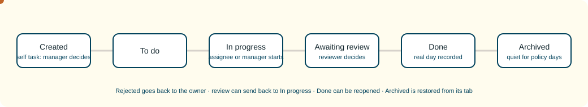

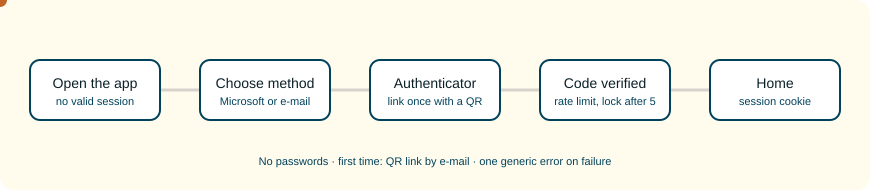

### Task life cycle (FR-48 to FR-53)

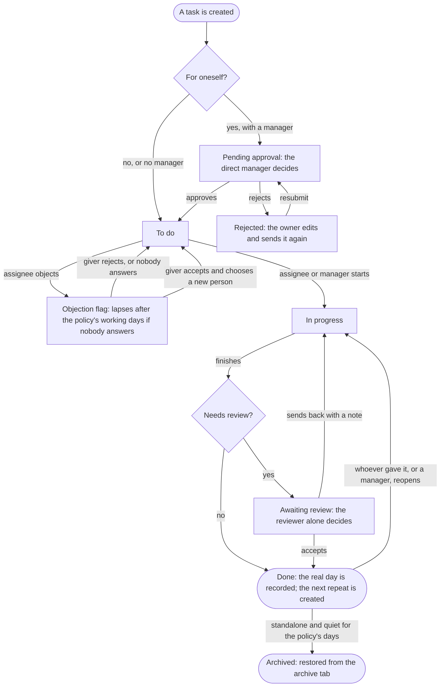

### Ticket life cycle (FR-37 to FR-41)

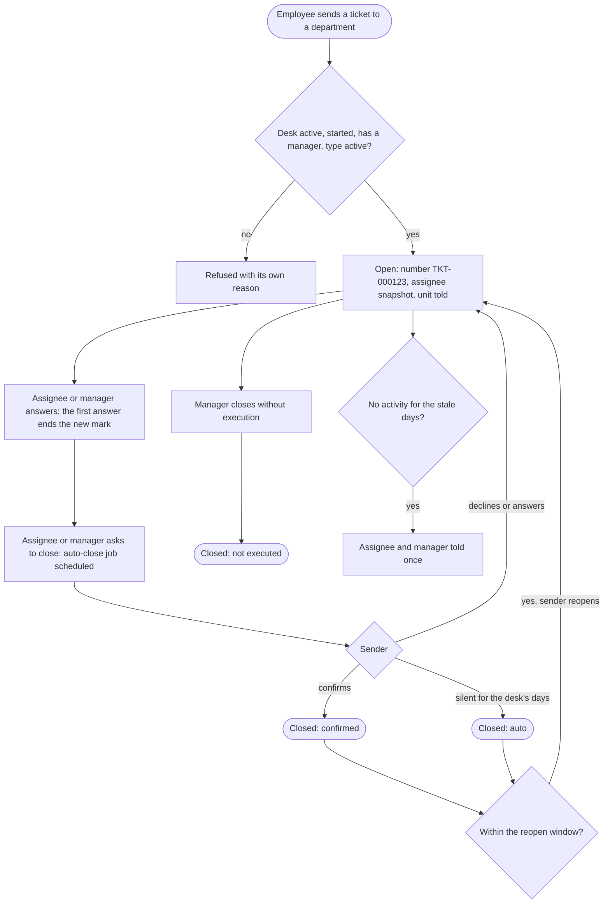

### Who sees a ticket, and how pages and lists are shown (FR-38, FR-42, FR-44)

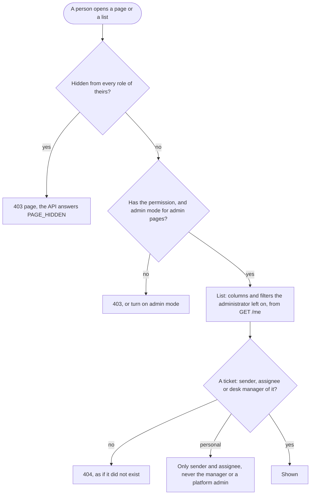

### Sign-in (two steps, no password)

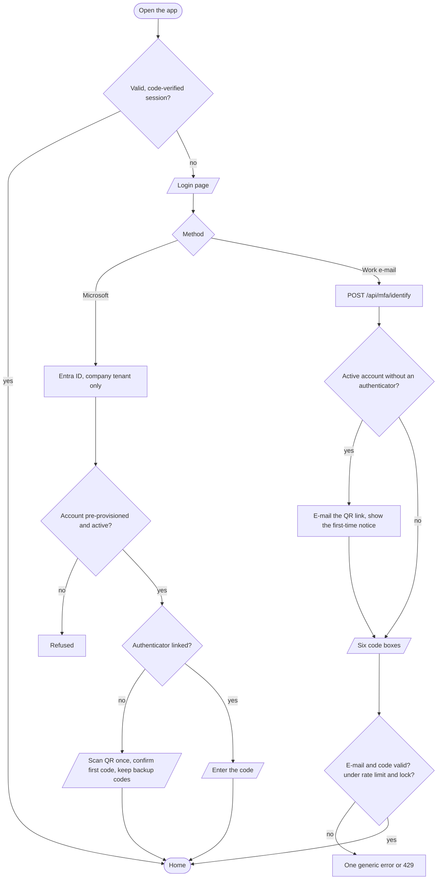

### Create an employee (HR)

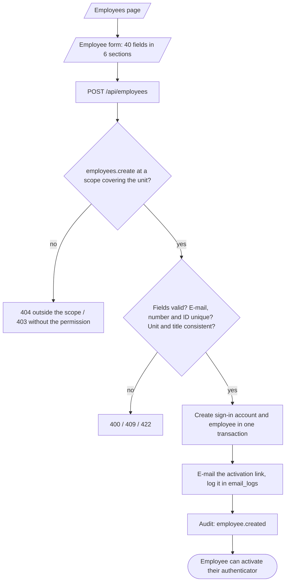

### Change the unit types and the parent–child table (one structure for the group)

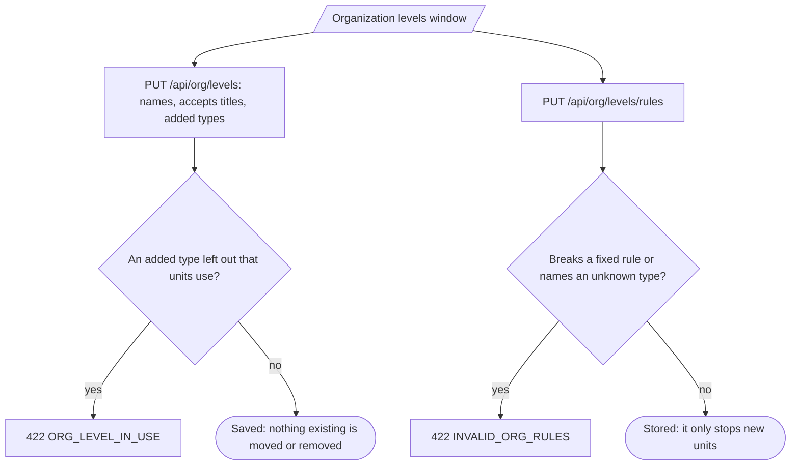

### Import from a file (employees, companies)

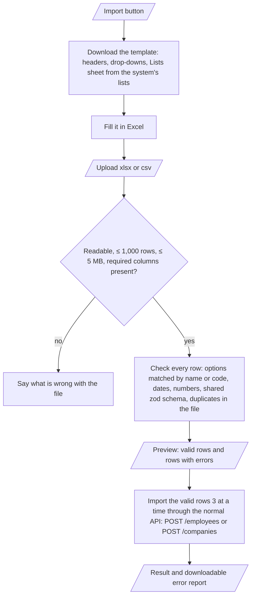

### Build a role

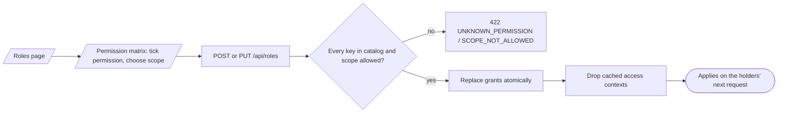

### Welcome tour (FR-67)

```mermaid
flowchart TD
  login([Signed in, code verified]) --> get[GET /api/me/tour/general: the steps this person may see]
  get --> seen{Progress saved?}
  seen -- none --> play[Dim the screen, show step 1: open its page or menu, wait for the element]
  seen -- finished or skipped --> fresh{Steps not seen yet?}
  fresh -- yes --> card[Offer the what's new card] --> play
  fresh -- no --> quiet([Nothing shown])
  play --> step{Element appears?}
  step -- no --> skipstep[Skip it in the direction of travel] --> play
  step -- yes --> bubble[Bubble: next, back, skip, Esc, arrows]
  bubble --> end{Last step or skip?}
  end -- no --> play
  end -- yes --> save[POST complete or skip: saved on the account] --> quiet
  restart([Restart in the account menu or profile]) --> clear[POST restart: forget progress] --> play
```

## 8. Sequence diagrams

### E-mail + code sign-in and an authorized request

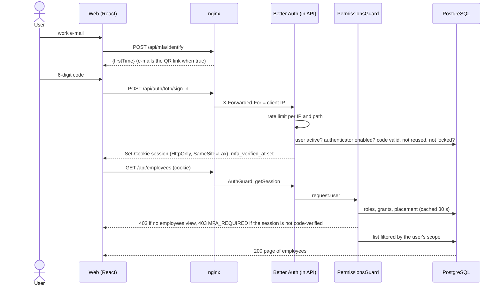

### First sign-in: activation link and QR code

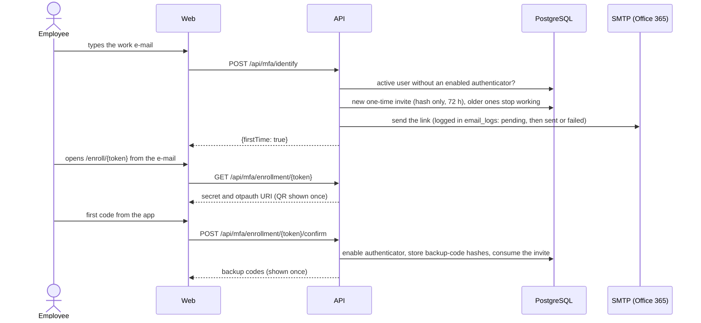

### Workflow transition with a durable timeout

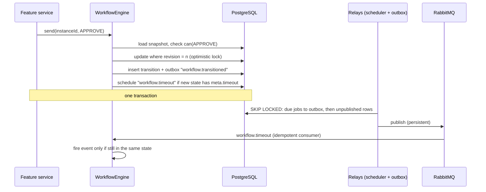

### Notifications by email

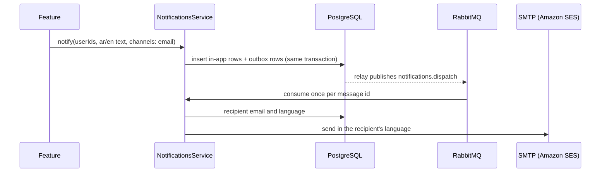

### Microsoft sign-in (Entra ID), then the code

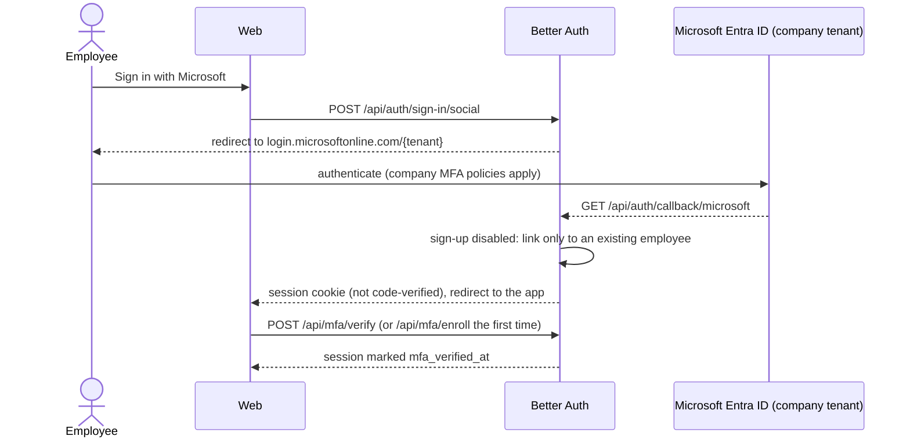

### Moving a task (FR-50, FR-56)

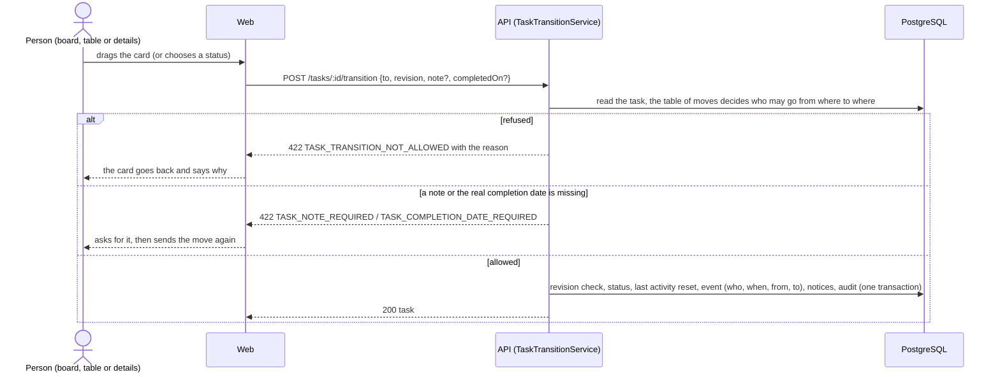

### Ticket send and answer (FR-37, FR-39)

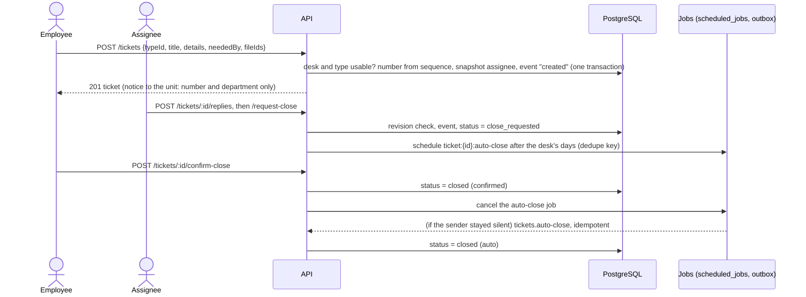

### What a person may do (FR-45 to FR-47)

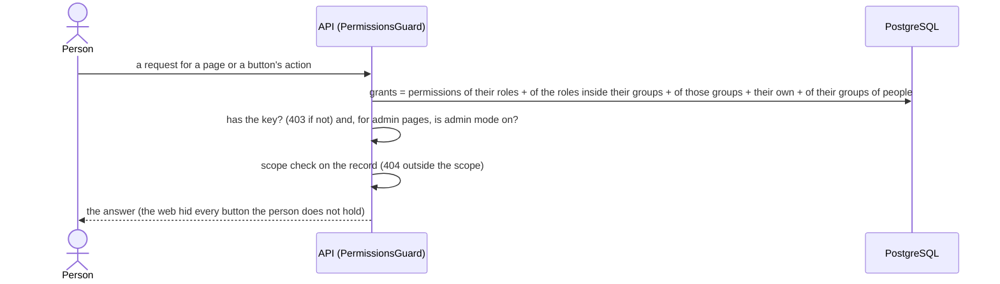

### Automatic roles (FR-43)

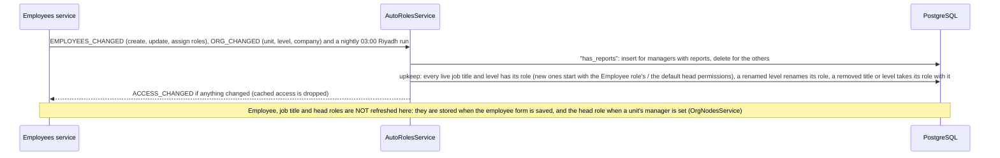

### Editing the welcome tour (FR-67)

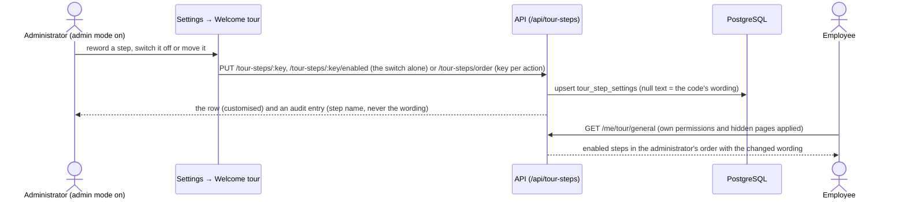

### Platform admin mode (FR-34)

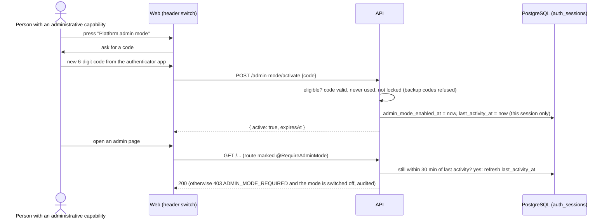

### Sign in as another employee (FR-85)

```mermaid
sequenceDiagram
  actor A as Platform administrator (admin mode on)
  participant W as Web
  participant API as API (PermissionsGuard)
  participant L as Better Auth (server-only endpoints)
  participant DB as PostgreSQL (auth_sessions)
  A->>W: «Sign in as this employee» on a row, confirm
  W->>API: POST /impersonation/:userId
  API->>API: impersonation.start + admin mode, feature on, not nested, target active and not oneself
  API->>L: open session for the employee (code-verified, marked with the administrator)
  L->>DB: new auth_sessions row (impersonated_by_user_id, impersonator_session_id)
  API-->>W: 204 + Set-Cookie of the employee's session, audit impersonation.started
  W->>API: every request: forbidden routes refused, idle or switched off = 403 IMPERSONATION_ENDED, else last activity = now
  A->>W: «Back to my account» (or the 403 above)
  W->>API: POST /impersonation/stop
  API->>DB: delete the employee's session, read the administrator's own session token
  alt the administrator's own session is still alive
    API-->>W: 204 + Set-Cookie of the administrator's session, audit impersonation.ended, notice to the employee
  else it expired meanwhile (it is not renewed during the impersonation)
    API-->>W: 204 with no cookie, the browser is signed out and the administrator signs in again, audit and notice as above
  end
```

## 9. Stack

| Layer | Technology | Reason / change from team default |
|---|---|---|
| Monorepo | npm workspaces + Turborepo | Team default (Track D) |
| API | NestJS 11.2 + TypeScript 5.9 | NestJS 12 is out but `nestjs-zod` supports up to 11; TypeScript 6/7 not yet supported by `ts-jest`/`typescript-eslint` |
| Database | PostgreSQL 16 + TypeORM 1.1 | Chosen by the team; migrations only |
| Validation | zod 4 schemas in `packages/shared`, `nestjs-zod` | One rule for API and web |
| Auth | Better Auth 1.7 (+ `@thallesp/nestjs-better-auth`), Microsoft Entra ID, custom TOTP sign-in plugin (authenticator app mandatory, no passwords) | Replaces the team's hand-written JWT; HttpOnly session cookie |
| Authorization | Dynamic roles + scoped permissions, CASL 7 for record checks | Requested: roles managed from the admin panel |
| Workflow | XState 5 with state in PostgreSQL | Requested; timeouts stored as jobs (XState timers are not durable) |
| Messaging | RabbitMQ 4 via `amqp-connection-manager`, transactional outbox, scheduled jobs table | Requested RabbitMQ instead of BullMQ/Redis; Redis not used |
| Excel / CSV | `write-excel-file` 4.1.1 + `@onparallel/write-excel-file-data-validation` 1.0.0 (drop-downs in templates), `read-excel-file` 9.3.10; CSV by our own small parser; all in the browser, loaded only when someone exports or imports | `exceljs` was rejected (moderate `uuid` advisory); versions pinned to releases older than 14 days |
| Email / SMS | SMTP adapter (Office 365 `smtp.office365.com:587` STARTTLS; Mailpit available locally) with a sent-e-mail log; SMS adapter placeholder | Saudi SMS provider to be chosen |
| Files | S3 (private bucket, SSE, signed URLs) / local folder in development | |
| Web | React 19 + Vite 8 + React Router 8 + TanStack Query 5 + Tailwind 4 + Radix primitives | Requested React SPA instead of Next.js |
| i18n | i18next + react-i18next, Arabic RTL default | |
| Tests | Vitest (API unit + e2e, web components), MSW 3, Playwright + axe | Vitest instead of Jest because Better Auth is ESM-only |
| CI/CD | GitHub Actions → GHCR → EC2 over SSH | Team default |

## 10. Run and deploy

### Local

Requirements: Node 24+, Docker (Docker Desktop on Windows/macOS). On Windows run the commands in WSL 2 or Git Bash.

**Quick start:** `./scripts/setup.sh` (creates `.env` with fresh secrets, installs, starts Docker services, migrates, seeds), then `npm run dev`.

**Manual steps** (what the script does):

```bash
npm ci                                   # .npmrc sets legacy-peer-deps (see docs/decisions.md)
cp .env.example .env                     # then fill BETTER_AUTH_SECRET, FIELD_ENCRYPTION_KEY, passwords
docker compose up -d                     # PostgreSQL (+ test DB), RabbitMQ, Mailpit
npm run db:migrate
npm run db:seed                          # roles, lookups and countries, 10 companies with levels, the first admin from SEED_ADMIN_*,
                                         # and the organization structure of Arweqah Alreyadah with all 270 job titles from the owner's file docs/organizational_structure.md (every environment, once, while the company has no units; development: `npm run db:reset:org` empties it first) and, development only (`SEED_DEMO_ORG=true`), demo ticket desks and sample tickets
npm run dev                              # API :3000, web :5173 (proxies /api)
npm run verify                           # end-of-task check: architecture, design, testing, security
```

| URL | What |
|---|---|
| http://localhost:5173 | Web app: sign in with Microsoft, or type `SEED_ADMIN_EMAIL` (the first time you get an e-mail with the QR link, then the code boxes) |
| http://localhost:3000/api/docs | Swagger (disabled in production) |
| http://localhost:5173/docs | User manual (signed-in page; each person sees the sections of the pages they may open; decision 372) |
| http://localhost:8025 | Mailpit (only when `SMTP_HOST` points at it; with Office 365 mail goes out for real and is tracked in the platform's «E-mail log» page) |
| http://localhost:15672 | RabbitMQ management (guest/guest locally) |

### Deploy

- **Branches and environments:** `dev` deploys to the GitHub environment **staging**, `main` to **production** (each with its own server, secrets `EC2_HOST` / `EC2_USER` / `EC2_SSH_KEY` and variables `APP_URL` / `MICROSOFT_ENABLED`). Feature pull requests go into `dev`; merging `dev` into `main` is the release. Production images are tagged with the commit SHA and `latest`, staging images with `<sha>-staging` and `dev`.
- **Trigger:** every push to `dev` or `main` after CI (quality, API e2e, Playwright, security including the ZAP scan) passes; or manually (`workflow_dispatch`).
- **Steps:** build `api` and `web` images → Trivy scan → push to GHCR → copy `docker-compose.prod.yml`, `docker/nginx/edge.conf` and `scripts/server/*.sh` to the server → SSH: log in to GHCR with the job's own token (no registry password is stored on the server) → `scripts/server/deploy.sh <sha>` (remove unused images → pull → TypeORM `migration:run` and the compiled seed through `node`, idempotent → `docker compose up -d`; the runtime image has no npm) → smoke test `GET {APP_URL}/api/health`.
- **GitHub secrets:** `EC2_HOST`, `EC2_USER`, `EC2_SSH_KEY` (printed by the bootstrap script). **Variables:** `APP_URL`, `MICROSOFT_ENABLED`. **Environments:** `staging` and `production`, each holding its own copy of these (a job reads its environment's values first).
- **Server layout** (`/opt/arweqah-platform`): `.env` (created by `bootstrap.sh` with generated secrets, never in GitHub), `secrets/microsoft.key` (certificate private key), `backups/`. Everything runs in Docker on one host: nginx (HTTPS, one Let's Encrypt certificate for both domains: the web domain proxies `/api` to the API so the browser stays on one origin and cookies stay first-party; the API domain reaches the same API directly for integrations), web, api, PostgreSQL 16, RabbitMQ; data in the volumes `pg_data`, `api_storage` (uploaded files, `FILE_STORAGE=local`) and `rabbitmq_data`.
- **Backups:** `scripts/server/backup.sh` runs daily at 02:30 (cron): database dump and files archive, kept 14 days in `backups/`. Copy that folder off the server too.

**First-time server setup** (Ubuntu 24.04 EC2, security group: 22 from the team, 80 and 443 open, Elastic IP, DNS `A` records of the web domain and the API domain, e.g. `stg-portal.arweqah.sa` and `stg-api-portal.arweqah.sa`, pointing to it)

1. Copy the script and run it: `scp scripts/server/bootstrap.sh ubuntu@<ip>:~` then `ssh ubuntu@<ip> "sudo bash bootstrap.sh"`. It asks for the two domains, certificate e-mail, GitHub owner, first admin e-mail, Microsoft IDs and SMTP; installs Docker and a firewall; writes `.env`; gets the HTTPS certificate (renewed automatically); schedules the backup; and prints the GitHub secrets, including a fresh deploy SSH key.
2. Add the secrets and variables in GitHub and create the environment of this server (`staging` or `production`; the script prints the exact values).
3. Copy the Microsoft certificate key to `secrets/microsoft.key` and register `https://<web domain>/api/auth/callback/microsoft` under **Web** in Entra ([docs/microsoft-sign-in.md](docs/microsoft-sign-in.md)).
4. Push to the branch of that environment (`dev` for staging, `main` for production). The first deploy creates the database tables and the first admin.

To use Amazon RDS or S3 later: set `DB_HOST`/`DB_SSL` or `FILE_STORAGE=s3` + `S3_BUCKET` in the server `.env` (and drop the `postgres` service for RDS).

**Rollback:** `export TAG=<previous sha> && docker compose -f docker-compose.prod.yml up -d api web`. Migrations are written backward compatible (add first, remove later); revert one with `docker compose -f docker-compose.prod.yml run --rm api node ../../node_modules/typeorm/cli.js -d dist/database/data-source.js migration:revert`.

## 11. Testing

| Type | Command | Covers |
|---|---|---|
| API unit | `npm test -w @arweqah-platform/api` | Scopes and CASL rules, permission catalog, env validation, field encryption, error mapping, redaction |
| API e2e (real PostgreSQL) | `npm run test:e2e:api` | Sign-in and authenticator flows with real TOTP, organization, employees (every filter), lookups, seeders, e-mail log, notifications, audit, IDOR, mass assignment, SQL injection, workflow concurrency |
| Security suite | part of API e2e (`test/security.e2e-spec.ts`) | 401 on every route, 403 on every permission route (discovered from Nest metadata), headers, CORS, 413, forged cookies |
| Web components | `npm test -w @arweqah-platform/web` | DataTable, list toolbar (search, filters, table / cards), export and import dialogs and file readers, employee and company import rules, error pages and the 403 route guard, sign-in steps, org page, role editor (MSW) |
| Full-stack e2e | `npm run test:e2e:web` | Own API on port 3100 against its own database `arweqah_platform_e2e` (never a development server, and never the API suite's `arweqah_platform_test`, so `npm run test:e2e` runs both suites at the same time), sidebar menus, e-mail + code sign-in and sign-out, 404 / 403 / 401 pages, search, filters, table / cards memory, export to CSV, import template download, company import from a file, no tokens in storage, no secret values in the bundle, axe on each page, desktop + phone; in CI it runs as four shards (`E2E_SHARD=1/4`…`4/4`), see decision 253 |
| Everything, as one gate | `npm run verify` | Architecture, design, testing and security checks, one line each |
| Static and supply chain | CI `security` workflow | npm audit (high), gitleaks, Semgrep (OWASP, Node, TypeScript, secrets), Trivy (fs + images), ZAP baseline + API scan (four parallel shards by module, `scripts/zap-shard.mjs`; on the push to `main` only, not on pull requests: decision 235) |

Requirement traceability: each `describe` title lists the FR/NFR IDs it covers, and section 4 lists the suites for each requirement.

## 12. Actors

| Actor | Can | Cannot |
|---|---|---|
| Employee (role "Employee") | Sign in with e-mail or Microsoft plus the authenticator code, see and edit own profile (theme, language, personal phone and e-mail, English name), see own notifications, upload own files | See other employees, roles, organization admin, audit or e-mail log unless a role grants it |
| Person given the task keys (custom role) | Work with their tasks (create, follow, log time, object, move their own cards), see the numbers of their tasks and tickets on the home page; with the team keys: the team page, matrix, approvals, moves of the team's cards, archive and restore, within the scope of each key | See or move a task outside their relation or scope (404); change a status outside the table of moves (422); the keys are not part of the Employee role |
| HR (custom role) | Create and update employees, place them in units, assign the roles they hold, resend activation links | Act outside their scope (gets 404), see salary / ID / IBAN without `employees.view_sensitive`, assign more than they hold, change their own roles |
| Line manager (custom role) | What the role grants, limited to their unit or subtree | Act outside their scope |
| System Admin (system role) | Every permission at the widest scope: translation and e-mail services (data, try-out, switch on), companies, levels, units, job titles, roles (with how each is assigned), page visibility per role, list management, audit log, e-mail log, and may switch **platform admin mode** on (`admin_mode.use`) | Delete system roles; use anything before linking the authenticator |
| Platform administrator with `impersonation.start` | In admin mode and when switched on in Settings → Security, work as any other active employee (their permissions and scope, no code) and go back; everything done is recorded under the employee's name with the administrator's beside it | Sign in as oneself or an inactive account, nest, change the employee's roles, groups, sign-in, account status or the security settings while inside |
| Desk manager (named in a desk's setup) | Switch admin mode on, set up the desk, see its tickets (not personal ones), answer, reassign, read its figures | See personal tickets, act on other desks |
| Administrator with the tour keys (`tour.settings_*`) | In admin mode, reword, switch off and reorder the welcome-tour steps (Settings → Welcome tour), reset a step to the code's wording | Add or remove steps (they come with the code), read anyone's progress |
| Auditor (custom role with `audit.view`) | Read the audit log | See secrets (redacted) |
| Microsoft Entra ID | Authenticate company accounts (setup: `docs/microsoft-sign-in.md`, check: `npm run microsoft:check`) | Create accounts (sign-up disabled) |
| Translation and e-mail services (AWS, Google, Azure, SMTP, SES, SendGrid, Microsoft 365) / SMS provider | Translate text, deliver messages | Read any data beyond the message |
| GitHub Actions | Build, test, deploy | Read production secrets (they live on the server) |

**Permission scopes:** `own`, `unit`, `subtree:1` to `subtree:5`, `subtree`, `company`, `all` (FR-80).

**Permission catalog:** one key for every page (`view`) and every button or action; the API refuses an action without its key and the web hides the button. The single source is [`packages/shared/src/permissions/keys.ts`](packages/shared/src/permissions/keys.ts) (each module also declares its keys, with Arabic and English labels, in `domain/<feature>.permissions.ts`); the roles and permissions pages show them. The **Employee** role starts with `EMPLOYEE_DEFAULT_PERMISSIONS` (own account, tickets, tasks); the head role of every unit starts with `LEVEL_HEAD_DEFAULT_PERMISSIONS`; everything else is given by an administrator.

## 13. Constraints

- **Regulatory:** Saudi PDPL. Personal data (national IDs, salaries) must be protected and kept in Saudi Arabia; the interim hosting in Bahrain needs the company's documented legal basis until the move.
- **Hosting:** existing AWS account; AWS Saudi region expected December 2026.
- **Scale:** 1,000–5,000 employees.
- **Budget (estimate):** about USD 350–400 per month (EC2 t3.xlarge, RDS, staging, S3, CloudWatch), around 35 % less with Savings Plans.
- **Technical:** Better Auth is ESM-only (Vitest, Node ≥ 24); `nestjs-zod` pins NestJS 11.
- **Organizational:** each business module starts from a written description by the product owner.

## 14. Assumptions

| Assumption | Impact if wrong | Confirmed by |
|---|---|---|
| 1,000–5,000 employees | Instance and database sizing, partitioning of attendance | Product owner |
| Finance in v1 is tracking and approval only (no accounting, no e-invoicing) | Large new scope (ledger, ZATCA) | Product owner |
| Payroll in v1 records and approves; no automatic GOSI/WPS deductions | Integrations and legal review needed | Proposed, to confirm |
| Airtable / Google Sheets sync is two-way, with a per-field owner and a conflict log | Data loss or overwrites | Product owner (two-way); conflict policy proposed |
| The company has a legal basis to host personal data in Bahrain until the Saudi region opens | Compliance risk; host in KSA immediately | To confirm with legal |
| Microsoft 365 accounts use the company email addresses HR enters | Employees cannot link Microsoft sign-in | To confirm with IT |
| A Saudi SMS provider will be chosen later | SMS channel only logs for now | Open |

## 15. Third parties

| Service | Purpose | Direction / trigger | Env vars | Docs |
|---|---|---|---|---|
| Microsoft Entra ID | Employee sign-in | User-initiated OAuth | `MICROSOFT_CLIENT_ID`, `MICROSOFT_TENANT_ID`, and `MICROSOFT_CLIENT_SECRET` or a certificate (`MICROSOFT_CERT_THUMBPRINT` + `MICROSOFT_CERT_PRIVATE_KEY_FILE`) | https://www.better-auth.com/docs/authentication/microsoft |
| E-mail service (SMTP, Amazon SES, SendGrid or Microsoft Graph, chosen in Settings → E-mail tab, FR-60) | Activation links and notification e-mail | Outbound, from the outbox; every message is recorded in `email_logs`. Keys are entered on the settings page (stored encrypted); the `.env` values below are the fallback when none is switched on | `SMTP_HOST`, `SMTP_PORT`, `SMTP_USER`, `SMTP_PASSWORD`, `SMTP_SECURE`, `MAIL_FROM` (SMTP AUTH must be enabled on the mailbox) | https://learn.microsoft.com/exchange/mail-flow-best-practices/how-to-set-up-a-multifunction-device-or-application-to-send-email-using-microsoft-365-or-office-365 |
| Amazon S3 | File storage | Outbound; signed download URLs (5 min) | `FILE_STORAGE`, `S3_BUCKET`, `S3_REGION` (credentials from the instance role) | https://docs.aws.amazon.com/s3/ |
| Translation service (Amazon Translate, Google Cloud Translation or Azure AI Translator, chosen in Settings → Translation tab, FR-59) | Fills the English field while a person types Arabic (FR-58) | Outbound; text of one field per call, nothing stored. Keys are entered on the settings page (stored encrypted); the Amazon Translate `.env` values below are the fallback | `TRANSLATE_AWS_ACCESS_KEY_ID`, `TRANSLATE_AWS_SECRET_ACCESS_KEY`, `TRANSLATE_AWS_REGION` (us-east-1); IAM user limited to `translate:TranslateText`; empty keys turn it off | https://docs.aws.amazon.com/translate/ |
| Amazon RDS PostgreSQL | Database | — | `DB_HOST`, `DB_PORT`, `DB_NAME`, `DB_USER`, `DB_PASSWORD`, `DB_SSL` | https://docs.aws.amazon.com/rds/ |
| RabbitMQ | Messaging between modules and workers | Internal | `MESSAGE_BUS`, `RABBITMQ_URL` | https://www.rabbitmq.com/docs |
| GitHub Container Registry | Images | Push from CI, pull on EC2 | — | https://docs.github.com/packages |
| Airtable, Google Sheets | Two-way sync (planned module) | Scheduled jobs | to be added with the module | — |
| SMS provider (Saudi) | SMS notifications (planned) | Outbound | to be added | — |

## More

### Project structure

```
apps/
  api/src/
    common/          base entity, domain errors, transaction runner, field cipher, error filter
    config/          env validation (zod), typed AppConfig, TypeORM options
    core/            auth · access (roles, scopes, CASL) · audit · messaging · workflow · notifications · files
    modules/         one folder per business feature (org, employees, tasks, tickets, ...), each domain / application / infrastructure / presentation
    database/        entities list, migrations, seeds
  web/src/
    app/             composition root: features list, router, layout, providers
    core/            API client, session, permissions, i18n, theme, feature contract
    shared/ui/       DataTable, ListToolbar, Dialog, FormField, FileDropzone ...
    shared/lib/      list hooks, fetchAllPages, matchesText
    shared/data-exchange/   export / import / template (xlsx, csv) used by every list
    features/        one folder per page group, exported through its index.ts
packages/shared      zod schemas, DTO types, permission keys and scopes (api + web)
e2e/                 Playwright specs + page objects
docs/                decisions, plans, database design, user manual, brand
docker/              nginx (web + edge), postgres init
```

### Architecture and patterns

Every API module has `domain / application / infrastructure / presentation`, each split into one folder per kind of file (see `.claude/skills/module-architecture`); imports only point inward, enforced by `eslint-plugin-boundaries`. Patterns, each where its trigger exists: Repository, Adapter (Better Auth, S3, SMTP, RabbitMQ), Strategy (file storage, notification channels, message bus), Registry (permissions, workflows, web features), Observer (audit events), Outbox, Unit of Work (`TransactionRunner`), Specification (`applyScope`), State machine (XState). On the web, features are imported only through their `index.ts`; components use hooks, hooks use the single `apiClient`.

### Adding a feature

1. Describe it: goal, users and roles, journeys, data and fields, business rules, approvals, notifications, reports, links to other modules. Write it in `docs/plans/<phase>.md` first.
2. API: `apps/api/src/modules/<feature>/...`, a `<feature>.permissions.ts` registered on module init, entities in `database/entities.ts`, a migration, a workflow definition if it has approvals, e2e specs named with FR ids.
3. Shared: request schemas and DTOs in `packages/shared/src/<feature>/`.
4. Web: `apps/web/src/features/<feature>/` with `index.ts` exporting a `FeatureModule` (lazy routes, nav item with its permission, `i18n/{ar,en}.json`), then one line in `app/features.ts`.
5. Welcome-tour steps for each new page, user-manual text (ar + en), `docs/database-design.md` rows for new tables.
6. Update sections 4, 6, 7, 8 and 12 of this README in the same PR.

### Brand

Primary 60 % (cream, green, ink), secondary 35 % (orange, beige, petrol, yellow); yellow never above 5 % of a design and never text. Full roles, accessible shades and contrast are in `.claude/skills/arweqah-design-system/SKILL.md`.

| Token | Value | Use |
|---|---|---|
| `cream` | `#FFFCEE` | Text on dark, e-mails, printed material |
| `green-400` | `#85BA95` | Positive states, accents (never text on light) |
| `ink` | `#0C2028` | Text, sidebar, primary buttons, sign-in screen |
| `orange-500` | `#C16426` | Highlights, large text only |
| `beige-300` | `#D7D2CB` | Branded dividers |
| `petrol-800` | `#00415B` | Links, selected items, focus ring |
| `yellow-300` | `#FBD564` | Notification dot only |

Components use semantic colors and surface tokens so the light and dark themes both work (kept in `localStorage.theme` and on the account). Typeface: Tajawal. Logos: `docs/brand/`, used only through `BrandLogo`.

### Hosting

Interim region `me-south-1` (Bahrain); move to the AWS Saudi region when it opens: create RDS and EC2 there, restore the latest snapshot, copy the S3 bucket, switch DNS, decommission Bahrain (short maintenance window).

### Further reading

| Document | What |
|---|---|
| [docs/decisions.md](docs/decisions.md) | Every architecture decision, newest first |
| [docs/database-design.md](docs/database-design.md) | Every table, columns and relations |
| [docs/plans/](docs/plans/) | Plan and implementation log of each module |
| [docs/microsoft-sign-in.md](docs/microsoft-sign-in.md) | Microsoft Entra setup |
| [SECURITY.md](SECURITY.md) | Security policy and controls |
| [CLAUDE.md](CLAUDE.md) | Working rules and commands for contributors and Claude Code |

Conventions: Conventional Commits (`feat(users): …`), branches `feat/*`, `fix/*`, `chore/*`; `dev` deploys to staging, `main` to production.

