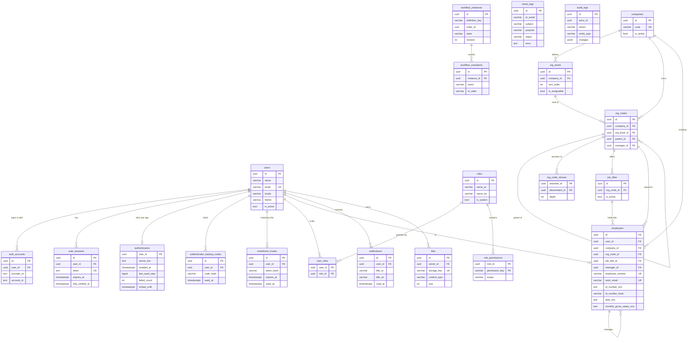
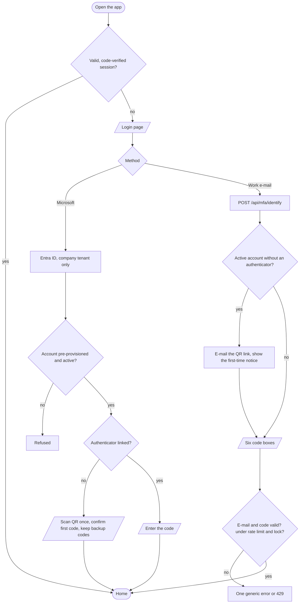
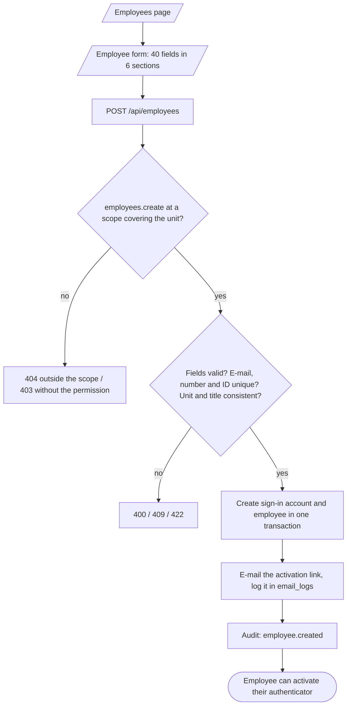
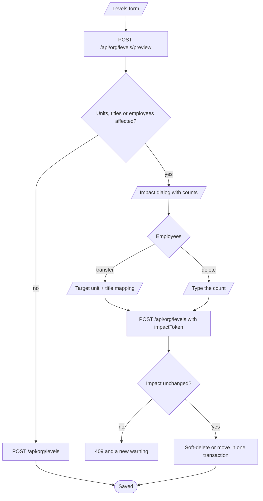
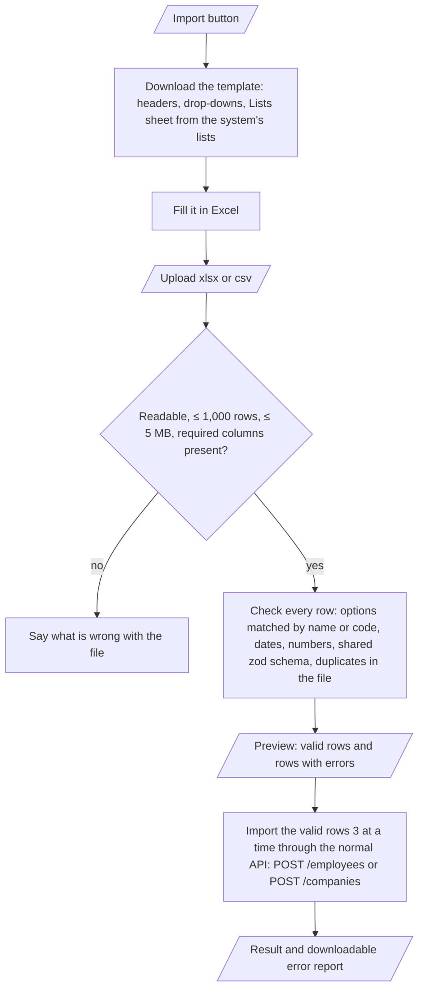
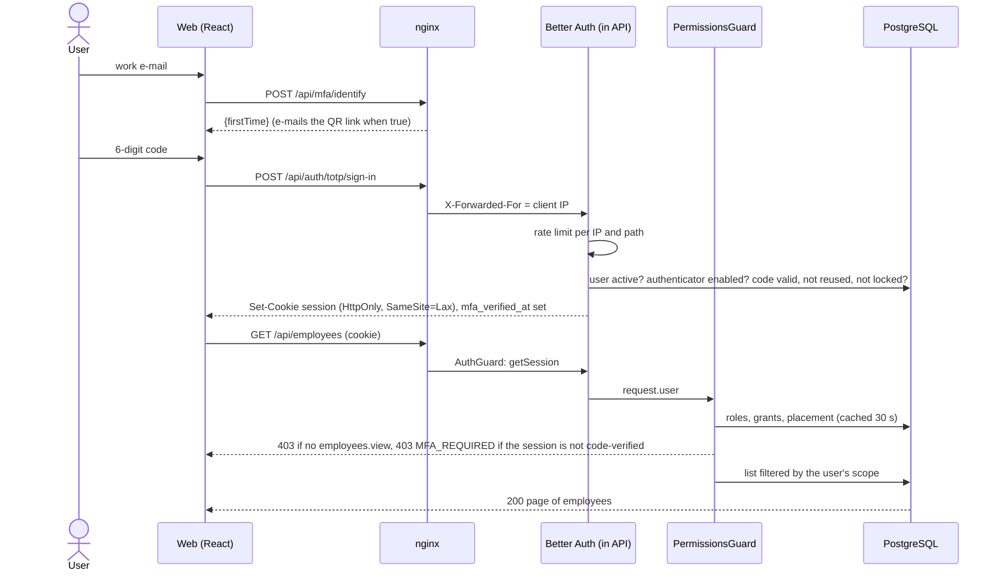
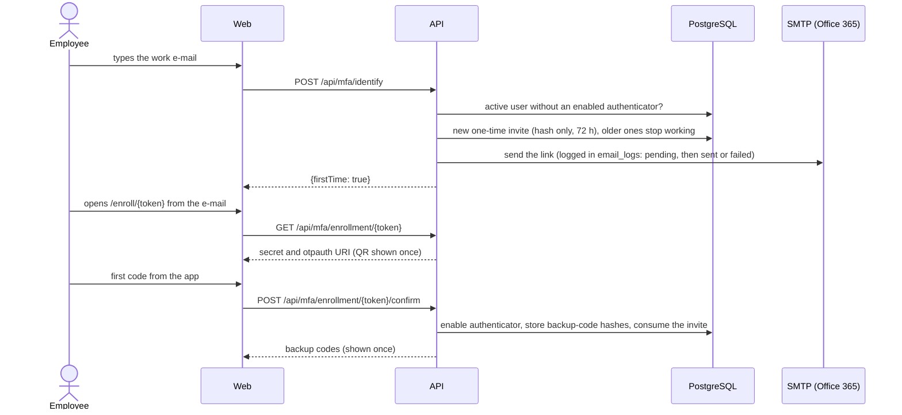
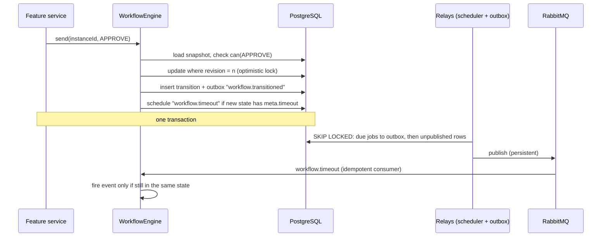
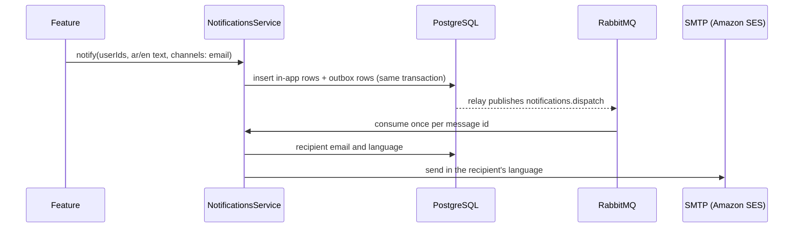
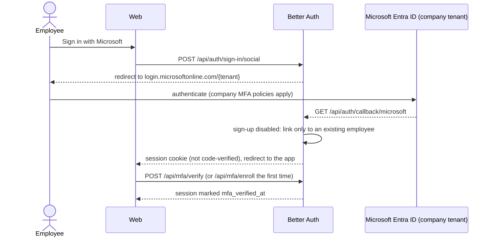

# Arweqah Platform

Internal ERP for Arweqah Alreyadah: one place for people, organization, requests, projects, tickets and finance tracking. This repository currently contains the **foundation** every business module is built on. Business modules are added one at a time from a written description of each feature (see [Adding a feature](#adding-a-feature)).

## 1. Overview

**Organization.** Arweqah Alreyadah (أروقة الريادة), a Saudi company with 1,000–5,000 employees across several branches.

**Problem.** Employee data, approvals, projects and tickets live in separate tools (Airtable, Google Sheets, email). Nobody has one view, approvals are slow to chase, and sensitive data (national IDs, salaries) is spread across files.

**Solution.** A bilingual (Arabic RTL / English) web platform where every employee signs in with Microsoft 365 or a work e-mail, always confirmed by a code from an authenticator app (no passwords), sees only what their role and position in the organization allow, and where every sensitive action is recorded.

**Main journeys in the foundation**

1. The startup administrator (`s.magdy@arweqah.sa`, created by the seeder) signs in with Microsoft, scans the QR code once to link an authenticator app, and from then on enters the 6-digit code at every sign-in.
2. An administrator builds each company's structure with forms: levels (sector / department / section / unit by default), units under any level, and job titles (mandatory on units that accept employees). Changing levels that hold data shows the impact and needs confirmation.
3. HR creates an employee from the 40-field form; the system creates a sign-in account and e-mails an activation link. The employee also gets the link on their first sign-in attempt (the e-mail step recognizes a first time and sends the QR link), scans the QR code and enters the code.
4. An administrator builds roles from the permission catalog and chooses how far each permission reaches (own → unit → subtree → company → all).
5. Every person has a profile page: they pick the light or dark theme and the language, and edit their personal phone, personal e-mail and English name; the rest of their record is HR's.
6. A user receives notifications in the app (and by e-mail); an auditor reviews the audit log; an administrator follows every e-mail the platform sent (sent / failed and why).

**In scope now:** passwordless authentication (Microsoft + authenticator app), companies, dynamic organization structure, employees, dynamic roles and scoped permissions, audit log, notifications (in-app, email, SMS adapter), file storage, workflow engine, messaging (outbox + RabbitMQ + durable scheduled jobs), sent-e-mail log, bilingual UI shell with grouped navigation.

**Out of scope now (planned modules):** attendance, leaves, requests, projects and tasks, tickets with SLA, expenses / advances / invoices tracking, payroll records, dashboards, two-way Airtable / Google Sheets sync. Out of scope for version 1 entirely: double-entry accounting, e-invoicing (ZATCA), GOSI / Mudad / WPS integrations.

## 2. Vision

A unified digital workplace that runs all of the company's resources efficiently and transparently.

## 3. Mission

Bring employee, project and request management into one secure platform that speeds up decisions and removes manual work.

## 4. Functional requirements

| ID | Requirement | Actor | Priority | Covered by |
|---|---|---|---|---|
| FR-01 | Sign in with the work e-mail and the 6-digit code of an authenticator app; no passwords, no self sign-up; one generic error; 5/min rate limit; lock after 5 wrong codes; a code cannot be reused; deactivated accounts refused | All users | Must | `apps/api/test/auth.e2e-spec.ts`, `apps/web/src/features/auth/pages/login-page.test.tsx` |
| FR-02 | The authenticator app is mandatory for everyone: no protected route works before it is linked and the session is code-verified | All users | Must | `apps/api/test/mfa.e2e-spec.ts`, `apps/api/test/access.e2e-spec.ts` |
| FR-03 | Sign in with Microsoft Entra ID, company tenant only, pre-provisioned employees only; the code is still required after Microsoft | All users | Must | `apps/api/src/config/env.schema.spec.ts`, `apps/api/test/mfa.e2e-spec.ts` (manual check against the real tenant before go-live) |
| FR-04 | Employees: create (also creates the sign-in account), update, activate / deactivate (ends sessions), terminate, assign roles, resend the activation link, reset the authenticator | HR / admin | Must | `apps/api/test/employees.e2e-spec.ts` |
| FR-05 | Dynamic roles built from a permission catalog; system roles cannot be deleted | Admin | Must | `apps/api/test/access.e2e-spec.ts`, `apps/web/src/features/roles/role-editor.test.tsx` |
| FR-06 | Every permission is scoped (own / unit / subtree / company / all); lists and records outside the scope are hidden (404) | All | Must | `apps/api/src/core/access/application/access.spec.ts`, `apps/api/test/security.e2e-spec.ts` |
| FR-07 | Replaced by FR-13 and FR-24 (companies, levels, units, job titles) | Admin | — | see FR-13, FR-24 |
| FR-08 | In-app notifications with unread count; email (and SMS) delivered in the background through the outbox | All | Must | `apps/api/test/platform.e2e-spec.ts` (Notifications) |
| FR-09 | Upload files (PDF, PNG, JPEG ≤ 10 MB) checked by content; only the owner can read them | All | Should | `apps/api/test/platform.e2e-spec.ts` (Files) |
| FR-10 | Workflow engine: persisted state machines with history, optimistic locking and durable timeouts (escalations) | Feature modules | Must | `apps/api/test/platform.e2e-spec.ts` (Workflow engine) |
| FR-11 | Audit log of sign-ins and sensitive changes, secrets redacted, readable by auditors only | Auditor | Must | `apps/api/test/platform.e2e-spec.ts` (Audit log), `apps/api/src/core/audit/application/audit.service.spec.ts` |
| FR-12 | Arabic (RTL) and English interface, switchable at any time | All | Must | `apps/web/src/core/i18n/i18n.test.ts` |
| FR-13 | The code is required in every session, also after Microsoft (the session is blocked until it is verified) | All users | Must | `apps/api/test/mfa.e2e-spec.ts`, `apps/web/src/features/auth/pages/verify-page.test.tsx`, `apps/web/src/features/org/org-page.test.tsx` |
| FR-14 | The startup administrator is created by the seeder (no password) and belongs to «أروقة الريادة» | System | Must | `apps/api/test/seeds.e2e-spec.ts` |
| FR-15 | No self sign-up and no password routes exist | All | Must | `apps/api/test/auth.e2e-spec.ts` |
| FR-16 | Activation link (QR code, first code, backup codes), one use, 72 h; the e-mail step recognizes a first sign-in and e-mails the link (one per minute per address) | Employee | Must | `apps/api/test/mfa.e2e-spec.ts`, `apps/web/src/features/auth/pages/login-page.test.tsx` |
| FR-17 | Employee form with 40 fields in 6 sections and conditional rules | HR | Must | `apps/api/test/employees.e2e-spec.ts`, `apps/web/src/features/employees/employee-form-page.test.tsx` |
| FR-18 | ID validation by type and nationality; unique type + number (searchable through an HMAC blind index) | HR | Must | `apps/api/test/employees.e2e-spec.ts` |
| FR-19 | Companies (10 seeded), levels, units, job titles with deletion and move rules | Admin | Must | `apps/api/test/org.e2e-spec.ts` |
| FR-20 | Scopes own / unit / subtree / company / all with 404 outside the scope | All | Must | `apps/api/test/employees.e2e-spec.ts` |
| FR-21 | ID number, IBAN and salary are encrypted and masked without `employees.view_sensitive` | HR | Must | `apps/api/test/employees.e2e-spec.ts` |
| FR-22 | Arabic / English for every lookup (`Accept-Language`) | All | Must | `apps/api/test/lookups.e2e-spec.ts` |
| FR-23 | Two-step sign-in page: work e-mail, then the code boxes (with a first-time notice) | All users | Must | `apps/web/src/features/auth/pages/login-page.test.tsx`, `apps/api/test/auth.e2e-spec.ts` |
| FR-24 | Dynamic organization built by forms; impact warning and confirmation when levels that hold data change (transfer employees with job-title mapping, or delete by typing the count) | Admin | Must | `apps/api/test/org.e2e-spec.ts` |
| FR-25 | Idempotent seeders: lookups, countries, 10 companies with the default levels (+ optional sample units in development) | System | Must | `apps/api/test/seeds.e2e-spec.ts` |
| FR-26 | Sent-e-mail log: every e-mail with status (pending / sent / failed), reason and server reply, never the body; filters; permission `notifications.email_log` | Admin | Should | `apps/api/test/email-log.e2e-spec.ts`, `apps/web/src/features/email-log/email-log-page.test.tsx` |
| FR-27 | Every list offers search, filters on every attribute that can be filtered (applied filters shown as removable chips), and a choice between a table and cards (remembered per list; phones start with cards). Employees: company, status, relation type, unit, job title, contract type, nationality, gender, work mode, marital and residency status, contract start range, ID / contract needing attention. Audit log: search, action, record type, actor, date range. E-mail log: search, status, type, address, date range. Notifications: search, read / unread, date range. Companies and roles: search plus status, type or holders | All | Must | `apps/api/test/employees.e2e-spec.ts`, `apps/api/test/platform.e2e-spec.ts`, `apps/api/test/email-log.e2e-spec.ts`, `apps/web/src/shared/ui/list-toolbar.test.tsx` |
| FR-28 | Export from every list: choose the scope (rows on the page, or all results of the current search and filters), the columns, and the file type (Excel or CSV); formulas are neutralized | All | Must | `apps/web/src/shared/data-exchange/data-exchange.test.ts`, `apps/web/src/shared/data-exchange/dialogs.test.tsx` |
| FR-29 | Import employees and companies from Excel or CSV: download a template whose drop-downs carry the system's lists (companies, units and job titles, countries, statuses, contract types…), preview the rows with their errors, import the valid ones, download an error report; every row goes through the same validation and API as the form | HR / admin | Must | `apps/web/src/shared/data-exchange/*.test.ts(x)`, `apps/web/src/features/employees/employees-import-rows.test.ts`, `apps/web/src/features/companies/companies-import.test.ts`, `apps/api/test/lookups.e2e-spec.ts` (org reference) |
| FR-30 | The 401, 403 and 404 pages share one design (picture, what happened, what to do, one button): 404 for an unknown address, 403 when a route needs a permission the person lacks (route guard from the navigation item's permission), 401 when the session ends while working (a visitor without a session goes straight to sign-in) | All | Must | `apps/web/src/app/error-pages.test.tsx`, `e2e/tests/navigation.spec.ts` |
| FR-31 | Organization page: choose the company, then see its structure as a chart (company card, one brand color per level with a legend, open / close nodes, open all, search, zoom, fit to screen, drag) or as a table (search, filters on level, status, employees and manager, export); selecting a unit shows its details beside it; the choice of chart or table is remembered | Admin / HR | Must | `apps/web/src/features/org/org-page.test.tsx`, `e2e/tests/org.spec.ts` |
| FR-32 | Messages are colored by meaning, with an icon and a start rule: success green, information yellow, warning orange, error red | All | Must | `apps/web/src/shared/ui/alert.test.tsx` |
| FR-33 | Light and dark theme (or follow the device): a toggle in the header and a choice on the profile page, saved in the browser and on the account; and an own profile page where a person changes the language, the theme and three contact details (personal phone, personal e-mail, English name) while the job details stay read-only; everything else belongs to HR | All users | Must | `apps/api/test/profile.e2e-spec.ts`, `apps/web/src/core/theme/theme.test.tsx`, `apps/web/src/features/profile/profile-page.test.tsx`, `e2e/tests/profile.spec.ts` |

Every test suite names the requirement IDs it covers in its `describe(...)` title.

## 5. Non-functional requirements

| ID | Requirement | Target | Verified by |
|---|---|---|---|
| NFR-01 | Performance | p95 < 300 ms for read endpoints at 5,000 users; morning check-in peak of 5,000 requests in 30 min | Load test (k6) to be added with the attendance module; indexes on every filter/foreign key |
| NFR-02 | Security | OWASP Top 10 controls; every non-public route 401 without session and 403 without permission | `apps/api/test/security.e2e-spec.ts` (routes discovered automatically), CI `security` workflow |
| NFR-03 | Input hardening | Unknown fields 400, bodies > 1 MB 413, no stack traces/SQL in errors, literal search | `apps/api/test/security.e2e-spec.ts` |
| NFR-04 | Availability | 99.5 % monthly | `/api/health` checks, `restart: unless-stopped`, deploy smoke test; CloudWatch alarm (to configure) |
| NFR-05 | Accessibility | WCAG 2.1 AA, no serious/critical axe violations | `@axe-core/playwright` in `e2e/` |
| NFR-06 | Localization | Full RTL Arabic and LTR English | `i18n.test.ts`, Playwright RTL checks |
| NFR-07 | Privacy / data residency (PDPL) | Personal data in Saudi Arabia once the AWS Saudi region opens; national IDs and bank data encrypted per field (AES-256-GCM) | `field-cipher.spec.ts`; migration plan in [Hosting](#hosting) |
| NFR-08 | Backup | RPO 24 h, RTO 4 h | RDS automated backups (7 days) + restore drill before go-live |
| NFR-09 | Maintainability | Layer rules enforced, duplication < 3 %, complexity ≤ 10 | ESLint `boundaries`, `npm run dup`, CI `quality` job |
| NFR-10 | Browser support | Last two versions of Chrome, Edge, Safari, Firefox; mobile | Playwright desktop + Pixel 7 projects |

## 6. ERD

Tables from the migrations in `apps/api/src/database/migrations`. Translated names live in `*_translations` tables (`lang` = `ar` | `en`; one per entity and per lookup) and the lookup tables (countries, marital / residency statuses, id types and rules, contract types, GOSI systems, termination reasons, relation types) are omitted from the diagram for readability. Messaging tables (`outbox_messages`, `scheduled_jobs`, `processed_messages`) have no foreign keys and are omitted too.



## 7. Flowcharts

**Sign-in (two steps, no password)**



**Create an employee (HR)**



**Change the levels of a company that holds data**



**Import from a file (employees, companies)**



**Build a role**


## 8. Sequence diagrams

**E-mail + code sign-in and an authorized request**



**First sign-in: activation link and QR code**



**Workflow transition with a durable timeout**



**Notifications by email**



**Microsoft sign-in (Entra ID), then the code**



## 9. Stack

| Layer | Technology | Reason / change from team default |
|---|---|---|
| Monorepo | npm workspaces + Turborepo | Team default (Track D) |
| API | NestJS 11.2 + TypeScript 5.9 | NestJS 12 is out but `nestjs-zod` supports up to 11; TypeScript 6/7 not yet supported by `ts-jest`/`typescript-eslint` |
| Database | PostgreSQL 16 + TypeORM 1.1 | Chosen by the team; migrations only |
| Validation | zod 4 schemas in `packages/shared`, `nestjs-zod` | One rule for API and web |
| Auth | Better Auth 1.7 (+ `@thallesp/nestjs-better-auth`), Microsoft Entra ID, custom TOTP sign-in plugin (authenticator app mandatory, no passwords) | Replaces the team's hand-written JWT; HttpOnly session cookie |
| Authorization | Dynamic roles + scoped permissions, CASL 7 for record checks | Requested: roles managed from the admin panel |
| Workflow | XState 5 with state in PostgreSQL | Requested; timeouts stored as jobs (XState timers are not durable) |
| Messaging | RabbitMQ 4 via `amqp-connection-manager`, transactional outbox, scheduled jobs table | Requested RabbitMQ instead of BullMQ/Redis; Redis not used |
| Excel / CSV | `write-excel-file` 4.1.1 + `@onparallel/write-excel-file-data-validation` 1.0.0 (drop-downs in templates), `read-excel-file` 9.3.10; CSV by our own small parser; all in the browser, loaded only when someone exports or imports | `exceljs` was rejected (moderate `uuid` advisory); versions pinned to releases older than 14 days |
| Email / SMS | SMTP adapter (Office 365 `smtp.office365.com:587` STARTTLS; Mailpit available locally) with a sent-e-mail log; SMS adapter placeholder | Saudi SMS provider to be chosen |
| Files | S3 (private bucket, SSE, signed URLs) / local folder in development | |
| Web | React 19 + Vite 8 + React Router 8 + TanStack Query 5 + Tailwind 4 + Radix primitives | Requested React SPA instead of Next.js |
| i18n | i18next + react-i18next, Arabic RTL default | |
| Tests | Vitest (API unit + e2e, web components), MSW 3, Playwright + axe | Vitest instead of Jest because Better Auth is ESM-only |
| CI/CD | GitHub Actions → GHCR → EC2 over SSH | Team default |

## 10. Run and deploy

### Local

Requirements: Node 24+, Docker (Docker Desktop on Windows/macOS). On Windows run the commands in WSL 2 or Git Bash.

**Quick start:** `./scripts/setup.sh` (creates `.env` with fresh secrets, installs, starts Docker services, migrates, seeds), then `npm run dev`.

**Manual steps** (what the script does):

```bash
npm ci                                   # .npmrc sets legacy-peer-deps (see docs/decisions.md)
cp .env.example .env                     # then fill BETTER_AUTH_SECRET, FIELD_ENCRYPTION_KEY, passwords
docker compose up -d                     # PostgreSQL (+ test DB), RabbitMQ, Mailpit
npm run db:migrate
npm run db:seed                          # roles, lookups and countries, 10 companies with levels, the first admin from SEED_ADMIN_*,
                                         # and (development only, SEED_DEMO_ORG=true) a sample structure per company
npm run dev                              # API :3000, web :5173 (proxies /api)
npm run verify                           # end-of-task check: architecture, design, testing, security
```

| URL | What |
|---|---|
| http://localhost:5173 | Web app: sign in with Microsoft, or type `SEED_ADMIN_EMAIL` (the first time you get an e-mail with the QR link, then the code boxes) |
| http://localhost:3000/api/docs | Swagger (disabled in production) |
| http://localhost:8025 | Mailpit (only when `SMTP_HOST` points at it; with Office 365 mail goes out for real and is tracked in the platform's «E-mail log» page) |
| http://localhost:15672 | RabbitMQ management (guest/guest locally) |

### Deploy

- **Trigger:** every push to `main` after CI (quality, API e2e, Playwright, security) passes; or manually (`workflow_dispatch`).
- **Steps:** build `api` and `web` images → Trivy scan → push to GHCR → copy `docker-compose.prod.yml`, `docker/nginx/edge.conf` and `scripts/server/*.sh` to the server → SSH: log in to GHCR with the job's own token (no registry password is stored on the server) → `scripts/server/deploy.sh <sha>` (pull → `migration:run:prod` → `seed:prod`, idempotent → `docker compose up -d`) → smoke test `GET {APP_URL}/api/health`.
- **GitHub secrets:** `EC2_HOST`, `EC2_USER`, `EC2_SSH_KEY` (printed by the bootstrap script). **Variables:** `APP_URL`, `MICROSOFT_ENABLED`. **Environment:** `production`.
- **Server layout** (`/opt/arweqah-platform`): `.env` (created by `bootstrap.sh` with generated secrets, never in GitHub), `secrets/microsoft.key` (certificate private key), `backups/`. Everything runs in Docker on one host: nginx (HTTPS, one Let's Encrypt certificate for both domains: the web domain proxies `/api` to the API so the browser stays on one origin and cookies stay first-party; the API domain reaches the same API directly for integrations), web, api, PostgreSQL 16, RabbitMQ; data in the volumes `pg_data`, `api_storage` (uploaded files, `FILE_STORAGE=local`) and `rabbitmq_data`.
- **Backups:** `scripts/server/backup.sh` runs daily at 02:30 (cron): database dump and files archive, kept 14 days in `backups/`. Copy that folder off the server too.

**First-time server setup** (Ubuntu 24.04 EC2, security group: 22 from the team, 80 and 443 open, Elastic IP, DNS `A` records of the web domain and the API domain, e.g. `stg-portal.arweqah.sa` and `stg-api-portal.arweqah.sa`, pointing to it)

1. Copy the script and run it: `scp scripts/server/bootstrap.sh ubuntu@<ip>:~` then `ssh ubuntu@<ip> "sudo bash bootstrap.sh"`. It asks for the two domains, certificate e-mail, GitHub owner, first admin e-mail, Microsoft IDs and SMTP; installs Docker and a firewall; writes `.env`; gets the HTTPS certificate (renewed automatically); schedules the backup; and prints the GitHub secrets, including a fresh deploy SSH key.
2. Add the secrets and variables in GitHub and create the `production` environment (the script prints the exact values).
3. Copy the Microsoft certificate key to `secrets/microsoft.key` and register `https://<web domain>/api/auth/callback/microsoft` under **Web** in Entra ([docs/microsoft-sign-in.md](docs/microsoft-sign-in.md)).
4. Push to `main`. The first deploy creates the database tables and the first admin.

To use Amazon RDS or S3 later: set `DB_HOST`/`DB_SSL` or `FILE_STORAGE=s3` + `S3_BUCKET` in the server `.env` (and drop the `postgres` service for RDS).

**Rollback:** `export TAG=<previous sha> && docker compose -f docker-compose.prod.yml up -d api web`. Migrations are written backward compatible (add first, remove later); revert one with `docker compose run --rm api npm run migration:revert`.

## 11. Testing

| Type | Command | Covers |
|---|---|---|
| API unit | `npm test -w @arweqah-platform/api` | Scopes and CASL rules, permission catalog, env validation, field encryption, error mapping, redaction |
| API e2e (real PostgreSQL) | `npm run test:e2e:api` | Sign-in and authenticator flows with real TOTP, organization, employees (every filter), lookups, seeders, e-mail log, notifications, audit, IDOR, mass assignment, SQL injection, workflow concurrency |
| Security suite | part of API e2e (`test/security.e2e-spec.ts`) | 401 on every route, 403 on every permission route (discovered from Nest metadata), headers, CORS, 413, forged cookies |
| Web components | `npm test -w @arweqah-platform/web` | DataTable, list toolbar (search, filters, table / cards), export and import dialogs and file readers, employee and company import rules, error pages and the 403 route guard, sign-in steps, org page, role editor (MSW) |
| Full-stack e2e | `npm run test:e2e:web` | Own API on port 3100 against the test database (never a development server), sidebar menus, e-mail + code sign-in and sign-out, 404 / 403 / 401 pages, search, filters, table / cards memory, export to CSV, import template download, company import from a file, no tokens in storage, no secret values in the bundle, axe on each page, desktop + phone (46 tests) |
| Everything, as one gate | `npm run verify` | Architecture, design, testing and security checks, one line each |
| Static and supply chain | CI `security` workflow | npm audit (high), gitleaks, Semgrep (OWASP, Node, TypeScript, secrets), Trivy (fs + images), ZAP baseline + API scan |

Requirement traceability: each `describe` title lists the FR/NFR IDs it covers, and section 4 lists the suites for each requirement.

## 12. Actors

| Actor | Can | Cannot |
|---|---|---|
| Employee (role "Employee") | Sign in with e-mail or Microsoft plus the authenticator code, see and edit own profile (theme, language, personal phone and e-mail, English name), see own notifications, upload own files | See other employees, roles, organization admin, audit or e-mail log unless a role grants it |
| HR (custom role) | Create and update employees, place them in units, assign the roles they hold, resend activation links | Act outside their scope (gets 404), see salary / ID / IBAN without `employees.view_sensitive`, assign more than they hold, change their own roles |
| Line manager (custom role) | What the role grants, limited to their unit or subtree | Act outside their scope |
| System Admin (system role) | Every permission at the widest scope: companies, levels, units, job titles, roles, audit log, e-mail log | Delete system roles; use anything before linking the authenticator |
| Auditor (custom role with `audit.view`) | Read the audit log | See secrets (redacted) |
| Microsoft Entra ID | Authenticate company accounts (setup: `docs/microsoft-sign-in.md`, check: `npm run microsoft:check`) | Create accounts (sign-up disabled) |
| Office 365 SMTP / SMS provider | Deliver messages | Read any data beyond the message |
| GitHub Actions | Build, test, deploy | Read production secrets (they live on the server) |

Permission catalog: `roles.view`, `roles.manage`, `audit.view`, `notifications.email_log`, `lookups.view`, `companies.view`, `companies.manage`, `org.view`, `org.manage`, `employees.view`, `employees.create`, `employees.update`, `employees.deactivate`, `employees.view_sensitive`, `employees.assign_roles`. Each feature module adds its own keys.

## 13. Constraints

- **Regulatory:** Saudi PDPL. Personal data (national IDs, salaries) must be protected and kept in Saudi Arabia; the interim hosting in Bahrain needs the company's documented legal basis until the move.
- **Hosting:** existing AWS account; AWS Saudi region expected December 2026.
- **Scale:** 1,000–5,000 employees.
- **Budget (estimate):** about USD 350–400 per month (EC2 t3.xlarge, RDS, staging, S3, CloudWatch), around 35 % less with Savings Plans.
- **Technical:** Better Auth is ESM-only (Vitest, Node ≥ 24); `nestjs-zod` pins NestJS 11.
- **Organizational:** each business module starts from a written description by the product owner.

## 14. Assumptions

| Assumption | Impact if wrong | Confirmed by |
|---|---|---|
| 1,000–5,000 employees | Instance and database sizing, partitioning of attendance | Product owner |
| Finance in v1 is tracking and approval only (no accounting, no e-invoicing) | Large new scope (ledger, ZATCA) | Product owner |
| Payroll in v1 records and approves; no automatic GOSI/WPS deductions | Integrations and legal review needed | Proposed, to confirm |
| Airtable / Google Sheets sync is two-way, with a per-field owner and a conflict log | Data loss or overwrites | Product owner (two-way); conflict policy proposed |
| The company has a legal basis to host personal data in Bahrain until the Saudi region opens | Compliance risk; host in KSA immediately | To confirm with legal |
| Microsoft 365 accounts use the company email addresses HR enters | Employees cannot link Microsoft sign-in | To confirm with IT |
| A Saudi SMS provider will be chosen later | SMS channel only logs for now | Open |

## 15. Third parties

| Service | Purpose | Direction / trigger | Env vars | Docs |
|---|---|---|---|---|
| Microsoft Entra ID | Employee sign-in | User-initiated OAuth | `MICROSOFT_CLIENT_ID`, `MICROSOFT_TENANT_ID`, and `MICROSOFT_CLIENT_SECRET` or a certificate (`MICROSOFT_CERT_THUMBPRINT` + `MICROSOFT_CERT_PRIVATE_KEY_FILE`) | https://www.better-auth.com/docs/authentication/microsoft |
| Office 365 SMTP (or Amazon SES) | Activation links and notification e-mail | Outbound, from the outbox; every message is recorded in `email_logs` | `SMTP_HOST`, `SMTP_PORT`, `SMTP_USER`, `SMTP_PASSWORD`, `SMTP_SECURE`, `MAIL_FROM` (SMTP AUTH must be enabled on the mailbox) | https://learn.microsoft.com/exchange/mail-flow-best-practices/how-to-set-up-a-multifunction-device-or-application-to-send-email-using-microsoft-365-or-office-365 |
| Amazon S3 | File storage | Outbound; signed download URLs (5 min) | `FILE_STORAGE`, `S3_BUCKET`, `S3_REGION` (credentials from the instance role) | https://docs.aws.amazon.com/s3/ |
| Amazon RDS PostgreSQL | Database | — | `DB_HOST`, `DB_PORT`, `DB_NAME`, `DB_USER`, `DB_PASSWORD`, `DB_SSL` | https://docs.aws.amazon.com/rds/ |
| RabbitMQ | Messaging between modules and workers | Internal | `MESSAGE_BUS`, `RABBITMQ_URL` | https://www.rabbitmq.com/docs |
| GitHub Container Registry | Images | Push from CI, pull on EC2 | — | https://docs.github.com/packages |
| Airtable, Google Sheets | Two-way sync (planned module) | Scheduled jobs | to be added with the module | — |
| SMS provider (Saudi) | SMS notifications (planned) | Outbound | to be added | — |

## More

### Project structure

```
apps/
  api/src/
    common/        base entity, domain errors, unit of work, field cipher, error filter
    config/        env validation (zod), typed AppConfig, TypeORM options
    core/          infrastructure every feature uses
      auth/        Better Auth adapter, authenticator app (TOTP), activation links
      access/      roles, permission catalog, scopes, CASL, PermissionsGuard
      audit/       audit log
      messaging/   outbox, RabbitMQ / in-memory bus, scheduled jobs, idempotency
      workflow/    XState engine, registry, history
      notifications/ in-app + channels (email, SMS), sent-e-mail log
      files/       storage strategies, content inspection
    modules/       org (companies, levels, units, job titles), employees, lookups; more are added one at a time
    database/      entities list, migrations, seeds
  web/src/
    app/           composition root: features list, router, layout, providers
    core/          API client, auth/session, permissions, i18n, theme (light / dark provider), feature contract
    shared/ui/     DataTable, ListToolbar, Dialog, FormField, Button…
    shared/lib/    list hooks (useListPage, useServerList, useFilters, useViewMode), fetchAllPages, matchesText
    shared/data-exchange/  export, import and template (xlsx / csv) used by every list
    features/      auth, home, employees, org, companies, roles, audit, email-log, notifications, profile, security
                   (sidebar menus come from each feature's `nav` + `group`)
packages/shared    zod schemas, DTO types, permission scopes (used by api and web)
e2e/               Playwright specs + page objects
docker/            nginx (web + edge), postgres init
```

### Architecture and patterns

Every API module has `domain / application / infrastructure / presentation`, each split into one folder per kind of file (entities, types, errors, contracts, rules, permissions; services, policies, transformers, messages; repositories, adapters, jobs; controllers, dtos), as described in `.claude/skills/module-architecture`; imports only point inward, enforced by `eslint-plugin-boundaries`. Patterns in use, each where its trigger exists: Repository (every aggregate), Adapter (Better Auth, S3, SMTP, RabbitMQ), Strategy (file storage, notification channels, message bus), Registry (permission catalog, workflow definitions, web features), Observer (in-process audit events), Outbox (cross-process events), Unit of Work (`TransactionRunner`), Specification (`applyScope` for list queries), State machine (XState). On the web, pages import features only through their `index.ts`; components use hooks, hooks use the single `apiClient`.

### Adding a feature

1. Describe it: name, goal, users and roles, journeys step by step, data and fields, business rules, approval path, notifications, reports, links to other modules.
2. API: `apps/api/src/modules/<feature>/{domain,application,infrastructure,presentation}`, a `<feature>.permissions.ts` registered on module init, entities added to `database/entities.ts`, a migration (`npm run db:migration:generate --name=<Feature>`), a workflow definition registered in `WorkflowRegistry` if it has approvals, e2e specs named with its FR IDs.
3. Shared: request schemas and DTOs in `packages/shared/src/<feature>/`.
4. Web: `apps/web/src/features/<feature>/` with `index.ts` exporting a `FeatureModule` (lazy routes, nav item with its permission, `i18n/{ar,en}.json`), then one line in `app/features.ts`.
5. Update sections 4, 6, 7, 8 and 12 of this README in the same PR.

### Brand

Official palette: primary 60 % (cream, green, ink) and secondary 35 % (orange, beige, petrol, yellow); yellow never above 5 % of a design. The dashboard itself uses derived cool neutrals for surfaces (approved screens): page `neutral-50`, panels white, borders `neutral-200`; brand `cream` and `beige` stay for the sign-in, e-mails and printed material. Full roles, derived accessible shades and measured contrast are in `.claude/skills/arweqah-design-system/SKILL.md`.

| Token | Value | Share | Use |
|---|---|---|---|
| `cream` (Clarity) | `#FFFCEE` | Primary | Text on dark, e-mails, printed material, the primary button in the dark theme |
| `green-400` (Growth) | `#85BA95` | Primary | Positive states, accents (never text on light) |
| `ink` (Strength) | `#0C2028` | Primary | Text, sidebar, primary buttons, sign-in screen |
| `orange-500` (Ambition) | `#C16426` | Secondary | Highlights, large text only |
| `beige-300` (Balance) | `#D7D2CB` | Secondary | Branded dividers (the dashboard uses `neutral-200`) |
| `petrol-800` (Trust) | `#00415B` | Secondary | Links, selected items, focus ring, avatar |
| `yellow-300` (Light) | `#FBD564` | Secondary, ≤ 5 % | Notification dot only; never text |
| `neutral-50 / 200 / 500 / 700`, `white` | `#F4F5F7` / `#E4E7EB` / `#8B939C` / `#5F6770`, `#FFFFFF` | Derived | Dashboard page, borders, hover borders, muted icons, panels |

**Light and dark theme:** the dashboard has both. Components use semantic colors (`fg` text, `link`, `primary` / `on-primary`, `success`, `warning`, `danger-text`) and the surface tokens (`white`, `neutral-*`, the `*-50` tints, `muted`), which `theme.css` re-points under `html[data-theme=dark]`; the sidebar and the sign-in screen stay `ink`. Measured in dark: text 14.9:1, muted 7.8:1, links 8.9:1, control borders 4.0:1 on the surface. The choice is kept in the browser (`localStorage.theme`, applied before first paint by `public/theme-init.js`) and on the account (`users.theme`).

Typeface: Tajawal only (Arabic and Latin; delivered files in `docs/brand/fonts/`, Regular/Medium/Bold self-hosted from `apps/web/src/assets/fonts/`).

Logo: the delivered set (`PNG.zip` and 8 originals) is in `docs/brand/`; web copies are in `apps/web/public/brand/` (color, color-on-dark, ink and white variants, horizontal and vertical, plus the mark alone and favicons) and are used only through the `BrandLogo` component (the sidebar uses the white variant). Usage rules (which variant on which background, clear space, minimum sizes) are in the design-system skill.

### Hosting

Interim region `me-south-1` (Bahrain). Move to the AWS Saudi region when it opens: create RDS and EC2 there, restore the latest snapshot, copy the S3 bucket, switch DNS, then decommission Bahrain. Plan a short maintenance window.

### Security

See [SECURITY.md](SECURITY.md).

### Decisions

See [docs/decisions.md](docs/decisions.md).

### Conventions

Conventional Commits (`feat(users): …`), branches `feat/*`, `fix/*`, `chore/*`; `main` is protected and deploys on merge. The PR template includes the README checkbox.
