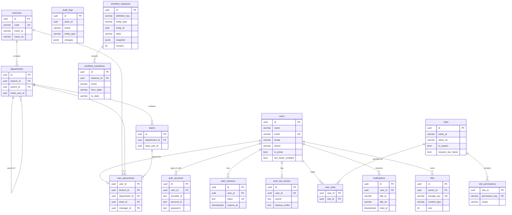
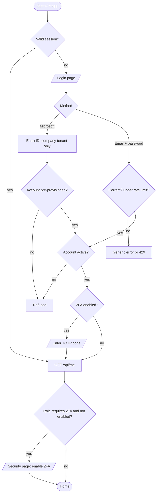
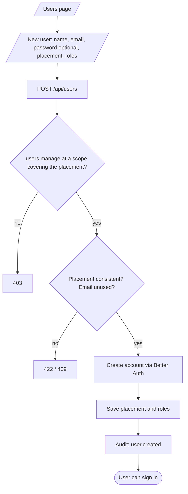
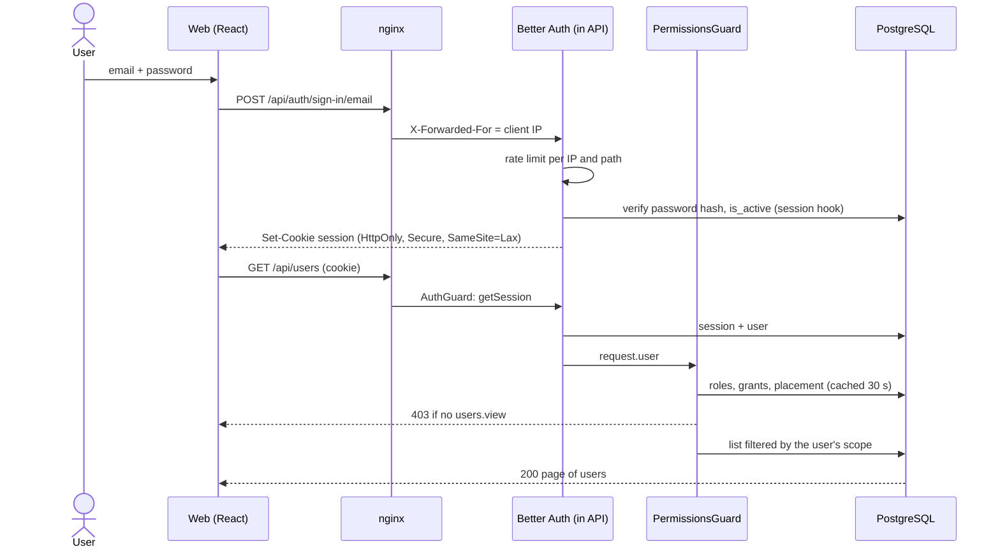
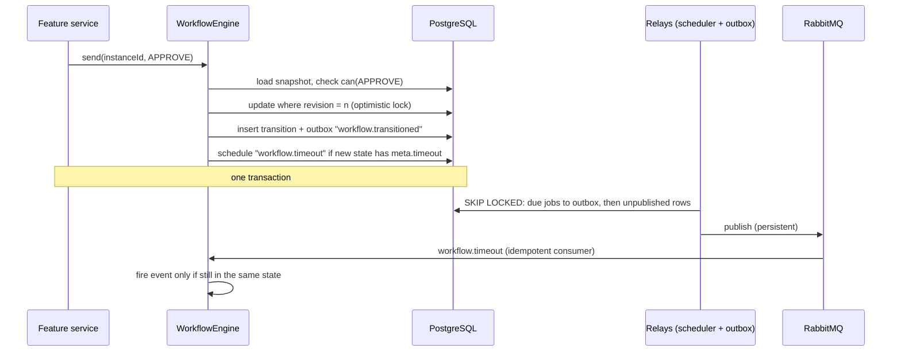
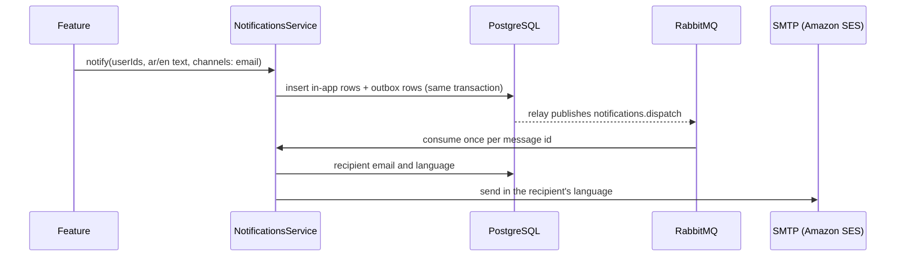
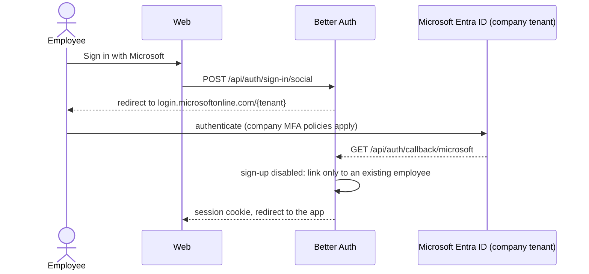

# Arweqah Platform

Internal ERP for Arweqah Alreyadah: one place for people, organization, requests, projects, tickets and finance tracking. This repository currently contains the **foundation** every business module is built on. Business modules are added one at a time from a written description of each feature (see [Adding a feature](#adding-a-feature)).

## 1. Overview

**Organization.** Arweqah Alreyadah (أروقة الريادة), a Saudi company with 1,000–5,000 employees across several branches.

**Problem.** Employee data, approvals, projects and tickets live in separate tools (Airtable, Google Sheets, email). Nobody has one view, approvals are slow to chase, and sensitive data (national IDs, salaries) is spread across files.

**Solution.** A bilingual (Arabic RTL / English) web platform where every employee signs in once (Microsoft 365 or password + two-step verification), sees only what their role and position in the organization allow, and where every sensitive action is recorded.

**Main journeys in the foundation**

1. An employee signs in with Microsoft or email + password, completes two-step verification when their role requires it, and lands on their home page.
2. HR creates an employee account, places it in a branch / department / team and assigns roles.
3. An administrator builds roles from the permission catalog and chooses how far each permission reaches (own records → team → department → branch → company).
4. An administrator maintains the organization structure.
5. A user receives notifications in the app (and by email), and an auditor reviews the audit log.

**In scope now:** authentication, users, organization structure, dynamic roles and scoped permissions, audit log, notifications (in-app, email, SMS adapter), file storage, workflow engine, messaging (outbox + RabbitMQ + durable scheduled jobs), bilingual UI shell.

**Out of scope now (planned modules):** attendance, leaves, requests, projects and tasks, tickets with SLA, expenses / advances / invoices tracking, payroll records, dashboards, two-way Airtable / Google Sheets sync. Out of scope for version 1 entirely: double-entry accounting, e-invoicing (ZATCA), GOSI / Mudad / WPS integrations.

## 2. Vision

A unified digital workplace that runs all of the company's resources efficiently and transparently.

## 3. Mission

Bring employee, project and request management into one secure platform that speeds up decisions and removes manual work.

## 4. Functional requirements

| ID | Requirement | Actor | Priority | Covered by |
|---|---|---|---|---|
| FR-01 | Sign in with email + password; sign out; no self sign-up; sign-in rate limit; deactivated accounts refused | All users | Must | `apps/api/test/auth.e2e-spec.ts`, `e2e/tests/auth.spec.ts` |
| FR-02 | Two-step verification (TOTP) required for roles that demand it (System Admin by default) | All users | Must | `apps/api/test/access.e2e-spec.ts` (Two-step verification), `e2e/tests/auth.spec.ts` |
| FR-03 | Sign in with Microsoft Entra ID, restricted to the company tenant; only pre-provisioned employees | All users | Must | `apps/api/src/config/env.schema.spec.ts` (manual check against the real tenant before go-live) |
| FR-04 | Create users with roles and placement; change roles and placement; deactivate (ends all sessions) and reactivate | HR / admin | Must | `apps/api/test/users.e2e-spec.ts`, `e2e/tests/users.spec.ts` |
| FR-05 | Dynamic roles built from a permission catalog in the admin panel; system roles cannot be deleted | Admin | Must | `apps/api/test/access.e2e-spec.ts`, `apps/web/src/features/roles/role-editor.test.tsx` |
| FR-06 | Every permission is scoped (own / team / department / branch / company); lists and records outside the scope are hidden (404) | All | Must | `apps/api/src/core/access/application/access.spec.ts`, `apps/api/test/users.e2e-spec.ts`, `apps/api/test/security.e2e-spec.ts` |
| FR-07 | Maintain branches, departments (nested) and teams; refuse cycles, cross-branch parents, deleting units in use | Admin | Must | `apps/api/test/users.e2e-spec.ts` (Organization structure) |
| FR-08 | In-app notifications with unread count; email (and SMS) delivered in the background through the outbox | All | Must | `apps/api/test/platform.e2e-spec.ts` (Notifications) |
| FR-09 | Upload files (PDF, PNG, JPEG ≤ 10 MB) checked by content; only the owner can read them | All | Should | `apps/api/test/platform.e2e-spec.ts` (Files) |
| FR-10 | Workflow engine: persisted state machines with history, optimistic locking and durable timeouts (escalations) | Feature modules | Must | `apps/api/test/platform.e2e-spec.ts` (Workflow engine) |
| FR-11 | Audit log of sign-ins and sensitive changes, secrets redacted, readable by auditors only | Auditor | Must | `apps/api/test/platform.e2e-spec.ts` (Audit log), `apps/api/src/core/audit/application/audit.service.spec.ts` |
| FR-12 | Arabic (RTL) and English interface, switchable at any time | All | Must | `apps/web/src/core/i18n/i18n.test.ts`, `e2e/tests/auth.spec.ts` |

Every test suite names the requirement IDs it covers in its `describe(...)` title.

## 5. Non-functional requirements

| ID | Requirement | Target | Verified by |
|---|---|---|---|
| NFR-01 | Performance | p95 < 300 ms for read endpoints at 5,000 users; morning check-in peak of 5,000 requests in 30 min | Load test (k6) to be added with the attendance module; indexes on every filter/foreign key |
| NFR-02 | Security | OWASP Top 10 controls; every non-public route 401 without session and 403 without permission | `apps/api/test/security.e2e-spec.ts` (routes discovered automatically), CI `security` workflow |
| NFR-03 | Input hardening | Unknown fields 400, bodies > 1 MB 413, no stack traces/SQL in errors, literal search | `apps/api/test/security.e2e-spec.ts`, `users.e2e-spec.ts` |
| NFR-04 | Availability | 99.5 % monthly | `/api/health` checks, `restart: unless-stopped`, deploy smoke test; CloudWatch alarm (to configure) |
| NFR-05 | Accessibility | WCAG 2.1 AA, no serious/critical axe violations | `@axe-core/playwright` in `e2e/` |
| NFR-06 | Localization | Full RTL Arabic and LTR English | `i18n.test.ts`, Playwright RTL checks |
| NFR-07 | Privacy / data residency (PDPL) | Personal data in Saudi Arabia once the AWS Saudi region opens; national IDs and bank data encrypted per field (AES-256-GCM) | `field-cipher.spec.ts`; migration plan in [Hosting](#hosting) |
| NFR-08 | Backup | RPO 24 h, RTO 4 h | RDS automated backups (7 days) + restore drill before go-live |
| NFR-09 | Maintainability | Layer rules enforced, duplication < 3 %, complexity ≤ 10 | ESLint `boundaries`, `npm run dup`, CI `quality` job |
| NFR-10 | Browser support | Last two versions of Chrome, Edge, Safari, Firefox; mobile | Playwright desktop + Pixel 7 projects |

## 6. ERD

Tables from the migrations in `apps/api/src/database/migrations`. Messaging tables (`outbox_messages`, `scheduled_jobs`, `processed_messages`) have no foreign keys and are omitted from the diagram.



## 7. Flowcharts

**Sign-in**



**Create a user (HR)**



**Build a role**


## 8. Sequence diagrams

**Email sign-in and an authorized request**



**Workflow transition with a durable timeout**



**Notifications by email**



**Microsoft sign-in (Entra ID)**



## 9. Stack

| Layer | Technology | Reason / change from team default |
|---|---|---|
| Monorepo | npm workspaces + Turborepo | Team default (Track D) |
| API | NestJS 11.2 + TypeScript 5.9 | NestJS 12 is out but `nestjs-zod` supports up to 11; TypeScript 6/7 not yet supported by `ts-jest`/`typescript-eslint` |
| Database | PostgreSQL 16 + TypeORM 1.1 | Chosen by the team; migrations only |
| Validation | zod 4 schemas in `packages/shared`, `nestjs-zod` | One rule for API and web |
| Auth | Better Auth 1.7 (+ `@thallesp/nestjs-better-auth`), Microsoft Entra ID, TOTP 2FA | Replaces the team's hand-written JWT; HttpOnly session cookie |
| Authorization | Dynamic roles + scoped permissions, CASL 7 for record checks | Requested: roles managed from the admin panel |
| Workflow | XState 5 with state in PostgreSQL | Requested; timeouts stored as jobs (XState timers are not durable) |
| Messaging | RabbitMQ 4 via `amqp-connection-manager`, transactional outbox, scheduled jobs table | Requested RabbitMQ instead of BullMQ/Redis; Redis not used |
| Email / SMS | SMTP adapter (Mailpit locally, Amazon SES in production); SMS adapter placeholder | Saudi SMS provider to be chosen |
| Files | S3 (private bucket, SSE, signed URLs) / local folder in development | |
| Web | React 19 + Vite 8 + React Router 8 + TanStack Query 5 + Tailwind 4 + Radix primitives | Requested React SPA instead of Next.js |
| i18n | i18next + react-i18next, Arabic RTL default | |
| Tests | Vitest (API unit + e2e, web components), MSW 3, Playwright + axe | Vitest instead of Jest because Better Auth is ESM-only |
| CI/CD | GitHub Actions → GHCR → EC2 over SSH | Team default |

## 10. Run and deploy

### Local

Requirements: Node 22.12+, Docker (Docker Desktop on Windows/macOS). On Windows run the commands in WSL 2 or Git Bash.

**Quick start:** `./scripts/setup.sh` (creates `.env` with fresh secrets, installs, starts Docker services, migrates, seeds), then `npm run dev`.

**Manual steps** (what the script does):

```bash
npm ci                                   # .npmrc sets legacy-peer-deps (see docs/decisions.md)
cp .env.example .env                     # then fill BETTER_AUTH_SECRET, FIELD_ENCRYPTION_KEY, passwords
docker compose up -d                     # PostgreSQL (+ test DB), RabbitMQ, Mailpit
npm run db:migrate
npm run db:seed                          # System Admin + Employee roles, HQ branch, first admin from SEED_ADMIN_*
npm run dev                              # API :3000, web :5173 (proxies /api)
```

| URL | What |
|---|---|
| http://localhost:5173 | Web app (sign in with `SEED_ADMIN_EMAIL`; you will be asked to enable 2FA) |
| http://localhost:3000/api/docs | Swagger (disabled in production) |
| http://localhost:8025 | Mailpit (emails sent locally) |
| http://localhost:15672 | RabbitMQ management (guest/guest locally) |

### Deploy

- **Trigger:** every push to `main` after CI (quality, API e2e, Playwright, security) passes; or manually (`workflow_dispatch`).
- **Steps:** build `api` and `web` images → Trivy scan → push to GHCR → SSH to EC2 → `migration:run:prod` → `seed:prod` (idempotent) → `docker compose up -d` → smoke test `GET {APP_URL}/api/health`.
- **GitHub secrets:** `EC2_HOST`, `EC2_USER`, `EC2_SSH_KEY`. **Variables:** `APP_URL`, `MICROSOFT_ENABLED`.
- **Server `.env`** (in `/opt/arweqah-platform`, created by hand, never in GitHub): everything in `.env.example` with production values, plus `RABBITMQ_USER`, `RABBITMQ_PASSWORD`, `REGISTRY`, `IMAGE_PREFIX`. Set `FILE_STORAGE=s3`, `SMTP_*` to the SES SMTP endpoint, `DB_SSL=true`, `APP_URL=API_URL=CORS_ORIGINS=https://app.<domain>`.

**First-time server setup**

1. EC2 Ubuntu 24.04 (t3.xlarge) in `me-south-1` with an instance role allowing S3 on the uploads bucket; security group: 22 from the team's IPs, 80/443 open.
2. RDS PostgreSQL 16 in the same VPC, not public, automated backups 7 days, encryption at rest.
3. Install Docker Engine + compose plugin; `mkdir /opt/arweqah-platform`; copy `docker-compose.prod.yml` and `docker/nginx/edge.conf` (replace `__DOMAIN__`); create `.env`.
4. `docker login ghcr.io` with a read-only package token.
5. DNS `app.<domain>` → Elastic IP; certbot certificate; renewal timer that reloads nginx.
6. Microsoft Entra app registration: redirect URI `https://app.<domain>/api/auth/callback/microsoft`; put the tenant GUID in `MICROSOFT_TENANT_ID`.
7. Push to `main`.

**Rollback:** `export TAG=<previous sha> && docker compose -f docker-compose.prod.yml up -d api web`. Migrations are written backward compatible (add first, remove later); revert one with `docker compose run --rm api npm run migration:revert`.

## 11. Testing

| Type | Command | Covers |
|---|---|---|
| API unit | `npm test -w @arweqah-platform/api` | Scopes and CASL rules, permission catalog, env validation, field encryption, error mapping, redaction (32 tests) |
| API e2e (real PostgreSQL) | `npm run test:e2e:api` | All FR-01…FR-11 endpoints, 2FA with real TOTP, IDOR, mass assignment, SQL injection, workflow concurrency (37 tests) |
| Security suite | part of API e2e (`test/security.e2e-spec.ts`) | 401 on every route, 403 on every permission route (discovered from Nest metadata), headers, CORS, 413, forged cookies |
| Web components | `npm test -w @arweqah-platform/web` | DataTable, permission-filtered navigation, role editor payload, RTL switching (MSW) |
| Full-stack e2e | `npm run test:e2e:web` | Sign-in with 2FA, admin adds a user who then signs in, XSS rendered as text, limited user blocked, no tokens in storage, no secret values in the bundle, axe on each page, desktop + mobile |
| Static and supply chain | CI `security` workflow | npm audit (high), gitleaks, Semgrep (OWASP, Node, TypeScript, secrets), Trivy (fs + images), ZAP baseline + API scan |

Requirement traceability: each `describe` title lists the FR/NFR IDs it covers, and section 4 lists the suites for each requirement.

## 12. Actors

| Actor | Can | Cannot |
|---|---|---|
| Employee (role "Employee") | Sign in, see own profile and notifications, upload own files, enable 2FA | See other users, roles, organization admin or audit log unless a role grants it |
| Line manager / HR (custom roles) | What their roles grant, limited to their team / department / branch | Act outside their scope (gets 404), change their own roles, deactivate themselves |
| System Admin (system role) | Every permission at company scope | Use protected pages before enabling 2FA; delete system roles |
| Auditor (custom role with `audit.view`) | Read the audit log | See secrets (redacted) |
| Microsoft Entra ID | Authenticate company accounts | Create accounts (sign-up disabled) |
| Amazon SES / SMS provider | Deliver messages | Read any data beyond the message |
| GitHub Actions | Build, test, deploy | Read production secrets (they live on the server) |

Permission catalog (foundation): `users.view`, `users.manage`, `roles.view`, `roles.manage`, `org.view`, `org.manage`, `audit.view`. Each feature module adds its own keys.

## 13. Constraints

- **Regulatory:** Saudi PDPL. Personal data (national IDs, salaries) must be protected and kept in Saudi Arabia; the interim hosting in Bahrain needs the company's documented legal basis until the move.
- **Hosting:** existing AWS account; AWS Saudi region expected December 2026.
- **Scale:** 1,000–5,000 employees.
- **Budget (estimate):** about USD 350–400 per month (EC2 t3.xlarge, RDS, staging, S3, CloudWatch), around 35 % less with Savings Plans.
- **Technical:** Better Auth is ESM-only (Vitest, Node ≥ 22.12); `nestjs-zod` pins NestJS 11.
- **Organizational:** each business module starts from a written description by the product owner.

## 14. Assumptions

| Assumption | Impact if wrong | Confirmed by |
|---|---|---|
| 1,000–5,000 employees | Instance and database sizing, partitioning of attendance | Product owner |
| Finance in v1 is tracking and approval only (no accounting, no e-invoicing) | Large new scope (ledger, ZATCA) | Product owner |
| Payroll in v1 records and approves; no automatic GOSI/WPS deductions | Integrations and legal review needed | Proposed, to confirm |
| Airtable / Google Sheets sync is two-way, with a per-field owner and a conflict log | Data loss or overwrites | Product owner (two-way); conflict policy proposed |
| The company has a legal basis to host personal data in Bahrain until the Saudi region opens | Compliance risk; host in KSA immediately | To confirm with legal |
| Microsoft 365 accounts use the company email addresses HR enters | Employees cannot link Microsoft sign-in | To confirm with IT |
| A Saudi SMS provider will be chosen later | SMS channel only logs for now | Open |

## 15. Third parties

| Service | Purpose | Direction / trigger | Env vars | Docs |
|---|---|---|---|---|
| Microsoft Entra ID | Employee sign-in | User-initiated OAuth | `MICROSOFT_CLIENT_ID`, `MICROSOFT_CLIENT_SECRET`, `MICROSOFT_TENANT_ID` | https://www.better-auth.com/docs/authentication/microsoft |
| Amazon SES (SMTP) | Notification email | Outbound, from the outbox | `SMTP_HOST`, `SMTP_PORT`, `SMTP_USER`, `SMTP_PASSWORD`, `SMTP_SECURE`, `MAIL_FROM` | https://docs.aws.amazon.com/ses/latest/dg/send-email-smtp.html |
| Amazon S3 | File storage | Outbound; signed download URLs (5 min) | `FILE_STORAGE`, `S3_BUCKET`, `S3_REGION` (credentials from the instance role) | https://docs.aws.amazon.com/s3/ |
| Amazon RDS PostgreSQL | Database | — | `DB_HOST`, `DB_PORT`, `DB_NAME`, `DB_USER`, `DB_PASSWORD`, `DB_SSL` | https://docs.aws.amazon.com/rds/ |
| RabbitMQ | Messaging between modules and workers | Internal | `MESSAGE_BUS`, `RABBITMQ_URL` | https://www.rabbitmq.com/docs |
| GitHub Container Registry | Images | Push from CI, pull on EC2 | — | https://docs.github.com/packages |
| Airtable, Google Sheets | Two-way sync (planned module) | Scheduled jobs | to be added with the module | — |
| SMS provider (Saudi) | SMS notifications (planned) | Outbound | to be added | — |

## More

### Project structure

```
apps/
  api/src/
    common/        base entity, domain errors, unit of work, field cipher, error filter
    config/        env validation (zod), typed AppConfig, TypeORM options
    core/          infrastructure every feature uses
      auth/        Better Auth adapter (IdentityProvider)
      access/      roles, permission catalog, scopes, CASL, PermissionsGuard
      audit/       audit log
      messaging/   outbox, RabbitMQ / in-memory bus, scheduled jobs, idempotency
      workflow/    XState engine, registry, history
      notifications/ in-app + channels (email, SMS)
      files/       storage strategies, content inspection
    modules/       business modules: org, users (and future features)
    database/      entities list, migrations, seeds
  web/src/
    app/           composition root: features list, router, layout, providers
    core/          API client, auth/session, permissions, i18n, theme, feature contract
    shared/ui/     DataTable, Dialog, FormField, Button…
    features/      auth, home, notifications, users, roles, org, audit, security
packages/shared    zod schemas, DTO types, permission scopes (used by api and web)
e2e/               Playwright specs + page objects
docker/            nginx (web + edge), postgres init
```

### Architecture and patterns

Every API module has `domain / application / infrastructure / presentation`; imports only point inward, enforced by `eslint-plugin-boundaries`. Patterns in use, each where its trigger exists: Repository (every aggregate), Adapter (Better Auth, S3, SMTP, RabbitMQ), Strategy (file storage, notification channels, message bus), Registry (permission catalog, workflow definitions, web features), Observer (in-process audit events), Outbox (cross-process events), Unit of Work (`TransactionRunner`), Specification (`applyScope` for list queries), State machine (XState). On the web, pages import features only through their `index.ts`; components use hooks, hooks use the single `apiClient`.

### Adding a feature

1. Describe it: name, goal, users and roles, journeys step by step, data and fields, business rules, approval path, notifications, reports, links to other modules.
2. API: `apps/api/src/modules/<feature>/{domain,application,infrastructure,presentation}`, a `<feature>.permissions.ts` registered on module init, entities added to `database/entities.ts`, a migration (`npm run db:migration:generate --name=<Feature>`), a workflow definition registered in `WorkflowRegistry` if it has approvals, e2e specs named with its FR IDs.
3. Shared: request schemas and DTOs in `packages/shared/src/<feature>/`.
4. Web: `apps/web/src/features/<feature>/` with `index.ts` exporting a `FeatureModule` (lazy routes, nav item with its permission, `i18n/{ar,en}.json`), then one line in `app/features.ts`.
5. Update sections 4, 6, 7, 8 and 12 of this README in the same PR.

### Brand

| Token | Value | Use |
|---|---|---|
| `navy-900` | `#0F1E3A` | Primary, sidebar, text |
| `gold-500` | `#C9A84C` | Active marks, focus ring, badges with navy text (never text on white: 2.6:1) |
| `surface` | `#F5F6F8` | Page background |
| `line` | `#DDE2EA` | Borders |
| Fonts | Cairo 700 (headings), Tajawal 400/500 (Arabic body), Inter (Latin) | Self-hosted via `@fontsource` |

Contrast: white on navy 16.6:1, navy on gold 6.3:1, navy on surface 15.8:1. The one decorative element is the arcade (أروقة) pattern on the sign-in page; the gold rule on the active navigation item echoes it.

### Hosting

Interim region `me-south-1` (Bahrain). Move to the AWS Saudi region when it opens: create RDS and EC2 there, restore the latest snapshot, copy the S3 bucket, switch DNS, then decommission Bahrain. Plan a short maintenance window.

### Security

See [SECURITY.md](SECURITY.md).

### Decisions

See [docs/decisions.md](docs/decisions.md).

### Conventions

Conventional Commits (`feat(users): …`), branches `feat/*`, `fix/*`, `chore/*`; `main` is protected and deploys on merge. The PR template includes the README checkbox.
