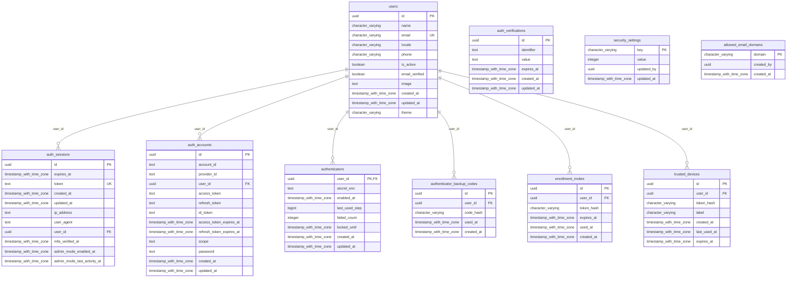
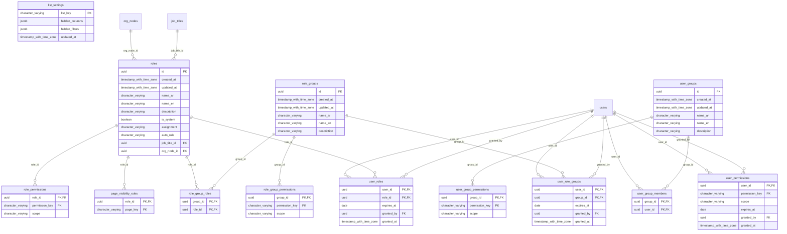
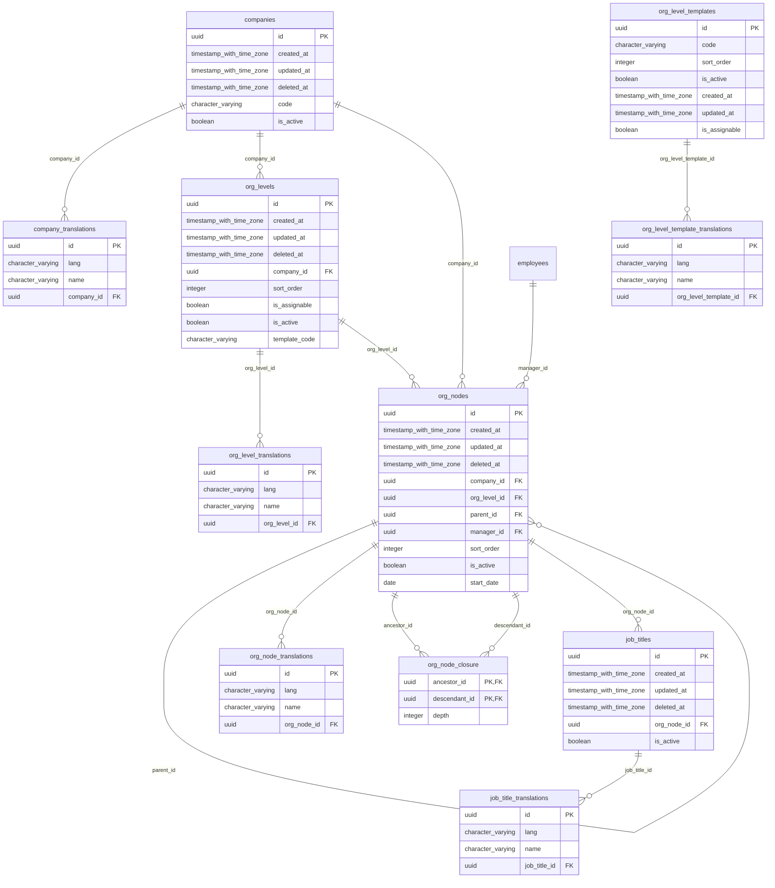
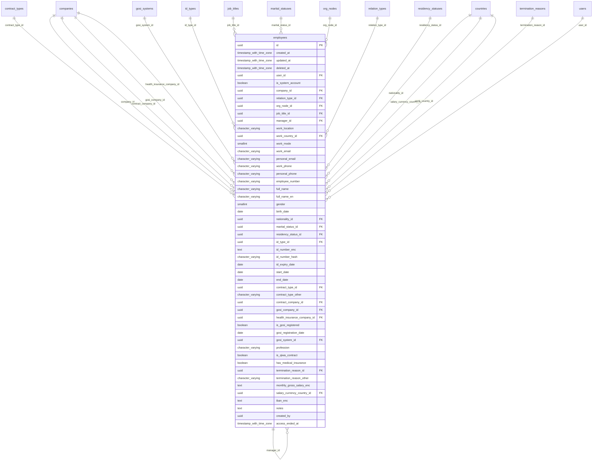
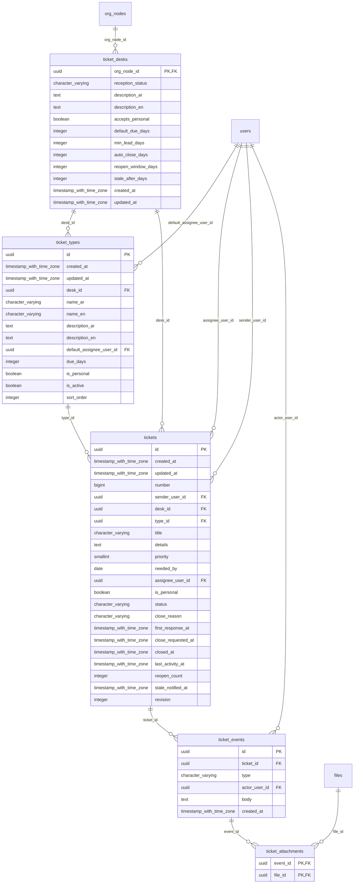
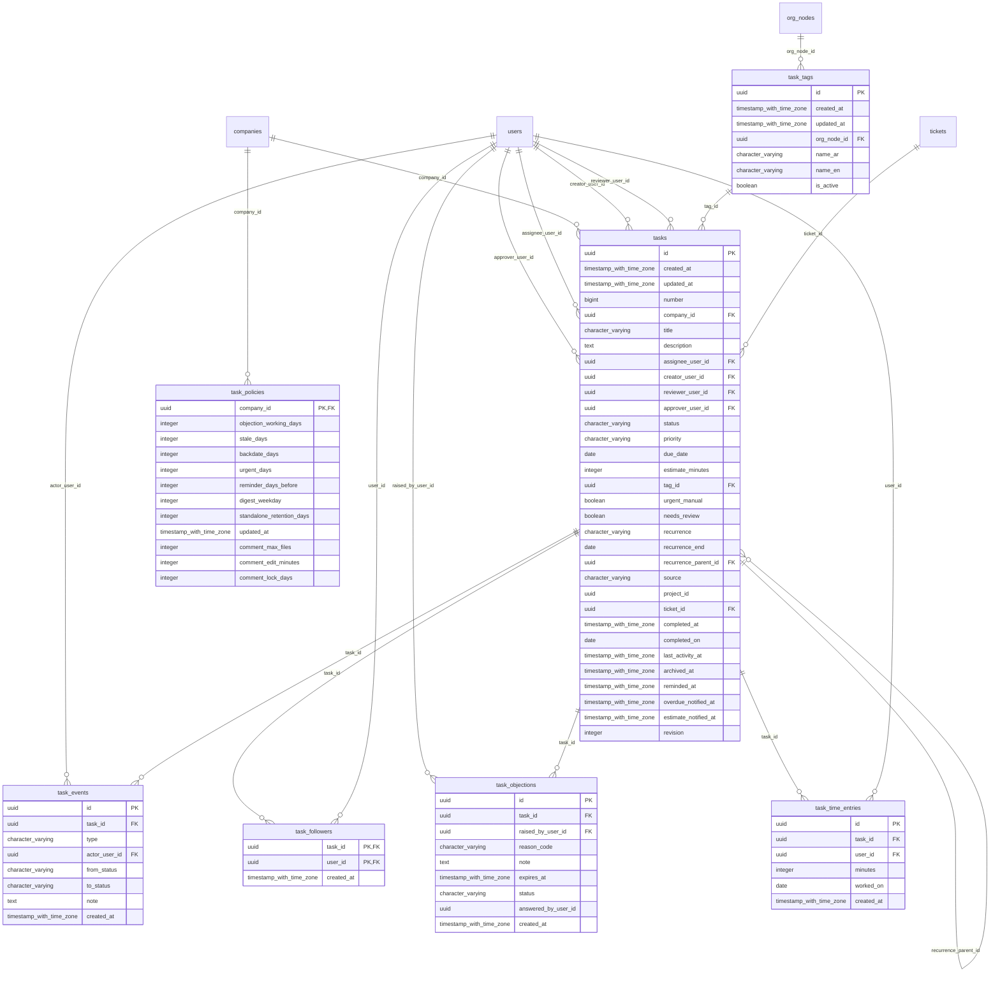
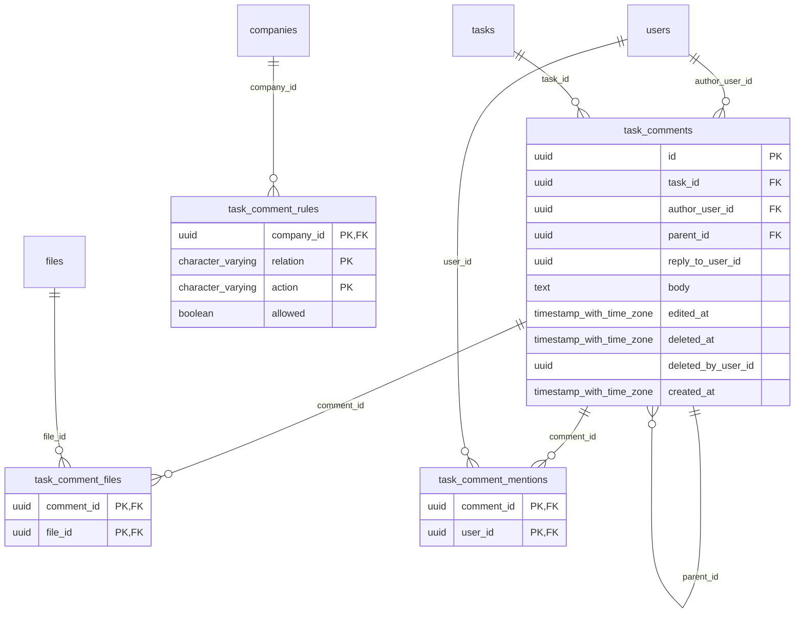

# Database design

All 84 tables of the PostgreSQL database (`arweqah_platform`), generated from the live schema after the last migration (`NodeHeadRoles`, 2026-11-02). Part 1 is the ER diagrams (one per area; a box with no columns is a table that lives in another area); part 2 describes what each table does.

> **Rule (CLAUDE.md):** every new table (or column that changes a relation) is added to this file in the same change as its migration: its columns in the diagram of its area, and one row in the description tables. `README.md` §6 keeps the short overview; this file is the full reference.

Conventions: `PK` primary key · `FK` foreign key · `UK` unique. Every `*_translations` table holds the names of its parent in `ar` and `en` (`lang`). Most tables have `id uuid`, `created_at`, `updated_at`; business entities also carry `revision` for optimistic concurrency.

## Part 1 — ER diagrams

### 1. Identity and sign-in

### 2. Access (roles, groups, permissions)

### 3. Organization

### 4. Lookups

```mermaid
erDiagram
  countries {
    uuid id PK
    character_varying code
    integer sort_order
    boolean is_active
    timestamp_with_time_zone created_at
    timestamp_with_time_zone updated_at
    character_varying iso_code
    character_varying currency_code
  }
  country_translations {
    uuid id PK
    character_varying lang
    character_varying name
    uuid country_id FK
    character_varying currency_name
  }
  marital_statuses {
    uuid id PK
    character_varying code
    integer sort_order
    boolean is_active
    timestamp_with_time_zone created_at
    timestamp_with_time_zone updated_at
  }
  marital_status_translations {
    uuid id PK
    character_varying lang
    character_varying name
    uuid marital_status_id FK
  }
  residency_statuses {
    uuid id PK
    character_varying code
    integer sort_order
    boolean is_active
    timestamp_with_time_zone created_at
    timestamp_with_time_zone updated_at
  }
  residency_status_translations {
    uuid id PK
    character_varying lang
    character_varying name
    uuid residency_status_id FK
  }
  id_types {
    uuid id PK
    character_varying code
    integer sort_order
    boolean is_active
    timestamp_with_time_zone created_at
    timestamp_with_time_zone updated_at
    boolean requires_country
  }
  id_type_translations {
    uuid id PK
    character_varying lang
    character_varying name
    uuid id_type_id FK
  }
  id_type_rules {
    uuid id PK
    character_varying code
    integer sort_order
    boolean is_active
    timestamp_with_time_zone created_at
    timestamp_with_time_zone updated_at
    uuid id_type_id FK
    uuid country_id FK
    character_varying regex
    integer min_length
    integer max_length
    character_varying checksum
  }
  id_type_rule_translations {
    uuid id PK
    character_varying lang
    character_varying name
    uuid id_type_rule_id FK
  }
  contract_types {
    uuid id PK
    character_varying code
    integer sort_order
    boolean is_active
    timestamp_with_time_zone created_at
    timestamp_with_time_zone updated_at
    boolean requires_end_date
    boolean is_other
  }
  contract_type_translations {
    uuid id PK
    character_varying lang
    character_varying name
    uuid contract_type_id FK
  }
  gosi_systems {
    uuid id PK
    character_varying code
    integer sort_order
    boolean is_active
    timestamp_with_time_zone created_at
    timestamp_with_time_zone updated_at
    jsonb conditions
  }
  gosi_system_translations {
    uuid id PK
    character_varying lang
    character_varying name
    uuid gosi_system_id FK
  }
  termination_reasons {
    uuid id PK
    character_varying code
    integer sort_order
    boolean is_active
    timestamp_with_time_zone created_at
    timestamp_with_time_zone updated_at
    boolean is_other
  }
  termination_reason_translations {
    uuid id PK
    character_varying lang
    character_varying name
    uuid termination_reason_id FK
  }
  relation_types {
    uuid id PK
    character_varying code
    integer sort_order
    boolean is_active
    timestamp_with_time_zone created_at
    timestamp_with_time_zone updated_at
    boolean limited_access
  }
  relation_type_translations {
    uuid id PK
    character_varying lang
    character_varying name
    uuid relation_type_id FK
  }
  relation_types ||--o{ relation_type_translations : "relation_type_id"
  countries ||--o{ country_translations : "country_id"
  marital_statuses ||--o{ marital_status_translations : "marital_status_id"
  residency_statuses ||--o{ residency_status_translations : "residency_status_id"
  id_types ||--o{ id_type_translations : "id_type_id"
  countries ||--o{ id_type_rules : "country_id"
  id_types ||--o{ id_type_rules : "id_type_id"
  id_type_rules ||--o{ id_type_rule_translations : "id_type_rule_id"
  contract_types ||--o{ contract_type_translations : "contract_type_id"
  gosi_systems ||--o{ gosi_system_translations : "gosi_system_id"
  termination_reasons ||--o{ termination_reason_translations : "termination_reason_id"
```

### 5. Employees

### 6. Tickets

### 7. Tasks

### 8. Task conversations

### 9. Platform services

```mermaid
erDiagram
  audit_logs {
    uuid id PK
    uuid actor_id
    character_varying action
    character_varying entity_type
    character_varying entity_id
    jsonb changes
    character_varying ip
    timestamp_with_time_zone created_at
    bigint seq
    character_varying prev_hash
    character_varying hash
  }
  files {
    uuid id PK
    timestamp_with_time_zone created_at
    timestamp_with_time_zone updated_at
    uuid owner_id FK
    character_varying storage_key UK
    character_varying original_name
    character_varying content_type
    integer size
  }
  outbox_messages {
    uuid id PK
    character_varying topic
    jsonb payload
    timestamp_with_time_zone created_at
    timestamp_with_time_zone published_at
    integer attempts
    text last_error
  }
  processed_messages {
    character_varying consumer PK
    character_varying message_id PK
    timestamp_with_time_zone processed_at
  }
  scheduled_jobs {
    uuid id PK
    character_varying topic
    jsonb payload
    timestamp_with_time_zone run_at
    character_varying status
    character_varying dedupe_key
    integer attempts
    text last_error
    timestamp_with_time_zone created_at
  }
  notifications {
    uuid id PK
    uuid user_id FK
    character_varying title_ar
    character_varying title_en
    text body_ar
    text body_en
    character_varying link
    timestamp_with_time_zone read_at
    timestamp_with_time_zone created_at
  }
  email_logs {
    uuid id PK
    character_varying to_email
    character_varying subject
    character_varying purpose
    character_varying status
    text error
    character_varying message_id
    text provider_response
    timestamp_with_time_zone created_at
    timestamp_with_time_zone sent_at
  }
  integration_providers {
    uuid id PK
    timestamp_with_time_zone created_at
    timestamp_with_time_zone updated_at
    character_varying kind
    character_varying provider_key
    jsonb config
    character_varying verified_hash
    timestamp_with_time_zone verified_at
    boolean is_active
    uuid updated_by
  }
  message_templates {
    uuid id PK
    timestamp_with_time_zone created_at
    timestamp_with_time_zone updated_at
    character_varying kind
    character_varying key
    jsonb content
    jsonb pending
    uuid pending_by
    timestamp_with_time_zone pending_at
    uuid updated_by
  }
  template_settings {
    uuid id PK
    timestamp_with_time_zone created_at
    timestamp_with_time_zone updated_at
    character_varying kind
    boolean require_approval
    uuid updated_by
  }
  workflow_instances {
    uuid id PK
    timestamp_with_time_zone created_at
    timestamp_with_time_zone updated_at
    character_varying definition_key
    integer definition_version
    character_varying entity_type
    uuid entity_id
    character_varying state
    boolean is_done
    jsonb snapshot
    uuid started_by
    integer revision
  }
  workflow_transitions {
    uuid id PK
    uuid instance_id FK
    character_varying event
    character_varying from_state
    character_varying to_state
    uuid actor_id
    character_varying comment
    timestamp_with_time_zone created_at
  }
  tour_step_settings {
    uuid id PK
    timestamp_with_time_zone created_at
    timestamp_with_time_zone updated_at
    character_varying step_key
    boolean enabled
    integer sort_order
    character_varying title_ar
    character_varying title_en
    character_varying body_ar
    character_varying body_en
    uuid updated_by
  }
  user_tour_progress {
    uuid id PK
    timestamp_with_time_zone created_at
    timestamp_with_time_zone updated_at
    uuid user_id
    character_varying tour
    character_varying status
    ARRAY seen_steps
  }
  migrations {
    integer id PK
    bigint timestamp
    character_varying name
  }
  users ||--o{ files : "owner_id"
  users ||--o{ notifications : "user_id"
  workflow_instances ||--o{ workflow_transitions : "instance_id"
```

## Part 2 — What each table does

### 1. Identity and sign-in

| Table | What it does |
|---|---|
| `users` | One row per person who can sign in: name, e-mail, language, theme, active flag. The root of almost every relation. |
| `auth_accounts` | Better Auth link between a user and a sign-in provider (Microsoft Entra or work e-mail). |
| `auth_sessions` | Active login sessions: token, expiry, when the authenticator code was verified, platform-admin-mode timestamps. |
| `auth_verifications` | Short-lived Better Auth tokens (e-mail verification, sign-in links). |
| `authenticators` | The user's authenticator-app secret (encrypted), replay guard (`last_used_step`), failed-attempt counter and lock time. |
| `authenticator_backup_codes` | One-time backup codes for a user who lost the authenticator app. |
| `enrollment_invites` | E-mailed QR link that lets a new user enroll the authenticator app the first time. |
| `trusted_devices` | Devices a person chose to «remember», so the code is skipped there until expiry. |
| `security_settings` | Single-row platform security settings (session length, request limit per minute, device trust…). |
| `allowed_email_domains` | E-mail domains allowed to sign in with a work e-mail. |

### 2. Access

| Table | What it does |
|---|---|
| `roles` | Roles (manual, automatic by rule, per-unit «head of unit» roles via `org_node_id`, collaborator base). |
| `role_permissions` | Permission keys a role holds, each with its scope (own / unit / company / all). |
| `user_roles` | Roles assigned to a person (stored choices, with the grant stamp). |
| `role_groups` | A named bundle of roles (e.g. «HR team»). |
| `role_group_roles` | Which roles are inside a role group. |
| `role_group_permissions` | Extra permission keys given to everyone holding a role group. |
| `user_groups` | A named group of people. |
| `user_group_members` | Members of a user group. |
| `user_group_permissions` | Permission keys given to every member of a user group. |
| `user_role_groups` | Role groups assigned to a person. |
| `user_permissions` | Exceptions: a single permission key given to one person, with scope, expiry and who granted it. |
| `page_visibility_rules` | Which pages (`page_key`) a role may see in the menu. |
| `list_settings` | Per list: hidden columns and hidden filters (list management). |

### 3. Organization

| Table | What it does |
|---|---|
| `companies` | The group's companies (branches): code and active flag; names in `company_translations`. |
| `company_translations` | Company names in ar / en. |
| `org_levels` | Levels of the structure per company (sector, department, section, unit…). |
| `org_level_translations` | Level names in ar / en. |
| `org_level_templates` | Reusable level sets used when a company is created. |
| `org_level_template_translations` | Template level names in ar / en. |
| `org_nodes` | The organization tree: each sector / department / section / unit, with its parent and head. |
| `org_node_translations` | Node names in ar / en. |
| `org_node_closure` | Ancestor → descendant pairs with depth, so «everything under this unit» is one query (scope checks). |
| `job_titles` | Job titles. |
| `job_title_translations` | Job title names in ar / en. |

### 4. Lookups (drop-down lists, each with its `*_translations`)

| Table | What it does |
|---|---|
| `countries` / `country_translations` | Countries and nationalities. |
| `marital_statuses` / `marital_status_translations` | Marital status values. |
| `residency_statuses` / `residency_status_translations` | Residency status values. |
| `id_types` / `id_type_translations` | Kinds of ID (national ID, iqama, passport…). |
| `id_type_rules` / `id_type_rule_translations` | Format rule per ID type and country: regex, min / max length, checksum. |
| `contract_types` / `contract_type_translations` | Employment contract types. |
| `gosi_systems` / `gosi_system_translations` | GOSI (social insurance) systems. |
| `termination_reasons` / `termination_reason_translations` | Reasons an employment ends. |
| `relation_types` / `relation_type_translations` | Relation of a person to the company (employee, collaborator…); `limited_access` marks the collaborator kind with a required end date. |

### 5. Employees

| Table | What it does |
|---|---|
| `employees` | The employee file: company, unit, job title, manager, relation, work location / mode, contact data, ID, contract, GOSI, medical insurance, dates, termination, salary. National ID, salary and IBAN are encrypted (`*_enc`, ID also hashed for lookup). Soft-deleted (`deleted_at`); linked to `users`. |

### 6. Tickets (internal, between departments)

| Table | What it does |
|---|---|
| `ticket_desks` | One per receiving unit (`org_node_id`): reception status, accepts-personal flag, default / minimum due days, auto-close, reopen window and stale-after days. |
| `ticket_types` | Kinds of ticket per desk (names ar / en, default assignee, due days, personal flag). |
| `tickets` | The ticket: sender, desk, type, title, details, priority, needed-by date, assignee, status, close reason, response and activity timestamps, reopen count. |
| `ticket_events` | Timeline of a ticket: answers, status changes, assignment, close and reopen. |
| `ticket_attachments` | Files attached to a ticket (links to `files`). |

### 7. Tasks

| Table | What it does |
|---|---|
| `tasks` | The task: company, creator, assignee, reviewer, approver, status, priority, due date, estimate, tag, recurrence, source (manual / ticket / project), completion and archive dates, reminder markers. |
| `task_events` | Timeline of a task: type, actor, from / to status and note. |
| `task_followers` | People who follow a task and are notified. |
| `task_objections` | An objection raised on a task: reason code, note, expiry, status and who answered. |
| `task_policies` | Per-company task settings: objection working days, stale days, back-date days, reminder days, digest weekday, retention, comment limits. |
| `task_tags` | Tags per unit (`org_node_id`) that a task can carry. |
| `task_time_entries` | Time logged against a task. |

### 8. Task conversations

| Table | What it does |
|---|---|
| `task_comments` | Comments and replies on a task. |
| `task_comment_files` | Files attached to a comment (links to `files`). |
| `task_comment_mentions` | `@` mentions in a comment, used for notifications. |
| `task_comment_rules` | Per-company matrix: which relation (owner, assignee, follower…) may do which comment action. |

### 9. Platform services

| Table | What it does |
|---|---|
| `audit_logs` | Tamper-evident audit trail: a hash chain (`seq`, `prev_hash`, `hash`); a trigger refuses update and delete. |
| `files` | Metadata of every stored file (original name, content type, size, owner, storage key). |
| `outbox_messages` | Transactional outbox: messages to publish to RabbitMQ, written in the same transaction as the change. |
| `processed_messages` | Idempotency record: consumers skip a message already handled. |
| `scheduled_jobs` | Durable timers (reminders, timeouts) run by the scheduler. |
| `notifications` | In-app notifications per user: bilingual title and body, link, read time. |
| `email_logs` | Every e-mail sent or failed, for support. |
| `integration_providers` | External services (e-mail, translation, Turnstile…): provider key, encrypted config, last verified test, active flag. |
| `message_templates` | Editable e-mail / message templates. |
| `template_settings` | Per template kind: whether changes need approval. |
| `workflow_instances` | Running XState approval workflows: definition, state, entity, snapshot. |
| `workflow_transitions` | History of each workflow instance's transitions. |
| `tour_step_settings` | Welcome-tour steps the admin edited: enabled flag, order, texts in ar / en. |
| `user_tour_progress` | Which tour steps each user has seen or dismissed. |
| `migrations` | TypeORM bookkeeping: which migrations already ran. |
