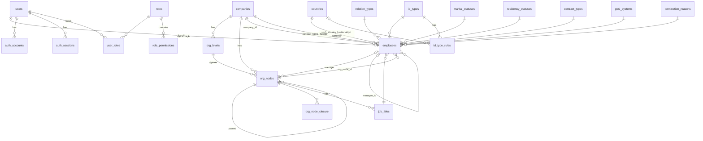

# خطة المرحلة 1 — الهوية والمصادقة والموظفون والهيكل التنظيمي

> الحالة: **مسودة (نسخة 5) تنتظر موافقتك**. لم يُكتب أي كود منها. أي تعديل تطلبه على هذا الملف أطبّقه قبل البدء.
> تغييرات النسخة 2: (1) الدخول **بدون كلمة مرور** نهائيًا: بريد + رمز تطبيق المصادقة، أو زر Microsoft. (2) الهيكل التنظيمي يُبنى بفورمات: فورم تقسيمات الهيكل أولًا ثم فورم إضافة وحدة تحت أي تقسيم.
> تغييرات النسخة 3 (بناءً على ردك): (3) **تفعيل تطبيق المصادقة إلزامي لكل مستخدم** بلا استثناء ولا خيار حسب الدور. (4) كل موظف يُنشأ له حساب دخول. (5) التقسيمات ديناميكية بالكامل، والترتيب الافتراضي من seeder: قطاع ← إدارة ← قسم ← وحدة، وقابل للتغيير. (6) **المسميات الوظيفية تحت الوحدات إلزامية**.
> تغييرات النسخة 4: (7) **الرمز مطلوب في كل عملية دخول** حتى بعد Microsoft. (8) تغيير التقسيمات مع وجود وحدات مسموح، **بعد تحذير يعرض البيانات المتأثرة وتأكيد المستخدم**. (9) قالب تقسيمات **واحد** لكل الشركات حاليًا. (10) **10 شركات افتراضية** من الـ seeder.
> تغييرات النسخة 5: (11) عند مسح تقسيم عليه موظفون: **تنبيه صريح وخياران: نقل الموظفين إلى وحدة أخرى، أو مسحهم بعد تأكيد إضافي**. لا يُمسح موظف بلا تنبيه. (12) مراجعة الترجمة العربية/الإنجليزية في جدول مرجعي (4.8). (13) الأدمن الأول يتبع «أروقة الريادة» (محسوم).
> التاريخ: 2026-10-21 · المرجع: وصف المالك + ملف "تصور فورم الموظف وقاعدة البيانات" + `CLAUDE.md` + `docs/decisions.md`.

---

## 1. الهدف والنطاق

### الهدف
نظام دخول آمن على Better Auth، وإدارة كاملة للموظفين من لوحة التحكم عن طريق فورم الموظف (40 حقل)، على هيكل تنظيمي لكل شركة، مع أدوار وصلاحيات تُحدد من يرى ويعدل أي موظف.

### داخل النطاق
| # | البند | ملخص |
|---|---|---|
| 1 | تسجيل الدخول | **بدون كلمة مرور**: (أ) بريد العمل + رمز تطبيق المصادقة (TOTP)، أو (ب) زر «الدخول بواسطة Microsoft». **تطبيق المصادقة إلزامي لكل مستخدم** (لا يدخل أحد النظام قبل تفعيله)، و**رمزه مطلوب في كل عملية دخول** حتى بعد Microsoft. **لا توجد صفحة تسجيل جديد**. |
| 2 | الحساب الأول (startup) | أدمن واحد يُنشأ بالـ seeder: `s.magdy@arweqah.sa` ويدخل بحساب Microsoft. |
| 3 | الموظفون | الأدمن يضيف ويعدل الموظفين من الداشبورد بفورم الـ 40 حقل. |
| 4 | الشركات والهيكل | شركات متعددة. التقسيمات **ديناميكية** وتُبنى بفورمات: **فورم تقسيمات الهيكل** (الافتراضي من seeder: قطاع ← إدارة ← قسم ← وحدة، وقابل للتغيير)، ثم **فورم إضافة وحدة** تحت أي تقسيم. **المسميات الوظيفية تحت الوحدات إلزامية**. |
| 5 | جداول الاختيارات (lookups) | 13 جدول مترجم عربي/إنجليزي، 8 منها بـ seeder و5 لها شاشات إدارة. |
| 6 | الأدوار والصلاحيات | شاشة بناء الأدوار (حُذفت من الواجهة في التنظيف الأخير وستعود هنا)، وربط الأدوار بالموظفين. |
| 7 | الأمان | تفعيل تطبيق المصادقة (دعوة)، رموز احتياطية، حماية من التخمين (قفل مؤقت)، إنهاء الجلسات عند التعطيل، سجل التدقيق. لا توجد كلمات مرور في النظام. |
| 8 | واجهة الداشبورد | صفحة الدخول، الرئيسية، الموظفون، الهيكل، الشركات، الأدوار، التدقيق، الملف الشخصي. |

### خارج النطاق (مراحل لاحقة)
الحضور، الإجازات، الطلبات، المشاريع، التذاكر، المصروفات، الرواتب (نحتفظ بحقول الراتب في السجل فقط)، المزامنة مع Airtable/Sheets، استيراد الموظفين من Excel (اقتراح مرحلة لاحقة).

---

## 2. قرارات معمارية مهمة (تغيّر شيئًا في الأساس الحالي)

### 2.1 المستخدم مقابل الموظف
- `users` = هوية الدخول (يملكها Better Auth: بريد، جلسات، حسابات). **تبقى كما هي.**
- `employees` = سجل الموظف الوظيفي (الـ 40 حقل). يرتبط بـ `users` بعلاقة **1:1** عبر `employees.user_id` (unique).
- **بريد العمل هو بريد الدخول وهو نفسه حساب Microsoft.** نفس القيمة في `users.email` و`employees.work_email`، ويُقفل تعديله بعد الإنشاء (تغييره عملية خاصة بمراجعة، خارج هذه المرحلة).
- البريد الشخصي لا يُستخدم للدخول أبدًا.

### 2.2 الهيكل التنظيمي الجديد يحل محل branches / departments / teams
الأساس الحالي فيه `branches` و`departments` و`teams` و`user_placements`. الوصف الجديد (شركات ← مستويات ← وحدات بشجرة مرنة) أعم، فلا يصح أن يعيشا معًا.
- **نحذف** `branches`, `departments`, `teams`, `user_placements` بـ migration جديد (لا بيانات إنتاج، المشروع في بدايته).
- **نضيف** `companies`, `org_levels`, `org_nodes` (+ closure table), `job_titles`.
- مكان الموظف = `employees.org_node_id`، والمدير = `employees.manager_id`.

### 2.3 نطاقات الصلاحيات (Scopes) — قرار مطلوب منك
النطاقات الحالية: `own / team / department / branch / company`. لم تعد تطابق الهيكل المرن. **المقترح:**

| النطاق الجديد | المعنى |
|---|---|
| `own` | سجله فقط |
| `unit` | الموظفون في وحدته مباشرة |
| `subtree` | وحدته وكل ما تحتها (مثل: مدير إدارة يرى كل أقسامها) |
| `company` | كل موظفي شركته |
| `all` | كل الشركات (للأدمن) |

يُنفَّذ `subtree` بـ closure table في `applyScope`. السجل خارج النطاق يرجع **404** كما في القاعدة الحالية. (سؤال 1 في آخر الملف.)

### 2.4 تشفير الحقول الحساسة
حسب `CLAUDE.md`: رقم الهوية والآيبان **يُشفَّران بـ `FieldCipher` (AES-256-GCM)** ولا يُسجَّلان في الـ logs أو الـ audit. وأقترح أيضًا **الراتب**.
- المشكلة: التشفير يكسر `UNIQUE (id_type_id, id_number)` والبحث.
- الحل: عمود `id_number_hash` = HMAC-SHA256 بمفتاح منفصل (`ID_HASH_KEY` في env)، عليه الـ unique والبحث بالمطابقة الكاملة فقط.
- الراتب يُحفظ مشفرًا كنص، والتحقق `>= 0` يتم في التطبيق (لا يمكن `CHECK` على قيمة مشفرة).
- صلاحية منفصلة `employees.view_sensitive` لعرض (رقم الهوية الكامل، الآيبان، الراتب). بدونها تظهر مقنّعة (`•••• 1234`).

### 2.5 الإلزامي في التحقق: zod وليس class-validator
وثيقة الفورم تذكر class-validator، لكن قاعدة المشروع (`CLAUDE.md`): **zod في `packages/shared`** لكل مدخلات الـ API والويب، حتى لا تتكرر القواعد. سأطبّق كل قواعد الوثيقة بـ zod (`superRefine` للشرطي) ومحقق الآيبان وسن الميلاد كدوال مشتركة. القواعد التي تحتاج داتابيز تبقى في الـ service.

### 2.6 قواعد الدخول (بدون كلمة مرور)

| الطريقة | السلوك |
|---|---|
| **(أ) بريد العمل + رمز تطبيق المصادقة** | الموظف يكتب بريده (`@arweqah.sa`) ورمز الـ 6 أرقام من Google/Microsoft Authenticator في نفس الصفحة، فيدخل. لا كلمة مرور ولا بريد تحقق. |
| **(ب) زر «الدخول بواسطة Microsoft»** | tenant الشركة فقط، `disableSignUp`، يُربط بالموظف عبر `work_email`. غير المسجل يُرفض برسالة عامة. **بعد نجاح Microsoft يُطلب رمز التطبيق دائمًا في كل دخول** (صفحة «أدخل الرمز»)، ولا يرى المستخدم أي صفحة قبل إدخاله. إن لم يكن التطبيق مفعّلًا يُحوَّل لصفحة التفعيل أولًا. |
| **كل دخول يطلب الرمز** | لا يوجد «تذكرني» ولا تخطي للرمز بأي طريقة. كل جلسة جديدة (بأي وسيلة) لا تعمل إلا بعد التحقق من الرمز. |
| **تفعيل التطبيق إلزامي لكل مستخدم** | بلا استثناء ولا حسب الدور: الحارس (`PermissionsGuard`) يحجب كل المسارات (ما عدا `/me` وصفحات التفعيل والخروج) حتى يُفعَّل التطبيق. يُحذف عمود `roles.requires_two_factor` لأنه لم يعد خيارًا. |
| كلمات المرور | **ملغاة بالكامل**: `emailAndPassword` مُعطَّل في Better Auth، لا حقل ولا route ولا صفحة (دخول، نسيت كلمة المرور، إعادة تعيين، تعيين كلمة مرور). |
| تسجيل جديد | **ملغي** (لا route ولا صفحة). |
| موظف جديد | **كل موظف يُنشأ له حساب دخول تلقائيًا** عند إضافته. يصله **بريد دعوة** برابط تفعيل صالح 72 ساعة لمرة واحدة: يمسح QR بتطبيق المصادقة ويؤكد برمز، فيصبح الدخول بالبريد + الرمز ممكنًا. أو يدخل بـ Microsoft فيُحوَّل لصفحة التفعيل الإجبارية. |

**ملاحظة تقنية مهمة:** Better Auth لا يدعم «بريد + TOTP فقط» جاهزًا (إضافة `twoFactor` تتطلب خطوة أولى بكلمة مرور). الحل: **Better Auth plugin** صغير داخل المشروع (`totp-sign-in`) يتحقق من الرمز بنفس أسرار `auth_two_factors` وينشئ الجلسة عبر الـ `internalAdapter` الرسمي (نفس الكوكي HttpOnly ونفس جدول الجلسات). هذا أكثر جزء حساسية في المرحلة، وله اختبارات أمان خاصة (7 نقاط أدناه).

**كيف يُطلب الرمز بعد Microsoft:** عند نجاح Microsoft تُنشأ الجلسة لكن بعلامة «غير مُتحقَّق منها» (`auth_sessions.mfa_verified_at = NULL`). الحارس يحجب كل المسارات (عدا `/me` وإدخال الرمز وتفعيل التطبيق والخروج) حتى يُدخل المستخدم الرمز الصحيح فتُضبط العلامة. أما الدخول بالبريد + الرمز فيُنشئ الجلسة متحقَّقًا منها مباشرة. بذلك لا تكفي جلسة Microsoft وحدها أبدًا.

**حماية الدخول بالرمز (لأنه 6 أرقام فقط):**
1. رد **عام ومتطابق** سواء كان البريد غير موجود أو بدون تطبيق مصادقة أو الرمز خاطئ (لا كشف عن وجود الحساب)، وبزمن استجابة متقارب.
2. Rate limit لكل IP ولكل بريد (5 محاولات/دقيقة).
3. **قفل الحساب** 15 دقيقة بعد 5 محاولات فاشلة متتالية (أعمدة `failed_verification_count` و`locked_until` موجودة أصلًا في `auth_two_factors`).
4. **منع إعادة استخدام** نفس الرمز في نافذته (حفظ `last_used_step`).
5. نافذة سماح ±1 خطوة (30 ثانية) فقط.
6. الحساب المعطل لا يدخل بأي طريقة، وتُنهى جلساته فورًا.
7. تسجيل كل محاولة فاشلة/ناجحة/قفل في الـ audit (بدون الرمز).

### 2.7 الحساب الأول (startup)
- الـ seeder (idempotent) ينشئ: الشركات العشر الافتراضية (4.7)، دور System Admin، `users` + `employees` للأدمن بـ `s.magdy@arweqah.sa` في شركة «أروقة الريادة».
- **أول دخول له بـ Microsoft** (يُربط تلقائيًا بالبريد)، فيُحوَّل لصفحة تفعيل التطبيق ويفعّله. بعدها كل دخول (بـ Microsoft أو بالبريد) يطلب الرمز.
- المتغيرات: `SEED_ADMIN_EMAIL=s.magdy@arweqah.sa`, `SEED_ADMIN_NAME`. **لا يوجد `SEED_ADMIN_PASSWORD`** (يُحذف).
- **للتطوير المحلي فقط** (حتى يجهز تسجيل Entra): متغير اختياري `SEED_ADMIN_TOTP_SECRET` يُنشئ للأدمن تطبيق مصادقة مفعّلًا مسبقًا، فتدخل محليًا بالبريد + الرمز. يرفض الـ seeder تشغيله في `NODE_ENV=production`.
- **عائق خارجي:** تجربة زر Microsoft فعليًا تحتاج تسجيل تطبيق Entra (Client ID, Secret, Tenant GUID).

### 2.8 تطبيق المصادقة إلزامي للجميع
- **أي شخص سيدخل النظام لازم يكون عنده تطبيق المصادقة مفعّلًا** (Microsoft Authenticator أو Google Authenticator أو ما يشابههما)، وهذا قرارك. لا يوجد خيار حسب الدور ولا استثناء للأدمن.
- **الرمز مطلوب في كل مرة تدخل فيها**، بالبريد أو بعد Microsoft، بلا «تذكرني». هو بديل كلمة المرور مع البريد، وعامل إضافي بعد Microsoft.
- **الأدمن الأول:** يدخل بـ Microsoft أول مرة، فيُحوَّل لصفحة التفعيل ويفعّل تطبيقه، وبعدها كل دخول يطلب الرمز.
- فقدان الهاتف: **10 رموز احتياطية** (تُعرض مرة واحدة عند التفعيل) + زر «إعادة تعيين تطبيق المصادقة» للأدمن من صفحة الموظف (يرسل دعوة تفعيل جديدة ويُسجَّل في الـ audit، ويحجب حساب الموظف حتى يفعّل من جديد).

---

## 3. الـ Features بالتفصيل

### 3.1 المصادقة (`core/auth` + web `features/auth`)
- دخول بالبريد + رمز تطبيق المصادقة (plugin مخصص، 2.6).
- دخول بـ Microsoft، وتسجيل الخروج.
- **صفحة تفعيل تطبيق المصادقة** من رابط الدعوة: QR + مفتاح نصي احتياطي + تأكيد برمز + عرض الرموز الاحتياطية مرة واحدة.
- صفحة الأمان للمستخدم: حالة تطبيق المصادقة، إعادة التفعيل، الرموز الاحتياطية، الجلسات النشطة وإنهاؤها.
- القفل المؤقت، ومنع إعادة استخدام الرمز، وردود عامة (2.6).
- حساب معطل لا يدخل وتُنهى جلساته فورًا (موجود).
- **تُحذف:** كل ما يخص كلمة المرور (دخول، نسيت، إعادة تعيين، تعيين، تغيير) من الـ API والويب والاختبارات.

### 3.2 الشركات
- CRUD (اسم عربي/إنجليزي، رمز، تفعيل/تعطيل). لا حذف إن كان عليها موظفون أو عقد.
- نسخ مستويات شركة كقالب عند إنشاء شركة جديدة (اقتراح من الوثيقة).

### 3.3 الهيكل التنظيمي (ديناميكي، يُبنى بفورمات)
**التقسيمات ديناميكية بالكامل:** عدد التقسيمات وأسماؤها وترتيبها تحددها كل شركة، ولا شيء ثابت في الكود. نقطة البداية فقط من seeder.

**الافتراضي من الـ seeder (للشركة الأولى، ويمكن تغييره لاحقًا):**

| الترتيب | التقسيم | يقبل مسميات وموظفين |
|---|---|---|
| 1 | قطاع (Sector) | لا |
| 2 | إدارة (Department) | لا |
| 3 | قسم (Section) | لا |
| 4 | وحدة (Unit) | **نعم** (آخر تقسيم) |

> **قالب واحد لكل الشركات حاليًا:** الـ seeder يزرع هذا الترتيب مرة واحدة (`org_level_templates`) ويُنشئ منه تقسيمات كل شركة من الشركات العشر الافتراضية، وأي شركة جديدة تُنشأ لاحقًا تبدأ به أيضًا. بعد ذلك تعدّل كل شركة تقسيماتها من الفورم 1 دون أن يتأثر القالب.

الهيكل يُبنى لكل شركة على **ثلاث فورمات متتابعة**، والشجرة صفحة عرض فقط (مع زر الفورم لكل خطوة):

**الفورم 1 — تقسيمات الهيكل (المستويات):** تعديل تقسيمات الشركة.
- الحقول: الشركة*، قائمة تقسيمات (زر «+ تقسيم»): الاسم بالعربي*، بالإنجليزي*، «يقبل مسميات وموظفين» (`is_assignable`). تظهر معبأة بالقالب الافتراضي.
- الترتيب حسب ترتيب الصفوف (1 = الأعلى) ويمكن تحريكها.
- **التغيير لاحقًا مسموح دائمًا، لكن بتحذير ثم تأكيد** (التفاصيل أسفل في «تغيير التقسيمات مع وجود بيانات»).
- قالب: «نسخ تقسيمات من شركة أخرى».

**الفورم 2 — إضافة وحدة تحت أي تقسيم:**
- الحقول: الشركة*، **التقسيم*** (من تقسيمات الشركة)، **الوحدة الأب*** (وحدات التقسيم السابق مباشرة، وتختفي للتقسيم الأول)، الاسم بالعربي*، بالإنجليزي*، مدير الوحدة (اختياري).
- **لو التقسيم `is_assignable` (مثل «وحدة»): قسم «المسميات الوظيفية» يظهر في نفس الفورم، ومسمى واحد على الأقل إلزامي** (زر «+ مسمى»)، فلا تُنشأ وحدة بلا مسميات.
- «حفظ وإضافة أخرى» للتتابع.

**الفورم 3 — إضافة مسميات لوحدة موجودة:** الشركة*، **الوحدة*** (التقسيمات `is_assignable` فقط)، مسمى أو أكثر (عربي/إنجليزي). للإضافة بعد الإنشاء، وللتعديل.

**تغيير التقسيمات مع وجود بيانات (تحذير ثم تأكيد):**
1. تغيير الاسم أو الإضافة في **آخر** السلسلة: مباشر، بدون تحذير (لا يتأثر شيء).
2. أي تغيير آخر (حذف تقسيم، إدخال تقسيم في الوسط، إعادة ترتيب، إلغاء `is_assignable`) يتأثر به ما تحته. قبل الحفظ تعرض الواجهة **رسالة تحذير بالبيانات المتأثرة**:
   «سيتأثر: 12 وحدة، 30 مسمى وظيفي، 140 موظفًا مرتبطًا. سيتم مسح الوحدات والمسميات.»
   وإن وُجد موظفون، يجب اختيار أحد الخيارين قبل التأكيد (البند 5). ثم زرا «إلغاء» و**«تأكيد المسح»**.
3. **المتأثر** = وحدات التقسيم المُغيَّر **وكل الوحدات تحتها في السلسلة** (لأن علاقة الأب بالابن تنكسر) + مسمياتها + الموظفون المرتبطون بها.
4. إن لم يؤكد المستخدم لا يتغير شيء. إن أكّد: تُمسح الوحدات والمسميات المتأثرة، ويُنفَّذ التغيير.
5. **الموظفون المتأثرون (قرارك):** لا يُمسح موظف إلا بعد تنبيه صريح. عند وجود موظفين في الوحدات المتأثرة يختار المستخدم **أحد خيارين** (لا يمكن التأكيد بدون اختيار):
   - **(أ) نقل الموظفين إلى وحدة أخرى (الخيار الموصى به):** يختار وحدة هدف **خارج الوحدات المتأثرة** (تقبل التعيين)، ثم يقابل كل مسمى وظيفي قديم بمسمى من مسميات الوحدة الهدف (الفورم يعرض المسميات المتأثرة واحدًا واحدًا). يُنقل الموظفون ولا يُمسح لهم سجل.
   - **(ب) مسح الموظفين:** تظهر رسالة إضافية بالأعداد وبلون التحذير: «سيتم مسح 140 موظفًا وتعطيل حسابات دخولهم وإنهاء جلساتهم». ولا يتفعّل زر التأكيد إلا بكتابة عدد الموظفين. المسح **حذف ناعم** لسجل الموظف مع تعطيل حساب الدخول وإنهاء الجلسات، ويُسجَّل في الـ audit بالأسماء والأرقام الوظيفية (بدون الحقول الحساسة).
6. المسح **حذف ناعم** (`deleted_at`) مع سجل في الـ audit يوثق الأعداد المتأثرة ومن أكّد.
7. الـ API: نفس الطلب مرتين. الأول `dryRun` يرجع الأثر (أعداد الوحدات والمسميات والموظفين + `impactToken`). الثاني يحمل `confirmDelete: true` و`impactToken` و**`employees`** إن وُجد موظفون: إما `{ action: 'transfer', unitId, titleMap: { oldTitleId: newTitleId } }` أو `{ action: 'delete', confirmCount: 140 }`. إن تغيّر الأثر بين الخطوتين (بيانات أُضيفت) يُرفض بـ 409 ويُعاد التحذير بالأرقام الجديدة. العملية كلها في transaction واحدة.

**قواعد (تُفرض في الـ API وليس الواجهة فقط):**
- التقسيم يتبع نفس الشركة. الوحدة الأب من نفس الشركة وفي التقسيم الذي قبله مباشرة بترتيب الشركة الحالي.
- وحدات التقسيم الأول `parent_id = null`.
- **المسميات الوظيفية تُضاف تحت الوحدات `is_assignable` فقط، وهي إلزامية:** لا وحدة قابلة للتعيين بلا مسمى واحد على الأقل، ولا يُحذف آخر مسمى في وحدة (إلا إن لم يكن عليها موظفون وعُطّلت الوحدة).
- لا حذف لمسمى عليه موظفون (تعطيل فقط).
- حذف **وحدة منفردة** (من الشجرة) تحتها وحدات أو موظفون: يُمنع بنص واضح (يُنقل/يُعطَّل الموظفون أولًا). المسح الجماعي يتم فقط عبر تغيير التقسيمات بالتحذير أعلاه.
- نقل وحدة لأب جديد: نفس شرط التقسيم، بدون cycles، داخل نفس الشركة.
- مدير الوحدة يُفضَّل أن يكون موظفًا في نفس الشركة (تحذير لا منع).
- عرض الوحدة بالمسار الكامل: `قطاع الأعمال › إدارة التقنية › قسم التطوير › وحدة الباك إند`.

### 3.4 الموظفون
- قائمة بجدول (`DataTable`): بحث بالاسم/الرقم الوظيفي/البريد، فلاتر (شركة، وحدة، نوع علاقة، الحالة)، ترتيب، ترقيم صفحات، تصدير CSV (اقتراح مرحلة لاحقة).
- إضافة وتعديل بالفورم (6 أقسام، 40 حقل) بكل الاعتماديات في الوثيقة.
- صفحة تفاصيل الموظف (قراءة) + سجل تغييراته من الـ audit.
- تعطيل/تفعيل الدخول (ينهي الجلسات).
- إنهاء العلاقة (تاريخ + سبب) — سلوكه التلقائي سؤال 5.
- تعيين الأدوار للموظف.
- تنبيهات (لا منع): هوية قاربت الانتهاء، عقد ينتهي قريبًا.
- حذف ناعم فقط، مع partial unique indexes.

### 3.5 الأدوار والصلاحيات
- شاشة مصفوفة الصلاحيات (مفتاح × نطاق) كما كانت، بالنطاقات الجديدة.
- أدوار النظام: System Admin، Employee. غير قابلة للحذف.
- صلاحيات جديدة (كل وحدة تسجلها في `onModuleInit`):

| المفتاح | النطاقات المسموحة |
|---|---|
| `employees.view` | own, unit, subtree, company, all |
| `employees.create` / `employees.update` | unit, subtree, company, all |
| `employees.deactivate` | subtree, company, all |
| `employees.view_sensitive` | subtree, company, all |
| `employees.assign_roles` | company, all |
| `companies.view` / `companies.manage` | all |
| `org.view` | company, all |
| `org.manage` | company, all |
| `lookups.view` | all (الجميع يقرأ ما يحتاجه الفورم) |
| `roles.view` / `roles.manage` | all (موجود) |
| `audit.view` | all (موجود) |

### 3.6 الترجمة (عربي/إنجليزي)
- كل lookup له جدول ترجمة `*_translations (id, <fk>, lang, name)` بـ `UNIQUE (fk, lang)`.
- الـ API يرجع الاسم حسب `Accept-Language`، وإن غابت الترجمة يرجع العربي.
- `BaseLookupEntity` و`BaseTranslationEntity` كـ abstract classes لتجنب التكرار (الـ jscpd يجب أن يبقى < 3%).

### 3.7 التدقيق والإشعارات
- كل إنشاء/تعديل/تعطيل/تغيير دور/تغيير هيكل يُسجَّل بـ `AUDIT_EVENT`، مع حجب الحقول الحساسة بالاسم.
- إشعار للموظف الجديد (بريد الدعوة)، وإشعار للمدير المباشر عند ضم موظف جديد تحته (اقتراح).

---

## 4. قاعدة البيانات

### 4.1 المخطط (ERD)



### 4.2 جداول تبقى كما هي
`users`, `auth_accounts` (لا حسابات credential بعد الآن؛ تبقى لحسابات Microsoft), `auth_sessions`, `auth_verifications`, `auth_two_factors` (+ عمود `last_used_step` الجديد)، `roles`, `role_permissions`, `user_roles`, `audit_logs`, `files`, `notifications`, `outbox_messages`, `scheduled_jobs`, `processed_messages`, `workflow_instances`, `workflow_transitions`.

### 4.3 جداول تُحذف
`branches`, `departments`, `teams`, `user_placements` (يعوضها الهيكل الجديد).

### 4.4 جداول جديدة

**نمط الترجمة (يتكرر لكل جدول مترجم):**
```
<table>               id uuid PK, code, sort_order, is_active, (is_other)…
<table>_translations  id uuid PK, <table>_id FK, lang ('ar'|'en'), name, UNIQUE(<table>_id, lang)
```

| الجدول | الأعمدة الإضافية | المصدر |
|---|---|---|
| `companies` | `code` unique, `is_active`, `deleted_at` | ديناميكي |
| `org_levels` | `company_id`, `sort_order`, `is_assignable`, `is_active`. UNIQUE(company_id, sort_order) | ديناميكي |
| `org_level_templates` | `sort_order`, `is_assignable` + ترجمة الاسم | seeder: القالب الافتراضي (قطاع، إدارة، قسم، وحدة) |
| `org_nodes` | `company_id`, `org_level_id`, `parent_id` (self), `manager_id` → employees, `sort_order`, `is_active`, `deleted_at` | ديناميكي |
| `org_node_closure` | `ancestor_id`, `descendant_id`, `depth`. PK (ancestor, descendant) | تلقائي (TypeORM closure-table) |
| `job_titles` | `org_node_id`, `is_active` | ديناميكي |
| `relation_types` | `code` | seeder: موظف، متعاون |
| `countries` | `iso_code`, `currency_code` (+ اسم العملة في الترجمة `currency_name`) | seeder: كل الدول |
| `marital_statuses` | — | seeder: أعزب، متزوج، مطلق، أرمل |
| `residency_statuses` | — | seeder: مواطن، مقيم، زوج/ة مواطن/ة، إقامة مميزة، ابن/ة مواطن/ة |
| `id_types` | `requires_country` | seeder: هوية وطنية، إقامة، هوية بلده، جواز سفر، رقم حدود، هوية خليجية |
| `id_type_rules` | `id_type_id`, `country_id` (null = عام), `regex`, `min_length`, `max_length` + `id_type_rule_translations.error_message` | seeder |
| `contract_types` | `requires_end_date`, `is_other` | seeder: محدد المدة، غير محدد المدة، عقد مشروع، تدريب/تمهير، أخرى |
| `gosi_systems` | `conditions` jsonb | seeder: القديم، الجديد |
| `termination_reasons` | `is_other` | seeder: استقالة، إنهاء، نقل، تقاعد، وفاة، أخرى |

> الجداول الـ 5 الديناميكية لها شاشات إدارة: `companies`, `org_levels`, `org_nodes`, `job_titles` (والموظفون). الباقي read-only في الواجهة، يتغير بـ migration/seeder.

### 4.5 جدول `employees`

| المجموعة | الأعمدة |
|---|---|
| هوية | `id` uuid PK، `user_id` uuid **unique** FK → users (RESTRICT) |
| عمل | `company_id`، `relation_type_id`، `org_node_id` (**إلزامي في الـ API**)، `job_title_id` (**إلزامي في الـ API**)، `manager_id` (SET NULL)، `work_location` v255، `work_country_id`، `work_mode` smallint (0 حضوري، 1 هجين، 2 عن بعد) |
| تواصل | `work_email` v255 (unique، `@arweqah.sa`، lowercase)، `personal_email`، `work_phone` v20، `personal_phone` v20 |
| شخصي | `employee_number` v50 unique، `full_name`، `full_name_en`، `gender` smallint، `birth_date`، `nationality_id`، `marital_status_id`، `residency_status_id`، `id_type_id`، **`id_number_enc`** (مشفر)، **`id_number_hash`**، `id_expiry_date` |
| تعاقد | `start_date` (إلزامي)، `end_date`، `contract_type_id`، `contract_type_other`، `contract_company_id`، `gosi_company_id`، `health_insurance_company_id`، `is_gosi_registered` (default false)، `gosi_registration_date`، `gosi_system_id`، `profession`، `is_qiwa_contract`، `has_medical_insurance`، `termination_reason_id`، `termination_reason_other` |
| راتب | **`monthly_gross_salary_enc`** (مشفر)، `salary_currency_country_id`، **`iban_enc`** (مشفر) |
| سجل | `notes` text، `is_system_account` boolean (default false، لحساب الأدمن الأول الذي يُزرع قبل بناء الهيكل)، `created_by`، `created_at`، `updated_at`، `deleted_at` |

**قيود الداتابيز (CHECK):**
- `end_date IS NULL OR end_date > start_date`
- `manager_id IS NULL OR manager_id <> id`
- `is_gosi_registered OR (gosi_registration_date IS NULL AND gosi_system_id IS NULL)`
- `has_medical_insurance OR health_insurance_company_id IS NULL`
- القيم المخفية بالشرط تُحفظ NULL (يفرضها الـ service ويؤكدها CHECK حيث أمكن).
- `org_node_id` و`job_title_id` يبقيان nullable في الداتابيز، والإلزام يُفرض في الـ API لكل الموظفين ما عدا `is_system_account = true` (سؤال 3د).

**Unique (جزئية `WHERE deleted_at IS NULL`):** `work_email`, `employee_number`, `(id_type_id, id_number_hash)`.
**Indexes:** `company_id`, `org_node_id`, `manager_id`, `job_title_id`, `user_id`, `full_name` (trgm للبحث، اقتراح)، `end_date`، `id_expiry_date`.

### 4.6 الـ Migrations (بالترتيب)
1. `DropLegacyOrg` — حذف branches/departments/teams/user_placements والمفاتيح الأجنبية الراجعة لها.
2. `LookupTables` — الجداول الـ 8 المبذورة + ترجماتها + `id_type_rules`.
3. `CompaniesAndOrg` — companies, org_levels, org_nodes, closure, job_titles + ترجماتها.
4. `Employees` — employees + القيود والـ indexes.
5. `ScopesV2` — تحديث قيم `role_permissions.scope` (team→unit، department→subtree، branch→company…) ليتوافق مع النطاقات الجديدة.
6. `PasswordlessAuth` — إضافة `auth_two_factors.last_used_step`، وإزالة أي بيانات credential متبقية (`auth_accounts` حيث `provider_id = 'credential'`)، وحذف `roles.requires_two_factor` (التفعيل إلزامي للجميع)، وإضافة `auth_sessions.mfa_verified_at` (الرمز مطلوب في كل دخول).

كل migration يُراجع SQL-ه يدويًا بعد التوليد.

### 4.7 الـ Seeders
| Seeder | المحتوى | ملاحظة |
|---|---|---|
| `companies.seeder` | **10 شركات افتراضية** (الجدول أسفله) | upsert بالـ `code` |
| `org-template.seeder` | قالب واحد لكل الشركات: قطاع ← إدارة ← قسم ← وحدة (`is_assignable` على «وحدة») + إنشاء تقسيمات كل شركة منه | upsert بالـ `code`؛ تُنشأ منه تقسيمات كل شركة جديدة أيضًا |
| `lookups.seeder` | الجداول الـ 8 بالعربي والإنجليزي + قواعد الهويات | upsert بالـ `code` (آمن للتكرار) |
| `countries.seeder` | كل الدول مع عملتها من ملف JSON ثابت داخل الريبو | لا نضيف مكتبة، الملف يُولَّد مرة واحدة |
| `foundation.seeder` | أدوار النظام (System Admin، Employee)، الأدمن `s.magdy@arweqah.sa` في «أروقة الريادة» (بدون كلمة مرور) | يُعدَّل للهيكل الجديد؛ `SEED_ADMIN_TOTP_SECRET` للتطوير فقط |

**الشركات الافتراضية (من وصفك).** الأسماء العربية صُحّح إملاؤها فقط (الهمزات والتاء المربوطة، مثل «أروقة» و«استدامة» و«الأثر» و«أثلاث»). **الأسماء الإنجليزية والرموز اقتراح مني (مراجعة لغوية فقط، لم تُعتمد رسميًا بعد):** بحثت عن كتابات رسمية فلم أجد مصدرًا موثوقًا للأسماء، سوى أن «Ladun» تطابق كتابة شركة سعودية مدرجة بنفس الاسم، و«Arweqah Alreyadah» من ملف README الخاص بالمشروع. تُعتمد الأسماء بموافقتك أو بإرسال الكتابة الرسمية من شعاراتكم/سجلاتكم (سؤال 13):

| # | العربي | الإنجليزي (اقتراح) | الرمز (اقتراح) |
|---|---|---|---|
| 1 | تدويم | Tadweem | TDW |
| 2 | بأيدينا | Bi-Aydina | BYD |
| 3 | أروقة الريادة | Arweqah Alreyadah | ARW |
| 4 | سجوم مصر | Sojoum Misr | SJM |
| 5 | لدن | Ladun | LDN |
| 6 | استدامة الأثر | Istidamat Al-Athar | ISA |
| 7 | حكينا | Hakeena | HKN |
| 8 | أثلاث | Athlath | ATH |
| 9 | عبدالعزيز العواد | Abdulaziz Al-Awad | AAW |
| 10 | رواد الحرف | Rowad Al-Hiraf | RHF |

الشركات تظهر جاهزة بتقسيماتها الأربعة (قطاع/إدارة/قسم/وحدة) وبدون وحدات ولا موظفين، ويبدأ بناؤها بالفورم 2.
> قواعد الـ regex لكل نوع هوية أضعها كما في الوثيقة (وطنية 10 أرقام تبدأ بـ 1، إقامة تبدأ بـ 2) والباقي افتراضي متساهل حتى تؤكد الصيغ الرسمية (سؤال 9).

### 4.8 جدول الترجمات المرجعي (مراجعة عربي/إنجليزي)
يُستخدم كما هو في الـ seeders وملفات i18n. المراجعة لغوية، وأي مصطلح قانوني/رسمي (التأمينات، قوى) يُراجَع مع الموارد البشرية قبل الإطلاق.

| الجدول | العربي | الإنجليزي |
|---|---|---|
| التقسيمات (القالب) | قطاع · إدارة · قسم · وحدة | Sector · Department · Section · Unit |
| نوع العلاقة | موظف · متعاون | Employee · Collaborator |
| الحالة الاجتماعية | أعزب · متزوج · مطلق · أرمل | Single · Married · Divorced · Widowed |
| الصفة | مواطن · مقيم · زوج/ة مواطن/ة · إقامة مميزة · ابن/ة مواطن/ة | Citizen · Resident · Spouse of a Citizen · Premium Residency · Child of a Citizen |
| نوع الهوية | هوية وطنية · إقامة · هوية بلده · جواز سفر · رقم حدود · هوية خليجية | National ID · Iqama (Residence Permit) · Home-Country ID · Passport · Border Number · GCC National ID |
| نوع العقد | محدد المدة · غير محدد المدة · عقد مشروع · تدريب/تمهير · أخرى | Fixed-Term · Indefinite-Term · Project Contract · Training / Tamheer · Other |
| نظام التأمينات | النظام القديم · النظام الجديد | Old System · New System |
| سبب انتهاء العلاقة | استقالة · إنهاء · نقل · تقاعد · وفاة · أخرى | Resignation · Termination · Transfer · Retirement · Death · Other |
| نمط العمل | حضوري · هجين · عن بعد | On-site · Hybrid · Remote |
| الجنس | ذكر · أنثى | Male · Female |

ملاحظات المراجعة:
- «إدارة» = Department و«قسم» = Section (التسلسل المعتاد في الشركات السعودية)، ومن يفضّل Division/Administration يُعدَّل في الـ seeder.
- «متعاون» = Collaborator؛ البدائل Contractor/Freelancer تغيّر المعنى القانوني، فأبقيته حرفيًا حتى تحدد الموارد البشرية.
- «تمهير» اسم برنامج رسمي، فيُكتب Tamheer مع وصفه (Training).
- أسماء الدول والعملات من ملف ISO (عربي/إنجليزي) وتُراجَع مرة عند توليد `countries.json`.
- كل النصوص تُخزَّن في جداول الترجمة (`lang = ar | en`) وليس في الكود.

---

## 5. الـ API

كل المسارات تحت `/api`، والرد 404 للسجل خارج النطاق، والمدخلات `z.strictObject`.

| المجموعة | المسار | الصلاحية |
|---|---|---|
| الدخول | `POST /auth/totp/sign-in` (بريد + رمز، plugin مخصص) · `POST /auth/sign-in/social` (Microsoft) · `POST /auth/sign-out` | عام / جلسة |
| تفعيل تطبيق المصادقة | `GET /auth/totp/enrollment/:token` · `POST /auth/totp/enrollment/:token/confirm` · `POST /auth/totp/backup-codes` | رابط الدعوة / جلسة |
| الملف الشخصي | `GET /me` | أي مستخدم |
| الموظفون | `GET /employees` · `GET /employees/:id` · `POST /employees` · `PUT /employees/:id` · `POST /employees/:id/deactivate` · `POST /employees/:id/activate` · `POST /employees/:id/terminate` · `PUT /employees/:id/roles` · `POST /employees/:id/resend-invite` · `POST /employees/:id/reset-authenticator` | `employees.*` |
| الشركات | `GET/POST/PUT /companies`, `DELETE /companies/:id` | `companies.*` |
| الهيكل (فورمات) | `GET /org/companies/:id/tree` · `POST /org/levels/batch` (فورم 1؛ بـ `dryRun` ثم `confirmDelete` + `impactToken` عند وجود بيانات متأثرة) · `PUT/DELETE /org/levels/:id` · `POST /org/levels/copy` · `POST /org/nodes` (فورم 2، ومعه `jobTitles[]` إلزامي لو التقسيم قابل للتعيين) · `PUT/DELETE /org/nodes/:id` · `POST /org/nodes/:id/move` · `POST/PUT/DELETE /org/job-titles` (فورم 3) | `org.*` |
| الـ lookups | `GET /lookups` (كل المبذور + الـ flags والقواعد في رد واحد) · `GET /lookups/org-nodes?companyId=` · `GET /lookups/job-titles?orgNodeId=` | `lookups.view` |
| الأدوار | `GET/POST/PUT/DELETE /roles` · `GET /permissions/catalog` | `roles.*` (موجود) |
| التدقيق | `GET /audit-logs` | `audit.view` (موجود) |
| الإشعارات | موجود | — |

---

## 6. الملفات والـ Packages

### 6.1 الـ API (`apps/api/src`)
```
core/
  auth/                        (يبقى) — بدون كلمات مرور
    application/invitation.service.ts          دعوة تفعيل تطبيق المصادقة (رابط 72 ساعة)
    application/totp-enrollment.service.ts     QR + تأكيد + رموز احتياطية
    infrastructure/totp-sign-in.plugin.ts      Better Auth plugin: بريد + رمز → جلسة متحقَّق منها
    infrastructure/mfa-step-up.ts              جلسة Microsoft بعلامة mfa_verified_at + POST /auth/totp/verify
    infrastructure/better-auth.factory.ts      emailAndPassword: off، plugin، Microsoft
  access/
    domain/scope.ts                            النطاقات الجديدة
    infrastructure/scope-query.ts              + subtree عبر org_node_closure
    application/profile.service.ts             /me (موجود)
modules/
  companies/{domain,application,infrastructure,presentation}
  org/                         levels, nodes, job-titles, tree, move
  lookups/                     قراءة المبذور + ترجمة Accept-Language
  employees/
    domain/employee.entity.ts, employee.permissions.ts, employee.repository.ts
    application/employees.service.ts, employee-validator.ts, employee-sanitizer.ts
    infrastructure/typeorm-employee.repository.ts
    presentation/employees.controller.ts
common/
  domain/base-lookup.entity.ts, base-translation.entity.ts
  infrastructure/hmac.ts                       id_number_hash
database/
  migrations/ (5 ملفات 4.6)  ·  seeds/lookups.seeder.ts, countries.seeder.ts, data/countries.json
```
*(الاستيراد للداخل فقط، وكل وحدة تستخدم application services للوحدة الأخرى وليس repositories.)*

### 6.2 الـ shared (`packages/shared/src`)
```
employees/schemas.ts      createEmployeeSchema, updateEmployeeSchema (superRefine للشرطي), DTOs
employees/validators.ts   isValidIban (mod-97), ageFrom, normalizeEmployee
companies/schemas.ts · org/schemas.ts · lookups/schemas.ts
auth/schemas.ts           (موجود: MeDto…)
permissions/keys.ts       المفاتيح الجديدة + scope.ts النطاقات الجديدة
```

### 6.3 الويب (`apps/web/src`)
```
features/
  auth/            login-page (بريد + رمز + زر Microsoft), enroll-authenticator (من الدعوة)
  home/            داشبورد (4.5 تصميم)
  employees/       employees-page, employee-form (6 sections), employee-details, hooks, api, i18n
  companies/       companies-page
  org/             org-page (شجرة عرض)، levels-form (فورم 1)، node-form (فورم 2)، job-title-form (فورم 3)
  roles/           roles-page, role-editor (تعود)
  audit/           audit-page (تعود)
  security/        security-page (تطبيق المصادقة + الرموز الاحتياطية + الجلسات)
  notifications/   bell + page (تعود)
shared/ui/
  combobox.tsx (select + بحث) · tree-view.tsx · date-field.tsx · phone-field.tsx
  section-card.tsx · stat-tile.tsx · empty-state.tsx · confirm-dialog.tsx
```
تُضاف سطرًا واحدًا لكل feature في `app/features.ts`، وكل feature له `i18n/{ar,en}.json`.

### 6.4 الـ Packages الجديدة
قاعدة المشروع: آخر إصدار مستقر عمره 14 يومًا على الأقل، بنسخة مثبتة بالضبط (يُتأكد وقت التنفيذ).

| Package | أين | لماذا |
|---|---|---|
| `libphonenumber-js` | shared | تحقق E.164 من الجوال (لو أكدت الصيغة الدولية، سؤال 7) |
| `@radix-ui/react-popover` + `cmdk` | web | combobox بحث (الوحدة، المدير، الدولة) — Radix لا يوفر combobox جاهزًا |
| `@radix-ui/react-tabs` | web | تنقل الأقسام/تبويبات التفاصيل (اختياري، إن لم نستخدم scroll-spy) |
| `qrcode.react` | web | رسم QR لتفعيل تطبيق المصادقة (يوجد حاليًا في صفحة الأمان؟ يُتحقق، وإلا يُضاف) |

**لا نضيف:** مكتبة آيبان (دالة mod-97 صغيرة)، ولا مكتبة دول (ملف JSON)، ولا مكتبة tree (TypeORM closure-table مدمج)، ولا مكتبة جداول (لدينا `DataTable`)، ولا react-hook-form/resolvers/zod (موجودة).

---

## 7. تصميم الواجهة (حسب هوية أروقة)

### 7.1 مبادئ التصميم
- **ألوان هوية أروقة الرسمية (من وصفك)، بنسبة 60% أساسية و35% ثانوية، والأصفر لا يتجاوز 5% من أي شاشة:**

| النسبة | الاسم | الـ token | HEX | الاستخدام |
|---|---|---|---|---|
| أساسي 60% | الوضوح (بيج فاتح) | `cream` | `#FFFCEE` | خلفية الصفحات واللوحات |
| أساسي 60% | النمو (أخضر) | `green-400` | `#85BA95` | الحالات الإيجابية، التقدم |
| أساسي 60% | القوة (كحلي غامق جدًا) | `ink` | `#0C2028` | النص، الشريط الجانبي، لوحة الدخول |
| ثانوي 35% | الطموح (برتقالي) | `orange-500` | `#C16426` | إبراز، تحذيرات، نص كبير فقط |
| ثانوي 35% | التوازن (رمادي بيج) | `beige-300` | `#D7D2CB` | الحدود والفواصل ورأس الجداول |
| ثانوي 35% | الثقة (أزرق بترولي) | `petrol-800` | `#00415B` | الأزرار الأساسية، الروابط، العنصر المحدد، حلقة التركيز |
| ثانوي 35% | النور (أصفر) | `yellow-300` | `#FBD564` | لمسات صغيرة فقط (خط العنصر النشط، نقطة الإشعار) — **≤ 5%** |

- **ظلال مشتقة (تحتاج موافقتك — سؤال 15):** الألوان الرسمية وحدها لا تحقق التباين في أدوار معينة، ولا يوجد أحمر للأخطاء. المقترح: `orange-700 #9C4A18` (نص برتقالي وزر برتقالي)، `green-800 #245A39` (نص النجاح)، `beige-700 #7A746A` (حدود الحقول)، `danger-700 #B3261E` (الأخطاء والإجراءات المدمّرة)، وتدرجات فاتحة `*-50` لخلفيات الحالات.
- **التباين المقاس (WCAG):** الكحلي على البيج 16.3، البترولي على البيج 10.7، البيج على الكحلي 16.3، الكحلي على الأخضر 7.5. **ممنوع كنص:** الأخضر على البيج (2.2)، الأصفر على البيج (1.4). البرتقالي على البيج 4.0 فيصلح للنص الكبير والرسوم فقط. حلقة التركيز بترولية على الخلفيات الفاتحة وصفراء على الداكنة.
- **الخط:** Tajawal وحده (عربي وإنجليزي، للعناوين والنص) من ملفات الهوية الرسمية (`docs/brand/fonts/`)، ومستضاف محليًا: Regular وMedium وBold. لا خطوط أخرى ولا CDN.
- **RTL أولًا:** الشريط الجانبي على اليمين، خصائص منطقية (`ms-`, `ps-`, `start-`)، أيقونات الاتجاه تنعكس.
- **الشعار الرسمي (حزمة `PNG.zip` — 8 ملفات):** الأصول في `docs/brand/`، ونسخ الويب بأسماء نظيفة في `apps/web/public/brand/`، ومكوّن واحد `BrandLogo` (`tone` و`layout` و`width` و`decorative`) هو الطريقة الوحيدة لاستخدامها:

| النسخة (`tone`) | الأفقي / الرأسي | تُستخدم على |
|---|---|---|
| `color` (main dark) | ✔ / ✔ | البيج والفاتح: الشريط العلوي والنموذج على الجوال، البريد الإلكتروني، المستندات |
| `on-dark` (main light) | ✔ / ✔ | **الكحلي `ink` فقط**: الشريط الجانبي (أفقي)، لوحة الدخول (رأسي) |
| `ink` (dark blue) | ✔ / ✔ | اللون الواحد على الفاتح: الطباعة، قسائم الراتب PDF، الأختام |
| `white` | ✔ / ✔ | الخلفيات الداكنة أو الملوّنة حين يُمنع الملوّن، مثل البترولي |
| `mark` (العلامة وحدها، اقتطعناها من الأفقي) | ملوّن / كحلي / أبيض | أقل من الحد الأدنى للعرض، الأفاتار، أيقونات الـ favicon |

  قواعد (فحصتها على معاينات فعلية): الشعار الملوّن `on-dark` **لا يوضع على البترولي** (الربع البترولي يختفي)، ولا توضع الملوّنة/الكحلية على الداكن. لا تغيير ألوان ولا تمديد ولا إعادة رسم، مسافة حرة ≥ 25% من عرض العلامة، حد أدنى للعرض 120px أفقي و72px رأسي. نص الشعار لا يُترجم و`alt` يُترجم.
- **مُنفَّذ الآن:** مكوّن `BrandLogo` (+ اختبار)، صفحة الدخول (لوحة `ink` فيها الشعار الرأسي، وعلى الجوال الشعار الأفقي أعلى النموذج، **واستُبدل نمط الأقواس بالكامل**)، الشريط الجانبي (الشعار الأفقي)، الشريط العلوي على الجوال، وأيقونات الـ favicon والـ apple-touch وحُذف `favicon.svg` القديم. **وتم ترحيل ألوان الواجهة بالكامل إلى ألوان الهوية (Tailwind default palette مُعطَّل)، وخط Tajawal وحده.**
- **العناصر الزخرفية:** لا شيء غير الشعار. خط أصفر رفيع عند العنصر النشط في القائمة.
- **التباين WCAG AA** كما في الجدول أعلاه، واختبار axe في كل صفحة (NFR-05).
- **الجوال:** كل الصفحات تعمل على عرض الهاتف (الشريط الجانبي drawer، الجداول تتحول لبطاقات).
- **الحركة:** انتقالات قصيرة (150ms)، احترام `prefers-reduced-motion`.

### 7.2 صفحة تسجيل الدخول
بنية `AuthShell` الحالية (نموذج هادئ على خلفية بيج + لوحة كحلية `ink` فيها الشعار الرأسي الفاتح في المنتصف؛ على الجوال تختفي اللوحة ويظهر الشعار الأفقي أعلى النموذج). **لا حقل كلمة مرور ولا «نسيت كلمة المرور» ولا تسجيل جديد.** زر Microsoft أولًا، ثم البريد + رمز التطبيق.

```
┌───────────────────────────────────────────┬──────────────────────────┐
│  [EN]  ▣ أروقة الريادة (أفقي، جوال فقط)   │                          │
│                                           │                          │
│            تسجيل الدخول                   │          ◆ علامة          │  ← كحلي غامق #0C2028
│   استخدم حساب العمل الخاص بك              │      أروقة الريادة        │    الشعار الرأسي الفاتح
│                                           │   Arweqah alreyadah       │    في المنتصف
│   ┌─────────────────────────────────┐     │                          │
│   │ ▣  الدخول بواسطة Microsoft      │     │                          │
│   └─────────────────────────────────┘     │                          │
│   ───────────── أو ─────────────          │                          │
│   بريد العمل                              │                          │
│   [ name@arweqah.sa                  ]    │                          │
│   رمز تطبيق المصادقة                      │                          │
│   [ _ ][ _ ][ _ ][ _ ][ _ ][ _ ]          │ ← 6 خانات، لصق تلقائي،    │
│   افتح Microsoft/Google Authenticator     │   inputmode=numeric       │
│   وأدخل الرمز الظاهر لحسابك               │                          │
│   ┌─────────────────────────────────┐     │                          │
│   │            دخول                 │ ← بترولي، نص بيج، focus بترولي    │
│   └─────────────────────────────────┘     │                          │
│   [رسالة خطأ عامة بالأحمر إن وُجدت]       │                          │
│   لم تفعّل التطبيق؟ افتح رابط الدعوة      │                          │
│   في بريدك أو ادخل بـ Microsoft           │                          │
└───────────────────────────────────────────┴──────────────────────────┘
```
- الحقلان في نفس الصفحة (خطوة واحدة) حتى لا يكشف النظام هل البريد موجود.
- **بعد زر Microsoft تظهر صفحة «أدخل الرمز» في كل مرة**، ولا يُرى أي شيء قبل إدخاله:
```
            التحقق من الهوية
   تم التحقق من حسابك على Microsoft.
   أدخل رمز تطبيق المصادقة لإكمال الدخول
   [ _ ][ _ ][ _ ][ _ ][ _ ][ _ ]
   [            متابعة            ]        [ استخدام رمز احتياطي ]
   [ الخروج ]
```
- **أي مستخدم لم يفعّل التطبيق (دخل بـ Microsoft أو من الدعوة) يُحوَّل لصفحة التفعيل ولا يرى شيئًا غيرها.**
- حالات: تحميل، «البريد أو الرمز غير صحيح» (رد واحد لكل الأسباب)، «محاولات كثيرة، حاول بعد 15 دقيقة» (قفل)، حساب معطل (برسالة عامة)، حساب Microsoft غير مسجل.
- **صفحة تفعيل التطبيق** (من الدعوة) بنفس الإطار: خطوة 1 تثبيت تطبيق المصادقة، خطوة 2 مسح QR (مع مفتاح نصي)، خطوة 3 إدخال رمز التأكيد، ثم عرض الرموز الاحتياطية مرة واحدة مع زر نسخ/تنزيل، ثم الانتقال للدخول.

### 7.3 هيكل الداشبورد (الـ Shell)
```
┌──────────────────────────────────────────────────────────────────────┐
│ ☰                         [EN]  🔔3   سارة مجدي  ⎋                    │ ← شريط علوي أبيض 64px
├──────────────────────────────────────────────────────────┬───────────┤
│                                                          │ أروقة      │
│                       منطقة المحتوى                       │ ┃ الرئيسية │ ← ┃ خط أصفر رفيع للنشط
│                         (بيج cream)                      │   الموظفون │   شريط كحلي غامق
│                                                          │   الهيكل   │   عناصر حسب الصلاحية
│                                                          │   الشركات  │
│                                                          │   الأدوار  │
│                                                          │   التدقيق  │
│                                                          │   الأمان   │
└──────────────────────────────────────────────────────────┴───────────┘
```
القائمة تظهر فقط العناصر التي يملك المستخدم صلاحيتها (والـ API يفرضها دائمًا).

### 7.4 الصفحة الرئيسية (الداشبورد)
مبنية على بيانات هذه المرحلة فقط:
```
 أهلًا سارة                                   [+ موظف جديد]
 ┌────────────┐ ┌────────────┐ ┌────────────┐ ┌────────────┐
 │ الموظفون   │ │ على رأس     │ │ هويات تنتهي│ │ عقود تنتهي │
 │   312      │ │ العمل 298  │ │ خلال 30 يوم│ │ خلال 30 يوم│
 │            │ │            │ │    7       │ │    4       │
 └────────────┘ └────────────┘ └────────────┘ └────────────┘
 ┌──────────────────────────────┐ ┌───────────────────────────┐
 │ الموظفون حسب الشركة / الوحدة │ │ آخر النشاطات (التدقيق)     │
 │ ▇▇▇▇▇▇▇▇▇ شركة أ  180        │ │ • أضاف أحمد موظفًا…        │
 │ ▇▇▇▇▇ شركة ب  90             │ │ • عُدّل دور…              │
 └──────────────────────────────┘ └───────────────────────────┘
 اختصارات: الموظفون · الهيكل · الأدوار
```
البطاقات تعرض فقط ما يسمح به نطاق المستخدم. المؤشرات المعروضة اقتراح (سؤال 11).

### 7.5 صفحة الموظفين (القائمة)
```
 الموظفون                                              [+ إضافة موظف]
 [🔎 بحث بالاسم أو الرقم أو البريد]  [الشركة ▾] [الوحدة ▾] [العلاقة ▾] [الحالة ▾]
 ┌────┬───────────────┬────────┬────────────────┬────────────┬────────┬───┐
 │ رقم│ الاسم         │ الشركة │ الوحدة          │ المسمى     │ الحالة │ ⋮ │
 ├────┼───────────────┼────────┼────────────────┼────────────┼────────┼───┤
 │1042│ أحمد علي      │ أ      │ التقنية › تطوير│ مطور       │ ● نشط  │ ⋮ │
 │1043│ منى حسن       │ ب      │ …               │ …          │ ○ معطل │ ⋮ │
 └────┴───────────────┴────────┴────────────────┴────────────┴────────┴───┘
                                            ‹ 1 2 3 … ›   25 ▾ في الصفحة
```
على الجوال: كل صف يتحول بطاقة (اسم، رقم، شركة، حالة).

### 7.6 فورم الموظف
صفحة كاملة (وليست dialog) بـ 6 أقسام، قائمة أقسام ثابتة على الجانب تتبع التمرير، وشريط حفظ سفلي ثابت. الأقسام: بيانات العمل · التواصل · البيانات الشخصية · التعاقد · الراتب والتكلفة · السجل.
```
 إضافة موظف
 ┌───────────────┐  ┌──────────────────────────────────────────────┐
 │ ● بيانات العمل│  │ بيانات العمل                                 │
 │ ○ التواصل     │  │ الشركة *          [ أروقة الريادة        ▾ ] │
 │ ○ الشخصية     │  │ الوحدة            [ ابحث… (معطل قبل الشركة)] │
 │ ○ التعاقد     │  │ المسمى الوظيفي    [ معطل قبل الوحدة      ▾ ] │
 │ ○ الراتب      │  │ المدير المباشر    [ ابحث…  ← مدير الوحدة افتراضيًا]│
 │ ○ السجل       │  │ نمط العمل  ( ) حضوري ( ) هجين ( ) عن بعد     │
 └───────────────┘  └──────────────────────────────────────────────┘
 ┌──────────────────────────────────────────────────────────────────┐
 │  [إلغاء]                                  [حفظ وإرسال الدعوة]    │
 └──────────────────────────────────────────────────────────────────┘
```
- الحقول الإلزامية بعلامة `*`، والأخطاء تحت كل حقل بالنص (وليس باللون فقط). **الوحدة والمسمى الوظيفي إلزاميان** (والوحدات المتاحة هي المقبولة للتعيين التي لها مسمى).
- الحقول المخفية بشرط تظهر/تختفي بحركة قصيرة وتُمسح قيمتها (القاعدة العامة في الوثيقة).
- خيار «أخرى» يفتح حقل «اذكر السبب».
- الحقول الحساسة (الهوية، الآيبان، الراتب) تظهر لمن عنده `employees.view_sensitive` فقط.
- بعد الحفظ يظهر تأكيد: تم إنشاء الموظف وأُرسلت دعوة على البريد (أو نسخ الرابط).

### 7.7 صفحات الهيكل التنظيمي (فورمات)
صفحة الهيكل تعرض **الشجرة للقراءة** مع أزرار تفتح الفورمات الثلاثة. وأول مرة لشركة جديدة (بدون تقسيمات) تظهر حالة فارغة تقود لـ «ابدأ بإضافة تقسيمات الهيكل».

```
 الهيكل التنظيمي          الشركة: [أروقة الريادة ▾]
 [⚙ تقسيمات الهيكل]  [+ إضافة وحدة]  [+ إضافة مسمى وظيفي]
 ┌─────────────────────────────────────────┬─────────────────────────┐
 │ ▾ قطاع الأعمال        (التقسيم: قطاع)   │ تفاصيل: قسم التطوير      │
 │   ▾ إدارة التقنية     (إدارة)           │ التقسيم: قسم (يقبل موظفين)│
 │     ▸ قسم التطوير     (قسم)   ◀ محدد    │ المدير: أحمد علي          │
 │     ▸ قسم الدعم                         │ الموظفون: 14              │
 │   ▸ إدارة المبيعات                      │ المسميات: مطور · قائد فريق│
 │ ▸ قطاع الدعم                            │ [تعديل] [نقل] [تعطيل]     │
 └─────────────────────────────────────────┴─────────────────────────┘
```

**فورم 1 — تقسيمات الهيكل** (صفحة/لوحة جانبية):
```
 تقسيمات هيكل: [أروقة الريادة ▾]
 ┌───┬─────────────────┬─────────────────┬────────────────────────┬────┐
 │ # │ الاسم بالعربي * │ بالإنجليزي *    │ يقبل مسميات وموظفين    │    │
 ├───┼─────────────────┼─────────────────┼────────────────────────┼────┤
 │ 1 │ قطاع            │ Sector          │ ☐                      │ ↕ ✕│
 │ 2 │ إدارة           │ Department      │ ☐                      │ ↕ ✕│
 │ 3 │ قسم             │ Section         │ ☑                      │ ↕ ✕│
 └───┴─────────────────┴─────────────────┴────────────────────────┴────┘
 [+ تقسيم]   [نسخ من شركة أخرى ▾]                [إلغاء]  [حفظ]
```
**فورم 2 — إضافة وحدة:**
```
 إضافة وحدة
 الشركة *        [ أروقة الريادة ▾ ]
 التقسيم *       [ قسم ▾ ]                 ← من تقسيمات الفورم 1
 الوحدة الأب *   [ ابحث… إدارة التقنية ]   ← وحدات تقسيم «إدارة» فقط
 الاسم بالعربي * [ وحدة الباك إند ]   بالإنجليزي * [ Backend ]
 مدير الوحدة     [ ابحث عن موظف… ]
 المسميات الوظيفية * (مسمى واحد على الأقل)  ← تظهر للتقسيمات القابلة للتعيين
   [ مطور باك إند ]  [ Backend Developer ]            ✕
   [ قائد فريق    ]  [ Team Lead         ]            ✕
   [+ مسمى]
                       [إلغاء] [حفظ وإضافة أخرى] [حفظ]
```
**فورم 3 — مسميات وحدة موجودة:** الشركة*، الوحدة* (التقسيمات القابلة للتعيين فقط)، مسمى أو أكثر عربي/إنجليزي، للإضافة والتعديل لاحقًا.

**نافذة تحذير تغيير التقسيمات (عند وجود بيانات متأثرة):**
```
 ⚠ تغيير التقسيمات سيؤثر على بيانات موجودة
 سيتم مسح: 12 وحدة · 30 مسمى وظيفيًا
 الموظفون المرتبطون: 140 موظفًا — اختر ما يحدث لهم:
  (●) نقلهم إلى وحدة أخرى (موصى به)
        الوحدة الهدف *  [ ابحث… ]            ← خارج الوحدات المتأثرة
        مطور باك إند  ←  [ مطور ▾ ]           ← مقابلة كل مسمى
        قائد فريق     ←  [ قائد ▾ ]
  ( ) مسحهم  ⛔ سيتم تعطيل حساباتهم وإنهاء جلساتهم
        اكتب عدد الموظفين للتأكيد: [ 140 ]
                     [ إلغاء ]        [ تأكيد المسح ]
```

### 7.8 باقي الصفحات
| الصفحة | الشكل |
|---|---|
| الشركات | جدول بسيط + dialog إضافة/تعديل (اسمان، رمز، حالة) |
| الأدوار والصلاحيات | قائمة أدوار + مصفوفة (صلاحية × نطاق) مجمّعة بالوحدة |
| سجل التدقيق | جدول مع فلتر (الفاعل، الإجراء، التاريخ)، الحقول الحساسة محجوبة |
| الأمان | حالة تطبيق المصادقة وإعادة تفعيله، الرموز الاحتياطية، الجلسات النشطة (لا توجد كلمة مرور) |
| الإشعارات | الجرس في الشريط العلوي + صفحة قائمة |
| تفاصيل الموظف | عرض للقراءة بأقسام الفورم + تبويب «السجل» من الـ audit |

### 7.9 حالات الواجهة المشتركة
فارغ (رسالة + زر إجراء)، تحميل (skeleton)، خطأ (alert + إعادة المحاولة)، لا صلاحية (404 وليس 403 للسجلات، ورسالة للصفحات)، تأكيد قبل أي إجراء مدمّر.

---

## 8. خطوات التنفيذ المقترحة (بالترتيب)

كل خطوة مستقلة وتنتهي بـ `lint typecheck build test` أخضر. **لا commit ولا push حتى توافق** (حسب طلبك).

| # | الخطوة | الناتج |
|---|---|---|
| 0 | إصلاح اختبار Playwright بتخفيف الـ rate limit في `NODE_ENV=test` فقط | أساس أخضر قبل البدء |
| 1 | النطاقات الجديدة + حذف الهيكل القديم + migrations 1 و5 | `core/access` محدث |
| 2 | الشركات + الهيكل (3 فورمات) + الـ closure + migration 3 + API | `modules/companies`, `modules/org` |
| 3 | الـ lookups + الـ seeders + migration 2 + `GET /lookups` | بيانات اختيارات جاهزة |
| 4 | الموظفون: entity + migration 4 + التشفير + schemas + service + controller | `modules/employees` |
| 5 | الدخول بدون كلمة مرور: تعطيل emailAndPassword، plugin `totp-sign-in`، الدعوة وتفعيل التطبيق، القفل ومنع إعادة الاستخدام، seeder الأدمن، تحديث الـ test helpers لتدخل برمز TOTP | الدخول كاملًا |
| 6أ ✅ | **ترحيل الهوية البصرية (تم):** استبدال navy/gold بألوان الهوية الجديدة في `theme.css` وكل مكوّنات `shared/ui` والصفحات الحالية (الأزرار، الشارات، الجداول، الحوار، الدخول)، وشعار البريد الإلكتروني (رابط `/brand/logo-horizontal.png`)، وتحديث اختبارات axe | واجهة بألوان أروقة وشعارها |
| 6 | الويب: shell + صفحة الدخول الجديدة (بريد + رمز + Microsoft) + صفحة تفعيل التطبيق + الرئيسية | واجهة الدخول والداشبورد |
| 7 | الويب: الموظفون (قائمة + فورم + تفاصيل) | الشاشة الرئيسية للمرحلة |
| 8 | الويب: الهيكل (الشجرة + الفورمات الثلاثة) + الشركات + الأدوار + التدقيق + الأمان + الإشعارات | باقي الشاشات |
| 9 | اختبارات e2e للـ API (FR-13…) + component + Playwright + axe | تغطية كاملة |
| 10 | تحديث README (§4، 6، 7، 8، 12) و`docs/decisions.md` و`.env.example` | توثيق |

### الاختبارات (تسمية بأرقام FR جديدة تبدأ من FR-13)
| FR | المتطلب |
|---|---|
| FR-13 | دخول Microsoft للشركة فقط، ربط بالموظف المسبق، رفض غير المسجل، و**طلب الرمز في كل دخول بعد Microsoft** (الجلسة محجوبة قبله) |
| FR-14 | الحساب الأول يُنشأ بالـ seeder ويدخل بـ Microsoft |
| FR-15 | لا يوجد تسجيل ذاتي (route غير موجود + 404) |
| FR-16 | دعوة الموظف وتفعيل تطبيق المصادقة (QR + تأكيد + رموز احتياطية + انتهاء الرابط واستخدامه مرة واحدة)، **وحجب كل المسارات لأي مستخدم لم يفعّل التطبيق** (بالبريد أو Microsoft) |
| FR-17 | إنشاء موظف بالـ 40 حقل مع كل القواعد الشرطية |
| FR-18 | تحقق الهوية بقواعد النوع والجنسية، وتفرّد النوع+الرقم |
| FR-19 | الشركات والمستويات والوحدات والمسميات وقيود الحذف والنقل |
| FR-20 | نطاقات الصلاحيات (own/unit/subtree/company/all) و404 خارج النطاق |
| FR-21 | إخفاء الحقول الحساسة بدون `employees.view_sensitive` |
| FR-22 | الترجمة عربي/إنجليزي لكل الـ lookups و`Accept-Language` |
| FR-25 | الـ seeders: 10 شركات افتراضية بتقسيماتها من القالب الواحد، idempotent عند التكرار |
| FR-23 | الدخول بالبريد + رمز التطبيق: نجاح، رد عام موحد للأخطاء، rate limit، قفل بعد 5 فشل، منع إعادة استخدام الرمز، رفض المعطل، لا وجود لأي route كلمة مرور |
| FR-24 | الهيكل الديناميكي بالفورمات: القالب الافتراضي من seeder (قطاع/إدارة/قسم/وحدة)، تعديل التقسيمات وقيودها، وحدة تحت أي تقسيم (أب من المستوى السابق)، **مسمى وظيفي إلزامي لكل وحدة قابلة للتعيين**، وموظف بلا وحدة/مسمى يُرفض، و**تحذير الأثر ثم التأكيد عند تغيير التقسيمات** (dryRun، impactToken، 409 لو تغير الأثر، حذف ناعم، نقل الموظفين بمقابلة المسميات، أو مسحهم بتأكيد العدد، ورفض التأكيد بلا اختيار) |

لكل FR: المسار الناجح، التحقق (400/422)، 403 لكل دور، 404 خارج النطاق، والتزامن (تكرار البريد/الرقم في طلبين متزامنين). مع اختبار أمان: لا تسريب لقيم مشفرة في الـ logs/audit/bundle.

---

## 9. المخاطر والاعتماديات الخارجية
| الخطر | التأثير | التخفيف |
|---|---|---|
| تسجيل تطبيق Entra غير جاهز | لا يمكن تجربة Microsoft فعليًا | كلمة مرور للتطوير المحلي، وتجهيز IT للتسجيل بالتوازي |
| plugin الدخول بالرمز مخصص (Better Auth لا يوفره) | ثغرة أمنية أو كسر عند ترقية Better Auth | اختبارات أمان مخصصة (FR-23)، تثبيت نسخة Better Auth، عزل الـ plugin في ملف واحد، مراجعة أمنية قبل الإطلاق |
| فقدان هاتف الموظف | لا يستطيع الدخول بالبريد | رموز احتياطية + Microsoft + إعادة تعيين من الأدمن |
| تخمين رمز 6 أرقام | اختراق حساب | قفل بعد 5 محاولات، rate limit، رد موحد، منع إعادة الاستخدام |
| تغيير التقسيمات يمسح وحدات ومسميات ويفصل موظفين | فقدان بيانات الهيكل بالخطأ | تحذير بالأعداد + تأكيد، `impactToken` ضد التأكيد القديم، حذف ناعم، سجل audit، ولا يُمسح موظف إلا بعد اختيار صريح (نقل أو مسح بتأكيد بكتابة العدد) |
| الـ subtree على 5000 موظف | بطء القوائم | closure table + indexes + اختبار أداء (NFR-01) |
| تغيير النطاقات وإلغاء كلمات المرور يكسران الاختبارات الحالية (الـ factories وPlaywright تدخل بكلمة مرور) | فشل اختبارات | migration 5 و6 + helper يولّد رمز TOTP لمستخدمي الاختبار + تحديث الـ factories وglobal-setup |
| تشفير الحقول يمنع البحث | صعوبة على HR | بحث بالمطابقة الكاملة عبر الـ hash، والباقي بالاسم/الرقم الوظيفي |
| بريد الدعوة (SES/SMTP) | الموظف لا يستلم رابط التفعيل | زر «نسخ رابط الدعوة» + إعادة إرسال، أو الدخول بـ Microsoft |
| حدود وثيقة الفورم ما زالت "اقتراح" | إعادة عمل لو تغيرت | تُحفظ كثوابت في `shared/validators` قابلة للتعديل في مكان واحد |

---

## 10. أسئلة مفتوحة تحتاج قرارك

أرقام 1–5 تغيّر التنفيذ مباشرة، ولكل منها اقتراح افتراضي سأعمل به لو لم تعدّله.

| # | السؤال | افتراضي مقترح |
|---|---|---|
| 1 | النطاقات الجديدة (own / unit / subtree / company / all) | موافق كما في 2.3 |
| 2 | ✅ **محسوم:** تطبيق المصادقة إلزامي لكل مستخدم، بلا حسب الدور. | — |
| 2ب | ✅ **محسوم:** الرمز مطلوب في **كل** دخول، بما فيه بعد Microsoft. | — |
| 3 | ✅ **محسوم:** كل الموظفين يُنشأ لهم حساب دخول (يمكن تعطيله). الدعوة ببريد برابط تفعيل (72 ساعة، مرة واحدة) أو يدخل بـ Microsoft. | — |
| 3أ | فقدان الهاتف: رموز احتياطية (10) + إعادة تعيين من الأدمن | نعم |
| 3ب | ✅ **محسوم:** التغيير مسموح مع وجود وحدات، **بتحذير يعرض البيانات المتأثرة**، وبعد تأكيد المستخدم يُمسح. | — |
| 3ج | ✅ **محسوم:** قالب واحد (قطاع/إدارة/قسم/وحدة) لكل الشركات حاليًا. | — |
| 3د | «المسميات الوظيفية إلزامية»: فهمتها كالتالي: (1) لا وحدة قابلة للتعيين بلا مسمى واحد على الأقل (يُطلب في فورم الوحدة)، و(2) **الوحدة والمسمى الوظيفي أصبحا إلزاميين في فورم الموظف** (وثيقة الفورم كانت تجعلهما اختياريين). والأدمن الأول `is_system_account` يُزرع قبل وجود هيكل فيُعفى حتى يختار وحدته. هل هذا هو المقصود؟ | نعم كما فهمت |
| 3هـ | ✅ **محسوم:** لا يُمسح موظف إلا بعد تنبيه صريح، مع خيار نقلهم إلى وحدة أخرى (4.8 والنافذة في 7.7). | — |
| 13 | ✅ الأسماء الإنجليزية والرموز **حاليًا من عندي** (حسب ردك). تبقى «مقترحة» حتى ترسل الكتابة الرسمية. | — |
| 14 | ✅ **محسوم:** الأدمن الأول يتبع «أروقة الريادة». | — |
| 16 | ✅ **محسوم ومُنفَّذ:** الشعار الرسمي بدل نمط الأقواس، وكل النسخ وصلت (8 ملفات). العلامة وحدها والـ favicon اقتطعناها نحن من الشعار الأفقي. | — |
| 15 | الألوان الرسمية سبعة فقط ولا يوجد أحمر للأخطاء، والأخضر والبرتقالي لا يصلحان كنص صغير على البيج. هل أعتمد الظلال المشتقة المقترحة (`orange-700`، `green-800`، `beige-700`، `danger-700` وتدرجات `*-50`)؟ أم عندكم ألوان رسمية للأخطاء والنصوص؟ | اعتماد المقترح |
| 4 | الراتب يُشفَّر ويحتاج صلاحية `view_sensitive` مع الهوية والآيبان؟ | نعم |
| 5 | عند إنهاء العلاقة (تاريخ نهاية أو سبب انتهاء): هل يُعطّل الدخول تلقائيًا؟ ومتى (يوم النهاية أو فورًا)؟ | تعطيل تلقائي في اليوم التالي لتاريخ النهاية، بمهمة مجدولة |
| 6 | مراجعة اسم الشركة الأولى وبياناتها للـ seed | «أروقة الريادة / ARW» |
| 7 | الجوال: صيغة دولية E.164 أم سعودي فقط؟ | دولية |
| 8 | حدود السن 18–70، والتمهير له حد مختلف؟ | 18–70 للجميع |
| 9 | الـ regex الرسمي لرقم الحدود، جواز السفر، وهوية كل دولة خليجية | أضع قواعد متساهلة مؤقتًا |
| 10 | الآيبان: سعودي فقط أم أي دولة؟ | سعودي فقط |
| 11 | مؤشرات الرئيسية (عدد الموظفين، على رأس العمل، هويات وعقود تنتهي خلال 30 يومًا) | كما في 7.4 |
| 12 | بقية «نقاط مفتوحة» في وثيقة الفورم (نوع "أخرى" وتاريخ النهاية، إلزامية سبب الانتهاء، ظهور شركتي التأمينات والتأمين الصحي بالـ toggles، مدير العقدة من شركة أخرى، صرامة التسلسل، المهنة نص حر أم قائمة، `conditions` في gosi_systems) | أطبق الاقتراح المكتوب في الوثيقة لكل نقطة، و`conditions` يبقى jsonb فارغ حتى مرحلة المرتبات |

---

## 11. تعريف الإنجاز لهذه المرحلة
- صفوف FR-13…FR-22 في README §4، وتحديث §6/7/8/12.
- API + migrations + permissions + seeders + schemas مشتركة.
- واجهة ar + en كاملة، RTL، حالات (فارغ/تحميل/خطأ)، جوال.
- اختبارات e2e للـ API، component، Playwright + axe، ومسار دخول حقيقي بالأدمن.
- `turbo run lint typecheck build test` + e2e API + e2e web كلها خضراء، و`npm run dup` < 3%.
- لا أسرار ولا قيم حساسة في الـ logs أو الـ audit أو الـ bundle.
- لا commit قبل مراجعتك وموافقتك.

---

## 12. سجل التنفيذ (ما تم)

> يُحدَّث في نهاية كل feature. كل بند: ماذا تم، وأين، وكيف تحققنا. البنود غير المنفَّذة تبقى في الخطة أعلاه.

### ✅ تم — الهوية البصرية (خطوة 6أ) · 2026-10-21
- **الألوان:** ألوان أروقة الرسمية في `apps/web/src/core/theme.css` مع تعطيل لوحة Tailwind الافتراضية (لا ألوان خارج الهوية)، وظلال مشتقة للنصوص والحالات. استُبدلت كل الألوان القديمة (navy/gold) في كل المكوّنات والصفحات.
- **الشعار:** 8 شعارات من `PNG.zip` + العلامة وحدها + أيقونات favicon في `apps/web/public/brand/`، ومكوّن `BrandLogo` (+ اختبار). استُبدل نمط الأقواس في صفحة الدخول بالشعار، وأضيف للشريط الجانبي والعلوي.
- **الخط:** Tajawal وحده من ملفات الهوية (`docs/brand/fonts/`)، مستضاف محليًا، وأُزيلت حزم Cairo/Inter/Tajawal من fontsource.
- **التحقق:** build/lint/typecheck/اختبارات الويب ناجحة؛ axe بلا مخالفات على الدخول والرئيسية والأمان (سطح مكتب وجوال)؛ تحميل الخط فعليًا في المتصفح (400/500/700 فقط).

### ✅ تم — أدوات الجودة والمراجعة · 2026-10-21
- **Skills للمشروع** (`.claude/skills/`): `clean-code`، `i18n-review` (+ مسرد مصطلحات)، `arweqah-design-system`، `security-check`، تُشغَّل بعد كل خطوة حسب `CLAUDE.md`.
- **سكربتات:** `npm run i18n:check`، `npm run design:check`، `npm run security:check [-- --audit]` (جُرّبت على مخالفات متعمدة فاكتشفتها).

### ✅ تم — طبقة البيانات والصلاحيات الأساسية (جزء من خطوات 1 و2 و3 و4) · 2026-10-21
- **`packages/shared`:** النطاقات الجديدة (own/unit/subtree/company/all)، مفاتيح صلاحيات المرحلة، مخططات الشركات والهيكل (مع تحذير الأثر) والـ lookups والموظفين، ومحققات مشتركة (بريد العمل، E.164، آيبان سعودي mod-97، السن).
- **قاعدة البيانات:** كيانات الشركات والتقسيمات والوحدات (+ closure) والمسميات والـ lookups المترجمة والموظفين، وmigration `OrgCompaniesEmployees` (يحذف branches/departments/teams/user_placements ويحوّل نطاقات الأدوار القديمة). نُفِّذ على قاعدة التطوير والمخطط مطابق للكيانات (لا فروقات).
- **`core/access`:** إعادة كتابة الـ AccessContext والـ CASL و`applyScope` للنطاقات الجديدة (subtree عبر closure)، والـ placement يُقرأ من سجل الموظف.
- **التشفير:** مزوّدا `FieldCipher` و`BlindIndex` (HMAC) مع متغير `BLIND_INDEX_KEY` (env/CI/setup).

### ✅ تم — الـ API كاملًا: الدخول بدون كلمة مرور، الهيكل، الـ lookups، الموظفون (خطوات 1–5 و9 للـ API) · 2026-10-21
**الدخول (core/auth)**
- كلمات المرور ملغاة: `emailAndPassword` مُعطَّل، وحُذف حساب credential وجدول Better Auth للتحقق بخطوتين، وحُذف `roles.requires_two_factor`.
- TOTP خاص بالمشروع (RFC 6238، مُتحقَّق بمتجه الاختبار الرسمي) بجداول `authenticators` و`authenticator_backup_codes` و`enrollment_invites`؛ السر مشفَّر (`FieldCipher`)، والرموز الاحتياطية والرابط مخزنان كـ hash فقط.
- plugin لـ Better Auth: `POST /api/auth/totp/sign-in` (بريد + رمز) ينشئ جلسة رسمية موسومة `mfa_verified_at`. رد واحد موحد لكل فشل، rate limit، قفل 15 دقيقة بعد 5 محاولات، منع إعادة استخدام الرمز، رموز احتياطية لمرة واحدة.
- جلسة Microsoft تُنشأ بدون `mfa_verified_at`، والحارس يحجب كل المسارات (ما عدا `/me` ومسارات `/api/mfa/*`) حتى يُدخل المستخدم الرمز (`POST /api/mfa/verify`) أو يفعّل التطبيق (`/api/mfa/enroll` و`/enroll/confirm`).
- دعوة الموظف: رابط 72 ساعة لمرة واحدة (`GET/POST /api/mfa/enrollment/:token`)، يُلغي الأقدم، بريد عربي/إنجليزي بشعار أروقة.
- ملاحظة: مسارات التفعيل تحت `/api/mfa/*` وليس `/api/auth/totp/*` (مسارات Better Auth محجوزة له)، ورسالة القفل عامة عمدًا (لا تكشف وجود الحساب).

**الهيكل والشركات (modules/org)**
- شركات + تقسيمات (قالب واحد) + وحدات (closure table) + مسميات، بفورمات: معاينة الأثر `POST /api/org/levels/preview`، حفظ بتأكيد `POST /api/org/levels` (`impactToken` + قرار الموظفين: نقل بمقابلة المسميات أو مسح بكتابة العدد)، نسخ التقسيمات، `POST/PUT/DELETE /api/org/nodes` (+ move) والمسميات (مسمى واحد على الأقل إلزامي للوحدة القابلة للتعيين).
- المسح الجماعي: حذف ناعم للوحدات والمسميات في transaction واحدة، وتعطيل حسابات الموظفين المحذوفين وإنهاء جلساتهم، وسجل audit بالأعداد.

**الـ lookups والـ seeders**
- `GET /api/lookups` (عربي افتراضيًا، وإنجليزي بـ Accept-Language) بكل الـ flags وقواعد الهويات، و`/lookups/companies` و`/org-nodes` و`/job-titles`.
- Seeders متكررة الأمان: 249 دولة بعملاتها (مُولَّدة بـ `scripts/generate-countries.mjs`)، 8 جداول مترجمة، قالب التقسيمات، **10 شركات**، والأدمن `s.magdy@arweqah.sa` (بدون كلمة مرور، يتبع أروقة الريادة، `SEED_ADMIN_TOTP_SECRET` للتطوير فقط ويُرفض في الإنتاج).

**الموظفون (modules/employees)**
- 40 حقلًا بتحقق zod مشترك + قواعد الـ flags في الـ API (نوع العقد، الهوية بحسب النوع والجنسية، "أخرى")، والقيم المخفية تُحفظ null.
- ID/IBAN/الراتب مشفرة، والتفرد والبحث عبر HMAC (`BLIND_INDEX_KEY`)؛ بدون `employees.view_sensitive` تظهر مقنّعة ولا تُعدَّل.
- النطاقات own/unit/subtree/company/all مع 404 خارج النطاق (قوائم وسجلات وإنشاء ونقل)، ومنع حلقات المدير، وتفرد البريد والرقم والهوية حتى مع التزامن، وتعويض حذف الحساب عند فشل الحفظ.
- تعطيل/تفعيل (ينهي الجلسات)، إنهاء العلاقة (مهمة يومية تعطّل الحساب بعد تاريخ النهاية)، تعيين الأدوار (لا يمنح أكثر مما يملك المانح ولا لنفسه)، إعادة إرسال الدعوة، إعادة تعيين تطبيق المصادقة، واختيار المدير المباشر.

**التحقق:** `typecheck` و`lint` نظيفان؛ اختبارات الوحدة 45 ناجحة؛ **e2e للـ API: 73 ناجحًا** (دخول/تفعيل 19، هيكل 12، موظفون 18، lookups وseeds 8، صلاحيات وأمان ومنصة)؛ `npm run security:check` ناجح؛ التكرار 0.17%.
**المتبقي:** واجهة الويب (خطوات 6–8) وPlaywright.

### 2026-10-21 — إعادة هيكلة الـ API (skill `module-architecture`)
- كل module صار له: `domain/{entities,types,errors,contracts,rules,permissions}`، `application/{services,policies,transformers,messages}`، `infrastructure/{repositories,adapters,jobs}`، `presentation/{controllers,dtos}`.
- DTOs أُخرجت من الـ controllers إلى `presentation/dtos`؛ `EmployeeAssembler` → `EmployeeTransformer`؛ `EmployeeLifecycleService` → `EmployeeLifecycleJob`.
- أسماء أحداث الـ audit ثوابت في `application/messages/*.messages.ts` (`ORG_AUDIT`, `EMPLOYEE_AUDIT`)؛ نوع `EmployeeValues` في `domain/types`.
- **التحقق:** `tsc` و`eslint` نظيفان؛ وحدة 45 ناجحة؛ e2e API 74 ناجحًا.
**المتبقي:** سجل واجهة الويب، Playwright، تحديث README (§4/6/7/8/12).

### 2026-10-21 — إصلاح الدخول: أول دخول وزر Microsoft
- زر «الدخول بواسطة Microsoft» ظاهر دائمًا (كان مخفيًا بمتغير `VITE_MICROSOFT_ENABLED`)، ولو الإعداد ناقص تظهر رسالة واضحة.
- أول دخول بالبريد: رابط «أول مرة تدخل؟» يرسل رابط تفعيل يعرض QR (`POST /api/mfa/request-link`، يرد 204 دائمًا دون كشف وجود الحساب، مرة كل دقيقة لكل بريد).
- أُوقف `SEED_ADMIN_TOTP_SECRET` في `.env` المحلي (كان يربط التطبيق بصمت فلا يظهر QR) وأُزيل ربط تطبيق الأدمن من قاعدة التطوير.
- **التحقق:** e2e API (mfa) 6 ناجحة، اختبارات صفحة الدخول 10 ناجحة، `tsc` و`eslint` و`i18n:check` و`design:check` و`security:check` ناجحة.

### 2026-10-21 — تدفق أول دخول من خطوتين
- صفحة الدخول: الخطوة 1 البريد (+ زر Microsoft)، ثم `POST /api/mfa/identify`؛ لو الحساب نشط ولم يربط تطبيقًا يرسل النظام رابط QR إلى البريد ويرد `firstTime: true`، وتظهر رسالة توضح الخطوات ثم مربعات الرمز. غير ذلك تظهر مربعات الرمز مباشرة.
- حُذف رابط «أول مرة تدخل؟» و`request-link`. الكشف الوحيد: «هذا بريد حساب نشط جديد»، والرسالة تصل صاحب البريد فقط؛ الرد واحد لغير الموجود والمفعّل. إرسال واحد كل دقيقة لكل بريد.
- **التحقق:** اختبارات الدخول 11 ناجحة، e2e MFA 6 ناجحة، lint/tsc/i18n/design/security ناجحة.

### 2026-10-21 — سجل البريد المرسل (FR-26)
- جدول `email_logs` (migration `EmailLogs`): المستلم، الموضوع، النوع (تفعيل/إشعار/أخرى)، الحالة (قيد الإرسال/تم/فشل)، سبب الفشل، رد خادم البريد. **لا يُحفظ نص الرسالة** لأنه قد يحتوي روابط تفعيل.
- `LoggedMailSender` يغلّف `SmtpMailSender`: يسجّل قبل الإرسال ثم يحدّث الحالة، ويكتب سبب الفشل في لوج الـ API.
- `GET /api/email-logs` (صلاحية `notifications.email_log`، فلاتر الحالة/النوع/البريد) وصفحة «سجل البريد» في الويب.
- إصلاح: فشل الإرسال في `identify` يُرجع إمكانية إعادة المحاولة فورًا (لا يبقى في فترة الانتظار).
- **التحقق:** e2e API 78 ناجحًا، `turbo lint typecheck build test` ناجح، i18n/design/security ناجحة، SMTP لـ Office 365 اختُبر بـ `verify()` ونجح.

### 2026-10-21 — الهيكل التنظيمي: إصلاح الأزرار + بيانات تجريبية، وتنعيم التصميم
- **خطأ:** عند خلو الشركة من الوحدات كانت الصفحة تعرض الحالة الفارغة فقط ولا تُركّب الفورمات، فلا يحدث شيء عند الضغط على «تقسيمات الهيكل / إضافة وحدة / إضافة مسمى». أُصلح، وتُعرض مستويات الشركة (قطاع › إدارة › قسم › وحدة) في الحالة الفارغة. اختبار مكوّن لذلك.
- **بيانات:** الشركات العشر ومستوياتها الأربعة كانت مزروعة فعلًا؛ الوحدات والمسميات ديناميكية ولا تُزرع في الإنتاج. أُضيف `OrgDemoSeeder` للتطوير فقط (`SEED_DEMO_ORG=true`، مرفوض في الإنتاج): قطاع ← إدارتان ← قسم ← وحدة بمسميين لكل شركة لا تحتوي وحدات (70 وحدة و40 مسمى). اختبار e2e.
- **التصميم:** حقول أنعم (ارتفاع 44، حدود تتفاعل مع المرور، هالة تركيز، حالة معطّل)، سهم موحّد `ChevronDown` عند نهاية الحقل (يتبع الاتجاه) في `Select` و`Combobox`، أزرار بظل وضغطة خفيفة، بطاقات وجداول بظل ناعم وتمييز الصف، شريط علوي ثابت بضبابية، وانتقال fade-in للصفحات. الألوان من الـ tokens فقط.
- **التحقق:** لقطات حقيقية (سطح مكتب/جوال، RTL)، اختبارات الويب 35 ناجحة.

### 2026-10-21 — إعادة تصميم صفحات الدخول
- `AuthShell` (دخول، التحقق، التفعيل): خلفية `ink` كاملة، بطاقة `cream` في المنتصف بالشعار الأفقي، زر اللغة أعلى الصفحة، حقوق النشر أسفلها، وزخارف هادئة (أعمدة وكتلة petrol، شبكة نقاط وقوس أخضر) تتبع الاتجاه وتختفي جزئيًا على الجوال. لا أصفر في الصفحة.
- **التحقق:** لقطات عربي/إنجليزي وجوال، اختبارات الويب 35 ناجحة، `i18n:check` و`design:check` ناجحان.

### 2026-10-21 — إعادة تصميم الـ sidebar والـ header
- `app/app-sidebar.tsx` و`app/app-header.tsx` (و`app-layout.tsx` صار مختصرًا): خلفية الصفحة `beige-100`، شريط جانبي عائم بحواف مدورة (`ink`) فيه الشعار وزر طي دائري وعنوان «الأقسام الرئيسية» وروابط على شكل حبوب (النشط `cream`)، ويُطوى إلى أيقونات على سطح المكتب ويصير drawer على الجوال. الشريط العلوي عائم مدور فيه المستخدم (حرف، اسم، دور)، الإشعارات، زر اللغة، الخروج.
- حُدّث skill `arweqah-design-system` (وصف الـ shell والدخول).
- **التحقق:** لقطات سطح مكتب/مطوي/جوال، اختبارات الويب 35 ناجحة، tsc/eslint نظيفان.

### 2026-10-21 — الجداول والحقول والبحث وعرض العناصر
- `DataTable`: لوحة مدورة بشريط علوي (عنوان القائمة + البحث والفلاتر في `toolbar`)، رأس بلا خلفية، صفوف أعلى، وتذييل «من 1 إلى 15 من أصل N نتيجة» مع السابق/التالي. نُقلت فلاتر الموظفين وسجل التدقيق وسجل البريد إلى الشريط العلوي.
- مكوّن جديد `SearchInput` (أيقونة بحث عند نهاية الحقل). الحقول 48px بحواف 12px، والأزرار 44px.
- `PageHeader` يعرض مسار التنقل (أيقونة الرئيسية › الصفحة). `Dialog`: زر إغلاق مربع بحد، حواف أكبر وخلفية ضبابية.
- **التحقق:** لقطات للموظفين وسجل التدقيق وحوار الشركة، اختبارات الويب 35 ناجحة.

### 2026-10-21 — تصميم الجداول والحقول والبحث
- `DataTable`: لوحة مدورة بشريط علوي (عنوان القائمة + بحث + فلاتر `toolbar`)، رأس جدول خفيف بلا خلفية، صفوف أرحب، وتذييل «من X إلى Y من أصل Z نتيجة» مع السابق/التالي.
- مكوّن جديد `SearchInput` (أيقونة بحث عند نهاية الحقل). نُقلت فلاتر الموظفين وسجل التدقيق وسجل البريد إلى شريط الجدول.
- `PageHeader` يعرض مسار التنقل (أيقونة الرئيسية › الصفحة). `Dialog` بزاوية أكبر وزر إغلاق بإطار وخلفية ضبابية. الحقول 48px بزاوية 12px، والأزرار أكبر قليلًا.
- **التحقق:** لقطات حقيقية للموظفين والتدقيق والشركات (حوار)، اختبارات الويب 35 ناجحة.

### 2026-10-21 — تحسين الجدول والترقيم
- `DataTable`: الجدول داخل إطار مدور برأس رمادي فاتح، وتذييل فيه «عرض N» (اختيار عدد الصفوف 15/30/50 عبر `onPageSizeChange`) وترقيم بأرقام الصفحات (السابق/أرقام/التالي بأزرار `soft`) ونص النطاق. طُبّق على الموظفين وسجل التدقيق وسجل البريد (`usePageSize`).
- زر جديد `soft` في `Button`.
- **التحقق:** لقطة حقيقية بترقيم متعدد الصفحات، اختبارات الويب 35 ناجحة.

### 2026-10-21 — ألوان الداشبورد وتباين الألوان
- ألوان الداشبورد صارت رماديات باردة مطابقة للسكرين شوت المعتمد: خلفية الصفحة `neutral-50`، اللوحات والبطاقات والحوارات والشريط العلوي أبيض بحدود `neutral-200`، الحقول بيضاء بحد `neutral-500`، الزر الأساسي `ink`، والرابط النشط في الشريط الجانبي أبيض. حُوّلت كل استخدامات `beige-*` إلى `neutral-*` (توكنات مشتقة جديدة في `theme.css`) وحُدّث الـ skill وفاحص التصميم.
- مراجعة التباين (حساب WCAG): حدود الحقول كانت 1.3–1.5:1 فرُفعت إلى 3.1:1 (WCAG 1.4.11)، والنص الثانوي 5.9:1، وروابط الشريط الجانبي 12:1، وعنوان القسم 7.5:1.
- الشعار في الشريط الجانبي صار الأبيض (`tone="white"`) وزر الطي بعد الشعار.
- **التحقق:** axe (WCAG 2 A/AA) نظيف على 11 صفحة بالعربي والإنجليزي، واختبارات الويب 35 ناجحة، `design:check` ناجح.

### 2026-10-21 — حواف الحقول، الترقيم، سهم الشريط الجانبي، الموبايل
- حواف الحقول فاتحة (`neutral-200`) مطابقة للصورة المعتمدة؛ الإحساس بالحقل من التسمية وحدّ التركيز (`petrol-800` + هالة). **ملاحظة تباين:** الحد الفاتح أقل من 3:1 (1.3:1) وهو قرار تصميم من المالك.
- الترقيم: الصفحة الحالية بخلفية `petrol-50`، والسابق/التالي والأرقام بأزرار `soft`.
- سهم الشريط الجانبي عند الطي صار في منتصف الشريط (كان منحرفًا بسبب `ms-auto`).
- الموبايل: `DataTable` يعرض بطاقة لكل صف (`useIsPhone`)، الشريط العلوي مختصر (زر لغة أيقونة فقط، بدون خروج) مع «تسجيل الخروج» داخل القائمة الجانبية، أهداف اللمس 44px، والفلاتر بعرض كامل.
- **التحقق:** لقطات جوال/مطوي/حقول، axe نظيف على سطح المكتب والجوال بالعربي والإنجليزي، اختبارات الويب 35 ناجحة.

### 2026-10-21 — قوائم الشريط الجانبي، تحديث الوثائق، وقراءة الوثائق مع كل مهمة
- **الشريط الجانبي:** قوائم وقوائم فرعية (الموارد البشرية: الموظفون/الهيكل/الشركات، إدارة النظام: الأدوار/التدقيق/سجل البريد، حسابي: الإشعارات/الأمان)، والرئيسية رابط مباشر. القائمة التي فيها الصفحة الحالية تُفتح تلقائيًا؛ عند الطي تظهر الأيقونات فقط. الشريط ملاصق لحافة النهاية بكامل الارتفاع و`sticky`. كل ميزة تحدد `group` في `nav`.
- **الوثائق:** أُعيد كتابة README (§1 المسارات، §4 صفوف FR-01…FR-26، §6 ERD الحقيقي، §7 و§8 المخططات الجديدة، §9/§10/§15 البريد والتشغيل، §12 الفاعلون، قسم الهوية والألوان)، وأُضيفت قرارات 19–31 إلى `docs/decisions.md`، وحُدّث skill التصميم وCLAUDE.md.
- **قراءة الوثائق مع كل مهمة:** قسم «Start of every task» في CLAUDE.md + hook `UserPromptSubmit` (`.claude/settings.json` ← `scripts/claude-task-reminder.sh`) يذكّر Claude بقراءة decisions وREADME وسجل الخطة واستدعاء skills قبل أي كود، وتحديثها مع كل تغيير.
- **التحقق:** اختبارات الويب 35 ناجحة (منها قائمة الشريط الجانبي)، لقطة حقيقية للقوائم.

### 2026-10-21 — بحث وفلاتر وعرض جدول/بطاقات في كل القوائم (FR-27)
- مكوّنات جديدة: `ListToolbar` (بحث + لوحة تصفية + مفتاح جدول/بطاقات)، `FilterField` (select/text/date/toggle) مع شرائح للفلاتر المطبّقة قابلة للإزالة، و`useFilters` و`useViewMode` (يُحفظ الاختيار لكل قائمة؛ الجوال يبدأ ببطاقات) و`matchesText`. `DataTable` يقبل `view` ويعرض البطاقات كشبكة.
- القوائم الست: **الموظفون** (الشركة، الحالة، نوع العلاقة، الوحدة ← تتبع الشركة، المسمى ← يتبع الوحدة، نوع العقد، الجنسية، الجنس، نمط العمل، الحالة الاجتماعية، الصفة، نطاق بداية العقد، هوية/عقد ينتهي قريبًا)، **سجل التدقيق** (بحث، إجراء، نوع السجل، المنفّذ، تاريخ)، **سجل البريد** (بحث، حالة، نوع، عنوان، تاريخ)، **الإشعارات** (بحث، مقروء/غير مقروء، تاريخ)، **الشركات** و**الأدوار** (بحث + حالة/نوع/وجود موظفين أو مستخدمين، في المتصفح).
- API: مرشحات جديدة في `GET /employees` و`/audit-logs` و`/email-logs` و`/notifications` (كلها بتحقق zod: 400 لقيمة غير صالحة)، ومساعد `dayRange` للتواريخ.
- **التحقق:** e2e API (موظفون 20، منصة، سجل البريد) ناجحة، اختبار مكوّن `list-toolbar.test.tsx`، axe نظيف مع لوحة التصفية مفتوحة وعلى 6 قوائم، لقطات للجدول والبطاقات واللوحة.

### 2026-10-21 — تصدير واستيراد، إعادة الحواف، منع التكرار، وبوابة التحقق (FR-28، FR-29)
- **التصدير (كل جدول):** حوار فيه النطاق (صفوف الصفحة أو كل نتائج البحث والتصفية)، والأعمدة بعدّاد وتحديد الكل، ونوع الملف (Excel أو CSV). يُبنى الملف في المتصفح، وتُحيَّد النصوص التي تشبه المعادلات، والحد 10,000 صف. مطبّق على القوائم الست.
- **الاستيراد (الموظفون والشركات):** تنزيل قالب Excel فيه العناوين (المطلوب بنجمة) وقوائم منسدلة على كل عمود له خيارات وورقة «القوائم» بكل خيارات النظام (الشركات، الوحدات مع مساراتها، المسميات، الدول، الحالات، أنواع العقود…)، ثم رفع الملف (xlsx أو csv حتى 1000 صف و5MB)، ومعاينة بالصفوف السليمة والخاطئة، واستيراد مع شريط تقدم، وتقرير أخطاء قابل للتنزيل. كل صف يمر بنفس schema ونفس API النموذج. endpoint جديد `GET /lookups/org-reference` (الوحدات والمسميات لكل الشركات).
- **التحقق من القالب:** فتح القالب في LibreOffice (ورقتان و20 قائمة منسدلة للموظفين) واستيراد شركات حقيقية عبر الواجهة ثم حذفها.
- **المكتبات:** `write-excel-file` 4.1.1 و`@onparallel/write-excel-file-data-validation` 1.0.0 (لأن 1.0.2 أحدث من 14 يومًا) و`read-excel-file` 9.3.10، وتجنّبنا `exceljs` بسبب advisory.
- **الحواف:** الشريط الجانبي عاد عائمًا بحواف مدورة على الجوانب الأربعة (24px) و`sticky`.
- **منع التكرار:** `useListPage` و`useServerList` و`ExchangeButtons` للقوائم، و`sql-like` و`run-seeder` و`OneTimeRecord` في الـ API؛ التكرار 0.5%.
- **بوابة التحقق:** `npm run verify` (معمارية، تصميم، اختبارات، أمان) + `npm run architecture:check`، وتحديث CLAUDE.md وhook التذكير وskills (التصميم والمعمارية) وREADME (FR-28/29، مخطط الاستيراد، المكتبات، الأوامر) وقرارات 33–36.

### 2026-10-21 — صفحات 401 / 403 / 404 وتحديث Playwright (FR-30)
- مكوّن `ErrorPage` واحد بنفس التصميم المرجعي (العنوان، سطر يشرح ما يُفعل، الأزرار، والرسم على جهة النهاية) مع رسم SVG بألوان الهوية. **404** لعنوان غير موجود داخل القالب، **403** عبر حارس مسار يقرأ صلاحية عنصر القائمة (`handle.permission` في `router.tsx` و`RouteOutlet`)، **401** صفحة كاملة `/401` عند انتهاء جلسة مستخدم كان مسجلًا (الزائر بلا جلسة يذهب مباشرة لتسجيل الدخول).
- **Playwright:** أُعيد كتابته للتدفق الجديد: خطوتا الدخول (بريد ثم مربعات الرمز) بأدمن الـ seeder وسرّ TOTP معروف للاختبار، حالة متصفح مسجّل تُحفظ مرة في global-setup، قوائم الشريط الجانبي، صفحات 404/403/401، البحث والفلاتر وتذكّر جدول/بطاقات، التصدير CSV، تنزيل قالب الاستيراد، واستيراد شركات من ملف، وaxe على كل شاشة، سطح مكتب وجوال: **30 اختبارًا ناجحًا**.
- **عزل الاختبارات:** الـ API الخاص بالاختبار على المنفذ 3100 وقاعدة الاختبار فقط (كان يعيد استخدام خادم التطوير على 3000)، `SIGN_IN_RATE_LIMIT` (يُرفض فوق 10 في الإنتاج)، والبريد موجّه لمنفذ مغلق.
- حُدّثت README (FR-30 وقسم الاختبارات) وقرارا 37 و38 وskill التصميم.
