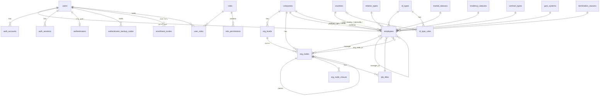

# خطة المرحلة 1 — الهوية والمصادقة والموظفون والهيكل التنظيمي

> الحالة: **نُفِّذت المرحلة (2026-10-21 → 2026-10-22)** وهذا الملف يعكس ما بُني فعلًا. الأقسام 1–11 محدّثة لتطابق الكود، وما قبل التنفيذ من تغييرات النسخ 2–5 أدناه تاريخ للقرارات. التفاصيل اليومية في «12. سجل التنفيذ». **المتبقي:** تسجيل تطبيق Entra لتجربة Microsoft فعليًا (الدليل والفحص جاهزان، والتنفيذ خطوة المالك/IT)، اختيار مزوّد SMS، اختبار مكوّن لحوار أثر الهيكل، واعتماد مالك الهوية للظلال المشتقة (سؤال 15).
> تغييرات النسخة 2: (1) الدخول **بدون كلمة مرور** نهائيًا: بريد + رمز تطبيق المصادقة، أو زر Microsoft. (2) الهيكل التنظيمي يُبنى بفورمات: فورم تقسيمات الهيكل أولًا ثم فورم إضافة وحدة تحت أي تقسيم.
> تغييرات النسخة 3 (بناءً على ردك): (3) **تفعيل تطبيق المصادقة إلزامي لكل مستخدم** بلا استثناء ولا خيار حسب الدور. (4) كل موظف يُنشأ له حساب دخول. (5) التقسيمات ديناميكية بالكامل، والترتيب الافتراضي من seeder: قطاع ← إدارة ← قسم ← وحدة، وقابل للتغيير. (6) **المسميات الوظيفية تحت الوحدات إلزامية**.
> تغييرات النسخة 4: (7) **الرمز مطلوب في كل عملية دخول** حتى بعد Microsoft. (8) تغيير التقسيمات مع وجود وحدات مسموح، **بعد تحذير يعرض البيانات المتأثرة وتأكيد المستخدم**. (9) قالب تقسيمات **واحد** لكل الشركات حاليًا. (10) **10 شركات افتراضية** من الـ seeder.
> تغييرات النسخة 5: (11) عند مسح تقسيم عليه موظفون: **تنبيه صريح وخياران: نقل الموظفين إلى وحدة أخرى، أو مسحهم بعد تأكيد إضافي**. لا يُمسح موظف بلا تنبيه. (12) مراجعة الترجمة العربية/الإنجليزية في جدول مرجعي (4.8). (13) الأدمن الأول يتبع «أروقة الريادة» (محسوم).
> التاريخ: 2026-10-21 · المرجع: وصف المالك + ملف "تصور فورم الموظف وقاعدة البيانات" + `CLAUDE.md` + `docs/decisions.md`.

---

## 1. الهدف والنطاق

### الهدف
نظام دخول آمن على Better Auth، وإدارة كاملة للموظفين من لوحة التحكم عن طريق فورم الموظف (40 حقل)، على هيكل تنظيمي لكل شركة، مع أدوار وصلاحيات تُحدد من يرى ويعدل أي موظف.

### داخل النطاق
| # | البند | ملخص |
|---|---|---|
| 1 | تسجيل الدخول | **بدون كلمة مرور**: (أ) بريد العمل + رمز تطبيق المصادقة (TOTP)، أو (ب) زر «الدخول بواسطة Microsoft». **تطبيق المصادقة إلزامي لكل مستخدم** (لا يدخل أحد النظام قبل تفعيله)، و**رمزه مطلوب في كل عملية دخول** حتى بعد Microsoft. **لا توجد صفحة تسجيل جديد**. |
| 2 | الحساب الأول (startup) | أدمن واحد يُنشأ بالـ seeder: `s.magdy@arweqah.sa` ويدخل بحساب Microsoft. |
| 3 | الموظفون | الأدمن يضيف ويعدل الموظفين من الداشبورد بفورم الـ 40 حقل. |
| 4 | الشركات والهيكل | شركات متعددة. التقسيمات **ديناميكية** وتُبنى بفورمات: **فورم تقسيمات الهيكل** (الافتراضي من seeder: قطاع ← إدارة ← قسم ← وحدة، وقابل للتغيير)، ثم **فورم إضافة وحدة** تحت أي تقسيم. **المسميات الوظيفية تحت الوحدات إلزامية**. |
| 5 | جداول الاختيارات (lookups) | 13 جدول مترجم عربي/إنجليزي، 8 منها بـ seeder و5 لها شاشات إدارة. |
| 6 | الأدوار والصلاحيات | شاشة بناء الأدوار وربط الأدوار بالموظفين ✅. |
| 7 | الأمان | تفعيل تطبيق المصادقة (دعوة)، رموز احتياطية، حماية من التخمين (قفل مؤقت)، إنهاء الجلسات عند التعطيل، سجل التدقيق. لا توجد كلمات مرور في النظام. |
| 8 | واجهة الداشبورد | صفحة الدخول (خطوتان)، الرئيسية، الموظفون، الهيكل (مخطط أو جدول)، الشركات، الأدوار، التدقيق، سجل البريد، الإشعارات، الأمان، وصفحات 401/403/404 ✅. |
| 9 | القوائم الموحدة | كل جدول فيه بحث، فلاتر على كل خاصية قابلة للتصفية، ومفتاح جدول/بطاقات (FR-27) ✅. |
| 10 | التصدير والاستيراد | تصدير من كل قائمة (نطاق، أعمدة، نوع ملف)، واستيراد الموظفين والشركات بقالب فيه قوائم النظام المنسدلة (FR-28، FR-29) ✅. |
| 11 | سجل البريد المرسل | كل بريد أرسله النظام بحالته وسبب فشله، بلا نصه (FR-26) ✅. |
| 12 | الهيكل كمخطط | مخطط بألوان المستويات، فتح/طي، بحث، تكبير، ملاءمة الشاشة (FR-31) ✅. |
| 13 | الثيم الفاتح والداكن | زر في الشريط العلوي واختيار في الملف الشخصي (فاتح/داكن/حسب الجهاز)، يُحفظ في المتصفح وعلى الحساب، وكل الشاشات بالوضعين (FR-33) ✅. |
| 14 | الملف الشخصي | صفحة `/profile`: يعدّل المستخدم اللغة والثيم وثلاث بيانات تواصل (الجوال الشخصي، البريد الشخصي، الاسم بالإنجليزية)، وبيانات العمل للقراءة فقط (FR-33) ✅. |
| 15 | دخول Microsoft | الكود جاهز؛ يبقى تسجيل التطبيق في Entra: دليل `docs/microsoft-sign-in.md` وفحص `npm run microsoft:check` ⏳ (خطوة المالك/IT). |

### خارج النطاق (مراحل لاحقة)
الحضور، الإجازات، الطلبات، المشاريع، التذاكر، المصروفات، الرواتب (نحتفظ بحقول الراتب في السجل فقط)، المزامنة مع Airtable/Sheets. (استيراد الموظفين من Excel كان مؤجَّلًا وأُنجز في هذه المرحلة.)

---

## 2. قرارات معمارية مهمة (تغيّر شيئًا في الأساس الحالي)

### 2.1 المستخدم مقابل الموظف
- `users` = هوية الدخول (يملكها Better Auth: بريد، جلسات، حسابات). **تبقى كما هي.**
- `employees` = سجل الموظف الوظيفي (الـ 40 حقل). يرتبط بـ `users` بعلاقة **1:1** عبر `employees.user_id` (unique).
- **بريد العمل هو بريد الدخول وهو نفسه حساب Microsoft.** نفس القيمة في `users.email` و`employees.work_email`، ويُقفل تعديله بعد الإنشاء (تغييره عملية خاصة بمراجعة، خارج هذه المرحلة).
- البريد الشخصي لا يُستخدم للدخول أبدًا.

### 2.2 الهيكل التنظيمي الجديد يحل محل branches / departments / teams
الأساس الحالي فيه `branches` و`departments` و`teams` و`user_placements`. الوصف الجديد (شركات ← مستويات ← وحدات بشجرة مرنة) أعم، فلا يصح أن يعيشا معًا.
- **نحذف** `branches`, `departments`, `teams`, `user_placements` بـ migration جديد (لا بيانات إنتاج، المشروع في بدايته).
- **نضيف** `companies`, `org_levels`, `org_nodes` (+ closure table), `job_titles`.
- مكان الموظف = `employees.org_node_id`، والمدير = `employees.manager_id`.

### 2.3 نطاقات الصلاحيات (Scopes) — قرار مطلوب منك
النطاقات الحالية: `own / team / department / branch / company`. لم تعد تطابق الهيكل المرن. **المقترح:**

| النطاق الجديد | المعنى |
|---|---|
| `own` | سجله فقط |
| `unit` | الموظفون في وحدته مباشرة |
| `subtree` | وحدته وكل ما تحتها (مثل: مدير إدارة يرى كل أقسامها) |
| `company` | كل موظفي شركته |
| `all` | كل الشركات (للأدمن) |

يُنفَّذ `subtree` بـ closure table في `applyScope`. السجل خارج النطاق يرجع **404** كما في القاعدة الحالية. (سؤال 1 في آخر الملف.)

### 2.4 تشفير الحقول الحساسة
حسب `CLAUDE.md`: رقم الهوية والآيبان **يُشفَّران بـ `FieldCipher` (AES-256-GCM)** ولا يُسجَّلان في الـ logs أو الـ audit. وأقترح أيضًا **الراتب**.
- المشكلة: التشفير يكسر `UNIQUE (id_type_id, id_number)` والبحث.
- الحل: عمود `id_number_hash` = HMAC-SHA256 بمفتاح منفصل (`ID_HASH_KEY` في env)، عليه الـ unique والبحث بالمطابقة الكاملة فقط.
- الراتب يُحفظ مشفرًا كنص، والتحقق `>= 0` يتم في التطبيق (لا يمكن `CHECK` على قيمة مشفرة).
- صلاحية منفصلة `employees.view_sensitive` لعرض (رقم الهوية الكامل، الآيبان، الراتب). بدونها تظهر مقنّعة (`•••• 1234`).

### 2.5 الإلزامي في التحقق: zod وليس class-validator
وثيقة الفورم تذكر class-validator، لكن قاعدة المشروع (`CLAUDE.md`): **zod في `packages/shared`** لكل مدخلات الـ API والويب، حتى لا تتكرر القواعد. سأطبّق كل قواعد الوثيقة بـ zod (`superRefine` للشرطي) ومحقق الآيبان وسن الميلاد كدوال مشتركة. القواعد التي تحتاج داتابيز تبقى في الـ service.

### 2.6 قواعد الدخول (بدون كلمة مرور)

| الطريقة | السلوك |
|---|---|
| **(أ) بريد العمل + رمز تطبيق المصادقة** | الموظف يكتب بريده (`@arweqah.sa`) ثم رمز الـ 6 أرقام من Google/Microsoft Authenticator، فيدخل. **كما بُني: خطوتان** (البريد ثم مربعات الرمز؛ عند «متابعة» يرد `POST /mfa/identify` بأن هذا أول دخول ويرسل رابط الـ QR على البريد، وتظهر رسالة توضح الخطوات ثم مربعات الرمز). لا كلمة مرور ولا بريد تحقق. |
| **(ب) زر «الدخول بواسطة Microsoft»** | tenant الشركة فقط، `disableSignUp`، يُربط بالموظف عبر `work_email`. غير المسجل يُرفض برسالة عامة. **بعد نجاح Microsoft يُطلب رمز التطبيق دائمًا في كل دخول** (صفحة «أدخل الرمز»)، ولا يرى المستخدم أي صفحة قبل إدخاله. إن لم يكن التطبيق مفعّلًا يُحوَّل لصفحة التفعيل أولًا. |
| **كل دخول يطلب الرمز** | لا يوجد «تذكرني» ولا تخطي للرمز بأي طريقة. كل جلسة جديدة (بأي وسيلة) لا تعمل إلا بعد التحقق من الرمز. |
| **تفعيل التطبيق إلزامي لكل مستخدم** | بلا استثناء ولا حسب الدور: الحارس (`PermissionsGuard`) يحجب كل المسارات (ما عدا `/me` وصفحات التفعيل والخروج) حتى يُفعَّل التطبيق. يُحذف عمود `roles.requires_two_factor` لأنه لم يعد خيارًا. |
| كلمات المرور | **ملغاة بالكامل**: `emailAndPassword` مُعطَّل في Better Auth، لا حقل ولا route ولا صفحة (دخول، نسيت كلمة المرور، إعادة تعيين، تعيين كلمة مرور). |
| تسجيل جديد | **ملغي** (لا route ولا صفحة). |
| موظف جديد | **كل موظف يُنشأ له حساب دخول تلقائيًا** عند إضافته. يصله **بريد دعوة** برابط تفعيل صالح 72 ساعة لمرة واحدة: يمسح QR بتطبيق المصادقة ويؤكد برمز، فيصبح الدخول بالبريد + الرمز ممكنًا. أو يدخل بـ Microsoft فيُحوَّل لصفحة التفعيل الإجبارية. |

**ملاحظة تقنية مهمة:** Better Auth لا يدعم «بريد + TOTP فقط» جاهزًا (إضافة `twoFactor` تتطلب خطوة أولى بكلمة مرور). الحل: **Better Auth plugin** صغير داخل المشروع (`totp-sign-in`) يتحقق من الرمز بأسرار جدول `authenticators` (مشفّرة) وينشئ الجلسة عبر الـ `internalAdapter` الرسمي (نفس الكوكي HttpOnly ونفس جدول الجلسات). هذا أكثر جزء حساسية في المرحلة، وله اختبارات أمان خاصة (7 نقاط أدناه).

**كيف يُطلب الرمز بعد Microsoft:** عند نجاح Microsoft تُنشأ الجلسة لكن بعلامة «غير مُتحقَّق منها» (`auth_sessions.mfa_verified_at = NULL`). الحارس يحجب كل المسارات (عدا `/me` وإدخال الرمز وتفعيل التطبيق والخروج) حتى يُدخل المستخدم الرمز الصحيح فتُضبط العلامة. أما الدخول بالبريد + الرمز فيُنشئ الجلسة متحقَّقًا منها مباشرة. بذلك لا تكفي جلسة Microsoft وحدها أبدًا.

**حماية الدخول بالرمز (لأنه 6 أرقام فقط):**
1. رد **عام ومتطابق** سواء كان البريد غير موجود أو بدون تطبيق مصادقة أو الرمز خاطئ (لا كشف عن وجود الحساب)، وبزمن استجابة متقارب.
2. Rate limit لكل IP ولكل بريد (5 محاولات/دقيقة).
3. **قفل الحساب** 15 دقيقة بعد 5 محاولات فاشلة متتالية (أعمدة `failed_count` و`locked_until` في جدول `authenticators`).
4. **منع إعادة استخدام** نفس الرمز في نافذته (حفظ `last_used_step`).
5. نافذة سماح ±1 خطوة (30 ثانية) فقط.
6. الحساب المعطل لا يدخل بأي طريقة، وتُنهى جلساته فورًا.
7. تسجيل كل محاولة فاشلة/ناجحة/قفل في الـ audit (بدون الرمز).

### 2.7 الحساب الأول (startup)
- الـ seeder (idempotent) ينشئ: الشركات العشر الافتراضية (4.7)، دور System Admin، `users` + `employees` للأدمن بـ `s.magdy@arweqah.sa` في شركة «أروقة الريادة».
- **أول دخول له بـ Microsoft** (يُربط تلقائيًا بالبريد)، فيُحوَّل لصفحة تفعيل التطبيق ويفعّله. بعدها كل دخول (بـ Microsoft أو بالبريد) يطلب الرمز.
- المتغيرات: `SEED_ADMIN_EMAIL=s.magdy@arweqah.sa`, `SEED_ADMIN_NAME`. **لا يوجد `SEED_ADMIN_PASSWORD`** (يُحذف).
- **للتطوير المحلي فقط** (حتى يجهز تسجيل Entra): متغير اختياري `SEED_ADMIN_TOTP_SECRET` يُنشئ للأدمن تطبيق مصادقة مفعّلًا مسبقًا، فتدخل محليًا بالبريد + الرمز. يرفض الـ seeder تشغيله في `NODE_ENV=production`.
- **عائق خارجي:** تجربة زر Microsoft فعليًا تحتاج تسجيل تطبيق Entra (Client ID, Secret, Tenant GUID).

### 2.8 تطبيق المصادقة إلزامي للجميع
- **أي شخص سيدخل النظام لازم يكون عنده تطبيق المصادقة مفعّلًا** (Microsoft Authenticator أو Google Authenticator أو ما يشابههما)، وهذا قرارك. لا يوجد خيار حسب الدور ولا استثناء للأدمن.
- **الرمز مطلوب في كل مرة تدخل فيها**، بالبريد أو بعد Microsoft، بلا «تذكرني». هو بديل كلمة المرور مع البريد، وعامل إضافي بعد Microsoft.
- **الأدمن الأول:** يدخل بـ Microsoft أول مرة، فيُحوَّل لصفحة التفعيل ويفعّل تطبيقه، وبعدها كل دخول يطلب الرمز.
- فقدان الهاتف: **10 رموز احتياطية** (تُعرض مرة واحدة عند التفعيل) + زر «إعادة تعيين تطبيق المصادقة» للأدمن من صفحة الموظف (يرسل دعوة تفعيل جديدة ويُسجَّل في الـ audit، ويحجب حساب الموظف حتى يفعّل من جديد).

---

## 3. الـ Features بالتفصيل

### 3.1 المصادقة (`core/auth` + web `features/auth`)
- دخول بالبريد + رمز تطبيق المصادقة (plugin مخصص، 2.6).
- دخول بـ Microsoft، وتسجيل الخروج.
- **صفحة تفعيل تطبيق المصادقة** من رابط الدعوة: QR + مفتاح نصي احتياطي + تأكيد برمز + عرض الرموز الاحتياطية مرة واحدة.
- صفحة الأمان للمستخدم: حالة تطبيق المصادقة، إعادة التفعيل، الرموز الاحتياطية، الجلسات النشطة وإنهاؤها.
- القفل المؤقت، ومنع إعادة استخدام الرمز، وردود عامة (2.6).
- حساب معطل لا يدخل وتُنهى جلساته فورًا (موجود).
- **تُحذف:** كل ما يخص كلمة المرور (دخول، نسيت، إعادة تعيين، تعيين، تغيير) من الـ API والويب والاختبارات.

### 3.2 الشركات
- CRUD (اسم عربي/إنجليزي، رمز، تفعيل/تعطيل). لا حذف إن كان عليها موظفون أو عقد.
- نسخ مستويات شركة كقالب عند إنشاء شركة جديدة (اقتراح من الوثيقة).

### 3.3 الهيكل التنظيمي (ديناميكي، يُبنى بفورمات)
**التقسيمات ديناميكية بالكامل:** عدد التقسيمات وأسماؤها وترتيبها تحددها كل شركة، ولا شيء ثابت في الكود. نقطة البداية فقط من seeder.

**الافتراضي من الـ seeder (للشركة الأولى، ويمكن تغييره لاحقًا):**

| الترتيب | التقسيم | يقبل مسميات وموظفين |
|---|---|---|
| 1 | قطاع (Sector) | لا |
| 2 | إدارة (Department) | لا |
| 3 | قسم (Section) | لا |
| 4 | وحدة (Unit) | **نعم** (آخر تقسيم) |

> **قالب واحد لكل الشركات حاليًا:** الـ seeder يزرع هذا الترتيب مرة واحدة (`org_level_templates`) ويُنشئ منه تقسيمات كل شركة من الشركات العشر الافتراضية، وأي شركة جديدة تُنشأ لاحقًا تبدأ به أيضًا. بعد ذلك تعدّل كل شركة تقسيماتها من الفورم 1 دون أن يتأثر القالب.

الهيكل يُبنى لكل شركة على **ثلاث فورمات متتابعة**، والشجرة صفحة عرض فقط (مع زر الفورم لكل خطوة):

**الفورم 1 — تقسيمات الهيكل (المستويات):** تعديل تقسيمات الشركة.
- الحقول: الشركة*، قائمة تقسيمات (زر «+ تقسيم»): الاسم بالعربي*، بالإنجليزي*، «يقبل مسميات وموظفين» (`is_assignable`). تظهر معبأة بالقالب الافتراضي.
- الترتيب حسب ترتيب الصفوف (1 = الأعلى) ويمكن تحريكها.
- **التغيير لاحقًا مسموح دائمًا، لكن بتحذير ثم تأكيد** (التفاصيل أسفل في «تغيير التقسيمات مع وجود بيانات»).
- قالب: «نسخ تقسيمات من شركة أخرى».

**الفورم 2 — إضافة وحدة تحت أي تقسيم:**
- الحقول: الشركة*، **التقسيم*** (من تقسيمات الشركة)، **الوحدة الأب*** (وحدات التقسيم السابق مباشرة، وتختفي للتقسيم الأول)، الاسم بالعربي*، بالإنجليزي*، مدير الوحدة (اختياري).
- **لو التقسيم `is_assignable` (مثل «وحدة»): قسم «المسميات الوظيفية» يظهر في نفس الفورم، ومسمى واحد على الأقل إلزامي** (زر «+ مسمى»)، فلا تُنشأ وحدة بلا مسميات.
- «حفظ وإضافة أخرى» للتتابع.

**الفورم 3 — إضافة مسميات لوحدة موجودة:** الشركة*، **الوحدة*** (التقسيمات `is_assignable` فقط)، مسمى أو أكثر (عربي/إنجليزي). للإضافة بعد الإنشاء، وللتعديل.

**تغيير التقسيمات مع وجود بيانات (تحذير ثم تأكيد):**
1. تغيير الاسم أو الإضافة في **آخر** السلسلة: مباشر، بدون تحذير (لا يتأثر شيء).
2. أي تغيير آخر (حذف تقسيم، إدخال تقسيم في الوسط، إعادة ترتيب، إلغاء `is_assignable`) يتأثر به ما تحته. قبل الحفظ تعرض الواجهة **رسالة تحذير بالبيانات المتأثرة**:
   «سيتأثر: 12 وحدة، 30 مسمى وظيفي، 140 موظفًا مرتبطًا. سيتم مسح الوحدات والمسميات.»
   وإن وُجد موظفون، يجب اختيار أحد الخيارين قبل التأكيد (البند 5). ثم زرا «إلغاء» و**«تأكيد المسح»**.
3. **المتأثر** = وحدات التقسيم المُغيَّر **وكل الوحدات تحتها في السلسلة** (لأن علاقة الأب بالابن تنكسر) + مسمياتها + الموظفون المرتبطون بها.
4. إن لم يؤكد المستخدم لا يتغير شيء. إن أكّد: تُمسح الوحدات والمسميات المتأثرة، ويُنفَّذ التغيير.
5. **الموظفون المتأثرون (قرارك):** لا يُمسح موظف إلا بعد تنبيه صريح. عند وجود موظفين في الوحدات المتأثرة يختار المستخدم **أحد خيارين** (لا يمكن التأكيد بدون اختيار):
   - **(أ) نقل الموظفين إلى وحدة أخرى (الخيار الموصى به):** يختار وحدة هدف **خارج الوحدات المتأثرة** (تقبل التعيين)، ثم يقابل كل مسمى وظيفي قديم بمسمى من مسميات الوحدة الهدف (الفورم يعرض المسميات المتأثرة واحدًا واحدًا). يُنقل الموظفون ولا يُمسح لهم سجل.
   - **(ب) مسح الموظفين:** تظهر رسالة إضافية بالأعداد وبلون التحذير: «سيتم مسح 140 موظفًا وتعطيل حسابات دخولهم وإنهاء جلساتهم». ولا يتفعّل زر التأكيد إلا بكتابة عدد الموظفين. المسح **حذف ناعم** لسجل الموظف مع تعطيل حساب الدخول وإنهاء الجلسات، ويُسجَّل في الـ audit بالأسماء والأرقام الوظيفية (بدون الحقول الحساسة).
6. المسح **حذف ناعم** (`deleted_at`) مع سجل في الـ audit يوثق الأعداد المتأثرة ومن أكّد.
7. الـ API: نفس الطلب مرتين. الأول `dryRun` يرجع الأثر (أعداد الوحدات والمسميات والموظفين + `impactToken`). الثاني يحمل `confirmDelete: true` و`impactToken` و**`employees`** إن وُجد موظفون: إما `{ action: 'transfer', unitId, titleMap: { oldTitleId: newTitleId } }` أو `{ action: 'delete', confirmCount: 140 }`. إن تغيّر الأثر بين الخطوتين (بيانات أُضيفت) يُرفض بـ 409 ويُعاد التحذير بالأرقام الجديدة. العملية كلها في transaction واحدة.

**قواعد (تُفرض في الـ API وليس الواجهة فقط):**
- التقسيم يتبع نفس الشركة. الوحدة الأب من نفس الشركة وفي التقسيم الذي قبله مباشرة بترتيب الشركة الحالي.
- وحدات التقسيم الأول `parent_id = null`.
- **المسميات الوظيفية تُضاف تحت الوحدات `is_assignable` فقط، وهي إلزامية:** لا وحدة قابلة للتعيين بلا مسمى واحد على الأقل، ولا يُحذف آخر مسمى في وحدة (إلا إن لم يكن عليها موظفون وعُطّلت الوحدة).
- لا حذف لمسمى عليه موظفون (تعطيل فقط).
- حذف **وحدة منفردة** (من الشجرة) تحتها وحدات أو موظفون: يُمنع بنص واضح (يُنقل/يُعطَّل الموظفون أولًا). المسح الجماعي يتم فقط عبر تغيير التقسيمات بالتحذير أعلاه.
- نقل وحدة لأب جديد: نفس شرط التقسيم، بدون cycles، داخل نفس الشركة.
- مدير الوحدة يُفضَّل أن يكون موظفًا في نفس الشركة (تحذير لا منع).
- عرض الوحدة بالمسار الكامل: `قطاع الأعمال › إدارة التقنية › قسم التطوير › وحدة الباك إند`.

### 3.4 الموظفون
- قائمة بجدول (`DataTable`): بحث بالاسم/الرقم الوظيفي/البريد، فلاتر (شركة، وحدة، نوع علاقة، الحالة)، ترتيب، ترقيم صفحات، تصدير CSV (اقتراح مرحلة لاحقة).
- إضافة وتعديل بالفورم (6 أقسام، 40 حقل) بكل الاعتماديات في الوثيقة.
- صفحة تفاصيل الموظف (قراءة) + سجل تغييراته من الـ audit.
- تعطيل/تفعيل الدخول (ينهي الجلسات).
- إنهاء العلاقة (تاريخ + سبب) — سلوكه التلقائي سؤال 5.
- تعيين الأدوار للموظف.
- تنبيهات (لا منع): هوية قاربت الانتهاء، عقد ينتهي قريبًا.
- حذف ناعم فقط، مع partial unique indexes.

### 3.5 الأدوار والصلاحيات
- شاشة مصفوفة الصلاحيات (مفتاح × نطاق) كما كانت، بالنطاقات الجديدة.
- أدوار النظام: System Admin، Employee. غير قابلة للحذف.
- صلاحيات جديدة (كل وحدة تسجلها في `onModuleInit`):

| المفتاح | النطاقات المسموحة |
|---|---|
| `employees.view` | own, unit, subtree, company, all |
| `employees.create` / `employees.update` | unit, subtree, company, all |
| `employees.deactivate` | subtree, company, all |
| `employees.view_sensitive` | subtree, company, all |
| `employees.assign_roles` | company, all |
| `companies.view` / `companies.manage` | all | — **حُذف لاحقًا وحلّت محلّه مفاتيح لكل إجراء (FR-45)**
| `org.view` | company, all |
| `org.manage` | company, all | — **حُذف لاحقًا وحلّت محلّه مفاتيح لكل إجراء (FR-45)**
| `lookups.view` | all (الجميع يقرأ ما يحتاجه الفورم) |
| `roles.view` / `roles.manage` | all (موجود) | — **حُذف لاحقًا وحلّت محلّه مفاتيح لكل إجراء (FR-45)**
| `audit.view` | all (موجود) |

### 3.6 الترجمة (عربي/إنجليزي)
- كل lookup له جدول ترجمة `*_translations (id, <fk>, lang, name)` بـ `UNIQUE (fk, lang)`.
- الـ API يرجع الاسم حسب `Accept-Language`، وإن غابت الترجمة يرجع العربي.
- `BaseLookupEntity` و`BaseTranslationEntity` كـ abstract classes لتجنب التكرار (الـ jscpd يجب أن يبقى < 3%).

### 3.7 التدقيق والإشعارات
- كل إنشاء/تعديل/تعطيل/تغيير دور/تغيير هيكل يُسجَّل بـ `AUDIT_EVENT`، مع حجب الحقول الحساسة بالاسم.
- إشعار للموظف الجديد (بريد الدعوة). **سجل البريد:** كل رسالة (دعوة أو إشعار) تُسجَّل في `email_logs` بالمستلم والموضوع والنوع والحالة (قيد الإرسال/تم/فشل) وسبب الفشل ورد الخادم، **دون نص الرسالة** (فيها روابط تفعيل)؛ يغلّف `LoggedMailSender` الـ SMTP، وصفحة «سجل البريد» بصلاحية `notifications.email_log` (FR-26).
- (إشعار المدير المباشر عند ضم موظف تحته بقي اقتراحًا لمرحلة لاحقة.)

---

## 4. قاعدة البيانات

### 4.1 المخطط (ERD)



### 4.2 جداول تبقى كما هي
`users`, `auth_accounts` (لا حسابات credential بعد الآن؛ تبقى لحسابات Microsoft), `auth_sessions`, `auth_verifications`, `authenticators` (بدل `auth_two_factors`: السر مشفّر + `last_used_step` والقفل) و`authenticator_backup_codes` و`enrollment_invites`، `roles`, `role_permissions`, `user_roles`, `audit_logs`, `files`, `notifications`, `outbox_messages`, `scheduled_jobs`, `processed_messages`, `workflow_instances`, `workflow_transitions`.

### 4.3 جداول تُحذف
`branches`, `departments`, `teams`, `user_placements` (يعوضها الهيكل الجديد).

### 4.4 جداول جديدة

**نمط الترجمة (يتكرر لكل جدول مترجم):**
```
<table>               id uuid PK, code, sort_order, is_active, (is_other)…
<table>_translations  id uuid PK, <table>_id FK, lang ('ar'|'en'), name, UNIQUE(<table>_id, lang)
```

| الجدول | الأعمدة الإضافية | المصدر |
|---|---|---|
| `companies` | `code` unique, `is_active`, `deleted_at` | ديناميكي |
| `org_levels` | `company_id`, `sort_order`, `is_assignable`, `is_active`. UNIQUE(company_id, sort_order) | ديناميكي |
| `org_level_templates` | `sort_order`, `is_assignable` + ترجمة الاسم | seeder: القالب الافتراضي (قطاع، إدارة، قسم، وحدة) |
| `org_nodes` | `company_id`, `org_level_id`, `parent_id` (self), `manager_id` → employees, `sort_order`, `is_active`, `deleted_at` | ديناميكي |
| `org_node_closure` | `ancestor_id`, `descendant_id`, `depth`. PK (ancestor, descendant) | تلقائي (TypeORM closure-table) |
| `job_titles` | `org_node_id`, `is_active` | ديناميكي |
| `relation_types` | `code` | seeder: موظف، متعاون |
| `countries` | `iso_code`, `currency_code` (+ اسم العملة في الترجمة `currency_name`) | seeder: كل الدول |
| `marital_statuses` | — | seeder: أعزب، متزوج، مطلق، أرمل |
| `residency_statuses` | — | seeder: مواطن، مقيم، زوج/ة مواطن/ة، إقامة مميزة، ابن/ة مواطن/ة |
| `id_types` | `requires_country` | seeder: هوية وطنية، إقامة، هوية بلده، جواز سفر، رقم حدود، هوية خليجية |
| `id_type_rules` | `id_type_id`, `country_id` (null = عام), `regex`, `min_length`, `max_length` + `id_type_rule_translations.error_message` | seeder |
| `contract_types` | `requires_end_date`, `is_other` | seeder: محدد المدة، غير محدد المدة، عقد مشروع، تدريب/تمهير، أخرى |
| `gosi_systems` | `conditions` jsonb | seeder: القديم، الجديد |
| `termination_reasons` | `is_other` | seeder: استقالة، إنهاء، نقل، تقاعد، وفاة، أخرى |

| `authenticators` · `authenticator_backup_codes` · `enrollment_invites` | سر التطبيق مشفّر، رموز احتياطية (hash)، روابط التفعيل (hash، 72 ساعة، مرة واحدة) | نتاج الدخول بلا كلمة مرور |
| `users.theme` | `light` / `dark` / `system` (الافتراضي) | تفضيل الثيم على الحساب |
| `email_logs` | `to_email`, `subject`, `purpose` (activation/notification/other), `status` (pending/sent/failed), `error`, `message_id`, `provider_response`, `sent_at` | سجل كل بريد مرسل (بلا النص) |

> الجداول الـ 5 الديناميكية لها شاشات إدارة: `companies`, `org_levels`, `org_nodes`, `job_titles` (والموظفون). الباقي read-only في الواجهة، يتغير بـ migration/seeder.

### 4.5 جدول `employees`

| المجموعة | الأعمدة |
|---|---|
| هوية | `id` uuid PK، `user_id` uuid **unique** FK → users (RESTRICT) |
| عمل | `company_id`، `relation_type_id`، `org_node_id` (**إلزامي في الـ API**)، `job_title_id` (**إلزامي في الـ API**)، `manager_id` (SET NULL)، `work_location` v255، `work_country_id`، `work_mode` smallint (0 حضوري، 1 هجين، 2 عن بعد) |
| تواصل | `work_email` v255 (unique، `@arweqah.sa`، lowercase)، `personal_email`، `work_phone` v20، `personal_phone` v20 |
| شخصي | `employee_number` v50 unique، `full_name`، `full_name_en`، `gender` smallint، `birth_date`، `nationality_id`، `marital_status_id`، `residency_status_id`، `id_type_id`، **`id_number_enc`** (مشفر)، **`id_number_hash`**، `id_expiry_date` |
| تعاقد | `start_date` (إلزامي)، `end_date`، `contract_type_id`، `contract_type_other`، `contract_company_id`، `gosi_company_id`، `health_insurance_company_id`، `is_gosi_registered` (default false)، `gosi_registration_date`، `gosi_system_id`، `profession`، `is_qiwa_contract`، `has_medical_insurance`، `termination_reason_id`، `termination_reason_other` |
| راتب | **`monthly_gross_salary_enc`** (مشفر)، `salary_currency_country_id`، **`iban_enc`** (مشفر) |
| سجل | `notes` text، `is_system_account` boolean (default false، لحساب الأدمن الأول الذي يُزرع قبل بناء الهيكل)، `created_by`، `created_at`، `updated_at`، `deleted_at` |

**قيود الداتابيز (CHECK):**
- `end_date IS NULL OR end_date > start_date`
- `manager_id IS NULL OR manager_id <> id`
- `is_gosi_registered OR (gosi_registration_date IS NULL AND gosi_system_id IS NULL)`
- `has_medical_insurance OR health_insurance_company_id IS NULL`
- القيم المخفية بالشرط تُحفظ NULL (يفرضها الـ service ويؤكدها CHECK حيث أمكن).
- `org_node_id` و`job_title_id` يبقيان nullable في الداتابيز، والإلزام يُفرض في الـ API لكل الموظفين ما عدا `is_system_account = true` (سؤال 3د).

**Unique (جزئية `WHERE deleted_at IS NULL`):** `work_email`, `employee_number`, `(id_type_id, id_number_hash)`.
**Indexes:** `company_id`, `org_node_id`, `manager_id`, `job_title_id`, `user_id`, `full_name` (trgm للبحث، اقتراح)، `end_date`، `id_expiry_date`.

### 4.6 الـ Migrations (ما نُفِّذ فعلًا، بالترتيب)
1. `Foundation` و`AuthTables` — الأساس (المستخدمون، الجلسات، الأدوار، التدقيق، الملفات، الرسائل، سير العمل).
2. `OrgCompaniesEmployees` — الـ lookups المترجمة وقواعد الهويات، الشركات والتقسيمات والوحدات (closure) والمسميات، `employees` بالقيود والـ indexes، وحذف جداول الفروع القديمة، وتحديث قيم نطاقات الصلاحيات.
3. `PasswordlessAuth` — `authenticators` و`authenticator_backup_codes` و`enrollment_invites` و`auth_sessions.mfa_verified_at`، وإزالة بيانات كلمات المرور.
4. `EmailLogs` — جدول `email_logs`.
5. `UserTheme` — عمود `users.theme` (فاتح/داكن/حسب الجهاز، الافتراضي `system`).

كل migration يُراجع SQL-ه يدويًا بعد التوليد، و`migration:generate` بعد أي تعديل entity يجب أن يقول «No changes» (يتحقق منه الفحص بعد إعادة هيكلة الكيانات).

### 4.7 الـ Seeders (كما نُفِّذت، كلها آمنة للتكرار)
| Seeder | المحتوى | ملاحظة |
|---|---|---|
| `foundation.seeder` | أدوار النظام (System Admin بكل الصلاحيات، Employee)، الأدمن `s.magdy@arweqah.sa` في «أروقة الريادة» بلا كلمة مرور | `SEED_ADMIN_TOTP_SECRET` للتطوير فقط (يربط تطبيقًا بصمت فلا يظهر QR، ومرفوض في الإنتاج) |
| `lookups.seeder` | الجداول الـ 8 بالعربي والإنجليزي + قواعد الهويات + كل الدول وعملاتها (`data/countries.data.ts` يولّده `scripts/generate-countries.mjs`) + قالب التقسيمات | upsert بالـ `code` |
| `companies.seeder` | **10 شركات افتراضية** (الجدول أسفله) بتقسيماتها الأربعة من القالب | لا يمس شركة موجودة |
| `org-demo.seeder` | **للتطوير فقط** (`SEED_DEMO_ORG=true`، مرفوض في الإنتاج): قطاع ← إدارتان ← قسم ← وحدة بمسميين لكل شركة بلا وحدات (70 وحدة و40 مسمى) | أسماء تجريبية عامة ومعلّمة كذلك |

**الشركات الافتراضية (من وصفك).** الأسماء العربية صُحّح إملاؤها فقط (الهمزات والتاء المربوطة، مثل «أروقة» و«استدامة» و«الأثر» و«أثلاث»). **الأسماء الإنجليزية والرموز اقتراح مني (مراجعة لغوية فقط، لم تُعتمد رسميًا بعد):** بحثت عن كتابات رسمية فلم أجد مصدرًا موثوقًا للأسماء، سوى أن «Ladun» تطابق كتابة شركة سعودية مدرجة بنفس الاسم، و«Arweqah Alreyadah» من ملف README الخاص بالمشروع. تُعتمد الأسماء بموافقتك أو بإرسال الكتابة الرسمية من شعاراتكم/سجلاتكم (سؤال 13):

| # | العربي | الإنجليزي (اقتراح) | الرمز (اقتراح) |
|---|---|---|---|
| 1 | تدويم | Tadweem | TDW |
| 2 | بأيدينا | Bi-Aydina | BYD |
| 3 | أروقة الريادة | Arweqah Alreyadah | ARW |
| 4 | سجوم مصر | Sojoum Misr | SJM |
| 5 | لدن | Ladun | LDN |
| 6 | استدامة الأثر | Istidamat Al-Athar | ISA |
| 7 | حكينا | Hakeena | HKN |
| 8 | أثلاث | Athlath | ATH |
| 9 | عبدالعزيز العواد | Abdulaziz Al-Awad | AAW |
| 10 | رواد الحرف | Rowad Al-Hiraf | RHF |

الشركات تظهر جاهزة بتقسيماتها الأربعة (قطاع/إدارة/قسم/وحدة) وبدون وحدات ولا موظفين، ويبدأ بناؤها بالفورم 2.
> قواعد الـ regex لكل نوع هوية أضعها كما في الوثيقة (وطنية 10 أرقام تبدأ بـ 1، إقامة تبدأ بـ 2) والباقي افتراضي متساهل حتى تؤكد الصيغ الرسمية (سؤال 9).

### 4.8 جدول الترجمات المرجعي (مراجعة عربي/إنجليزي)
يُستخدم كما هو في الـ seeders وملفات i18n. المراجعة لغوية، وأي مصطلح قانوني/رسمي (التأمينات، قوى) يُراجَع مع الموارد البشرية قبل الإطلاق.

| الجدول | العربي | الإنجليزي |
|---|---|---|
| التقسيمات (القالب) | قطاع · إدارة · قسم · وحدة | Sector · Department · Section · Unit |
| نوع العلاقة | موظف · متعاون | Employee · Collaborator |
| الحالة الاجتماعية | أعزب · متزوج · مطلق · أرمل | Single · Married · Divorced · Widowed |
| الصفة | مواطن · مقيم · زوج/ة مواطن/ة · إقامة مميزة · ابن/ة مواطن/ة | Citizen · Resident · Spouse of a Citizen · Premium Residency · Child of a Citizen |
| نوع الهوية | هوية وطنية · إقامة · هوية بلده · جواز سفر · رقم حدود · هوية خليجية | National ID · Iqama (Residence Permit) · Home-Country ID · Passport · Border Number · GCC National ID |
| نوع العقد | محدد المدة · غير محدد المدة · عقد مشروع · تدريب/تمهير · أخرى | Fixed-Term · Indefinite-Term · Project Contract · Training / Tamheer · Other |
| نظام التأمينات | النظام القديم · النظام الجديد | Old System · New System |
| سبب انتهاء العلاقة | استقالة · إنهاء · نقل · تقاعد · وفاة · أخرى | Resignation · Termination · Transfer · Retirement · Death · Other |
| نمط العمل | حضوري · هجين · عن بعد | On-site · Hybrid · Remote |
| الجنس | ذكر · أنثى | Male · Female |

ملاحظات المراجعة:
- «إدارة» = Department و«قسم» = Section (التسلسل المعتاد في الشركات السعودية)، ومن يفضّل Division/Administration يُعدَّل في الـ seeder.
- «متعاون» = Collaborator؛ البدائل Contractor/Freelancer تغيّر المعنى القانوني، فأبقيته حرفيًا حتى تحدد الموارد البشرية.
- «تمهير» اسم برنامج رسمي، فيُكتب Tamheer مع وصفه (Training).
- أسماء الدول والعملات من ملف ISO (عربي/إنجليزي) وتُراجَع مرة عند توليد `countries.json`.
- كل النصوص تُخزَّن في جداول الترجمة (`lang = ar | en`) وليس في الكود.

---

## 5. الـ API (كما نُفِّذ)

كل المسارات تحت `/api`، والرد 404 للسجل خارج النطاق، والمدخلات `z.strictObject`، وكل ما سوى المسارات العامة 401 بلا جلسة و403 بلا صلاحية (يُكتشف تلقائيًا في اختبار الأمان).

| المجموعة | المسار | الصلاحية |
|---|---|---|
| الدخول | `POST /auth/totp/sign-in` (بريد + رمز، plugin مخصص) · `POST /auth/sign-in/social` (Microsoft) · `POST /auth/sign-out` | عام / جلسة |
| خطوة البريد | `POST /mfa/identify` — يرد `firstTime` ويرسل رابط الـ QR لأول مرة (مرة كل دقيقة للبريد) | عام |
| تفعيل التطبيق | `GET /mfa/enrollment/:token` · `POST /mfa/enrollment/:token/confirm` (من الرابط) · `POST /mfa/enroll` · `POST /mfa/enroll/confirm` · `POST /mfa/verify` (جلسة Microsoft أو أي جلسة غير متحقَّق منها) | رابط الدعوة / جلسة |
| الملف الشخصي | `GET /me` (يشمل `theme`) · `GET /me/profile` · `PUT /me/profile` (اللغة، الثيم، الجوال الشخصي، البريد الشخصي، الاسم بالإنجليزية فقط؛ أي حقل آخر 400) | أي مستخدم، لنفسه فقط |
| الموظفون | `GET /employees` (بحث + 15 فلترًا: الشركة، الحالة، العلاقة، الوحدة، المسمى، العقد، الجنسية، الحالة الاجتماعية، الصفة، الجنس، نمط العمل، مدى بداية العقد، هوية/عقد ينتهي) · `GET /employees/:id` · `GET /employees/summary` · `GET /employees/managers` · `POST /employees` · `PUT /employees/:id` · `POST /employees/:id/{deactivate,activate,terminate,resend-invite,reset-authenticator}` · `PUT /employees/:id/roles` | `employees.*` |
| الشركات | `GET/POST /companies` · `PUT/DELETE /companies/:id` | `companies.*` |
| الهيكل | `GET /org/companies/:id/tree` · `POST /org/levels/preview` ثم `POST /org/levels` (بـ `impactToken` وقرار الموظفين) · `POST /org/levels/copy` · `POST /org/nodes` · `PUT/DELETE /org/nodes/:id` · `POST /org/nodes/:id/move` · `POST /org/nodes/:id/job-titles` · `PUT/DELETE /org/job-titles/:id` | `org.*` |
| الـ lookups | `GET /lookups` · `/lookups/companies` · `/lookups/org-nodes?companyId=` · `/lookups/job-titles?orgNodeId=` · `/lookups/org-reference` (كل الوحدات والمسميات لقوالب الاستيراد) | `lookups.view` |
| الأدوار | `GET/POST /roles` · `PUT/DELETE /roles/:id` · `GET /permissions/catalog` | `roles.*` |
| التدقيق | `GET /audit-logs` (بحث، إجراء، نوع السجل، المنفّذ، تاريخ) | `audit.view` |
| سجل البريد | `GET /email-logs` (بحث، حالة، نوع، عنوان، تاريخ) | `notifications.email_log` |
| الإشعارات | `GET /notifications` (بحث، مقروء/غير مقروء، تاريخ) · `GET /notifications/unread-count` · `POST /notifications/read` · `POST /notifications/read-all` | المستخدم نفسه |
| الملفات والصحة | `POST /files` · `GET /files/:id[/content]` · `GET /health` | — |

كل القوائم تقبل `page` و`pageSize` (≤ 100) و`search`، وتتحقق من الفلاتر بـ zod (400 لقيمة غير صالحة).

---

## 6. الملفات والـ Packages (كما بُنيت)

### 6.1 الـ API (`apps/api/src`)
كل module بأربع طبقات، وكل طبقة مقسّمة بنوع الملف (skill `module-architecture` ويفحصها `npm run architecture:check`):
```
modules/<feature>/
  domain/          entities · types · errors · contracts · rules · permissions
  application/     services · policies · transformers · messages   (ثوابت الـ audit)
  infrastructure/  repositories · adapters · jobs
  presentation/    controllers · dtos
  <feature>.module.ts
modules/org/        companies, levels, units, job titles, tree, impact, move
modules/employees/  الموظفون + EmployeePlacementPort (adapter) + مهمة إنهاء العقود اليومية
modules/lookups/    الـ lookups + org-reference
core/auth/          Better Auth، TOTP (RFC 6238)، plugin totp-sign-in، الدعوات، mfa.controller
core/access/        النطاقات (subtree بـ org_node_closure)، CASL، PermissionsGuard، /me
core/audit/ · core/notifications/ (قنوات + سجل البريد LoggedMailSender) · core/messaging/ · core/workflow/ · core/files/
common/             base entities، أخطاء، FieldCipher وBlindIndex، sql-like، date-range، insert-row
database/           entities.ts · migrations/ (4.6) · seeds/ (4.7) · run-seeder.ts
```
*(الاستيراد للداخل فقط، وكل module يستخدم application services للآخر وليس repositories.)*

### 6.2 الـ shared (`packages/shared/src`)
```
employees/{schemas,validators}.ts   createEmployeeSchema (superRefine للشرطي)، employeesQuerySchema بالفلاتر، DTOs، isValidIban، ageFrom
companies/ · org/ · lookups/ (OrgReferenceDto) · roles/ · audit/ · notifications/ (email-log.ts) · auth/ · files/
permissions/{keys,scope,types}.ts   المفاتيح (منها notifications.email_log) والنطاقات الخمسة
common/pagination.ts                page/pageSize/search، Paginated<T>
```

### 6.3 الويب (`apps/web/src`)
```
app/             features.ts · router.tsx (حارس الصلاحية للمسارات) · app-layout/sidebar/header · sidebar-nav (قوائم فرعية) · route-outlet (403) · not-found / session-ended
core/            api-client، auth/session، permissions، i18n، theme/ (ThemeProvider الفاتح/الداكن)، theme.css (tokens + الوضع الداكن + موصلات المخطط)، feature + navigation
features/        auth · home · employees · org · companies · roles · audit · email-log · notifications · profile · security   (كل feature: index.ts + i18n/ar,en.json)
shared/ui/       DataTable · ListToolbar (+ViewSwitch، FilterField) · SearchInput · Dialog · FormField (Input/Select/Textarea) · Combobox · Button · Alert · Badge · TreeChart · ErrorPage · EmptyState · SectionCard · StatTile · CodeInput · BrandLogo · ConfirmDialog
shared/lib/      useListPage · useServerList · useFilters · useViewMode · usePageSize · useIsPhone · fetchAllPages · matchesText · errorMessage
shared/data-exchange/   export-file · template · read-sheet · csv · mapping · export-dialog · import-dialog · exchange-buttons (xlsx / csv، بالمتصفح)
```

### 6.4 الـ Packages المضافة فعلًا
قاعدة المشروع: آخر إصدار مستقر عمره 14 يومًا على الأقل، بنسخة مثبتة بالضبط.

| Package | أين | لماذا |
|---|---|---|
| `@radix-ui/react-popover` + `cmdk` | web | combobox بحث (الوحدة، المدير، الدولة) ولوحة التصفية |
| `qrcode` | web | رسم QR تفعيل تطبيق المصادقة |
| `write-excel-file` 4.1.1 + `@onparallel/write-excel-file-data-validation` 1.0.0 | web | ملفات Excel للتصدير والقالب بقوائم منسدلة (الإضافة 1.0.0 لأن 1.0.2 أحدث من 14 يومًا) |
| `read-excel-file` 9.3.10 | web | قراءة ملفات الاستيراد |

**لم نضف:** مكتبة آيبان (دالة mod-97)، مكتبة دول (ملف مولَّد)، مكتبة tree (closure table)، مكتبة جداول (`DataTable`)، مكتبة رسم المخطط (HTML وCSS)، `exceljs` (advisory على `uuid`)، `libphonenumber-js` (تحقق الجوال بدالة صغيرة).

---

## 7. تصميم الواجهة (حسب هوية أروقة)

> **تحديث بعد التنفيذ:** المرجع الحي للتصميم هو skill `arweqah-design-system` وقسم Brand في README. أهم ما تغيّر عن الرسومات أدناه: (1) سطح الداشبورد صار رماديات باردة وأبيض (الصفحة `neutral-50`، اللوحات بيضاء بحدود `neutral-200`، الزر الأساسي `ink`)، وتبقى الكريمي والبيج للدخول والبريد والطباعة؛ (2) الشريط الجانبي عائم بحواف مدورة 24px بقوائم وقوائم فرعية؛ (3) كل الحواف مدورة؛ (4) حدود الحقول فاتحة بقرار المالك (قرار 29)؛ (5) صفحة الدخول بطاقة على خلفية `ink` بخطوتين. الأقسام 7.2–7.8 أدناه تحتفظ بالتخطيط الأصلي، وتفاصيل ما بُني في 7.10–7.16.

### 7.1 مبادئ التصميم
- **ألوان هوية أروقة الرسمية (من وصفك)، بنسبة 60% أساسية و35% ثانوية، والأصفر لا يتجاوز 5% من أي شاشة:**

| النسبة | الاسم | الـ token | HEX | الاستخدام |
|---|---|---|---|---|
| أساسي 60% | الوضوح (بيج فاتح) | `cream` | `#FFFCEE` | خلفية الصفحات واللوحات |
| أساسي 60% | النمو (أخضر) | `green-400` | `#85BA95` | الحالات الإيجابية، التقدم |
| أساسي 60% | القوة (كحلي غامق جدًا) | `ink` | `#0C2028` | النص، الشريط الجانبي، لوحة الدخول |
| ثانوي 35% | الطموح (برتقالي) | `orange-500` | `#C16426` | إبراز، تحذيرات، نص كبير فقط |
| ثانوي 35% | التوازن (رمادي بيج) | `beige-300` | `#D7D2CB` | الحدود والفواصل ورأس الجداول |
| ثانوي 35% | الثقة (أزرق بترولي) | `petrol-800` | `#00415B` | الأزرار الأساسية، الروابط، العنصر المحدد، حلقة التركيز |
| ثانوي 35% | النور (أصفر) | `yellow-300` | `#FBD564` | لمسات صغيرة فقط (خط العنصر النشط، نقطة الإشعار) — **≤ 5%** |

- **ظلال مشتقة (تحتاج موافقتك — سؤال 15):** الألوان الرسمية وحدها لا تحقق التباين في أدوار معينة، ولا يوجد أحمر للأخطاء. المقترح: `orange-700 #9C4A18` (نص برتقالي وزر برتقالي)، `green-800 #245A39` (نص النجاح)، `beige-700 #7A746A` (حدود الحقول)، `danger-700 #B3261E` (الأخطاء والإجراءات المدمّرة)، وتدرجات فاتحة `*-50` لخلفيات الحالات.
- **التباين المقاس (WCAG):** الكحلي على البيج 16.3، البترولي على البيج 10.7، البيج على الكحلي 16.3، الكحلي على الأخضر 7.5. **ممنوع كنص:** الأخضر على البيج (2.2)، الأصفر على البيج (1.4). البرتقالي على البيج 4.0 فيصلح للنص الكبير والرسوم فقط. حلقة التركيز بترولية على الخلفيات الفاتحة وصفراء على الداكنة.
- **الخط:** Tajawal وحده (عربي وإنجليزي، للعناوين والنص) من ملفات الهوية الرسمية (`docs/brand/fonts/`)، ومستضاف محليًا: Regular وMedium وBold. لا خطوط أخرى ولا CDN.
- **RTL أولًا:** الشريط الجانبي على اليمين، خصائص منطقية (`ms-`, `ps-`, `start-`)، أيقونات الاتجاه تنعكس.
- **الشعار الرسمي (حزمة `PNG.zip` — 8 ملفات):** الأصول في `docs/brand/`، ونسخ الويب بأسماء نظيفة في `apps/web/public/brand/`، ومكوّن واحد `BrandLogo` (`tone` و`layout` و`width` و`decorative`) هو الطريقة الوحيدة لاستخدامها:

| النسخة (`tone`) | الأفقي / الرأسي | تُستخدم على |
|---|---|---|
| `color` (main dark) | ✔ / ✔ | البيج والفاتح: الشريط العلوي والنموذج على الجوال، البريد الإلكتروني، المستندات |
| `on-dark` (main light) | ✔ / ✔ | **الكحلي `ink` فقط**: الشريط الجانبي (أفقي)، لوحة الدخول (رأسي) |
| `ink` (dark blue) | ✔ / ✔ | اللون الواحد على الفاتح: الطباعة، قسائم الراتب PDF، الأختام |
| `white` | ✔ / ✔ | الخلفيات الداكنة أو الملوّنة حين يُمنع الملوّن، مثل البترولي |
| `mark` (العلامة وحدها، اقتطعناها من الأفقي) | ملوّن / كحلي / أبيض | أقل من الحد الأدنى للعرض، الأفاتار، أيقونات الـ favicon |

  قواعد (فحصتها على معاينات فعلية): الشعار الملوّن `on-dark` **لا يوضع على البترولي** (الربع البترولي يختفي)، ولا توضع الملوّنة/الكحلية على الداكن. لا تغيير ألوان ولا تمديد ولا إعادة رسم، مسافة حرة ≥ 25% من عرض العلامة، حد أدنى للعرض 120px أفقي و72px رأسي. نص الشعار لا يُترجم و`alt` يُترجم.
- **مُنفَّذ الآن:** مكوّن `BrandLogo` (+ اختبار)، صفحة الدخول (لوحة `ink` فيها الشعار الرأسي، وعلى الجوال الشعار الأفقي أعلى النموذج، **واستُبدل نمط الأقواس بالكامل**)، الشريط الجانبي (الشعار الأفقي)، الشريط العلوي على الجوال، وأيقونات الـ favicon والـ apple-touch وحُذف `favicon.svg` القديم. **وتم ترحيل ألوان الواجهة بالكامل إلى ألوان الهوية (Tailwind default palette مُعطَّل)، وخط Tajawal وحده.**
- **العناصر الزخرفية:** لا شيء غير الشعار. خط أصفر رفيع عند العنصر النشط في القائمة.
- **التباين WCAG AA** كما في الجدول أعلاه، واختبار axe في كل صفحة (NFR-05).
- **الجوال:** كل الصفحات تعمل على عرض الهاتف (الشريط الجانبي drawer، الجداول تتحول لبطاقات).
- **الحركة:** انتقالات قصيرة (150ms)، احترام `prefers-reduced-motion`.

### 7.2 صفحة تسجيل الدخول
بنية `AuthShell` الحالية (نموذج هادئ على خلفية بيج + لوحة كحلية `ink` فيها الشعار الرأسي الفاتح في المنتصف؛ على الجوال تختفي اللوحة ويظهر الشعار الأفقي أعلى النموذج). **لا حقل كلمة مرور ولا «نسيت كلمة المرور» ولا تسجيل جديد.** زر Microsoft أولًا، ثم البريد + رمز التطبيق.

```
┌───────────────────────────────────────────┬──────────────────────────┐
│  [EN]  ▣ أروقة الريادة (أفقي، جوال فقط)   │                          │
│                                           │                          │
│            تسجيل الدخول                   │          ◆ علامة          │  ← كحلي غامق #0C2028
│   استخدم حساب العمل الخاص بك              │      أروقة الريادة        │    الشعار الرأسي الفاتح
│                                           │   Arweqah alreyadah       │    في المنتصف
│   ┌─────────────────────────────────┐     │                          │
│   │ ▣  الدخول بواسطة Microsoft      │     │                          │
│   └─────────────────────────────────┘     │                          │
│   ───────────── أو ─────────────          │                          │
│   بريد العمل                              │                          │
│   [ name@arweqah.sa                  ]    │                          │
│   رمز تطبيق المصادقة                      │                          │
│   [ _ ][ _ ][ _ ][ _ ][ _ ][ _ ]          │ ← 6 خانات، لصق تلقائي،    │
│   افتح Microsoft/Google Authenticator     │   inputmode=numeric       │
│   وأدخل الرمز الظاهر لحسابك               │                          │
│   ┌─────────────────────────────────┐     │                          │
│   │            دخول                 │ ← بترولي، نص بيج، focus بترولي    │
│   └─────────────────────────────────┘     │                          │
│   [رسالة خطأ عامة بالأحمر إن وُجدت]       │                          │
│   لم تفعّل التطبيق؟ افتح رابط الدعوة      │                          │
│   في بريدك أو ادخل بـ Microsoft           │                          │
└───────────────────────────────────────────┴──────────────────────────┘
```
- **كما بُني: خطوتان** (بريد ثم الرمز) بدل خطوة واحدة، بطلب المالك: النظام يتعرف على أول دخول من البريد ويرسل رابط الـ QR. الكشف الوحيد «حساب نشط بلا تطبيق» وبلا إرسال لغير صاحب البريد (قرار 21).
- **بعد زر Microsoft تظهر صفحة «أدخل الرمز» في كل مرة**، ولا يُرى أي شيء قبل إدخاله:
```
            التحقق من الهوية
   تم التحقق من حسابك على Microsoft.
   أدخل رمز تطبيق المصادقة لإكمال الدخول
   [ _ ][ _ ][ _ ][ _ ][ _ ][ _ ]
   [            متابعة            ]        [ استخدام رمز احتياطي ]
   [ الخروج ]
```
- **أي مستخدم لم يفعّل التطبيق (دخل بـ Microsoft أو من الدعوة) يُحوَّل لصفحة التفعيل ولا يرى شيئًا غيرها.**
- حالات: تحميل، «البريد أو الرمز غير صحيح» (رد واحد لكل الأسباب)، «محاولات كثيرة، حاول بعد 15 دقيقة» (قفل)، حساب معطل (برسالة عامة)، حساب Microsoft غير مسجل.
- **صفحة تفعيل التطبيق** (من الدعوة) بنفس الإطار: خطوة 1 تثبيت تطبيق المصادقة، خطوة 2 مسح QR (مع مفتاح نصي)، خطوة 3 إدخال رمز التأكيد، ثم عرض الرموز الاحتياطية مرة واحدة مع زر نسخ/تنزيل، ثم الانتقال للدخول.

### 7.3 هيكل الداشبورد (الـ Shell)
```
┌──────────────────────────────────────────────────────────────────────┐
│ ☰                         [EN]  🔔3   سارة مجدي  ⎋                    │ ← شريط علوي أبيض 64px
├──────────────────────────────────────────────────────────┬───────────┤
│                                                          │ أروقة      │
│                       منطقة المحتوى                       │ ┃ الرئيسية │ ← ┃ خط أصفر رفيع للنشط
│                         (بيج cream)                      │   الموظفون │   شريط كحلي غامق
│                                                          │   الهيكل   │   عناصر حسب الصلاحية
│                                                          │   الشركات  │
│                                                          │   الأدوار  │
│                                                          │   التدقيق  │
│                                                          │   الأمان   │
└──────────────────────────────────────────────────────────┴───────────┘
```
القائمة تظهر فقط العناصر التي يملك المستخدم صلاحيتها (والـ API يفرضها دائمًا).

### 7.4 الصفحة الرئيسية (الداشبورد)
مبنية على بيانات هذه المرحلة فقط:
```
 أهلًا سارة                                   [+ موظف جديد]
 ┌────────────┐ ┌────────────┐ ┌────────────┐ ┌────────────┐
 │ الموظفون   │ │ على رأس     │ │ هويات تنتهي│ │ عقود تنتهي │
 │   312      │ │ العمل 298  │ │ خلال 30 يوم│ │ خلال 30 يوم│
 │            │ │            │ │    7       │ │    4       │
 └────────────┘ └────────────┘ └────────────┘ └────────────┘
 ┌──────────────────────────────┐ ┌───────────────────────────┐
 │ الموظفون حسب الشركة / الوحدة │ │ آخر النشاطات (التدقيق)     │
 │ ▇▇▇▇▇▇▇▇▇ شركة أ  180        │ │ • أضاف أحمد موظفًا…        │
 │ ▇▇▇▇▇ شركة ب  90             │ │ • عُدّل دور…              │
 └──────────────────────────────┘ └───────────────────────────┘
 اختصارات: الموظفون · الهيكل · الأدوار
```
البطاقات تعرض فقط ما يسمح به نطاق المستخدم. المؤشرات المعروضة اقتراح (سؤال 11).

### 7.5 صفحة الموظفين (القائمة)
```
 الموظفون                                              [+ إضافة موظف]
 [🔎 بحث بالاسم أو الرقم أو البريد]  [الشركة ▾] [الوحدة ▾] [العلاقة ▾] [الحالة ▾]
 ┌────┬───────────────┬────────┬────────────────┬────────────┬────────┬───┐
 │ رقم│ الاسم         │ الشركة │ الوحدة          │ المسمى     │ الحالة │ ⋮ │
 ├────┼───────────────┼────────┼────────────────┼────────────┼────────┼───┤
 │1042│ أحمد علي      │ أ      │ التقنية › تطوير│ مطور       │ ● نشط  │ ⋮ │
 │1043│ منى حسن       │ ب      │ …               │ …          │ ○ معطل │ ⋮ │
 └────┴───────────────┴────────┴────────────────┴────────────┴────────┴───┘
                                            ‹ 1 2 3 … ›   25 ▾ في الصفحة
```
على الجوال: كل صف يتحول بطاقة (اسم، رقم، شركة، حالة).

### 7.6 فورم الموظف
صفحة كاملة (وليست dialog) بـ 6 أقسام، قائمة أقسام ثابتة على الجانب تتبع التمرير، وشريط حفظ سفلي ثابت. الأقسام: بيانات العمل · التواصل · البيانات الشخصية · التعاقد · الراتب والتكلفة · السجل.
```
 إضافة موظف
 ┌───────────────┐  ┌──────────────────────────────────────────────┐
 │ ● بيانات العمل│  │ بيانات العمل                                 │
 │ ○ التواصل     │  │ الشركة *          [ أروقة الريادة        ▾ ] │
 │ ○ الشخصية     │  │ الوحدة            [ ابحث… (معطل قبل الشركة)] │
 │ ○ التعاقد     │  │ المسمى الوظيفي    [ معطل قبل الوحدة      ▾ ] │
 │ ○ الراتب      │  │ المدير المباشر    [ ابحث…  ← مدير الوحدة افتراضيًا]│
 │ ○ السجل       │  │ نمط العمل  ( ) حضوري ( ) هجين ( ) عن بعد     │
 └───────────────┘  └──────────────────────────────────────────────┘
 ┌──────────────────────────────────────────────────────────────────┐
 │  [إلغاء]                                  [حفظ وإرسال الدعوة]    │
 └──────────────────────────────────────────────────────────────────┘
```
- الحقول الإلزامية بعلامة `*`، والأخطاء تحت كل حقل بالنص (وليس باللون فقط). **الوحدة والمسمى الوظيفي إلزاميان** (والوحدات المتاحة هي المقبولة للتعيين التي لها مسمى).
- الحقول المخفية بشرط تظهر/تختفي بحركة قصيرة وتُمسح قيمتها (القاعدة العامة في الوثيقة).
- خيار «أخرى» يفتح حقل «اذكر السبب».
- الحقول الحساسة (الهوية، الآيبان، الراتب) تظهر لمن عنده `employees.view_sensitive` فقط.
- بعد الحفظ يظهر تأكيد: تم إنشاء الموظف وأُرسلت دعوة على البريد (أو نسخ الرابط).

### 7.7 صفحات الهيكل التنظيمي (فورمات)
صفحة الهيكل تعرض **الشجرة للقراءة** مع أزرار تفتح الفورمات الثلاثة. وأول مرة لشركة جديدة (بدون تقسيمات) تظهر حالة فارغة تقود لـ «ابدأ بإضافة تقسيمات الهيكل».

```
 الهيكل التنظيمي          الشركة: [أروقة الريادة ▾]
 [⚙ تقسيمات الهيكل]  [+ إضافة وحدة]  [+ إضافة مسمى وظيفي]
 ┌─────────────────────────────────────────┬─────────────────────────┐
 │ ▾ قطاع الأعمال        (التقسيم: قطاع)   │ تفاصيل: قسم التطوير      │
 │   ▾ إدارة التقنية     (إدارة)           │ التقسيم: قسم (يقبل موظفين)│
 │     ▸ قسم التطوير     (قسم)   ◀ محدد    │ المدير: أحمد علي          │
 │     ▸ قسم الدعم                         │ الموظفون: 14              │
 │   ▸ إدارة المبيعات                      │ المسميات: مطور · قائد فريق│
 │ ▸ قطاع الدعم                            │ [تعديل] [نقل] [تعطيل]     │
 └─────────────────────────────────────────┴─────────────────────────┘
```

**فورم 1 — تقسيمات الهيكل** (صفحة/لوحة جانبية):
```
 تقسيمات هيكل: [أروقة الريادة ▾]
 ┌───┬─────────────────┬─────────────────┬────────────────────────┬────┐
 │ # │ الاسم بالعربي * │ بالإنجليزي *    │ يقبل مسميات وموظفين    │    │
 ├───┼─────────────────┼─────────────────┼────────────────────────┼────┤
 │ 1 │ قطاع            │ Sector          │ ☐                      │ ↕ ✕│
 │ 2 │ إدارة           │ Department      │ ☐                      │ ↕ ✕│
 │ 3 │ قسم             │ Section         │ ☑                      │ ↕ ✕│
 └───┴─────────────────┴─────────────────┴────────────────────────┴────┘
 [+ تقسيم]   [نسخ من شركة أخرى ▾]                [إلغاء]  [حفظ]
```
**فورم 2 — إضافة وحدة:**
```
 إضافة وحدة
 الشركة *        [ أروقة الريادة ▾ ]
 التقسيم *       [ قسم ▾ ]                 ← من تقسيمات الفورم 1
 الوحدة الأب *   [ ابحث… إدارة التقنية ]   ← وحدات تقسيم «إدارة» فقط
 الاسم بالعربي * [ وحدة الباك إند ]   بالإنجليزي * [ Backend ]
 مدير الوحدة     [ ابحث عن موظف… ]
 المسميات الوظيفية * (مسمى واحد على الأقل)  ← تظهر للتقسيمات القابلة للتعيين
   [ مطور باك إند ]  [ Backend Developer ]            ✕
   [ قائد فريق    ]  [ Team Lead         ]            ✕
   [+ مسمى]
                       [إلغاء] [حفظ وإضافة أخرى] [حفظ]
```
**فورم 3 — مسميات وحدة موجودة:** الشركة*، الوحدة* (التقسيمات القابلة للتعيين فقط)، مسمى أو أكثر عربي/إنجليزي، للإضافة والتعديل لاحقًا.

**نافذة تحذير تغيير التقسيمات (عند وجود بيانات متأثرة):**
```
 ⚠ تغيير التقسيمات سيؤثر على بيانات موجودة
 سيتم مسح: 12 وحدة · 30 مسمى وظيفيًا
 الموظفون المرتبطون: 140 موظفًا — اختر ما يحدث لهم:
  (●) نقلهم إلى وحدة أخرى (موصى به)
        الوحدة الهدف *  [ ابحث… ]            ← خارج الوحدات المتأثرة
        مطور باك إند  ←  [ مطور ▾ ]           ← مقابلة كل مسمى
        قائد فريق     ←  [ قائد ▾ ]
  ( ) مسحهم  ⛔ سيتم تعطيل حساباتهم وإنهاء جلساتهم
        اكتب عدد الموظفين للتأكيد: [ 140 ]
                     [ إلغاء ]        [ تأكيد المسح ]
```

### 7.8 باقي الصفحات
| الصفحة | الشكل |
|---|---|
| الشركات | جدول بسيط + dialog إضافة/تعديل (اسمان، رمز، حالة) |
| الأدوار والصلاحيات | قائمة أدوار + مصفوفة (صلاحية × نطاق) مجمّعة بالوحدة |
| سجل التدقيق | جدول مع فلتر (الفاعل، الإجراء، التاريخ)، الحقول الحساسة محجوبة |
| الأمان | حالة تطبيق المصادقة وإعادة تفعيله، الرموز الاحتياطية، الجلسات النشطة (لا توجد كلمة مرور) |
| الإشعارات | الجرس في الشريط العلوي + صفحة قائمة |
| تفاصيل الموظف | عرض للقراءة بأقسام الفورم + تبويب «السجل» من الـ audit |

### 7.9 حالات الواجهة المشتركة
فارغ (رسالة + زر إجراء)، تحميل (skeleton)، خطأ (alert + إعادة المحاولة)، لا صلاحية (404 وليس 403 للسجلات، ورسالة للصفحات)، تأكيد قبل أي إجراء مدمّر.

### 7.10 القوائم الموحدة (FR-27) — كما بُنيت
كل صفحة جدول: `PageHeader` (مسار تنقل + عنوان + الزر الأساسي) ثم لوحة `DataTable` واحدة شريطها العلوي `ListToolbar`: عنوان القائمة، **البحث**، زر **التصفية** (لوحة بحقل لكل خاصية قابلة للتصفية: قائمة، نص، تاريخ، مفتاح؛ وعدّاد؛ وشرائح للفلاتر المطبّقة تُزال فرديًا)، **الاستيراد/التصدير**، و**مفتاح جدول/بطاقات** (يُحفظ لكل قائمة، والجوال يبدأ ببطاقات). التذييل: «عرض N» (15/30/50)، أرقام الصفحات، ونطاق النتائج. القوائم الكبيرة (الموظفون، التدقيق، البريد، الإشعارات) تصفّي في الـ API، والصغيرة (الشركات، الأدوار) في المتصفح. حالة الصفحة مشتركة في `useListPage` و`useServerList`.

### 7.11 التصدير والاستيراد (FR-28، FR-29) — كما بُنيا
- **التصدير:** حوار: النطاق (صفوف الصفحة أو كل النتائج حسب البحث والتصفية الحاليين)، الأعمدة (تحديد الكل/لا شيء وعدّاد)، نوع الملف (Excel أو CSV بـ BOM للعربية). يُبنى الملف في المتصفح، حتى 10,000 صف، والنصوص التي تشبه المعادلات تُخزَّن نصًا.
- **الاستيراد (الموظفون والشركات):** تنزيل **القالب** (ورقة «القالب» بالعناوين والمطلوب بنجمة وقوائم منسدلة، وورقة «القوائم» بكل خيارات النظام: الشركات، الوحدات بمساراتها، المسميات، الدول، الحالات، العقود…)، ثم رفع الملف (xlsx/csv، ≤1000 صف، ≤5MB)، **معاينة** بالصفوف السليمة والخاطئة (رقم الصف ورسالته)، **استيراد** ثلاثة صفوف معًا بشريط تقدم عبر نفس API النموذج (فتبقى الصلاحيات والتفرد والتدقيق في الـ API)، ثم **نتيجة** وتقرير أخطاء CSV. الخلايا تُطابق الخيار باسمه العربي أو الإنجليزي أو رمزه، والوحدة تُطابق داخل شركة الصف، والمسمى داخل الوحدة، والمدير برقمه الوظيفي. أعمدة الهوية والراتب والآيبان في القالب لمن يملك `employees.view_sensitive` فقط. سجلات النظام (التدقيق، البريد، الإشعارات) والأدوار تُصدَّر فقط.

### 7.12 الهيكل التنظيمي: مخطط وجدول (FR-31) — كما بُني
اختيار الشركة + مفتاح «مخطط/جدول» (يُحفظ، والجوال يبدأ بالجدول) وتفاصيل الوحدة المحددة بجانبه. **المخطط:** بطاقة الشركة (ink) في الجذر وتحتها الوحدات، **لون من الهوية لكل مستوى**: قطاع petrol، إدارة أخضر، قسم برتقالي، وحدة أبيض بشارة ink، وتتكرر الألوان بعد الرابع، مع شارة نصية باسم المستوى ووسيلة إيضاح (فاللون ليس الإشارة الوحيدة)؛ فتح/طي كل عقدة، **فتح الكل وطي الكل يعيدان ملاءمة المخطط للشاشة**، بحث يفتح الآباء ويظلّل النتيجة، تكبير وتصغير، سحب. موصلاته بالـ CSS فقط. **الجدول:** نفس الوحدات بالترتيب الشجري مع بحث وفلاتر (التقسيم، الحالة، الموظفون، المدير) وتصدير.

### 7.13 صفحات الأخطاء (FR-30) — كما بُنيت
مكوّن `ErrorPage` واحد لـ401 و403 و404: العنوان، سطر يشرح ما يُفعل، الأزرار، والرسم على جهة النهاية (SVG بألوان الهوية: ثلاث خانات وسطها شارة بأيقونة عدسة/قفل/مفتاح). **404** لعنوان غير موجود، **403** عند غياب صلاحية المسار (حارس يقرأ صلاحية عنصر القائمة)، **401** (`/401`) عند انتهاء جلسة مستخدم كان مسجلًا وزرّه «تسجيل الدخول»؛ الزائر بلا جلسة يذهب مباشرة للدخول.

### 7.14 الرسائل والألوان (FR-32)
`Alert` بلون المعنى مع أيقونة وخط جانبي 4px ونص داكن: **نجاح أخضر، معلومة صفراء، تحذير برتقالي، خطأ أحمر** (الخطأ `role=alert` والباقي `status`)؛ الأصفر خلفية وخط فقط وليس لون نص.

### 7.15 الثيم الفاتح والداكن (FR-33) — كما بُني
الوضعان على كل شاشات الداشبورد. المكوّنات تستخدم ألوانًا دلالية (`text-fg` للنص، `text-link` للروابط والعنصر المحدد، `bg-primary text-on-primary` للزر الأساسي، `text-success/warning/danger-text` لنص الحالات) وتوكنات الأسطح (`white` للوحات، `neutral-50` للصفحة، `neutral-200` للحدود، `neutral-500` لحدود الحقول، وتدرجات `*-50`)، و`theme.css` يعيد توجيهها تحت `html[data-theme=dark]`. الشريط الجانبي وشاشة الدخول `ink` في الوضعين. **قيم الداكن المقاسة:** السطح `#111F27`، الصفحة `#0A151B`، النص `#F4F1E6` (14.9:1)، الثانوي `#A4B3BB` (7.8:1)، الرابط `#8CC4DF` (8.9:1)، حدود الحقول `#6B7F8B` (4.0:1)، والزر الأساسي يعكس (كريمي بنص ink)، وحلقة التركيز صفراء. الاختيار: أيقونة شمس/قمر في الشريط العلوي، وفاتح/داكن/حسب الجهاز في الملف الشخصي؛ يُحفظ في `localStorage.theme` (يُطبَّق قبل أول رسم بـ `public/theme-init.js` دون وميض) وعلى الحساب (`users.theme`)، فيُطبَّق على جهاز جديد. اختُبر axe على 11 صفحة بالوضعين وPlaywright للتبديل والحفظ.

### 7.16 الملف الشخصي (FR-33) — كما بُني
صفحة `/profile` (من أيقونة المستخدم في الشريط العلوي أو من «حسابي»): **المظهر** (بطاقات الثيم الثلاث + اللغة، تُطبَّق فورًا وتُحفظ)، **بيانات التواصل** (الجوال الشخصي بصيغة دولية، البريد الشخصي، الاسم بالإنجليزية؛ تحقق بنفس schema مع رسائل تحت الحقل)، **بيانات العمل** للقراءة فقط (الرقم الوظيفي، الشركة، الوحدة، المسمى، المدير، بريد العمل، تاريخ البداية)، ورابط لصفحة الأمان. **قرار:** المالك لم يحدد الحقول القابلة للتعديل، فاخترت أصغر مجموعة آمنة (بلا قاعدة عمل)؛ الاسم والرقم والتعيين والعقد والهوية والآيبان والراتب لقسم الموارد البشرية ويُرفض أي إرسال لها بـ 400، والحقول الحساسة لا تُعاد أبدًا، والـ audit يسجل أسماء الحقول بلا قيمها. حساب بلا سجل موظف يرى المظهر فقط.


---

## 8. خطوات التنفيذ (نُفِّذت كلها)

كل خطوة مستقلة وتنتهي بـ `lint typecheck build test` أخضر. **لا commit ولا push حتى توافق** (حسب طلبك).

| # | الخطوة | الناتج |
|---|---|---|
| 0 | إصلاح اختبار Playwright بتخفيف الـ rate limit في `NODE_ENV=test` فقط | أساس أخضر قبل البدء |
| 1 | النطاقات الجديدة + حذف الهيكل القديم + migrations 1 و5 | `core/access` محدث |
| 2 | الشركات + الهيكل (3 فورمات) + الـ closure + migration 3 + API | `modules/companies`, `modules/org` |
| 3 | الـ lookups + الـ seeders + migration 2 + `GET /lookups` | بيانات اختيارات جاهزة |
| 4 | الموظفون: entity + migration 4 + التشفير + schemas + service + controller | `modules/employees` |
| 5 | الدخول بدون كلمة مرور: تعطيل emailAndPassword، plugin `totp-sign-in`، الدعوة وتفعيل التطبيق، القفل ومنع إعادة الاستخدام، seeder الأدمن، تحديث الـ test helpers لتدخل برمز TOTP | الدخول كاملًا |
| 6أ ✅ | **ترحيل الهوية البصرية (تم):** استبدال navy/gold بألوان الهوية الجديدة في `theme.css` وكل مكوّنات `shared/ui` والصفحات الحالية (الأزرار، الشارات، الجداول، الحوار، الدخول)، وشعار البريد الإلكتروني (رابط `/brand/logo-horizontal.png`)، وتحديث اختبارات axe | واجهة بألوان أروقة وشعارها |
| 6 | الويب: shell + صفحة الدخول الجديدة (بريد + رمز + Microsoft) + صفحة تفعيل التطبيق + الرئيسية | واجهة الدخول والداشبورد |
| 7 | الويب: الموظفون (قائمة + فورم + تفاصيل) | الشاشة الرئيسية للمرحلة |
| 8 | الويب: الهيكل (الشجرة + الفورمات الثلاثة) + الشركات + الأدوار + التدقيق + الأمان + الإشعارات | باقي الشاشات |
| 9 | اختبارات e2e للـ API (FR-13…) + component + Playwright + axe | تغطية كاملة |
| 10 | تحديث README (§4، 6، 7، 8، 12) و`docs/decisions.md` و`.env.example` | توثيق |

> الخطوات 1–10 أعلاه ✅ (الويب: الدخول، الرئيسية، الموظفون، الهيكل، الشركات، الأدوار، التدقيق، الأمان، الإشعارات). وأُضيف عليها بطلب المالك: إعادة هيكلة الـ API بالأنواع، سجل البريد، قوائم موحدة، تصدير/استيراد، مخطط الهيكل، صفحات الأخطاء، وبوابة `npm run verify`.

### الاختبارات (أرقام FR التي نُفِّذت فعلًا)
| FR | المتطلب | أين اختُبر |
|---|---|---|
| FR-13 | الرمز مطلوب في كل جلسة، بما فيه بعد Microsoft | `mfa.e2e-spec` · `verify-page.test` |
| FR-14 | الأدمن الأول بالـ seeder | `seeds.e2e-spec` |
| FR-15 | لا تسجيل ذاتي ولا مسارات كلمة مرور | `auth.e2e-spec` |
| FR-16 | رابط التفعيل (QR، رموز احتياطية، مرة واحدة، 72 ساعة) وخطوة البريد `identify` | `mfa.e2e-spec` · `login-page.test` |
| FR-17 / 18 | فورم الـ 40 حقلًا، قواعد الهوية والتفرد | `employees.e2e-spec` · `employee-form-page.test` |
| FR-19 / 24 | الشركات والهيكل الديناميكي وتحذير الأثر | `org.e2e-spec` |
| FR-20 / 21 | النطاقات والـ 404 والحقول الحساسة | `employees.e2e-spec` |
| FR-22 | الترجمة وAccept-Language | `lookups.e2e-spec` |
| FR-23 | الدخول بخطوتين: رد عام، rate limit، قفل، منع إعادة الاستخدام | `auth.e2e-spec` · `login-page.test` · `e2e/tests/auth.spec` |
| FR-25 | الـ seeders (والبيانات التجريبية) | `seeds.e2e-spec` |
| FR-26 | سجل البريد | `email-log.e2e-spec` · `email-log-page.test` |
| FR-27 | البحث والفلاتر وجدول/بطاقات | `employees/platform/email-log e2e` · `list-toolbar.test` · `e2e/tests/lists.spec` |
| FR-28 / 29 | التصدير والاستيراد والقالب | `data-exchange.test` · `dialogs.test` · `employees-import-rows.test` · `companies-import.test` · `e2e/tests/lists.spec` |
| FR-30 | صفحات 401/403/404 وقوائم الشريط | `error-pages.test` · `e2e/tests/navigation.spec` |
| FR-31 | مخطط وجدول الهيكل | `org-page.test` · `e2e/tests/org.spec` |
| FR-32 | ألوان الرسائل | `alert.test` |
| FR-33 | الثيم الفاتح والداكن والملف الشخصي | `profile.e2e-spec` · `theme.test` · `profile-page.test` · `e2e/tests/profile.spec` |

لكل FR: المسار الناجح، التحقق (400/422)، 403 لكل دور، 404 خارج النطاق، والتزامن (تكرار البريد/الرقم في طلبين متزامنين). مع اختبار أمان: لا تسريب لقيم مشفرة في الـ logs/audit/bundle.

---

## 9. المخاطر والاعتماديات الخارجية
| الخطر | التأثير | التخفيف |
|---|---|---|
| تسجيل تطبيق Entra غير جاهز | لا يمكن تجربة Microsoft فعليًا | **ما زال معلّقًا:** الدخول بالبريد + رمز التطبيق يعمل محليًا (و`SEED_ADMIN_TOTP_SECRET` للتطوير)، وزر Microsoft يعرض رسالة «غير مُعدّ» إلى أن تُضاف `MICROSOFT_*`؛ تجهيز IT للتسجيل بالتوازي |
| plugin الدخول بالرمز مخصص (Better Auth لا يوفره) | ثغرة أمنية أو كسر عند ترقية Better Auth | اختبارات أمان مخصصة (FR-23)، تثبيت نسخة Better Auth، عزل الـ plugin في ملف واحد، مراجعة أمنية قبل الإطلاق |
| فقدان هاتف الموظف | لا يستطيع الدخول بالبريد | رموز احتياطية + Microsoft + إعادة تعيين من الأدمن |
| تخمين رمز 6 أرقام | اختراق حساب | قفل بعد 5 محاولات، rate limit، رد موحد، منع إعادة الاستخدام |
| تغيير التقسيمات يمسح وحدات ومسميات ويفصل موظفين | فقدان بيانات الهيكل بالخطأ | تحذير بالأعداد + تأكيد، `impactToken` ضد التأكيد القديم، حذف ناعم، سجل audit، ولا يُمسح موظف إلا بعد اختيار صريح (نقل أو مسح بتأكيد بكتابة العدد) |
| الـ subtree على 5000 موظف | بطء القوائم | closure table + indexes + اختبار أداء (NFR-01) |
| تغيير النطاقات وإلغاء كلمات المرور يكسران الاختبارات الحالية (الـ factories وPlaywright تدخل بكلمة مرور) | فشل اختبارات | migration 5 و6 + helper يولّد رمز TOTP لمستخدمي الاختبار + تحديث الـ factories وglobal-setup |
| تشفير الحقول يمنع البحث | صعوبة على HR | بحث بالمطابقة الكاملة عبر الـ hash، والباقي بالاسم/الرقم الوظيفي |
| بريد الدعوة (SES/SMTP) | الموظف لا يستلم رابط التفعيل | زر «نسخ رابط الدعوة» + إعادة إرسال، أو الدخول بـ Microsoft |
| حدود وثيقة الفورم ما زالت "اقتراح" | إعادة عمل لو تغيرت | تُحفظ كثوابت في `shared/validators` قابلة للتعديل في مكان واحد |
| بريد حقيقي من Office 365 أثناء الاختبار | رسائل تفعيل لعناوين وهمية | اختبارات المتصفح تشير لمنفذ SMTP مغلق، وسجل البريد يُظهر كل فشل بسببه |
| استيراد خاطئ بالجملة | موظفون كثر بحسابات ورسائل تفعيل | معاينة بالأخطاء قبل أي حفظ، حد 1000 صف، صفوف سليمة فقط، ويمر كل صف بنفس تحقق الـ API |
| اختبارات المتصفح تضرب خادم التطوير | تلويث بيانات التطوير | API خاص بالاختبار على المنفذ 3100 وقاعدة الاختبار فقط ولا يعيد استخدام خادم قائم |
| ملفات Excel وCSV ببيانات حساسة | تسريب من ملف مصدَّر | التصدير يتبع صلاحيات وأقنعة الـ API، والتصدير للمستخدم نفسه فقط |

---

## 10. أسئلة مفتوحة تحتاج قرارك

أرقام 1–5 تغيّر التنفيذ مباشرة، ولكل منها اقتراح افتراضي سأعمل به لو لم تعدّله.

| # | السؤال | افتراضي مقترح |
|---|---|---|
| 1 | النطاقات الجديدة (own / unit / subtree / company / all) | موافق كما في 2.3 |
| 2 | ✅ **محسوم:** تطبيق المصادقة إلزامي لكل مستخدم، بلا حسب الدور. | — |
| 2ب | ✅ **محسوم:** الرمز مطلوب في **كل** دخول، بما فيه بعد Microsoft. | — |
| 3 | ✅ **محسوم:** كل الموظفين يُنشأ لهم حساب دخول (يمكن تعطيله). الدعوة ببريد برابط تفعيل (72 ساعة، مرة واحدة) أو يدخل بـ Microsoft. | — |
| 3أ | فقدان الهاتف: رموز احتياطية (10) + إعادة تعيين من الأدمن | نعم |
| 3ب | ✅ **محسوم:** التغيير مسموح مع وجود وحدات، **بتحذير يعرض البيانات المتأثرة**، وبعد تأكيد المستخدم يُمسح. | — |
| 3ج | ✅ **محسوم:** قالب واحد (قطاع/إدارة/قسم/وحدة) لكل الشركات حاليًا. | — |
| 3د | «المسميات الوظيفية إلزامية»: فهمتها كالتالي: (1) لا وحدة قابلة للتعيين بلا مسمى واحد على الأقل (يُطلب في فورم الوحدة)، و(2) **الوحدة والمسمى الوظيفي أصبحا إلزاميين في فورم الموظف** (وثيقة الفورم كانت تجعلهما اختياريين). والأدمن الأول `is_system_account` يُزرع قبل وجود هيكل فيُعفى حتى يختار وحدته. هل هذا هو المقصود؟ | نعم كما فهمت |
| 3هـ | ✅ **محسوم:** لا يُمسح موظف إلا بعد تنبيه صريح، مع خيار نقلهم إلى وحدة أخرى (4.8 والنافذة في 7.7). | — |
| 13 | ✅ الأسماء الإنجليزية والرموز **حاليًا من عندي** (حسب ردك). تبقى «مقترحة» حتى ترسل الكتابة الرسمية. | — |
| 14 | ✅ **محسوم:** الأدمن الأول يتبع «أروقة الريادة». | — |
| 16 | ✅ **محسوم ومُنفَّذ:** الشعار الرسمي بدل نمط الأقواس، وكل النسخ وصلت (8 ملفات). العلامة وحدها والـ favicon اقتطعناها نحن من الشعار الأفقي. | — |
| 15 | الألوان الرسمية سبعة فقط ولا يوجد أحمر للأخطاء، والأخضر والبرتقالي لا يصلحان كنص صغير على البيج. هل أعتمد الظلال المشتقة المقترحة (`orange-700`، `green-800`، `beige-700`، `danger-700` وتدرجات `*-50`)؟ أم عندكم ألوان رسمية للأخطاء والنصوص؟ | اعتماد المقترح |
| 4 | الراتب يُشفَّر ويحتاج صلاحية `view_sensitive` مع الهوية والآيبان؟ | نعم |
| 5 | عند إنهاء العلاقة (تاريخ نهاية أو سبب انتهاء): هل يُعطّل الدخول تلقائيًا؟ ومتى (يوم النهاية أو فورًا)؟ | تعطيل تلقائي في اليوم التالي لتاريخ النهاية، بمهمة مجدولة |
| 6 | مراجعة اسم الشركة الأولى وبياناتها للـ seed | «أروقة الريادة / ARW» |
| 7 | الجوال: صيغة دولية E.164 أم سعودي فقط؟ | دولية |
| 8 | حدود السن 18–70، والتمهير له حد مختلف؟ | 18–70 للجميع |
| 9 | الـ regex الرسمي لرقم الحدود، جواز السفر، وهوية كل دولة خليجية | أضع قواعد متساهلة مؤقتًا |
| 10 | الآيبان: سعودي فقط أم أي دولة؟ | سعودي فقط |
| 11 | مؤشرات الرئيسية (عدد الموظفين، على رأس العمل، هويات وعقود تنتهي خلال 30 يومًا) | كما في 7.4 |
| 12 | بقية «نقاط مفتوحة» في وثيقة الفورم (نوع "أخرى" وتاريخ النهاية، إلزامية سبب الانتهاء، ظهور شركتي التأمينات والتأمين الصحي بالـ toggles، مدير العقدة من شركة أخرى، صرامة التسلسل، المهنة نص حر أم قائمة، `conditions` في gosi_systems) | أطبق الاقتراح المكتوب في الوثيقة لكل نقطة، و`conditions` يبقى jsonb فارغ حتى مرحلة المرتبات |

---

**حالة الأسئلة بعد التنفيذ:** المحسومة أعلاه (2، 2ب، 3، 3ب، 3ج، 3هـ، 13، 14، 16) كما هي. الأسئلة 1 و3أ و3د و4–12 **نُفِّذت بالقيم الافتراضية المقترحة** وتبقى قابلة للتعديل في مكان واحد (`shared`). السؤال 15 (الظلال المشتقة): **طُبّقت** (`orange-700`، `green-800`، `danger-700`، تدرجات `*-50`، ورماديات الداشبورد `neutral-*`) وتنتظر **اعتماد مالك الهوية**. قراران من المالك أثناء التنفيذ: رماديات باردة لسطح الداشبورد (قرار 28)، وحدود حقول فاتحة تحت 3:1 (قرار 29، و`neutral-500` جاهز للرجوع). مفتوح الآن: تسجيل Entra، مزوّد SMS، الصيغ الرسمية للهويات (9).

---

## 11. تعريف الإنجاز لهذه المرحلة
- ✅ صفوف FR-13…FR-32 في README §4، وتحديث §6/7/8/12 والهوية والأوامر.
- ✅ API + migrations + permissions + seeders + schemas مشتركة.
- ✅ واجهة ar + en كاملة، RTL، حالات (فارغ/تحميل/خطأ/لا صلاحية)، جوال.
- ✅ اختبارات e2e للـ API (90)، وحدة للـ API (46)، component (76)، Playwright + axe (46، سطح مكتب وجوال، بالثيمين)، ومسار دخول حقيقي بالأدمن.
- ✅ `npm run verify` (معمارية، تصميم، اختبارات، أمان) أخضر، و`npm run dup` < 3% (0.5%).
- ✅ لا أسرار ولا قيم حساسة في الـ logs أو الـ audit أو الـ bundle (فحصها `security:check` واختبار الـ bundle).
- ✅ الرفع على GitHub (`Arweqah-Company/arweqah_platform`، فرع `main`) بطلب المالك؛ آخر تعديلات لم تُرفع بعد.
- ✅ دليل تشغيل Microsoft (`docs/microsoft-sign-in.md`) وفحص `npm run microsoft:check` (يتحقق من القيم وأن Microsoft تقبل المعرّف والسر والـ tenant).
- ⏳ المتبقي: تنفيذ تسجيل Entra لـ Microsoft (خطوة المالك/IT)، مزوّد SMS، اختبار مكوّن لحوار أثر الهيكل، اعتماد الظلال المشتقة، وCI أخضر على GitHub لأول مرة.

---

## 12. سجل التنفيذ (ما تم)

> يُحدَّث في نهاية كل feature. كل بند: ماذا تم، وأين، وكيف تحققنا. البنود غير المنفَّذة تبقى في الخطة أعلاه.

### ✅ تم — الهوية البصرية (خطوة 6أ) · 2026-10-21
- **الألوان:** ألوان أروقة الرسمية في `apps/web/src/core/theme.css` مع تعطيل لوحة Tailwind الافتراضية (لا ألوان خارج الهوية)، وظلال مشتقة للنصوص والحالات. استُبدلت كل الألوان القديمة (navy/gold) في كل المكوّنات والصفحات.
- **الشعار:** 8 شعارات من `PNG.zip` + العلامة وحدها + أيقونات favicon في `apps/web/public/brand/`، ومكوّن `BrandLogo` (+ اختبار). استُبدل نمط الأقواس في صفحة الدخول بالشعار، وأضيف للشريط الجانبي والعلوي.
- **الخط:** Tajawal وحده من ملفات الهوية (`docs/brand/fonts/`)، مستضاف محليًا، وأُزيلت حزم Cairo/Inter/Tajawal من fontsource.
- **التحقق:** build/lint/typecheck/اختبارات الويب ناجحة؛ axe بلا مخالفات على الدخول والرئيسية والأمان (سطح مكتب وجوال)؛ تحميل الخط فعليًا في المتصفح (400/500/700 فقط).

### ✅ تم — أدوات الجودة والمراجعة · 2026-10-21
- **Skills للمشروع** (`.claude/skills/`): `clean-code`، `i18n-review` (+ مسرد مصطلحات)، `arweqah-design-system`، `security-check`، تُشغَّل بعد كل خطوة حسب `CLAUDE.md`.
- **سكربتات:** `npm run i18n:check`، `npm run design:check`، `npm run security:check [-- --audit]` (جُرّبت على مخالفات متعمدة فاكتشفتها).

### ✅ تم — طبقة البيانات والصلاحيات الأساسية (جزء من خطوات 1 و2 و3 و4) · 2026-10-21
- **`packages/shared`:** النطاقات الجديدة (own/unit/subtree/company/all)، مفاتيح صلاحيات المرحلة، مخططات الشركات والهيكل (مع تحذير الأثر) والـ lookups والموظفين، ومحققات مشتركة (بريد العمل، E.164، آيبان سعودي mod-97، السن).
- **قاعدة البيانات:** كيانات الشركات والتقسيمات والوحدات (+ closure) والمسميات والـ lookups المترجمة والموظفين، وmigration `OrgCompaniesEmployees` (يحذف branches/departments/teams/user_placements ويحوّل نطاقات الأدوار القديمة). نُفِّذ على قاعدة التطوير والمخطط مطابق للكيانات (لا فروقات).
- **`core/access`:** إعادة كتابة الـ AccessContext والـ CASL و`applyScope` للنطاقات الجديدة (subtree عبر closure)، والـ placement يُقرأ من سجل الموظف.
- **التشفير:** مزوّدا `FieldCipher` و`BlindIndex` (HMAC) مع متغير `BLIND_INDEX_KEY` (env/CI/setup).

### ✅ تم — الـ API كاملًا: الدخول بدون كلمة مرور، الهيكل، الـ lookups، الموظفون (خطوات 1–5 و9 للـ API) · 2026-10-21
**الدخول (core/auth)**
- كلمات المرور ملغاة: `emailAndPassword` مُعطَّل، وحُذف حساب credential وجدول Better Auth للتحقق بخطوتين، وحُذف `roles.requires_two_factor`.
- TOTP خاص بالمشروع (RFC 6238، مُتحقَّق بمتجه الاختبار الرسمي) بجداول `authenticators` و`authenticator_backup_codes` و`enrollment_invites`؛ السر مشفَّر (`FieldCipher`)، والرموز الاحتياطية والرابط مخزنان كـ hash فقط.
- plugin لـ Better Auth: `POST /api/auth/totp/sign-in` (بريد + رمز) ينشئ جلسة رسمية موسومة `mfa_verified_at`. رد واحد موحد لكل فشل، rate limit، قفل 15 دقيقة بعد 5 محاولات، منع إعادة استخدام الرمز، رموز احتياطية لمرة واحدة.
- جلسة Microsoft تُنشأ بدون `mfa_verified_at`، والحارس يحجب كل المسارات (ما عدا `/me` ومسارات `/api/mfa/*`) حتى يُدخل المستخدم الرمز (`POST /api/mfa/verify`) أو يفعّل التطبيق (`/api/mfa/enroll` و`/enroll/confirm`).
- دعوة الموظف: رابط 72 ساعة لمرة واحدة (`GET/POST /api/mfa/enrollment/:token`)، يُلغي الأقدم، بريد عربي/إنجليزي بشعار أروقة.
- ملاحظة: مسارات التفعيل تحت `/api/mfa/*` وليس `/api/auth/totp/*` (مسارات Better Auth محجوزة له)، ورسالة القفل عامة عمدًا (لا تكشف وجود الحساب).

**الهيكل والشركات (modules/org)**
- شركات + تقسيمات (قالب واحد) + وحدات (closure table) + مسميات، بفورمات: معاينة الأثر `POST /api/org/levels/preview`، حفظ بتأكيد `POST /api/org/levels` (`impactToken` + قرار الموظفين: نقل بمقابلة المسميات أو مسح بكتابة العدد)، نسخ التقسيمات، `POST/PUT/DELETE /api/org/nodes` (+ move) والمسميات (مسمى واحد على الأقل إلزامي للوحدة القابلة للتعيين).
- المسح الجماعي: حذف ناعم للوحدات والمسميات في transaction واحدة، وتعطيل حسابات الموظفين المحذوفين وإنهاء جلساتهم، وسجل audit بالأعداد.

**الـ lookups والـ seeders**
- `GET /api/lookups` (عربي افتراضيًا، وإنجليزي بـ Accept-Language) بكل الـ flags وقواعد الهويات، و`/lookups/companies` و`/org-nodes` و`/job-titles`.
- Seeders متكررة الأمان: 249 دولة بعملاتها (مُولَّدة بـ `scripts/generate-countries.mjs`)، 8 جداول مترجمة، قالب التقسيمات، **10 شركات**، والأدمن `s.magdy@arweqah.sa` (بدون كلمة مرور، يتبع أروقة الريادة، `SEED_ADMIN_TOTP_SECRET` للتطوير فقط ويُرفض في الإنتاج).

**الموظفون (modules/employees)**
- 40 حقلًا بتحقق zod مشترك + قواعد الـ flags في الـ API (نوع العقد، الهوية بحسب النوع والجنسية، "أخرى")، والقيم المخفية تُحفظ null.
- ID/IBAN/الراتب مشفرة، والتفرد والبحث عبر HMAC (`BLIND_INDEX_KEY`)؛ بدون `employees.view_sensitive` تظهر مقنّعة ولا تُعدَّل.
- النطاقات own/unit/subtree/company/all مع 404 خارج النطاق (قوائم وسجلات وإنشاء ونقل)، ومنع حلقات المدير، وتفرد البريد والرقم والهوية حتى مع التزامن، وتعويض حذف الحساب عند فشل الحفظ.
- تعطيل/تفعيل (ينهي الجلسات)، إنهاء العلاقة (مهمة يومية تعطّل الحساب بعد تاريخ النهاية)، تعيين الأدوار (لا يمنح أكثر مما يملك المانح ولا لنفسه)، إعادة إرسال الدعوة، إعادة تعيين تطبيق المصادقة، واختيار المدير المباشر.

**التحقق:** `typecheck` و`lint` نظيفان؛ اختبارات الوحدة 45 ناجحة؛ **e2e للـ API: 73 ناجحًا** (دخول/تفعيل 19، هيكل 12، موظفون 18، lookups وseeds 8، صلاحيات وأمان ومنصة)؛ `npm run security:check` ناجح؛ التكرار 0.17%.
**المتبقي:** واجهة الويب (خطوات 6–8) وPlaywright.

### 2026-10-21 — إعادة هيكلة الـ API (skill `module-architecture`)
- كل module صار له: `domain/{entities,types,errors,contracts,rules,permissions}`، `application/{services,policies,transformers,messages}`، `infrastructure/{repositories,adapters,jobs}`، `presentation/{controllers,dtos}`.
- DTOs أُخرجت من الـ controllers إلى `presentation/dtos`؛ `EmployeeAssembler` → `EmployeeTransformer`؛ `EmployeeLifecycleService` → `EmployeeLifecycleJob`.
- أسماء أحداث الـ audit ثوابت في `application/messages/*.messages.ts` (`ORG_AUDIT`, `EMPLOYEE_AUDIT`)؛ نوع `EmployeeValues` في `domain/types`.
- **التحقق:** `tsc` و`eslint` نظيفان؛ وحدة 45 ناجحة؛ e2e API 74 ناجحًا.
**المتبقي:** سجل واجهة الويب، Playwright، تحديث README (§4/6/7/8/12).

### 2026-10-21 — إصلاح الدخول: أول دخول وزر Microsoft
- زر «الدخول بواسطة Microsoft» ظاهر دائمًا (كان مخفيًا بمتغير `VITE_MICROSOFT_ENABLED`)، ولو الإعداد ناقص تظهر رسالة واضحة.
- أول دخول بالبريد: رابط «أول مرة تدخل؟» يرسل رابط تفعيل يعرض QR (`POST /api/mfa/request-link`، يرد 204 دائمًا دون كشف وجود الحساب، مرة كل دقيقة لكل بريد).
- أُوقف `SEED_ADMIN_TOTP_SECRET` في `.env` المحلي (كان يربط التطبيق بصمت فلا يظهر QR) وأُزيل ربط تطبيق الأدمن من قاعدة التطوير.
- **التحقق:** e2e API (mfa) 6 ناجحة، اختبارات صفحة الدخول 10 ناجحة، `tsc` و`eslint` و`i18n:check` و`design:check` و`security:check` ناجحة.

### 2026-10-21 — تدفق أول دخول من خطوتين
- صفحة الدخول: الخطوة 1 البريد (+ زر Microsoft)، ثم `POST /api/mfa/identify`؛ لو الحساب نشط ولم يربط تطبيقًا يرسل النظام رابط QR إلى البريد ويرد `firstTime: true`، وتظهر رسالة توضح الخطوات ثم مربعات الرمز. غير ذلك تظهر مربعات الرمز مباشرة.
- حُذف رابط «أول مرة تدخل؟» و`request-link`. الكشف الوحيد: «هذا بريد حساب نشط جديد»، والرسالة تصل صاحب البريد فقط؛ الرد واحد لغير الموجود والمفعّل. إرسال واحد كل دقيقة لكل بريد.
- **التحقق:** اختبارات الدخول 11 ناجحة، e2e MFA 6 ناجحة، lint/tsc/i18n/design/security ناجحة.

### 2026-10-21 — سجل البريد المرسل (FR-26)
- جدول `email_logs` (migration `EmailLogs`): المستلم، الموضوع، النوع (تفعيل/إشعار/أخرى)، الحالة (قيد الإرسال/تم/فشل)، سبب الفشل، رد خادم البريد. **لا يُحفظ نص الرسالة** لأنه قد يحتوي روابط تفعيل.
- `LoggedMailSender` يغلّف `SmtpMailSender`: يسجّل قبل الإرسال ثم يحدّث الحالة، ويكتب سبب الفشل في لوج الـ API.
- `GET /api/email-logs` (صلاحية `notifications.email_log`، فلاتر الحالة/النوع/البريد) وصفحة «سجل البريد» في الويب.
- إصلاح: فشل الإرسال في `identify` يُرجع إمكانية إعادة المحاولة فورًا (لا يبقى في فترة الانتظار).
- **التحقق:** e2e API 78 ناجحًا، `turbo lint typecheck build test` ناجح، i18n/design/security ناجحة، SMTP لـ Office 365 اختُبر بـ `verify()` ونجح.

### 2026-10-21 — الهيكل التنظيمي: إصلاح الأزرار + بيانات تجريبية، وتنعيم التصميم
- **خطأ:** عند خلو الشركة من الوحدات كانت الصفحة تعرض الحالة الفارغة فقط ولا تُركّب الفورمات، فلا يحدث شيء عند الضغط على «تقسيمات الهيكل / إضافة وحدة / إضافة مسمى». أُصلح، وتُعرض مستويات الشركة (قطاع › إدارة › قسم › وحدة) في الحالة الفارغة. اختبار مكوّن لذلك.
- **بيانات:** الشركات العشر ومستوياتها الأربعة كانت مزروعة فعلًا؛ الوحدات والمسميات ديناميكية ولا تُزرع في الإنتاج. أُضيف `OrgDemoSeeder` للتطوير فقط (`SEED_DEMO_ORG=true`، مرفوض في الإنتاج): قطاع ← إدارتان ← قسم ← وحدة بمسميين لكل شركة لا تحتوي وحدات (70 وحدة و40 مسمى). اختبار e2e.
- **التصميم:** حقول أنعم (ارتفاع 44، حدود تتفاعل مع المرور، هالة تركيز، حالة معطّل)، سهم موحّد `ChevronDown` عند نهاية الحقل (يتبع الاتجاه) في `Select` و`Combobox`، أزرار بظل وضغطة خفيفة، بطاقات وجداول بظل ناعم وتمييز الصف، شريط علوي ثابت بضبابية، وانتقال fade-in للصفحات. الألوان من الـ tokens فقط.
- **التحقق:** لقطات حقيقية (سطح مكتب/جوال، RTL)، اختبارات الويب 35 ناجحة.

### 2026-10-21 — إعادة تصميم صفحات الدخول
- `AuthShell` (دخول، التحقق، التفعيل): خلفية `ink` كاملة، بطاقة `cream` في المنتصف بالشعار الأفقي، زر اللغة أعلى الصفحة، حقوق النشر أسفلها، وزخارف هادئة (أعمدة وكتلة petrol، شبكة نقاط وقوس أخضر) تتبع الاتجاه وتختفي جزئيًا على الجوال. لا أصفر في الصفحة.
- **التحقق:** لقطات عربي/إنجليزي وجوال، اختبارات الويب 35 ناجحة، `i18n:check` و`design:check` ناجحان.

### 2026-10-21 — إعادة تصميم الـ sidebar والـ header
- `app/app-sidebar.tsx` و`app/app-header.tsx` (و`app-layout.tsx` صار مختصرًا): خلفية الصفحة `beige-100`، شريط جانبي عائم بحواف مدورة (`ink`) فيه الشعار وزر طي دائري وعنوان «الأقسام الرئيسية» وروابط على شكل حبوب (النشط `cream`)، ويُطوى إلى أيقونات على سطح المكتب ويصير drawer على الجوال. الشريط العلوي عائم مدور فيه المستخدم (حرف، اسم، دور)، الإشعارات، زر اللغة، الخروج.
- حُدّث skill `arweqah-design-system` (وصف الـ shell والدخول).
- **التحقق:** لقطات سطح مكتب/مطوي/جوال، اختبارات الويب 35 ناجحة، tsc/eslint نظيفان.

### 2026-10-21 — الجداول والحقول والبحث وعرض العناصر
- `DataTable`: لوحة مدورة بشريط علوي (عنوان القائمة + البحث والفلاتر في `toolbar`)، رأس بلا خلفية، صفوف أعلى، وتذييل «من 1 إلى 15 من أصل N نتيجة» مع السابق/التالي. نُقلت فلاتر الموظفين وسجل التدقيق وسجل البريد إلى الشريط العلوي.
- مكوّن جديد `SearchInput` (أيقونة بحث عند نهاية الحقل). الحقول 48px بحواف 12px، والأزرار 44px.
- `PageHeader` يعرض مسار التنقل (أيقونة الرئيسية › الصفحة). `Dialog`: زر إغلاق مربع بحد، حواف أكبر وخلفية ضبابية.
- **التحقق:** لقطات للموظفين وسجل التدقيق وحوار الشركة، اختبارات الويب 35 ناجحة.

### 2026-10-21 — تصميم الجداول والحقول والبحث
- `DataTable`: لوحة مدورة بشريط علوي (عنوان القائمة + بحث + فلاتر `toolbar`)، رأس جدول خفيف بلا خلفية، صفوف أرحب، وتذييل «من X إلى Y من أصل Z نتيجة» مع السابق/التالي.
- مكوّن جديد `SearchInput` (أيقونة بحث عند نهاية الحقل). نُقلت فلاتر الموظفين وسجل التدقيق وسجل البريد إلى شريط الجدول.
- `PageHeader` يعرض مسار التنقل (أيقونة الرئيسية › الصفحة). `Dialog` بزاوية أكبر وزر إغلاق بإطار وخلفية ضبابية. الحقول 48px بزاوية 12px، والأزرار أكبر قليلًا.
- **التحقق:** لقطات حقيقية للموظفين والتدقيق والشركات (حوار)، اختبارات الويب 35 ناجحة.

### 2026-10-21 — تحسين الجدول والترقيم
- `DataTable`: الجدول داخل إطار مدور برأس رمادي فاتح، وتذييل فيه «عرض N» (اختيار عدد الصفوف 15/30/50 عبر `onPageSizeChange`) وترقيم بأرقام الصفحات (السابق/أرقام/التالي بأزرار `soft`) ونص النطاق. طُبّق على الموظفين وسجل التدقيق وسجل البريد (`usePageSize`).
- زر جديد `soft` في `Button`.
- **التحقق:** لقطة حقيقية بترقيم متعدد الصفحات، اختبارات الويب 35 ناجحة.

### 2026-10-21 — ألوان الداشبورد وتباين الألوان
- ألوان الداشبورد صارت رماديات باردة مطابقة للسكرين شوت المعتمد: خلفية الصفحة `neutral-50`، اللوحات والبطاقات والحوارات والشريط العلوي أبيض بحدود `neutral-200`، الحقول بيضاء بحد `neutral-500`، الزر الأساسي `ink`، والرابط النشط في الشريط الجانبي أبيض. حُوّلت كل استخدامات `beige-*` إلى `neutral-*` (توكنات مشتقة جديدة في `theme.css`) وحُدّث الـ skill وفاحص التصميم.
- مراجعة التباين (حساب WCAG): حدود الحقول كانت 1.3–1.5:1 فرُفعت إلى 3.1:1 (WCAG 1.4.11)، والنص الثانوي 5.9:1، وروابط الشريط الجانبي 12:1، وعنوان القسم 7.5:1.
- الشعار في الشريط الجانبي صار الأبيض (`tone="white"`) وزر الطي بعد الشعار.
- **التحقق:** axe (WCAG 2 A/AA) نظيف على 11 صفحة بالعربي والإنجليزي، واختبارات الويب 35 ناجحة، `design:check` ناجح.

### 2026-10-21 — حواف الحقول، الترقيم، سهم الشريط الجانبي، الموبايل
- حواف الحقول فاتحة (`neutral-200`) مطابقة للصورة المعتمدة؛ الإحساس بالحقل من التسمية وحدّ التركيز (`petrol-800` + هالة). **ملاحظة تباين:** الحد الفاتح أقل من 3:1 (1.3:1) وهو قرار تصميم من المالك.
- الترقيم: الصفحة الحالية بخلفية `petrol-50`، والسابق/التالي والأرقام بأزرار `soft`.
- سهم الشريط الجانبي عند الطي صار في منتصف الشريط (كان منحرفًا بسبب `ms-auto`).
- الموبايل: `DataTable` يعرض بطاقة لكل صف (`useIsPhone`)، الشريط العلوي مختصر (زر لغة أيقونة فقط، بدون خروج) مع «تسجيل الخروج» داخل القائمة الجانبية، أهداف اللمس 44px، والفلاتر بعرض كامل.
- **التحقق:** لقطات جوال/مطوي/حقول، axe نظيف على سطح المكتب والجوال بالعربي والإنجليزي، اختبارات الويب 35 ناجحة.

### 2026-10-21 — قوائم الشريط الجانبي، تحديث الوثائق، وقراءة الوثائق مع كل مهمة
- **الشريط الجانبي:** قوائم وقوائم فرعية (الموارد البشرية: الموظفون/الهيكل/الشركات، إدارة النظام: الأدوار/التدقيق/سجل البريد، حسابي: الإشعارات/الأمان)، والرئيسية رابط مباشر. القائمة التي فيها الصفحة الحالية تُفتح تلقائيًا؛ عند الطي تظهر الأيقونات فقط. الشريط ملاصق لحافة النهاية بكامل الارتفاع و`sticky`. كل ميزة تحدد `group` في `nav`.
- **الوثائق:** أُعيد كتابة README (§1 المسارات، §4 صفوف FR-01…FR-26، §6 ERD الحقيقي، §7 و§8 المخططات الجديدة، §9/§10/§15 البريد والتشغيل، §12 الفاعلون، قسم الهوية والألوان)، وأُضيفت قرارات 19–31 إلى `docs/decisions.md`، وحُدّث skill التصميم وCLAUDE.md.
- **قراءة الوثائق مع كل مهمة:** قسم «Start of every task» في CLAUDE.md + hook `UserPromptSubmit` (`.claude/settings.json` ← `scripts/claude-task-reminder.sh`) يذكّر Claude بقراءة decisions وREADME وسجل الخطة واستدعاء skills قبل أي كود، وتحديثها مع كل تغيير.
- **التحقق:** اختبارات الويب 35 ناجحة (منها قائمة الشريط الجانبي)، لقطة حقيقية للقوائم.

### 2026-10-21 — بحث وفلاتر وعرض جدول/بطاقات في كل القوائم (FR-27)
- مكوّنات جديدة: `ListToolbar` (بحث + لوحة تصفية + مفتاح جدول/بطاقات)، `FilterField` (select/text/date/toggle) مع شرائح للفلاتر المطبّقة قابلة للإزالة، و`useFilters` و`useViewMode` (يُحفظ الاختيار لكل قائمة؛ الجوال يبدأ ببطاقات) و`matchesText`. `DataTable` يقبل `view` ويعرض البطاقات كشبكة.
- القوائم الست: **الموظفون** (الشركة، الحالة، نوع العلاقة، الوحدة ← تتبع الشركة، المسمى ← يتبع الوحدة، نوع العقد، الجنسية، الجنس، نمط العمل، الحالة الاجتماعية، الصفة، نطاق بداية العقد، هوية/عقد ينتهي قريبًا)، **سجل التدقيق** (بحث، إجراء، نوع السجل، المنفّذ، تاريخ)، **سجل البريد** (بحث، حالة، نوع، عنوان، تاريخ)، **الإشعارات** (بحث، مقروء/غير مقروء، تاريخ)، **الشركات** و**الأدوار** (بحث + حالة/نوع/وجود موظفين أو مستخدمين، في المتصفح).
- API: مرشحات جديدة في `GET /employees` و`/audit-logs` و`/email-logs` و`/notifications` (كلها بتحقق zod: 400 لقيمة غير صالحة)، ومساعد `dayRange` للتواريخ.
- **التحقق:** e2e API (موظفون 20، منصة، سجل البريد) ناجحة، اختبار مكوّن `list-toolbar.test.tsx`، axe نظيف مع لوحة التصفية مفتوحة وعلى 6 قوائم، لقطات للجدول والبطاقات واللوحة.

### 2026-10-21 — تصدير واستيراد، إعادة الحواف، منع التكرار، وبوابة التحقق (FR-28، FR-29)
- **التصدير (كل جدول):** حوار فيه النطاق (صفوف الصفحة أو كل نتائج البحث والتصفية)، والأعمدة بعدّاد وتحديد الكل، ونوع الملف (Excel أو CSV). يُبنى الملف في المتصفح، وتُحيَّد النصوص التي تشبه المعادلات، والحد 10,000 صف. مطبّق على القوائم الست.
- **الاستيراد (الموظفون والشركات):** تنزيل قالب Excel فيه العناوين (المطلوب بنجمة) وقوائم منسدلة على كل عمود له خيارات وورقة «القوائم» بكل خيارات النظام (الشركات، الوحدات مع مساراتها، المسميات، الدول، الحالات، أنواع العقود…)، ثم رفع الملف (xlsx أو csv حتى 1000 صف و5MB)، ومعاينة بالصفوف السليمة والخاطئة، واستيراد مع شريط تقدم، وتقرير أخطاء قابل للتنزيل. كل صف يمر بنفس schema ونفس API النموذج. endpoint جديد `GET /lookups/org-reference` (الوحدات والمسميات لكل الشركات).
- **التحقق من القالب:** فتح القالب في LibreOffice (ورقتان و20 قائمة منسدلة للموظفين) واستيراد شركات حقيقية عبر الواجهة ثم حذفها.
- **المكتبات:** `write-excel-file` 4.1.1 و`@onparallel/write-excel-file-data-validation` 1.0.0 (لأن 1.0.2 أحدث من 14 يومًا) و`read-excel-file` 9.3.10، وتجنّبنا `exceljs` بسبب advisory.
- **الحواف:** الشريط الجانبي عاد عائمًا بحواف مدورة على الجوانب الأربعة (24px) و`sticky`.
- **منع التكرار:** `useListPage` و`useServerList` و`ExchangeButtons` للقوائم، و`sql-like` و`run-seeder` و`OneTimeRecord` في الـ API؛ التكرار 0.5%.
- **بوابة التحقق:** `npm run verify` (معمارية، تصميم، اختبارات، أمان) + `npm run architecture:check`، وتحديث CLAUDE.md وhook التذكير وskills (التصميم والمعمارية) وREADME (FR-28/29، مخطط الاستيراد، المكتبات، الأوامر) وقرارات 33–36.

### 2026-10-21 — صفحات 401 / 403 / 404 وتحديث Playwright (FR-30)
- مكوّن `ErrorPage` واحد بنفس التصميم المرجعي (العنوان، سطر يشرح ما يُفعل، الأزرار، والرسم على جهة النهاية) مع رسم SVG بألوان الهوية. **404** لعنوان غير موجود داخل القالب، **403** عبر حارس مسار يقرأ صلاحية عنصر القائمة (`handle.permission` في `router.tsx` و`RouteOutlet`)، **401** صفحة كاملة `/401` عند انتهاء جلسة مستخدم كان مسجلًا (الزائر بلا جلسة يذهب مباشرة لتسجيل الدخول).
- **Playwright:** أُعيد كتابته للتدفق الجديد: خطوتا الدخول (بريد ثم مربعات الرمز) بأدمن الـ seeder وسرّ TOTP معروف للاختبار، حالة متصفح مسجّل تُحفظ مرة في global-setup، قوائم الشريط الجانبي، صفحات 404/403/401، البحث والفلاتر وتذكّر جدول/بطاقات، التصدير CSV، تنزيل قالب الاستيراد، واستيراد شركات من ملف، وaxe على كل شاشة، سطح مكتب وجوال: **30 اختبارًا ناجحًا**.
- **عزل الاختبارات:** الـ API الخاص بالاختبار على المنفذ 3100 وقاعدة الاختبار فقط (كان يعيد استخدام خادم التطوير على 3000)، `SIGN_IN_RATE_LIMIT` (يُرفض فوق 10 في الإنتاج)، والبريد موجّه لمنفذ مغلق.
- حُدّثت README (FR-30 وقسم الاختبارات) وقرارا 37 و38 وskill التصميم.

### 2026-10-22 — مخطط وجدول الهيكل التنظيمي، ألوان المستويات، وألوان الرسائل (FR-31، FR-32)
- **الصفحة:** اختيار الشركة ثم مفتاح «مخطط / جدول» (يُحفظ الاختيار، والجوال يبدأ بجدول)، وتفاصيل الوحدة المختارة بجانبه مع زر إغلاق.
- **المخطط (`TreeChart` مشترك):** بطاقة الشركة في الجذر (ink)، وكل مستوى بلون من الهوية بالترتيب: قطاع petrol، إدارة أخضر، قسم برتقالي، وحدة أبيض بشارة ink، مع شارة نصية باسم المستوى ووسيلة إيضاح للألوان؛ فتح/طي العقد وفتح الكل وطي الكل (**يعيدان ملاءمة المخطط للشاشة**) والبحث (يفتح الآباء ويظلّل النتيجة) والتكبير والتصغير وملاءمة الشاشة والسحب. خطوط الربط بالـ CSS فقط.
- **الجدول:** نفس الوحدات بالترتيب الشجري مع بحث وفلاتر (التقسيم، الحالة، الموظفون، المدير) وتصدير.
- **الرسائل (`Alert`):** نجاح أخضر، معلومة صفراء، تحذير برتقالي، خطأ أحمر، بأيقونة وخط جانبي ونص داكن.
- **Playwright:** `org.spec.ts` (مخطط، جدول، شركة أخرى) وإصلاح سباق في فتح القائمة الجانبية على الجوال: **36 اختبارًا ناجحًا**. حُذف `TreeView` القديم.
- حُدّثت README (FR-31/32) وقرارا 39 و40 وskill التصميم.

### 2026-10-22 — مراجعة شاملة لملف الخطة والوثائق
- **ملف الخطة:** أُعيد تحديث الأقسام 1–11 لتطابق ما بُني (كان ما زال «مسودة تنتظر الموافقة»): الحالة والمتبقي، نطاق المرحلة (البنود 9–12)، سجل البريد في 3.7، الجداول والمهاجرات الأربع الفعلية و`email_logs` والـ seeders (4.4/4.6/4.7)، جدول الـ API الفعلي بالفلاتر (5)، هيكل الملفات والمكتبات المضافة (6)، تحديث تصميم الواجهة والأقسام 7.10–7.14 (قوائم، تصدير/استيراد، مخطط الهيكل، صفحات الأخطاء، الرسائل)، جدول FR-13…FR-32 بأماكن اختبارها، المخاطر الجديدة، حالة الأسئلة المفتوحة، وتعريف الإنجاز مع ✅ والمتبقي. وصُحّح 2.6 و7.2 لخطوتي الدخول وأسماء جداول التطبيق.
- **وثائق أخرى:** `SECURITY.md` (دخول بلا كلمات مرور، خطوة `identify`، روابط التفعيل، حقن المعادلات في الملفات، سجل البريد، عزل اختبارات المتصفح، `npm run verify`)، مسرد المصطلحات (مخطط، تصفية، تصدير/استيراد، قالب…)، `.env.example` (Office 365 و`SIGN_IN_RATE_LIMIT`)، README وdecisions وCLAUDE.md وskill التصميم كلها محدّثة سابقًا.
- **الأعداد:** e2e الـ API 84، وحدة الـ API 46، component الويب 66، Playwright 36.

### 2026-10-22 — الثيم الفاتح والداكن، الملف الشخصي، وإغلاق دخول Microsoft (FR-33)
- **الثيم:** ألوان دلالية (`fg`، `link`، `primary`/`on-primary`، `success`/`warning`/`danger-text`) بدل الألوان الثابتة في 60+ موضعًا، و`theme.css` يعيد توجيه توكنات الأسطح تحت `data-theme=dark`؛ `ThemeProvider` يتبع الجهاز لخيار «حسب الجهاز»، و`public/theme-init.js` يمنع الوميض، وأيقونة شمس/قمر في الشريط العلوي، ويُحفظ في المتصفح وعلى الحساب (`users.theme`، migration `UserTheme`). تباين الداكن مقاس: النص 14.9:1، الرابط 8.9:1، حدود الحقول 4.0:1. **axe نظيف على 11 صفحة بالوضعين.**
- **الملف الشخصي:** `GET/PUT /api/me/profile` (لنفسه فقط، بلا مفتاح صلاحية): اللغة والثيم وثلاث بيانات تواصل فقط، وأي حقل لـ HR يُرفض بـ 400، والحقول الحساسة لا تُعاد، والـ audit بأسماء الحقول فقط. صفحة `/profile` (مظهر، تواصل، بيانات العمل للقراءة فقط). خدمة `AccountPreferencesService` في `core/auth` و`EmployeeProfileService` في `modules/employees`.
- **دخول Microsoft:** دليل `docs/microsoft-sign-in.md` (تسجيل التطبيق، الـ redirect URI، القيم، قائمة تجربة، وجدول أعطال) وأمر `npm run microsoft:check` الذي يتحقق من القيم ويسأل Microsoft هل تقبل المعرّف والسر والـ tenant (جُرّب فعليًا على Microsoft). **ما يبقى لإغلاق المرحلة خطوة المالك/IT فقط:** تسجيل التطبيق ثم تنفيذ قائمة التجربة.
- **التحقق:** `npm run verify` أخضر؛ e2e API 90، component 76، Playwright 46 (منها 10 للثيم والملف الشخصي). حُدّثت README (FR-33، الألوان، ERD) وقرارات 41–43 وskill التصميم وCLAUDE.md وSECURITY.md و`.env.example`.

### 2026-10-22 — دخول Microsoft بشهادة بدل السر (التينانت يمنع الأسرار)
- **السبب:** سياسة التينانت تمنع client secrets، فأضيف بديل معتمد: شهادة (private_key_jwt) عبر `clientAssertion` في Better Auth. القرار 44.
- **الكود:** `core/auth/infrastructure/microsoft-certificate-assertion.ts` (توقيع RS256 مع `x5t`)، التحقق في `env.schema.ts` (سر أو شهادة، لا الاثنان)، `AppConfig.microsoft.credential`، وربطها في `better-auth.factory.ts`.
- **الأدوات:** `scripts/generate-microsoft-certificate.sh` (المفتاح في `~/.arweqah/microsoft` خارج المستودع)، و`npm run microsoft:check` يدعم الشهادة.
- **التحقق:** اختبارات الوحدة للتوقيع والإعدادات خضراء؛ الفحص الحي يصل لـ Microsoft ويعيد AADSTS700027 لأن ملف `.crt` لم يُرفع في Azure بعد.
- **المتبقي:** رفع `.crt` في Azure، إضافة redirect URIs، `npm run microsoft:check` ثم تجربة الدخول.

### 2026-10-22 — النشر على EC2 و CI/CD
- **الخادم:** سكربت لمرة واحدة `scripts/server/bootstrap.sh` (Ubuntu 24.04): Docker، جدار ناري، `.env` بأسرار مولّدة، شهادة HTTPS من Let's Encrypt بتجديد تلقائي، نسخ احتياطي يومي (`backup.sh`)، ومفتاح SSH للنشر يُطبع مرة واحدة.
- **التشغيل:** `docker-compose.prod.yml` صار فيه PostgreSQL محلي وأحجام للبيانات والمرفقات ومجلد `secrets` لمفتاح شهادة Microsoft؛ nginx يقرأ النطاق من `APP_HOST`. القرار 45.
- **CI/CD:** `deploy.yml` بعد نجاح CI على main: بناء الصور وفحص Trivy ودفعها لـ GHCR، نسخ ملفات التشغيل للخادم، ثم `scripts/server/deploy.sh` (تهجير قاعدة البيانات ثم تشغيل)، واختبار `/api/health`. الدخول إلى GHCR بتوكن الـ job نفسه دون كلمة سر مخزنة.
- **التحقق:** صياغة السكربتات وملفات YAML وصحة `docker compose config`؛ التشغيل الحي على الخادم يتم عند أول تشغيل للسكربت.
- **نطاقان للتجريب (القرار 46):** `stg-portal.arweqah.sa` للواجهة و`stg-api-portal.arweqah.sa` للـ API على نفس الخادم وشهادة واحدة؛ المتصفح يستدعي `/api` على نطاق الواجهة (كوكي من الطرف الأول بلا CORS)، ونطاق الـ API متاح مباشرة للتكاملات. `edge.conf` و`bootstrap.sh` و`docker-compose.prod.yml` تعرف `APP_HOST` و`API_HOST`.

### 2026-10-23 — القائمة الجانبية ثابتة عند التمرير
- **المشكلة:** القائمة الجانبية الرئيسية كانت تنزلق مع الصفحة الطويلة (مثل إضافة موظف والهيكل التنظيمي) لأن `lg:inset-y-auto` كان يلغي `lg:top-4` فيصير `top:auto` فلا يعمل `sticky`.
- **الإصلاح:** `app-sidebar.tsx`: `lg:bottom-auto` بدل `lg:inset-y-auto`. فُحص بقياس موضع القائمة قبل التمرير وبعده على ثلاث صفحات، وأُضيف اختبار Playwright في `navigation.spec.ts`.
- **شريط الحفظ في نموذج الموظف:** صار عائمًا بنفس شكل الهيدر (`sticky`، حواف دائرية، ظل خفيف) داخل عمود المحتوى بدل `fixed` بعرض الصفحة الذي كان يمتد تحت القائمة الجانبية. فُحص على سطح المكتب والجوال.

### 2026-10-23 — مراجعة فالديشن نموذج الموظف: بريد العمل ورقم الهوية
- **بريد العمل:** كان مقيّدًا بـ `@arweqah.sa` في الـ API والنموذج (مخطط zod المشترك)؛ أُضيفت اختبارات: النطاقات الفرعية و`@arweqah.sa.evil.com` و`a@arweqah.sa@gmail.com` وحالة الأحرف.
- **رقم الهوية:** قاعدة واحدة مشتركة `idNumberProblem` (حزمة `shared`) يستعملها الـ API والنموذج؛ الهوية الوطنية والإقامة تتطلبان الآن رقم تحقق Luhn صحيحًا (عمود `id_type_rules.checksum`، ترحيل `IdRuleChecksum`)؛ والنموذج يعرض رسالة الخطأ أثناء الكتابة بلغة الشاشة ويعيد الفحص عند تغيير النوع أو الجنسية.
- **صيغ الدول:** لم تُضف بعد. القائمة المقترحة في `docs/id-number-formats-proposal.md` بانتظار موافقة المالك (القرار 47).
- **التحقق:** اختبارات وحدة (Luhn، اختيار القاعدة حسب الجنسية، النطاق)، e2e للـ API (٩٠ ناجحًا)، واختبار مكوّن للنموذج.
- **قائمة أقسام نموذج الموظف:** صارت لوحة صغيرة ثابتة تُظلّل القسم الذي يقرؤه المستخدم (`useActiveSection` في `shared/lib`، `aria-current="location"`، وآخر قسم يُظلَّل عند نهاية الصفحة)، وفُصلت في `form/sections-nav.tsx`. فُحصت لقطات الوضعين الفاتح والداكن، واختبار مكوّن في `sections-nav.test.tsx`.
- **ملاحظة تشغيل محلي:** بعد سحب ترحيل جديد شغّل `npm run db:migrate` على قاعدة التطوير (وإلا يفشل تحميل القوائم في نموذج الموظف لغياب عمود `checksum`).

### 2026-10-23 — الفالديشن أثناء الكتابة وعند مغادرة الحقل في كل الفورمات
- **القاعدة:** كل حقل يعرض خطأه أثناء الكتابة فيه أو عند مغادرته، لا بعد زر الحفظ، والحقل الذي لم يُلمس يبقى هادئًا (القرار 48).
- **التنفيذ:** نموذج الموظف `mode: 'all'`؛ والفورمات اليدوية عبر `useLiveError` و`useRules` (`shared/lib/live-validation`): الشركات، الهيكل (وحدة، مستويات، مسميات، نقل)، الأدوار، إنهاء العلاقة، الملف الشخصي، وبريد الدخول. رسائل `validation.*` في الترجمة العامة بالعربية والإنجليزية. حقول كل فورم في مكوّن خاص ليبدأ «اللمس» من جديد عند كل فتح.
- **التحقق:** اختبارات وحدة للخطاف، واختبارات مكوّن (الموظف، الشركات، الدخول)، واختبار Playwright مع axe في `forms.spec.ts`.

### 2026-10-23 — المرحلة 0 من موديول التذاكر: وضع مدير المنصة (FR-34)
- **الوظيفة:** من يملك قدرة إدارية (الصلاحية `admin_mode.use` الممنوحة لمدير النظام، وقدرات تسجّلها موديولات لاحقة عبر `AdminModeEligibility`) يعمل كموظف عادي حتى يفعّل الوضع من الهيدر برمز **جديد** من تطبيق المصادقة (يُرفض الرمز المستخدم دون احتسابه محاولة فاشلة، ولا تُقبل الأكواد الاحتياطية، والخاطئ يشارك قفل الدخول). يُحفظ على الجلسة (عمودان في `auth_sessions`، هجرة `AdminMode`) فينتهي مع الخروج، وينطفئ بعد 30 دقيقة بلا نشاط إداري، ويُدقَّق كل تفعيل وإيقاف وانتهاء.
- **الفرض في الخادم:** المسارات الموسومة `@RequireAdminMode()` ترجع 403 `ADMIN_MODE_REQUIRED`؛ و`GET /api/me` يعيد `adminMode`؛ ونقاط `/api/admin-mode` (حالة، تفعيل، إيقاف).
- **الواجهة:** زر درع في الهيدر (أيقونة فقط على الجوال) وحوار بستة مربعات للرمز، وشارة «وضع المدير مفعّل»، وعناصر القائمة `requiresAdminMode`، وإشعار عند الانتهاء التلقائي. وضُغط الهيدر على الجوال ليتسع للزر.
- **اختبارات الـ e2e للمتصفح:** صارت الرموز تُؤخذ من `freshCode` (يتذكر آخر خطوة مستخدمة في ملف وينتظر الساعة عند الحاجة) بدل الاعتماد على «الخطوة التالية».
- **التحقق:** قواعد (وحدة)، 8 اختبارات e2e للـ API (رمز مستعمل، احتياطي، قفل، انتهاء، جلستان، تدقيق)، 5 اختبارات مكوّن، ورحلة Playwright مع axe.
- **ملاحظة:** صفحات الإدارة الحالية (الأدوار، الشركات، التدقيق…) **لم تُربط** بالوضع بعد؛ الربط سطر واحد لكل صفحة (`requiresAdminMode` + `@RequireAdminMode()`) بانتظار قرار المالك.

### 2026-10-23 — المرحلة 1 من موديول التذاكر: تعديلات الهيكل التنظيمي (FR-35)
- **تاريخ بدء الوحدة:** عمود `org_nodes.start_date` إلزامي عند إضافة وحدة وقابل للتعديل (من 1980 حتى سنتين قادمتين، ثابتان مشتركان في `packages/shared`)، يظهر في نموذج الوحدة (بتحقق حي) وفي تفاصيلها. الوحدات الحالية مُلئت بتاريخ إنشائها في الهجرة `OrgUnitStartDate`.
- **كود قالب المستوى:** عمود `org_levels.template_code` (`sector`/`department`/`section`/`unit`) يُنسخ من قالب الهيكل عند إنشاء مستويات الشركة ويبقى عند إعادة التسمية وإعادة الترتيب والنسخ؛ المستويات المضافة يدويًا بلا كود؛ والهجرة تملؤه للمستويات الحالية بمطابقة اسمها الإنجليزي. لا خانة في الواجهة (القرار 50).
- **التحقق:** اختباران جديدان e2e للـ API (التاريخ: مطلوب ونطاق وتعديل؛ الكود: افتراضي وإعادة تسمية ونسخ)، واختبار مكوّن للنموذج والتفاصيل، وتحديث بقية اختبارات الهيكل.
- **مؤجَّل إلى مرحلة الإعداد (3):** حماية حذف عقدة لها جهة تذاكر نشطة، لأن جدول الجهات لا يوجد بعد.

### 2026-10-23 — المراحل 2–7 من موديول التذاكر: الجهات، الإرسال، دورة الحياة، الأرقام، الواجهة (FR-36…FR-41)
- **الخادم:** `apps/api/src/modules/tickets` (طبقات كاملة)، هجرة `1792737333662-Tickets`، جداول `ticket_desks/types/tickets/events/attachments`، صلاحية `tickets.administer`، وقدرة وضع المدير لمدير الجهة. الوصول بالعلاقة (مرسل/منفّذ/مدير) والتذاكر الشخصية مخفية عن المدير.
- **الوقت:** إغلاق تلقائي عبر `scheduled_jobs`، ومهمة يومية للتذاكر الراكدة، وأيام عمل (الجمعة والسبت) لمدة الإنجاز فقط.
- **الواجهة:** `features/tickets` (قائمة بتبويبات وتجميع، حوار إرسال بخطوتين، صفحة التفاصيل، الإعداد، الأرقام) ومكوّن `FileAttachments` وتجميع `groupOf` في `DataTable`.
- **انحرافات عن الخطة:** لا مفتاح `tickets.create`؛ معامل البحث `search`؛ مفتاح الجهة هو معرّف عقدة الهيكل؛ DTO الإعداد يحمل اسم الشركة.
- **التحقق:** 24 اختبار e2e للـ API، اختبارات مكوّن لحوار الإرسال، ورحلة Playwright كاملة (55 ناجحاً)، و`npm run verify`.
- **مؤجَّل:** منع حذف أو نقل عقدة لها جهة نشطة أو تذاكر مفتوحة.

### 2026-10-23 — تعديلات على التذاكر والهيكل ووضع المدير (FR-34، FR-35، FR-36، FR-40)
- **الأرقام:** فلتر «الإدارة» أعلى صفحة أداء التذاكر. **الإعداد:** قسمان منفصلان («الاستقبال» و«المُهَل») وزر «إضافة نوع» أساسي بجوار عنوان القسم (`SectionCard` صار يقبل `action`).
- **الهيكل:** حُذفت بيانات الهيكل التجريبية من قاعدة التطوير، وصار الـ seeder (`org-demo.seeder.ts` + `data/org-structure.data.ts`) يضيف هيكل أروقة الريادة من ملف المالك (68 وحدة)؛ الإنجليزية مترجمة، وكل وحدة بمسمى «موظف» مؤقت وتاريخ بدء 2024-01-01؛ الرئيس المذكور في الملف لم يُربط لأن الموظف غير موجود. جهات التذاكر التجريبية انتقلت إلى «إدارة الخدمات المشتركة» و«إدارة المشاريع».
- **الحماية:** لا نقل ولا حذف لإدارة جهتها تستقبل التذاكر أو لها تذاكر مفتوحة (`OrgNodeDependentsPort` + `ORG_NODE_HAS_TICKETS`، ويشمل تعديل التقسيمات).
- **وضع المدير:** الشركات وسجل التدقيق وسجل البريد وتعديل الأدوار وفهرس الصلاحيات صارت تتطلبه (الخادم والواجهة)؛ قراءة قائمة الأدوار بقيت مفتوحة لشاشات الموظفين.
- **التحقق:** اختبارات e2e للـ API محدّثة (`signInAdminMode`) مع اختبارين جديدين، وPlaywright محدّث (`support/admin-mode.ts`) مع اختبار لإخفاء صفحات الإدارة.

### 2026-10-23 — قائمة «حسابي» في الهيدر وصفحة ظهور الصفحات (FR-42)
- **الهيدر:** «حسابي» (الملف الشخصي، الإشعارات، الأمان) خرجت من الـ sidebar إلى قائمة منسدلة تحت الاسم في الهيدر (`app/account-menu.tsx`)، وفيها البريد وتسجيل الخروج.
- **ظهور الصفحات:** صفحة جديدة تحت «إدارة النظام» (`features/page-visibility`، صلاحية `pages.manage`، وضع المدير) يختار منها المدير لكل **دور** الصفحات التي لا يراها (الموظفون، الهيكل، الشركات، الأدوار، التدقيق، سجل البريد، التذاكر، إعداد التذاكر، أداء التذاكر). الصفحة المخفية تختفي من القائمة وتعرض صفحة 403 ويرفضها الخادم (`PAGE_HIDDEN` عبر `@HiddenWithPage`)؛ والشخص يفقد الصفحة فقط إذا أخفتها **كل** أدواره؛ والدور الذي يملك `pages.manage` مقفل ولا تُخفى عنه صفحات.
- **خارج النطاق:** الرئيسية والملف الشخصي والأمان (طلب المالك) والإشعارات (جرس الهيدر يعتمد عليها) وصفحة الظهور نفسها.
- **الخادم:** جدول `page_visibility_rules` (هجرة `PageVisibility`)، `PageVisibilityService` في `core/access`، و`hiddenPages` ضمن `GET /api/me`، وتدقيق `role.pages_updated` بأسماء الصفحات فقط.
- **التحقق:** 5 اختبارات e2e للـ API (FR-42)، اختبار مكوّن للصفحة واختبارات للقائمة، ورحلة Playwright مع axe.

### 2026-10-23 — قائمة الأدوار وإدارة القوائم (FR-43، FR-44)
- **الأدوار:** عمودا `assignment` و`auto_rule` على `roles`؛ صفحة الأدوار تعرض الإسناد وتفلتر به وتعدّل الملاحظة (الوصف) والإسناد؛ أُضيفت أدوار قائمة المالك (27 دورًا مع «موظف» و«مدير النظام» الموجودين) بلا صلاحيات، مرة واحدة فقط (`RolesCatalogSeeder`).
- **الإسناد التلقائي:** قاعدتان فقط (`AutoRolesService`): «موظف» للجميع (إضافة فقط) و«مدير مباشر» لمن له مرؤوسون (عضوية مضبوطة)، تعملان بعد كل تغيير في الموظفين وليلًا؛ الدور ذو القاعدة لا يتحول إلى يدوي ولا يظهر في قوائم الإسناد اليدوي.
- **إدارة القوائم:** صفحة جديدة تحت «إدارة النظام» (`features/list-settings`، صلاحية `lists.manage`، وضع المدير) تحدد لكل جدول الأعمدة والفلاتر الظاهرة، بإعداد واحد للجميع؛ الجدول `list_settings` والإعداد داخل `GET /api/me`؛ كل القوائم تقرأه عبر `listKey` في `DataTable` و`ListToolbar`؛ العمود الأول لا يُخفى والتصدير لا يتأثر.
- **ظهور الصفحات وصلاحيات كل دور:** كلاهما موجود من قبل (صفحة «ظهور الصفحات» وصفحة «الأدوار والصلاحيات»)؛ لم يُغيَّر فيهما شيء.
- **ملاحظة:** عمود الملاحظات في القائمة («السطر متلخبط في الأوتبوت» لدور مدير المشروع) لم يُنقل، لأنه ملاحظة عن عدد الصلاحيات في ملف المالك لا عن الدور.
- **التحقق:** اختبارات e2e للـ API (الأدوار والإسناد التلقائي، إعدادات القوائم)، اختبارات مكوّن، ورحلة Playwright مع axe.

### 2026-10-23 — أداء التذاكر يقرأ الإدارات من الهيكل (FR-40)
- صفحة أداء التذاكر وفلتر «الإدارة» فيها صارا يعرضان كل إدارات الهيكل التنظيمي التي يحق للشخص رؤيتها (مدير المنصة: كلها، ومدير الإدارة: إداراته) بدل الإدارات التي أُعدّت للتذاكر فقط؛ الإدارة غير المُعدّة تظهر بأصفار. اختبار API جديد في `tickets.e2e-spec.ts`.

### 2026-10-23 — ألوان الرسائل الأربعة، وخطأ تعديل الموظف، وأداء التذاكر المجمّع
- **ألوان الرسائل:** معلومة بالأزرق، تحذير بالأصفر، خطأ بالأحمر، نجاح بالأخضر؛ مصدر واحد `shared/ui/message-tones.ts` يستعمله `Alert` والـ toasts (`sonner` صار بلا خلفية بيضاء) والـ `Badge` (نغمات info/warning/danger/success/neutral، وحُذفت `highlight`)؛ بطاقة الإحصاء «تحتاج انتباهًا» صارت صفراء؛ حُدّث ملف التصميم (FR-32، القرار 66).
- **تعديل الموظف:** سبب «بعض الحقول غير صحيحة» دون تحديد حقل أن نموذج التعديل كان يرسل `roleIds` ومخطط التحديث يرفضه؛ صار لا يرسله، وأي مشكلة تحقق من الخادم تظهر تحت حقلها (القرار 67)، واختبار وحدة جديد.
- **أداء التذاكر:** عند «كل الإدارات» تُجمع الإحصاءات في أرقام واحدة (SQL مجمّع)، وتُضاف إلى الجداول (تحتاج انتباهًا، حسب النوع، حسب المسؤول) خانة «الإدارة» في هذا الاختيار فقط؛ عند اختيار إدارة تُعرض أرقامها وجداولها دون خانة الإدارة. شكل `GET /api/tickets/figures` صار `{ desks, scope, figures }`.

### 2026-10-23 — صلاحية لكل صفحة ولكل زر (FR-45)
- **القاعدة:** لكل صفحة مفتاح عرض، ولكل زر أو إجراء (إضافة، تعديل، حذف، نقل، اعتماد، رفض، تصدير، استيراد، رد، إغلاق…) مفتاحه، معرَّفة في `packages/shared/src/permissions/keys.ts` وفي ملف صلاحيات كل موديول بتسمية عربية وإنجليزية؛ الخادم يرفض بدونها (403) والواجهة تخفي الزر والصفحة (`nav.permission` و`<Can>` و`ExchangeButtons permissions`).
- **الجديد:** تقسيم `org.manage` إلى (وحدة: إضافة/تعديل/نقل/حذف، تقسيمات الهيكل، المسميات الوظيفية، تصدير)، و`companies.manage` إلى (إضافة/تعديل/حذف/تصدير/استيراد)، و`roles.manage` إلى (إضافة/تعديل/حذف/تصدير)، وإجراءات الموظفين (إنهاء العلاقة، إعادة إرسال التفعيل، إعادة ضبط التطبيق، تصدير، استيراد)، وصفحات حسابي (الملف: عرض/تعديل، الأمان، الإشعارات: عرض/تعليم كمقروء/تصدير)، وصفحات ظهور الصفحات وإدارة القوائم (عرض/تغيير)، والتذاكر (عرض، إرسال، رد، طلب إغلاق، **اعتماد** الإغلاق، **رفض** الإغلاق، إغلاق بلا تنفيذ، إعادة فتح، عرض الإعداد وتعديله، إضافة/تعديل/حذف نوع، عرض الأرقام).
- **دور «موظف»:** يبدأ بمفاتيح حسابه (الملف والأمان والإشعارات) وإجراءات التذاكر كما كان الحال، ما دام بلا صلاحيات (بذر مرة واحدة)؛ ولم تُمنح المفاتيح الجديدة تلقائيًا لبقية الأدوار بطلب المالك، وحذفت هجرة `RemoveCoarsePermissions` المفاتيح القديمة من الأدوار.
- **إصلاحات مرافقة:** مفاتيح بها شرطة سفلية (مثل `employees.view_sensitive`) كانت ترفضها قاعدة التحقق عند حفظ الدور؛ ونموذج تعديل الموظف؛ وأخطاء lint في `use-employee-form`.
- **التحقق:** الاختبارات تعطي المستخدمين مفاتيح دور «موظف» افتراضيًا (`factories.user`، و`bare` لمن لا دور له)، وفحص الأمان يتأكد أن كل مسار محمي يرفض من لا يملك مفتاحه.

### 2026-10-23 — صفحة الصلاحيات ومجموعات الأدوار والمستخدمين (FR-46، FR-47)
- **صفحة الصلاحيات** (`features/permissions`، وضع المدير): صفحة واحدة تُوضع عليها الصلاحيات على **دور أو مجموعة أدوار أو شخص بعينه أو مجموعة مستخدمين**، مع عرض ما يصل الهدف من جهات أخرى، وزرّا «تحديد كل الصلاحيات» و«إلغاء كل التحديد» (في المصفوفة المشتركة `PermissionMatrix` التي يستعملها أيضًا نافذة إضافة الدور وتعديله).
- **المجموعات:** مجموعة الأدوار حزمة أدوار تُسند لشخص (من صفحة الموظف: زر «المجموعات»، مفتاح `employees.assign_groups`) فتصله كل أدوارها وصلاحيات المجموعة؛ ومجموعة المستخدمين أشخاص بعينهم بصلاحيات واحدة؛ وتُنشأ وتُعدّل وتُحذف من صفحة الصلاحيات نفسها بلا صفحات مستقلة (طلب المالك).
- **الخادم:** جداول `role_groups`، `role_group_roles`، `role_group_permissions`، `user_role_groups`، `user_groups`، `user_group_members`، `user_group_permissions`، `user_permissions` (هجرتان)؛ الصلاحيات الفعلية للشخص = أدواره + أدوار مجموعاته + صلاحيات مجموعاته + صلاحياته الخاصة + صلاحيات مجموعات المستخدمين؛ لا أحد يضع أكثر مما يملك؛ إخفاء الصفحات يحسب الأدوار داخل المجموعات؛ مفاتيح لكل إجراء.
- **لم يُضف نطاق «إدارتي»** بقرار المالك: تُستعمل النطاقات الموجودة على الصلاحيات في الأدوار.
- **إصلاحات:** الجدول العريض على الجوال صار قابلًا للتمرير بلوحة المفاتيح (axe)؛ ترتيب الصفحات المخفية.
- **مؤجل:** نطاقات التذاكر (رؤية تذاكر الفريق، ورد المكتب المستقبل ضمن النطاق) — التصميم متفق عليه ولم يُنفَّذ بعد.

### 2026-10-23 — بذر الهيكل التنظيمي يعمل على السيرفر
- **السبب:** كان `OrgDemoSeeder` محجوبًا بالمتغير `SEED_DEMO_ORG` الذي يرفضه الإنتاج، فلم يكن يعمل على السيرفر أبدًا رغم أن `deploy.sh` يشغّل `seed:prod` في كل نشر.
- **الإصلاح:** صار `OrgStructureSeeder` (`seeds/org-structure.seeder.ts`) يعمل في كل البيئات، مرة واحدة فقط ما دامت أروقة الريادة بلا وحدات (لا يلمس هيكلًا بناه أحد أو عدّله)؛ وبقي `SEED_DEMO_ORG` للإدارات التجريبية والتذاكر التجريبية في التطوير وحدها.
- **ما سيحدث عند النشر التالي:** يُزرع الهيكل (68 وحدة، 32 مسمى «موظف» مؤقتًا، تاريخ بدء 2024-01-01) على السيرفر إن كانت الشركة بلا وحدات؛ وإن كان فيها وحدات فلا يتغير شيء، وعندها يُمسح الهيكل القديم بيدك أو بسكربت ثم يُعاد التشغيل.

### 2026-10-24 — إصلاح ثغرات المكتبات وأخطاء مخططات README
- **الثغرات (CI: npm audit وTrivy):** رُقّيت `zod` إلى 4.6.7 (في api وweb وshared)، وثُبّتت `multer` 2.5.0 و`body-parser` 2.4.0 كاعتماديات في الجذر مع `overrides` لتحل محل النسخ داخل NestJS وExpress؛ كلها أحدث من الحد المعتاد (14 يومًا) فسُجّلت كاستثناء أمني موافَق عليه (القرار 73)، وعُدّلت القاعدة في `CLAUDE.md`.
- **مخططات README:** أخطاء العرض في GitHub كانت من علامات اقتباس وفواصل منقوطة داخل نصوص العقد؛ أُزيلت.
- **التحقق:** `npm audit --omit=dev --audit-level=high` يمر، و`verify` كاملًا (يشمل رفع الملفات).


### 2026-10-24 — تثبيت TypeScript على 5.9
- فشل بناء الـ web في CI كان من فرع Dependabot `typescript-7.0.2` وليس من `main` (TypeScript 7 أزال `baseUrl`).
- أُضيف `ignore` لـ `typescript` في `.github/dependabot.yml` لمنع أي ترقية، وسُجّل القرار 74 في `docs/decisions.md`.

### 2026-10-27 — ترجمة فورية للحقول الإنجليزية (FR-58)
- **ما تم:** عند كتابة اليوزر بالعربي في نموذج له حقل إنجليزي مقابل يُملأ الإنجليزي تلقائيًا بعد توقف قصير عن الكتابة عبر Amazon Translate (us-east-1). يُكتب فقط إذا كان الحقل الإنجليزي فارغًا أو يحمل ترجمته هو؛ ما كتبه الشخص بيده لا يُمس. النص بلا حروف عربية لا يُرسل. 30 طلبًا في الدقيقة لكل شخص. بلا مفاتيح يتعطل المساعد والنماذج تعمل كما كانت.
- **أين:** API في `core/translation` (منفذ `Translator`، `AwsTranslator`، `DisabledTranslator`، `POST /translate`، مخطط في `packages/shared/src/translation`)، متغيرات `TRANSLATE_AWS_*` في `env.schema.ts` و`.env.example`، وفي الويب hook مشترك `shared/lib/use-auto-english.ts` مستخدم في الشركات والوحدات والتقسيمات والمسميات والأدوار والمجموعات وأنواع التذاكر (الاسم والوصف) ووصف الإدارة والفئات واسم الموظف.
- **الأمان:** المفاتيح في `.env` المحلي فقط (خارج git)؛ يجب إضافتها إلى `.env` على السيرفر؛ مستخدم IAM محدود بـ `translate:TranslateText`. المفاتيح كُتبت في المحادثة فيُنصح بتدويرها.
- **التحقق:** اختبارات API e2e (`translation.e2e-spec.ts`) واختبارات hook في الويب، وفحص حقيقي لـ Amazon Translate بالمفاتيح (ردّ «Department of Shared Services»).

### 2026-10-27 — خدمات الترجمة والبريد من لوحة التحكم (FR-59، FR-60)
- **ما تم:** صفحتان في إدارة النظام («إعدادات الترجمة» و«إعدادات البريد الإلكتروني») يختار منهما الأدمن الخدمة المستخدمة: الترجمة (Amazon Translate وGoogle Cloud Translation وAzure AI Translator) والبريد (SMTP وAmazon SES وSendGrid وMicrosoft Graph). البيانات في جدول `integration_providers` (عمود jsonb، الأسرار مشفّرة). لا تُفعَّل خدمة إلا إذا اكتملت بياناتها ونجحت تجربة بهذه البيانات نفسها؛ تغيير بيانات الخدمة المستخدمة يوقفها حتى تُجرَّب من جديد. التجربة: نافذة بخانة عربي وإنجليزي لتترجم فورًا، ونافذة إرسال رسالة لأي بريد، وأي خطأ من الخدمة يظهر للأدمن. قيم `.env` تبقى احتياطًا عند عدم تفعيل أي خدمة. تسجيل الدخول لم يُمَسّ.
- **أين:** API في `core/integrations` (كيان ومستودع وخدمات وبوابة اختبار `ProbeRegistry` ومتحكم مبني من مصنع واحد للنوعين) و`core/translation` (محوّلات Google وAzure وAWS ومصنع و`ActiveTranslator`) و`core/notifications` (نقل SMTP وSES وSendGrid وGraph ومصنع و`ActiveMailTransport`)؛ المخطط والكتالوج في `packages/shared/src/integrations`؛ الويب في `features/integrations`؛ الهجرة `IntegrationProviders`؛ مفاتيح الصلاحيات `integrations.translation_*` و`integrations.email_*` (عرض، تعديل، تجربة، تفعيل، تصدير)؛ القرارات 98 و99 و100.
- **التحقق:** API e2e (`integrations.e2e-spec.ts`، 19 اختبارًا بمزودين وهميين) واختبارات وحدة للقواعد، واختبارات مكوّنات الويب (25) ورحلة Playwright مع axe (`integrations.spec.ts`).


### 2026-10-27 — إعدادات الخدمات في صفحة واحدة بتبويبات
- **ما تم:** صارت إعدادات الترجمة والبريد تبويبين في صفحة «الإعدادات» (`/service-settings`، تحت إدارة النظام)؛ كل تبويب يظهر لمن يملك صلاحية عرضه ولم تُخفَ صفحته؛ العنوانان القديمان يحوّلان إلى التبويب المناسب. أُضيف مكوّن `Tabs` المشترك (واستُعمل في تبويبات المهام). مفاتيح الصلاحيات ومفاتيح ظهور الصفحات بقيت لكل نوع.
- **التحقق:** `npm run verify -- --quick` ناجح، واختبارات المكوّنات (تبويب لكل صلاحية والتبديل بينهما)، وتحديث اختبار Playwright للصفحة.

### 2026-10-27 — قائمة الإشعارات المنسدلة ودليل مفاتيح الخدمات
- **ما تم:** (FR-61) جرس الإشعارات صار يفتح قائمة منسدلة فيها أحدث خمسة إشعارات و«تعليم الكل كمقروء» ورابط «عرض كل الإشعارات»، بدل الانتقال المباشر للصفحة. (FR-62) لكل خدمة ترجمة أو بريد وصف تحت اسمها وأيقونة «كيف أحصل على البيانات» في صفها تفتح نافذة فيها خطوات الحصول على المفاتيح لكل مزوّد ومعنى كل قيمة. كما صُحّحت الوثائق التي ما زالت تذكر الصفحتين المنفصلتين (README وخطة المزودين).
- **أين:** `features/notifications/notification-bell.tsx`، `features/integrations/{provider-help-dialog,provider-modals}.tsx` ونص الدليل في `i18n/*.json` تحت `help`.
- **التحقق:** اختبارات مكوّنات (الجرس، الدليل)، و`npm run verify`.

### 2026-10-27 — إخفاء إدارة الصفحات وإدارة القوائم من القائمة الجانبية
- **ما تم:** أُضيف `hideFromMenu` في `NavItem` وفُعّل للصفحتين؛ تختفيان من الـsidebar فقط، ويبقى المسار والصلاحيات والـAPI كما هي (يرجعان بحذف العلامة).
- **التحقق:** typecheck واختبارات الويب.

### 2026-10-27 — سجل التدقيق وسجل البريد بالفئات والنصوص المفهومة (FR-63)
- **ما تم:** سجل التدقيق يعرض الإجراء جملة مفهومة وفئة (الدخول والأمان، الموظفون، الهيكل والشركات، الأدوار والصلاحيات، التذاكر، المهام، إعدادات النظام، أخرى) ولا يعرض اسم الإجراء التقني؛ الاسم يبقى في قاعدة البيانات والكود. القائمة المشتركة في `packages/shared/src/audit/catalog.ts` (عربي وإنجليزي) وعليها يقوم الفلتر بالفئة والبحث بنص الإجراء. فلاتر: الفئة، الإجراء، الشخص (الاسم أو البريد)، التاريخ. سجل البريد: فئات (دعوات التفعيل، التذاكر، المهام، إشعارات عامة، تجربة إعدادات البريد، أخرى) يحددها المرسِل، مع فلتر بالفئة والشخص والحالة والتاريخ.
- **التحقق:** API e2e (فئات التدقيق وبحث النص وفئات البريد) واختبارات مكوّنات الويب.

### 2026-10-27 — قوالب البريد والإشعارات (FR-64، FR-65)
- **ما تم:** تبويبان جديدان في صفحة «الإعدادات»: «قوالب البريد» (دعوة التفعيل وإطار نسخة الإشعار) و«قوالب الإشعارات» (8 للتذاكر و20 للمهام). يعدّل الأدمن الصياغة بالعربية والإنجليزية بمحرر نصوص (TipTap) تظهر فيه المتغيرات عند كتابة @ بحسب ما يملؤه الكود فقط، وألوان البريد من ألوان الهوية السبعة. الحفظ في جدول `message_templates` والنص الأصلي يبقى في الكود (يُرسَل عند عدم التعديل أو فشل القالب). معاينة حية، «أرسل لي تجربة» للبريد، «العودة للأصل». اعتماد شخص ثانٍ اختياري بمفتاح في التبويب (مطفأ في البداية). تنظيف HTML على الخادم وتهريب القيم. أُعيد بناء رسائل التذاكر والمهام لتقرأ من القوالب.
- **أين:** `apps/api/src/core/templates/**` (جديد) و`core/notifications` (نقطة التجربة وإطار البريد) و`modules/{tickets,tasks}/application/messages/*-templates.ts`، والويب في `features/templates/**` وتبويبات `features/integrations/settings-page.tsx`.
- **التحقق:** API e2e (`templates.e2e-spec.ts`) واختبارات وحدة للقواعد واختبارات مكوّنات الويب. **لم يُنفَّذ بعد:** إشعار المعتمِدين عند تقديم تعديل.

### 2026-10-28 — تعليقات المهام وردودها وملفاتها والمنشن (FR-66)
- **ما تم:** بعد عشرة أسئلة مع المالك نُفّذ التصميم كاملًا (المراحل 1–6 من `docs/plans/phase-3-tasks.md` §14): كيانات `task_comments` و`task_comment_files` و`task_comment_mentions` و`task_comment_rules` وأرقام سياسات جديدة (`commentMaxFiles` 5، `commentEditMinutes` 15، `commentLockDays` 0) في هجرة واحدة، وعشرة مفاتيح `tasks.comment_*`، ومصفوفة (علاقة × فعل) لكل شركة تُحرَّر من صفحة سياسات المهام: الفعل يمرّ حين يملك دور الشخص مفتاحه وتكون خانة إحدى علاقاته مفعّلة. علاقات المحادثة: المسند إليه، من أسند، المعتمِد، المراجع، المتابع، المدير (ضمن نطاقه)، زميل بمهمة مفتوحة في نفس الفئة، والمذكور؛ والأخيران يريان العنوان والمحادثة فقط (404 على المهمة نفسها). تعليق ورد بمستوى واحد وملفات حتى الحد وتعديل/حذف ناعم بمهلة، وقراءة فقط للمؤرشفة وقفل اختياري بعد الإنجاز، وإشعارات (المذكور بريد أيضًا بلا نص، من رُدّ عليه، المسند إليه ومن أسند، المتابعون مرة ما دام الإشعار السابق غير مقروء) بثلاثة قوالب جديدة تظهر في «قوالب الإشعارات».
- **أين:** API في `modules/tasks` (`domain/{entities/task-comment.entities,rules/task-comment-access.rules,errors/task-comment.errors,contracts/task-comment.repository,types}`، `application/{policies/task-comment-*,services/task-comment*,transformers}`، `infrastructure/repositories/typeorm-task-comment.repository`، `presentation/controllers/task-comment*`)، `NotifyCommand.coalesce` في `core/notifications`، مساعد `sendOpenedFile` المشترك في `core/files/presentation`؛ المشترك `packages/shared/src/tasks/comments.ts`؛ الويب `features/tasks/comments/*` وقسم المصفوفة في صفحة السياسات.
- **انحرافات** (مسجّلة في جدول الانحرافات بخطة المهام): المذكور لا يُضاف متابعًا؛ «المسؤول» = المعتمِد؛ صندوق نص عادي بقائمة `@` بدل محرر TipTap؛ `0` = بلا قفل؛ لا مفتاح تصدير.
- **التحقق:** `task-comments.e2e-spec.ts` (مسار ناجح، تحقق، 403 لكل دور، 404 لغير الأطراف، مصفوفة، مهلة، أرشيف، إشعارات، تدقيق بلا نص)، `task-comment-access.rules.spec.ts`، اختبارات مكوّنات الويب، ورحلة Playwright + axe.

### 2026-10-29 — جولة الترحيب (FR-67)
- **ما تم:** جولة إرشادية تظهر للموظف عند أول دخول (تظليل العناصر الحقيقية بفقاعة بتصميم المنصة في الفاتح والداكن والعربية والإنجليزية)، تُسجَّل في الحساب مع «أعد الجولة»، وجولة إدارة منفصلة عند أول تفعيل لوضع المدير، و«ما الجديد» للخطوات الجديدة فقط. الخطوات بالصلاحيات والصفحات المخفية، ونصوصها وتفعيلها وترتيبها يعدّلها الأدمن من الإعدادات ← جولة الترحيب. أُضيفت القاعدة الدائمة 9 في `CLAUDE.md`: كل فيتشر جديد يحمل خطوات جولته تلقائيًا.
- **أين:** API `modules/tour` + migration `TourSteps` + `packages/shared/src/tour`؛ الويب `features/tour` و`data-tour` في `app/*` و`PageHeader`، وخطوات كل فيتشر؛ المحرّك `react-joyride@3.2.0` (القراران 111 و112). الخطة الكاملة والانحرافات في `docs/plans/welcome-tour.md`.
- **التحقق:** `tour.e2e-spec.ts` (12) واختبارات وحدة ومكوّنات (21) و`tour.spec.ts` Playwright + axe (14) و`npm run verify`.

### 2026-10-29 — جولة الترحيب: خطوات التذاكر والمهام والهيكل (FR-67)
- **ما تم:** سبع خطوات جديدة: إنشاء تذكرة وطرق عرضها، طرق عرض المهام وشرح لوحة Kanban، فتح المهمة وتعديلها، طرق عرض الهيكل وشرح تقسيماته، زر المستويات وإضافة وحدة؛ كل خطوة بقائمة «ما يمكنك فعله» حسب الصلاحية وبمفتاحها في الكتالوج.
- **أين:** `packages/shared/src/tour/catalog.ts`، `tour:` في `features/{tickets,tasks,org}/index.ts` وi18n (ar/en)، `data-tour` في `ViewSwitch` و`DataTable` وأزرار الصفحات، `e2e/tests/tour.spec.ts`.
- **التحقق:** `tour.spec.ts` (14 مكتبي + جوال)، `i18n:check`، `npm run verify`.

### 2026-11-02 — الأدوار التلقائية الموحّدة: الأساس (المرحلة 4.1-أ من `docs/plans/phase-4-access.md`، FR-68 وFR-69)
- **ما تم:** أساس الأدوار التي تتبع الهيكل في جدول `roles` نفسه: عمودا `job_title_id` و`org_level_id` (فريدان، FK قيد فقط) وقيمتا القاعدة `job_title` (دور لكل مسمى) و`node_head` (دور قائد لكل مستوى)؛ مزامنة العضوية في `AutoRolesService` (SQL لإضافة من يطابق مسماه الدور أو يدير وحدة نشطة في مستواه وسحبه ممن لم يعد كذلك) تعمل عند `EMPLOYEES_CHANGED` والحدث الجديد `ORG_CHANGED` وكل ليلة؛ حراسة الدور المشتق (لا حذف ولا تغيير اسم ولا إسناد يدوي: `DERIVED_ROLE` 422، والصلاحيات والوصف فقط)؛ مفتاح `roles.sync_auto` وزر «تحديث الأعضاء الآن» (`POST /roles/sync-auto`) مع تدقيق؛ عمود «النوع» وفلتره في صفحة الأدوار وإقفال الاسم في المحرر.
- **ما لم يتم بعد (4.1-ب و4.1-ج):** إنشاء دور المسمى/القائد تلقائيًا مع المسمى/المستوى ونسخ صلاحيات القالب، الصلاحيات الافتراضية للقادة، إرسال `ORG_CHANGED` من خدمة الهيكل، وتوسيع النطاق لعدة نقاط ارتكاز. صفوف FR-68/69 في README تُضاف عند اكتمال 4.1.
- **أين:** `packages/shared/src/roles/schemas.ts`، `core/access/{domain/role.entity,domain/errors,application/{roles.service,auto-roles.service,user-access.service,access.events},infrastructure/typeorm-user-access.repository,presentation/roles.controller}`، migration `AutoRolesByOrganization`، `features/roles/{roles-page,role-editor,role-kind,api}` وi18n.
- **التحقق:** `auto-roles.e2e-spec.ts` (10 اختبارات: مزامنة المسمى والقائد، حراسة التعديل والحذف والإسناد، فرادة الدور، الزر وصلاحيته وتدقيقه)، واختبارات مكوّنات (`role-kind`, `RoleEditor`)، و`npm run verify -- --quick` ناجح.

### 2026-11-02 — دور تلقائي لكل مسمى وظيفي (المرحلة 4.1-ب من `docs/plans/phase-4-access.md`، FR-68)
- **ما تم:** كل مسمى وظيفي له دوره في جدول `roles` يُنشأ مع المسمى في نفس المعاملة (إنشاء وحدة بمسمياتها أو إضافة مسميات) ويتبع اسمه ويُحذف معه (حذف المسمى أو الوحدة أو إزالة المستويات). تنسخ صلاحياته من **دور قالب يختاره منشئ المسمى** (افتراضيًا دور «موظف» ذو القاعدة `everyone`)؛ يُرفض القالب غير الموجود (404) أو دور مسمى/مستوى (422 `ROLE_TEMPLATE_INVALID`) أو ما يزيد عمّا يملكه المنشئ (403). الأعضاء هم من يحملون المسمى (مزامنة)، والتحديث الذاتي ينشئ دور أي مسمى بلا دور ويحذف دور المسمى المحذوف. migration `JobTitleRolesBackfill` تعبّئ المسميات الموجودة. صفحة الأدوار: عمود «الوحدة والشركة» وفلتر الشركة وبحث بها؛ نموذج المسميات في الهيكل: قائمة «نسخ الصلاحيات من دور» لمن يملك `roles.view`.
- **أين:** `core/access/{application/job-title-roles.service,domain/access.repository,infrastructure/typeorm-role.repository,infrastructure/typeorm-user-access.repository}`، `modules/org/application/services/{org-nodes,org-levels}.service`، `packages/shared/src/{org,roles}/schemas.ts`، `features/org/job-title-rows.tsx`، `features/roles/roles-page.tsx`.
- **التحقق:** `job-title-roles.e2e-spec.ts` (7 اختبارات) و`auto-roles.e2e-spec.ts` (10)، واختبار مكوّن `job-title-rows.test.tsx`، وREADME (FR-68، §6، §8) وdecisions 113–116.

### 2026-11-02 — دور قائد لكل مستوى هيكلي وتوسيع النطاق (المرحلة 4.1-ج من `docs/plans/phase-4-access.md`، FR-69)
- **ما تم:** كل مستوى في كل شركة له دور «قائد {المستوى}» (القاعدة `node_head`) يُنشأ مع المستوى ويتبع اسمه ويُحذف معه، بصلاحيات افتراضية ثابتة (`LEVEL_HEAD_DEFAULT_PERMISSIONS`: الموظفون، مهام الفريق، مصفوفة المهام، اعتماد المهام الذاتية ورفضها، أرقام التذاكر، كلها بنطاق `subtree`). يحمله مدير أي وحدة نشطة في المستوى، ويتحدث فور إنشاء/تعديل (المدير، الإيقاف)/نقل/حذف وحدة أو تغيير مستوى أو شركة (الحدث `ORG_CHANGED` من خدمات الهيكل) وبعد كل تغيير في الموظفين وكل ليلة. **النطاق:** نطاقا `unit` و`subtree` لمن يحمل دور قائد يشملان الوحدات التي يديرها وما تحتها بجانب مكان تسكينه (`AccessContext.unitNodeIds/subtreeNodeIds` و`ScopeFilter.managed*` و`applyScope` و`AbilityFactory`). migration `LevelHeadRolesBackfill` تنشئ أدوار المستويات الموجودة وتسند القادة الحاليين.
- **انحرافان مسجّلان (قراران 118 و119):** النطاق يُضاف لكل صلاحية بنطاق وحدة/شجرة لا لمنحة دور القائد وحدها؛ و`org.view` خارج الافتراضيات لأن نطاقه الأضيق «الشركة».
- **أين:** `core/access/{domain/access-context,application/{ability.factory,access-context.service},infrastructure/{scope-query,typeorm-user-access.repository,typeorm-role.repository}}`، `modules/org/application/services/*` (إرسال `ORG_CHANGED`)، `packages/shared/src/permissions/keys.ts`، `features/roles`.
- **التحقق:** `level-head-roles.e2e-spec.ts` (6 اختبارات: إنشاء الدور وصلاحياته، انتقاله مع المدير، النطاق 200/404/403، إعادة التسمية والإنشاء والحذف التلقائي، وحدة موقوفة أو مدير غادر، الحراسة)، و5 اختبارات وحدة للنطاق، وتعديل اختبار موظفين قديم.

### 2026-11-02 — فورم الموظف بخطوتين: البيانات ثم الأدوار (امتداد FR-68)
- **ما تم:** للمخوَّل بـ`employees.assign_roles` و`roles.view` صار فورم إضافة الموظف وتعديله خطوتين: (1) بيانات الموظف بالأقسام الستة (يتحقق منها زر «التالي: الأدوار» ويبقى في الخطوة 1 إن وُجد خطأ)، (2) الأدوار: دور «موظف» ودور المسمى الذي اختير في الخطوة 1 معلّمان ومقفلان (يأتيان تلقائيًا بعد الحفظ)، وأدوار الموظف التلقائية الأخرى (مدير، قائد وحدة) تظهر مقفلة عند التعديل، ويُختار ما شاء من الأدوار اليدوية الأخرى. التعديل يحفظ الأدوار عبر `PUT /employees/:id/roles` عند تغييرها. بلا الصلاحية يبقى الفورم خطوة واحدة كما كان. جدول `user_roles` (user_id + role_id) موجود ويسمح بأكثر من دور للموظف، فلم يُنشأ جدول جديد.
- **أين:** `features/employees/{employee-form-page.tsx,form/roles-step.tsx,form/use-employee-form.ts}` وi18n (`steps`, `rolesStep`)، وحُذف `form/account-section.tsx`.
- **التحقق:** `roles-step.test.tsx` (3) وتوسيع `employee-form-page.test.tsx` (2)، وlint وtypecheck نظيفان.

### 2026-11-02 — الأدوار مخزّنة لا مزامنة: موظف ودور المسمى وقائد المستوى يُعلَّمون ويُلغون من الفورم (تعديل FR-68 وFR-69)
- **القرار (المالك):** لا مزامنة ولا جدول استثناءات؛ كل موظف مربوط بالأدوار المختارة له في `user_roles`، والأدوار التلقائية القديمة (موظف، المسمى، القائد) قابلة للإلغاء من الفورم ولا يعيدها شيء.
- **ما تم:** حُذفت عبارات المزامنة لأدوار «الجميع» والمسمى والقائد (بقي `has_reports` وصيانة أدوار المسميات والمستويات)؛ إنشاء الموظف بلا `roleIds` (الاستيراد/الـAPI) يعطيه دور «موظف» ودور مسماه، وإرسال قائمة يعطي ما فيها فقط؛ منح الأدوار مقيّد بما يملكه المانح إلا «موظف» ودور مسمى الشخص نفسه؛ دور القائد يُعطى لمدير الوحدة عند إنشاء الوحدة أو تغيير مديرها أو حالتها (`syncHeadRole` من `OrgNodesService`) ويُسحب ممن لم يعد يدير وحدة نشطة في المستوى؛ مُنح دور «موظف» للأدمن الأول عند إنشائه. الفورم: دور «موظف» ودور المسمى معلّمان من البداية (ويتبدّل دور المسمى عند تغيير المسمى) ويمكن إلغاؤهما، مع تنبيه عند إلغاء «موظف»، وأدوار قيادة شركة الموظف والأدوار اليدوية وما يحمله الموظف أصلًا ظاهرة للاختيار، و«مدير مباشر» مقفل. لا يُرسل الفورم `roleIds` لمن لا يملك خطوة الأدوار فيأخذ الموظف الافتراضيين.
- **أين:** `core/access/{application/user-access.service,infrastructure/typeorm-user-access.repository,domain/access.repository}`، `modules/employees/application/services/employees.service.ts`، `modules/org/application/services/org-nodes.service.ts`، `database/seeds/foundation.seeder.ts`، `packages/shared/src/employees/schemas.ts`، `features/employees/{employee-form-page.tsx,form/{roles-step,use-default-roles,use-employee-form}}`.
- **التحقق:** `auto-roles.e2e-spec.ts` و`level-head-roles.e2e-spec.ts` وبقية الأدوار (43 اختبارًا لهذا الجزء) واختبارات المكوّن (30 بمجلد الموظفين).

### 2026-11-02 — عمق رؤية الصلاحية (المرحلة 4.1-د من `docs/plans/phase-4-access.md`، FR-80)
- **ما تم:** نطاق جديد `subtree:N` (الوحدة وN مستويات تحتها، N من 1 إلى 5) لكل صلاحية تسمح بـ`subtree`، فيحدد مدير المنصة لكل دور قائد (ولكل دور ومجموعة وشخص) عمق رؤيته بحرية: قائد القطاع يرى الإدارات فقط، وقائد القسم كل ما تحته. مجموعة وحدات الشخص خريطة واحدة (وحدة ← أقل عمق) من مكان تسكينه والوحدات التي يديرها (`AccessContext.nodesFor`)، تغذي القوائم (`applyScope`) وفحص السجل (`AbilityFactory`) والتذاكر وامتداد المهام (`TaskViewer.reachNodes`). `org.view` صار يقبل نطاقي الوحدة والشجرة: الهيكل يعرض الوحدات التي يطالها النطاق فقط وأعلاها كجذر. قائمة النطاق في مصفوفة الأدوار تعرض خيارات العمق بالعربية والإنجليزية. تسميات النطاق في `useScopeLabel`.
- **أين:** `packages/shared/src/permissions/scope.ts`، `core/access/{domain/access-context,infrastructure/{scope-query,typeorm-user-access.repository},application/{ability.factory,permission-catalog}}`، `modules/{org,tasks}`، `features/roles/permission-matrix.tsx`، `shared/lib/use-scope-label.ts`.
- **التحقق:** `scope-depth.e2e-spec.ts` (5: شجرة الهيكل بعمق 1 و2 والتحقق من الشركة الأخرى، الموظفون بحسب العمق، رفض عمق خارج المدى أو لصلاحية لا تسمح، منع منح عمق أوسع)، و16 اختبار وحدة (ترتيب النطاقات، `nodesFor`، `applyScope`، المهام، الكتالوج)، واختباران لمصفوفة الأدوار.

### 2026-11-02 — الاستثناءات بتاريخ انتهاء وقائمتها (المرحلة 4.2 من `docs/plans/phase-4-access.md`، FR-70)
- **ما تم:** أعمدة `expires_at` و`granted_by` و`granted_at` على `user_roles` و`user_permissions` و`user_role_groups` (migration `AccessExceptions`)؛ الدور أو الصلاحية الشخصية أو مجموعة الأدوار تسري **حتى** آخر يوم (بتوقيت الرياض) ثم تسقط فورًا، ومهمة ليلية (03:10) تحذف المنتهي وتكتبه في التدقيق (`access.exception_expired`)؛ استبدال الأدوار أو المجموعات أو الصلاحيات يحفظ تاريخ ما بقي؛ فورم الموظف (الخطوة 2) فيه حقل «ينتهي في» لكل دور معلَّم (غير «موظف» ودور المسمى)، والـAPI يرفض تاريخًا ماضيًا أو لدور غير ممنوح. صفحة **الاستثناءات** (`/exceptions`، وضع المدير، `exceptions.view`): قائمة بالشخص والنوع والممنوح والنطاق بالكلمات ومن منحه ومتى وآخر يوم، بحث وفلاتر (النوع، من منح، ينتهي خلال 7/14/30/60 يومًا، بلا انتهاء) وجدول/بطاقات وتصدير، وإجراءان على الصف: تغيير التاريخ وسحب الاستثناء؛ المفاتيح `exceptions.view/update/revoke/export` في `keys.ts` و`access.permissions.ts` وإخفاء الصفحة (`HIDEABLE_PAGES`) وكتالوج القوائم وخطوة جولة الترحيب. كذلك أُصلح `e2e/tests/page-visibility.spec.ts` (أدوار المسميات صارت كثيرة بنفس الاسم) وصار منتقي الأدوار في إخفاء الصفحات يعرض «الدور (الوحدة · الشركة)».
- **أين:** `core/access/{domain,application/access-exceptions.service,infrastructure/typeorm-access-exception.repository,presentation/access-exceptions.controller}`، `packages/shared/src/exceptions`، `modules/employees` (تواريخ الأدوار)، `features/exceptions`، `features/employees/form/{roles-step,form-state,use-employee-form}`، `common/domain/riyadh-date.ts`.
- **التحقق:** `access-exceptions.e2e-spec.ts` (7) و`tour.e2e-spec.ts` (+1)، واختبارات مكوّن (صفحة الاستثناءات 5، خطوة الأدوار +2)، واختبار `todayInRiyadh`، وPlaywright `exceptions.spec.ts` (لم يُشغَّل محليًا).

### 2026-11-02 — سحب الدخول في اليوم التالي لتاريخ الخروج (المرحلة 4.3 من `docs/plans/phase-4-access.md`، FR-71)
- **ما تم:** كانت مهمة يومية تعطّل الحساب بعد تاريخ الإنهاء موجودة لكنها تحسب اليوم بتوقيت UTC؛ صارت تعمل 00:05 بتوقيت الرياض وبتاريخها، وتسجّل `employees.access_ended_at`؛ إنهاء التعاقد بتاريخ ماضٍ يعطّل فورًا (وتنتهي الجلسة المفتوحة)؛ إزالة تاريخ النهاية أو نقله إلى اليوم أو بعده يعيد الدخول لمن يملك `employees.deactivate` (ولا يعيده بدونه ولا مع بقاء التاريخ ماضيًا)؛ صفحة الموظف تعرض «دخوله مغلق لانتهاء التعاقد منذ…»؛ تدقيق `employee.access_restored`. استثناء «متابعة طلب الخروج» ونسخة البريد مؤجلان لوحدة الطلبات.
- **أين:** `modules/employees/{application/services/employees.service,infrastructure/jobs/employee-lifecycle.job,infrastructure/repositories,domain/entities}`، migration `EmployeeAccessEnded`، `features/employees/employee-actions.tsx`.
- **التحقق:** 3 اختبارات جديدة في `employees.e2e-spec.ts` (الإغلاق في اليوم التالي بتوقيت الرياض، الإغلاق الفوري وانتهاء الجلسة، الاستعادة بالشروط).

### 2026-11-02 — المسمى الوظيفي لكل شخص (المرحلة 4.4 من `docs/plans/phase-4-access.md`، FR-72)
- **ما تم:** المسمى (والوحدة) كان مطلوبًا أصلًا عند إضافة موظف أو تعديله ويرفضه الـAPI بلا مسمى أو بمسمى null، وعدّاد «بحاجة لتسكين» على الرئيسية؛ أُضيف فلتر «بحاجة لتسكين» (`needsPlacement`) في قائمة الموظفين (أي شخص بلا وحدة أو مسمى، دون حساب النظام) لتصفية الموجودين. **لم يُضف قيد قاعدة البيانات** (قرار 129): كل مصانع اختبارات الـAPI تنشئ أشخاصًا بلا وحدة فسيفشل القيد فيها، وحساب النظام بلا مسمى؛ يُضاف بعد تعديل المصانع وتصفية الموجودين.
- **أين:** `packages/shared/src/employees/schemas.ts`، `typeorm-employee.repository.ts`، `features/employees/employees-filters.ts`، كتالوج القوائم.
- **التحقق:** اختبار API جديد (الفلتر ورفض الإنشاء بلا مسمى) واختبار وحدة للفلتر.

### 2026-11-02 — الجلسات والأجهزة الموثوقة وإعدادات الأمان (المرحلة 4.5 من `docs/plans/phase-4-access.md`، FR-73 وFR-74)
- **ما تم:** صفحة الأمان تعرض جلسات الشخص (المتصفح والنظام، العنوان مخفي آخره، آخر نشاط، الحالية معلَّمة) مع إنهاء جلسة أو كل الأخرى؛ «تذكّر هذا الجهاز» في خطوة الرمز بعد الدخول بمايكروسوفت (يظهر إن حدد المدير أيامًا فوق 0): كوكي HttpOnly بسرّ يُحفظ له hash في `trusted_devices`، فتُتخطى خطوة الرمز على هذا المتصفح في الدخول التالي بمايكروسوفت حتى انتهاء المدة (الدخول بالبريد لا يُتخطى)، وقائمة الأجهزة الموثوقة بإلغاء لكل جهاز، وتُلغى كلها عند إعادة ضبط المصادق أو تعطيل الحساب. تبويب «الأمان» في الإعدادات: `trustedDeviceDays` و`requestsPerMinute` (جدول `security_settings`)، بمفاتيح `security_settings.view/edit` وإخفاء الصفحة. **المناطق المحمية (G6) لم تُبنَ** لأن وضع مدير المنصة يطلب رمزًا جديدًا غير مستعمل (قرار 132).
- **أين:** `core/auth/{application/{sessions,trusted-devices,security-settings}.service,infrastructure,presentation/{sessions,security-settings}.controller+device-cookie,domain}`، `packages/shared/src/security`، migration `SecuritySettingsAndTrustedDevices`، `features/security`، `features/auth/pages/verify-page.tsx`، `features/integrations/settings-page.tsx`.
- **التحقق:** `device-security.e2e-spec.ts` (7) و`device-description.spec.ts` واختبارات مكوّن (صفحة الأمان 4، التبويب 2، خطوة الرمز +3).

### 2026-11-02 — سلامة السجل، حدّ الطلبات، نطاقات البريد (FR-75…77)
- **ما تم:** سجل التدقيق صار سلسلة تجزئة (`seq/prev_hash/hash`) تُكتب بقفل استشاري، مع trigger يمنع التعديل والحذف، ومسار `GET /audit-logs/verify` ومهمة أسبوعية للفحص. حدّ الطلبات في الدقيقة صار من الإعدادات (guard أول). نطاقات البريد المسموحة قائمة يحررها المدير في تبويب «الأمان» (الافتراضي `arweqah.sa` عند الفراغ) والتحقق في الـAPI لا في المخطط المشترك.
- **أين:** `core/audit` (`audit-chain`، المستودع، الخدمة)، `common/application/rate-window`، `core/auth/application/allowed-email-domains.service`، migrations `AuditHashChain` و`AllowedEmailDomains`، `features/security/email-domains-card.tsx`.
- **التحقق:** `audit-chain.e2e-spec` (6)، `request-rate.e2e-spec` (3)، `device-security` و`employees` e2e (33)، `audit-chain.spec` و`rate-window.spec`، اختبار مكوّن لقائمة النطاقات (صفحة الأمان 7 ناجحة).

### 2026-11-02 — أساس المتعاون (المرحلة 4.7 من `docs/plans/phase-4-access.md`، FR-79)
- **ما تم:** عمود `relation_types.limited_access` (يُعلَّم به «متعاون»)، ودور تلقائي «أساس المتعاون» (`auto_rule = limited_access`) بصلاحيات حسابه الشخصي والأمان والإشعارات فقط. المتعاون الجديد يأخذ هذا الدور بدل دور الموظف مع دور مسماه، ويُرفض بلا تاريخ نهاية (422)، وتغيير العلاقة يبدّل الدور الأساسي فقط. نموذج الموظف يطبّق التحديد نفسه ويعلّم تاريخ النهاية إلزاميًا. سحب الدخول بعد التاريخ يعمل بالمهمة الليلية القائمة (FR-71). أُصلح أيضًا: رسالة بريد العمل في النموذج (لا قاعدة نطاق في المخطط المشترك) وتمييز «ناقص» عن «غير صحيح».
- **أين:** `migration CollaboratorBase`، `core/access` (`defaultRoleIdsFor`, `swapBaseRole`)، `modules/lookups`، `modules/employees` (قواعد وخدمة)، `packages/shared` (`COLLABORATOR_BASE_PERMISSIONS`, `RelationTypeLookupDto`)، `features/employees/form/{use-default-roles,contract-section}`.
- **لم يُبنَ بعد:** شارة «متعاون» في القائمة (الفلتر بنوع العلاقة موجود).
- **التحقق:** `collaborator-base.e2e-spec` (4)، `employee-flags.rules.spec`، اختبارات نموذج الموظف (34 ناجحة).

### 2026-11-02 — الحماية من الروبوتات Cloudflare Turnstile (المرحلة 4.6 من `docs/plans/phase-4-access.md`، FR-78)
- **ما تم:** نوع تكامل جديد `captcha` بمزوّد `turnstile` (مفتاح الموقع علني، والسري مشفّر ولا يُرجَع). تبويب «الحماية من الروبوتات» في الإعدادات بنفس قائمة الخدمات (بحث وفلاتر وجدول/بطاقات وتصدير ونافذة مساعدة)، ولا يُفعَّل إلا بعد نجاح تجربة بالأداة الحقيقية بالمفاتيح نفسها. صفحة الدخول تعرض الأداة عند وجود مزوّد مفعَّل (`GET /captcha/config` بالمفتاح العلني فقط) و`POST /mfa/identify` يتحقق من الإجابة عبر Cloudflare (422 `CAPTCHA_FAILED` موحّد). بلا مزوّد مفعَّل لا فحص، وعند سقوط Cloudflare يُسمح بالدخول ويُدوَّن `captcha.unavailable` في التدقيق. خطوة جولة الإدارة `captcha-settings`، وCSP في nginx يسمح بـ`challenges.cloudflare.com`.
- **أين:** `core/integrations` (`captcha.service`، `captcha-probe`، `turnstile.verifier`، `captcha.controller`، صلاحيات `integrations.captcha_*`)، `core/auth/presentation/mfa.controller`، `packages/shared/src/integrations`، `shared/ui/turnstile.tsx`، `features/integrations` (التبويب ونافذة التجربة)، `features/auth/pages/login-page.tsx`، `docker/nginx/web.conf`.
- **التحقق:** `captcha.e2e-spec` (6)، `login-bot-check.test` (3)، `test-dialog.test` (+2)، Playwright `captcha.spec` و`tour.spec` و`exceptions.spec` ناجحة.
- **ملاحظة:** خطوة تسجيل الدخول بالرمز (`/auth/totp/sign-in`) لا تحمل الفحص؛ تحميها خطوة الرمز نفسها وحدّ الطلبات.

### 2026-11-02 — الاستثناءات تبويبًا في صفحة الأدوار (FR-70)
- **ما تم:** صفحة الاستثناءات صارت تبويبًا «الاستثناءات» بجانب «الأدوار» في `/roles` (`?tab=exceptions`)، يظهر لمن يملك `exceptions.view` ولم تُخفَ الصفحة عنه، و`/exceptions` تعيد التوجيه إليه. أُزيل عنصر القائمة. بقيت المفاتيح ومفتاح الظهور وخطوة الجولة (تفتح التبويب).
- **أين:** `features/roles/roles-page.tsx`، `features/exceptions/{exceptions-tab,index}`، اختبار `exceptions-tab.test`، وPlaywright `exceptions.spec`.
- **التحقق:** اختبارات الويب 341 ناجحة، وPlaywright (أدناه).

### 2026-11-02 — دور قائد لكل وحدة بدل كل مستوى في كل شركة (FR-69)
- **ما تم:** دور «قائد {الوحدة}» لكل قطاع وإدارة وقسم ووحدة (مثل «قائد قطاع التشغيل وتقديم الخدمات») بدل دور لكل مستوى في كل شركة؛ العمود `roles.org_node_id` بدل `org_level_id`. الـmigration `NodeHeadRoles` أنشأ دورًا لكل وحدة حيّة بصلاحيات دور مستواها القديم وأعطاه لمدير الوحدة وحذف أدوار المستويات. الدور يُنشأ ويُعاد تسميته ويُحذف مع الوحدة. أُثبت باختبار أن دور الموظف لا يملك مفاتيح إضافة/تعديل الوحدة أو إضافة المسمى.
- **أين:** `core/access` (الكيان والمستودعان والخدمة)، `modules/org/application/services/org-nodes.service`، migration `NodeHeadRoles`، `RoleDto.orgNodeId`، اختبارات `node-head-roles.e2e-spec` و`scope-depth` و`employee-default-permissions.spec`.
- **التحقق:** 26 اختبار e2e للأدوار والنطاق والبذور، واختبار الوحدة الجديد، واختبارات الأدوار في الويب.

### 2026-11-02 — دور قائد لكل وحدة بدل كل مستوى (FR-69)
- **ما تم:** دور القائد صار لكل وحدة هيكلية (قطاع/إدارة/قسم/وحدة) باسمها، مثل «قائد قطاع التشغيل وتقديم الخدمات»، لا لكل مستوى في كل شركة (`roles.org_node_id` بدل `org_level_id`). يحمله مدير الوحدة، ويُسمّى ويُحذف مع وحدته، وتبدأ صلاحياته بما كان لدور مستواها (ترحيل `NodeHeadRoles` على كل الوحدات القائمة). إضافة الوحدات وتعديلها وتقسيمات الهيكل وإضافة المسمى تبقى للإدارة فقط، واختبار وحدة يثبت أن دور الموظف وأساس المتعاون لا يحملان مفاتيحها.
- **أين:** `core/access` (الكيان والمستودع والخدمة)، `modules/org/application/services/org-nodes.service` (يمنح الدور بعد صنعه)، الترحيل، `features/roles` (وسم «قائد وحدة»).
- **التحقق:** `node-head-roles.e2e-spec` و`scope-depth` و`auto-roles` و`seeds` (26 ناجحًا)، و`employee-default-permissions.spec`، واختبارات الويب.

### 2026-11-02 — مرجع تصميم قاعدة البيانات (`docs/database-design.md`)
- **ما تم:** ملف جديد فيه مخططات mermaid لكل الجداول الـ84 مقسّمة إلى 9 مجالات (الهوية، الصلاحيات، الهيكل، القوائم، الموظفون، التذاكر، المهام، محادثات المهام، خدمات المنصة) بأعمدتها والعلاقات، ثم جداول تصف عمل كل جدول. أُضيفت القاعدة 11 إلى `CLAUDE.md`: كل جدول جديد يُضاف إلى هذا الملف مع الترحيل نفسه. أُضيف رابط في README §6 والقرار 147 في `docs/decisions.md`.
- **أين:** `docs/database-design.md`، `CLAUDE.md`، `README.md` §6، `docs/decisions.md`.
- **التحقق:** المخطط مولَّد من قاعدة البيانات الحية (84 جدولًا، 106 مفتاحًا أجنبيًا) ومقارنة أسماء الأعمدة بالأوصاف؛ تغيير وثائق فقط بلا كود.

### 2026-11-02 — مراجعة `docs/microsoft-sign-in.md` على الكود
- **ما تم:** طابقت الملف بالكود (`env.schema`، `better-auth.factory`، `mfa.controller`، `check-microsoft.mjs`، `bootstrap.sh`، `deploy.yml`) وأضفت ما ينقص: متغيرات اختيارية (`SIGN_IN_RATE_LIMIT`، بذرة المدير)، قواعد رفض الإقلاع، خطوات الخادم (نسخ المفتاح)، «تذكّر هذا المتصفح» بعد Microsoft، التدقيق وحدّ المحاولات، ربط الحساب بالبريد، أن Microsoft خارج فحص Turnstile، رموز أخطاء إضافية، وقسم بريد Graph كإعداد منفصل.
- **أين:** `docs/microsoft-sign-in.md`.
- **التحقق:** مراجعة يدوية للكود المذكور؛ تغيير وثائق فقط.

### 2026-11-02 — تعديل الهيكل يحتاج وضع مدير المنصة (FR-24)
- **ما تم:** إضافة الوحدات وتعديلها ونقلها وحذفها وتقسيمات الهيكل وإضافة المسميات صارت تحتاج وضع مدير المنصة (`@RequireAdminMode()` على مسارات `/org` المعدِّلة، والقراءة مفتوحة لمن يملك `org.view`). أزرارها في صفحة الهيكل لا تظهر إلا والوضع مفعّل (`<Can adminMode>`). خطوتا الجولة «تقسيمات الهيكل» و«إضافة وحدة» انتقلتا إلى جولة الإدارة.
- **التحقق:** اختبار API يثبت 403 `ADMIN_MODE_REQUIRED` لسبع عمليات، اختبارا مكوّن لإخفاء الأزرار وإظهارها، وPlaywright `org.spec` و`tour.spec`، وتحديث الاختبارات القديمة لتدخل وضع المدير.

### 2026-11-02 — أدوار الموظف ظاهرة في صفحته، واسم الوحدة فقط في إضافة المسميات (FR-69)
- **ما تم:** صفحة الموظف صار فيها قسم «الأدوار» (يظهر دور قائد الوحدة)، ونافذة الأدوار تعرض الأدوار التلقائية التي يحملها الشخص مؤشَّرة وأدوار قادة وحدات شركته، وقائمة الوحدة في «إضافة مسميات» تعرض اسم الوحدة فقط بدل المسار الكامل. التفاصيل في `docs/decisions.md` القرار 147.
- **التحقق:** اختبار مكوّن `details-roles.test.tsx`، وtypecheck وlint واختبارات الموظفين والهيكل نجحت.

### 2026-11-02 — بحث في قائمة الدور وفي الصلاحيات (FR-47)
- **ما تم:** قائمة اختيار الدور/المجموعة في صفحة الصلاحيات فيها بحث (`Select` يقبل `searchable`)، ومصفوفة الصلاحيات (صفحة الصلاحيات ومحرر الدور) فوقها خانة بحث بالاسم أو المفتاح أو الوحدة؛ العلامات على الصفوف المخفية تبقى. القرار 148.
- **التحقق:** اختبارا مكوّن (`permission-matrix.test.tsx`، `permissions-page.test.tsx`)، وverify السريع.

### 2026-11-02 — مسار التنقل الكامل وبحث في نافذة أدوار الموظف
- **ما تم:** مسار التنقل في كل صفحة صار: الرئيسية › مجموعة القائمة › القائمة (رابط، للصفحات الداخلية كالموظف والتذكرة) › الصفحة، يُقرأ من عناصر القائمة الظاهرة بدون إعداد لكل صفحة (`shared/ui/page-header.tsx`). نافذتا أدوار الموظف ومجموعاته فيهما بحث بالاسم (`pick-dialog.tsx`). القرار 149.
- **التحقق:** اختبارات مكوّن (`page-header.test.tsx`، `pick-dialog.test.tsx`)، وكل اختبارات الواجهة نجحت، وverify السريع.

### 2026-11-02 — قائمة الوحدة في نموذج الموظف تعرض الاسم فقط
- **ما تم:** `OrgNodeOptionDto` فيه `nameAr/nameEn`، وقائمة الوحدة في إضافة الموظف وتعديله تعرض اسم الوحدة بدل المسار الكامل (المسار باقٍ في القوائم والفلاتر وقوالب الاستيراد). القرار 150.
- **التحقق:** اختبارات نموذج الموظف، وtypecheck.

### 2026-11-02 — تعديل الأدوار والمجموعات لحساب الشخص نفسه في وضع مدير المنصة، وهامش خطوات نموذج الموظف
- **ما تم:** `PUT /employees/:id/roles` و`/groups` على حساب الشخص نفسه يُسمح بهما في وضع مدير المنصة فقط (خارجه `SELF_ACTION`)، فتعديل مسمى حسابك مع تبديل دور المسمى لا يُرفض عند المدير. شريط خطوات النموذج صار له هامش سفلي ولا يلتصق بالنموذج. القرار 151.
- **التحقق:** اختبار API في `employees.e2e-spec.ts` (422 خارج وضع المدير، 200 داخله)، واختبارات نموذج الموظف.

### 2026-11-02 — الموظف العادي يرى حسابه ويعدّل الحقول الذاتية فقط (FR-83)
- **ما تم:** دور «موظف» وأدوار المسميات صار فيها `employees.view` و`employees.update` بنطاق `own` (migration `1793628000000`)؛ الخادم يرفض تغيير غير الحقول الذاتية (جوال العمل، الجوال الشخصي، البريد الشخصي، الاسم الإنجليزي) بـ422 `FIELD_NOT_EDITABLE`، والراتب والعملة والآيبان والهوية لا تُكتب أصلًا بلا `view_sensitive`؛ النموذج يقفل الحقول المحمية مع تلميح، وزر «تعديل» لا يظهر إلا في صف الشخص نفسه (`isOwn`). التفاصيل في G13 (`docs/plans/phase-4-access.md`) والقرار 152.
- **التحقق:** `employee-self-service.e2e-spec.ts` (6 اختبارات)، واختبارا مكوّن (النموذج والقائمة)، و`npm run verify`.

### 2026-11-03 — قاعدة الوصول إلى البيانات (SQL خام للمعقّد فقط)
- **ما تم:** كُتبت القاعدة: العمليات البسيطة (جلب بالمفتاح، حفظ، حذف، فلاتر عادية) عبر TypeORM، والاستعلامات المعقدة فقط (union، `ON CONFLICT … RETURNING`، `DELETE … USING`، CTE، المرور على جدول الإغلاق، فلاتر النطاق على صفوف كثيرة، التقارير) SQL خام داخل `infrastructure/repositories` بمعاملات دائمًا ومغطّاة باختبار e2e على PostgreSQL حقيقية.
- **أين:** `CLAUDE.md` (قاعدة «Data access» في قواعد المعمارية)، `docs/decisions.md` القرار 153.
- **ملاحظة:** لم يُعدَّل أي كود؛ الملفات القائمة التي تستخدم SQL خام لأمر بسيط تُراجع عند المرور عليها، ولم أجرِ مسحًا لها الآن.

### 2026-11-03 — خطة «دخول كـ» لمدير النظام (G15، FR-85) — خطة فقط
- **ما تم:** كُتبت الخطة كاملة في `docs/plans/phase-4-access.md` (القسم G15 والمرحلة 4.12): القاعدة، البيانات (3 أعمدة على `auth_sessions` ومفتاحا إعدادات)، الـAPI، الصلاحية `impersonation.start`، الويب والشريط، التدقيق المزدوج، الإشعار، الإعدادات، الجولة، والاختبارات. **لم يُكتب أي كود.**
- **أين:** `docs/plans/phase-4-access.md`.
- **المتبقي:** موافقة المالك على الافتراضات المفتوحة ثم البناء.

### 2026-11-03 — «دخول كـ» لمدير النظام (المرحلة 4.12 من `docs/plans/phase-4-access.md`، G15، FR-85)
- **ما تم:** مدير النظام (مفتاح `impersonation.start` + وضع مدير النظام مفعّل + الميزة مشغّلة في الإعدادات) يعمل بحساب أي موظف نشط آخر بصلاحياته ونطاقه ودون رمز، ثم يعود لحسابه. الجلسة جلسة الموظف نفسه موسومة بالمدير (3 أعمدة على `auth_sessions`) ينشئها endpointان خادميان فقط في Better Auth. ممنوع داخلها: وضع المدير، التداخل، مصادق الموظف وأجهزته وجلساته وملفه، أدواره ومجموعاته وصلاحياته وحالة حسابه، وإعدادات الأمان. التدقيق مزدوج (`changes.impersonatedBy` + `impersonation.started/ended`)، وإشعار للموظف بعد الانتهاء. تنتهي بالعودة أو الخمول (30 د افتراضيًا) أو إيقاف الميزة. الإعدادان في تبويب الأمان (مُوقَفة افتراضيًا). في الويب: أيقونة في صف الموظف وزر في صفحته وشريط ثابت «العودة لحسابي».
- **أين:** `core/access` (`impersonation.service`، `impersonation.rules`، المستودع والمحوّل، المتحكم، المعترِض، تعديل `permissions.guard` و`profile.service`)، `core/auth/infrastructure/impersonation.plugin.ts` و`better-auth.factory`، `core/audit` (`impersonation-stamp`)، migration `Impersonation`، `packages/shared` (مفاتيح، إعدادات، `MeDto`، `EmployeeListItemDto.userId`، التدقيق)، `apps/web/src/core/impersonation`، تبويب الأمان، صف الموظف وصفحته، `docs/database-design.md`، README (FR-85، مخطط §8، §12)، `docs/decisions.md` 161–166.
- **التحقق:** API e2e `impersonation.e2e-spec` (14 اختبارًا: معطّلة افتراضيًا، 403 بلا مفتاح وخارج وضع المدير، البدء والعودة دون رمز، النفس/المجهول/المعطّل، مدير آخر دون وضع المدير، المحظورات، التدقيق بالاسمين، الخمول، الإيقاف أثناء الجلسة، سقوط جلسة المدير، endpoints غير قابلة للوصول عبر HTTP، الإعدادات)، واختبارات وحدة (`impersonation.rules`، ختم التدقيق)، واختبارات المكوّن (الشريط والزر وتبويب الإعدادات و`RequireAuth`)، وPlaywright `impersonation.spec` مع axe.

### 2026-11-03 — إصلاح اختبارات Playwright بعد FR-84 (اختبارات فقط)
- **ما تم:** (1) `e2e/global-setup.ts` صار يفعّل وضع مدير النظام قبل تخطّي الجولتين ثم يوقفه؛ كانت الجولة الإدارية تُتخطّى خارج الوضع فتظهر خطواتها «جديدة» عند أول تفعيل، وتظهر نافذة «أُضيفت 11 خطوة جديدة» فوق الصفحة وتعترض النقرات (أسقطت اختبارات القوائم والتنقل وظهور الصفحات والصلاحيات و«دخول كـ»). (2) `admin-mode.spec` يتوقع الآن صفحة 403 «ليس لديك صلاحية للدخول إلى هذه الصفحة» لصفحة إدارية خارج الوضع بدل الرسالة القديمة (قاعدة FR-84).
- **ملاحظة تشغيل:** كل تشغيل e2e يستعمل قاعدة `arweqah_platform_test`؛ تشغيلان في وقت واحد (جلستان أو طرفيتان) يمسحان جداول بعضهما ويسببان فشلًا وهميًا وقفلًا ميتًا. للتشغيل المعزول: `CREATE DATABASE <name>_test`، ثم `DB_NAME=<name>_test NODE_ENV=test npm run migration:run -w @arweqah-platform/api` (يجب أن يسبق Playwright لأنه يشغّل الخادم قبل التهيئة)، ثم `DB_NAME=<name>_test npx playwright test`؛ الاسم يجب أن ينتهي بـ`_test`.
- **التحقق:** حزمة سطح المكتب على قاعدة معزولة: 57 ناجحًا و7 فاشلة، ثم الملفات الثمانية المتأثرة (21 اختبارًا) كلها ناجحة بعد الإصلاحين.


### 2026-11-03 — صلاحيات دور الإدارة داخل وضع مدير النظام فقط (FR-84) ودور «موظف» الواحد (FR-86)
- **ما تم:** (1) خارج وضع مدير النظام لا تعمل صلاحيات الأدوار التي تحمل `admin_mode.use`؛ يبقى `admin_mode.use` فقط، وتعود الصلاحيات في جلسة الوضع (`AccessContext.elevate()`، `AdminModeService.effective`، الحارس)، والرد `ADMIN_MODE_REQUIRED` بدل 403 لما يملكه الشخص عبر الدور الإداري، والواجهة تعيد قراءة كل القوائم عند التبديل. (2) دور «موظف» العام (`everyone`) هو الأساس الوحيد لكل الناس: أضيف له الهيكل (`org.view`) والمهام الذاتية ومحادثاتها (هجرة `1793630000000-EmployeeRoleDefaults` + `EMPLOYEE_DEFAULT_PERMISSIONS`)؛ أدوار المسميات صارت تُسمّى «المسمى — الوحدة» وتبدأ فارغة (`RENAME_JOB_TITLE_ROLES`، `defaultTemplatePermissions` فارغ).
- **أين:** `apps/api/src/core/access/*` (السياق، الحارس، الخدمة، المستودع)، `packages/shared/src/permissions/keys.ts`، الهجرة، `use-admin-mode.ts`؛ الخطة G14 وG16، README FR-84/FR-86، القرارات 154 و155.
- **الاختبارات:** `admin-role-gating.e2e-spec.ts`، وحدات `access.spec.ts` و`employee-default-permissions.spec.ts`؛ خيار `without` في `factories.user` و`me()` للاختبارات عن شخص يفتقد المفاتيح؛ تعديل اختبارات API e2e وPlaywright التي كانت تعتمد على صلاحيات المدير خارج الوضع (الأخيرة تفعّل الوضع في `beforeEach`).
- **ملاحظة:** دور المسمى الذي عدّله المالك بالخطأ (`Employee` للوحدة) يحمل صلاحيات إضافية (سجل البريد والتصدير)؛ بانتظار قرار حذفها.

### 2026-11-03 — صفحة «صلاحياتي» والصلاحيات خارج `/me` (FR-88، G18)
- **ما تم:** (1) صفحة `/my-access` لكل موظف من قائمة الحساب: أدواره، وكل صلاحية نافذة بمداها ومصدرها (دور / مجموعة أدوار / مجموعة أشخاص / مباشرة) مجمّعة بالمجال، ببحث وفلاتر (المجال، المدى، المصدر) وجدول/كروت وتصدير؛ صلاحيات الدور الإداري لا تظهر إلا في وضع مدير المنصة، وقبله ينبّه شريط بأنها مخفية دون أسماء. (2) حُذف `permissions` من `GET /me`، ونقطة `GET /me/access` تحملها؛ الويب يقرؤها مرة بعد تأكيد الرمز ويحتفظ بها طوال الجلسة (`useAccess`، `staleTime: Infinity`)، ويعيد قراءتها عند تفعيل/إغلاق وضع المدير وعند `ADMIN_MODE_REQUIRED` وبعد تعديل دور أو مجموعة أو صلاحية (`refreshAccess`)؛ `RequireAuth` ينتظرها فلا تومض القائمة.
- **تنظيف الكود:** هوك مشترك `useReach(key)` بدل أربع نسخ من `permissions.find(key)?.scope` (مهامي، المصفوفة، الرئيسية، نموذج الموظف الذاتي)؛ `usePermissions` و`<Can>` يقرآن من `useAccess`.
- **أين:** API: `core/access` (`my-access.service.ts`، `my-access.rules.ts`، `my-access.messages.ts`، استعلام `GRANT_SOURCES_OF_USER`، `me.controller.ts`)، هجرة `1793632000000-MyAccessKeys`، المفتاحان `my_access.view/export`؛ shared: `permissions/my-access.ts`؛ web: `features/my-access/*`، `core/permissions/{use-access,access-key,can}`، `test/msw.ts` (`access()`)، خطوة الجولة `my-access`.
- **كيف تحقّقنا:** `my-access.e2e-spec.ts` (دور، مصدر، وضع الإدارة خارجه وداخله، مباشر، /me بلا permissions، 401) مع تعديل `auth` و`admin-role-gating` و`role-groups` و`access-exceptions`؛ اختبارات الويب 367 + `use-access.test.tsx` (طلب واحد، إعادة عند الطلب فقط، لا طلب قبل الرمز) و`my-access-page.test.tsx`؛ Playwright `my-access.spec.ts` (+ axe) وتعديل `navigation.spec.ts`.

### 2026-11-03 — «تذكّر هذا الجهاز» في خطوة الرمز بعد الدخول بالبريد (FR-73)
- **ما تم:** خطوة الرمز في صفحة الدخول بالبريد صار فيها نفس خانة «تذكّر هذا الجهاز ولا تطلب الرمز عليه» كما في خطوة الرمز بعد مايكروسوفت. تظهر فقط حين يسمح المسؤول بأيام الأجهزة الموثوقة (`/mfa/identify` يرجع `trustedDevicesEnabled`). عند التفعيل يثبّت `/auth/totp/sign-in` الجهاز بنفس الكوكي (`arweqah_device`، HttpOnly) ومدته من إعدادات الأمان. الدخول بالبريد نفسه لا يُتخطّى (الرمز هو إثباته الوحيد)؛ الفائدة أن الدخول التالي بمايكروسوفت من نفس المتصفح لا يطلب الرمز.
- **أين:** `totp-sign-in.plugin.ts` (`rememberDevice`، `trustDevice`)، `auth-core.module.ts` (مزوّد `TOTP_SIGN_IN_DEPS`)، `TrustedDevicesService.enabled()`، `mfa.controller.ts`، `packages/shared` (`totpSignInSchema`)، `login-page.tsx`.
- **كيف تحقّقنا:** e2e في `device-security.e2e-spec.ts` (لا كوكي والأيام 0، كوكي وصف في `trusted_devices` عند السماح)، `mfa.e2e-spec.ts`، واختبار مكوّن في `login-page.test.tsx`؛ lint وtypecheck نظيفان.

### 2026-11-03 — تسريع فحص ZAP API في CI بتقسيمه إلى 4 أجزاء متوازية
- **ما تم:** خطوة «ZAP API scan» كانت تأخذ نحو 18 دقيقة متتابعة (أغلب وقت فحص `security / dast`). صار الفحص 4 مهام متوازية، كل واحدة تفحص مسارات موديولات محددة من ملف OpenAPI؛ المهمة 1 تشغّل أيضًا فحص baseline. مهمة `dast` تبقى باسمها وتفشل إن فشل أي جزء. لا سقف زمني ولا قاعدة معطّلة، فالتغطية كاملة.
- **أين:** `.github/workflows/security.yml` (`dast-scan` بمصفوفة `shard`، ثم `dast`)، `scripts/zap-shard.mjs`، قرار 172 في `docs/decisions.md`، سطر الأمان في README §10.
- **كيف تحقّقنا:** تجربة محلية للتقسيم (كل مسار في جزء واحد بالضبط والأحجام متقاربة)؛ التشغيل الفعلي لـZAP يُتحقق منه في CI لهذا الفرع.


### 2026-11-03 — خطة المرحلة 5: الموظفون ثم الهيكل والمسميات ثم الملف المهني — خطة فقط
- **ما تم:** قُرئ ملف «الهيكل التنظيمي والمسميات، والموظفون، والملف المهني» وقورن بما بُني (الكيانات، الصلاحيات، FR-01…FR-88، قاعدة البيانات)، وكُتبت الخطة كاملة بأربع مراحل: الموظفون (القيم المؤرخة، السجل، الصورة، الدليل، التعديل الجماعي، صلاحيات الحقول، إعادة الاستيراد)، الهيكل (شجرة واحدة للمجموعة، مشتركة، ظهور حسب التسكين، نسخ الوحدات والميثاق، القادة، المقار)، المسميات (إثراء، دمج، بطاقات)، الملف المهني (ثلاث دفعات). أُحجزت FR-89…FR-110. **لم يُكتب أي كود.**
- **أين:** `docs/plans/phase-5-people-structure-profile.md`.
- **المتبقي:** قرارات المالك (D1 أهمها: هيكل واحد للمجموعة بدل هيكل لكل شركة)، ووصول ملفات المسميات والملحق 11، ثم البناء مرحلة بمرحلة.

### 2026-11-03 — حسم قرارات خطة المرحلة 5 (تحديث الخطة فقط)
- **ما تم:** حسم المالك: هيكل واحد لكل الشركات وأي تقسيم أو مسمى يُضاف يظهر في الكل (D1)، وحدات مشتركة يكون مدير موظفيها قائد الوحدة في أروقة تلقائيًا والموارد البشرية تعدّله (D16)، المكتب يقبل تحته مسميات وأقسامًا (D3/D15)، نقل الوحدة فوري مع تدقيق (D4)، تعديل محتوى المسمى لكل عمليات الموارد البشرية (D6)، المنصة مرجع واستيراد تحديث يدوي (D8)، الرفض يعيد الرفع وبعد 3 يُبلَّغ المدير (D9)، نطاق مسؤول التطوير يضبطه المدير (D10)، إثبات الإتمام شهادة أو تطبيق أو مخرج (D11)، التذكير حسب الوثيقة 11 (D12)، طلب تطوير بسقوف (D13)، الإخفاء لشاشة الهيكل فقط (Q6)، إعفاء «دخول كـ» وحساب النظام من الإقرار والمتعاونون يُقرّون (Q7)، لا شيء مطلوب لـ«حسابي» (Q9). لم يُكتب كود.
- **أين:** `docs/plans/phase-5-people-structure-profile.md` (القسم 2 وما يتبعه).
- **المتبقي:** ملفات المسميات والملحق 11 من المالك، Q10 (موعد المحتوى النهائي)، وافتراضات D5 وD7 وD14 للمراجعة.

### 2026-11-03 — توضيح المالك لنموذج الهيكل: وحدة مشتركة أو تُدار لكل شركة (تحديث الخطة فقط)
- **ما تم:** أُكّد أن أروقة الريادة هي الأم وتحتها الشركات، والتقسيمات واحدة منطقيًا (مكرّرة اليوم في القاعدة). عند إنشاء الوحدة يُختار `management_mode`: **مشتركة** (قائد واحد في أروقة ومدير كل موظف تحتها في أي شركة هو قائدها، مثل قطاع التشغيل) أو **تُدار لكل شركة** (قائد مستقل في كل شركة يدير موظفيها، مثل قطاع النمو). جدول `org_node_leaders` صار بـ`company_id`. وحدة بلا قائد في الشركة: يصعد المدير لأقرب أب له قائد في نفس الشركة. لم يُكتب كود.
- **أين:** `docs/plans/phase-5-people-structure-profile.md` (2.2، 2.5، 2.5ب، D16).

### 2026-11-03 — دور قائد الوحدة واحد وغير مربوط بشركة (تحديث الخطة فقط)
- **ما تم:** بقرار المالك صلاحيات كل القادة متشابهة، فيُستبدل دور «قائد {وحدة}» لكل وحدة (FR-69) بدور تلقائي واحد «قائد وحدة» يحمله كل قائد فعّال في أي شركة، مع ترحيل يقارن الأدوار المعدّلة يدويًا قبل الحذف. وأُضيف خطر ونطاق جديد (2.5ج): بعد توحيد الشجرة يجلس موظفو شركات مختلفة في عقدة واحدة، فيُقيَّد نطاقا `unit`/`subtree` بشركة صاحب الصلاحية للوحدات «تُدار لكل شركة». لم يُكتب كود.
- **أين:** `docs/plans/phase-5-people-structure-profile.md` (2.5 و2.5ج وجدول المخاطر).

### 2026-11-03 — تصحيح: دور قائد لكل وحدة بلا تكرار لكل شركة، ووصول ملف الملفات المهنية (تحديث الخطة فقط)
- **ما تم:** صحّح المالك فهمي: لا دور «قائد وحدة» عام واحد؛ كل قطاع/إدارة/قسم/وحدة له دور قائد خاص (FR-69 كما هو) لكنه لا يتكرر لكل شركة، وصلاحياته واحدة في كل الشركات (قائد قطاع النمو واحدة، قائد قطاع التشغيل واحدة). عُدّل بند 2.5 في الخطة وبقي قيد الشركة للنطاقات (2.5ج). ووصل ملف «الملفات المهنية للمسميات» (184 مسمى لقطاع التشغيل): سُجّل في مدخلات الخطة ما وصل وما ما زال ناقصًا (المسؤوليات والمؤهلات والمؤشرات وجهة الرفع وبقية القطاعات). لم يُكتب كود.
- **أين:** `docs/plans/phase-5-people-structure-profile.md` (2.5 والقسم 8).

### 2026-11-03 — فحص ملفي المسميات والموظفين (CSV) وتحديث الخطة (خطة فقط)
- **ما تم:** فُحص ملفا «المسميات الوظيفية الجديدة» (270 مسمى، 6 جذور، 60 مسار وحدة) و«تحديث المسميات للموظفين» (100 موظف). وُجد: العربية تالفة في الملفين (تحتاج إعادة تصدير UTF-8)؛ الجذور ليست كلها قطاعات (إدارتا COM وSTR والمكتب التنفيذي) فتبقى المستويات ديناميكية؛ اسم «(قسم 01)» = «قسم تسليم المشاريع»؛ تعارض مع بطاقات التعلم في وحدة المنتجات والحلول التقنية (المرجع CSV)؛ 4 موظفين بلا مسمى؛ 10 مسميات في ملف الموظفين لا تطابق CSV (لاحقة المحفظة)؛ المدير الفعلي أقرب مسمى أعلى مشغول لا قائد الوحدة مباشرة. لم يُكتب كود.
- **أين:** `docs/plans/phase-5-people-structure-profile.md` (القسم 11).

### 2026-11-03 — قرار Q14: المدير المباشر = أقرب مسمى أعلى مشغول (تحديث الخطة فقط)
- **ما تم:** حسم المالك أن المدير التلقائي يُشتق من سلسلة «يرفع إلى» (أقرب شاغل أعلى)، لا قائد الوحدة مباشرة؛ في المشتركة بين شاغلي أروقة وفي «لكل شركة» داخل الشركة. كُتب الاشتقاق الافتراضي من الرمز (قابل للتعديل من الموارد البشرية) والاختبارات في القسم 11.4. لم يُكتب كود.

### 2026-11-03 — القيم المؤرخة للوحدة والمسمى والمدير: الجزء البرمجي (المرحلة 1.1، FR-89)
- **ما تم:** جدول `employee_assignments` (فترة لكل قيمة بـ`valid_from/valid_to` وسبب وكاتب)؛ تغيير يبدأ اليوم يُكتب على سجل الموظف فورًا، وما يبدأ لاحقًا ينتظر ويطبّقه `EmployeeAssignmentsJob` يوميًا (00:10 الرياض) مرة واحدة؛ إلغاء التغيير الذي لم يبدأ؛ تصحيح التغيير في يوم بدء الفترة نفسه؛ بداية التاريخ من تاريخ مباشرة الموظف؛ تعبئة أولية بهجرة وتاريخ أول عند إنشاء الموظف؛ مفتاح `employees.assign_change` (شركة/الكل)؛ حقلا `effectiveFrom` و`changeReason` في نموذج التعديل.
- **أين:** `apps/api/src/modules/employees/{domain,application,infrastructure,presentation}` (كيان، قواعد، أخطاء، عقد المستودع، خدمة، مهمة، متحكم)، `packages/shared/src/employees/assignments.ts`، هجرة `EmployeeAssignments1793738476741`، `docs/database-design.md`، README FR-89، القرارات 173–175، الخطة §11.5.
- **كيف تحقّقنا:** `assignment.rules.spec.ts` (7 اختبارات)، `employee-assignments.e2e-spec.ts` (11 اختبارًا: سجل فارغ ثم أول فترة، التطبيق الفوري، الانتظار والتطبيق مرة واحدة، الإلغاء، التصحيح في اليوم نفسه، المدير، رفض بلا سبب/ماضٍ/تاريخ غير تالٍ/بلا تغيير/مسمى لا يناسب الوحدة/وحدة شركة أخرى/مدير مجهول/حلقة، 403 و404، النموذج، موظف جديد) مع بقاء `employees` و`employee-self-service` و`job-title-roles` و`org` خضراء؛ lint وtypecheck وarchitecture:check نظيفة.
- **المتبقي:** حوار التاريخ والسبب في الواجهة، وربط نقل الوحدات من الهيكل بالمحرك (المرحلة 2)، ثم 1.2 إلى 1.7.

### 2026-11-04 — المرحلة 1 كاملة (الموظفون): السجل والصورة والدليل والتعديل الجماعي وصلاحيات الحقول وتحديث الاستيراد (FR-90 … FR-95، وواجهة FR-89)
- **ما تم:** (1) حوار «يسري من + السبب» داخل نموذج التعديل؛ (2) تبويب السجل بأسماء القيم وتدقيق التغييرات وإلغاء المؤجل؛ (3) الصورة الشخصية بقص مربع؛ (4) دليل الموظفين وملف الزميل بثلاثة مستويات؛ (5) التعديل الجماعي بمعاينة تطابق التنفيذ (`rehearse`)؛ (6) صفحة صلاحيات حقول الموظف وجدول القواعد؛ (7) وضع «تحديث من ملف» في الاستيراد. التفاصيل والمؤجل في الخطة `phase-5-people-structure-profile.md` §11.6 والقرارات 176–181.
- **أين:** `apps/api/src/modules/employees/**` (خدمات: السجل والصورة والدليل والجماعي وقواعد الحقول؛ متحكمات؛ كيان `employee-field-rule`)، هجرات `1793740000000` … `1793743000000`، `packages/shared/src/employees/{directory,bulk,field-rules,assignments}.ts`، `apps/web/src/features/{employees,directory,employee-fields}`، `shared/ui/{avatar,data-table}` (عمود التحديد)، `shared/data-exchange` (وضع التحديث).
- **كيف تحقّقنا:** اختبارات API على PostgreSQL حقيقية: `employee-history` و`employee-photo` و`directory` و`employee-bulk` و`employee-fields` و`employee-import-update` (+ تحديث `employee-assignments`)؛ ومكوّنات الواجهة لكل ميزة؛ وقاعدة `directory.rules.spec.ts`؛ و`lint` و`typecheck` و`architecture:check` و`dup` (0.10%) و`security:check` و`i18n:check` و`design:check` نظيفة.


### 2026-11-04 — صندوق الإسقاط الموحّد للرفع (`FileDropzone`)
- **ما تم:** أي شاشة تطلب صورة أو ملفًا صارت بشكل واحد (صندوق منقّط بأيقونة رفع و«أسقط الملف هنا، أو انقر للتصفح» وحد الحجم) بدل الزر والمدخل الخام. يفحص النوع والحجم بنفسه للنقر وللإسقاط، ويُقفل أثناء الرفع. القاعدة الدائمة 14 في `CLAUDE.md`، والقرار 182، وقسم 13 في خطة المرحلة 5، وسطر في skill التصميم.
- **أين:** `apps/web/src/shared/ui/file-dropzone.tsx` (جديد) و`file-attachments.tsx` (تذاكر ومهام) و`features/employees/photo-dialog.tsx` و`shared/data-exchange/import-steps.tsx`؛ نصوص `dropzone.*` في `ar/en.json` وإزالة مفاتيح لم تعد مستعملة.
- **كيف تحقّقنا:** `file-dropzone.test.tsx` وتحديث `photo-section.test.tsx`، وبقية اختبارات الواجهة (130) خضراء.

### 2026-11-04 — «فريقي» بدل دليل الموظفين العام، وفصل قاعدة Playwright (FR-92)
- **ما تم:** (1) دليل الموظفين لم يعد صفحة `/directory`؛ صار تبويب «فريقي» في صفحة الموظفين (`/employees?tab=team`) يرى فيه كل موظف زملاء وحدته بالضبط، بياناتهم الأساسية فقط، بلا نفسه ولا حسابات النظام ولا الوحدات الفرعية ولا الأعلى؛ من بلا وحدة يرى رسالة تشرح ذلك. مفتاحا `directory.view/export` ونطاقهما صار `all` وحده (الوحدة هي المدى)، وبقيت أسماء المفاتيح والصفحة المخفية كما هي وتغيّرت التسميات فقط. صورة الموظف تُقرأ للزملاء وللنفس ولمن يصل للسجل بـ`employees.view`، وغيرهم 404. (2) سبب «اختفاء صفي»: قاعدة التطوير لم تُطبَّق عليها مهاجرات المرحلة 1، فصارت القاعدة 13 في CLAUDE.md (migrate + seed بعد كل مهمة) وطُبِّقت المهاجرات. (3) Playwright صار على قاعدة خاصة `arweqah_platform_e2e` فيعمل مع API e2e بالتوازي (القاعدة 15، `npm run test:e2e`، `scripts/e2e-all.sh`، وفاحص الأمان استثنى سكربت إنشاء القاعدة كما استثنى `reset-test-db`).
- **أين:** `domain/rules/directory.rules.ts` (`isTeammate`)، `directory.service.ts`، `employee-reach.policy.ts` (`isOfMyTeam`)، `employee-photo.service.ts`، `typeorm-employee.repository.ts` (`team`)، `directory.ts` في shared؛ الواجهة `features/employees/{team-tab,team-columns,team-filters,team-profile-dialog,employees-tabs}.tsx` وحُذفت ميزة `directory` من القائمة الجانبية؛ `ensure-database.ts`، `e2e/support/fixtures.ts` (`E2E_DB_NAME`)، `e2e/playwright.config.ts`، `e2e/global-setup.ts`، `scripts/{e2e-all,verify}.sh`.
- **كيف تحقّقنا:** API e2e كاملة على قاعدتها: 52 ملفًا و470 اختبارًا ناجحة (منها `directory` بستة اختبارات و`employee-photo`)؛ اختبارات الوحدة للقاعدة `isTeammate`؛ الواجهة 92 ملفًا و414 اختبارًا (تبويبات الصفحة وتبويب فريقي وحالة بلا وحدة)؛ Playwright كاملة على القاعدة الجديدة: 137 ناجحًا وفشل اختبارا الجولة لأن عدد الخطوات صار 28 (اختفت خطوة الرابط الجانبي)، فصُحّح التوقع ونجح ملف الجولة على سطح المكتب وعلى الجوال منفردًا. **لم يُشغَّل بعد** `scripts/e2e-all.sh` كاملًا (التوازي الفعلي)؛ شُغِّل كل شق على حدة، ومُرِّر فحص صياغته فقط.
