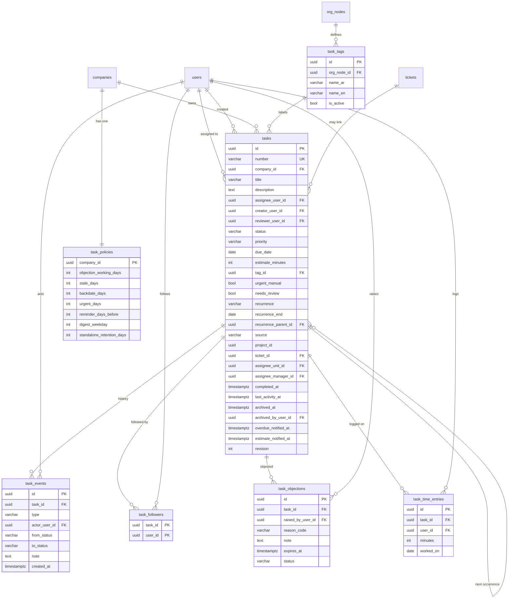

# خطة موديول المهام (Tasks)

**الحالة: المراحل 0–9 منفّذة (2026-10-24)، لم تُرفع إلى git بانتظار موافقة المالك.**

**خط الأساس (قبل أي تعديل):** آخر commit `fd8acee`؛ اختبارات الوحدة API 66 اختبارًا في 12 ملفًا، الويب 107 في 32 ملفًا، API e2e (PostgreSQL حقيقية) 147 في 18 ملفًا — كلها ناجحة. الملفات الموجودة المسموح تعديلها: `docs/plans/phase-3-allowed-existing-changes.txt`. المصدر الوحيد للمتطلبات هو وصف المالك (الشاشات، طرق العرض، دورة الحياة)؛ كل ما لم يرد فيه مكتوب في §2 كسؤال بإجابة مقترحة ولا يُبنى قبل ردّك. الرقم التالي للمتطلبات: **FR-48** (آخر رقم مستعمل FR-47).

## 0. ما وجدته في الكود (يغيّر الخطة)

| ما كُتب في الوصف | الواقع في الكود | الأثر |
|---|---|---|
| «راجع status enum بتاع Task entity» | لا يوجد كيان مهام ولا موديول | الحالات تُعرَّف من الصفر (§4.2) وتُراجع معك |
| المشاريع، أعضاء المشروع، مدير المشروع | لا يوجد موديول مشاريع | نقاط ربط (ports) ترجع فارغًا حتى يُبنى الموديول |
| `/admin/effects` تنفيذ القرارات | غير موجود | الاعتماد بآلة XState في `WorkflowRegistry`؛ التنفيذ الآخر يتأجل |
| تحويل المهام عند ترك الموظف | شاشة إنهاء الخدمة موجودة في employees | يُتحقق أنها تنشر حدث outbox، وإلا يُضاف |
| سحب وإفلات Kanban | لا مكتبة في المشروع | `@dnd-kit/core` بنسخة مثبتة عمرها ≥ 14 يومًا، ويُسجَّل في `decisions.md` |
| «مخفي عن الموظفين إلا مدير المنصة» | القرار 68: لا تُمنح مفاتيح جديدة تلقائيًا | مفاتيح المهام لا تُمنح لدور «موظف»، وصفحاتها تُخفى من صفحة الرؤية |
| دور «مطّلع الاستثناء على المهام» | موجود في seed بلا وصف ولا صلاحيات | لا يُبنى له سلوك قبل وصفك (س 8) |
| حدث إنهاء الموظف | `EmployeesService.terminate` يسجّل التدقيق فقط ولا ينشر حدث outbox | **نبنيه الآن (المرحلة 4):** نشر `employee.terminated` بـ `Outbox.enqueue` داخل نفس معاملة الإنهاء (تعديل صغير في employees مع اختباره) |
| ملخص الصفحة الرئيسية للمهام والتذاكر | الرئيسية تعرض إحصاءات الموظفين وأحدث التدقيق وروابط فقط؛ لا ملخص للتذاكر ولا مهام | **نبنيه الآن:** نقاط `summary` في tasks وtickets وأقسام في الرئيسية (§9.5) |
| سطر «المهام» في صلاحيات الصفحة والقوائم | كتالوج الصلاحيات يعرف `tickets` وغيره فقط؛ كتالوج الرؤية `packages/shared/src/pages/schemas.ts` وكتالوج القوائم لا يعرفان المهام | **نضيفها الآن (§3.1)** |
| حساب أيام العمل (الجمعة والسبت إجازة) | موجود في `tickets/domain/rules/working-days.rules.ts` | يُنقل إلى `common/` ويستعمله الموديولان (لا نسخ، `npm run dup` < 3 %) |

## 1. الهدف والنطاق

مكان الموظف الواحد لشغله: ما عليه، وما طلبه من غيره، وما يتابعه؛ والمدير يرى مهام فريقه.

**داخل النطاق (v1):** مهامي (3 تبويبات)، فريقي، المصفوفة، مهمة جديدة، عرض الجدول وعرض Kanban بقواعد نقل في الخادم، الاعتماد الذاتي، الاعتراض، التذكير والملخص الأسبوعي والركود، التكرار، تسجيل الوقت (بأثر رجعي حتى 7 أيام)، فئات الوحدة، سياسات المهام، تحويل المهام عند ترك الموظف، التصدير.

**قاعدة التنفيذ (قرار المالك):** كل ما هو ناقص في الكود **ونحتاجه للمهام نبنيه الآن** داخل هذه الخطة (حدث إنهاء الموظف، ملخصات الصفحة الرئيسية، نقل حساب أيام العمل، الـ ports...). أما **الموديول الكامل الغائب (مثل المشاريع)** فلا نبنيه هنا: نترك له نقطة ربط (port) بتطبيق فارغ آمن ونكتب ملاحظة **«تُنفَّذ لاحقًا عند الوصول إلى فيتشر كذا»** في §1.1 وفي `decisions.md` وREADME.

**خارج النطاق الآن:** موديول المشاريع نفسه، Gantt، استيراد المهام من ملف، `/admin/effects` (انظر §1.1).

### 1.1 مؤجل: يُنفَّذ لاحقًا عند الوصول إلى فيتشره

| الفيتشر الغائب | ما يُنفَّذ فيه لاحقًا | ما نتركه الآن |
|---|---|---|
| **موديول المشاريع** | (1) أعضاء المشروع والإدارات المشاركة كمن يُسند إليهم؛ (2) خطوة اعتماد «مدير المشروع / المسؤول عن المخرَج» بعد المدير المباشر؛ (3) ربط `tasks.project_id` بـ FK؛ (4) تحويل مهام المشروع لمدير المشروع عند ترك الموظف؛ (5) الإسناد لإدارة كاملة يذهب لرئيس الوحدة؛ (6) عرض مهام المشروع في خطته وGantt | `TaskProjectMembersPort` و`TaskProjectApproverPort` بتطبيق فارغ (`NoProject...Adapter`: لا أعضاء ولا معتمد)، عمود `project_id` بلا FK، قيمة `source = 'project'` معرَّفة، وخطوة الاعتماد الثانية في آلة XState معطّلة بشرط |
| **`/admin/effects` (تنفيذ القرارات)** | تطبيق نتائج الموافقة أو الرفض عبر شاشة التنفيذ | الاعتماد الذاتي ينفَّذ داخل آلة `task.self_approval` مباشرة بلا انتظار هذه الشاشة |
| **Gantt وخطة المشروع** | عرض زمني للمهام | لا شيء الآن |
| **استيراد المهام من ملف** | قالب Excel وتحقق صفوف | لا استيراد (القرار 35: لا استيراد إلا حيث يُملأ من ملف) |

كل صف يُسجَّل أيضًا كملاحظة في README §4 تحت FR المهام المعنية وفي `decisions.md`، كي لا يضيع.

## 2. قرارات المالك (اعتُمدت الافتراضات بتاريخ 2026-10-24)

**المالك وافق على كل الافتراضات المقترحة أدناه**، بما فيها قراراته الخاصة في س 3 و4. المفتوح الوحيد: **س 11** (بقية جملة «وضع المدير» المقطوعة)، ولا يحجب المراحل. المقترح في كل صف هو القرار المعتمد.

| # | السؤال | المقترح |
|---|---|---|
| 1 | «الاعتراض يسقط بعد 3 أيام عمل»: مهلة للموظف كي يعترض، أم اعتراض بلا رد يسقط وتبقى المهمة عليه؟ | الثاني (وصف Kanban: «حالة مؤقتة ليها مدة»). يجوز الاعتراض ما دامت المهمة «للتنفيذ» |
| 2 | الأسباب الأربعة للاعتراض | مؤقتًا: ليست من اختصاصي، المدة غير كافية، تفتقد معلومات، أولويات متعارضة — تُعدَّل بإجابتك |
| 3 | مصير المهمة الذاتية المرفوضة من المعتمد | **محسوم (قرارك):** حالة `rejected` («مرفوضة») ولها **عمود في Kanban** وتظهر في الجدول |
| 4 | المهام المستقلة «تُحفظ 30 يومًا»: مسح أم أرشفة؟ | **محسوم (قرارك):** أرشفة، **وتُسترجع من الداشبورد** (تبويب/فلتر «المؤرشفة» وزر «استرجاع» بمفتاحه)؛ تُؤرشف بعد 30 يومًا من إغلاق المهمة المستقلة، والمفتوحة لا تُلمس |
| 5 | سلسلة الاعتماد | المدير المباشر دائمًا، ثم مدير المشروع **لمهام المشاريع فقط**؛ من بلا مدير تُعتمد مهمته تلقائيًا |
| 6 | معنى «مهمة مهمة ولا عادية» في المصفوفة | أولوية «عالية» = مهمة |
| 7 | المراجع في «تحتاج مراجعة» | من أسند المهمة؛ وللذاتية من اعتمدها |
| 8 | دور «مطّلع الاستثناء على المهام» | لا شيء حتى تصفه (معتمد: لا سلوك له الآن) |
| 9 | الإسناد لإدارة كاملة في مهام المشاريع | يذهب لرئيس الوحدة؛ يؤجَّل لحين موديول المشاريع |
| 10 | نص الإشعارات | داخل المنصة برقم المهمة وعنوانها؛ البريد للأهم فقط (إسناد، اعتراض، رفض إنجاز) برقم المهمة بلا عنوان (كالقرار 55) |
| 12 | «إشعار لو عدّت الوقت المسموح بيه في الحل»: أي وقت؟ | الاثنان: (أ) **فات الموعد** `due_date` ← إشعار للمسند إليه ولمن أسند، (ب) **الساعات المسجلة تجاوزت التقدير** `estimate_minutes` ← إشعار للمسند إليه ولمن أسند. كل واحد مرة واحدة لكل مهمة. عدّل لو تقصد واحدًا فقط |
| 13 | «اشعار عند الانتهاء»: لمن؟ | لمن أسند المهمة (وللمتابعين)، وللمراجع عند «بانتظار المراجعة» |
| 11 | آخر جملة في ملخصك («وضع المدير») مقطوعة | **مفتوح:** أرسل بقيتها؛ لم يُحفظ شيء أثناء الاستكشاف |

## 3. الرؤية والصلاحيات

- **الرؤية بالعلاقة والنطاق معًا:** تبويبات مهامي تتحدد بالعلاقة (المسند إليه، من أسند، متابِع). فريقي بنطاق الصلاحية `tasks.team_view`: `unit` للمرؤوسين المباشرين، `subtree` لكل من تحته. خارج النطاق ← `NotFoundError` (404).
- **الإخفاء عن الموظفين:** لا مفتاح للمهام في دور «موظف»؛ المدير يمنحها من صفحة الصلاحيات، وتُخفى الصفحات من صفحة الرؤية حتى الإطلاق.
- **من يسند لمن** (`TaskAssignmentPolicy`):
  - المدير لأي شخص في subtree.
  - الموظف لمدير إدارته (الإدارة = مستوى `template_code = 'department'`).
  - المشاركون في نفس التذكرة لبعضهم عبر `TaskTicketParticipantsPort` (يطبقه موديول tickets).
  - أعضاء المشروع أو الإدارات المشاركة عبر `TaskProjectMembersPort` (يرجع فارغًا الآن).
  - الإسناد لنفسك مسموح لكنه ينتظر اعتمادًا.
- **الإخفاء:** نفس القاعدة؛ لا مفتاح مهام في دور «موظف».

### 3.1 صلاحيات المهام (تُضاف إلى كتالوج الصلاحيات وصفحة الصلاحيات)

تُعرَّف في `packages/shared/src/permissions/keys.ts` (`CorePermission.Tasks...`) وفي `domain/permissions/tasks.permissions.ts` بالعربي والإنجليزي، وتُسجَّل في `onModuleInit`، وتظهر في **صفحة الصلاحيات ومصفوفة الأدوار تحت قسم جديد «المهام / Tasks»** (مفتاح الترجمة `module.tasks` في i18n الأدوار). كل مفتاح له نطاقات مسموحة تُختار عند وضعه على دور أو مجموعة أو شخص.

| المفتاح | ما يتيحه | النطاقات |
|---|---|---|
| `tasks.view` | صفحة «مهامي» وتبويباتها وتفاصيل المهمة (+ ملخص الرئيسية) | own |
| `tasks.team_view` | صفحة «فريقي» (القائمة والـ Kanban وSwimlanes) | unit، subtree |
| `tasks.matrix_view` | صفحة المصفوفة | own، unit، subtree |
| `tasks.create` | زر «مهمة جديدة» | الكل |
| `tasks.assign` | الإسناد لشخص آخر (وليس لنفسك) | unit، subtree، company، all (بحدود قواعد §5) |
| `tasks.update` | تعديل بيانات المهمة | own، unit، subtree |
| `tasks.change_status` | نقل حالة مهامي (سحب أو زر) | own |
| `tasks.team_change_status` | نقل حالة مهام فريقي | unit، subtree |
| `tasks.approve` / `tasks.reject` | اعتماد أو رفض مهمة ذاتية ينتظرني | unit، subtree |
| `tasks.review` | قبول الإنجاز أو رفضه كمراجع | own |
| `tasks.reopen` | إعادة فتح مكتملة | own، unit، subtree |
| `tasks.resubmit` | إعادة إرسال المرفوضة للاعتماد | own |
| `tasks.object` | الاعتراض على مهمة أُسندت لي | own |
| `tasks.follow` | متابعة مهمة | own |
| `tasks.log_time` | تسجيل ساعات (بأثر رجعي حتى الحد) | own |
| `tasks.archive_view` | تبويب المؤرشفة | own، unit، subtree |
| `tasks.restore` | استرجاع مؤرشفة | own، unit، subtree |
| `tasks.export` | زر التصدير في قوائم المهام | الكل |
| `tasks.tags_view` / `tasks.tag_create` / `tasks.tag_update` / `tasks.tag_delete` | صفحة الفئات وأزرارها | own (إدارتي)، unit، subtree، all |
| `tasks.policies_view` / `tasks.policies_edit` | صفحة سياسات المهام وتعديلها (وضع المدير) | all |

- **أماكن التسجيل (كلها في المرحلة 1):** `keys.ts`؛ `tasks.permissions.ts`؛ `module.tasks` و`module.<...>` في i18n الأدوار؛ كتالوج رؤية الصفحات `packages/shared/src/pages/schemas.ts` ومعه i18n page-visibility (صفحات: مهامي، فريقي، المصفوفة، الفئات، السياسات)؛ كتالوج القوائم `LIST_CATALOG` (`tasks`، `task-tags`) وi18n إدارة القوائم؛ اختبار `security.e2e` يتأكد أن كل مسار يحمل مفتاحه.
- **لا تُمنح لدور «موظف»** (القرار 68)؛ يمنحها المدير من صفحة الصلاحيات. أما ملخص الرئيسية فمفتاحه نفس `tasks.view` / `tickets.view` فلا مفتاح جديد.
- صفحة الفئات تُدار من إدارتها؛ صفحة السياسات في وضع المدير (`@RequireAdminMode()`).

## 4. نموذج البيانات (هجرة واحدة، كل كيان في `entities.ts`)

### 4.1 الجداول

| الجدول | الأعمدة الأساسية |
|---|---|
| `tasks` | `id`، `number` (TSK-000123)، `company_id`، `title`، `description`، `assignee_id`، `creator_id`، `reviewer_id`، `status`، `priority`، `due_date`، `estimate_minutes`، `tag_id`، `urgent_manual`، `needs_review`، `recurrence` + `recurrence_end`، `recurrence_parent_id`، `source` (standalone / project / ticket)، `project_id`، `ticket_id` (FK قيد فقط)، `completed_at`، `last_activity_at`، `archived_at`، `revision`، لقطة وحدة المسند إليه ومديره |
| `task_events` | المهمة، من، متى، النوع، من حالة، إلى حالة، ملاحظة — كل نقلة تصفّر `last_activity_at` |
| `task_followers` | المهمة، الموظف |
| `task_objections` | المهمة، المعترض، السبب (من 4 ثابتة)، ملاحظة، `expires_at`، الحالة (open / expired / accepted / rejected) |
| `task_time_entries` | المهمة، الموظف، دقائق، تاريخ العمل (حتى 7 أيام للخلف) |
| `task_tags` | الإدارة (org node)، الاسم عربي وإنجليزي، فعّال |
| `task_policies` | صف لكل شركة بكل الأرقام (لا أرقام ثابتة في الكود): مدة الاعتراض (3 أيام عمل)، الركود (30)، الرجعي (7)، العاجل (2)، التذكير قبل الموعد (1)، موعد الملخص (الأحد 08:00)، حفظ المستقلة (30) |

### 4.1.1 مخطط الكيانات (ERD)



ملاحظات: `project_id` عمود بلا FK حتى يوجد جدول المشاريع؛ `ticket_id` وبقية الأعمدة إلى جداول موديولات أخرى constraint-only (`@ManyToOne('Name')`)؛ لقطة وحدة ومدير المسند إليه (`assignee_unit_id`، `assignee_manager_id`) تُحفظ وقت الإنشاء كي تبقى الاعتمادات والتقارير ثابتة عند نقل الموظف.

### 4.2 الحالات
`pending_approval` ← `todo` ← `in_progress` ← `awaiting_review` ← `done`، و`rejected` (مرفوضة من المعتمد؛ لها عمود في Kanban).
- **المرفوضة:** لا تُسحب منها ولا إليها (تُنشأ برفض المعتمد فقط)؛ صاحبها يعيد إنشاء مهمة جديدة أو يعدّل ويعيد الإرسال للاعتماد (زر `tasks.resubmit`، تعود `pending_approval` وتُسجَّل في التاريخ).
- **الاعتراض علم** على المهمة، ليس حالة.
- **عاجلة** محسوبة: موعدها خلال يومين، أو متأخرة، أو `urgent_manual`.
- **راكدة** محسوبة: `last_activity_at` أقدم من مدة الركود.
- **الأولوية:** منخفضة، متوسطة (الافتراضي)، عالية.

## 5. دورة الحياة والقواعد التجارية (في `domain/rules` بلا I/O، مع unit tests)

- **جدول النقل** (`task-transitions.rules.ts`):

| النقلة | من يقدر |
|---|---|
| من «بانتظار الاعتماد» إلى أي عمود | لا أحد بالسحب؛ تتحرك بموافقة المعتمد فقط |
| «للتنفيذ» ← «قيد التنفيذ» | المسند إليه |
| «قيد التنفيذ» ← «مكتملة» | المسند إليه؛ وإن كانت «تحتاج مراجعة» تذهب تلقائيًا إلى «بانتظار المراجعة» |
| «بانتظار المراجعة» ← «مكتملة» | المراجع فقط |
| «بانتظار المراجعة» ← «قيد التنفيذ» | المراجع (رفض إنجاز، ملاحظة إلزامية) |
| «مكتملة» ← أي عمود (إعادة فتح) | من أسند أو المدير |
| أي نقلة في فريقي | المدير ضمن مدى الإسناد |

- **الإنجاز المتأخر** (`task-dates.rules.ts`): إن فات موعد المهمة بأكثر من 7 أيام يلزم تأكيد تاريخ الإنجاز الفعلي، والتسجيل الرجعي مسموح حتى 7 أيام فقط (وكذلك تسجيل الساعات).
- **الاعتماد الذاتي:** آلة XState باسم `task.self_approval` (مدير مباشر ثم مدير المشروع لمهام المشاريع)، مهلها `meta.timeout` لا `after`. الفورم يعرض «تُعتمد من فلان» قبل الحفظ.
- **الاعتراض:** المسند إليه يختار أحد الأسباب الأربعة؛ مدته أيام عمل تُقرأ من السياسة؛ بعدها يسقط (مهمة `scheduled_jobs` دائمة).
- **التذكير والمتابعة:** تذكير قبل الموعد بيوم؛ ملخص الأحد صباحًا للمدير بمتأخرات فريقه؛ علم الركود يوميًا.
- **التكرار:** عند إغلاق المهمة المتكررة تُولَّد التالية.
- **المستقلة:** تُؤرشف بعد المدة (س 4) وتخرج من القوائم العادية؛ **الاسترجاع** من تبويب «المؤرشفة» في الداشبورد (`tasks.restore`) يعيدها بحالتها قبل الأرشفة ويسجل حدث `restored` ويُشعر من أسند.
- **ترك الموظف:** مستهلك لحدث `employee.terminated` داخل `IdempotencyGuard.once`؛ مهامه العادية لمديره المباشر ومهام المشاريع لمدير المشروع، وكل نقل يُسجَّل في `task_events` والتدقيق.
- **التزامن:** `revision` متفائل (409 عند التعارض).

## 6. واجهة الـ API (`modules/tasks`)

- **قراءة:** `GET /tasks?tab=assigned|created|following`، `GET /tasks/team` (فلتر بشخص)، `GET /tasks/matrix`، `GET /tasks/:id`، `GET /task-tags`، `GET /task-policies`.
- **كتابة:** `POST /tasks`، `PATCH /tasks/:id`، `POST /tasks/:id/transition` `{to, note?, actualDoneDate?, revision}`، `approve` و`reject`، `object` و`respond-objection`، `follow` و`unfollow`، `time-entries`، `GET /tasks?archived=true` و`POST /tasks/:id/restore` و`POST /tasks/:id/resubmit`، CRUD الفئات، `PUT /task-policies`.
- **`TaskTransitionService` المكان الوحيد لتغيير الحالة.** يتحقق من الجدول والنطاق والـ `revision`، ويرفض بـ `TASK_TRANSITION_NOT_ALLOWED` وسبب مقروء، ويسجل الحدث والتدقيق. الـ Kanban يستدعيه هو نفسه، فلا يوجد مسار ثانٍ. واجهة الويب تمنع السحب الخاطئ لتجربة أفضل فقط وليست الحماية.
- القوائم بـ `ctx.filterFor(key)` + `applyScope(...)`؛ المفرد بـ `AbilityFactory.assertCan(ctx, key, resource)`.
- المخططات `z.strictObject` في `packages/shared/src/tasks/`.

## 7. الواجهة (`apps/web/src/features/tasks`، ar + en، وسطر في `app/features.ts`)

- **مهامي:** `PageHeader` + `DataTable` + `ListToolbar` (بحث، فلتر لكل سمة، مفتاح جدول/Kanban) + `ExchangeButtons` (تصدير فقط). تفتح على المفتوحة مرتبة بالموعد.
- **الجدول:** العنوان، المسند إليه، الموعد، الأولوية، الحالة، الفئة، التقدير؛ ترتيب بالنقر؛ شارة حمراء للعاجل ورمادية للراكد (أيقونة ونص، لا لون وحده)؛ تجميع بالموعد أو الحالة أو الشخص.
- **Kanban:** 6 أعمدة (بانتظار الاعتماد، للتنفيذ، قيد التنفيذ، بانتظار المراجعة، مكتملة، **مرفوضة**)؛ الكارت: العنوان، صورة المسند إليه، الموعد، الأولوية، الفئة، علامات عاجل/راكد/معترض عليها. عند الرفض يرجع الكارت وتظهر رسالة بالسبب. يعمل بلوحة المفاتيح (axe). نافذة لتاريخ الإنجاز الفعلي ونافذة ملاحظة لرفض الإنجاز.
- **فريقي:** نفس العرضين، فلتر بشخص، مرؤوسون مباشرون أو كل من تحته، وSwimlanes (صف لكل موظف) في Kanban.
- **المصفوفة:** أربعة مربعات (مهم/عادي × عاجل/غير عاجل).
- **مهمة جديدة:** العنوان، المسند إليه (أنا)، الموعد (اليوم)، الأولوية (متوسطة)، الوقت المتوقع، الفئة، التكرار.
- **الفئات** و**سياسات المهام:** صفحتا إدارة.
- آخر طريقة عرض يتذكرها `useViewMode` لكل مستخدم.
- الالتزام بمهارة `arweqah-design-system`: ألوان semantic، RTL، الجوال، الألوان الأربعة للرسائل.

## 8. الإشعارات والتدقيق

**الإشعارات داخل المنصة** (`core/notifications`، بلا نصوص حساسة في البريد):

| الحدث | يصل إلى | قناة |
|---|---|---|
| أُسندت لك مهمة | المسند إليه (يظهر في صفحة الإشعارات والجرس) | داخل المنصة + بريد |
| **كل تغيير في حالة المهمة** (نقل، اعتماد، رفض، مراجعة، إعادة فتح، أرشفة، استرجاع) | **من أسند المهمة** (وللمتابعين) | داخل المنصة |
| انتهت المهمة (مكتملة) | من أسند المهمة والمتابعون | داخل المنصة |
| بانتظار المراجعة | المراجع | داخل المنصة + بريد |
| تجاوزت المهمة موعدها | المسند إليه ومن أسند | داخل المنصة |
| تجاوزت الساعات المسجلة التقدير | المسند إليه ومن أسند | داخل المنصة |
| اعتراض / رد على اعتراض / رفض إنجاز | الطرف الآخر | داخل المنصة + بريد |
| تذكير قبل الموعد بيوم | المسند إليه | داخل المنصة |
| ملخص الأحد | المدير | داخل المنصة |
| نقل ملكية بسبب ترك الموظف | المستلم ومن أسند | داخل المنصة + بريد |

- **لا يُشعَر من قام بالتغيير بتغييره هو** (لا إشعار ذاتي).
- **التجميع:** عدة تغييرات متتالية خلال دقيقة على نفس المهمة تصل كإشعار واحد (حتى لا يغرق المسند).
- **الإنشاء:** كل إشعار يُكتب في نفس معاملة التغيير عبر `Outbox.enqueue` والمستهلك idempotent، فلا يضيع ولا يتكرر.
- **تجاوز الموعد والتقدير:** من jobs تنفّذ يوميًا وعند تسجيل الساعات؛ الأعمدة `overdue_notified_at` و`estimate_notified_at` تمنع التكرار.
- **التدقيق** عبر `events.emit(AUDIT_EVENT, ...)`: إنشاء، إسناد، نقل حالة، اعتماد/رفض، أرشفة، استرجاع، اعتراض، تغيير سياسة، تحويل ترك الموظف — أسماء وأرقام فقط.

## 9. المعمارية: بنية الملفات، النظافة، ونظام التصميم

تتبع مهارات `module-architecture` و`clean-code` و`arweqah-design-system` حرفيًا. **في بداية كل مرحلة** أذكر مكان كل ملف جديد، **وفي نهايتها** أؤكد قائمة `module-architecture` في سطر واحد.

### 9.1 الـ API: `apps/api/src/modules/tasks/` (كل ملف في مجلد نوعه، ولا شيء في الجذر غير `tasks.module.ts`)

```
tasks.module.ts                         ربط Nest + تسجيل الصلاحيات في onModuleInit + تسجيل آلة الاعتماد في WorkflowRegistry
domain/
  entities/        task.entity.ts, task-event.entity.ts, task-follower.entity.ts, task-objection.entity.ts,
                   task-time-entry.entity.ts, task-tag.entity.ts, task-policy.entity.ts   (كيان لكل ملف)
  types/           task.types.ts                 (الحالات، الأولويات، أسباب الاعتراض، نماذج القراءة)
  errors/          task.errors.ts                (TASK_TRANSITION_NOT_ALLOWED، TASK_NOT_ARCHIVED، ... برسائل إنجليزية)
  contracts/       task.repository.ts, task-event.repository.ts, task-tag.repository.ts, task-policy.repository.ts,
                   task-project-members.port.ts, task-ticket-participants.port.ts, task-reporting-line.port.ts
  rules/           task-transitions.rules.ts, task-flags.rules.ts, task-dates.rules.ts, task-assignment.rules.ts
                   (+ ملف .spec.ts بجانب كل واحد؛ بلا I/O)
  permissions/     tasks.permissions.ts
application/
  services/        tasks.service.ts (إنشاء/تعديل/تفاصيل)، task-query.service.ts (القوائم وفريقي والمصفوفة)،
                   task-transition.service.ts، task-approval.service.ts، task-objection.service.ts،
                   task-archive.service.ts، task-time.service.ts، task-reminder.service.ts،
                   task-handover.service.ts، task-notifier.service.ts، task-policy.service.ts، task-tag.service.ts
  policies/        task-access.policy.ts (من يرى)، task-assignment.policy.ts (من يسند لمن)
  transformers/    task.transformer.ts، task-event.transformer.ts، task-tag.transformer.ts
  messages/        task.messages.ts (أسماء التدقيق ونصوص الإشعارات عربي/إنجليزي، لا نص داخل الخدمات)
infrastructure/
  repositories/    typeorm-task.repository.ts، typeorm-task-event.repository.ts، typeorm-task-tag.repository.ts،
                   typeorm-task-policy.repository.ts، task-sql.ts (مقاطع الاستعلام المشتركة)
  adapters/        employee-termination.adapter.ts (يطبّق ما يلزم من موديول employees عبر port)، 
                   تطبيق task-reporting-line.port فوق خدمات org/employees المصدَّرة
  jobs/            task-reminder.job.ts، task-stale.job.ts، task-archive.job.ts، task-digest.job.ts،
                   task-objection-expiry.job.ts، task-recurrence.job.ts، task-handover.consumer.ts، task-notice.consumer.ts
presentation/
  controllers/     tasks.controller.ts، task-team.controller.ts، task-tags.controller.ts، task-policies.controller.ts
  dtos/            tasks.dtos.ts (createZodDto من مخططات shared)
```

- **المخططات والأنواع المشتركة:** `packages/shared/src/tasks/{schemas.ts, types.ts, statuses.ts}` (`z.strictObject` للمدخلات، ثوابت الحالات والأولويات وأسباب الاعتراض تُستورد في الـ API والويب ولا تُعاد كتابتها).
- **ربط خارج الموديول:** تسجيل الكيانات في `database/entities.ts` (بلا glob)، والـ ports بين tasks وemployees/org/tickets تُطبَّق في `infrastructure/adapters` للموديول المالك، ولا يستورد tasks مستودعات غيره (خدمات مصدَّرة أو ports فقط).
- **ما يُنقل لأماكنه المشتركة لا يُنسخ:** `working-days.rules.ts` ← `common/`؛ أي منطق نطاق أو تاريخ يحتاجه موديولان ← `common/`.
- **لا `index.ts` داخل الموديول** (الاستيراد صريح)، وملف رئيسي واحد لكل ملف، وأسماء الملفات `kebab-case`.

### 9.2 الويب: `apps/web/src/features/tasks/` (يصدّر `FeatureModule` من `index.ts` + سطر في `app/features.ts`)

```
index.ts                         FeatureModule: مسارات lazy، عناصر القائمة بصلاحياتها، i18n
api.ts                           استدعاءات apiClient + مفاتيح TanStack Query (لا fetch في المكوّنات)
i18n/ar.json, en.json
my-tasks/        my-tasks-page.tsx, use-my-tasks.ts, tasks-columns.tsx, tasks-filters.ts
my-tasks/        …, team-controls.tsx (تبويب «فريقي» داخل مهامي)
matrix/          matrix-section.tsx (قسم في الرئيسية), matrix-quadrant.tsx
board/           task-board.tsx, board-column.tsx, task-card.tsx, use-board-drag.ts, transition-dialogs.tsx
new-task/        new-task-dialog.tsx (نافذة منبثقة), task-draft.ts, task-fields.tsx, approver-hint.tsx
details/         task-details-page.tsx, task-timeline.tsx, task-actions.tsx, objection-dialog.tsx, time-entry-dialog.tsx
archive/         archive-tab.tsx, restore-button.tsx
tags/            tags-page.tsx, tag-form-dialog.tsx
policies/        policies-page.tsx, policy-sections.tsx
task-badges.tsx                  شارات الحالة والأولوية وعاجل وراكد ومعترض عليها
```

- **المكوّنات تستعمل hooks، والـ hooks تستعمل `apiClient`.** استيراد أي feature آخر عبر `index.ts` فقط.
- **إعادة استعمال لا نسخ:** `DataTable` + `ListToolbar` + `ExchangeButtons`، و`useListPage` / `useServerList` / `useFilters` / `useViewMode` / `fetchAllPages` من `shared/lib`، و`Dialog` و`FormField` و`SectionCard` و`PageHeader` و`Alert` و`Badge` من `shared/ui`. ما يستعمله Kanban وغيره من عناصر عامة (مثل لوحة أعمدة أو بطاقة قابلة للسحب) يُضاف إلى `shared/ui` إن احتاجته ميزة ثانية؛ والأهم أن منطق السحب العام (`useBoardDrag`) لا يعرف شيئًا عن المهام.
- **القوائم تسجَّل في `LIST_CATALOG`** (أعمدة وفلاتر المهام والفئات والمؤرشفة) وفي i18n الخاص بإدارة القوائم، وتمرّر `listKey`.

### 9.3 نظام التصميم (مطابقة `arweqah-design-system`)

- **الألوان:** رموز العلامة فقط (`text-fg`، `text-link`، `bg-primary`، `bg-white`، `bg-neutral-50`، حدود `neutral-200`، التدرجات `*-50`)، لا hex ولا ألوان ثابتة؛ الثيم الفاتح والداكن معًا؛ الأصفر ≤ 5 % ولا يكون نصًا؛ الأخضر والبرتقالي لا يكونان نصًا صغيرًا.
- **شارات الحالة والأولوية والتنبيهات:** من `message-tones.ts` فقط: عاجل ← خطر (أحمر)، راكد ← محايد (رمادي)، معترض عليها ← تحذير (أصفر بنص داكن)، مكتملة ← نجاح، مرفوضة ← خطر، بانتظار المراجعة والاعتماد ← معلومة. **كل شارة بأيقونة ونص** (لا لون وحده).
- **Kanban:** لوحة بيضاء مستديرة 24px، الأعمدة أسطح `neutral-50` مستديرة، الكارت `rounded-2xl` بحد `neutral-200` وظل خفيف؛ رأس العمود باسمه وعدّاده؛ الكارت يُمسك بمقبض ظاهر وله `aria-label`؛ حلقة التركيز 2px (`petrol-800` فاتح، `yellow-300` داكن)؛ حركة ≤ 150ms وتحترم `prefers-reduced-motion`.
- **RTL أولًا:** خصائص منطقية فقط (`ms-/me-/ps-/pe-/start-/end-`)، أسهم الاتجاه تنقلب، الأرقام والرموز LTR، أعمدة Kanban تتدفق من اليمين في العربية، والتحقق في اللغتين.
- **الجوال (قرار المالك):** الجدول يتحول إلى بطاقات، والـ Kanban **يُمرَّر أفقيًا بأعمدته الستة** بعرض ثابت لكل عمود (لا تبويب ولا عمود واحد)، مع تمرير سلس وبلوحة المفاتيح، وأهداف اللمس ≥ 44px، وفلاتر بعرض كامل، وفورم بعمود واحد. السحب بين الأعمدة على الجوال يعمل باللمس مع تمرير تلقائي للحافة، ويُتحقق منه في المرحلة 7 (axe ولقطات الجوال).
- **كل الحالات مصمَّمة:** تحميل (هيكل)، فارغ (رسالة وزر)، خطأ (Alert + إعادة محاولة)، بلا صلاحية (403)، مع نص عربي وإنجليزي.
- **النماذج:** تسمية فوق الحقل، `*` للإلزامي مع `aria-required`، خطأ نصي تحت الحقل **أثناء الكتابة** (`useLiveError` + `useRules`)، أقسام في `SectionCard`، شريط حفظ لاصق، زر أساسي واحد لكل عرض، وحذف أو إجراء لا رجعة فيه بـ `ConfirmDialog`.
- **الصلاحيات في الشاشة:** مفتاح عرض لكل صفحة (`nav.permission`)، وكل زر داخل `<Can permission>`، و`ExchangeButtons permissions`.
- **التحقق البصري في كل مرحلة واجهة:** `npm run design:check` و`npm run i18n:check`، لقطات عربي/إنجليزي، سطح مكتب/جوال، فاتح/داكن، وaxe على كل شاشة جديدة.

### 9.4 قواعد الكود النظيف (تُفرض بـ ESLint والمراجعة)

- **الحدود:** التعقيد ≤ 10، العمق ≤ 3، ≤ 4 معاملات (الـ constructors مستثناة؛ نستعمل كائن خيارات)، الدالة ≤ 40 سطرًا (≤ 80 في `.tsx`)، التكرار < 3 % (`npm run dup`)، لا `any`، لا متغيرات غير مستعملة. إذا لامست دالة حدًّا فهي تفعل شيئين: تُقسَّم بالمسؤولية ولا يُضغط الكود.
- **ما سيُقسَّم عمدًا من البداية** (كي لا تتضخم الملفات): جدول الانتقالات كبيانات (خريطة من `(من، إلى)` إلى قاعدة صغيرة) لا `if` متداخل؛ `TaskTransitionService` ينسّق فقط ويستدعي القواعد؛ الإشعارات في `TaskNotifierService` لا داخل الخدمات الأخرى؛ كل job ملف مستقل؛ `use-board-drag` منفصل عن مكوّنات الأعمدة.
- **المسؤولية الواحدة:** المتحكم يترجم HTTP فقط (تحقق DTO ← استدعاء دالة خدمة واحدة ← DTO)؛ الخدمة تحمل حالة الاستخدام (النطاق، المعاملة، التدقيق، outbox)؛ المستودع يحمل الاستعلامات؛ القاعدة النقية تحمل الحساب.
- **الاعتماد على التجريدات:** الخدمات تعتمد على العقود (`contracts`) لا على TypeORM ولا على أصناف المستودعات.
- **الأسماء تقول القصد:** `assertCanAssign` لا `check`؛ المنطقيات أسئلة (`isStale`, `hasObjection`)؛ لا اختصارات؛ ثوابت مسمّاة بدل الأرقام السحرية (3 أيام وغيرها تأتي من `task_policies` لا من الكود).
- **الأخطاء:** أخطاء نطاق بكود ثابت (`NotFoundError`, `BusinessRuleError`)، والنص الإنجليزي في `errors/` والترجمة في i18n الويب `errors.<CODE>`؛ خارج النطاق ← 404.
- **لا تعليقات تشرح ما يفعله الكود، فقط لماذا؛** لا كود ميت ولا TODO بلا مهمة.
- **عدم قابلية التغيير:** لا تعديل للمدخلات ولا حالة مشتركة قابلة للتعديل على مستوى الملف.
- **الأمان في البنية:** كل مسار `@RequirePermission`؛ القوائم `ctx.filterFor` + `applyScope`؛ السجل المفرد `AbilityFactory.assertCan`؛ الآثار بين الموديولات `Outbox.enqueue` في نفس المعاملة ومستهلك `IdempotencyGuard.once`؛ التدقيق `events.emit(AUDIT_EVENT, ...)`؛ التحقق عند الحدّ فقط بـ zod.
- **قائمة الإنهاء لكل مرحلة:** `npx turbo run lint typecheck build test`، `npm run architecture:check`، `npm run dup`، `npm run design:check`، `npm run i18n:check`، `npm run security:check`، ثم `npm run verify`.

### 9.5 الصفحة الرئيسية: مهامي الحالية وتذاكري وإحصاءات مفيدة (FR-57)

تعديل على `features/home` (كل الموظفين يدخلونها؛ لا يمكن إخفاؤها). كل قسم يظهر **فقط لمن يملك مفتاحه** وللصفحة غير المخفية عنه، فمن لا يملك صلاحيات المهام لا يرى قسم المهام.

**الترتيب في الصفحة** (فوق الأقسام الحالية: إحصاءات الموظفين، الاختصارات، آخر النشاط):

1. **شريط «أرقامي»** (`StatTile`، الأرقام تخصني وحدي، وتفتح كل بطاقة القائمة المفلترة المقابلة):
   - المهام: مفتوحة، **متأخرة** (تحذير إن > 0)، تستحق خلال 7 أيام، أنجزتها آخر 30 يومًا، **نسبة الإنجاز في الموعد** آخر 30 يومًا، بانتظار مراجعتي، بانتظار اعتمادي.
   - التذاكر: أرسلتها ولم تُغلق، **بانتظار تأكيدي** (طلب المعالج إغلاقها)، **تنتظر ردّي** (منسوبة إليّ أو لإدارتي كمدير مكتب).
   - للمدير فقط (`tasks.team_view`): مهام فريقي المتأخرة، الراكدة، المنجزة هذا الأسبوع.
2. **«مهامي الحالية»:** أول 5 مهام مفتوحة مسندة إليّ مرتبة بالموعد (العنوان، الموعد، شارة الأولوية، عاجل/متأخرة)، مع شريط تقدم بسيط يوزّع مفتوحاتي على الحالات (للتنفيذ، قيد التنفيذ، بانتظار المراجعة) بألوان العلامة ونص لا لون وحده، ورابط «عرض كل مهامي».
3. **«تذاكري»:** قائمتان قصيرتان (أول 5 لكل منهما): **تذاكر أرسلتها وما زالت مفتوحة** (وتُبرز التي **بانتظار تأكيدي**)، و**تذاكر تنتظر ردّي** (منسوبة إليّ)، مع روابط «عرض الكل».

**الخادم (لا منطق في الويب):**
- `GET /tasks/summary` في tasks: `task-summary.service.ts` + مستودع بعدّادات SQL مجمّعة (لا تحميل مهام للعدّ)، بنطاق `tasks.view` للأرقام الشخصية و`tasks.team_view` لأرقام الفريق، يرجع الأرقام وقائمة أول 5.
- `GET /tickets/mine-summary` في tickets: `ticket-summary.service.ts` بالعدّادات والقائمتين، بنفس قاعدة «الرؤية بالعلاقة» (المرسل أو المنسوب)، والتذاكر **الشخصية** تُحسب لأصحابها فقط (القرار 52).
- المخططات في `packages/shared/src/tasks/` و`.../tickets/`، والمحوّلات في `application/transformers`، والتفاصيل في ملفات الخدمات لا المتحكمات.
- الأرقام تُخزَّن مؤقتًا دقيقة واحدة في TanStack Query (staleTime)، وتتحدّث بعد أي إجراء على المهمة.

**الويب:**
- تبقى `home-page.tsx` قصيرة: تركّب أقسامًا. كل قسم مكوّن يُصدَّر من `index.ts` الخاص بميزته (`features/tasks` ← `MyTasksPanel`، `MyNumbers`؛ `features/tickets` ← `MyTicketsPanel`) وتستوردها الرئيسية عبر `index.ts` فقط (قاعدة عدم استيراد الداخل).
- مكوّنات `shared/ui` الموجودة: `StatTile` و`SectionCard` و`Badge`؛ ما يلزم من جديد (مثل شريط التوزيع `ProgressSplit`) يُضاف إلى `shared/ui` ليعاد استعماله.
- كل الحالات: تحميل (هيكل)، فارغ («لا مهام مفتوحة، أحسنت» + زر «مهمة جديدة» إن ملك `tasks.create`)، خطأ (Alert وإعادة المحاولة)، وأقسام بلا صلاحية لا تُرسم أصلًا.
- بالعربية والإنجليزية، الفاتح والداكن، RTL، والجوال (القسمان يتراصان عموديًا، والأرقام شبكة عمودين).

## 10. الاختبارات (جزء من «انتهى»)

| FR | المحتوى |
|---|---|
| FR-48 | مهامي والإنشاء والإسناد والمتابعة |
| FR-49 | فريقي والنطاقات |
| FR-50 | الجدول وKanban وجدول النقل |
| FR-51 | الاعتماد الذاتي |
| FR-52 | الاعتراض |
| FR-53 | التذكير والملخص والركود والتكرار والأرشفة |
| FR-54 | الفئات والسياسات |
| FR-55 | تحويل المهام عند ترك الموظف |
| FR-57 | الصفحة الرئيسية: أرقامي، مهامي الحالية، تذاكري (أرسلتها المفتوحة وما ينتظر ردّي)، وأرقام الفريق للمدير |
| FR-56 | إشعارات المهام (إسناد، كل تغيير حالة، انتهاء، تجاوز الموعد والتقدير) والأرشفة والاسترجاع |

- **API e2e (PostgreSQL حقيقية):** المسار السعيد، التحقق، 403 لكل دور، 404 خارج النطاق، تعارض `revision`، وكل صف في جدول النقل (مسموح وممنوع).
- **unit:** القواعد النقية وحساب أيام العمل بعد نقله.
- **component:** الجدول، الـ Kanban (قبول ورفض السحب)، الفورم، المصفوفة.
- **Playwright + axe:** رحلة كاملة في RTL وLTR، سطح مكتب وجوال، وسحب بلوحة المفاتيح.

## 11. التوثيق الذي يتحدّث مع الكود

README §4 (FR-48…57)، §6 ERD، §7 و§8 (مخطط دورة المهمة، تسلسل النقل والاعتماد)، §12 الأطراف؛ `docs/decisions.md` (من القرار 75: المكتبة، حالات المهمة، الاعتراض كعلم، الأرشفة، الـ ports)؛ سجل التنفيذ في آخر هذا الملف (الإدخالات القديمة في `phase-1-auth-employees.md` (حتى 2026-11-04))؛ مهارة `arweqah-design-system` (بطاقة Kanban وشارات العاجل والراكد).

### 11.1 تعريف «انتهى» للفيتشر (من CLAUDE.md) وكيف تغطيه الخطة

لا تُعدّ الفيتشر منتهية إلا بكل بند. الجدول يربط كل بند بمرحلته:

| بند «انتهى» في CLAUDE.md | أين في الخطة |
|---|---|
| الوصف مكتوب كصفوف FR في README §4 (الرقم التالي الحر) | المرحلة 0: FR-48…57 |
| موديول API + هجرة + صلاحيات | المراحل 1 إلى 5 و8 |
| مخططات zod مشتركة في `packages/shared` | المرحلة 1 (وتُوسَّع في 2 و8) |
| ميزة ويب (عربي + إنجليزي) | المراحل 6 و7 و8 |
| اختبارات API e2e بأسماء FR: المسار السعيد، التحقق، 403 لكل دور، 404 خارج النطاق، التزامن | المراحل 2 إلى 5 و8 |
| اختبارات مكوّنات | المراحل 6 و7 و8 |
| رحلة Playwright + axe | المراحل 6 و7 و8 و9 |
| README §4/6/7/8/12 محدّثة | المرحلة 0 (§4)، وتُستكمل مع كل مرحلة (§6 ERD، §7 دورة المهمة، §8 تسلسل النقل والاعتماد، §12 الأطراف)، وتُراجع في 9 |
| `npx turbo run lint typecheck build test` وكلتا حزمتي e2e خضراء | نهاية كل مرحلة (الـ e2e الكاملة في 9) |
| Conventional Commit | commit مستقل لكل مرحلة، بعد موافقتك، مثل `feat(tasks): ...` |

**وما تطلبه CLAUDE.md عند نهاية كل خطوة** (يدخل في كل مرحلة):
- قراءة `docs/decisions.md` وأقسام README ذات الصلة وآخر إدخالات سجل التنفيذ **قبل** كتابة الكود (تمّت لهذه الخطة، وتُعاد قبل كل مرحلة).
- استدعاء مهارة `module-architecture` في بداية ونهاية كل مرحلة API، و`arweqah-design-system` قبل أي واجهة.
- في النهاية، بهذا الترتيب: `module-architecture` ← `clean-code` ← `security-check` (`npm run security:check`) ← `arweqah-design-system` (`npm run design:check` + الشاشات الفعلية RTL/LTR، مكتب/جوال، فاتح/داكن، axe) ← `i18n-review` (`npm run i18n:check`) ← **`npm run verify`**.
- **تقرير المرحلة** من أربعة أسطر (Architecture، Design، Testing، Security) + سطر **«الموديولات القديمة»** (§11.3) وسطر لكل مهارة: ما شُغِّل وما وُجد وما أُصلح؛ لا يُخفَّف فحص ليمر.
- تحديث، في نفس المرحلة: README (§4/6/7/8/12، Brand، Run)، `docs/decisions.md`، **إدخال مؤرخ بالعربية** في «سجل التنفيذ (ما تم)» آخر هذا الملف (قاعدة المالك منذ 2026-11-05: سجل كل ميزة في ملف خطتها)، ومهارة التصميم عند تغيّر قواعده. المرحلة لا تنتهي والملفات تخالف الكود.
- تبعية جديدة (`@dnd-kit/core` وغيرها): أحدث إصدار مستقر عمره ≥ 14 يومًا ومثبّت بدقة؛ ويُسجَّل القرار.
- ما لم يرد في وصفك لا يُخترع: أسأل بأسئلة اختيار قصيرة.

### 11.2 أثر الخطة على الموديولات الموجودة (لا كسر ولا تغيير سلوك)

**فحصت الآن `git status`: الملف الوحيد المضاف هو `docs/plans/phase-3-tasks.md`؛ لم يُعدَّل أي ملف موجود، ولم يُنفَّذ أي كود.** عند التنفيذ تبقى القاعدة: **إضافة فقط، بلا تغيير سلوك**. وما يلمس موجودًا مذكور هنا كله بدقة، ولا شيء غيره:

| الموديول / الملف الموجود | التغيير المخطَّط | لماذا لا يكسر ما يعمل |
|---|---|---|
| قاعدة البيانات | هجرة واحدة **تنشئ جداول جديدة فقط**؛ لا `ALTER` ولا حذف على أي جدول موجود (الـ FK إلى جداول أخرى constraint-only) | لا أثر على بيانات حالية؛ تُراجع SQL قبل التشغيل |
| `employees` (المرحلة 4) | سطر `Outbox.enqueue('employee.terminated', …)` داخل معاملة `terminate` الموجودة | إضافة أثر جانبي فقط؛ نتيجة الدالة والتدقيق كما هما؛ اختبارات employees الحالية تبقى خضراء + اختبار جديد للحدث |
| `tickets` (المراحل 2 و8) | ملفات جديدة فقط: `ticket-summary.service` ومسار `GET /tickets/mine-summary` وتطبيق `TaskTicketParticipantsPort`؛ وتسجيلها في `tickets.module.ts` | لا تغيير على مسارات ولا قواعد التذاكر |
| `tickets/domain/rules/working-days.rules.ts` (المرحلة 1) | **يُنقل إلى `common/`** ويُحدَّث الاستيراد في tickets؛ المنطق والاختبارات كما هي | نقل بلا تغيير سلوك؛ اختبارات `ticket.rules.spec` تمر قبل النقل وبعده (تُقارن) |
| `org` | لا تغيير؛ tasks تستعمل خدماته المصدَّرة وports | — |
| `core/access` وكتالوج الصلاحيات | إضافة مفاتيح `tasks.*` في `keys.ts` وتسجيل صلاحيات الموديول | إضافة؛ لا تغيير على مفاتيح قائمة ولا تُمنح لأي دور |
| `core/notifications` | أنواع إشعارات جديدة | إضافة؛ يُتحقق من سجل الأنواع في المرحلة 1 |
| `core/lists` / `LIST_CATALOG` | إدخالان جديدان `tasks` و`task-tags` | إضافة |
| `page-visibility` (`pages/schemas.ts` + i18n) | خمس صفحات جديدة في الكتالوج | لا صف = ظاهرة، فلا تتأثر الصفحات الحالية |
| `roles` i18n | سطر `module.tasks` | إضافة |
| `database/entities.ts`، `app.module`، `app/features.ts` | سطر لكل كيان/موديول/ميزة | إضافة |
| `features/home` (المرحلة 8) | تعديل `home-page.tsx` ليركّب أقسامًا جديدة؛ أقسام الموظفين والاختصارات وآخر النشاط تبقى كما هي | اختبارات الرئيسية الحالية تبقى خضراء، والأقسام الجديدة خلف مفاتيحها فلا يتغير شيء لمن لا يملكها |

**الضمانات أثناء التنفيذ:**
1. قبل كل مرحلة: تشغيل اختبارات الوحدة وAPI e2e الحالية كخط أساس (يجب أن تكون خضراء).
2. بعد كل مرحلة: `git diff --stat` يُفحص، وكل ملف **موجود** معدَّل يُدرج في تقرير المرحلة بسبب تعديله، وأي ملف غير مذكور في الجدول أعلاه سبب لإيقاف المرحلة وسؤالك.
3. أي اختبار موجود يفشل بسبب هذه الفيتشر = خطأ في تنفيذي يُصلَح في الكود الجديد، **ولا يُعدَّل الاختبار القديم ولا يُضعَّف** ليمر.
4. الإضافات إلى الكتالوجات المشتركة (صلاحيات، قوائم، صفحات) تُختبر بأن عدّادات القديم لم تتغير.

### 11.3 التحقق من أن الموديولات القديمة لم تتغير (بوابة في كل مرحلة)

الفحص بالقراءة **ومؤتمت** كي لا يعتمد على الذاكرة:

1. **خط الأساس (المرحلة 0):** نسجّل hash آخر commit قبل البدء (`fd8acee` الآن، ويُحدَّث إن تقدّم `main`) في رأس هذا الملف، ونشغّل اختبارات الوحدة وAPI e2e وweb ونحفظ أعداد النجاح (كم اختبارًا وكم ملفًا) كمرجع.
2. **قائمة السماح:** ملف `docs/plans/phase-3-allowed-existing-changes.txt` فيه مسارات الملفات **الموجودة** المسموح تعديلها، وهي ما في جدول §11.2 فقط (مثل `employees.service.ts` و`home-page.tsx` و`keys.ts`). كل ملف جديد داخل `modules/tasks` و`features/tasks` وملفات الهجرة والاختبارات الجديدة مسموح بطبيعته.
3. **سكربت `scripts/check-existing-untouched.sh` (يُكتب في المرحلة 1، ويُشغَّل في نهاية كل مرحلة وضمن تقرير المعمارية):**
   - `git diff --name-status <خط الأساس>`: أي ملف حالته `M` أو `D` أو `R` (معدَّل أو محذوف أو منقول) **وليس في قائمة السماح** يُفشل الفحص ويوقف المرحلة.
   - الملف المنقول المسموح (`working-days.rules.ts` فقط) يُتحقق أن محتواه مطابق بعد النقل (`git diff -M --stat` يُظهر تشابهًا 100 %).
   - الملفات المسموح تعديلها يُعرض فرقها **كاملًا** في تقرير المرحلة لتراجعه (أسطر مضافة فقط؛ أي سطر محذوف في ملف قديم يحتاج تبريرًا صريحًا).
4. **الهجرة:** فحص آلي أن ملف الهجرة الجديد لا يحتوي `ALTER TABLE` ولا `DROP` ولا `UPDATE`/`DELETE` على جداول موجودة (`grep` على أسماء الجداول القديمة)، ويحتوي `CREATE TABLE` للجداول الجديدة فقط؛ و`npm run db:migration:generate` بعدها لا ينتج فرقًا (لا انحراف).
5. **الاختبارات القديمة كما هي:** `git diff` على ملفات الاختبار الموجودة فارغ (لا يُعدَّل اختبار قديم)، وأعداد النجاح بعد المرحلة ≥ خط الأساس وبلا فشل.
6. **الكتالوجات المشتركة:** اختبار صغير يؤكد أن كل مفاتيح الصلاحيات وصفحات الرؤية وقوائم `LIST_CATALOG` **القديمة** ما زالت بنفس القيم والنطاقات (لقطة قبل/بعد)، وأن أدوار seed (موظف، مدير النظام) بلا تغيير في صلاحياتها.
7. **سلوك الموديولات القديمة:** حزم API e2e الخاصة بـ tickets وemployees وorg وaccess وauth تُشغَّل كاملة في كل مرحلة، لا الجديدة فقط؛ وPlaywright للرحلات القديمة (تذاكر، موظفون، هيكل، رؤية الصفحات) في المرحلتين 8 و9.
8. **التقرير:** سطر في تقرير كل مرحلة: «الموديولات القديمة: لم يتغير إلا (قائمة الملفات المسموحة المعدَّلة) / لا شيء»، مع نتيجة السكربت.

## 12. مراحل التنفيذ

**طريقة العمل (كما في خطة التذاكر):** كل مرحلة commit مستقل، وتنتهي بـ `npm run verify` وتقرير من أربعة أسطر (architecture, design, testing, security) وسطر لكل skill، ثم **انتظار موافقتك** قبل المرحلة التالية. بعد كل مرحلة يُضاف إدخال مؤرخ بالعربية في سجل التنفيذ. لا مرحلة تُغلق وفيها اختبار أحمر أو فحص أمني معلّق.

### المرحلة 0 — الوصف والقرارات
- **المحتوى:** تسجيل إجاباتك على §2، وصفوف FR-48…57 في README §4، وقرارات `decisions.md` (من 75)، **وتسجيل خط الأساس** (hash آخر commit وأعداد الاختبارات الناجحة الحالية) وملف قائمة السماح (§11.3).
- **الاختبارات:** لا كود؛ `npm run verify -- --quick` يمر.
- **الأمان:** مراجعة أن نص القرارات لا يكشف أسرارًا؛ تأكيد أن المفاتيح لا تُمنح لدور «موظف».

### المرحلة 1 — الأساس: الكيانات والصلاحيات والقواعد
- **المحتوى:** سكربت `scripts/check-existing-untouched.sh` (§11.3)، الكيانات والهجرة (ثم مراجعة SQL)، المخططات المشتركة `z.strictObject`، مفاتيح الصلاحيات في `keys.ts` وملف الصلاحيات، القواعد النقية (انتقالات، أعلام، تواريخ، إسناد)، نقل `working-days` إلى `common/`، تسجيل الكيانات في `entities.ts`.
- **الاختبارات:**
  - unit لكل صف في جدول الانتقالات (مسموح وممنوع)، العاجل والراكد، حد 7 أيام، `addWorkingDays` بعد النقل (اختبارات التذاكر ما زالت تمر).
  - اختبار الهجرة: تصعد وتنزل بلا انحراف (`migration:generate` فارغ).
  - `architecture:check` و`dup` < 3 %.
- **الأمان:**
  - كل مفتاح له تسمية عربية وإنجليزية ويظهر في كتالوج الصلاحيات.
  - `security:check` يتأكد أن كل مسار لاحقًا يحمل `@RequirePermission`.
  - أعمدة النصوص بحدود طول في المخطط (لا نصوص مفتوحة).
  - لا بيانات حساسة في الكيانات.

### المرحلة 2 — الإنشاء والإسناد والقوائم والنقل
- **المحتوى:** `TasksService` (إنشاء، قوائم بالتبويبات الثلاثة، فريقي، المصفوفة، تفاصيل)، `TaskAssignmentPolicy`، المتابعة، `TaskTransitionService` (المكان الوحيد لتغيير الحالة) مع `task_events`، و`TaskNotifierService` (إشعار المسند إليه عند الإسناد، وإشعار من أسند عند **كل** تغيير حالة، وإشعار الانتهاء؛ عبر outbox)، الـ ports (المشاريع والتذاكر) وتطبيق منفذ التذاكر.
- **الاختبارات (API e2e على PostgreSQL، أسماؤها FR-48/49/50):**
  - المسار السعيد، تحقق 400، 403 لكل دور، **404 خارج النطاق**.
  - تعارض `revision` (409)، وكل نقلة مسموحة وممنوعة بكودها.
  - الإنجاز المتأخر بين 7 أيام وما بعدها.
  - إسناد غير مسموح (موظف لموظف آخر ← مرفوض).
  - مدى المدير في فريقي (`unit` مقابل `subtree`).
  - **الإشعارات (FR-56):** الإسناد يُنشئ إشعارًا للمسند إليه؛ كل نقلة تُنشئ إشعارًا لمن أسند والمتابعين؛ الانتهاء يُنشئ إشعار انتهاء؛ لا إشعار لمن نفّذ التغيير؛ التجميع خلال دقيقة؛ إعادة تسليم الحدث لا تكرر الإشعار.
- **الأمان:**
  - **IDOR:** لا قراءة ولا نقل لمهمة غير مرئية (404 لا 403).
  - المسند إليه لا يغيّر حقول غيره.
  - المدير لا يتجاوز مدى نطاقه.
  - فلتر `ctx.filterFor` على كل قائمة؛ فحص حقن في البحث (`sql-like`).
  - التدقيق لا يحمل العنوان ولا الوصف.
  - الإشعار يصل لأصحاب العلاقة بالمهمة فقط (لا يُرسل لمن خرج من نطاقها أو ترك الموظف).

### المرحلة 3 — الاعتماد الذاتي والاعتراض
- **المحتوى:** آلة `task.self_approval` في `WorkflowRegistry` (مدير مباشر ← مدير المشروع للمشاريع)، `approve`/`reject`، `TaskObjectionService` ومهلة السقوط عبر `scheduled_jobs`.
- **الاختبارات (FR-51/52):**
  - الاعتماد بخطوة وبخطوتين، الرفض ← `rejected` (وإعادة الإرسال `resubmit`)، من بلا مدير ← يُعتمد تلقائيًا.
  - الاعتراض بكل سبب، سقوطه بساعة مزيّفة (3 أيام عمل عبر الجمعة والسبت)، اعتراض مكرر، اعتراض بعد البدء.
  - المستهلك idempotent (يُعاد التسليم بلا أثر مضاعف).
  - تعارض اعتماد مقابل نقل.
- **الأمان:**
  - **لا اعتماد ذاتي لنفسك:** المعتمد لا يكون صاحب المهمة.
  - المعتمد الخاطئ ← 403/404.
  - سبب الاعتراض من القائمة المغلقة فقط.
  - أي إعادة تسليم لحدث لا تكرر الأثر (`IdempotencyGuard`).

### المرحلة 4 — الخلفية: تذكير، ركود، تكرار، أرشفة، ترك الموظف
- **المحتوى:** إشعارا **تجاوز الموعد** و**تجاوز الساعات المسجلة للتقدير** (مرة لكل مهمة)، **الأرشفة** و**الاسترجاع** (`POST /tasks/:id/restore`)، jobs يومية بتوقيت الرياض، ملخص الأحد، التكرار، الأرشفة، مستهلك `employee.terminated` (وإضافة الحدث في employees إن لم يوجد)، الإشعارات الداخلية والبريد للأهم.
- **الاختبارات (FR-53/55):**
  - ساعة مزيّفة لكل job، وتشغيل مكرر بلا أثر ثانٍ.
  - تجاوز الموعد يُشعر المسند إليه ومن أسند مرة واحدة؛ تسجيل ساعات تتخطى التقدير يُشعر مرة واحدة؛ المهمة المنتهية لا تُشعر بالتجاوز.
  - المستقلة تُؤرشف بعد 30 يومًا من الإغلاق، وتخرج من القوائم، ويُسترجع بحالتها السابقة مع حدث `restored`؛ استرجاع مهمة غير مؤرشفة ← 409.
  - التذكير لمن لا مهمة له لا يرسل.
  - ملخص المدير يضم متأخرات فريقه فقط.
  - المهمة المتكررة تولّد التالية مرة واحدة.
  - ترك الموظف: العادية لمديره والمشاريع لمدير المشروع، وموظف بلا مدير يبقى بلا ضياع (تُسجَّل ويُنبَّه المنصة).
- **الأمان:**
  - المستهلك لا يعمل بصلاحية مستخدم بل بهوية النظام ويُدقَّق.
  - الإشعارات والبريد بلا نص حساس.
  - لا تسرب بيانات بين الشركات (`company_id` في كل استعلام job).
  - حدث الإنهاء لا يقبل مدخلات من الخارج.
  - **الاسترجاع** بمفتاح `tasks.restore` فقط، ومن النطاق؛ الأرشيف لا يظهر لمن لا يملك `tasks.archive_view`؛ المؤرشفة لا تُعدَّل.

### المرحلة 5 — الفئات والسياسات
- **المحتوى:** API الفئات (لكل إدارة) والسياسات (وضع المدير)، التحقق من حدود الأرقام، تدقيق التغييرات.
- **الاختبارات (FR-54):** إضافة وتعديل وتعطيل فئة، سياسة بقيم خارج الحدود ← 400، السياسات تُطبَّق فعلًا (تغيير مدة الركود يغيّر العلم)، 403 بدون المفتاح، `ADMIN_MODE_REQUIRED` بدون وضع المدير.
- **الأمان:**
  - **وضع المدير مفروض في الخادم** على السياسات.
  - مدير إدارة لا يعدّل فئات إدارة أخرى (404).
  - حدود دنيا وعليا لكل رقم كي لا تُعطَّل المهام (مثلاً مهلة صفر).
  - `list.settings` للقوائم الجديدة في كتالوج القوائم.

### المرحلة 6 — الواجهة: مهامي، الجدول، مهمة جديدة
- **المحتوى:** `features/tasks` (ar وen)، تبويب/فلتر «المؤرشفة» وزر «استرجاع»، عمود الإشعارات في صفحة الإشعارات (نص عربي وإنجليزي لكل حدث)، التبويبات الثلاثة، `DataTable` + `ListToolbar` + `ExchangeButtons` (تصدير)، الشارات، التجميع، الفورم بعبارة «تُعتمد من فلان»، التحقق الحي، إخفاء الأزرار بـ `<Can>`، الصفحات في الرؤية.
- **الاختبارات:**
  - component: الجدول، الفلاتر، الفورم (الافتراضيات والتحقق والاعتماد)، `Can` يخفي الزر.
  - MSW لحالات الخطأ.
  - `design:check` و`i18n:check`.
- **الأمان:** لا `dangerouslySetInnerHTML`، النصوص تُهرَّب، التصدير لا يتجاوز ما حُمِّل (القرار 69)، الصفحة المخفية 403.
- **التحقق البصري:** RTL وLTR، سطح مكتب وجوال، axe.

### المرحلة 7 — Kanban وفريقي والمصفوفة
- **المحتوى:** إضافة `@dnd-kit/core` (مثبتة، ≥ 14 يومًا، قرار)، لوحة Kanban بستة أعمدة، السحب ← `/transition` مع إرجاع الكارت ورسالة السبب، نوافذ تاريخ الإنجاز وملاحظة الرفض، Swimlanes في فريقي، المصفوفة، `useViewMode`.
- **الاختبارات:**
  - component: عمود «مرفوضة» (لا سحب منه ولا إليه، وزر إعادة الإرسال)، قبول السحب ورفضه، السحب بلوحة المفاتيح، علامات الكارت، الـ Swimlanes.
  - المصفوفة تضع المهمة في المربع الصحيح.
  - API: أي سحب ممنوع يُرفض في الخادم حتى لو تجاوزت الواجهة.
- **الأمان:**
  - الحماية في الخادم وحده (اختبار طلب مباشر بلا واجهة).
  - فحص تدقيق المكتبة (`npm audit`) للتبعية الجديدة.
  - المدير لا يسحب خارج مدى فريقه.
- **التحقق البصري:** axe على السحب، RTL (اتجاه السحب)، الجوال.

### المرحلة 8 — الصفحة الرئيسية: مهامي الحالية وتذاكري والإحصاءات
- **المحتوى:** `GET /tasks/summary` و`GET /tickets/mine-summary`، `task-summary.service` و`ticket-summary.service`، أقسام الرئيسية (أرقامي، مهامي الحالية، تذاكري)، `ProgressSplit` في `shared/ui`، تصدير المكوّنات من `index.ts` الميزتين.
- **الاختبارات (FR-57):**
  - API e2e: الأرقام صحيحة لمجموعة بيانات معروفة (مفتوحة، متأخرة، خلال 7 أيام، منجزة 30 يومًا، نسبة الإنجاز في الموعد، بانتظار المراجعة والاعتماد)؛ تذاكر «بانتظار تأكيدي» و«تنتظر ردّي» و«أرسلتها»؛ التذكرة الشخصية تُحسب لصاحبها ولا تظهر لغيره؛ أرقام الفريق للمدير فقط وبحدود نطاقه؛ 403 بدون `tasks.view` / `tickets.view`؛ لا تسرب بين الشركات؛ العدّ بلا N+1 (اختبار عدد الاستعلامات).
  - component: كل قسم يختفي بدون مفتاحه ويظهر معه؛ حالات التحميل والفارغ والخطأ؛ البطاقة تفتح القائمة المفلترة الصحيحة.
  - Playwright + axe: الرئيسية بموظف عادي (لا أقسام مهام)، وبموظف عنده المفاتيح، وبمدير (أرقام الفريق)، عربي/إنجليزي، فاتح/داكن، جوال.
- **الأمان:** الملخص لا يكشف مهمة أو تذكرة خارج نطاق المستخدم (لا عدّ لما لا يراه)؛ لا عناوين تذاكر شخصية لغير أصحابها؛ لا بيانات حساسة في الاستجابة؛ الاستجابة بحدود (5 عناصر) ولا تسمح بـ pageSize من العميل؛ مفتاح لكل نقطة.
- **التحقق البصري:** لقطات وaxe، وأن الأصفر ≤ 5 % وأن لا لون وحده يحمل المعنى (متأخرة بنص وأيقونة).

### المرحلة 9 — الختام
- **المحتوى:** رحلات Playwright + axe، بيانات تجريبية للتطوير فقط، تحديث README §4/6/7/8/12 ومهارة التصميم وسجل التنفيذ وقسم «انحرافات التنفيذ».
- **الاختبارات:** `npx turbo run lint typecheck build test`، `test:e2e:api`، `test:e2e:web`، `npm run dup`.
- **الأمان:** مراجعة `security-check` الكاملة: سلسلة 404/403، فرض وضع المدير، حقن النصوص، تسرب النص في البريد والتدقيق، تحميل الملفات إن وُجدت، `npm run security:check` و`npm audit`.
- **النهاية:** `npm run verify` كاملًا وتقرير الأسطر الأربعة.

## 13. مخاطر ونقاط انتباه

- **اتساع النطاق:** دورة الحياة كبيرة؛ المراحل تُسلَّم مستقلة، وكل ما يعتمد على المشاريع يبقى خلف ports.
- **سباق السحب:** شخصان ينقلان نفس المهمة؛ `revision` يرد 409 والواجهة تعيد تحميل العمود.
- **المكتبة الجديدة:** `@dnd-kit/core` بنسخة مثبتة عمرها ≥ 14 يومًا، والتحقق من إتاحتها بلوحة المفاتيح قبل اعتمادها.
- **التوقيت:** الركود والتذكير والملخص بتوقيت Asia/Riyadh كما في التذاكر.
- **حدث إنهاء الخدمة:** إن لم ينشره موديول employees الآن فإضافته تغيير في موديول آخر، يُنفَّذ ويُسجَّل.
- **تعدد الأطراف:** مهمة بلا مدير مباشر (قمة الهيكل) تُعتمد تلقائيًا وفق س 5؛ يحتاج تأكيدك.

## 14. تحديث: تعليقات المهام وردودها (FR-66، اعتُمد بتاريخ 2026-10-28)

**الحالة: منفَّذ (2026-10-28)، لم يُرفع إلى git بانتظار موافقة المالك.** كل مهمة لها محادثة: تعليقات بنص عادي وملفات وردود ومنشن `@`، وكل شيء فيها ديناميكي من الداشبورد. القرارات من أسئلة المالك (س 14-1 إلى 14-12):

| # | القرار |
|---|---|
| 14-1 | **من يقرأ ويكتب:** المسؤول عن المهمة، من أسند، المسند إليه، المراجع، المتابعون، المدير (ضمن نطاق فريقه)، وزميل عنده مهمة مفتوحة **بنفس فئة المهمة**، والمذكور بمنشن |
| 14-2 | **ديناميكي بالكامل (الخيار 3):** كل فعل يمر لو **مفتاح الصلاحية في دور الشخص** و**خلية المصفوفة لإحدى علاقاته مفعّلة**. المصفوفة (علاقة × فعل) لكل شركة تُعدَّل من «سياسات المهام». غير ذلك 404 |
| 14-3 | **غير الطرف** (زميل الفئة، المذكور) يرى رقم المهمة وعنوانها والمحادثة فقط؛ لا الـtimeline ولا الوقت المسجل ولا الأزرار، والمهمة لا تظهر في قوائمه |
| 14-4 | **المنشن:** أي موظف نشط في الشركة؛ يصله إشعار ويدخل علاقة «مذكور» في المصفوفة (يقفلها الأدمن إن أراد). **لا يتضاف متابعًا للمهمة** (انحراف مسجّل): المتابع يرى المهمة كلها، والمذكور يرى العنوان والمحادثة فقط (14-3) |
| 14-5 | **التعديل والحذف:** تعديل تعليقك وحذفه بمهلة 15 دقيقة (رقم في السياسات) بعدها يُقفلان؛ علامة «معدّل»؛ الحذف ناعم (يبقى «حُذف هذا التعليق» والردود تحته، والنص القديم محفوظ للتدقيق ولا يُعرض). حذف تعليق غيرك بمفتاح `tasks.comment_delete_any` |
| 14-6 | **الملفات:** حتى 5 ملفات لكل تعليق (الرقم في السياسات)، النوع والحجم من `core/files`، ويحمّلها من يقرأ التعليق فقط. التعليق نص أو ملف على الأقل |
| 14-7 | **الشكل:** نص عادي بفقرات و`@` (TipTap بوضع plain، بلا HTML)، والردود على مستوى واحد (الرد على رد يربط بنفس الأب مع اسم من رُدّ عليه) |
| 14-8 | «الملاحظات» هي نفسها التعليقات (لا ملاحظات خاصة ولا داخلية) |
| 14-9 | **المقفولة والمؤرشفة:** التعليقات مفتوحة حتى بعد «تمت»، والمؤرشفة للقراءة فقط وتُفتح عند الاسترجاع؛ سياسة اختيارية «قفل التعليقات بعد X يوم من الإغلاق» (افتراضيًا بلا قفل) |
| 14-10 | **الإشعارات:** المذكور دائمًا (بريد أيضًا بلا نص التعليق)، صاحب التعليق المردود عليه، المسند إليه ومن أسند عند كل تعليق، بقية المتابعين بتجميع دقيقة؛ لا أحد يُشعَر بتعليقه. القوالب في «قوالب الإشعارات» (FR-65) بمتغيرات `@commenter` و`@taskNumber` |

### 14.1 البيانات (هجرة واحدة، الكيانات في `task.entities.ts` و`entities.ts`)
- `task_comments`: `id`، `task_id`، `author_id`، `parent_id` (مستوى رد واحد)، `reply_to_user_id`، `body` (نص مع `{{mention:userId}}`)، `edited_at`، `deleted_at`، `deleted_by`، `created_at`.
- `task_comment_files`: `comment_id`، `file_id` (من `core/files`).
- `task_comment_mentions`: `comment_id`، `user_id`.
- `task_comment_rules`: `company_id`، `relation`، `action`، `allowed` (فريد على الثلاثة).
- أعمدة جديدة في `task_policies`: `comment_max_files` (5)، `comment_edit_minutes` (15)، `comment_lock_days` (فارغ = بلا قفل)، بحدود كباقي الأرقام.

### 14.2 الصلاحيات (مفتاح + مصفوفة)
- **المفاتيح** (في `keys.ts` و`tasks.permissions.ts` وصفحة الصلاحيات ورؤية الصفحات وكتالوج القوائم، بالعربي والإنجليزي): `tasks.comment_view`، `tasks.comment_add`، `tasks.comment_reply`، `tasks.comment_upload`، `tasks.comment_mention`، `tasks.comment_edit`، `tasks.comment_delete`، `tasks.comment_delete_any`، `tasks.comment_rules_view`، `tasks.comment_rules_edit` (وضع المدير)، `tasks.comment_export`. لا تُمنح لدور «موظف» (القرار 68).
- **العلاقات:** `responsible`، `assigner`، `assignee`، `reviewer`، `follower`، `manager`، `category_peer`، `mentioned`. **الأفعال:** `read`، `write`، `reply`، `upload`، `mention`، `edit_own`، `delete_own`.
- **القاعدة النقية** `domain/rules/task-comment-access.rules.ts`: تحسب علاقات الشخص بالمهمة ثم تقرر الفعل من المفتاح والمصفوفة (اختبارات وحدة لكل علاقة وفعل). زميل الفئة = له مهمة مفتوحة بنفس `tag_id` (استعلام في المستودع، لا نسخ منطق).
- **الافتراضي عند إنشاء الشركة:** الأطراف (مسؤول، من أسند، مسند إليه، مراجع، متابع، مدير) لهم كل الأفعال؛ زميل الفئة والمذكور للقراءة والكتابة والرد فقط.

### 14.3 الـAPI (داخل `modules/tasks`، كل ملف في مجلد نوعه)
- `GET/POST /tasks/:id/comments`، `POST /tasks/:id/comments/:commentId/replies`، `PATCH` و`DELETE /tasks/:id/comments/:commentId`، `GET /tasks/:id/comments/:commentId/files/:fileId`، `GET /tasks/:id/mentionables?q=`، `GET/PUT /task-comment-rules`، تصدير بمفتاحه.
- الملفات ترفع أولًا عبر `/files` ثم تُربط بالتعليق بمعرّفها (الملف ملك صاحبه حتى يُربط، ثم `getGranted` لمن يقرأ التعليق).
- ملفات جديدة: `task-comment.service.ts` و`task-comment-access.policy.ts` و`task-comment.transformer.ts` و`typeorm-task-comment.repository.ts` خلف عقده و`task-comments.controller.ts` و`task-comment-rules.controller.ts` و`task-comment.errors.ts` ورسائل التدقيق والإشعار في `messages`.
- **الأمان:** النص يُخزَّن كما هو ويُعرض كنص (لا HTML)؛ المنشن يُتحقق من وجود المستخدم وأنه في شركة المهمة؛ لا تسريب لوجود مهمة (404)؛ المرفقات بنوع ومحتوى وحجم؛ مهلة التعديل من الخادم وليس من الواجهة؛ التدقيق بلا نص التعليق (نوع ومعرّفات فقط).

### 14.4 الإشعارات والتدقيق
- إشعارات جديدة في `task-templates.ts` (مثلًا `task.comment_mentioned`، `task.comment_replied`، `task.comment_added`) فتظهر تلقائيًا في تبويب «قوالب الإشعارات» ويعدّلها الأدمن؛ الكتابة بـ `Outbox.enqueue` في نفس المعاملة والمستهلك idempotent، والتجميع بدقيقة لغير المنشن.
- تدقيق في `audit/catalog.ts` (فئة المهام): `task.comment_added/edited/deleted`، `task.comment_rules_changed`، `task.comment_policy_changed`.

### 14.5 الواجهة (`features/tasks/comments/`، ar + en، فاتح وداكن، RTL وLTR)
- تبويب «التعليقات» في تفاصيل المهمة (وللغريب عن المهمة صفحة محادثة بعنوانها فقط)، محرر TipTap plain مع chips للمنشن (إعادة استعمال `features/templates` عبر فهرسها لا بنسخها، أو نقل الجزء المشترك إلى `shared/ui`)، رفع ملفات، ردود تحت التعليق، «معدّل» و«حُذف هذا التعليق».
- «مصفوفة صلاحيات التعليقات» في صفحة سياسات المهام (جدول علاقات × أفعال بمفاتيح تبديل، `PermissionMatrix`-style) ومعها أرقام الحدود الثلاثة.
- كل زر في `<Can permission>`، الحالات الأربع (تحميل، فارغ، خطأ، بلا صلاحية)، ألوان semantic، لا inline style.

### 14.6 مراحل التنفيذ (commit لكل مرحلة، وتنتهي بـ `npm run verify` وتقرير الأسطر الأربعة)
1. **الأساس:** الكيانات والهجرة والمفاتيح (كل أماكن التسجيل) والقواعد النقية واختباراتها.
2. **التعليقات والردود والملفات:** الخدمة والمستودع والمسارات، واختبارات e2e بـ FR-66 (مسار ناجح، تحقق، 403 لكل دور، 404 خارج المصفوفة، ملف مرفوض، مهلة التعديل، مؤرشفة، تزامن).
3. **المنشن والإشعارات:** `mentionables`، المتابعة التلقائية، الإشعارات وقوالبها، بريد المنشن بلا نص.
4. **المصفوفة والسياسات:** `task-comment-rules` وأرقام الحدود وصفحتها وتدقيقها.
5. **الواجهة:** التبويب والمحرر والمصفوفة، اختبارات المكوّنات، Playwright + axe (عربي/إنجليزي، فاتح/داكن، جوال).
6. **الختام:** README §4/6/7/8/12، `decisions.md`، مهارة التصميم، سجل التنفيذ، `verify` وأمان كامل.

### 14.7 نقاط انتباه
- زميل الفئة قد يكون عدده كبيرًا: الاستعلام بفهرس على `(tag_id, status)` وبدون تحميل كل الأسماء.
- تغيير المصفوفة يسري فورًا على التعليقات القديمة (الفحص عند القراءة لا عند الكتابة).
- مهمة بلا فئة: لا زملاء فئة.
- المشاريع لاحقًا: أعضاء المشروع يصيرون علاقة جديدة في المصفوفة بلا تغيير في الهيكل.

## انحرافات التنفيذ عن الخطة

| الخطة | ما نُفّذ | لماذا |
|---|---|---|
| §14: المذكور يتضاف متابعًا للمهمة | يدخل علاقة «مذكور» في المحادثة فقط | المتابعة تكشف المهمة كلها وتناقض قرار 14-3 |
| §14: علاقة «المسؤول» منفصلة | «المسؤول» = المعتمِد (`approver`)؛ المسند إليه ومن أسند علاقتان | لا دور «مسؤول» آخر في الكود |
| §14.5: محرر TipTap plain مع chips | صندوق نص عادي، `@` يفتح قائمة الزملاء، والاسم يتحول إلى `{{mention:id}}` عند الإرسال، والعرض chips | استيراد محرر ميزة القوالب مخالف لقاعدة «لا استيراد من داخل ميزة أخرى»، وقائمته ثابتة وليست من الخادم |
| §14.1: `comment_lock_days` فارغ = بلا قفل | الرقم `0` = بلا قفل | كل أرقام السياسات أعداد صحيحة بحدود |
| §14.2: مفتاح `tasks.comment_export` | لم يُنشأ | المحادثة ليست قائمة فلا تصدير لها |
| §14.4: تجميع المتابعين بدقيقة | المتابع يُشعَر مرة ما دام إشعار سابق من المحادثة غير مقروء (`NotifyCommand.coalesce`) | أبسط وأنفع من نافذة زمنية ولا يحتاج مهمة مجدولة |
| رابط إشعار التعليق | `/tasks/:id/conversation` (صفحة المحادثة وحدها، تعمل لمن ليس طرفًا) | المذكور لا يملك صفحة المهمة |
| نقل `working-days.rules.ts` إلى `common/` | لم يُنقل | الدوال العامة (`addWorkingDays`، `daysBetween`، `riyadhToday`) موجودة أصلًا في `packages/shared`؛ فلم يُمسّ أي ملف قديم في tickets |
| `TaskTicketParticipantsPort` يطبّقه موديول tickets | يطبّقه `infrastructure/adapters` داخل tasks بقراءة SQL فقط | لا تعديل على tickets، وهو نفس أسلوب `TicketDirectory` |
| لقطة وحدة ومدير المسند إليه في `tasks` (`assignee_unit_id`، `assignee_manager_id`) | لم تُنشأ؛ النطاق يُحسب حيًّا من سجل الموظف | أعمدة بلا استعمال |
| تجميع الإشعارات المتتالية خلال دقيقة | لم يُنفَّذ؛ لكل تغيير إشعاره | طلب المالك «إشعار مع كل تغيير»، والتجميع كان من عندي (القرار 86) |
| الحالة الملغاة `cancelled` | `rejected` ولها عمود | قرار المالك |
| صفحة «مهمة جديدة» | نافذة منبثقة فوق قائمة مهامي (`/tasks?new=1` يفتحها)، والتعديل نافذة أيضًا (القرار 89) | طلب المالك |
| صفحتا «فريقي» و«المصفوفة» | «فريقي» تبويب داخل مهامي (`/tasks?tab=team`) والمصفوفة قسم في الرئيسية؛ بلا مسار ولا عنصر قائمة، ومفتاحا الصفحة (`tasks-team`، `tasks-matrix`) باقيان لإخفائهما (القرار 88) | طلب المالك |
| `MyTicketsPanel` يُصدَّر من ميزة tickets | يعيش في ميزة home | لا تعديل على ملفات tickets في الويب (القرار 84) |
| اسم ملفات الكيانات (ملف لكل كيان) | ملف واحد `task.entities.ts` | كما في tickets |
| خطوة «الرد على الاعتراض» | الرفض يُبقي المهمة؛ القبول يطلب شخصًا جديدًا ويعيد إسناد المهمة إليه | قرار المالك (القرار 85) |
| الاستيراد في المرحلة 8 من `index.ts` الميزتين | الرئيسية تستورد `MyTasksPanel` و`useTaskSummary` من فهرس tasks فقط | قاعدة عدم استيراد الداخل |

## سجل التنفيذ (ما تم)

### 2026-10-24 — المرحلة 0 (الوصف والقرارات وخط الأساس)
- **ما تم:** كُتبت خطة الموديول في `docs/plans/phase-3-tasks.md` (مراحل 0–9، ERD، صلاحيات `tasks.*`، الصفحة الرئيسية، المعمارية وبوابة «الموديولات القديمة»)، وأُضيفت متطلبات FR-48…FR-57 إلى README §4، والقرارات 75–83 إلى `docs/decisions.md` (الحالات، خدمة نقل واحدة، الاعتراض يسقط، الأرشفة والاسترجاع، السياسات في جدول، الإشعارات، المؤجل لحين موديول المشاريع، مكتبة Kanban، إخفاء الفيتشر عن «موظف»).
- **خط الأساس:** commit `fd8acee`؛ وحدة API 66/12، ويب 107/32، API e2e 147/18، كلها خضراء؛ وقائمة الملفات القديمة المسموح تعديلها في `docs/plans/phase-3-allowed-existing-changes.txt`.
- **التحقق:** لم يتغير أي كود؛ التعديلات توثيق فقط.
- **المتبقي:** المرحلة 1 (الكيانات والهجرة والصلاحيات والقواعد النقية) بعد موافقتك.

### 2026-10-24 — المراحل 1–9 (الأساس إلى الصفحة الرئيسية)
- **الأساس (م1):** كيانات `tasks` و`task_events` و`task_followers` و`task_objections` و`task_time_entries` و`task_tags` و`task_policies` وهجرة واحدة تنشئ جداول جديدة فقط، مخططات zod مشتركة، 25 مفتاح صلاحية `tasks.*` (لا تُمنح لدور «موظف») وتسجيلها في كتالوج الصلاحيات والرؤية والقوائم، قواعد نقية بـ unit tests (جدول النقل، الأعلام، التواريخ، الإسناد، النطاق، الاعتراض، التكرار، آلة الاعتماد)، وسكربت `scripts/check-existing-untouched.sh`.
- **الإنشاء والنقل (م2):** `TasksService` و`TaskQueryService` و`TaskTransitionService` (المكان الوحيد لتغيير الحالة) و`TaskAccessPolicy` و`TaskViewerFactory`؛ مسارات `/tasks`، `/tasks/team`، `/tasks/matrix`، `/tasks/options`، `/tasks/:id`.
- **الاعتماد والاعتراض (م3):** آلة `task.self_approval` في `WorkflowRegistry` (أول استعمال لمحرك الـ workflow)، اعتماد/رفض/إعادة إرسال، اعتراض بسبب من أربعة وسقوط دائم عبر `scheduled_jobs`.
- **الخلفية (م4):** تذكير وتجاوز موعد وملخص مديرين وأرشفة واسترجاع وتكرار وتسجيل وقت وإشعار تجاوز التقدير وتحويل المهام عند ترك الموظف (حدث `employees.terminated` ينشره `EmployeesService.terminate` عبر outbox، تعديل إضافي فقط).
- **الفئات والسياسات (م5):** `/task-tags` (نطاق لكل مفتاح) و`/task-policies` (وضع المدير، حدود لكل رقم).
- **الواجهة (م6–7):** `features/tasks`: مهامي بثلاث تبويبات، الجدول (ترتيب بالنقر على الرأس) وKanban بستة أعمدة (`@dnd-kit/core` 6.3.1، سحب بمقبض + قائمة «نقل إلى» للوحة المفاتيح والجوال، تمرير أفقي على الجوال)، فريقي بصفوف لكل شخص، المصفوفة، مهمة جديدة، التفاصيل بإجراءاتها، الفئات، السياسات؛ `DataTable` يقبل `sort`/`onSort` اختياريًا.
- **الرئيسية (م8):** «أرقامي» و«مهامي الحالية» و«تذاكري» (`GET /tasks/summary`، `GET /tickets/mine-summary`) لمن يملك المفتاح ولم تُخفَ صفحته؛ مكوّن `ProgressSplit` في `shared/ui`.
- **التحقق:** 105 اختبار API e2e جديد (221 + 13 + 11 = كلها خضراء مع القديمة)، اختبارات الوحدة والمكوّنات، و14 رحلة Playwright (مكتب وجوال، axe نظيف)، ولقطات حقيقية بالعربية والإنجليزية والفاتح والداكن. تفاصيل الانحرافات في آخر `docs/plans/phase-3-tasks.md`.
- **سؤال للمالك:** سؤال «وضع المدير» المقطوع (س 11).

### 2026-10-24 — قبول الاعتراض يعيد إسناد المهمة، وإصلاح ظهور المهام في القائمة الجانبية
- **قبول الاعتراض:** `POST /tasks/:id/objection/answer` صار يقبل `newAssigneeUserId`؛ القبول يتطلب اختيار شخص جديد (`TASK_REASSIGN_REQUIRED` بدونه أو إن كان نفس المسند إليه)، ويتحقق الخادم أن من أسند يحق له الإسناد إليه بنفس قواعد الإنشاء، ثم تنتقل المهمة وتُسجَّل `reassigned` في التاريخ ويصل المسند إليه الجديد إشعار «مهمة جديدة»؛ الرفض يُبقي المهمة كما هي. الواجهة: نافذة الرد تطلب «أسندها إلى» عند القبول. اختبارات: ثلاثة API e2e واثنان للمكوّنات.
- **ترتيب أحداث المهمة:** الأحداث المكتوبة في معاملة واحدة تُحفظ بـ `clock_timestamp()` ليبقى ترتيبها كما كُتبت.
- **لماذا لا تظهر المهام في القائمة الجانبية:** قاعدة بيانات التطوير لم تكن قد شُغّلت عليها هجرة المهام ولا `seed`، فلم يكن لدور «مدير النظام» أي مفتاح `tasks.*`، والعناصر تظهر بمفاتيحها. نُفّذ `npm run db:migrate` و`npm run db:seed` على قاعدة التطوير (صار للدور 25 مفتاحًا)؛ **على أي بيئة أخرى (الاختبار الداخلي، الخادم) يلزم نفس الأمر بعد النشر** (`deploy.sh` يشغّل الهجرة و`seed:prod`)، وإلا لا يرى أحد قسم المهام. دور «موظف» لا يملك المفاتيح عمدًا (القرار 83) فيمنحها المدير من صفحة الصلاحيات.

### 2026-10-24 — «فريقي» تبويب داخل مهامي، والمصفوفة في الرئيسية
- **فريقي:** صار التبويب الرابع في «مهامي» (يظهر لمن يتجاوز نطاق مفتاح الفريق نفسه ولم تُخفَ صفحته)، بنفس الجدول وKanban، مع اختيار «مرؤوسيّ المباشرون / كل من تحتي» وصف لكل شخص؛ حُذف مساره وعنصره من القائمة (`/tasks?tab=team` يفتحه، وبطاقات الرئيسية تشير إليه).
- **المصفوفة:** قسم «مصفوفة المهام» في الصفحة الرئيسية لمن يملك `tasks.matrix_view` ولم تُخفَ صفحته؛ حُذف مسارها وعنصرها من القائمة. المسارات في الـ API ومفتاحا الإخفاء باقية.
- **التحقق:** اختبارات مكوّنات للتبويب والقسم، وتحديث رحلات Playwright.

### 2026-10-24 — إضافة المهمة وتعديلها في نافذة منبثقة
- زر «مهمة جديدة» يفتح `NewTaskDialog` فوق القائمة (واسعة)، وبعد الحفظ تُغلق وتتحدث القائمة؛ حُذف مسار `/tasks/new` وصفحته. التعديل نافذة منذ البداية وصارت واسعة. `Dialog` يقبل `wide`. رابط الرئيسية لمهمة جديدة يفتح `/tasks?new=1` فتظهر النافذة مفتوحة.
- **التحقق:** `npm run verify` أخضر، و14 رحلة Playwright للمهام (مكتب وجوال) بعد التعديل.

### 2026-10-24 — بيانات تجريبية، والمدير المباشر اختياري في فورم الموظف
- **بيانات تجريبية في قاعدة التطوير فقط، بإدخال مباشر بلا seeder ولا ملف في المستودع:** موظفان تحت كل وحدة من الوحدات الـ32 (64 موظفًا: `DEMO-0001…0064`، بريد `demo.NNN@arweqah.sa`، دور «موظف»؛ الأول مدير الوحدة والثاني يتبعه)، و33 مهمة تغطي كل الحالات (بانتظار الاعتماد ومرفوضة بمثيل workflow حقيقي، للتنفيذ، قيد التنفيذ، بانتظار المراجعة، مكتملة في موعدها ومتأخرة، مؤرشفة) وكل العلامات (عاجلة، متأخرة، راكدة، معترض عليها، متكررة، مصنّفة بفئات إدارة) مع وقت مسجل ومتابعين وتاريخ لكل مهمة، موزعة بين مدير النظام والموظفين ليرى كل تبويب ما يعرضه.
- **حذفها:** `DELETE FROM tasks WHERE assignee_user_id IN (SELECT id FROM users WHERE email LIKE 'demo.%') OR creator_user_id IN (SELECT id FROM users WHERE email LIKE 'demo.%')` ثم مهام مدير النظام لنفسه (عناوينها: تحديث سياسة الإجازات، حجز قاعة الاجتماع السنوي، مراجعة عقود الموردين، الاجتماع الأسبوعي للفريق، إعداد دليل الموظف)، ثم `task_tags` الثلاثة، ثم حذف الموظفين `DEMO-%` ومستخدميهم (وإفراغ `org_nodes.manager_id` التي أشارت إليهم).
- **المدير المباشر:** كان يعود مقترحًا بعد أن يمسحه المستخدم (عند تحديث قائمة الوحدات أو اختيار وحدة أخرى) ويُقترح أيضًا عند تعديل موظف بلا مدير؛ صار يُقترح لموظف جديد فقط وحتى يختار المستخدم أو يمسح بيده. الـ API والمخطط كانا يقبلان بلا مدير أصلًا. اختبار مكوّن جديد يفشل على الكود القديم.

### 2026-10-24 — «فئات المهام» بدل «وسوم المهام»، وعمود الإجراءات ونقر الصف في كل الجداول
- **التسمية:** صار اسم الوسم بالعربية «فئة» و«فئات المهام» في الشاشات والصلاحيات وصفحة الرؤية وإدارة القوائم وهذه الوثائق (والدور المبذور «مسؤول فئات الوحدة»، وعُدّل في قاعدة التطوير)؛ بالإنجليزية يبقى tags.
- **كل الجداول:** `DataTable` يقبل `actions` (آخر عمود، عنوانه «الإجراءات»، وفي بطاقة الجوال أسفلها) و`onRowClick` (النقر في أي مكان بالصف خارج أزراره وروابطه يفتح عرضه). طُبّقا على الموظفين (عرض وتعديل وتعطيل/تفعيل)، الشركات والأدوار والفئات (تعديل وحذف، والنقر يفتح المحرر لمن يملك التعديل)، الهيكل (النقر يحدد الوحدة)، التذاكر والمهام (النقر يفتح الصفحة)، الإشعارات (النقر يفتح رابطها ويعلّمها مقروءة، وزر «تعليم كمقروء»)، وسجل التدقيق وسجل البريد (نافذة تفاصيل جديدة `DetailsDialog`). جداول أرقام التذاكر ملخصات وليست سجلات فلا إجراءات عليها.
- **اختبارات:** `data-table-actions.test.tsx`، واختبارات صفحات التدقيق والبريد والموظفين.

### 2026-10-24 — إجراءات الصفوف أيقونات، واسم الوحدة فقط في الموظفين
- مكوّن `RowAction` (زر أو رابط أيقونة بلا كلمة، واسم الإجراء في `aria-label` والتلميح) في كل أعمدة الإجراءات: عين للعرض، قلم للتعديل، سلة للحذف، تشغيل/إيقاف للتفعيل، علامتان للتعليم كمقروء، سهم خارج للفتح. الأسماء الدقيقة بقيت فاختباراتها كما هي.
- قائمة الموظفين تعرض اسم الوحدة فقط (والتصدير يحتفظ بالمسار كاملًا).
- **الرئيسية بعرض الصفحة كاملًا:** كان غلاف الصفحة بحد أقصى `max-w-5xl` فلا تملأ البطاقات العرض؛ أُزيل الحد (العرض الأقصى للمحتوى يحدده القالب العام).

### 2026-10-24 — إجراءات الهيكل التنظيمي على الصف
- جدول الهيكل: لكل وحدة أيقونات عرض وتعديل وإضافة وحدة تحتها ونقل وحذف (كل منها بمفتاحه وحيث يصح: لا نقل للوحدة العليا ولا إضافة تحت المستوى الأخير)، وتفتح نماذج التعديل والنقل وتأكيد الحذف نوافذ منبثقة من الصف أو من لوحة التفاصيل عبر مكوّن واحد `NodeActionDialogs`. نماذج التقسيمات والوحدة والمسميات كانت نوافذ أصلًا.
- **سؤال للمالك:** نموذج إضافة الموظف وتعديله ما زال صفحة كاملة (ستة أقسام وقائمة أقسام جانبية). هل تريده نافذة منبثقة أيضًا؟


### 2026-10-24 — شجرة دائرية للهيكل ولوحة كانبان للتذاكر
- **الهيكل التنظيمي:** عرض ثالث «شجرة دائرية» بجانب المخطط والجدول: الشركة في المركز وحلقة لكل مستوى، حصة كل وحدة من الزاوية بعدد أوراقها، تسميات على الأشعة (تنقلب في النصف الأيسر)، نفس ألوان المستويات والبحث والتكبير. الحساب في `shared/lib/radial-layout.ts` (5 اختبارات وحدة) والرسم `shared/ui/radial-tree.tsx`، ويُستعمل عبر `OrgChartView radial`.
- **التذاكر:** عرض «لوحة كانبان» بجانب الجدول: عمود لكل حالة (مفتوحة / طلب إغلاق / مغلقة)، البطاقة رابط للتذكرة، للقراءة فقط (انتقال التذكرة بإجراءاتها الخاصة فلا سحب وإفلات)، صفحة واحدة بـ100 تذكرة بنفس البحث والمرشحات مع تنبيه عند الزيادة. هيكل العمود مشترك `KanbanColumn` مع لوحة المهام.
- **التحقق:** اختبارات مكوّن للشجرة الدائرية ولوحة التذاكر، eslint وtsc نظيفان.

### 2026-10-24 — استبدال الشجرة الدائرية بـ Sunburst
- عرض الهيكل الثالث صار **Sunburst** بدل الشجرة الدائرية: الشركة قرص في المركز وحلقة لكل مستوى وقطعة لكل وحدة بحجم عدد الوحدات تحتها، بنفس ألوان المستويات والبحث والتكبير. الحساب `shared/lib/sunburst-layout.ts` (4 اختبارات) والرسم `shared/ui/sunburst.tsx`؛ الاسم يُكتب على القطعة إن اتسعت وإلا يبقى عنوانًا واسمًا للقارئ الشاشي. حُذفت ملفات الشجرة الدائرية.

### 2026-10-24 — استبدال Sunburst بـ Icicle
- عرض الهيكل الثالث صار **Icicle**: الشركة شريط في الأعلى وصف لكل مستوى وكتلة لكل وحدة تحت أبيها بعرض عدد الوحدات تحتها، بنفس الألوان والبحث والتكبير. التقسيم في `shared/lib/partition-layout.ts` (حصص من 0 إلى 1) والرسم `shared/ui/icicle.tsx`؛ الاسم يُقصّ ليناسب عرض الكتلة ويُحذف في الكتلة الضيقة جدًا مع بقائه عنوانًا واسمًا للقارئ الشاشي. حُذف Sunburst.

### 2026-10-24 — قواعد ثابتة لكل فيتشر
- أُضيف إلى `CLAUDE.md` قسم «Standing rules» بثماني قواعد: أكثر من طريقة عرض للجدول، فلتر لكل ما يصلح للفلترة، البحث دائمًا، التصدير (والاستيراد حيث يمكن ملء القائمة من ملف)، تسجيل الصفحة وإجراءاتها في الصلاحيات، بنية تصميم واحدة، بنية كود ومعمارية واحدة، كود نظيف واختبارات أمان وe2e. قرار 97 في `docs/decisions.md`.

### 2026-10-24 — Icicle أفقي بطيّ وفتح
- عرض Icicle صار **أفقيًا**: الشركة كتلة في جهة البداية (جهة النهاية بالعربية) وعمود لكل مستوى وكتلة لكل وحدة بجانب أبيها بارتفاع عدد الوحدات تحتها؛ كل ورقة 60 وحدة رسم فيتسع الاسم كاملًا وسطر ثانٍ (المستوى والعدد)، وكل شيء مفتوح عند البدء. زر +/− على كل كتلة لها وحدات تحتها يطوي ويفتح أي جزء، مع «فتح الكل» و«طي الكل» والملاءمة والتكبير، والبحث يفتح الطريق إلى النتيجة.
- مشترك: `shared/lib/chart-tree.ts` (دوال الشجرة) و`shared/lib/use-open-nodes.ts` (حالة الطي) يستعملهما `TreeChart` والـ Icicle دون نسخ.

### 2026-10-28 — تعليقات المهام (FR-66)
- **ما تم:** نُفّذ §14 كاملًا (الكيانات والهجرة والمفاتيح والمصفوفة والخدمات والإشعارات والواجهة)؛ التفاصيل والانحرافات في الإدخالات القديمة في `phase-1-auth-employees.md` (حتى 2026-11-04) وفي جدول الانحرافات أعلاه.
- **التحقق:** e2e للـAPI والويب واختبارات الوحدة والمكوّنات وPlaywright + axe، و`npm run verify`.

