# خطة المرحلة 6: المسار الوظيفي وتقييم الأداء

> **التصور التفاعلي (مرجع التصميم عند التنفيذ): <https://claude.ai/artifact/KxMPUkBkkbnzehVRYc3nPm>** (الإصدار 31). افتحه قبل بناء أي شاشة وقارنها به. وللقراءة من Claude Code استعمل أداة Artifact بالإجراء `read` على هذا الرابط (يعيد كود الصفحة كاملًا بما فيه المحللات `parseTitle` و`parseEvalAll` وكل النصوص والأرقام). إن اختلف الكود عن الخطة فالخطة هي الأحدث في القواعد، والتصور هو المرجع في الشكل.

التاريخ: 2026-11-07 · **خطة فقط، لا كود بعد.** تحل هذه الخطة محل «القسم 6: المرحلة 4: الملف المهني» في `phase-5-people-structure-profile.md` (بقي هناك سطر إحالة)، وتضيف وحدة **تقييم الأداء** التي لم تكن مكتوبة. المصدر: التصور التفاعلي الذي صُمّم مع المالك على Claude Artifact (الرابط في القسم 16)، وخطوات تعديله 22 إصدارًا حتى حسم المالك كل ما فيه. كل ما كُتب هنا من شاشات وقواعد هو ما رآه المالك وقبله في التصور.

الرموز: ✅ مبني · 🟡 جزئي · ❌ غير مبني. **لا شيء هنا مبني** إلا التصور نفسه (Artifact) وهذه الخطة.

أرقام FR المحجوزة: **FR-111 إلى FR-125** (القسم 14). الأرقام FR-108 إلى FR-110 التي حجزتها خطة المرحلة 5 للملف المهني **أُلغي حجزها**: FR-108 صار في README لشاشة الهيكل، والملف المهني يبدأ الآن من FR-111. تُنقل الصفوف إلى README §4 عند بدء كل دفعة.

---

## 0. الصورة الكبيرة

الوحدتان منفصلتان في الكود ومتصلتان بمنافذ (ports):

| | `career-profile` (المسار الوظيفي) | `performance` (تقييم الأداء) |
|---|---|---|
| ماذا | صفحة لكل موظف بخمسة أقسام ثابتة محتواها حسب **المسمى**، إقرار إلزامي، رفع الشهادات واعتمادها، متابعة المدير، شاشة الموارد البشرية، طلبات التطوير | دورة سنوية: تقييم ذاتي ← مدير مباشر ← مدير أعلى ← معايرة ← اعتماد ← إبلاغ فردي ← اعتراض ← إغلاق، ومحطات السنة |
| جداول | `career_*` | `performance_*` |
| يقرأ من الأخرى | — | ساعات التعلم المعتمدة (للمكوّن الإضافي) عبر منفذ `LearningHoursPort` |
| تعرضه الواجهة | `features/career-profile` | `features/performance` (تبويب «تقييمي» داخل قسم «تقييم الأداء» من المسار الوظيفي يستدعي مكوّنًا من `performance` عبر `index.ts`) |

**الدفعات** (كل دفعة تُسلَّم وحدها، القسم 15): 4أ المحتوى والعرض والإقرار · 4ب الإنجاز والشهادات والمتابعة · 4ج الكفايات وطلبات التطوير · 5أ الدورة والتقييم الذاتي وتقييم المدير · 5ب المعايرة والاعتماد والاعتراض · 5ج التذكيرات والمحطات والتصدير.

**ما يُعاد استخدامه من المنصة:** `files` (PDF/PNG/JPEG حتى 10MB) و`FileDropzone`، `scheduled_jobs` والـoutbox للتذكيرات والمواعيد، XState عبر `WorkflowRegistry` للدورة والشهادات وطلبات التطوير، الإشعارات، `ExchangeButtons`، الأدوار التلقائية و`LEVEL_HEAD_DEFAULT_PERMISSIONS`، صفحة الصلاحيات وظهور الصفحات وكتالوج القوائم، جولة الترحيب، والجدول الموجود `development_stage_rules` (مراحل التطوير الخمس بساعاتها وميزانيتها، يُقرأ ولا يُنسخ).

---

## 1. القرارات (✅ حسمها المالك في جلسات التصميم)

| # | القرار |
|---|---|
| P1 ✅ | **من يقيّم من:** كل مدير يقيّم كل من تحته في الهيكل، مباشرًا وغير مباشر، في كل المستويات. من خارج وحدته 404. |
| P2 ✅ | **سلسلة واحدة:** الموظف يقيّم نفسه ← مديره المباشر يراجع ويعدّل ← المدير الأعلى **يراجع ويعدّل تقييم المدير المباشر** (لا تقييمان متوازيان) ← المعايرة ← الاعتماد. تقييم غير المباشر لا يبدأ قبل مراجعة مديره المباشر. |
| P3 ✅ | **الدورة تُفتح من الموارد البشرية.** قبل الفتح الصفحة في وضع عرض. عند الفتح يظهر لكل موظف زر «بدء التقييم الذاتي»، وإرساله يُشعر مديره المباشر فيراجع ويعدّل ثم يصل للمدير الأعلى. |
| P4 ✅ | **مفتاحا المعايرة والاعتماد يحملهما شخص واحد** يعيّنه مدير المنصة من صفحة الصلاحيات. الموارد البشرية ترى صفحة المعايرة بلا تعديل (للقراءة فقط)، لا تعاير ولا تعتمد. |
| P5 ✅ | **اختصاران:** اسم الموظف في الإشعار رابط يفتح نافذة التقييم، وزر «تقييم» في كل صف من «فريقي المهني». |
| P6 ✅ | **المدير يقيّم النتائج بدرجة 0 إلى 100** لكل معيار، وقاعدة تحويل المؤشر إلى درجة تُعرض بجانب الحقل. |
| P7 ✅ | **السلوكيات بمقياس من خمسة مستويات:** دائمًا 100، غالبًا 75، أحيانًا 50، نادرًا 25، أبدًا 0. **ملاحظة إلزامية (5 أحرف على الأقل) عند الطرفين:** دائمًا، نادرًا، أبدًا. |
| P8 ✅ | **المكوّن الإضافي:** «التعلم» آلي من الساعات المعتمدة في خطة التعلم، و«المبادرات الداخلية» و«المساهمة في النمو» تُختار من **كتالوج سنوي** تضعه الموارد البشرية بنقاط لكل بند وسقف لكل نوع. |
| P9 ✅ | **الموظف لا يرى الدرجات قبل الاعتماد والإبلاغ الفردي.** قبله يرى «قيد المراجعة (المرحلة الحالية)» فقط. |
| P10 ✅ | **الاعتراض:** اعتراض واحد مسبَّب (10 أحرف) على بند واحد، في نافذة خمسة أيام عمل من الإبلاغ. يبتّ فيه حامل مفتاح الاعتماد: يقبله فيعيده للمدير لإعادة التقييم (ثم يعتمد التقييم المعدّل)، أو يرفضه بسبب فيصير الاعتماد نهائيًا وتُغلق الدورة. لا تُغلق الدورة وفيها اعتراض قيد النظر. |
| P11 ✅ | **المحطات** (مراجعات قصيرة ونبض) يسجّل المدير محضرها بلا درجات، فيراه الموظف ويقرّ باطلاعه. |
| P12 ✅ | **الدورة تأخذ لقطة (snapshot) من قالب كل مرحلة وقت الفتح**، فلا يتغير تقييم سنة مضت إن تغيّر ملف التقييم لاحقًا. |
| P13 ✅ | **وحدتان:** `performance` منفصلة عن `career-profile`، والمعيار الآلي (من المشاريع والجودة) **مؤجل**: تُدخَل درجته يدويًا من المدير الآن. |
| P14 ✅ | **المعاينة للمسمى كله** لا لموظف: بلا اسم ولا تقدّم شخصي ولا شارة الإقرار ولا تنبيه الإقرار ولا تبويب «تقييمي». |
| P15 ✅ | **الإقرار:** عند أول دخول وعند تغيّر المسمى وعند «إعادة فتح الإقرار»، يرى الموظف مساره وحده ولا يستخدم المنصة قبل الإقرار (استثناءات الجلسة والحساب الأول من خطة المرحلة 5 §4.3 باقية: «دخول كـ» لا تُقرّ، حساب النظام لا يُحجب، مدير المنصة يعفي مؤقتًا بتدقيق، والمتعاونون يُقرّون). |
| P16 ✅ | **«تطبيق في العمل» كدليل إتمام:** يعتمده المدير المباشر ثم مسؤول تطوير الموظفين قبل أن يُحتسب. |
| P17 ✅ | **المدير المباشر وحده يرى ملف فريقه المهني** (مسار الإنجاز). أي مستوى أعلى يرى التقييمات لا تفاصيل الملف. |
| P18 ✅ | **الأوامر الصامتة ممنوعة:** زر لا يستطيع العمل الآن لا يكون «معطّلًا صامتًا»، بل يبقى ظاهرًا باهتًا (`aria-disabled`) ويشرح بنقرة سبب المنع في رسالة قصيرة (مثل «بانتظار مراجعة دانة الشهري أولًا»). *(هذا قرار واجهة حسمه المالك بعد أن بدت الأزرار المعطّلة معطوبة.)* |
| P19 ✅ | **الإقرار بعد قراءة مضمونة، لا من أي مكان في الصفحة:** الأقسام الخمسة تُقرأ بالترتيب بزر «التالي»، و«التالي» لا يعمل قبل التمرير حتى آخر القسم، وخطوة «الإقرار» سادسة وأخيرة، ومربع الإقرار معطّل حتى الوصول إليها. *(قرار المالك بعد مراجعة التصور: ترك الصفحة للتصفح الحر لا يضمن أن الموظف مرّ على كل شيء.)* |

---

## 2. الجزء أ: المسار الوظيفي (`career-profile`)

### 2.1 هيكل الشاشة العام
- **القائمة الجانبية** تعرض الصفحات حسب الدور والمفتاح: «المسار الوظيفي» (للجميع، **وتظهر فقط إذا جُهِّز مسار المسمى «جاهزًا»**، وإلا تظهر بطاقة «مسارك الوظيفي لم يُجهَّز بعد»)، «فريقي المهني»، «تقييم فريقي»، «مراجعة الشهادات» (وعدّاد المنتظر)، «المعايرة والاعتماد»، «دورة التقييم»، «محتوى المسارات الوظيفية».
- **رأس الصفحة:** `PageHeader`. الشاشة على الجوال: زر القائمة يفتح درج القائمة الجانبية ويغلقه النقر خارجه أو على بند.
- هوية أروقة: رموز العلامة، فاتح وداكن، RTL وLTR، لا ألوان ثابتة للنص أو السطح (`arweqah-design-system`). الأصفر ≤ 5% ولا يُستعمل نصًا.

### 2.2 صفحة «المسار الوظيفي» للموظف (FR-111)
- **بطاقة التعريف:** اسم الموظف، مسماه، وحدته، مديره المباشر، **رمز المسمى** (`OPS.01.01.01-L9P-01`) مقسومًا إلى شارات (قطاع، إدارة، قسم، وحدة، ثم `L9P`)، وشارة «مرحلة التطوير: التأسيس».
- **شارة في الرأس:** «أقررتَ بإصدار المحتوى N» (للموظف فقط، لا في المعاينة).
- **أربع بطاقات أرقام:** خطوات مسار المستوى (منجز من كلها، شريط أخضر) · الساعات المنجزة والوسام التالي (عند كم ساعة) · الميزانية المصروفة من حد المرحلة (شريط برتقالي) · الجدارات الأساسية المحققة والمستوى الحالي ← التالي. بطاقات 4ب و4ج تحمل شارة الدفعة في التصور وتُخفى بمفتاح «أبرز الدفعات» في العرض التجريبي فقط.
- **خمسة أقسام بنفس الترتيب لكل الناس** (تبويبات رئيسية، وعدّاد على «خطة التعلم» منجز/كل، وعدّاد أحمر «N متأخر» على «المطلوب»):

| القسم | المحتوى | تبويبات فرعية |
|---|---|---|
| 1 الوصف الوظيفي | ملخص الوظيفة، مؤشرات الأداء (والمؤشر الحاكم بشارة برتقالية)، المسؤوليات كمجموعات قابلة للطي بمهامها (الأولى مفتوحة). يُسحب من المسمى ولا يُكتب مرتين، ويتغير بتغيّر **إصدار المحتوى** | — |
| 2 تقييم الأداء | تنبيه «تقييمك هو تقييم مرحلتك: <المرحلة>» + أوزان الأساسي والإضافي (شريطان نسبيان) والسقف، معايير النتائج بحصصها، السلوكيات بأسئلة المقيّم، سلم الدرجات برسم نطاقات ومنزلق تجريبي، بطاقة السنة المالية (أشهر محطة/متابعة يومية وملاحظات قابلة للطي) | تقييمي (للموظف فقط) · الأوزان والمعايير · السلوكيات · سلم الدرجات · بطاقة السنة |
| 3 التطوير المهني | ثلاث بطاقات (مرحلة التطوير من الدرجة والمسار، ساعات السنة، حد ميزانية الفرد). **السلم الوظيفي رسم درجات صاعدة (`lgraph`)** من اليمين لليسار، كل درجة أعلى من قبلها، علامة «أنت هنا» (في المعاينة «المسمى الحالي») ومستوى «التالي ↑»، وتنبيه «شرط الانتقال للمستوى التالي». **مسار المستوى:** أربع خطوات (الأساس المعرفي، الشهادة المحورية، التطبيق الموثق، التوسع) كل منها نوعه (دورة / شهادة / تطبيق في العمل) وحالته وزر رفع الإثبات، مع «المخرج الموثق» و«الشهادات في نهاية المستوى». **الجدارات الفنية:** جدول جدارات × مستويات (أساسي / خبير / — / غير مطلوبة) وعمود «مستواي» | السلم الوظيفي · مسار المستوى · الجدارات الفنية |
| 4 خطة التعلم | فترات (سنة 1، سنة 2، ما بعد السنة 2، أو أي فترة تضيفها الموارد البشرية) كتبويبات وعدّاد وحدات، وإجمالي الفترة بالساعات والدقائق. شريط أدوات: بحث، فلاتر (الأولوية، الحالة، اللغة)، تصدير، «طلب تعلّم من خارج الخطة»، وتبديل **جدول / كروت** (واحد فقط، يُحفظ). صف الوحدة: الأولوية (إلزامي أحمر، ضروري برتقالي، أساسي أزرق)، الاسم والمزود، المدة، اللغة، الحالة، وإجراءات: «فتح الرابط» (أو «لا رابط بعد»)، «رفع الشهادة / أعد الرفع»، عين التفاصيل. النقر على الصف يفتح التفاصيل | وحدات التعلم · الأوسمة (أربعة أوسمة بعتبات ساعات وأشرطة تقدّم) |
| 5 المطلوب | بنود بمواعيد (إقرار، قياس 30 يومًا، امتثال 90 يومًا، 4 ساعات شهريًا، حوار ربعي، حزمة 12 شهرًا). لكل بند مربع «تم»، وحالته: تم / متأخر / بعد N يومًا (برتقالي ≤ 30 يومًا) / «ما دمت في الفترة». ثم نص الإقرار (بعد الإقرار يصير تنبيهًا أخضر «أقررتَ بما يلي») | — |

الحدود: وحدة الإنجاز تُحتسب **مرة واحدة** وتبقى للموظف إن انتقل لمسمى يتضمنها؛ الساعات لا تُحتسب قبل الاعتماد.

### 2.2ب حالة بنود صفحة الموظف وشاشة الموارد البشرية مقابل التصور (ما بُني وما ينتظر)
✅ مبني (2026-11-08) · ⏳ ينتظر دفعته (يحتاج بياناتها، لا يُبنى قبلها).

| البند في التصور | الحالة | ملاحظة |
|---|---|---|
| القراءة بالترتيب والإقرار P19، البوابة، الشريط السفلي | ✅ | |
| الأقسام الخمسة بمحتواها (الوصف، التطوير، التعلم، المطلوب) | ✅ | التقييم: تنبيه حتى 5أ |
| بطاقة التعريف: الاسم، المسمى، الوحدة، المدير المباشر، شارات أجزاء الرمز، شارة مرحلة التطوير | ✅ | وُسّع `GET /career-profile/me` (الاسم، المدير، الوحدة، الدرجة والمسار، المرحلة) |
| أرقام المرحلة: ساعات السنة وسقف ميزانية الفرد (من `development_stage_rules`) | ✅ | |
| بطاقات الأرقام الأربع بالتقدّم (خطوات منجزة، ساعات منجزة والوسام التالي، الميزانية المصروفة، الجدارات المحققة) | ⏳ 4ب/4ج | تحتاج سجلات الإنجاز والطلبات |
| قسم التطوير: تبويبات فرعية (السلم / مسار المستوى / الجدارات)، السلم صاعد بشارة «أنت هنا» و«المستوى التالي»، شرط الانتقال | ✅ | |
| عمود «مستواي» في الجدارات وشارة «محققة» | ⏳ 4ج | |
| رفع إثبات على خطوة المسار | ⏳ 4ب | |
| خطة التعلم: تبويبات الفترات وإجماليها، بحث، فلاتر (الأولوية، اللغة)، جدول/كروت، تصدير، فتح الرابط | ✅ | مفتاح تصدير `career_learning.export` وقائمة `career-learning` في الكتالوج |
| خطة التعلم: فلتر الحالة، رفع الشهادة، تفاصيل الوحدة، أوسمة بالتقدّم، طلب تعلّم من خارج الخطة | ⏳ 4ب/4ج | |
| الأوسمة: العتبات وشرط الاحتساب | ✅ | التقدّم ⏳ 4ب |
| المطلوب: البنود بمواعيدها وحالتها (متأخر، بعد N يومًا) ونص الإقرار | ✅ | مربع «تم» لكل بند ⏳ 4ب |
| قسم تقييم الأداء كله (تقييمي، الأوزان، السلوكيات، سلم الدرجات، بطاقة السنة) | ⏳ 5أ/5ب | |
| شاشة الموارد البشرية: قائمة المسميات بحالتها، بحث وفلاتر وتصدير | ✅ | |
| مساحة عمل المسمى بسبعة تبويبات ومحررات حقول كل قسم، وقائمة النواقص قبل «جاهز» | ✅ | تُفتح بنقرة على الصف؛ قائمة النواقص حيّة من القاعدة المشتركة نفسها؛ بلا مفتاح التعديل تُعرض للقراءة فقط |
| رفع ملف المسمى، المعاينة، جاهز/مسودة، إعادة فتح الإقرار | ✅ | |
| Excel: روابط وحدات التعلم | ✅ | المتعدد الأوراق: غير مبني (ق261) |
| «القوائم المشتركة»: المراحل والمعايير والسلوكيات وملف التقييم | ⏳ 5أ | |
| مراجعة الشهادات، فريقي المهني، طلبات التطوير | ⏳ 4ب/4ج | |
| دورة التقييم، التقييم الذاتي، تقييم المدير، المعايرة والاعتماد، الاعتراض، المحطات | ⏳ 5أ/5ب/5ج | |

### 2.3 بوابة الإقرار (FR-112)
- شاشة كاملة تحجب المنصة: مسار المسمى وحده (نفس الأقسام الخمسة) مع «تسجيل الخروج» دائمًا، وتنبيه بسبب الظهور («أول دخول لك» / «تغيّر مسماك الوظيفي» / «أعادت الموارد البشرية فتح الإقرار»).
- **القراءة بالترتيب (P19):** ست خطوات: الأقسام الخمسة (الوصف، التقييم، التطوير، التعلم، المطلوب) ثم «الإقرار». التبويبات تعرض رقم الخطوة؛ **القسم المقروء عليه علامة ✓، والقسم الذي لم يحن دوره عليه قفل** ولا ينتقل إليه النقر (رسالة «اقرأ الأقسام بالترتيب»). يُفتح القسم التالي بزر **«التالي: <اسم القسم>»** الذي **لا يعمل قبل أن يمرّر الموظف حتى آخر القسم** (تحت الزر تلميح ظاهر «مرّر حتى آخر القسم ليُفعَّل التالي»؛ قسم أقصر من الشاشة يُحتسب مقروءًا فورًا). زر «السابق» يرجع لأي قسم مقروء، وما كان مقروءًا يبقى «التالي» فيه مفعّلًا. عند كل انتقال يعود التمرير للأعلى والتركيز لتبويب الخطوة.
- **خطوة «الإقرار» (السادسة):** تعرض نص الإقرار (من «المطلوب») وقائمة الأقسام الخمسة بعلامة «قُرئ» وتذكيرًا بمربع الإقرار.
- **شريط ثابت أسفل الشاشة:** شريط تقدّم (ست نقاط) و«القسم i من 5: <الاسم>» وأزرار «السابق» و«التالي»، ثم **مربع اختيار الإقرار معطّل ومعه سطر يشرح السبب** («يُفعَّل بعد أن تقرأ الأقسام الخمسة بالترتيب وتصل إلى خطوة الإقرار») إلى أن تصل الخطوة السادسة، وسطر «يُسجَّل الإقرار باسمك وإصدار المحتوى N وتاريخه»، وزر «أقرّ وأتابع» لا يتفعّل إلا بتعليم المربع. (المربع معطّل بقرار المالك صراحة؛ زر «التالي» معطّل ومعه تلميح ظاهر، فلا صمت: P18.)
- **التصور فقط:** زر «للتجربة: افتح الإقرار» يتخطّى القراءة لتسهيل التجربة، **ولا يُبنى في الإنتاج**.
- **حدّ معروف:** التمرير حتى آخر القسم يضمن أن الموظف مرّ على الصفحة لا أنه قرأها، ولا يُتتبَّع فتح التبويبات الفرعية داخل القسم (مثل «سلم الدرجات»). إن أراد المالك إلزام فتحها فتُضاف لاحقًا.
- بعد الإقرار: رسالة ثم متابعة المنصة، وتظهر شارة «أقررتَ…» وتنبيه الإقرار الأخضر في «المطلوب».
- البيانات: `career_acknowledgements (employee_id, title_id, content_version, acknowledged_at)`. الحارس في `RequireAuth` بعد رمز المصادقة، يمر منه `/career-profile` والخروج فقط.
- *محسوم:* إلزام القراءة بالترتيب (P19). *ما زال مفتوحًا:* هل تُخفى جملة الإقرار من تبويب «المطلوب» قبل الإقرار؟ الافتراضي: ظاهرة (والتبويب يقول إنه يُقرّ بها في خطوة الإقرار الأخيرة).

### 2.4 رفع الإثبات واعتماده (FR-114)
**الموظف:** حوار «رفع إثبات الإنجاز»: نوع الإثبات بخيارين بطاقيين (شهادة؛ تطبيق في العمل)، و`FileDropzone` (PDF/PNG/JPEG، حتى 10MB، يفحص النوع والحجم ويعرض الخطأ تحته)، وملاحظة للمراجع، وزر «إرسال للاعتماد». «شهادة» بلا ملف ترفض بـ«أرفق ملف الشهادة أولًا». بعد الإرسال تصير الحالة «بانتظار الاعتماد» ولا تُحتسب الساعات. المرفوضة تعرض **سبب الرفض** في تنبيه أحمر وزر «أعد الرفع»، و«رُفضت N مرة. بعد 3 مرات يُبلَّغ مديرك المباشر».

**المراجع (مسؤول تطوير الموظفين):** صفحة «مراجعة الشهادات»: تنبيه نطاق المراجعة (كل الموظفين افتراضيًا ويضبطه مدير المنصة) · شريط أدوات (بحث بالموظف أو الوحدة، فلتر نوع الإثبات: شهادة / تطبيق في العمل / مخرج مكتوب، تصدير) · جدول (الموظف، الوحدة، الإثبات، الساعات، رُفع في، **مسار الحالة**: مرفوع ‹ معتمد / مرفوض / مُحال للمدير) · إجراءات الصف: اعتماد، رفض بسبب، إحالة للمدير المباشر. **النقر على الصف يفتح نافذة المراجعة:** الموظف، الوحدة، نوع الإثبات، الساعات التي ستُحتسب، تاريخ الرفع، الملف المرفوع بزر «فتح الملف»، وتنبيه «تطبيق في العمل: اعتمده المدير المباشر أولًا، وهذا اعتمادك الأخير» عند اللزوم، وأزرار الاعتماد/الرفض/الإحالة. سبب الرفض ≥ 5 أحرف. يُحفظ اسم من اعتمد ووقته.

**الآلة:** `career.certificate` (XState): `uploaded → approved | rejected | referred_to_manager`. «تطبيق في العمل» يمر بـ`referred_to_manager` (اعتماد المدير) ثم اعتماد المسؤول. بعد الرفض الثالث إشعار للمدير.

الدور «مسؤول تطوير الموظفين»: يدوي (`assignment = manual`)، مفتاحه `career_certificates.review` بنطاق قابل للضبط، ويدخل في مراجعة الأدوار.

### 2.5 «فريقي المهني» للمدير المباشر (FR-115)
- جدول: الموظف، المسمى، شريط إنجاز الإلزامي والضروري بالنسبة، الساعات المعتمدة من ساعات السنة، المتأخر (شارة)، الحالة (منتظم / متأخر)، وعمود إجراءات أخير: زر **«تقييم»** وعين الملف. النقر على الصف يفتح نافذة العضو.
- **نافذة العضو:** ثلاث بطاقات (الإنجاز، الساعات، المتأخر)، قائمة «بانتظار اعتماد» للموظف، وقسم تقييم الأداء (التقييم الذاتي أُرسل/لم يُرسل، تقييمك تم/لم يتم) و«عرض للقراءة: لا تعديل على ملفه المهني من هنا»، وزر «تقييم الأداء».
- تنبيه «تقرير شهر نوفمبر: N موظفين متأخرون في الحزمة بعد اليوم 60».
- بحث بالاسم، فلتر الحالة، تصدير، **جدول / كروت** (يجب بناء عرض الكروت فعلًا: في التصور الزر ينبّه فقط).
- المفتاح `career_team.view` بنطاق `subtree`؛ غير الفريق = 404.

### 2.6 طلبات التطوير (FR-116، الدفعة 4ج)
حوار «طلب تعلّم من خارج الخطة»: اسم الكورس، التكلفة بالريال، «ضمن خطة التعلم» أو «خارج الخطة»، **سلسلة الاعتماد تُحسب وتُعرض فورًا**: ضمن الخطة وحتى 5,000 ← المدير المباشر (رد خلال 5 أيام عمل بمهلة دائمة `meta.timeout`)، خارج الخطة أو 5,000–20,000 ← مدير القطاع، فوق 20,000 ← الرئيس التنفيذي. تحذير إن زادت التكلفة عن الباقي من ميزانية الفرد السنوية (حد المرحلة). مرفق «اتفاقية الاستبقاء للتدريب الممول» بـ`FileDropzone`.

### 2.7 شاشة «محتوى المسارات الوظيفية» (الموارد البشرية، FR-113)
- **تخطيط من عمودين:** يمين قائمة المسميات (بحث بالمسمى أو الرمز؛ كل مسمى باسمه ورمزه وشارة «بلا محتوى» / «مسودة» / «جاهز»)، ويسار لوحة المسمى المختار.
- **رأس اللوحة:** اسم المسمى والرمز وشارة «إصدار المحتوى N» وحالة (جاهز: ظاهر لشاغليه / مسودة: لا يراها الموظف)، وأزرار: **معاينة كموظف** (عين) · **رفع ملف المسمى** · **تعيين كجاهز** أو **إرجاع إلى مسودة** · **إعادة فتح الإقرار لشاغلي المسمى (N)**. أعلى الصفحة: «تنزيل Excel» و«رفع Excel».
- **تعيين كجاهز معطّل ما دام ناقصًا**، وتنبيه يسرد النواقص: الوصف ناقص (ملخص أو مؤشرات أو مسؤوليات) · التطوير ناقص (السلم أو المسار أو الجدارات أو شرط الانتقال) · خطة التعلم بلا وحدات أو فيها وحدة/فترة غير مكتملة · المطلوب أو نص الإقرار ناقص · تقييم المرحلة لم يُرفع من القوائم المشتركة. التعيين جاهزًا يطلب تأكيدًا يذكر عدد الموظفين الذين سيظهر لهم المسار ويُطلب إقرارهم؛ والإرجاع إلى مسودة يخفيه من القائمة الجانبية دون حذف ما أنجزوه.
- **سبع تبويبات:** الوصف الوظيفي · السلم والمسار · الجدارات الفنية · خطة التعلم · المطلوب · التقييم (يشرح أن التقييم لمرحلة التطوير لا للمسمى ويحيل إلى القوائم) · القوائم المشتركة.
- **محرر خطة التعلم:** فترات بأسماء فريدة غير فارغة (أخطاء «اسم الفترة مطلوب/مكرر»)، وحدة بأولوية واسم (مطلوب) ومزود ومدة (نص عربي مثل «ساعتان و30 دقيقة» يُحلَّل إلى دقائق، خطأ «مدة غير مفهومة») ولغة ورابط (يبدأ بـ`https://`)، حذف وحدة وفترة بتأكيد، إضافة وحدة وفترة. إجمالي كل فترة يُحسب حيًّا.
- **رفع ملف المسمى (الأساس الذي يعتمد عليه الباقي):** حوار بوضعين: «لصق النص» (مع «املأ بالمثال») و«رفع ملف» (docx/xlsx/pdf/txt حتى 10MB؛ في الخادم). **الاستخراج على الخادم** يقرأ: الوصف (ملخص، مؤشرات والحاكم منها، مسؤوليات: سطر بلا نقطة أخيرة تتبعه مهام تنتهي بنقطة)، التطوير (سلم L1…L9 مع المسمى الحالي، شرط الانتقال، الوحدة والمسمى، الخطوات الأربع، المخرج الموثق، الشهادات، جدول الجدارات)، خطة التعلم (الأوسمة بساعاتها وجملة قاعدتها، الفترات ووحداتها: أولوية، اسم، مزود، مدة، لغة)، والمطلوب (بنود بتاريخ ينتهي بمواعيد، آخر تاريخ في العنوان هو الموعد، وشهر وحده يعني آخر يومه، ثم جملة الإقرار). يتجاهل نصوص التنقل («التالي»، «السابق»، «طباعة»، «رجوع») ويذكرها في تنبيه. **جدول مراجعة قبل الحفظ** بحالة كل قسم (سليم / يحتاج مراجعة): فحوصات تطابق رأس السنة 1 (عدد الوحدات وإجمالي المدة) ومطابقة رمز المسمى في المطلوب لرمز المسمى. **لا يُحفظ ما فيه قسم يحتاج مراجعة.** الحفظ يرفع إصدار المحتوى ويُسجَّل من رفعه. تقييم الأداء ليس في هذا الملف.
- **المعاينة:** نافذة كبيرة بالصفحة نفسها للمسمى كله (القرار P14): التبويبات تعمل والأزرار صامتة، ولا اسم ولا تقدّم ولا إقرار ولا «تقييمي»، والمسمى بلا محتوى يعطي «ارفع ملف المسمى لتظهر المعاينة». تُعاد رسم المعاينة إن تغيّر المحتوى والنافذة مفتوحة.
- **إعادة فتح الإقرار:** حوار يذكر عدد المتأثرين والاستثناءات، وسببًا إلزاميًا، وفيه تدقيق.
- **Excel (مه-09، سر-05):** ملف واحد متعدد الأوراق (كفايات، وحدات، مسميات↔وحدات، حزم، قوائم) بقالب بقوائم منسدلة؛ «تجربة قبل الحفظ» بعدد الصالح والمرفوض وجدول (الصف، الورقة، السبب) وتقرير أخطاء قابل للتنزيل؛ استيراد الصالح يرفع إصدار المحتوى. أول استيراد من ملحق الوثيقة 11.
- **القوائم المشتركة:** مراحل التقييم، المعايير، السلوكيات، الأوسمة، مزودو الكورسات، كتالوج الكورسات (184). ورفع **ملف تقييم الأداء** (قسم 3.8).

### 2.8 لوحة المفاتيح والحوكمة
مفاتيح القسم 11، كل صفحة بـ`view` وكل زر بمفتاحه. تُسجَّل في `keys.ts` وملف الوحدة (عناوين عربية وإنجليزية) وصفحة الصلاحيات وظهور الصفحات (`pages/schemas.ts`) وكتالوج القوائم (`lists/catalog.ts`). وبحسب القاعدة 17: مفاتيح الفريق وما دونه (`career_team.view`, `performance.team_evaluate`, `performance.milestone_record`) تدخل `LEVEL_HEAD_DEFAULT_PERMISSIONS` بنطاق `subtree` مع هجرة تضيف الناقص للأدوار الرأسية الموجودة.

---

## 3. الجزء ب: تقييم الأداء (`performance`)

### 3.1 مراحل الدورة (آلة XState `performance.cycle`)
`none ← self ← mgr ← cal ← appr ← notif ← obj ← closed` (التصور يسمّيها: لم تُفتح، التقييم الذاتي، تقييم المدير، المعايرة، الاعتماد، الإبلاغ الفردي، نافذة الاعتراض، مغلقة).

| المرحلة | من يعمل | ماذا يحدث | الموعد المعتاد |
|---|---|---|---|
| التقييم الذاتي | الموظف | يقيّم سلوكياته ويكتب إنجازاته ويختار من الكتالوج، ويُشعَر مديره عند الإرسال | حتى 10 مارس |
| تقييم المدير | المدير المباشر ثم الأعلى | يراجع الذاتي ويدخل درجات النتائج والسلوك | بعد التقييم الذاتي |
| المعايرة | حامل مفتاح المعايرة | يقارن بين المديرين ويعدّل بسبب مكتوب | 21 إلى 24 أبريل |
| الاعتماد | حامل مفتاح الاعتماد | يعتمد النتائج ويبتّ في الاعتراضات | 27 أبريل |
| الإبلاغ الفردي | النظام | يبلّغ كل موظف بنتيجته فرديًا مع نسخة قابلة للتصدير | 30 أبريل |
| نافذة الاعتراض | الموظف وحامل الاعتماد | اعتراض واحد مسبَّب | خمسة أيام عمل |
| مغلقة | النظام | تُغلق الدورة وتبقى النتائج في سجل الموظف | — |

الانتقال بين المراحل بالتواريخ (مهام `scheduled_jobs`) أو يدويًا من الموارد البشرية. المهل الدائمة في `meta.timeout`، لا `after`.

**شريط المراحل (stepper)** يظهر أعلى «تقييمي» و«تقييم فريقي» و«المعايرة والاعتماد» و«دورة التقييم». **كل مرحلة زر قابل للنقر** يفتح نافذة «من يعمل فيها، ماذا يحدث، الموعد» (المرحلة الحالية/انتهت/قادمة) وفيها «اذهب إلى شاشة هذه المرحلة»: للمدير «تقييم فريقي»، للمعاير «المعايرة» أو «الاعتماد»، للموارد البشرية «دورة التقييم» أو «المعايرة»، وللموظف «تقييمي».

### 3.2 سلسلة التقييم والحجب (قاعدة `evalBlock`)
زر «تقييم/قيّم» له ثلاث حالات منع، تُعرض بنقرة (P18): «لم تُفتح دورة التقييم بعد» · «مرحلة تقييم المدير لم تبدأ بعد، والمرحلة الحالية: …» · «بانتظار مراجعة <المدير المباشر> (مديره المباشر) أولًا» لغير المباشر. يفتح الزر نافذة التقييم إن لم يوجد مانع. حالة المدير للموظف: لم يبدأ / بانتظار تقييمك / بانتظار مراجعة المدير المباشر / راجعتَه وانتقل للمدير الأعلى / عُدّل بعد الاعتراض / أُعيد إليك بسبب اعتراض. في API يطبّق الخادم القاعدة نفسها (لا يكتفي بالواجهة) ويعطي 409 برمز ثابت.

### 3.3 معادلة الدرجة (تُحسب على الخادم وتُعرض حيًّا في النافذة)
```
R  = Σ (حصة المعيار% × درجة المدير 0..100) / 100          (0..100)
bs = متوسط درجات السلوكيات (دائمًا100 غالبًا75 أحيانًا50 نادرًا25 أبدًا0)
أساسي = R × وزن النتائج% + bs × وزن السلوك%            (أوزان المرحلة، مثال التأسيس 60/40)
تعلم  = min(1, ساعات التعلم المعتمدة ÷ ساعات المرحلة) × نقاط «تعلم» (10)
مبادرات = min(سقف المبادرات (10), Σ نقاط البنود المختارة)
نمو    = min(سقف النمو (5), Σ نقاط البنود المختارة)
النهائي = round1( أساسي + تعلم + مبادرات + نمو + تعديل المعايرة )     (سقف 125)
```
أوزان النتائج/السلوك للمراحل الخمس تأتي من ملف التقييم لا من الكود (التصور استعمل 60/40 للتأسيس من الملف الفعلي، و50/50 و45/55 و40/60 و30/70 للباقي كأمثلة توضيحية). مجموع الأساسي + الإضافي = السقف (100 + 25 للتأسيس).

**سلم الدرجات:** استثنائي ≥ 110 · يفوق التوقعات 95–109.9 · يحقق التوقعات 80–94.9 · يحتاج تحسينًا 65–79.9 · دون التوقعات < 65. يُحلَّل من عبارات الملف («النهائي 95 إلى 109.9»، «110 فأكثر»، «أقل من 65») إلى نطاقات على محور 0..السقف، ويُرسم **باتجاه عربي من اليمين إلى اليسار** (الأدنى عند اليمين، الأعلى عند اليسار) بشكلين حسب العرض، والاثنان في الصفحة والـCSS يُظهر أحدهما:
  - **شاشة كبيرة (901px فما فوق): درج أفقي من خمسة أعمدة** يرتفع كل عمود عن الذي على يمينه، وفي كل عمود المدى واسم المستوى ووصفه بلون المستوى (الارتفاع `min-height` فيكبر العمود بنصه ولا يُقصّ). العمود الذي فيه الدرجة له إطار وشارة «هنا» (وفي نتيجة الموظف «درجتك»)، وتحته سطر «ترتقي من اليمين إلى اليسار».
  - **جوال وما دون 900px: درج عمودي،** الأعلى في الأعلى، لكل مستوى صف: المدى بلون المستوى + الاسم + الوصف، والصف الحالي مظلّل بعلامة «هنا/درجتك».
  - فوقهما الدرجة بخط كبير وشارة المستوى والسقف، ومنزلق تجريبي في قسم «سلم الدرجات» ينقل التمييز في الشكلين معًا؛ **بلا منزلق** في نتيجة الموظف.
  - *بدائل جُرّبت ورُفضت:* شريط أفقي بمؤشر ومحور رقمي (يقصّ أسماء الشرائح الضيقة على الجوال)، وخط زمني بدوائر مرقمة (يعرض وصف المستوى الحالي وحده). أُبقي الدرج الأفقي لأنه يعرض وصف كل المستويات معًا.
  ألوان الشارات: دون ← أحمر، يحتاج ← برتقالي، يحقق ← أزرق، يفوق/استثنائي ← أخضر.

### 3.4 شاشات الموظف (قسم «تقييم الأداء» ← تبويب «تقييمي»، FR-119 و FR-123)
- **قبل الفتح:** «لم تُفتح دورة التقييم بعد. حين تفتحها الموارد البشرية يظهر هنا زر «بدء التقييم الذاتي» وتصلك رسالة.» (وضع عرض).
- **المرحلة الذاتية:** بطاقة حالة (لم يبدأ / مُرسَل) وزر **«بدء التقييم الذاتي»** (بعد الإرسال: «تعديل تقييمي الذاتي» حتى يبدأ المدير). **نموذج التقييم الذاتي:** لكل سلوك قائمة المستويات الخمسة وملاحظة (إلزامية عند الطرفين، 5 أحرف) · إنجازاتي لكل معيار نتائج **بلا درجة** (نص حر) · بطاقة «التعلم (آلي)» بساعاتي المعتمدة من ساعات المرحلة · مربعات اختيار البنود من الكتالوج (مبادرات، نمو) بنقاطها. أزرار «رجوع للعرض» و«إرسال تقييمي الذاتي/حفظ التعديل». الإرسال يولّد إشعارًا للمدير المباشر. بعد الإرسال يعرض جدول «ما أرسلتُه (للقراءة)».
- **من تقييم المدير حتى الاعتماد:** «تقييمك قيد المراجعة (<المرحلة>). **لا تُعرض الدرجات قبل الإبلاغ الفردي** بعد الاعتماد.»
- **بعد الإبلاغ (نتيجتي):** الدرجة النهائية الكبيرة (من السقف) وشارة المستوى ووصفه وزر **«نسخة قابلة للتصدير»** (`performance.export`)، سلم الدرجات بتمييز درجتي (الدرج الأفقي/العمودي أعلاه)، جدول النتائج (المعيار، الحصة، درجتي، نقاطه)، جدول السلوكيات (تقييم المدير وملاحظته)، المكوّن الإضافي بتفصيله (وتعديل المعايرة وسببه إن وجد).
- **الاعتراض:** تنبيه «نافذة الاعتراض مفتوحة خمسة أيام عمل من الإبلاغ» + زر «اعتراض على معيار أو سلوك». حوار: البند (قائمة معايير النتائج والسلوكيات و«المكوّن الإضافي») والسبب (10 أحرف). حالته تظهر للموظف: قيد نظر المعتمد / قُبل وأُعيد للمدير / أعاد مديرك التقييم وصار الاعتماد النهائي أعلاه / رُفض: <سبب>.
- **محطات السنة:** جدول (المحطة، الموعد، الحالة: مسجّلة واطلع الموظف / مسجّلة / لم تُسجَّل / لا تجري هذا العام) وتحت المسجّلة الإجراء المتفق عليه.

### 3.5 شاشات المدير (FR-120, FR-121)
- **صفحة «تقييم فريقي»:** رأس بالمرحلة الحالية، شريط المراحل، تنبيه سلسلة الاعتماد، **صندوق إشعارات** («<اسم رابط> أرسل تقييمه الذاتي وينتظر مراجعتك»، والاسم رابط يفتح نافذة التقييم: P5)، ثم تبويبان: **الفريق** و**المحطات**.
- **الفريق:** شريط أدوات (بحث، «النطاق»: كل من تحتي بكل المستويات / مباشرون فقط، فلتر حالة التقييم: الكل / بانتظار تقييمك / تم تقييمه، تصدير، جدول/كروت) وجدول: الموظف، المسمى، المدير المباشر («أنت» أو الاسم مع شارة «غير مباشر»)، تقييمه الذاتي، تقييمك، الدرجة والمستوى، وإجراء **«قيّم» أو «عرض»** (يصير «عرض» بعد مرحلة المعايرة إلا إن أُعيد إليه باعتراض). النقر على الصف يفتح نافذة التقييم أو يشرح المنع.
- **نافذة التقييم (كبيرة):** تنبيه حالة تقييمه الذاتي («لا تلتزم به»)، نص «بعد إرسالك يذهب التقييم إلى <المدير الأعلى> ثم المعايرة»، **النتائج:** حقل رقمي 0..100 لكل معيار بحصته ودليل القاعدة «تحويل المؤشر إلى درجة» وخطأ فوري · **السلوكيات:** قائمة المستويات الخمسة مع ما كتبه الموظف («ذاتي: غالبًا · ملاحظته») وملاحظة المدير (إلزامية عند الطرفين) · **المكوّن الإضافي:** «تعلم (آلي)» ومربعات البنود مع شارة «ادّعاه الموظف» · **بطاقة حيّة** بالدرجة النهائية والمستوى والمعادلة. «إرسال التقييم» معطّل ما دام خطأ. بعد مرحلة المعايرة تُقفل كل الحقول (للقراءة) إلا حالة «أُعيد إليك بسبب اعتراض».
- **المحطات:** جدول المحطات (مراجعات قصيرة 15 يوليو و15 يناير، نبض 15 سبتمبر و15 مارس، والدرجة الإنذارية 20 أكتوبر «لا تجري هذا العام») وزر «تسجيل المحضر / عرض-تعديل المحضر»: حوار «أين نحن؟» «ما العائق؟» و**الإجراء المتفق عليه (إلزامي 5 أحرف)**. للنبض ملاحظة قصيرة بلا درجة. بعد الحفظ يراه الموظف ويقرّ باطلاعه.

### 3.6 صفحة «المعايرة والاعتماد» (FR-122)
تبويبان: **المعايرة** و**الاعتماد والاعتراضات**.
- **المعايرة:** رسم توزيع المستويات (صفوف: اسم المستوى عند اليمين، والشريط يمتد من اليمين بعدد الموظفين، والرقم عند اليسار، بألوان السلم نفسها) وجدول: الموظف، درجة المدير، **حقل تعديل المعايرة** (±0.5)، الدرجة بعد المعايرة، المستوى. الحقل مفعّل فقط في مرحلة المعايرة ولحامل المفتاح؛ **أي تعديل يطلب سببًا مكتوبًا (5 أحرف)** ويُسجَّل في التدقيق ويظهر للموظف بعد الإبلاغ. زر «إنهاء المعايرة وإرسالها للاعتماد».
- **الاعتماد:** نفس رسم التوزيع وجدول (الموظف، الدرجة، المستوى) وزر «اعتماد النتائج وإبلاغ الجميع فرديًا» (يبدأ نافذة الاعتراض). ثم **الاعتراضات:** بطاقة الاعتراض (الموظف، البند، السبب، الحالة) وأزرار «قبول وإعادته للمدير» و«رفض بسبب» (حوار، 10 أحرف)، وبعد أن يعيد المدير تقييمه «اعتماد التقييم المعدّل» ثم تُغلق الدورة.
- **الصلاحية:** حامل مفتاحي المعايرة والاعتماد (شخص واحد) يعدّل ويعتمد؛ الموارد البشرية ترى بلا تعديل («الاعتماد لحامل مفتاح الاعتماد فقط»). الاعتماد يعمل في مرحلته فقط.

### 3.7 صفحة «دورة التقييم» (الموارد البشرية، FR-118 و FR-124)
- **رأس:** زر «فتح دورة التقييم وإبلاغ الموظفين» (يصير «نقل الدورة للمرحلة التالية» بعد الفتح) وزر **«إغلاق الدورة»** (يطلب تأكيدًا، ويُمنع بنافذة «لا يمكن إغلاق الدورة» إن وُجد اعتراض قيد النظر، ويحفظ اسم من أغلق ووقته؛ بعده لا تعديل على التقييمات وتبقى النتائج في سجل كل موظف).
- **مواعيد المراحل:** جدول بالتواريخ (الختامي النهائي بعد إقفال الأرقام، لقاءا المعايرة، الاعتماد، الإبلاغ الفردي، نافذة الاعتراض، آخر موعد للتقييم الذاتي، إغلاق الختامي النوعي) مع **تعديل الموعد**: «من» مطلوب و«إلى» اختياري و**تحقق من الترتيب** (لا يسبق نهاية المرحلة قبله ولا يتجاوز بداية التي بعده، ولا نهاية قبل البداية)، ويُسجَّل في التدقيق ويُشعر من تتأثر مواعيدهم.
- **جاهزية فتح الدورة:** قائمة: تقييم كل مرحلة من الخمس «مرفوع / لم يُرفع»، مفتاحا المعايرة والاعتماد ممنوحان، وعدد بنود الكتالوج. **لقطة القالب:** تأخذها الدورة وقت الفتح (P12).
- **التذكيرات التلقائية** (جدول + زر «تعديل الإعدادات» (`performance.reminders_manage`)): تذكير الموظف بالتقييم الذاتي قبل آخر موعد بـ(أيام مفصولة بفواصل، 1..30، الافتراضي 7 و3 و1)، تذكير المدير بتقييم ينتظره كل (1..14) يوم، تذكير المحطات قبل الموعد بـ(1..14)، تذكير المعاير والمعتمد كل (1..14). لكل منها تشغيل/إيقاف. إشعار داخلي وبريد، **تتوقف عند الإنجاز، ولا تُرسل في عطلة نهاية الأسبوع**، ولا تحمل عناوين الكورسات (قاعدة FR-56).
- **كتالوج المكوّن الإضافي لهذه السنة:** جدول (البند، النوع: مبادرات داخلية / مساهمة في النمو، النقاط) وإضافة (اسم ≥ 3 أحرف، نقاط 1..10) وحذف. سقف كل نوع من ملف التقييم. المسافة بين «إضافة بند» والجدول يجب أن تكون ظاهرة (أُصلح في التصور).

### 3.8 ملف التقييم (قوائم مشتركة، يرفعه من يملك `career_lists.edit`)
ملف واحد لكل المراحل الخمس ثم سلم الدرجات وبطاقة السنة المالية. الاستخراج على الخادم: لكل مرحلة: الأساسي (النتائج/السلوك) والإضافي (تعلم، مبادرات، نمو) والسقف وقاعدة «يقيّم المدير المباشر…»، معايير النتائج بحصصها وملاحظة «ما تعنيه النتائج فيها»، السلوكيات (`B1.1`، الاسم، «سؤال المقيّم»)، ثم سلم الدرجات (5 نطاقات بأوصافها) وبطاقة السنة (12 شهرًا: محطة / متابعة يومية، وملاحظات الأشهر). **التحقق قبل الحفظ:** أساسي = نتائج + سلوك · حصص معايير النتائج = 100 · الأساسي + الإضافي = السقف · لكل سلوك سؤال · سلم الدرجات 5 مستويات والسنة 12 شهرًا. **لا يُحفظ تقييم لا تُجمع أوزانه كما هو متوقع**؛ مرحلة ناقصة تبقى «لم يُرفع»، والدورة لا تُفتح قبل رفع المراحل كلها. المراحل: 1 التأسيس 40 ساعة/3000 · 2 التخصص 48/5000 · 3 البراعة 48/8000 · 4 القيادة التشغيلية 56/12000 · 5 القيادة المؤسسية 60/18000 (من `development_stage_rules`)، والمرحلة تُشتق من الدرجة والمسار.

### 3.9 المعيار الآلي (مؤجل، P13)
معيار «تقييم المشاريع المخدومة (آلي)» يبقى إدخالًا يدويًا من المدير الآن. يُبنى لاحقًا بعد وحدة المشاريع عبر منفذ `ResultsCriteriaPort`، دون تغيير الجداول (عمود `source = manual|auto` جاهز في `performance_scores`).

---

## 4. نموذج البيانات

> كل جدول جديد يدخل `docs/database-design.md` في نفس تغيير هجرته (قاعدة 11)، وكل كيان في `entities.ts`، وقيود المفاتيح الخارجية لجداول الوحدات الأخرى `@ManyToOne('EntityName')` فقط.

**`career-profile`** (يبقى كما في خطة المرحلة 5 §4.2 مع هذه الإضافات):
- `career_competencies`، `career_title_competencies (title_id, competency_id, required_level)`.
- `career_learning_units` (+ ترجمات)، `career_learning_providers`، `career_title_learning_units (title_id, unit_id, priority, period_id, sequence)`، **`career_learning_periods (title_id, name, sort)`** بدل أعمدة «سنة 1/2» الثابتة لأن الفترات مفتوحة العدد وبأسماء حرة، `career_learning_badges (title_id, name, condition, hours)`.
- `career_title_content (title_id, version, summary, kpis jsonb, responsibilities jsonb, ladder jsonb, transition_rule, steps jsonb, output, certs, competency_cols jsonb, required_items jsonb, ack_text, status draft|ready, updated_by, updated_at)` + سجل إصدارات `career_title_content_versions` يحفظ لقطة كل رفع.
- `career_acknowledgements`، `career_ack_reopenings (title_id, reason, by, at)`.
- `career_learning_records (employee_id, learning_unit_id, status, proof_kind, file_id, note, approved_by, approved_at, rejection_reason, rejection_count)`، مفتاحه الوحدة لا المسمى.
- `career_required_progress (employee_id, title_id, item_index, done_at)` لمربع «تم».
- `career_development_requests (…)` للدفعة 4ج، `career_employee_competency_levels (employee_id, competency_id, level, reached_at, evidence_file_id, approved_by)`.
- مراحل التطوير: **تُقرأ من `development_stage_rules` الموجود** ولا يُنشأ جدول مكرر (تصحيح لما كتبته خطة المرحلة 5 §4.2).

**`performance`:**
- `performance_templates (id, stage_no, name, basic_results_w, basic_behaviour_w, extra jsonb, cap, rule_text, results_criteria jsonb, behaviours jsonb, source_version)` وجدولا الإعداد المشتركان `performance_grade_scale` و`performance_fiscal_card`.
- `performance_cycles (id, fiscal_year, status, opened_by, opened_at, closed_by, closed_at, dates jsonb, reminders jsonb, template_snapshot jsonb)` — **اللقطة هنا** (P12).
- `performance_catalog_items (cycle_id, kind init|growth, title, points)`.
- `performance_evaluations (cycle_id, employee_id, stage_no, status, direct_manager_id, upper_manager_id, calibrated_adjust, calibrated_reason, final_score, final_level, approved_at, notified_at)` مفتاح فريد `(cycle_id, employee_id)`.
- `performance_self_evaluations (evaluation_id, behaviours jsonb, notes jsonb, achievements jsonb, init_ids int[], growth_ids int[], sent_at)`.
- `performance_scores (evaluation_id, reviewer_level direct|upper, criterion_key, score, source manual|auto)` و`performance_behaviour_scores (evaluation_id, reviewer_level, behaviour_code, level_value, note)` بنسختين (مباشر / أعلى) لحفظ ما عدّله الأعلى.
- `performance_objections (evaluation_id, item, reason, status pending|returned|readjusted|rejected, decision, decided_by, decided_at)`.
- `performance_milestones (cycle_id, employee_id, milestone_key, q1, q2, action, recorded_by, recorded_at, acknowledged_at)`.
- كل تغيير درجة ومعايرة واعتماد وإغلاق وتعديل موعد في **التدقيق** (`AUDIT_EVENT`)، ولا يُسجَّل نص الملاحظات في التدقيق (يُحجب).


### 4.1 مخطط العلاقات (ERD) للمراجعة

> مخطط **مخطَّط لا مبني**. الجداول القائمة (`employees`، `job_titles`، `files`، `development_stage_rules`) تظهر بمفاتيحها فقط. عند البناء ينتقل كل جدول إلى `docs/database-design.md` مع صفه في «ماذا يفعل كل جدول» (قاعدة 11). `*_translations` لجداول المحتوى تشارك صف أصلها.

**أ) المسار الوظيفي (`career-profile`)**

```mermaid
erDiagram
  job_titles {
    uuid id PK
  }
  employees {
    uuid id PK
    uuid job_title_id FK
  }
  files {
    uuid id PK
  }
  career_title_content {
    uuid id PK
    uuid title_id FK,UK
    int version
    text summary
    jsonb kpis
    jsonb responsibilities
    jsonb ladder
    text transition_rule
    jsonb steps
    text output
    text certs
    jsonb competency_cols
    jsonb required_items
    text ack_text
    varchar status "draft or ready"
    uuid updated_by FK
    timestamptz updated_at
  }
  career_title_content_versions {
    uuid id PK
    uuid title_id FK
    int version
    jsonb snapshot
    uuid uploaded_by FK
    timestamptz uploaded_at
  }
  career_competencies {
    uuid id PK
    varchar code UK
    varchar name_ar
    varchar name_en
  }
  career_title_competencies {
    uuid id PK
    uuid title_id FK
    uuid competency_id FK
    varchar required_level "basic, expert, not_required"
  }
  career_learning_providers {
    uuid id PK
    varchar name
    varchar url
  }
  career_learning_units {
    uuid id PK
    uuid competency_id FK
    uuid provider_id FK
    varchar name_ar
    varchar name_en
    varchar method
    int minutes
    varchar language "ar or en"
    varchar link
  }
  career_learning_periods {
    uuid id PK
    uuid title_id FK
    varchar name
    int sort
  }
  career_title_learning_units {
    uuid id PK
    uuid title_id FK,UK
    uuid unit_id FK,UK
    uuid period_id FK
    varchar priority "mandatory, necessary, basic"
    int sequence
  }
  career_learning_badges {
    uuid id PK
    uuid title_id FK
    varchar name
    varchar condition
    int hours
  }
  career_learning_records {
    uuid id PK
    uuid employee_id FK,UK
    uuid learning_unit_id FK,UK
    varchar status "todo, doing, wait, done, rej"
    varchar proof_kind "cert, app, output"
    uuid file_id FK
    text note
    uuid approved_by FK
    timestamptz approved_at
    text rejection_reason
    int rejection_count
  }
  career_required_progress {
    uuid id PK
    uuid employee_id FK
    uuid title_id FK
    int item_index
    timestamptz done_at
  }
  career_acknowledgements {
    uuid id PK
    uuid employee_id FK,UK
    uuid title_id FK,UK
    int content_version UK
    timestamptz acknowledged_at
  }
  career_ack_reopenings {
    uuid id PK
    uuid title_id FK
    text reason
    uuid reopened_by FK
    timestamptz reopened_at
  }
  career_development_requests {
    uuid id PK
    uuid employee_id FK
    varchar course_name
    numeric cost
    boolean in_plan
    varchar approver_level "manager, sector, ceo"
    varchar status
    uuid retention_file_id FK
  }
  career_employee_competency_levels {
    uuid id PK
    uuid employee_id FK
    uuid competency_id FK
    varchar level
    date reached_at
    uuid evidence_file_id FK
    uuid approved_by FK
  }
  job_titles ||--o| career_title_content : "has content"
  job_titles ||--o{ career_title_content_versions : "versions"
  job_titles ||--o{ career_title_competencies : "requires"
  career_competencies ||--o{ career_title_competencies : "in"
  career_competencies ||--o{ career_learning_units : "builds"
  career_learning_providers ||--o{ career_learning_units : "offers"
  job_titles ||--o{ career_learning_periods : "periods"
  job_titles ||--o{ career_title_learning_units : "plan"
  career_learning_units ||--o{ career_title_learning_units : "in plan"
  career_learning_periods ||--o{ career_title_learning_units : "groups"
  job_titles ||--o{ career_learning_badges : "badges"
  employees ||--o{ career_learning_records : "does"
  career_learning_units ||--o{ career_learning_records : "done as"
  files ||--o{ career_learning_records : "proof"
  employees ||--o{ career_required_progress : "ticks"
  employees ||--o{ career_acknowledgements : "acknowledges"
  job_titles ||--o{ career_acknowledgements : "of title"
  job_titles ||--o{ career_ack_reopenings : "reopened"
  employees ||--o{ career_development_requests : "asks"
  employees ||--o{ career_employee_competency_levels : "reaches"
  career_competencies ||--o{ career_employee_competency_levels : "level of"
```



**ب) تقييم الأداء (`performance`)**


**العلاقات بين الوحدتين:** لا مفتاح خارجي بينهما. `performance` تقرأ الساعات المعتمدة من `career_learning_records` عبر `LearningHoursPort` (مجموع دقائق الوحدات `status = done` للموظف)، والمرحلة تُشتق من درجة الموظف ومساره عبر `development_stage_rules`. القوالب الحية `performance_templates` و`performance_grade_scale` و`performance_fiscal_card` تُنسخ إلى `performance_cycles.template_snapshot` عند فتح الدورة.

**قيود لا يرسمها المخطط (`UK` في الرسم يعني جزءًا من مفتاح فريد مركّب):** `performance_evaluations` فريد على `(cycle_id, employee_id)` · `performance_scores` على `(evaluation_id, reviewer_level, criterion_key)` وكذلك السلوكيات على `behaviour_code` · `career_learning_records` على `(employee_id, learning_unit_id)` (الوحدة تُحتسب مرة) · `career_acknowledgements` على `(employee_id, title_id, content_version)` · `career_title_learning_units` على `(title_id, unit_id)` · `performance_milestones` على `(cycle_id, employee_id, milestone_key)` · دورة واحدة فقط بحالة غير `closed` · اعتراض واحد لكل تقييم. كل الدرجات والمبالغ `numeric` لا `float`.

---

## 5. واجهة API (للتفصيل عند البناء، كل مسار بمفتاحه)

**المسار الوظيفي:** `GET /career-profile/me` · `POST /career-profile/me/acknowledge` · `GET /career-profile/titles/:id/preview` · `GET/PUT /career/titles/:id/content`، `POST /career/titles/:id/file` (استخراج + `dryRun`)، `POST …/publish|draft|reopen-acknowledgement` · `POST /career/learning/:unitId/proof` · `GET /career/certificates?…` + `POST …/:id/approve|reject|refer` · `GET /career/team` · `POST /career/requests` + اعتماد · Excel: `GET /career/content/template`، `POST /career/content/import?dryRun`، `GET /career/content/export`.
**تقييم الأداء:** `GET/POST /performance/cycles`، `POST /performance/cycles/:id/advance|close`، `PUT …/dates/:i`، `PUT …/reminders`، `GET/POST/DELETE …/catalog` · `GET /performance/me`، `PUT /performance/me/self` (حفظ/إرسال) · `GET /performance/team?scope=all|direct`، `GET/PUT /performance/evaluations/:employeeId` (404 خارج النطاق، 409 `EVALUATION_BLOCKED` برمز السبب) · `GET /performance/calibration`، `PUT …/:employeeId/adjust` (سبب إلزامي)، `POST …/finish-calibration`، `POST …/approve` · `POST /performance/me/objection`، `POST /performance/objections/:id/return|reject|finalize` · `GET/PUT /performance/milestones…` · `GET /performance/me/export` · `GET/POST /performance/templates/import?dryRun`.
كل تحقق بـ`z.strictObject` في `packages/shared/src/{career,performance}/`.

---

## 6. الأمن والنطاقات
- **النطاق الأساسي هو شجرة الهيكل لا قائمة مباشرين:** `performance.team_evaluate` بنطاق `subtree` (القاعدة 17) ويُحسب على الخادم؛ التقييم خارج الشجرة 404 لا 403.
- **الدرجات تُحجب عن الموظف** حتى `notified_at`: الاستجابة نفسها لا تحمل الأرقام قبله (لا إخفاءً في الواجهة فقط)، واختبار e2e يضمنه.
- **الموارد البشرية لا تعاير ولا تعتمد** إلا إن مُنحت المفتاحين؛ اختبار 403 لكل دور.
- الملفات المرفوعة عبر وحدة `files` بفحص النوع والحجم والتحميل بمصادقة، والروابط في وحدات التعلم `https://` فقط وتُفتح بـ`rel="noopener noreferrer"`.
- لا تُخزَّن في التدقيق نصوص الملاحظات والاعتراضات (تُحجب بالاسم).
- «دخول كـ» (FR-85): لا يُقرّ ولا يقيّم ولا يعترض ولا يرفع باسم الموظف (جلسة قراءة).

---

## 7. الإشعارات والتذكيرات
مواضيع الـoutbox: `performance.cycle_opened`، `performance.self_sent` (لمديره المباشر، والاسم رابط إلى نافذة تقييمه)، `performance.manager_reviewed` (للمدير الأعلى)، `performance.calibration_ready`، `performance.approved`، `performance.individual_result` (لكل موظف مع رابط نسخة التصدير)، `performance.objection_opened|decided|returned`، `performance.dates_changed`، `career.certificate_submitted|decided|rejected_thrice`، `career.ack_required`، `career.monthly_manager_report`. المستهلكون داخل `IdempotencyGuard.once(...)`. التذكيرات في `scheduled_jobs` بإعدادات الدورة، وتتوقف عند الإنجاز، ولا تُرسل عطلة نهاية الأسبوع.

---

## 8. جولة الترحيب (قاعدة 9)
مفاتيح `packages/shared/src/tour/catalog.ts` مع `data-tour` و`tour.<key>.{title,body}` بالعربية والإنجليزية واختبار Playwright بالدور الصحيح:
`career-profile` (الصفحة) · `career-acknowledge` · `career-learning` · `career-team` · `career-review` (مراجعة الشهادات) · `career-content` (محتوى المسارات) · `career-title-file` (رفع ملف المسمى) · `performance-self` (تقييمي) · `performance-team` (تقييم فريقي) · `performance-calibration` (المعايرة والاعتماد) · `performance-cycle` (دورة التقييم).

---

## 9. كل قوائم هذه الوحدات (القاعدة 1 إلى 5)
| القائمة | عروض | بحث | فلاتر | تصدير | استيراد |
|---|---|---|---|---|---|
| وحدات التعلم (موظف) | جدول + كروت | الاسم والمزود | الأولوية، الحالة، اللغة، (الفترة تبويب) | ✅ | ❌ يُملأ من ملف المسمى/Excel |
| فريقي المهني | جدول + كروت | الاسم | الحالة | ✅ | ❌ بيانات إنجاز لا تُستورد |
| مراجعة الشهادات | جدول + كروت | الموظف والوحدة | نوع الإثبات (+ الحالة والمدة لاحقًا) | ✅ | ❌ تُرفع من الموظف |
| تقييم فريقي | جدول + كروت | الاسم | النطاق، حالة التقييم | ✅ | ❌ |
| المعايرة (الجدول) | جدول + رسم التوزيع | الاسم | المستوى | ✅ | ❌ |
| محتوى المسارات (قائمة المسميات) | قائمة + لوحة | المسمى والرمز | الحالة (بلا محتوى/مسودة/جاهز) | ✅ | ✅ Excel |
| كتالوج المكوّن الإضافي | جدول | البند | النوع | ✅ | ✅ |
> ما في التصور وغير مبني: عرض الكروت في «فريقي المهني» و«تقييم فريقي» (الزر ينبّه فقط)، وفلتر «نوع الإثبات» وبحث «مراجعة الشهادات» (حقول بلا وظيفة). **هذه بنود إلزامية في البناء**، ليست اختيارية.

---

## 10. الشكل والتصميم (ما استقر في التصور)
- **رأس صفحة موحّد** + بطاقات `panel`/`card`/`card soft`، فجوة مضبوطة بين كل البطاقات والتبويبات ولوحات الحوار (أُصلح تلاصق البطاقات)، ولوحات صفحة الدورة بفراغ بين العنوان والجدول.
- **السلم الوظيفي رسم درجات صاعدة** لا جدول (بلون خاص للحالي والتالي والسابق).
- **جداول الجوال:** حد أدنى لعرض الجدول مع تمرير أفقي داخلي (`.tw>table{min-width:560px}`، والصغير 420px) فلا يتمدد الإطار.
- **أزرار محجوبة** باهتة (`aria-disabled`) مع رسالة السبب، لا `disabled` صامت. حوارات بتركيز أول عنصر وإغلاق بـEscape وبالنقر خارجها.
- أزرار الإجراءات داخل صفوف الجدول (`data-stop`) لا تفتح الصف، والنقر على الصف يفتح عرضه.
- فاتح وداكن وRTL وLTR، وتدقيق axe، وفحص بلا تمرير أفقي في سطح المكتب والجوال (أُجري على التصور مرتين).

---

## 11. المفاتيح الافتراضية (جدول «من يملك ماذا»: افتراضي فقط ويُغيَّر من صفحة الصلاحيات)
الأدوار: موظف · مدير مباشر · مسؤول تطوير · موارد بشرية · مدير المنصة.

| المفتاح | موظف | مدير | مطوّر | موارد | منصة |
|---|:-:|:-:|:-:|:-:|:-:|
| `career_profile.view` | ✔ | ✔ | ✔ | ✔ | ✔ |
| `career_acknowledge.create` | ✔ | ✔ | ✔ | ✔ | ✔ |
| `career_learning.upload` | ✔ | ✔ | ✔ | ✔ | ✔ |
| `career_team.view` | | ✔ | | ✔ | ✔ |
| `career_certificates.review` | | | ✔ | | ✔ |
| `career_requests.create` | ✔ | ✔ | ✔ | ✔ | ✔ |
| `career_requests.approve` | | ✔ | | | ✔ |
| `career_titlefile.upload / publish / preview` | | | | ✔ | ✔ |
| `career_content.view / edit / import / export` | | | | ✔ | ✔ |
| `career_acknowledge.reopen` | | | | ✔ | ✔ |
| `career_lists.* / career_catalog.*` | | | | ✔ | ✔ |
| `performance.self_evaluate` | ✔ | ✔ | ✔ | ✔ | ✔ |
| `performance.team_evaluate` | | ✔ | | | ✔ |
| `performance.milestone_record` | | ✔ | | | ✔ |
| `performance.calibrate` · `performance.approve` | | | | | ✔ (شخص واحد يعيّنه المدير) |
| `performance.object` | ✔ | ✔ | ✔ | ✔ | ✔ |
| `performance.cycle_manage / catalog_manage / cycle_close / reminders_manage` | | | | ✔ | ✔ |
| `performance.export` | ✔ | ✔ | ✔ | ✔ | ✔ |

الصفحات الأربع (المسار، فريقي، المراجعة، المحتوى) تُخفى عن دور من «ظهور الصفحات».

---

## 12. الاختبارات (تُسمّى بأرقام FR)
- **API e2e على PostgreSQL حقيقية:** مسار سعيد لكل دفعة · تحقق (سبب، مدة، رابط، وزن) · **403 لكل دور** · **404 خارج الشجرة** (تقييم موظف خارج وحدتي، فريقي المهني) · **الحجب:** لا درجات للموظف قبل الإبلاغ · **السلسلة:** غير المباشر لا يُقيَّم قبل مراجعة مديره (409) · **تزامن:** معايرتان معًا، اعتمادان معًا، تعديل ذاتي وبدء مدير · إغلاق الدورة مع اعتراض قيد النظر مرفوض · لقطة القالب لا تتغير بتغيّر الملف · الإقرار يعيد الحجب عند تغيير المسمى بتاريخ · إعادة الفتح لكل شاغلي المسمى · جلسة «دخول كـ» لا تتأثر · الوحدة المنجزة لا تتكرر عند الانتقال · كورس لا يُحسب قبل اعتماد شهادته · SQL الخام (إن وُجد) باختبار.
- **اختبارات الوحدة للقواعد النقية:** معادلة الدرجة، تحليل سلم الدرجات، تحليل ملف المسمى وملف التقييم (أمثلة التصور هي أول حالات الاختبار)، `evalBlock`، تحليل «ساعتان و30 دقيقة»، ترتيب المواعيد.
- **اختبارات المكوّن:** كل صفحة وحوار، الأزرار المحجوبة تشرح السبب، النقر على الصف، الخطأ الفوري.
- **Playwright + axe:** رحلة الموظف (إقرار ← رفع شهادة ← تقييم ذاتي ← نتيجة ← اعتراض)، رحلة المدير (تقييم مباشر وغير مباشر)، رحلة الموارد البشرية (رفع ملف ← جاهز ← فتح دورة ← إغلاق)، والمعايرة والاعتماد؛ فاتح/داكن، RTL/LTR، جوال.

---

## 13. المخاطر
| الخطر | الأثر | التخفيف |
|---|---|---|
| تسرب الدرجات للموظف قبل الاعتماد | عالٍ | الحجب في الخادم، اختبار e2e على الاستجابة نفسها |
| تقييم موظف خارج الشجرة | عالٍ | نطاق `subtree` على الخادم، 404 |
| تغيير القالب بعد الفتح يُفسد سنة | عالٍ | لقطة في `performance_cycles` |
| ملف مسمى يُستخرج خطأً فيُنشر محتوى ناقص | متوسط | جدول مراجعة قبل الحفظ، لا يُحفظ ما فيه قسم يحتاج مراجعة، «جاهز» يتطلب فحوصًا |
| تأخر الإقرار يقفل الناس خارج المنصة | متوسط | استثناءات P15 ومسار إنقاذ بتدقيق |
| تعدد مديرين يربك السلسلة | متوسط | قاعدة `evalBlock` في الخادم والتصور، واختبار تزامن |
| بطء قوائم الفرق عند 5,000 موظف | متوسط | فلاتر في الاستعلام، فهارس على `(cycle_id, employee_id)` و`direct_manager_id` |

---

## 14. أرقام FR المحجوزة
| FR | الموضوع | الدفعة |
|---|---|---|
| FR-111 | صفحة المسار الوظيفي بأقسامها الخمسة وإصدار المحتوى | 4أ |
| FR-112 | بوابة الإقرار وإعادة فتحه واستثناءاته | 4أ |
| FR-113 | شاشة محتوى المسارات: رفع ملف المسمى، الجاهزية، المعاينة، Excel، القوائم المشتركة | 4أ |
| FR-114 | رفع الإثبات واعتماده ومراجعة الشهادات وآلة `career.certificate` | 4ب |
| FR-115 | فريقي المهني، التذكيرات، التقرير الشهري للمدير | 4ب |
| FR-116 | طلبات التطوير بسقوف الاعتماد والميزانية | 4ج |
| FR-117 | مستويات الكفايات وجاهزية المقعد والأوسمة | 4ج |
| FR-118 | دورة التقييم: الفتح، المواعيد، لقطة القالب، الإغلاق، ملف التقييم | 5أ |
| FR-119 | التقييم الذاتي | 5أ |
| FR-120 | تقييم المدير المباشر ثم الأعلى وقاعدة السلسلة | 5أ |
| FR-121 | المحطات ومحاضرها وإقرار الاطلاع | 5ج |
| FR-122 | المعايرة والاعتماد | 5ب |
| FR-123 | الإبلاغ الفردي ونتيجتي والاعتراض | 5ب |
| FR-124 | التذكيرات وكتالوج المكوّن الإضافي | 5ج |
| FR-125 | تصدير نتيجة التقييم | 5ج |

---

## 15. الترتيب والتبعيات
```
خطة المرحلة 5 (الهيكل والمسميات) ──► 4أ ──► 4ب ──► 4ج
                                            │
                                            └──► 5أ ──► 5ب ──► 5ج
```
- **4أ** تعتمد على المسميات المُثراة (FR-104..107) وعلى ملفات المحتوى (القسم 17).
- **5أ** تعتمد على 4ب لأن «تعلم (آلي)» يقرأ الساعات المعتمدة.
- يمكن بناء 5أ بنموذج بلا ساعات (الحقل صفر) إن تأخرت 4ب، فالمنفذ `LearningHoursPort` يُرجع صفرًا حتى تُبنى.
- كل دفعة تُسلَّم بقواعد CLAUDE.md: FR في README §4 وسطر في `docs/database-design.md` لكل جدول، وهجرة، ومفاتيح كاملة في الأماكن الخمسة، وبحث وفلاتر وتصدير لكل قائمة، وجولة الترحيب، واختبارات API/مكوّن/Playwright + axe، و`module-architecture` و`clean-code` و`security-check` و`arweqah-design-system` و`i18n-review`، و`npm run verify` + حزمتا e2e، ثم `db:migrate` و`db:seed` على قاعدة التطوير، وسجل التنفيذ والقرارات.

### 15.1 مراحل التنفيذ (تقسيم الدفعات إلى مراحل تُسلَّم كلٌّ على حدة)
كل مرحلة تنتهي بـ`npm run verify` وحزمتي e2e خضراء وهجرة وسجل تنفيذ، ثم تبدأ التي بعدها. الدفعات 4ب وما بعدها تُقسَّم بالطريقة نفسها عند بدئها.

| المرحلة | الدفعة | ماذا | الحالة |
|---|---|---|---|
| **م1** | 4أ | **طبقة المحتوى (API فقط):** وحدة `career-profile`، جدولا `career_title_content` و`career_title_content_versions`، مفاتيح `career_content.view/edit` و`career_titlefile.publish/preview`، `GET/PUT /career/titles/:id/content` (يرفع الإصدار ويحفظ لقطة)، `POST …/publish` و`…/draft` بقواعد الجاهزية (تنقصها خطة التعلم والتقييم حتى م3)، FR-111 و FR-113 (جزئيًا)، اختبارات الوحدة والـAPI e2e | ✅ تمّت 2026-11-08 |
| م2 | 4أ | **استخراج ملف المسمى على الخادم:** نقل المحلّل من التصور إلى `domain/rules` باختبارات وحدة (وصف، تطوير، خطة التعلم، المطلوب)، `POST /career/titles/:id/file` بوضع `dryRun`، قراءة txt ثم docx/pdf/xlsx | ✅ تمّت 2026-11-08 (نص ملصوق أو `.txt`؛ docx/pdf/xlsx في م2ب) |
| م2ب | 4أ | **قراءة docx وpdf:** في المتصفح (`mammoth` و`pdfjs-dist`) ورفع الملف بـ`FileDropzone` | ✅ تمّت 2026-11-08 (ق260) |
| م3 | 4أ | **خطة التعلم محتوى:** `career_learning_units/providers/periods/badges` وربطها بالمسمى، وإدخالها في شروط الجاهزية | ✅ تمّت 2026-11-08 (داخل مستند المحتوى: ق258) |
| م4 | 4أ | **ملف الموظف والإقرار (API):** `GET /career-profile/me`، `POST …/acknowledge`، إعادة فتح الإقرار، الحارس بعد رمز المصادقة واستثناءاته، FR-112، وحقن المفاتيح في دور رئيس الوحدة (قاعدة 17) | ✅ تمّت 2026-11-08 (ق259) |
| م5 | 4أ | **واجهة الموارد البشرية:** شاشة «محتوى المسارات الوظيفية» (قائمة المسميات، التبويبات، رفع الملف، المعاينة، الجاهزية)، المفاتيح في صفحة الصلاحيات وظهور الصفحات وكتالوج القوائم | ✅ تمّت 2026-11-08 (بلا محررات حقول يدوية) |
| م6 | 4أ | **واجهة الموظف وبوابة الإقرار:** صفحة المسار الوظيفي بأقسامها، القراءة بالترتيب قبل الإقرار (P19)، سلم الدرجات، جولة الترحيب، Playwright + axe | ✅ تمّت 2026-11-08 |
| م7 | 4أ | **تبادل Excel والقوائم المشتركة ومراجعة الدفعة:** استيراد/تصدير المحتوى، القوائم، README §4/6/7/8/12 وسجل الدفعة | ✅ تمّت 2026-11-08 (ملف روابط التعلم: ق261) |
| 4ب … 5ج | | تُقسَّم عند بدئها (القسم 15) | مخطَّط |

---

## 16. التصور التفاعلي (مرجع التصميم)
- الرابط: <https://claude.ai/artifact/KxMPUkBkkbnzehVRYc3nPm> (الإصدار 31). يُجرَّب بأدوار: موظف، مدير مباشر، مسؤول تطوير، المعاير والمعتمد، الموارد البشرية؛ وبمراحل الدورة السبع؛ وبحالات الإقرار الأربع (وفي «أول دخول» تُجرَّب القراءة بالترتيب)؛ ووضع فاتح/داكن.
- المحتوى والأسماء والأرقام في التصور **أمثلة للشرح**؛ المحتوى الحقيقي يأتي من ملفات المسميات (القسم 17 من خطة المرحلة 5).
- **فجوات معروفة في التصور (تُبنى في الإنتاج):** عرض الكروت في «فريقي المهني» و«تقييم فريقي» · فلتر وبحث «مراجعة الشهادات» · إقرار الموظف باطلاعه على محضر المحطة · المعيار الآلي · سلسلة اعتماد بثلاثة مستويات لا تُرسم · زر «تصدير» يفتح رسالة فقط.

## 17. مدخلات مطلوبة من المالك قبل البناء
1. **ملفات المسميات** الكاملة (الوصف والسلم والجدارات وخطة التعلم والمطلوب) لكل مسمى، بعد وصول 184 مسمى جزئيًا (انظر خطة المرحلة 5 §8).
2. **ملف تقييم الأداء** الفعلي للمراحل 2 إلى 5 (وصل منه المرحلة 1 فقط؛ بقية المراحل في التصور أمثلة).
3. **ملحق الوثيقة 11** لأول استيراد Excel.
4. **قرار موعد** رفع النسخة النهائية من محتوى المسارات (Q10 مفتوح).
5. **بنود كتالوج المكوّن الإضافي** للسنة (التصور فيه أمثلة).
6. من يحمل مفتاحي المعايرة والاعتماد عند الإطلاق (شخص واحد).
7. ~~هل نُلزم بفتح التبويبات الخمسة قبل زر الإقرار؟~~ حُسم (P19). بقي: هل تُخفى جملة الإقرار من «المطلوب» قبله؟ (2.3)

---

## 18. سجل التنفيذ (ما تم)

### 2026-11-07 — التصور التفاعلي والخطة (بلا كود)
- **المطلوب:** رسم المسار الوظيفي وتقييم الأداء على Claude Artifact أولًا (قاعدة 12)، ثم كتابة الخطة.
- **ما تم:** تصور تفاعلي بأدوار وحالات وحوارات كاملة (22 إصدارًا)، وحُسمت بأسئلة اختيارية القرارات P1 إلى P18، ثم نُقل كل ما فيه إلى هذا الملف، وأُحيل إليه من القسم 6 في خطة المرحلة 5 وجدول «ما تم وما هو مخطط» هناك، وسُجّلت القرارات 241 إلى 244 في `docs/decisions.md`.
- **كيف تحقّقنا:** اختبارات Playwright على التصور لكل دور (فتح النوافذ، منع الأزرار بسببها، تحقق المدخلات، حالات الدورة) ومراجعتان للتصميم بلا فيض أفقي ولا أخطاء JS في سطح المكتب والجوال والداكن.
- **لم يُبنَ شيء:** لا API ولا هجرات ولا واجهة. كل بند في هذا الملف «مخطَّط».

### 2026-11-08 — تعديل التصور: القراءة بالترتيب قبل الإقرار، وسلم الدرجات
- **المطلوب (من المالك):** (1) موقع الإقرار غير مناسب: ترك الصفحة للتصفح لا يضمن أن الموظف مرّ عليها كاملة، فتكون القراءة بزر «التالي» إلى صفحة الإقرار ويبقى مربع الإقرار معطّلًا حتى يقرأ كل شيء. (2) اتجاه سلم الدرجات خاطئ (يجب من اليمين لليسار) وتصميمه سيئ، وأن يكون عموديًا على الجوال وأفقيًا على الشاشة الكبيرة. (3) رسم توزيع المستويات بالاتجاه نفسه.
- **ما تم (التصور فقط، الإصدارات 23 إلى 31):** القرار P19 والقسم 2.3 أعلاه (ست خطوات، تبويبات مقفلة، «التالي» بعد التمرير لآخر القسم، خطوة إقرار أخيرة، مربع معطّل حتى الوصول إليها)؛ سلم الدرجات: درج أفقي ≥ 901px وعمودي دونها، باتجاه عربي، بعد تجربة شريط ثم خط زمني ثم رجوع للدرج؛ رسم توزيع المستويات صفوفًا من اليمين؛ قرار جديد في قسم القرارات داخل التصور (٣أ).
- **كيف تحقّقنا:** Playwright على التصور: مسار الإقرار كاملًا (تبويب مقفل لا يُفتح، «التالي» معطّل حتى آخر التمرير، المربع معطّل حتى الخطوة السادسة، الإقرار يُغلق البوابة، بلا أخطاء JS)؛ وسلم الدرجات في أربعة أماكن (ملف الموظف، نتيجتي، بوابة الإقرار، معاينة الموارد البشرية) بسبعة عروض (360 إلى 1440px) وفاتح/داكن: يظهر الشكل المناسب وحده، بلا نص مقصوص وبلا تمرير أفقي من السلم. أُصلح خللان: درج أفقي ضيق بين 641 و900px (رُفع الحدّ إلى 901px)، ونص مقصوص في أضيق عمود (`min-height`).
- **ملاحظة خارج النطاق:** صفحة «محتوى المسارات الوظيفية» تتمرّر أفقيًا على الجوال (العرض 804px على شاشة 390px)، ظهرت قبل أي تعديل هنا، وتُعالج عند بناء الواجهة (دفعة 4أ).
- **لم يُبنَ شيء في المنصة:** لا API ولا هجرات ولا واجهة؛ كل ما في الملف «مخطَّط».

### 2026-11-08 — م1: طبقة المحتوى (API فقط) ✅
- **المطلوب (من المالك):** تقسيم الشغل إلى مراحل وبدء أولها. قُسّمت الدفعة 4أ إلى م1 إلى م7 (القسم 15.1)؛ وهذه م1.
- **ما تم:** وحدة `career-profile` بالمجلدات حسب النوع (domain/application/infrastructure/presentation)؛ جدولا `career_title_content` و`career_title_content_versions` وهجرة `CareerTitleContent1794138622379` (نظيفة، قيود المفتاح الأجنبي `ON DELETE CASCADE`)؛ مخطط zod مشترك `packages/shared/src/career/content.ts` (`z.strictObject`)؛ أربعة مفاتيح (`career_content.view/edit`، `career_titlefile.publish/preview`) بعناوين عربية وإنجليزية في `keys.ts` وملف صلاحيات الوحدة؛ `GET/PUT /career/titles/:id/content` و`POST …/publish` و`…/draft`؛ قاعدة الجاهزية النقية (`career-readiness.rules.ts`) باختبار وحدة؛ منفذ `TitleIdentityPort` فوق `JobTitlesService.identity` الذي صُدِّر من وحدة الهيكل؛ ثلاثة أحداث تدقيق في الكتالوج المشترك بلا نص المحتوى. FR-111 وFR-113 (جزئيًا) في README §4، والجدولان في `docs/database-design.md`، والقرارات 249 إلى 251.
- **كيف تحقّقنا:** 12 اختبار API e2e على PostgreSQL حقيقية (مسار سعيد، تحقق 400، 403 لكل مفتاح من الأربعة، 404 لمسمى غير موجود، تعارض الإصدار 409، ثلاث حفظات أولى معًا، التدقيق)، و11 اختبار وحدة لقواعد الجاهزية. **اختبار التزامن فشل قبل الإصلاح** (حفظ أولي متزامن كسر القيد الفريد لجدول الإصدارات) **وينجح بعده** بقفل `pg_advisory_xact_lock`.
- **لم يُبنَ بعد (قصدًا):** مفاتيح الصفحة في «ظهور الصفحات» و«كتالوج القوائم» وصفحة الصلاحيات (تُضاف مع الشاشة في م5)، وحقن المفاتيح في دور رئيس الوحدة (قاعدة 17، م4)، وجولة الترحيب (مع الشاشات)، ورفع الملف واستخراجه (م2). لا واجهة ويب بعد.
- **إصلاح متقطعَين ظهرا في `verify` (قرار 252):** `exceptions-tab.test.tsx` (قراءة أزرار الصف قبل وصول الصلاحيات) و`task-comments.spec.ts` على الجوال (انتظار إغلاق نافذة «مهمة جديدة» 5 ثوانٍ فقط). كل واحد أُعيد إنتاجه بنفس الخطأ قبل الإصلاح (تأخير 150ms على `/api/me`، وتأخير 6.5s على `POST /api/tasks`) وينجح بعده؛ لا نوم أطول.
- **مراجعة CodeRabbit على PR 58:** تعليق واحد حقيقي (اختبار «لا إجراءات لمن يرى القائمة فقط» قد ينجح قبل وصول الصلاحيات). أُثبت قبل الإصلاح بمنحة تُظهر الزر فنجح الاختبار خطأً، وبعد الإصلاح (انتظار زر «تصدير» الذي يظهر مع الصلاحيات) يفشل في الحالة نفسها ويمر بالمنحة الصحيحة.
- **فشل `quality` في CI على PR 58:** اختبار ثالث من العائلة نفسها (`org-page.test.tsx`: زر «إضافة أول وحدة» يُقرأ قبل وصول الصلاحيات). أُعيد إنتاجه بتأخير 150ms على `/api/me/access` بنفس الخطأ، وأُصلح بـ`findByRole`.

### 2026-11-08 — م2: استخراج ملف المسمى على الخادم ✅
- **المطلوب (من المالك):** إكمال المرحلة الثانية بعد دمج م1.
- **ما تم:** قواعد القراءة النقية في `domain/rules` (الوصف الوظيفي، التطوير، خطة التعلم، المطلوب، المدة بالعربية، تركيب `readTitleFile`) منقولة من محلّل التصور ومقسومة لتحترم حدود المنصة، مع fixture هو ملف المثال نفسه؛ `POST /career/titles/:id/file` بمفتاح جديد `career_titlefile.upload` (عناوين عربية وإنجليزية): `dryRun` (الافتراضي) يعرض الأعداد وأكواد المشاكل ولا يحفظ، والتشغيل الفعلي يحفظ نسخة جديدة عبر الحفظ نفسه ويُرفض بـ422 `TITLE_FILE_NEEDS_REVIEW` ما دام قسم يحتاج مراجعة؛ رمز المسمى داخل الملف إن خالف رمزه الفعلي فهو `code_mismatch`؛ إجراء تدقيق `career.content.file_uploaded` بالأعداد بلا نص. القراران 256 و257.
- **كيف تحقّقنا:** 29 اختبار وحدة جديدًا للقواعد (12 للمدد و17 لقراءة الملف) (ملف المثال كاملًا بلا مشاكل، الأعداد، المواعيد النهائية، المدد، اختلاف الرمز، اختلاف مجموع الفترة، قسم ناقص، محتوى يتجاوز حدًّا) و7 اختبارات API e2e على PostgreSQL حقيقية (تجربة بلا حفظ، حفظ ثم استبدال بنسخة ثانية، رفض 422 مع بقاء المخزَّن، رمز لمسمى آخر، تحقق 400، 404 و403، التدقيق بلا نص). تنبيهان من `eslint-plugin-security` في تعبير المواعيد عولجا (تعبير حرفي بلا تداخل، وسطر العنوان لا يتجاوز 160 حرفًا حتى لا تُمرَّر سطور ضخمة للتعبير).
- **لم يُبنَ بعد (قصدًا):** حفظ خطة التعلم (م3)، قراءة docx/pdf/xlsx (م2ب)، الواجهة (م5).

### 2026-11-08 — م2ب وم3 إلى م7: خطة التعلم، الإقرار، الشاشتان، التبادل ✅ (في commit واحد بطلب المالك)
- **المطلوب (من المالك):** إنهاء كل المراحل معًا (ومعها قراءة docx وpdf وExcel) ورفعها في commit واحد.
- **ما تم (API):** خطة التعلم داخل مستند المحتوى بوحدات لها أرقام ثابتة وتدخل شروط «جاهز» وحفظ ملف المسمى (ق258)؛ الإقرار: جدولا `career_acknowledgements` و`career_ack_reopenings` وهجرتان (الجداول، ومنح مفتاحي الإقرار للدور العام ولأدوار الرؤساء حيث ينقصان)، قاعدة `acknowledgementState`، `GET /career-profile/me` و`POST …/acknowledge` و`POST /career/titles/:id/reopen-acknowledgement` ومنفذ `EmployeeCareerPort` في وحدة الموظفين (ق259)؛ `GET /career/titles` (قائمة المسميات بحالة المسار: بحث وفلاتر وصفحات في استعلام SQL واحد)؛ `POST /career/learning-links` (ق261). مفاتيح جديدة: `career_profile.view`، `career_acknowledge.create/reopen`، `career_content.import/export`، `career_titlefile.upload`.
- **ما تم (الويب):** ميزة `features/career-profile`: صفحة الموظف `/career-profile` (الأقسام الخمسة، القراءة بالترتيب P19 بشريط سفلي و`IntersectionObserver` لنهاية القسم، خطوة الإقرار السادسة)، `CareerGate` في `AppLayout` (كل صفحة تقود للمسار حتى الإقرار)، صفحة الموارد البشرية `/career-content` (جدول وبطاقات وبحث وفلاتر وتصدير واستيراد، معاينة، رفع ملف المسمى بـ`FileDropzone` من txt أو docx أو pdf أو نص ملصوق مع تجربة تذكر النواقص، تعيين جاهز/مسودة بعدد الشاغلين، إعادة فتح الإقرار بسبب)، ومفاتيح الصفحتين في ظهور الصفحات وكتالوج القوائم وجولة الترحيب (خطوتان عامتان بنصوص عربية وإنجليزية).
- **كيف تحقّقنا:** API: وحدة (قواعد الجاهزية والإقرار وروابط التعلم) وe2e على PostgreSQL حقيقية لكل مسار (حفظ المحتوى، ملف المسمى، الإقرار وإعادة فتحه والهجرة، القائمة، روابط التعلم؛ 403 لكل مفتاح و404 و400 وتزامن)؛ الويب: اختبارات مكوّنات (القراءة بالترتيب مع مراقب نهاية مزيّف، البوابة، الصفحة والحوارات، المستورد، القارئ)؛ Playwright + axe للصفحة وحوارين وقائمة المسار في الديسكتوب والجوال، وخطوات الجولة. **اختبار الصفحة كشف علّة فاتت اختبارات المكوّنات** (القائمة لا تتحدّث بعد «تعيين جاهزًا»: ق262)، وأُثبتت بفشل اختبار مكوّن قبل الإصلاح ونجاحه بعده.
- **ما لم يُبنَ (قصدًا، ومكتوب هنا):** محررات الحقول اليدوية (التعديل بملف المسمى أو روابط التعلم)، ملف Excel المتعدد الأوراق (ق261)، القوائم المشتركة (المراحل والمعايير…)، حجب الـAPI للمنصة قبل الإقرار (الحجب في الويب فقط: ق259)، قسم التقييم (ينتظر دورة التقييم 5أ) وسلم الدرجات معه، إشعار الشاغلين عند إعادة فتح الإقرار، مفاتيح الفريق (4ب).

### 2026-11-08 — إكمال 4أ مطابقةً للتصور (بطاقة الموظف، التطوير، التعلم، مساحة عمل الموارد البشرية) ✅
- **المطلوب (من المالك):** تطبيق ما في التصور ضمن 4أ (القسم 2.2ب فيه الحالة بندًا بندًا: ما بُني وما ينتظر 4ب/4ج/5أ).
- **API:** `GET /career-profile/me` يعيد الآن اسم الموظف ومديره والوحدة والدرجة والمسار ومرحلة التطوير (ساعات السنة وسقف الميزانية) من `development_stage_rules`؛ `JobTitlesService.identity` يشمل هذه الحقول؛ المدة العربية وقاعدة «جاهز» انتقلتا إلى الحزمة المشتركة (`durationMinutes`، `careerReadinessProblems`) ليستعملها المحرر في الويب بالقاعدة نفسها.
- **الويب:** بطاقة الموظف (الاسم، المسمى، الوحدة، المدير، شارات أجزاء الرمز، مرحلة التطوير)؛ قسم التطوير: أرقام المرحلة وثلاثة تبويبات فرعية ورسم السلم الصاعد من اليمين لليسار بـ«أنت هنا» و«المستوى التالي» (عمودي على الجوال)؛ قسم التعلم: تبويبان فرعيان (الوحدات، الأوسمة) وقائمة لكل فترة بحث وفلاتر (الأولوية، اللغة) وجدول/كروت وتصدير بمفتاح `career_learning.export`؛ **مساحة عمل المسمى** (تُفتح بنقرة على الصف): سبعة تبويبات، خمسة منها محررات حقول (الوصف والمؤشرات والمسؤوليات، السلم والشرط ومسار المستوى، مصفوفة الجدارات، خطة التعلم بفتراتها ووحداتها وأوسمتها، المطلوب والإقرار) بتحقق حيّ (اسم فترة فارغ أو مكرر، مدة غير مفهومة، رابط غير https)، وقائمة نواقص حيّة، وحفظ على الإصدار المقروء (409 إن تغيّر)؛ بلا مفتاح `career_content.edit` تُعرض للقراءة فقط.
- **التحقق:** 50 اختبار مكوّن (بينها 10 للمساحة والمحررات و4 للبطاقة والسلم والتبويبات والتعلم)، واختباران جديدان في Playwright (المساحة بتحرير وحفظ ونقاط axe، ومعاينة بتبويباتها) على الديسكتوب والجوال، وصور فعلية بالعربية فاتحًا وداكنًا وديسكتوب وجوال: كشفت ثلاث مشكلات أُصلحت (بطاقة الموظف تنهار على الجوال، شارات الرمز لاصقة، الشريط السفلي ثقيل).
- **ما بقي ينتظر دفعته (القسم 2.2ب):** بطاقات الأرقام بالتقدّم، رفع الإثباتات ومراجعتها، مربعات «تم»، طلبات التطوير، مستويات الجدارات (4ب/4ج)، وقسم التقييم وسلم الدرجات (5أ/5ب).

### 2026-11-08 — إصلاحات مراجعة PR 60 (CodeRabbit) ✅
- **ما وُجد حقيقيًا وأُصلح (كل واحد باختبار فشل قبل الإصلاح ونجح بعده):** قراءة اليوم من آخر رقمين لسنة سابقة («أكتوبر 2026 ومارس 2027» تعطي 26 بدل 31)؛ حقول «سطر لكل بند» تقصّ المسافة والسطر الفارغ أثناء الكتابة (`LinesTextarea`)؛ اسم فلتر الوحدة `unit` ليطابق الفهرس؛ صفحة 500 لا تزول إذا نجح الاستعلام الذي فشل؛ أسهم شريط القراءة لا تُعكس مرتين في العربية؛ تثبيت نسخة المسار طوال جلسة القراءة (بلا اختبار فاشل: إعادة الجلب تحتاج بيانات قديمة لا يصل إليها الاختبار)؛ مفاتيح القوائم تحمل الترتيب؛ جملة السلم بالإنجليزية (من اليسار إلى اليمين).
- **محتوى مخزَّن قبل خطة التعلم:** (`main` لم يكن فيه `learning`) صار يُقرأ خطةً فارغة في مساري القراءة؛ كان استيراد روابط التعلم يعطي 500 (اختبار e2e فشل ثم نجح). ولم يُرفض أي تعليق.
- **التوثيق:** رقم القرار 263 المكرر صار 265، وقرار جديد 266، حذف سجل 4أ المكرر، تحديث صف FR-113.

### 2026-11-08 — صلاحيات الموظف وإعادة بناء صفحة «محتوى المسارات الوظيفية» على شكل التصور ✅ (الدفعة 4ب، فرع `feat/career-employee-access-4b`)
- **المطلوب (من المالك):** الموظف له صفحة المسار الوظيفي فقط، لا المسميات الوظيفية ولا محتوى المسارات؛ الأدمن له كل الشاشات؛ وصفحة المحتوى بنفس تصميم التصور.
- **الصلاحيات:** `job_titles.view` رُفع من الصلاحيات الأولى لدور الموظف (هجرة `EmployeeWithoutJobTitlesPage`، تُبقيه لرؤساء الوحدات وللأدوار اليدوية)؛ خطوتا الجولة `job-titles` و`title-card` لم تعودا للموظف؛ قرار 267.
- **الصفحة:** قائمة المسميات في عمود (الاسم والرمز والحالة) مع البحث والفلاتر، ولوحة المسمى المفتوح بجانبها (الاسم والرمز وإصدار المحتوى وحالة الظهور وأزرار بالكلمات: معاينة، رفع ملف المسمى، تعيين جاهز/مسودة، إعادة فتح الإقرار بعدد الشاغلين، ثم ما ينقص والتبويبات السبعة والحفظ)؛ التصدير والاستيراد في الرأس؛ قرار 268.
- **التحقق:** 55 اختبار مكوّن للميزة (أُعيدت كتابة اختبارات الصفحة واللوحة)، وPlaywright لـ`career-content` أُعيد على الشكل الجديد.
- **ما بقي:** باقي صفحات التصور (4ب: مراجعة الشهادات، فريقي المهني، رفع الإثباتات؛ 4ج؛ 5أ–5ج) كما في جدول 2.2ب.

