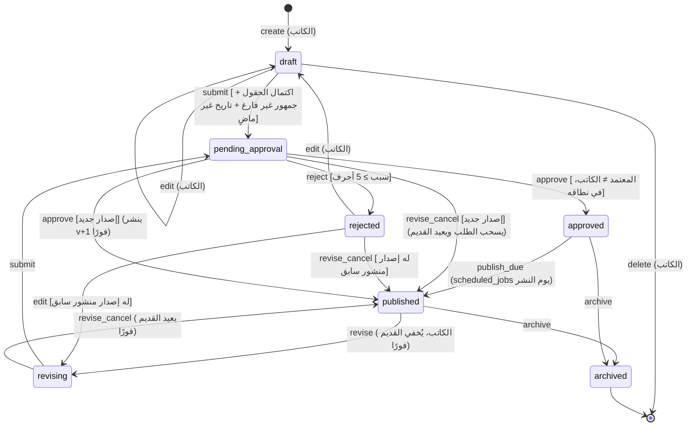
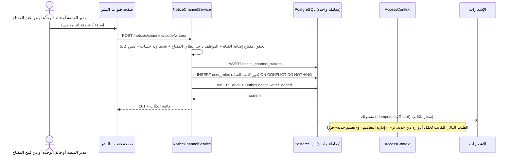

# خطة المرحلة 8: التعاميم والسياسات المطلوب إقرارها (`notices`)

التاريخ: 2026-11-22 · **خطة فقط، لا كود بعد.** المصدر: وصف المالك للوحدة (تع-01…07)، والتصميم المعتمد على Claude Artifact (https://claude.ai/artifact/FRbp3RN9rr3ZbeD2ergp2s)، والخطة الأولى (https://claude.ai/artifact/TE7SF4pLXiaCjfxJQZh4zp)، وفحص الكود الحالي. كل ما هنا قرار المالك أو نتيجة فحص الكود، وما لم يحسمه المالك بعد موسوم **⚠ بانتظار التأكيد** مع توصية، ولا يُبنى قبل التأكيد.

الرموز: ✅ مبني · 🟡 جزئي · ❌ غير مبني. **مبني (2026-11-22): الـAPI وحزمة `shared` (الجداول، الترحيل، الصلاحيات، الآلة، النشر على دفعات، الإقرار، القنوات)، وواجهة الويب غير مبنية بعد.**

أرقام FR المحجوزة: **FR-167 إلى FR-176** (القسم 12). تُنقل صفوفها إلى README §4 عند بدء الدفعة الأولى.

---

## 0. الفكرة

ما تعلنه الشركة لموظفيها، والسياسات التي يجب أن يقرّ الموظف بالاطلاع عليها. جهتان تنشران، ولكل منهما قناة: **الموارد البشرية** و**التواصل المؤسسي**. يكتب الموظف المخوّل في قناته، ويعتمد قائد وحدته، وفي يوم النشر يصل الجمهور على دفعات، والسياسة تبقى في «بانتظاري» حتى يقرّ بها الموظف، والناشر يرى من أقرّ ومن لم يقرّ.

**ما لا يتغير:** لا تذكير إضافي (لا بريد ولا إشعار متكرر): الإشعار الوحيد عند النشر. لا نشر قبل الاعتماد. لا تعديل لنص منشور.

## 1. القرارات

### ✅ حسمها المالك

| # | القرار |
|---|---|
| N1 ✅ | قناتان فقط: الموارد البشرية والتواصل المؤسسي. |
| N2 ✅ | يعتمد التعميم قائد وحدة كاتبه. |
| N3 ✅ | السياسة غير المُقرّ بها تبقى ظاهرة في «بانتظاري» بلا تذكير إضافي. |
| N4 ✅ | الجمهور الكبير يصله التعميم على دفعات. |
| N5 ✅ | من ينضم للجمهور بعد النشر يصله التعميم تلقائيًا (في الليلة التالية). |
| N6 ✅ | يمكن تثبيت تعميم واحد في الرئيسية. |
| N7 ✅ | **إضافة كاتب في صفحة «قنوات النشر» على قناة معيّنة تمنحه تلقائيًا كل الصلاحيات اللازمة لكتابة التعميم في تلك القناة**، وإزالته تسحبها (القسم 8). |
| N8 ✅ | تصميم الشاشات كما في الـArtifact (إطار المنصة، شاشات: الرئيسية، تعاميمي، إدارة التعاميم، بانتظار اعتمادي، قنوات النشر، الحالات، ونوافذها). |
| N9 ✅ | **التعديل بعد النشر بإصدار جديد يعود للاعتماد** (جلسة 2026-11-22): من أقرّ بالقديم يُطلب منه إقرار جديد؛ **القديم يُخفى فور بدء التعديل**؛ إن رُفض الجديد يبقى مخفيًا حتى يعدّل الكاتب ويعتمد القائد؛ **وللكاتب زر «إلغاء التعديل وإعادة القديم»** يُرجع القديم ظاهرًا فورًا (القسم 6.9). |
| N10 ✅ | **إدارة كتّاب القنوات بصلاحيات عادية فقط، دون جداول أو أعمدة إضافية:** أربعة مفاتيح (إضافة وإزالة لكل قناة). قائد الوحدة يحملها تلقائيًا بنطاق `subtree` فيدير كتّاب وحدته وما تحتها فقط؛ ومن يُمنح المفتاح بنطاق أوسع من صفحة الصلاحيات يدير القناة في كل الوحدات؛ مدير المنصة `all` (القسمان 4.5 و5). جدول الكتّاب بأعمدة قليلة. |

### ⚠ بانتظار التأكيد (توصيتي هي ما تفترضه الخطة حتى تردّ)

| # | السؤال | التوصية المفترضة |
|---|---|---|
| Q2 | رفض القائد | يعود التعميم مسودة مع سبب إلزامي (5 أحرف)؛ يعدّل الكاتب ويعيد الإرسال. |
| Q3 | كاتب هو نفسه قائد وحدته | يعتمد قائد الوحدة الأعلى؛ إن لم يوجد فمدير المنصة. |
| Q5 | موضع «بانتظاري» (غير موجود بعد) | تبويب «بانتظار إقراري» في «تعاميمي» + بطاقة في الرئيسية، ويُضمّ لصندوق «بانتظاري» العام عند بنائه (وحدة الطلبات). |
| Q6 | التثبيت | تعميم واحد للشركة كلها، يثبّته من يملك `notices.pin`. |
| Q7 | حجم الدفعة | 500 موظف كل 5 دقائق، قابلة للتعديل من الإعدادات. |
| Q8 | «فتح الوحدة للجميع» (تع-07) | كل موظف يرى صفحة «تعاميمي» وبطاقة الرئيسية ويقرّ، دون كتابة. |
| Q10 | لحظة النشر في يوم النشر | بداية اليوم بتوقيت الرياض (00:00) عبر `scheduled_jobs`. |
| Q11 | أرشفة تعميم فيه سياسات غير مقرّ بها | يخرج من «بانتظاري» فور الأرشفة ويبقى تقرير الإقرار محفوظًا. |
| Q12 | كاتب أُزيل من القناة وله مسودات | تبقى المسودات، ويستطيع كاتب آخر في القناة تولّيها بزر «تولّي المسودة» (المفتاح `notices.take_over`، القسم 8)؛ ما أُرسل للاعتماد يكمل مساره. |

## 2. الحالة الحالية (من فحص الكود)

| ما هو موجود | أين | كيف نستعمله |
|---|---|---|
| ✅ آلة الاعتماد (XState) و`WorkflowRegistry` مع مهلات دائمة | `core/workflow` | آلة التعميم. |
| ✅ outbox + `IdempotencyGuard` + `scheduled_jobs` + RabbitMQ | `core/messaging` | النشر المجدول والدفعات. |
| ✅ إشعارات (جرس، بريد) | `core/notifications` | إشعار النشر وإشعارات الاعتماد. |
| ✅ ملفات مع معاينة (`FileChip`، `FilePreviewDialog`) | `core/files` | مرفقات التعميم. |
| ✅ أدوار نظام وأدوار تلقائية (`roles.auto_rule`) و`user_roles` كخيارات مخزّنة | `core/access` | أدوار كتّاب القنوات (القسم 8). |
| ✅ دور رئيس الوحدة التلقائي (`LEVEL_HEAD_DEFAULT_PERMISSIONS`) | `packages/shared/src/permissions/keys.ts` | مفاتيح الاعتماد والتقرير (القاعدة 17). |
| ✅ مجموعات الأشخاص والأدوار، الهيكل، المسميات | `core/access`, `modules/org`, `modules/employees` | جمهور التعميم، عبر منافذها. |
| ✅ مهمة ليلية 00:15 الرياض (نمط `OrgScheduleJob`) | `modules/org` | نمط مهمة اللحاق بالمنضمّين. |
| ✅ `FileDropzone`, `MultiCombobox`, `TreeSelect`, `DataTable`, `ListToolbar`, `ExchangeButtons`, `ConfirmDialog`, `StatTile`, `Tabs` | `shared/ui`, `shared/data-exchange` | كل الشاشات. |
| ❌ صندوق «بانتظاري» العام | — | وحدة الطلبات لاحقًا؛ نبدأ بتبويب خاص (Q5). |
| ❌ وحدة `notices` | — | **تُبنى كاملة.** |

## 3. البنية

- **API:** `apps/api/src/modules/notices/{domain,application,infrastructure,presentation}` بنمط tickets/tasks (`module-architecture`). الجمهور وأعضاء الوحدات عبر منافذ `org` و`employees`، لا مستودعاتها.
- **Shared:** `packages/shared/src/notices/` (مخططات zod، DTOs، ثوابت الحالات).
- **Web:** `apps/web/src/features/notices/` (`index.ts` يصدّر `FeatureModule`، مسارات lazy، ترجمات ar/en)، وسطر في `app/features.ts`.
- كل كيان جديد في `apps/api/src/database/entities.ts`. FK لجداول وحدات أخرى: `@ManyToOne('EntityName')` قيدًا فقط.

## 4. الصفحات (تطابق شاشات الـArtifact)

مفاتيح الصفحات في `pages/schemas.ts`، وقوائمها في `lists/catalog.ts`. كل صفحة ونافذة لها مفاتيحها في القسم 5.

### 4.1 الرئيسية: بطاقات التعاميم (تع-05، تع-07)

- **ليست صفحة جديدة**: أقسام تُضاف إلى الرئيسية الحالية.
- **أقسام:** أربع `StatTile` (كل واحدة `Link` تفتح قائمتها): «بانتظار إقراري» (لون «يحتاج انتباه»)، «تعاميم جديدة هذا الأسبوع»، «بانتظار اعتمادي» (لمن يملك `notices.approve`)، «مسوداتي» (لمن يملك `notices.create`). **التعميم المثبّت** بطاقة petrol-50 بشارات (مثبّت، القناة، النوع) وزر «قراءة وإقرار» أو «قراءة». قائمة «بانتظار إقراري» (أحدث 3) مع «عرض الكل» وسطر «لا نرسل تذكيرًا إضافيًا».
- **الصلاحية:** `notices.view`. البطاقات الأخرى تظهر بمفتاحها (`notices.approve`، `notices.create`)، والتي لا يملكها المستخدم تُخفى (لا بطاقة فارغة).
- **API:** `GET /notices/home` يعيد الأعداد والتعميم المثبّت وأحدث الإقرارات المعلقة في طلب واحد (نطاق `own`).
- **حالات:** تحميل (skeleton)، لا تعميم مثبّت (القسم يختفي)، خطأ (`Alert` مع إعادة محاولة).
- **جولة الترحيب:** خطوة `notices-home` على `data-tour="pinned-notice"`؛ المفتاح `notices.view`.

### 4.2 تعاميمي (لكل موظف) — `/notices` (تع-07، تع-03)

- **المفاتيح:** عرض الصفحة `notices.view` (مفتاح الصفحة `notices`). **القائمة:** `notices`. القائمة الجانبية: رابط علوي تحت «الرئيسية» مع عدّاد الإقرارات المعلقة (شارة صفراء).
- **الصفحة:** `PageHeader` (عنوان ووصف) ثم لوحة بيضاء فيها: `Tabs` (الكل، بانتظار إقراري + عدّاد، أقررت بها، إعلانات)، `ListToolbar`.
- **البحث:** عنوان التعميم ونصّه (API).
- **الفلاتر (كلها في الـAPI):** القناة، النوع (إعلان/سياسة)، حالتي (بانتظار الإقرار / أقررت / للعلم)، تاريخ النشر (من/إلى)، مثبّت (نعم/لا).
- **العروض:** بطاقات (افتراضي)، جدول؛ `ViewSwitch` واحد محفوظ (`useViewMode('notices')`)، والهاتف يبدأ بالبطاقات. لا لوحة (Kanban) لهذه البيانات، والسبب في سطر الخطة (القاعدة 1: لا يوجد عرض ثالث طبيعي).
- **الجدول:** العنوان، القناة، النوع، تاريخ النشر، حالتي، **الإجراءات آخر عمود** (أيقونة `Eye` = قراءة/قراءة وإقرار). نقر الصف يفتح نافذة القراءة.
- **التصدير:** `ExchangeButtons` للتصدير (النطاق، الأعمدة، النوع) بمفتاح `notices.export_mine`. لا استيراد: التعميم يُكتب ويُعتمد ولا يُنشأ بالجملة.
- **نافذة القراءة والإقرار (`xl`):** شارات القناة والنوع، النص كما وصل (لا يتغير)، المرفقات (`FileChip`)، وشريط سفلي: خانة «قرأت وأقرّ…» (تُفعّل زر «أقرّ» فقط) وأزرار «لاحقًا» و«أقرّ». للإعلان: زر «قراءة» فقط وتُسجَّل القراءة دون إقرار.
- **الصلاحيات:** القراءة `notices.view`؛ الإقرار `notices.acknowledge` (للموظف الحقيقي؛ جلسة «الدخول كموظف» لا تقرّ: 403).
- **API:** `GET /notices/mine` (قائمة مرقّمة + فلاتر + `tab`)، `GET /notices/mine/:id` (قراءة؛ تعميم لم يصل هذا الموظف = 404)، `POST /notices/mine/:id/read`، `POST /notices/mine/:id/acknowledge` (idempotent: إقرار ثانٍ يعيد النجاح بلا تغيير؛ على إعلان 422 `NOTICE_NO_ACK_REQUIRED`؛ على أرشيف 409 `NOTICE_ARCHIVED`).
- **حالات:** تحميل، فارغة («لا توجد تعاميم بعد»)، خطأ، لا صلاحية (صفحة 403).
- **الجولة:** خطوة `notices-my` على `data-tour="main-list"`.

### 4.3 إدارة التعاميم (الناشر والقائد) — `/notices/manage` (تع-01، تع-02، تع-03، تع-05)

- **المفاتيح:** عرض `notices.manage_view` (مفتاح الصفحة `notices-manage`، القائمة `notices-manage`). القائمة الجانبية: قائمة فرعية «التواصل والتعاميم» ← «إدارة التعاميم».
- **النطاق:** الكاتب يرى تعاميم القنوات التي هو كاتب فيها؛ قائد الوحدة يرى تعاميم وحدته وما تحتها (`subtree`)؛ مدير المنصة يرى الكل. ما خارج النطاق 404.
- **الصفحة:** `PageHeader` + زر «تعميم جديد» (`<Can notices.create>`) + لوحة: `Tabs` (الكل، مسوداتي، بانتظار الاعتماد، منشورة، مؤرشفة)، `ListToolbar`.
- **البحث:** عنوان (عربي/إنجليزي)، النص، اسم الكاتب.
- **الفلاتر:** القناة، النوع، الحالة (مسودة / بانتظار الاعتماد / معتمد مجدول / منشور / مرفوض / مؤرشف)، الكاتب، وحدة الكاتب (`TreeSelect`)، تاريخ النشر (من/إلى)، مثبّت، نسبة الإقرار (أقل من 50% / 50–99% / 100%).
- **الأعمدة:** العنوان (+ الإصدار)، القناة، النوع، الكاتب، الحالة (+ شارة مثبّت)، الجمهور (ووصفه وعدد الواصلين)، تاريخ النشر، الإقرار (شريط تقدم + نسبة)، **الإجراءات آخر عمود**.
- **إجراءات الصف (أيقونات فقط، كلٌّ بمفتاحه):** عرض `Eye` (`notices.manage_view`) · تعديل `Pencil` (`notices.edit`، لمسودة أو مرفوض وللكاتب وحده، أو لمن تولّاها) · إرسال للاعتماد `Send` (`notices.submit`) · تولّي المسودة `UserCheck` (`notices.take_over`، لمسودة أو مرفوض كاتبه لم يعد كاتبًا في قناته، ولكاتب في القناة نفسها وحده) · حذف `Trash2` (`notices.delete`، مسودة فقط، مع `ConfirmDialog`) · تثبيت/فك تثبيت `Pin` (`notices.pin`، لمنشور فقط) · أرشفة `Ban` (`notices.archive`، لمنشور، مع `ConfirmDialog`) · **تعديل بإصدار جديد `FilePen` (`notices.revise`، لمنشور وللكاتب وحده، `ConfirmDialog` يقول «سيُخفى التعميم عن الموظفين حتى يعتمد القائد الإصدار الجديد»)** · **إلغاء التعديل وإعادة القديم `Undo2` (`notices.revise_cancel`، لتعميم في حالة «قيد التعديل» أو إصدار جديد بانتظار الاعتماد أو مرفوض وله إصدار منشور سابق؛ للكاتب وحده، `ConfirmDialog` يقول «يعود الإصدار المنشور ظاهرًا فورًا ويُحذف تعديلك»)**. في تبويب «الكل» تظهر شارة «قيد التعديل · مخفي عن الموظفين» (تحذير) على هذه الصفوف.
- **العروض:** جدول + بطاقات (`ViewSwitch` `useViewMode('notices-manage')`).
- **التصدير:** `notices.export` (النطاق، الأعمدة، xlsx/csv). **لا استيراد** (السبب في الصف).
- **نقر الصف:** يفتح نافذة التفاصيل (المسودة تفتح نموذج التعديل).
- **API:** `GET /notices` (فلاتر + بحث + `tab` + ترقيم + ترتيب)، `GET /notices/:id`، `POST /notices`، `PUT /notices/:id`، `DELETE /notices/:id`، `POST /notices/:id/submit`، `POST /notices/:id/pin`، `DELETE /notices/:id/pin`، `POST /notices/:id/archive`.
- **جولة:** `notices-manage` على `data-tour="main-list"`.

#### نافذة «تعميم جديد / تعديل» (wide)

- **الحقول:** القناة (قائمة بقنوات يكتب فيها الشخص فقط)، تاريخ النشر (اليوم أو بعده)، النوع (بطاقتا اختيار: إعلان للعلم / سياسة تحتاج إقرارًا)، العنوان بالعربية (إجباري) والإنجليزية (ترجمة تلقائية FR-58)، النص (إجباري)، الجمهور (كل الموظفين أو: وحدات ومسميات ومجموعات بـ`MultiCombobox`/`TreeSelect`، مع عدّاد «يصل إلى N موظفًا» من API)، المرفقات (`FileDropzone` مضغوط، حتى 10 ميغابايت، أنواع مسموحة).
- **التحقق الحي:** كل حقل يعرض خطأه أثناء الكتابة (`useLiveError` + `useRules`)؛ جمهور فارغ تحذير؛ تاريخ في الماضي خطأ.
- **أزرار:** «حفظ كمسودة» (`notices.create` أو `notices.edit`) و«إرسال للاعتماد» (`notices.submit`، يتفعّل عند اكتمال الحقول) و«إلغاء».
- **قواعد:** `z.strictObject`؛ نص التعميم يُنظّف من HTML خطر (قائمة بيضاء)؛ لا مرفق خارج خدمة الملفات.

#### نافذة التفاصيل (xl) — أربع تبويبات

| التبويب | المحتوى | المفتاح |
|---|---|---|
| النص | النص كما سيصل والمرفقات | `notices.manage_view` |
| الاعتماد | خط زمني: كُتب، أُرسل، اعتمده/رفضه (باسم القائد وتاريخه وسبب الرفض)، نُشر (عدد الدفعات والواصلين)، الإقرار جارٍ | `notices.manage_view` |
| الجمهور | قواعد الجمهور، عدد الواصلين، «من وصلهم لاحقًا بعد النشر» | `notices.manage_view` |
| الإقرارات | ثلاث `StatTile` (وصلهم، أقرّوا، لم يقرّوا)، جدول بحث/فلتر (الحالة، الوحدة)/تصدير: الموظف، الوحدة، وصله في، الحالة (أقرّ + تاريخه / لم يقرّ / انضم بعد النشر) | `notices.ack_report`، التصدير `notices.ack_export` |

- **API:** `GET /notices/:id/flow`، `GET /notices/:id/audience`، `GET /notices/:id/acknowledgements` (مرقّم + بحث + فلاتر)، وتصديره يقرأ نفس المسار بصفحات (`fetchAllPages`، حتى 10,000 صف).
- **النطاق:** من لا يملك `notices.ack_report` لا يرى تبويب الإقرارات؛ قائد الوحدة يرى إقرارات من هم في وحدته وما تحتها فقط، والناشر يرى كل جمهور تعاميمه.

### 4.4 بانتظار اعتمادي (القائد) — `/notices/approvals` (تع-01)

- **المفاتيح:** عرض `notices.approve_view` (مفتاح الصفحة `notices-approvals`). تُمنح لدور رئيس الوحدة (`subtree`) تلقائيًا (القاعدة 17).
- **الصفحة:** `PageHeader` + `Alert` معلومات + قائمة بطاقات (`li`) لكل تعميم أُرسل لاعتماد هذا الشخص: العنوان، النوع، الكاتب والوحدة، متى أُرسل، تاريخ النشر وعدد الجمهور.
- **أيقونات الصف:** عرض `Eye` (يفتح التفاصيل) · اعتماد `Check` (`notices.approve`، يؤكّد بسطر في `ConfirmDialog` مع «سيُنشر في …») · رفض `X` (`notices.reject`، نافذة بسبب إلزامي 5 أحرف).
- **بحث وفلاتر وتصدير:** بحث (العنوان، الكاتب)، فلاتر: القناة، النوع، الكاتب، تاريخ الإرسال، وتبديل جدول/بطاقات (القاعدة 1)، وتصدير `notices.export`. هذه الصفحة تُبنى بنفس `DataTable` + `ListToolbar` كغيرها (القاعدة 6)، والتصميم في الـArtifact يوضح الشكل المختصر.
- **قواعد:** لا يعتمد الكاتب تعميمه (403 `NOTICE_SELF_APPROVAL`)؛ من ليس قائد الوحدة أو الأعلى منها 404؛ اعتماد تعميم حالته ليست «بانتظار الاعتماد» 409 `NOTICE_NOT_PENDING`؛ اعتماد ورفض متزامنان يحسمهما `revision` (الثاني 409).
- **API:** `GET /notices/approvals`، `POST /notices/:id/approve`، `POST /notices/:id/reject` (`{ reason }`).
- **الجولة:** `notices-approvals`.

### 4.5 قنوات النشر (الإعدادات) — `/notices/channels` (تع-06، N7)

- **⚠ حلّ FR-177 (القسم 4ب) محل ما يلي من مفاتيح القنوات الأربعة وشاشة البطاقتين:** المفتاحان العامان `writer_add/writer_remove` على وحدة القناة، والصفحة جدول بكل القنوات. 
- **المفاتيح (N10، كلها عادية في صفحة الصلاحيات؛ الأصل قبل FR-177):** عرض الصفحة `notices.channels_view` (مفتاح الصفحة `notices-channels`). **لكل قناة مفتاحان:** `notices.hr_writer_add` و`notices.hr_writer_remove` (الموارد البشرية)، `notices.comms_writer_add` و`notices.comms_writer_remove` (التواصل المؤسسي). **حفظ إعدادات الدفعات:** `notices.settings_edit`. كل زر داخل `<Can permission>` بمفتاحه؛ زر «إضافة كاتب» في بطاقة قناة يظهر لمن يملك مفتاح إضافتها، وأيقونة الإزالة لمن يملك مفتاح إزالتها. **لا وضع إدارة (admin mode) مطلوب** لأن الصفحة صلاحيات عادية.
- **النطاق:** قائد الوحدة (دور رئيس الوحدة) يحمل المفاتيح الأربعة بنطاق `subtree`: يبحث في **موظفي وحدته وما تحتها فقط** (`applyScope` على المرشحين)، ويرى في القائمة كتّاب وحدته فقط؛ كاتب خارج نطاقه لا يظهر ولا يُزال (404). من يُمنح المفتاح بنطاق `company` أو `all` من صفحة الصلاحيات يرى كل الكتّاب ويدير القناة في كل الوحدات. مدير المنصة `all`. ومن لا يملك مفتاح أي قناة لا تظهر له بطاقتها؛ ومن لا يملك أيًّا منها وبلا `channels_view` يرى 403.
- **الصفحة:** `SectionCard` لكل قناة يملك الشخص أحد مفاتيحها أو يراها (الموارد البشرية، التواصل المؤسسي) فيها: عنوان القناة وزر «إضافة كاتب» (`action` في البطاقة)، سطر شرح (الدور المرتبط وما يمنحه)، وجدول الكتّاب **بأعمدة قليلة فقط**: الكاتب (صورة واسم ومسمى)، الوحدة، تاريخ الإضافة، والإجراءات (أيقونة إزالة). لا عمود «من أضافه» ولا ملاحظة (يبقيان في سجل التدقيق). بطاقة ثالثة «النشر على دفعات» لمن يملك `notices.settings_edit`: حجم الدفعة (500) والفاصل بالدقائق (5)، وسطر حي «جمهور من N موظفًا يصله في X دفعات خلال Y دقيقة».
- **بحث وفلاتر:** بحث باسم الكاتب داخل القناة، وفلتر الوحدة. القائمتان صغيرتان فتُفلتران في المتصفح. تصدير `notices.channels_export` لقائمة الكتّاب. لا استيراد: الإضافة من القائمة المنسدلة تضمن التحقق.
- **نافذة «إضافة كاتب» (wide):** الحقول: القناة (قائمة بالقنوات التي يملك مفتاح إضافتها، مختارة مسبقًا من الزر)، الموظف (`Combobox` بحث بالاسم **من أول حرف**، يعرض الموظفين النشطين **داخل نطاق صلاحية الشخص** الذين ليسوا كتّابًا في هذه القناة، تحت كل اسم مسماه ووحدته). تنبيه معلومات: «يحصل الكاتب تلقائيًا على صلاحيات الكتابة في هذه القناة فقط، ولا يعتمد تعميمه بنفسه، ولا يكتب في القناة الأخرى». زر «إضافة الكاتب» مغلق حتى يُختار موظف من القائمة؛ خطأ حي «اختر موظفًا من القائمة» إن غادر الحقل بنص لا يطابق. تنبيه تحذيري (غير مانع) إن كان الموظف بلا قائد أعلى فيعتمده مدير المنصة (Q3).
- **عند الإضافة (N7):** تُنفَّذ في معاملة واحدة: صف في `notice_channel_writers` + إسناد **دور كاتب هذه القناة** له (القسم 8) + تدقيق + إشعار للكاتب بالجرس والبريد («أصبحت كاتبًا في قناة …»). الكاتب يرى «إدارة التعاميم» و«تعميم جديد» **فورًا بلا إعادة دخول** (يُعاد حساب `AccessContext` من الجلسة بالطلب التالي).
- **عند الإزالة:** نافذة تأكيد تذكر عدد مسوداته ومرسلاته؛ ثم حذف الصف وسحب الدور (القسم 8).
- **API:** `GET /notices/channels` (القناتان وكتّابهما والإعدادات)، `POST /notices/channels/:code/writers` (`{ employeeId, note? }`)، `DELETE /notices/channels/:code/writers/:userId`، `GET /notices/channels/:code/candidates?search=` (مرشحون)، `PUT /notices/channels/settings` (حجم الدفعة والفاصل).
- **أخطاء:** كاتب موجود 409 `NOTICE_WRITER_EXISTS`؛ موظف غير نشط 422 `NOTICE_WRITER_INACTIVE`؛ موظف لا حساب له 422 `NOTICE_WRITER_NO_ACCOUNT`؛ قناة غير موجودة 404؛ حجم دفعة خارج 1–5000 أو فاصل خارج 1–60 دقيقة 422.
- **الجولة:** `notices-channels` على `data-tour="main-list"`.

### 4.1ب شريط «تعاميم بانتظار إقرارك» تحت الشريط العلوي (تع-07، تع-03)
- **ماذا:** شريط تنبيه (`Alert` بنبرة تحذير) تحت الـnavbar في كل صفحات التطبيق، يظهر ما دام عند الموظف تعميم/سياسة بانتظار إقراره: «تنبيه: لديك N تعميم بانتظار إقرارك. اقرأه وأقرّ به.» وزر «عرض التعاميم» يذهب إلى `/notices`.
- **القاعدة:** يظهر لمن يملك `notices.view` وعدد «بانتظاري» > 0 (من `GET /notices/home` الموجود: `awaiting`)؛ يختفي عند الصفر ولا يظهر داخل صفحات `/notices` نفسها؛ لا مفتاح جديد ولا نقطة API جديدة ولا تذكير إضافي (بعد الإقرار يختفي الشريط فورًا لأن الاستعلام يُحدَّث). يُرسم مع شريط التقييمات (`EvaluationNoticeBanner`) بنفس النمط.
- **الملفات:** `features/notices/shared/awaiting-banner.tsx` (يُصدَّر من `index.ts` ويُرسم في `AppLayout`)، نصوص `banner.*` ar+en، اختبار `awaiting-banner.test.tsx` (يظهر بالعدد، يختفي عند الصفر، لا يظهر في `/notices`).

### 4.6 الحالات (تنطبق على كل صفحة)

تحميل (skeleton) · فارغة (رسالة + زر) · خطأ (`Alert` + إعادة محاولة) · لا صلاحية (صفحة 403) · تعميم خارج النطاق (404) · الرسائل الأربع (معلومات/تحذير/خطأ/نجاح). كل شارة حالة تحمل نصًا، فلا يعتمد المعنى على اللون وحده.

## 4أ. مواصفات الشاشات كما في الـArtifact (منطقة بمنطقة)

المرجع البصري: https://claude.ai/artifact/FRbp3RN9rr3ZbeD2ergp2s. كل شاشة هنا بمناطقها من الأعلى إلى الأسفل ونصوصها ومكوّناتها ومفاتيحها وحالاتها، ليُبنى الويب منها دون العودة للتخمين. **المراجع:** `arweqah-design-system` (ألوان العلامة فقط، RTL منطقي `ms-/me-/ps-/pe-`، فاتح وداكن، أيقونات للإجراءات لا كلمات، `PageHeader` + `DataTable` + `ListToolbar`، ≥ 40px للهدف، تحول الجدول إلى بطاقات على الهاتف). **تعديلات على الـArtifact الحالي** (تُجرى عليه في هذا الـPR): أيقونتا «تعديل بإصدار جديد» و«إلغاء التعديل وإعادة القديم» وصف «قيد التعديل»، ومفاتيح كتّاب القنوات الأربعة، وإظهار الوحدة وتاريخ الإضافة في جدول الكتّاب.

### 4أ.0 الإطار المشترك (لا يُبنى من جديد: الموجود في `AppLayout`)

| المنطقة | المحتوى |
|---|---|
| الشريط الجانبي | إطار أبيض بحافة 24px يضم لوحة `ink` بحافة 16px. الشعار (`BrandLogo tone="on-dark"`). عناصر الوحدة: **«الرئيسية»** (علوي) · **«تعاميمي»** (علوي، تحت الرئيسية، يظهر بـ`notices.view`، شارة صفراء بعدد الإقرارات المعلقة) · قائمة **«التواصل والتعاميم»** (زر بسهم `aria-expanded`، تُفتح تلقائيًا في صفحاتها) وتحتها بإزاحة وخط رفيع: «إدارة التعاميم» (`notices.manage_view`) · «بانتظار اعتمادي» + شارة بالعدد (`notices.approve_view`) · «قنوات النشر» (`notices.channels_view`). عنصر لا يملك الشخص مفتاحه لا يظهر؛ والقائمة نفسها تختفي إن خلت من أبنائها. الرابط النشط: كتلة كريمية بنص `ink`. |
| الشريط العلوي العائم | أبيض بحافة، فيه (من بداية السطر): فتات الخبز (اسم الصفحة)، ثم الجرس (نقطة صفراء عند غير المقروء)، المظهر، قائمة الحساب (آخر عنصر). الهاتف: زر القائمة والشعار والجرس والصورة. |
| الهاتف (< `sm`) | الشريط الجانبي درج بإغلاق بالنقر خارجه؛ كل جدول يتحول إلى بطاقة لكل صف والإجراءات في أسفلها؛ الفلاتر بعرض كامل؛ نماذج بعمود واحد. |

### 4أ.1 الرئيسية — أقسام التعاميم (`/`)

| # | المنطقة | المحتوى بالحرف | المكوّن | المفتاح | سلوك |
|---|---|---|---|---|---|
| 1 | ترويسة | «مرحبًا {الاسم}» + «ما يحتاج انتباهك اليوم.» | `PageHeader` (الموجودة) | — | — |
| 2 | أربع بطاقات أرقام | «بانتظار إقراري» (رقم كبير + «سياسات لم تقرّ بها»، خلفية `yellow-50` = يحتاج انتباه) · «تعاميم جديدة» («هذا الأسبوع») · «بانتظار اعتمادي» («تعاميم من وحدتي») · «مسوداتي» («لم تُرسل بعد») | `StatTile` داخل `Link` | الأولى والثانية `notices.view`؛ الثالثة `notices.approve_view`؛ الرابعة `notices.create` | الضغط يفتح القائمة المقابلة بتبويبها؛ بطاقة بلا مفتاح تُخفى؛ صفر في «بانتظار إقراري» بلا لون تنبيه |
| 3 | التعميم المثبّت | لوحة `petrol-50` بحافة 24px: دائرة `petrol-800` بأيقونة دبوس؛ شارات «مثبّت» (info) + اسم القناة (محايدة) + «سياسة · تحتاج إقرارًا» (تحذير) أو «إعلان للعلم»؛ العنوان `text-xl`؛ مقتطف سطران؛ زر «قراءة وإقرار» (رئيسي) أو «قراءة»؛ «نُشر في {تاريخ}» | بطاقة مخصصة في `features/notices` | `notices.view` | لا تعميم مثبّت = القسم يختفي؛ الزر يفتح نافذة القراءة |
| 4 | بانتظار إقراري | عنوان «بانتظار إقراري» وزر نصي «عرض الكل»؛ حتى 3 صفوف بيضاء مستديرة: العنوان + «{القناة} · {التاريخ}» + زر ثانوي «قراءة وإقرار»؛ سطر `muted`: «السياسة تبقى هنا حتى تقرّ بها. لا نرسل تذكيرًا إضافيًا.» | `SectionCard` | `notices.view` | فارغ: القسم يختفي (لا رسالة فارغة) |

الحالات: تحميل (هيكل بالأرقام والصفوف)، خطأ (`Alert` أحمر + «إعادة المحاولة»). `data-tour="pinned-notice"` على منطقة 3 (وعلى منطقة 2 إن لم يوجد مثبّت). الـAPI: `GET /notices/home`.

### 4أ.2 تعاميمي — `/notices` (تبويب بالرابط `?tab=await|done|info`)

| المنطقة | المحتوى بالحرف | المكوّن | المفتاح |
|---|---|---|---|
| ترويسة | «تعاميمي» + «التعاميم والسياسات التي وصلتك من الموارد البشرية والتواصل المؤسسي.» | `PageHeader` | `notices.view` |
| لوحة بيضاء 24px | تحتوي ما يلي | `ListToolbarPanel` | |
| تبويبات | «الكل» · «بانتظار إقراري» + شارة تحذير بالعدد · «أقررت بها» · «إعلانات» | `Tabs` | |
| شريط الأدوات | مربع بحث «ابحث بالعنوان أو النص» · زر «تصفية» + عدّاد الفلاتر · مبدّل **بطاقات / جدول** (أيقونتان، محفوظ `useViewMode('notices')`، الهاتف يبدأ بالبطاقات) · زر «تصدير» | `ListToolbar`، `ExchangeButtons` | التصدير `notices.export_mine` |
| لوحة الفلاتر | القناة (الكل/الموارد البشرية/التواصل المؤسسي) · النوع (إعلان/سياسة) · حالتي (بانتظار إقراري/أقررت بها/للعلم) · تاريخ النشر من–إلى · مثبّت (نعم/لا) | `FilterField` | |
| شرائح الفلاتر | شريحة قابلة للإزالة لكل فلتر مطبّق، مثل «القناة: الموارد البشرية ✕» | | |
| **عرض البطاقات** | شبكة بطاقات 300px+؛ كل بطاقة (`rounded-2xl`، حافة `yellow-300` إن كانت تنتظر إقرارًا): صف شارات (القناة info، النوع: «سياسة» تحذير أو «إعلان للعلم» محايدة، «مثبّت» إن كان، «أقررت بها» نجاح إن أُقرّ) · العنوان · مقتطف سطران · أسفلها التاريخ («أقررت في {تاريخ}» إن أُقرّ) وزر: **«قراءة وإقرار»** (رئيسي) للسياسة غير المقرّة، وإلا **«قراءة»** (ثانوي) | `NoticeCard` | |
| **عرض الجدول** | الأعمدة: العنوان · القناة · النوع · تاريخ النشر · حالتي («بانتظار إقراري» تحذير / «أقررت بها» نجاح / «للعلم» محايدة) · **الإجراءات آخر عمود: أيقونة `Eye`** (تلميح «قراءة»). نقر الصف يفتح نافذة القراءة | `DataTable` (`error`، `onRowClick`) | |
| تذييل | «عرض 1–6 من 6» + صفوف في الصفحة + أرقام الصفحات | | |

حالات: تحميل (هيكل) · فارغة («لا توجد تعاميم بعد» + «ستظهر هنا التعاميم والسياسات عند وصولها إليك.») · فارغة لبحث («لا نتائج») · خطأ (`Alert` + إعادة محاولة) · غياب المفتاح (صفحة 403). الإقرار المعلق يبقى في تبويب «بانتظار إقراري» بلا تذكير. `data-tour="main-list"`. الـAPI: `GET /notices/mine` بكل الفلاتر في الاستعلام. لا استيراد (التعميم لا يُنشأ من ملف).

### 4أ.3 إدارة التعاميم — `/notices/manage`

| المنطقة | المحتوى بالحرف | المكوّن | المفتاح |
|---|---|---|---|
| ترويسة | «إدارة التعاميم» + «اكتب التعاميم، تابع اعتمادها ونشرها، وشاهد من أقرّ.» + زر رئيسي «＋ تعميم جديد» (زر واحد رئيسي في الصفحة) | `PageHeader` | الصفحة `notices.manage_view`؛ الزر `notices.create` |
| تبويبات | «الكل» · «مسوداتي» + عدّاد · «بانتظار الاعتماد» + عدّاد · «منشورة» · «مؤرشفة» | `Tabs` | |
| شريط الأدوات | بحث «ابحث بالعنوان أو الكاتب» · «تصفية» · «تصدير» · مبدّل جدول/بطاقات (`useViewMode('notices-manage')`) | `ListToolbar` | التصدير `notices.export` |
| الفلاتر | القناة · النوع · الحالة (مسودة/بانتظار الاعتماد/معتمد مجدول/منشور/قيد التعديل/مرفوض/مؤرشف) · الكاتب · وحدة الكاتب (`TreeSelect`) · تاريخ النشر من–إلى · مثبّت · نسبة الإقرار (أقل من 50% / 50–99% / 100%) | `FilterField` | |
| الجدول | الأعمدة بالترتيب: **العنوان** (+ سطر صغير «v{الإصدار}» أو «ينشر {تاريخ}») · القناة · النوع (سياسة تحذير / إعلان محايدة) · الكاتب · **الحالة** (مسودة محايدة · بانتظار الاعتماد تحذير · معتمد مجدول info · منشور نجاح + «مثبّت» info · **قيد التعديل · مخفي عن الموظفين** تحذير · مرفوض خطر · مؤرشف محايدة) · الجمهور («كل الموظفين (1,240)» أو «3 قطاعات (860)») · تاريخ النشر · **الإقرار** (`<progress>` + نسبة؛ «—» لما ليس سياسة منشورة) · **الإجراءات** (آخر عمود) | `DataTable` + `onRowClick` | |
| أيقونات الصف (بحسب الحالة والمفتاح) | `Eye` عرض (دائمًا) · `Pencil` تعديل (مسودة أو مرفوض، مؤلفه، `notices.edit`) · `Send` إرسال للاعتماد (مسودة، `notices.submit`) · `Trash2` حذف (مسودة، `notices.delete`) · `Pin` تثبيت / فك تثبيت (منشور، `notices.pin`) · `FilePen` **تعديل بإصدار جديد** (منشور، `notices.revise`) · `Undo2` **إلغاء التعديل وإعادة القديم** (قيد التعديل / جديد بانتظار الاعتماد / مرفوض وله منشور سابق، `notices.revise_cancel`) · `Ban` أرشفة (منشور، `notices.archive`). كل أيقونة بتلميح واسم وصول | `RowAction` | |
| الاستيراد | لا استيراد لهذه القائمة (التعميم يُكتب ويُعتمد ولا يُنشأ بالجملة)؛ السبب مكتوب هنا فقط ولا يظهر في الشاشة (القاعدة 4). | | |

**حالات الصف والأزرار:** تعميم قيد التعديل يحمل شارة التحذير ولا يظهر في تبويب «منشورة». التأكيدات: الحذف `ConfirmDialog` («حذف المسودة؟ لا يمكن التراجع»)، الأرشفة («يخرج من «تعاميمي» ومن «بانتظاري» ويبقى التقرير»)، التعديل بإصدار جديد («سيُخفى التعميم عن الموظفين حتى يعتمد القائد الإصدار الجديد»)، إلغاء التعديل («يعود الإصدار المنشور ظاهرًا فورًا ويُحذف تعديلك»). نجاح كل إجراء `toast`. حالات: تحميل، فارغة («لا توجد تعاميم» + زر «تعميم جديد» لمن يملك `create`)، خطأ، 403. `data-tour="main-list"`.

### 4أ.4 النوافذ

#### أ) «تعميم جديد / تعديل» (`Dialog wide`، عنوان «تعميم جديد» أو «تعديل التعميم» أو «إصدار جديد من {العنوان}»)

| الصف | الحقل | الشكل | قواعد وأخطاء حية |
|---|---|---|---|
| 1 (عمودان) | **القناة \***: قائمة؛ تحتها «تظهر القنوات التي تكتب فيها فقط.» | `Select` | قناة واحدة = مثبتة؛ عند الإصدار الجديد مقفلة |
| 1 | **تاريخ النشر \*** | `DateField` | اليوم أو بعده، «تاريخ النشر لا يكون في الماضي»؛ **مخفي في الإصدار الجديد** (ينشر فور الاعتماد، مع سطر «يُنشر الإصدار الجديد فور اعتماده») |
| 2 | **النوع \***: بطاقتا اختيار: «إعلان للعلم — يُقرأ فقط، لا يحتاج إقرارًا.» / «سياسة تحتاج إقرارًا — تبقى في «بانتظاري» حتى يقرّ بها الموظف.» | `radio` cards | إجباري |
| 3 (عمودان) | **العنوان بالعربية \*** (مثال: «سياسة السفر والإيفاد») · **العنوان بالإنجليزية** (LTR، «تُملأ تلقائيًا أثناء الكتابة») | `Input` + ترجمة تلقائية (FR-58) | «العنوان مطلوب» بعد اللمس، حتى 200 حرف |
| 4 | **النص \*** + تلميح «اكتب نص التعميم كما سيراه الموظف. لا يتغير بعد النشر دون إصدار جديد.» | `Textarea` (حتى 20,000 حرف) | «النص مطلوب»؛ يُنظَّف من HTML الخطر |
| 5 | **الجمهور \***: بطاقتا اختيار «كل الموظفين (N)» / «وحدات ومسميات ومجموعات — اختر من القوائم»؛ عند الثانية: `MultiCombobox` للوحدات (`TreeSelect` مع خيار «ومن تحتها») والمسميات والمجموعات، شرائح بالمختار، وسطر «المختار: 2 · يصل إلى 262 موظفًا» (من API حي بعد 700ms) | | «اختر جمهورًا»؛ تحذير إن كان العدد صفرًا |
| 5 | `Alert` معلومات: «من ينضم إلى هذا الجمهور بعد النشر يصله التعميم في الليلة التالية. يُرسل على دفعات.» | | |
| 6 | **مرفقات**: `FileDropzone compact` («أفلت الملف هنا، أو اضغط للاختيار · حتى 10 ميغابايت») + `FileChip` لكل مرفق بزر إزالة | | النوع والحجم يفحصهما المكوّن؛ حتى 5 ملفات |

الأزرار (تذييل ثابت): «إلغاء» · «حفظ كمسودة» (`create`/`edit`) · «إرسال للاعتماد» (رئيسي، `submit`، مغلق حتى تكتمل الحقول، وبجواره سطر `muted` يذكر السبب إن كان مغلقًا). تحذير عند الإغلاق بتغييرات غير محفوظة (`ConfirmDialog`).

#### ب) «التفاصيل» (`Dialog xl`)

| المنطقة | المحتوى |
|---|---|
| الرأس | شارات (القناة، النوع، الحالة) · العنوان `text-xl` · «كتبها {الكاتب} · نُشرت {التاريخ}» · زر إغلاق |
| تبويبات | «النص» · «الاعتماد» · «الجمهور» · «الإقرارات» + شارة بالنسبة (الأخير بـ`notices.ack_report`) |
| «النص» | النص كما سيصل في لوحة `neutral-50` (سطر 2) + `FileChip` للمرفقات؛ عند إصدار جديد معلّق: مبدّل «الإصدار 2 / الإصدار 1 / مقارنة جنبًا إلى جنب» |
| «الاعتماد» | خط زمني عمودي: نقطة خضراء مملوءة بعلامة (تمّ)، دائرة بحافة `link` (الحالية)، دائرة متقطعة (قادمة). الخطوات: كُتب (الاسم والتاريخ) · أُرسل للاعتماد · اعتمده/رفضه {القائد · الوحدة · التاريخ · سبب الرفض} · نُشر (عدد الدفعات والواصلين) · الإقرار جارٍ («792 من 1,240 أقرّوا · لا تذكير إضافي») · وللإصدارات: «بدأ التعديل بإصدار 2» و«أُلغي التعديل وعاد الإصدار 1». |
| «الجمهور» | قواعد الجمهور كصفوف، عدد الواصلين، «وصلهم بعد النشر: N» |
| «الإقرارات» | ثلاث بطاقات (وصلهم / أقرّوا / لم يقرّوا — الأخيرة `yellow-50`) · بحث «ابحث بالاسم أو الوحدة» · فلتر الحالة والوحدة · تصدير (`notices.ack_export`) · جدول: الموظف (صورة + اسم) · الوحدة · وصله في · الحالة («أقرّ · {تاريخ}» نجاح / «أقرّ بإصدار أقدم» info / «لم يقرّ» تحذير / «انضم بعد النشر» info) |
| التذييل | «إغلاق» + أزرار الإجراء حسب الحالة (اعتماد/رفض للمعتمد) |

#### ج) «القراءة والإقرار» (`Dialog xl`)

رأس: شارات (القناة، «سياسة تحتاج إقرارًا») والعنوان. جسم: النص (لوحة `neutral-50`، سطر 2) والمرفقات (`FileChip` بزر «عرض»). تذييل ثابت: خانة (`size-5 accent-petrol-800`) «قرأت السياسة وأقرّ بالاطلاع عليها والالتزام بها.» (مغلقة بنص «اقرأ التعميم أولًا» حتى يمرّ الموظف بنهاية النص إن طال)، زر «لاحقًا» (ثانوي) و«أقرّ» (رئيسي، مغلق حتى تُحدَّد الخانة). نجاح: `toast` «سُجّل إقرارك. شكرًا» وتنتقل البطاقة إلى «أقررت بها». للإعلان: لا خانة، زر «قراءة» يغلق ويسجل القراءة. حالة التعميم المؤرشف: `Alert` معلومات «هذا التعميم لم يعد ساريًا» بلا إقرار.

#### د) «رفض التعميم» (`Dialog narrow`)

عنوان «رفض التعميم» + «يعود إلى كاتبه مسودةً مع السبب.»؛ حقل **سبب الرفض \*** (`Textarea`، placeholder «خمسة أحرف على الأقل»، خطأ حي «اكتب سببًا من خمسة أحرف على الأقل.»)؛ «إلغاء» و«رفض» (`danger`، مغلق حتى يصح السبب). **الاعتماد** يأخذ `ConfirmDialog`: «اعتماد «{العنوان}»؟ سيُنشر في {التاريخ} لـ N موظفًا.» (للإصدار الجديد: «سيُنشر فورًا وسيُطلب إقرار جديد ممن أقرّ بالقديم»).

#### هـ) «إضافة كاتب» (`Dialog` بعرض عادي) — تفاصيلها في 4.5

عنوان «إضافة كاتب» + «يكتب في القناة المختارة ويرسل تعاميمه لاعتماد قائد وحدته.»؛ القناة (قائمة)؛ الموظف (`Combobox`، `role=combobox`، قائمة `role=listbox` بصورة واسم ومسمى · وحدة تحت كل خيار، «لا يوجد موظف مطابق.»، أسهم + Enter، «اختر موظفًا من القائمة.» عند نص بلا اختيار)، سطر المختار «{المسمى} · {الوحدة}»؛ `Alert` معلومات عن الصلاحيات؛ «إلغاء» و«إضافة الكاتب» (رئيسي، مغلق حتى الاختيار). نجاح: `toast` «أُضيف {الاسم} كاتبًا في القناة».

### 4أ.5 بانتظار اعتمادي — `/notices/approvals`

| المنطقة | المحتوى |
|---|---|
| ترويسة | «بانتظار اعتمادي» + «تعاميم كتبها موظفو وحدتك. لا تُنشر قبل اعتمادك.» |
| تنبيه | `Alert` معلومات: «الاعتماد على نص التعميم وجمهوره وتاريخ نشره كما هي. إن رفضته يعود إلى كاتبه مع السبب.» |
| شريط الأدوات | بحث «ابحث بالعنوان أو الكاتب» · فلاتر (القناة، النوع، الكاتب، تاريخ الإرسال) · جدول/بطاقات · تصدير (`notices.export`) |
| القائمة (عرض البطاقات الافتراضي؛ والجدول بأعمدة: العنوان، النوع، الكاتب والوحدة، أُرسل، ينشر، الجمهور، الإجراءات) | صف أبيض مستدير: العنوان + شارة النوع (+ «إصدار 2» للتعديلات) · سطر «{الكاتب} · {الوحدة} · أُرسل {منذ} · ينشر {التاريخ} لـ {الجمهور}» · أيقونات: `Eye` عرض، `Check` اعتماد (`notices.approve`)، `X` رفض (`notices.reject`). نقر الصف يفتح التفاصيل |
| فارغة | دائرة بأيقونة صح + «لا يوجد ما ينتظر اعتمادك» + «حين يرسل أحد موظفي وحدتك تعميمًا سيظهر هنا.» |
| سطر `note` | «لا تعتمد تعميمًا كتبته أنت: يذهب اعتماده إلى قائد الوحدة الأعلى.» |

### 4أ.6 قنوات النشر — `/notices/channels`

| المنطقة | المحتوى |
|---|---|
| ترويسة | «قنوات النشر» + «من يكتب في كل قناة، وإعدادات النشر على دفعات.» |
| بطاقة قناة (لكل قناة يراها الشخص) | عنوان «قناة الموارد البشرية» / «قناة التواصل المؤسسي» + زر ثانوي «＋ إضافة كاتب» (بمفتاح إضافة تلك القناة فقط) + سطر شرح «مفتاح الكتابة: `notices.create` · قناة HR/التواصل» + جدول الكتّاب الصغير: **الكاتب** (صورة + اسم + مسمى) · **الوحدة** · **تاريخ الإضافة** · **الإجراءات**: `Trash2` إزالة (بمفتاح إزالة القناة، `ConfirmDialog`: «إزالة {الاسم} من الكتّاب؟ تبقى مسوداته ويتولاها كاتب آخر في القناة.») |
| بطاقة «النشر على دفعات» (لـ`notices.settings_edit`) | «حجم الدفعة (موظف)» = 500 · «الفاصل بين الدفعات (دقيقة)» = 5 · سطر «جمهور من 1,240 موظفًا يصله التعميم في 3 دفعات خلال 10 دقائق.» · زر «حفظ» |
| بحث/فلاتر/تصدير | بحث باسم الكاتب داخل القناة · فلتر الوحدة · «تصدير» (`notices.channels_export`) |

حالات: فارغة لقناة بلا كتّاب («لا يوجد كتّاب في هذه القناة بعد.» + «إضافة كاتب»)، تحميل، خطأ، 403. أخطاء الحفظ حية (حجم الدفعة 1–5000 والفاصل 1–60).

### 4أ.7 صفحة «الحالات» (تنطبق على كل صفحة)

تحميل (`aria-busy`، أسطر skeleton) · فارغة (دائرة `petrol-50` بأيقونة + عنوان + شرح + زر) · خطأ (`Alert` أحمر «تعذر تحميل التعاميم» + «إعادة المحاولة») · لا صلاحية («ليست لديك صلاحية لهذه الصفحة» + «الصفحة الرئيسية») · الرسائل الأربع (نجاح/تحذير/معلومات/خطأ، كلٌّ بأيقونة وحافة بداية 4px) · الشارات الست (مسودة، بانتظار الاعتماد، معتمد · مجدول، منشور، مرفوض، مؤرشف) + «قيد التعديل · مخفي عن الموظفين».

### 4أ.8 المظهر والوصول

فاتح وداكن بنفس رموز `theme.css` (لا لون ثابت للنص أو السطح)، RTL ثم LTR (أسهم الاتجاه تنعكس، الأرقام والرموز LTR)، أصفر ≤ 5% من الشاشة ولا يكون نصًا، تركيز مرئي (2px petrol على الفاتح، أصفر على الداكن)، `aria-sort` على رؤوس الترتيب، حوارات تحبس التركيز وتعيده، `prefers-reduced-motion`، axe بلا مخالفات.

## 4ب. قنوات لأي وحدة (FR-177) — طلب المالك 2026-11-23

> **الحالة:** كُتب قبل البناء (القاعدة 12) ثم بُني؛ ما أُنجز وما بقي في سجل التنفيذ (القسم 16). يحلّ محل تثبيت القناتين (N1) ومفاتيح الكتّاب لكل قناة (N10): القناتان `hr` و`corporate_comms` تبقيان كأول صفّين فقط.

### ماذا ولماذا
القنوات لم تعد اثنتين ثابتتين. تُضاف قناة **لأي وحدة** (إدارة أو قسم أو وحدة) من الهيكل التنظيمي، وإنشاؤها **يجهّز الصلاحيات تلقائيًا**، ويُضاف إليها كتّاب **يحصلون على صلاحياتهم تلقائيًا ويفقدونها بالإزالة**. السبب: كل إدارة تحتاج أن تنشر تعاميمها دون طلب تطوير جديد لكل قناة.

### القرارات (أجاب عنها المالك)
- **D1 — من ينشئ قناة أو يعطّلها أو يحذفها:** مدير المنصة، ومن يحمل المفتاحين الجديدين `notices.channel_add` و`notices.channel_remove` (الثاني يشمل التعطيل والتفعيل والحذف). رئيس الوحدة يحملهما بدور رئيس الوحدة بنطاق `subtree` (القاعدة 17)، ومدير المنصة `all`، ويُمنح أي شخص نطاقًا أوسع من صفحة الصلاحيات. **النطاق = الوحدة وما تحتها:** إنشاء قناة لوحدة خارج النطاق 404. إعادة تسمية قناة (`PUT`) تتبع `notices.channel_add`.
- **D2 — صلاحيات الكتّاب:** **دور كاتب واحد يُنشأ تلقائيًا مع كل قناة** (دور نظام، `auto_rule = 'notice_writer'`، بالمفاتيح الثابتة نفسها، لا يُحذف ولا تُعدَّل مفاتيحه، اسمه من اسم القناة). إضافة كاتب تمنحه دور **قناته**، وإزالته تسحبه، في المعاملة نفسها (الآلية الموجودة معمَّمة). مفاتيح `hr_writer_*` و`comms_writer_*` الأربعة تصير **مفتاحين عامين** `notices.writer_add` و`notices.writer_remove` **نطاقهما الوحدة المالكة للقناة**: رئيس تلك الوحدة يحملهما بـ`subtree` تلقائيًا، ومدير المنصة `all`، ويُمنحان بنطاق أوسع لأي شخص. **ترحيل البيانات:** القناتان المبذورتان تأخذان وحدتيهما (إدارة الموارد البشرية، إدارة التواصل المؤسسي) إن وُجدتا في الهيكل، وإلا تبقى القناة بلا وحدة (على مستوى الشركة) فيديرها مدير المنصة وحده؛ وتتحول المنح القديمة للمفاتيح الأربعة (في الأدوار ومجموعات الأدوار ومجموعات الأشخاص والاستثناءات) إلى المفتاحين الجديدين، بلا تكرار وبأوسع نطاق.
- **D3 — التعطيل والحذف:** القناة تُعطَّل (`is_active = false`): تبقى تعاميمها المنشورة، **يُسحب دور الكتّاب منهم جميعًا** (وتبقى صفوف عضويتهم)، ولا يُكتب فيها تعميم جديد (409 `NOTICE_CHANNEL_DISABLED`)، وتختفي من اختيار القناة في نافذة الكتابة ومن «إضافة كاتب»، وتبقى في فلتر إدارة التعاميم. يمكن إعادة تفعيلها فيُعاد الدور لكتّابها. **الحذف** (`DELETE`) فقط لقناة لم يُكتب فيها أي تعميم قط؛ وإلا 409 `NOTICE_CHANNEL_HAS_NOTICES` وتعرض الواجهة «تعطيل» بدلًا منه. حذف قناة بها كتّاب يسحب أدوارهم ثم يحذف الدور والقناة في معاملة واحدة.

### القاعدة
1. اسم القناة بالعربية والإنجليزية (1–90 حرفًا) **فريد** (بلا اعتبار حالة الأحرف، 409 `NOTICE_CHANNEL_NAME_EXISTS`) والوحدة **لا تتغير** بعد الإنشاء. يجوز لوحدة أكثر من قناة باسمين مختلفين.
2. `code` معرّف نصي ثابت يُولَّد من الاسم الإنجليزي (`[a-z0-9_]`، حتى 60، فريد بلاحقة رقمية عند التكرار) ولا يتغير عند إعادة التسمية؛ يحل محل تعداد `NOTICE_CHANNEL_CODES` (التحقق صار بنمط المعرّف لا بقائمة).
3. إعادة التسمية تعيد تسمية دور القناة أيضًا (`كاتب تعاميم — {الاسم}`).
4. من يدير قناة (يصل مفتاح `writer_add` أو `writer_remove` أو `channel_add` أو `channel_remove` إلى **وحدتها**) يراها في الصفحة مع **كل** كتّابها؛ والمرشحون للإضافة هم الموظفون النشطون داخل نطاق المفتاح (وحدة الشخص وما تحتها لرئيس الوحدة). قناة بلا وحدة لا يصلها إلا نطاق `all`.
5. إشعارات: لا جديد (إشعار إضافة الكاتب وإزالته الموجودان يبقيان).

### الشاشة — `/notices/channels`
- `PageHeader` + `DataTable` لكل القنوات (لا بطاقتان ثابتتان): الأعمدة اسم القناة، الوحدة، الحالة (نشطة/معطّلة)، عدد الكتّاب، آخر تعديل، **الإجراءات** (أيقونات: الكتّاب، تعطيل/تفعيل، حذف). `onRowClick` يفتح **نافذة كتّاب القناة** (جدول الكتّاب الحالي نفسه بالبحث وفلتر الوحدة والتصدير وزر «إضافة كاتب» وأيقونة الإزالة).
- `ListToolbar`: بحث (اسم القناة بالعربية والإنجليزية والوحدة)، فلتر الوحدة، فلتر الحالة (نشطة/معطّلة)، مبدّل جدول/بطاقات واحد، وتصدير `notices.channels_export`. لا استيراد (القناة تُنشأ من نافذة تتحقق من الوحدة والاسم).
- زر **«إضافة قناة»** (`<Can notices.channel_add>`) يفتح نافذة: الاسم بالعربية والإنجليزية (تحقق حي: مطلوب، حتى 90)، **الوحدة** (`Combobox` بالوحدات التي يديرها الشخص: `GET /notices/channels/units?search=`)، تنبيه «تُنشأ صلاحيات الكتّاب تلقائيًا». إعادة التسمية من أيقونة قلم في صف القناة (النافذة نفسها بالاسمين فقط) لمن يملك `channel_add`.
- أيقونات الصف: تعطيل/تفعيل (`channel_remove`، بتأكيد يذكر أن الكتّاب سيفقدون صلاحياتهم)، حذف (`channel_remove`، مخفي/معطّل إن كانت للقناة تعاميم ويعرض سببه). حالات: تحميل، فراغ («لا قنوات بعد»)، خطأ مع إعادة المحاولة، 403.
- بطاقة «النشر على دفعات» تبقى لمن يملك `notices.settings_edit`.
- الاختيار في نموذج الكتابة وفلاتر «تعاميمي» و«الإدارة» و«بانتظار اعتمادي» و«إضافة كاتب» **من القائمة الديناميكية** (`GET /notices/options` و`GET /notices/channels`) لا من ثابت.

### API
`POST /notices/channels` (`{ nameAr, nameEn, unitId }`، `channel_add`، وحدة خارج النطاق 404، اسم مكرر 409)، `PUT /notices/channels/:code` (`{ nameAr, nameEn }`، `channel_add`)، `POST /notices/channels/:code/disable` و`/enable` و`DELETE /notices/channels/:code` (`channel_remove`)، `GET /notices/channels/units?search=` (وحدات نطاق `channel_add`)، والموجود (`GET /notices/channels`، `:code/candidates`، `:code/writers`، `DELETE :code/writers/:userId`) بمعرّف القناة النصي. تدقيق: `notice.channel_created|renamed|disabled|enabled|deleted`.

### البيانات
`notice_channels` تُضاف إليها `org_node_id uuid NULL` (قيد FK فقط إلى `org_nodes`)، ويتسع `code` إلى 60، وفهرسان فريدان على `name_ar` و`name_en` (والتحقق بلا اعتبار حالة الأحرف في الخدمة)؛ `is_active` و`name_ar` و`name_en` و`writer_role_id` موجودة. ترحيل جديد `NoticeChannelsPerUnit` (لا يُعدَّل ترحيل التعاميم الأول): يضيف العمود ويربط القناتين بوحدتيهما إن وُجدتا ويحوّل المنح القديمة ويضيف `channel_add` و`channel_remove` و`writer_add` و`writer_remove` لأدوار رؤساء الوحدات الموجودة (ما ينقصها فقط)، idempotent. تحديث `docs/database-design.md` (القاعدة 11).

### المفاتيح (القواعد 5 و17)
`notices.channel_add` و`notices.channel_remove` و`notices.writer_add` و`notices.writer_remove` (نطاقات `subtree`/`company`/`all`) بتسميات ar/en في `keys.ts` و`notices.permissions.ts`، وتُزال المفاتيح الأربعة القديمة من كل مكان. الأربعة في `LEVEL_HEAD_DEFAULT_PERMISSIONS` بـ`subtree`. صفحة الصلاحيات تقرأ الكتالوج؛ ظهور الصفحات `notices-channels` موجود؛ كتالوج القوائم يُضاف له `notices-channels`.

### الاختبارات (FR-177)
API e2e (`notices-channels-units.e2e-spec.ts`): إنشاء قناة لوحدة (مسار سعيد) وإنشاء دورها تلقائيًا، تحقق 400، 403 لكل دور، وحدة خارج النطاق 404، اسم مكرر 409، رئيس وحدة ينشئ لوحدته فقط، إضافة كاتب تمنح دور قناته وإزالته تسحبه في معاملة واحدة، التعطيل يسحب الدور ويمنع الكتابة ويختفي من خيارات الكتابة، التفعيل يعيده، الحذف فقط بلا تعاميم (409 وإلا)، إعادة التسمية تعيد تسمية الدور، ونتيجة الترحيل (بذر القناتين وتحويل المفاتيح). وحدات للقواعد (توليد المعرّف، اسم الدور). Vitest+MSW للنافذة والصفحة. Playwright: إنشاء قناة لوحدة ثم إضافة كاتب (`e2e/tests/notices.spec.ts`).

### الجولة ودليل المستخدم
خطوة `notices-channels` موجودة على `data-tour="main-list"`؛ يُحدَّث نصها ليذكر إضافة القنوات. القسم `73-notices-channels` (ar + en) يُعاد كتابته بحسب مفاتيح القارئ، ثم `npm run docs:build`.

## 5. الصلاحيات (كل صفحة وزر له مفتاح)

تُعلن في `packages/shared/src/permissions/keys.ts` وفي `domain/notices.permissions.ts` بتسميات عربية وإنجليزية، وتُسجَّل في `onModuleInit`، وصفحة الصلاحيات، وظهور الصفحات (`pages/schemas.ts`)، وكتالوج القوائم (`lists/catalog.ts`) — القاعدة 5.

| المفتاح | الإجراء | النطاقات المسموحة | من (افتراضيًا) |
|---|---|---|---|
| `notices.view` | يرى ما وصله (الرئيسية و«تعاميمي») | own | دور الموظف (كل موظف) |
| `notices.acknowledge` | يقرّ بسياسة | own | دور الموظف |
| `notices.export_mine` | تصدير «تعاميمي» | own | دور الموظف |
| `notices.manage_view` | صفحة إدارة التعاميم وتفاصيلها | own, subtree, all | دور كاتب القناة (own، قنواته)، دور رئيس الوحدة (subtree)، مدير المنصة (all) |
| `notices.create` | يضيف (تعميم جديد) | own | دور كاتب القناة |
| `notices.edit` | يعدّل مسودته أو المرفوض | own | دور كاتب القناة |
| `notices.delete` | يحذف مسودته | own | دور كاتب القناة |
| `notices.submit` | يرسل للاعتماد | own | دور كاتب القناة |
| `notices.approve_view` | صفحة بانتظار اعتمادي | subtree, all | دور رئيس الوحدة (subtree) |
| `notices.approve` | يعتمد | subtree, all | دور رئيس الوحدة (subtree) |
| `notices.reject` | يرفض بسبب | subtree, all | دور رئيس الوحدة (subtree) |
| `notices.pin` | تثبيت/فك تثبيت في الرئيسية | company, all | مدير المنصة (والتواصل المؤسسي إن أراد المالك، Q6) |
| `notices.archive` | أرشفة منشور | own, subtree, all | دور كاتب القناة (own)، رئيس الوحدة (subtree) |
| `notices.revise` | تعديل منشور بإصدار جديد (يُخفي القديم) | own | دور كاتب القناة |
| `notices.revise_cancel` | إلغاء التعديل وإعادة القديم | own | دور كاتب القناة |
| `notices.take_over` | تولّي مسودة كاتب أُزيل من القناة (يصير كاتبها) | own | دور كاتب القناة |
| `notices.ack_report` | تبويب الإقرارات وقائمة من أقرّ | own, subtree, all | كاتب القناة (own)، رئيس الوحدة (subtree)، مدير المنصة |
| `notices.ack_export` | تصدير قائمة الإقرارات | own, subtree, all | مثل `ack_report` |
| `notices.export` | تصدير قوائم الإدارة والاعتماد | own, subtree, all | كاتب القناة، رئيس الوحدة |
| `notices.channels_view` | صفحة قنوات النشر | subtree, all | دور رئيس الوحدة (subtree: كتّاب وحدته وما تحتها)، مدير المنصة (all) |
| `notices.writer_add` | إضافة كاتب في قناة (+ منح دور القناة تلقائيًا)؛ **نطاقه الوحدة المالكة للقناة** (FR-177، يحل محل مفاتيح القنوات الأربعة) | subtree, company, all | رئيس الوحدة المالكة (subtree)، مدير المنصة (all) |
| `notices.writer_remove` | إزالة كاتب من قناة (+ سحب دورها)؛ نطاقه الوحدة المالكة | subtree, company, all | رئيس الوحدة المالكة (subtree)، مدير المنصة (all) |
| `notices.channel_add` | إنشاء قناة لوحدة وإعادة تسميتها (+ إنشاء دورها تلقائيًا)؛ النطاق الوحدة وما تحتها (FR-177) | subtree, company, all | رئيس الوحدة (subtree)، مدير المنصة (all) |
| `notices.channel_remove` | تعطيل قناة وتفعيلها وحذفها إن لم يكن لها تعاميم (FR-177) | subtree, company, all | رئيس الوحدة (subtree)، مدير المنصة (all) |
| `notices.settings_edit` | إعدادات الدفعات | all | مدير المنصة |
| `notices.channels_export` | تصدير قائمة الكتّاب | all | مدير المنصة |

- **القاعدة 17:** `notices.manage_view`، `approve_view`، `approve`، `reject`، `archive`، `ack_report`، `ack_export`، `export`، **و`channels_view` ومفاتيح الكتّاب (`writer_add/remove`) ومفتاحا القنوات (`channel_add/remove`) (N10، FR-177)** تدخل في `LEVEL_HEAD_DEFAULT_PERMISSIONS` بنطاق `subtree`، ومعها **ترحيل** يضيفها لأدوار الرؤساء الموجودة (`auto_rule = 'node_head'`، المفاتيح الناقصة فقط) ويُسجَّل في `docs/decisions.md`.
- **دور الموظف الأساسي:** `notices.view`، `acknowledge`، `export_mine` تُضاف له بترحيل (القاعدة 5 وQ8).
- كل route عليه `@RequirePermission(key)`؛ الواجهة تخفي ما لا يملكه الشخص (`nav.permission`، `<Can>`، `ExchangeButtons permissions`). خارج النطاق **404 لا 403**.
- مفاتيح كتابة القناة **ليست مفتاحًا لكل قناة**: القناة تُقيَّد بالعضوية في `notice_channel_writers` (فحص في الخدمة)، والمفاتيح عامة تحملها أدوار الكتّاب (القسم 8). كاتب الموارد البشرية لا يكتب في التواصل المؤسسي حتى لو حمل المفاتيح.

## 6. سير العمل (Workflow) بالتفصيل

### 6.1 آلة الحالات (XState، مسجّلة في `WorkflowRegistry`)

(`rejected` بلا إصدار منشور سابق يعود إلى `draft` كما في المسار الأول؛ الحارس `has_published_version` يفصل بين الحالتين.)

| الحالة | معناها | من يغيّرها | ما يظهر للموظف |
|---|---|---|---|
| `draft` | مسودة عند كاتبها | الكاتب | لا شيء |
| `pending_approval` | عند قائد الوحدة | الكاتب أرسل | لا شيء |
| `rejected` | رُفض مع سبب | القائد | لا شيء (الكاتب يرى السبب) |
| `approved` | معتمد، ينتظر يوم النشر | القائد | لا شيء |
| `published` | نُشر لجمهوره | مهمة النشر | يصل حسب الدفعات |
| `archived` | أُوقف | من يملك `archive` | يخرج من «بانتظاري» (Q11) ويبقى التقرير |
| `revising` | إصدار جديد قيد الكتابة عند الكاتب لتعميم كان منشورًا | الكاتب (`revise`) | **مخفي**: لا يظهر في «تعاميمي» ولا «بانتظاري» ولا الرئيسية |

- **لا يوجد انتقال `draft → published`**. ينتقل `pending_approval → published` فقط عند اعتماد إصدار جديد (`approve`) أو سحب طلب إصدار جديد (`revise_cancel`)؛ أي نشر آخر دون اعتماد ممنوع (التعميم الأول يمر بـ`approved` ثم مهمة النشر). القاعدة في الآلة نفسها (حارس + اختبار بالصياغة نفسها)، لا فحص في الواجهة.
- **المهلات:** لا مهلة على الاعتماد (لم يطلبها المالك). تُستعمل مهلة `meta.timeout` الدائمة فقط لو أضاف المالك لاحقًا تصعيد التأخير. لا `after` في XState.
- **التزامن:** كل انتقال بـ`revision` (تحسين متفائل)؛ الاعتماد والرفض المتزامنان: الأول ينجح والثاني 409.
- **إعادة الإرسال بعد الرفض:** يعود إلى `draft` عند أول تعديل، وإرساله ينشئ طلب اعتماد جديدًا؛ يبقى سجل الرفض السابق في الخط الزمني.

### 6.2 الكتابة والإرسال (تع-01)

1. كاتب (يحمل دور القناة وعضو `notice_channel_writers`) يفتح «تعميم جديد»؛ القنوات في القائمة هي التي يكتب فيها فقط (الباك إند يتحقق مرة ثانية: قناة ليس كاتبًا فيها 403 `NOTICE_NOT_CHANNEL_WRITER`).
2. «حفظ كمسودة»: `POST /notices` ينشئ `draft`، لا اعتماد ولا جمهور مُحلَّل بعد (الجمهور قواعد مخزنة).
3. «إرسال للاعتماد»: `POST /notices/:id/submit` يتحقق: العنوان العربي والنص، جمهور يضم موظفًا على الأقل (وقت الإرسال)، تاريخ النشر ≥ اليوم. يحدد **المعتمد**: قائد وحدة الكاتب (من `org`)؛ إن كان الكاتب نفسه القائد فالقائد الأعلى؛ إن لم يوجد فمدير المنصة (Q3). يخزّن `approver_user_id` وقت الإرسال.
4. في المعاملة نفسها: `Outbox.enqueue('notice.submitted', …)` فيستقبله مستهلك (داخل `IdempotencyGuard.once`) يرسل إشعارًا للمعتمد (الجرس + بريد حسب تفضيله) ويزيد عدّاد «بانتظار اعتمادي».
5. تدقيق: `NOTICE_SUBMITTED` (بلا نص التعميم).

### 6.3 الاعتماد أو الرفض

1. القائد يفتح «بانتظار اعتمادي» ويراجع النص والجمهور والتاريخ.
2. **اعتماد:** `POST /notices/:id/approve` ← `approved`، يخزّن المعتمد والوقت. إن كان تاريخ النشر اليوم أو مضى (لحظة الاعتماد بعد 00:00 من يوم النشر) يُنشر فورًا؛ وإلا يُسجَّل `scheduled_jobs` بوقت 00:00 يوم النشر بتوقيت الرياض (Q10). إشعار للكاتب: «اعتُمد تعميمك وسيُنشر في …».
3. **رفض:** `POST /notices/:id/reject` بسبب إلزامي ← `rejected`؛ إشعار للكاتب بالسبب.
4. تدقيق: `NOTICE_APPROVED` / `NOTICE_REJECTED` (السبب يُخزَّن في الجدول ويظهر في الخط الزمني، ولا يدخل نص التعميم في التدقيق).

### 6.4 النشر والدفعات (تع-02)

1. **`scheduled_jobs`** لحظة النشر ترفع حدث `notice.publish_due` عبر RabbitMQ؛ المستهلك داخل `IdempotencyGuard.once('notice.publish:<id>')`.
2. المستهلك: يتحقق أن الحالة `approved` (وإلا يتجاهل بصمت: أُرشف أو أُلغي)، ينقلها إلى `published`، يحدّد `published_at`، ويحسب **قائمة الجمهور** بالاستعلام المجمّع (SQL خام في `infrastructure/repositories` مع اختبار e2e على PostgreSQL): الاتحاد بين «كل الموظفين النشطين» أو (وحدات + ما تحتها بالـclosure table) أو مسميات أو مجموعات أشخاص، بلا تكرار، نشطون فقط.
3. **الدفعات (N4):** يُنشئ المستهلك مهمة دفعة أولى `notice.deliver_batch { noticeId, version, batchNo }` (`version` = الإصدار المنشور: 1 للنشر الأول، وv+1 عند اعتماد إصدار جديد، 6.9). كل دفعة تأخذ التالي بعدد `batch_size` (الإعداد، الافتراضي 500) من الجمهور بترتيب ثابت، وتسجّل كل واصل **لكل إصدار على حدة** بـ`INSERT … ON CONFLICT (notice_id, user_id) DO UPDATE SET notified_version = EXCLUDED.notified_version WHERE notice_recipients.notified_version < EXCLUDED.notified_version RETURNING` (يُرجع الجدد ومن أُشعر بإصدار أقدم فقط، فيصل إشعار «تحديث» لمن وصله الإصدار 1، وإعادة تشغيل الدفعة نفسها لا تُرجع شيئًا فلا تكرر)، وترسل لكل واصل إشعار الجرس وبريدًا على دفعات، ثم تجدول الدفعة التالية بعد `batch_interval_minutes` (الافتراضي 5) في `scheduled_jobs` حتى ينتهي الجمهور. المفتاح الاستبعادي: `notice.batch:<id>:<version>:<n>` (يشمل الإصدار فلا يصطدم نشر الإصدار 2 بدفعات الإصدار 1). حين تنتهي الدفعة الأخيرة تُثبَّت `notice_versions.delivery_completed_at` لهذا الإصدار.
4. ما إن تُدخل الدفعة صفوف `notice_recipients` حتى يصير التعميم ظاهرًا لهؤلاء في «تعاميمي» (والإقرار المعلق في «بانتظاري»). من لم تصله دفعته بعد لا يراه.
5. عند اكتمال الدفعات: تدقيق `NOTICE_PUBLISHED` (عدد الواصلين، عدد الدفعات).
6. **فشل:** دفعة فاشلة تُعاد تلقائيًا (إعادة محاولة RabbitMQ) ولا تتكرر آثارها بفضل `ON CONFLICT` و`IdempotencyGuard`؛ بعد استنفاد المحاولات تُسجَّل `NOTICE_BATCH_FAILED` ويصل تنبيه لمدير المنصة، ولا يُبلَّغ الكاتب بنجاح كاذب.

### 6.5 وصول التعميم لمن ينضم لاحقًا (تع-04)

- **مهمة ليلية** `NoticeCatchUpJob` (00:15 الرياض، بنمط `OrgScheduleJob`): لكل تعميم `published` غير مؤرشف **اكتمل توصيل إصداره الحالي** (`notice_versions.delivery_completed_at` غير فارغ؛ فمن لا صف له في تلك اللحظة هو منضمّ بعد النشر حقًا لا صاحب دفعة لم تصل بعد، ودفعات نشر لم تنتهِ تُترك لدفعاتها)، تعيد حساب الجمهور بالاستعلام نفسه وتُدخل **الناقصين فقط** (`ON CONFLICT DO NOTHING`) بعلامة `joined_after_publish = true`، وترسل لهم الإشعار (على دفعات أيضًا).
- تشمل: موظفًا جديدًا، منتقلًا إلى وحدة داخل الجمهور، ومن أُضيف لمجموعة أشخاص ضمن الجمهور. **لا تُسحب** التعاميم ممن غادر الجمهور (يبقى ما وصله)، ولا يُعاد إقرار أقرّ به.
- معيار التحقق: موظف ينضم للجمهور بعد النشر يصله التعميم في اليوم التالي.

### 6.6 الإقرار (تع-03)

1. الموظف يفتح تعميمًا من نوع «سياسة» فتظهر نافذة القراءة، وخانة «قرأت…» تفعّل «أقرّ».
2. `POST /notices/mine/:id/acknowledge` يضع `acknowledged_at` و`acknowledged_version = notices.current_version` (الإصدار الذي يقرأه الآن، 6.9) في صف `notice_recipients` الخاص به. idempotent.
3. تدقيق `NOTICE_ACKNOWLEDGED` (الموظف + التعميم + الوقت).
4. «بانتظاري» = كل صف في `notice_recipients` للموظف بتعميم `published` يتطلب إقرارًا و(`acknowledged_at is null` **أو** `acknowledged_version < notices.current_version`)، فيعود التعميم لمن أقرّ بإصدار أقدم عند نشر إصدار جديد (6.9). **تبقى ظاهرة حتى الإقرار بلا أي تذكير** (لا مهمة تذكير ولا بريد ثانٍ).
5. **تقرير الناشر:** `GET /notices/:id/acknowledgements`: من أقرّ (مع التاريخ) ومن لم يقرّ، ومن وصله بعد النشر؛ المجموع = الواصلون؛ المفلتر بالنطاق (القائد يرى وحدته وما تحتها).
6. الإقرار لا ينتحله أحد: جلسة «الدخول كموظف» (FR-85) ترفض الإقرار 403 `NOTICE_ACK_IMPERSONATION`.

### 6.7 التثبيت والأرشفة (تع-05)

- **تثبيت:** `POST /notices/:id/pin` على `published` فقط، في معاملة واحدة تفكّ تثبيت السابق وتثبّت هذا (فهرس فريد جزئي: صف واحد `is_pinned = true` للشركة)؛ تدقيق `NOTICE_PINNED`. فك التثبيت `DELETE …/pin`.
- **أرشفة:** `POST /notices/:id/archive`؛ تفك التثبيت تلقائيًا، وتلغي دفعات لم تُنفَّذ، وتخرج التعميم من «بانتظاري»، وتبقى الإقرارات للتقرير.

### 6.9 الإصدارات بعد النشر (N9)

1. **بدء التعديل:** الكاتب (مؤلف التعميم) يضغط «تعديل بإصدار جديد» ← `POST /notices/:id/revise`: في معاملة واحدة يُنشأ صف في `notice_versions` برقم `current_version + 1` منسوخًا من النص الحالي، وتنتقل الحالة إلى `revising`، ويُخفى التعميم **فورًا** عن «تعاميمي» و«بانتظاري» والرئيسية (الاستعلامات تستبعد `revising` وتبقى صفوف `notice_recipients` والإقرارات كما هي). إن كان مثبّتًا يُفك تثبيته. تدقيق `NOTICE_REVISION_STARTED`. **لا إشعار للجمهور.**
2. **التعديل والإرسال:** يعدّل الكاتب مسودة الإصدار الجديد (العنوان والنص والمرفقات والجمهور؛ **تاريخ النشر لا يُسأل عنه: ينشر الجديد فور اعتماده** حتى لا يبقى التعميم مخفيًا إلى تاريخ مستقبلي). `POST /notices/:id/submit` يرسله للاعتماد (`pending_approval`) إلى قائد الوحدة نفسه بنفس قواعد 6.2.
3. **الاعتماد:** ينشر `v+1` فورًا: يصير `current_version = v+1`، وتُنشَر مهمة دفعات (6.4) لإشعار الجمهور بـ«تحديث على …» على دفعات. لمن أقرّ بالإصدار القديم: صف `notice_recipients` يبقى لكن `acknowledged_version < current_version` فيعود التعميم **إلى «بانتظاري» ويُطلب إقرار جديد**. في تقرير الناشر: من أقرّ بالإصدار الحالي، ومن أقرّ بإصدار أقدم فقط (شارة «أقرّ بالإصدار 1 وينتظر الإقرار بـ2»)، ومن لم يقرّ. للإعلان (بلا إقرار) يُمسح `read_at` فيظهر جديدًا.
4. **الرفض:** يُرفض بسبب إلزامي كما في 6.3 ← `rejected`، **ويبقى التعميم مخفيًا** (قرار المالك) حتى يعدّل الكاتب (`rejected → revising`) ويعتمد القائد.
5. **«إلغاء التعديل وإعادة القديم» (`POST /notices/:id/revise-cancel`، المفتاح `notices.revise_cancel`):** متاح للكاتب وحده في ثلاث حالات: `revising`، أو إصدار جديد في `pending_approval` (يسحب طلب الاعتماد ويُبلَّغ المعتمد أنه سُحب)، أو `rejected` وله إصدار منشور سابق. ينفّذ في معاملة واحدة: حذف مسودة الإصدار الجديد من `notice_versions`، وإعادة الحالة إلى `published` مع بقاء `current_version` كما كان، فيظهر القديم **فورًا** لمن كان يراه بإقراراته كما هي (لا إقرار جديد، ولا إشعار للجمهور لأن شيئًا لم يتغير عليهم)، ويُعاد للمثبّت تثبيته يدويًا (لا يُعاد تلقائيًا). تدقيق `NOTICE_REVISION_CANCELLED`. على تعميم ليس في هذه الحالات 409 `NOTICE_NOT_REVISING`.
6. **الأرشفة أثناء التعديل:** من يملك `archive` يؤرشفه (يخرج من كل مكان، ويُحذف الإصدار الجديد المعلّق من الاعتماد).
7. **المنضمّون لاحقًا (6.5):** يصلهم **الإصدار الحالي المنشور** فقط؛ تعميم في `revising` لا تلحقه المهمة الليلية حتى يُنشر الجديد.
8. **المعتمد يرى** في «بانتظار اعتمادي» شارة «إصدار 2» ونصًا مقارنًا مع الإصدار المنشور السابق (مقارنة جنبًا إلى جنب).

### 6.8 مخطط تسلسل منح صلاحيات الكاتب (N7)

## 7. نموذج البيانات

| الجدول | الأعمدة الأساسية | ملاحظات |
|---|---|---|
| `notice_channels` | `id`, `code` (`hr`/`corporate_comms`) UK, `name_ar`, `name_en`, `writer_role_id` FK → `roles`, `is_active` | صفّان يُبذران بالترحيل. |
| `notice_channel_writers` | `id`, `channel_id` FK, `user_id` FK, `added_at` | UK(`channel_id`,`user_id`). من أضافه والملاحظة في سجل التدقيق لا في أعمدة (N10). |
| `notices` | `id`, `channel_id` FK, `kind` (`announcement`/`policy`), `status`, `author_id` FK, `author_unit_id` FK, `approver_user_id` FK, `approved_at`, `reject_reason`, `publish_on` (date), `published_at`, `is_pinned`, `pinned_at`, `archived_at`, `revision`, `current_version`، طوابع | فهرس فريد جزئي على `is_pinned = true`. العنوان والنص انتقلا إلى `notice_versions`. |
| `notice_versions` | `id`, `notice_id` FK, `version`, `title_ar`, `title_en`, `body`, `created_at`, `is_draft`, `delivery_completed_at` | UK(`notice_id`,`version`)؛ إصدار منشور لا يُعدَّل أبدًا، والمسودة الجديدة تُحذف عند `revise_cancel`. المرفقات والجمهور لكل إصدار (`version` في `notice_attachments` و`notice_audiences`). |
| `notice_audiences` | `id`, `notice_id` FK, `version`, `type` (`all`/`unit`/`title`/`people_group`), `ref_id`, `include_below` | قواعد، لا أعضاء. |
| `notice_recipients` | `id`, `notice_id` FK, `user_id` FK, `delivered_at`, `notified_version`, `read_at`, `acknowledged_at`, `acknowledged_version`, `joined_after_publish` | UK(`notice_id`,`user_id`)؛ «بانتظاري» = سياسة منشورة و`acknowledged_version` فارغ أو أقل من `current_version`. فهارس: (`user_id`,`acknowledged_at`). |
| `notice_attachments` | `id`, `notice_id` FK, `version`, `file_id` FK → `core/files`, `position` | |
| `notice_settings` | `id` (صف واحد)، `batch_size`, `batch_interval_minutes`، `updated_by`, `updated_at` | بدل ثوابت أو `.env` (نمط A5 في المرحلة 7). |

- الترحيلات: الجداول + بذر القناتين + إنشاء **دوري كاتب القناتين** (القسم 8) بمفاتيحهما (ومنها `notices.revise` و`revise_cancel` و`take_over`) + إضافة مفاتيح الموظف لدور الموظف + إضافة مفاتيح الرئيس لأدوار الرؤساء الموجودة (ومنها مفاتيح الكتابة بنطاق `own` لشرط المنح، القسم 5). كلها idempotent.
- **`docs/database-design.md`:** كل جدول في مخطط ER لمنطقته (منطقة جديدة «التعاميم») وصف في «What each table does» (القاعدة 11).
- حساسية: لا أعمدة حساسة تحتاج `FieldCipher`. التدقيق لا يحمل نص التعميم أو سبب الرفض.

## 8. إضافة كاتب ← الصلاحيات تلقائيًا (N7) بالتفصيل

**المبدأ:** لكل قناة **دور نظام** يحمل مفاتيح الكتابة. الإضافة تُسند الدور، والإزالة تسحبه، وكلاهما في **معاملة واحدة** مع صف `notice_channel_writers`، فلا حالة نصف مُنجزة. استُعمل الدور (لا مفاتيح مباشرة على الشخص `user_permissions`) لأن المنصة تعتمد «الأدوار كخيارات مخزّنة» (قرار 113)، وتظهر للمالك في صفحة الأدوار والصلاحيات كما هي.

| العنصر | القيمة |
|---|---|
| دور قناة الموارد البشرية | «كاتب تعاميم — الموارد البشرية» (`auto_rule = 'notice_writer'`، `notice_channel_id = hr`، دور نظام لا يُحذف ولا يتحول إلى يدوي، ومخفي من منتقيات الأدوار اليدوية — بنمط الأدوار التلقائية، قرار 63). |
| دور قناة التواصل المؤسسي | «كاتب تعاميم — التواصل المؤسسي» (بالمثل، `corporate_comms`). |
| المفاتيح في كل دور | `notices.manage_view` (own)، `notices.create` (own)، `notices.edit` (own)، `notices.delete` (own)، `notices.submit` (own)، `notices.archive` (own)، `notices.ack_report` (own)، `notices.ack_export` (own)، `notices.export` (own)، `notices.revise` (own)، `notices.revise_cancel` (own)، `notices.take_over` (own). |
| ما لا يمنحه | الاعتماد، الرفض، التثبيت، إدارة القنوات: لا يعتمد تعميمه بنفسه ولا يثبّته. |
| تقييد القناة | الدور عام المفاتيح؛ **التقييد بالعضوية** في `notice_channel_writers` (`NoticePolicy.assertWriter(channel, user)` في كل إنشاء/تعديل/إرسال). فالكاتب في قناة لا يكتب في الأخرى حتى لو أُضيف للدورين بعضوية واحدة فقط. |
| الإضافة | معاملة: (1) تحقق (مفتاح `<قناة>_writer_add` بنطاقه، موظف داخل نطاق المفتاح، نشط، له حساب، ليس كاتبًا، وليس نظام النظام، **و`UserAccessService.canGrant(المانح, دور الكاتب)`: المانح يملك كل مفاتيح دور الكاتب بنطاق مساوٍ أو أوسع، قرار 71، وإلا 403؛ ولهذا يحمل دور رئيس الوحدة مفاتيح الكتابة بنطاق `own` (القسم 5)**) (2) `INSERT notice_channel_writers` (3) `INSERT user_roles (user, writer_role) … ON CONFLICT DO NOTHING` (4) تدقيق `NOTICE_WRITER_ADDED` (من أضافه والملاحظة في التدقيق) (5) `Outbox` إشعار للكاتب. |
| الإزالة | معاملة: حذف الصف، وسحب الدور **فقط إن لم يبقَ له صف آخر على القناة نفسها** (كل دور خاص بقناة فيُسحب دائمًا)، تدقيق `NOTICE_WRITER_REMOVED`، إشعار للكاتب. تبقى مسوداته (Q12) وتنتظر من يتولّاها (الصف التالي). |
| تولّي مسودات المُزال (Q12) | `POST /notices/:id/take-over` بالمفتاح `notices.take_over`: لمن هو **كاتب حالي في قناة التعميم نفسها** (`assertWriter`)، على تعميم حالته `draft` أو `rejected` وكاتبه **لم يعد له صف** في `notice_channel_writers` لتلك القناة. معاملة واحدة: `author_id` = المتولّي، وتبقى القناة والإصدار والمرفقات، تدقيق `NOTICE_TAKEN_OVER` (الكاتب السابق والجديد). كاتب قناة أخرى 404؛ كاتبه ما زال في القناة 409 `NOTICE_AUTHOR_STILL_WRITER`؛ ما أُرسل للاعتماد يكمل مساره عند كاتبه الأول (6.3). |
| بعد الإضافة | في الطلب التالي يُحمَّل `AccessContext` بالدور الجديد فتظهر عناصر القائمة ويقبل الـAPI؛ لا إعادة دخول. |
| تكرار الإضافة | idempotent على مستوى الدور؛ على مستوى الصف 409 `NOTICE_WRITER_EXISTS`. |
| تعارض | شخص يحمل الدور من مسار آخر (مجموعة أدوار) لا يكسر شيئًا: التقييد يبقى بالعضوية، فمن بلا صف لا يكتب. |
| تعارض مع «تعديل الدور يدويًا» | مفاتيح دور الكاتب لا تُعدَّل من صفحة الأدوار (دور نظام بمفاتيح مقفلة)، ومن أراد تغييرها غيّرها بترحيل. |
| جلسة «الدخول كموظف» | لا تكتب ولا تقرّ (القراءة فقط). |

**اختبارات هذا الجزء (API e2e بـFR-174):** إضافة كاتب تمنحه الدور وتظهر له الكتابة فورًا بلا إعادة دخول؛ إزالة تسحب الدور ويُرفض كتابته بعدها بـ403؛ كاتب HR لا يكتب في قناة التواصل 403؛ إضافة مكررة 409؛ موظف غير نشط 422؛ فشل في منتصف المعاملة لا يترك دورًا بلا صف ولا العكس؛ قائد وحدة يضيف كاتبًا من وحدته (يمر) ومن وحدة أخرى (404)؛ قائد بلا مفتاح قناة معينة 403 على تلك القناة؛ من مُنح المفتاح بنطاق `all` يضيف من أي وحدة؛ كاتب خارج النطاق لا يُزال (404).

## 9. التكاملات

| مع | كيف |
|---|---|
| الاعتمادات | آلة الاعتماد بخطوة واحدة (قائد الوحدة)، قابلة لفتح خطوات أكثر لاحقًا من غير كود. |
| الإشعارات | رموز: `NOTICE_SUBMITTED`, `NOTICE_APPROVED`, `NOTICE_REJECTED`, `NOTICE_PUBLISHED`, `NOTICE_WRITER_ADDED`, `NOTICE_WRITER_REMOVED` بقوالب عربي/إنجليزي. **لا قالب تذكير** (قاعدة N3). |
| الواجهة العامة | بطاقات الرئيسية، الجرس، عدّاد القائمة الجانبية. |
| الهيكل والموظفون | منافذ: `NoticeAudiencePort` (استعلام الجمهور)، `NoticeApproverPort` (قائد الوحدة)، تُنفَّذ في `org` و`employees`. |
| الملفات | `core/files` للمرفقات والمعاينة. |
| التدقيق | `events.emit(AUDIT_EVENT, …)` لكل انتقال، بلا نصوص. |
| المساعد (FR-145) | الكتالوج المولَّد يلتقط الـroutes تلقائيًا؛ `@AgentHint` على الإقرار: «لا يقرّ المساعد بدل الموظف» (يُستبعد `acknowledge`). |

## 10. الاختبارات (أسماؤها بأرقام FR)

**API e2e (على PostgreSQL الحقيقي):** مسار سعيد لكل ميزة · تحقق الإدخال (`z.strictObject`) · 403 لكل دور · 404 خارج النطاق · تزامن (اعتماد/رفض، تثبيت اثنين).
1. تعميم لا يُنشر قبل اعتماده: إرسال نشر مباشر من المسودة 422، ويمرّ تاريخ النشر بلا أثر على غير المعتمد. (FR-167)
2. الكاتب لا يعتمد تعميمه، وقائد وحدة أخرى 404. (FR-167)
3. رفض بلا سبب 422؛ رفض صحيح يعيد مسودة. (FR-167)
4. جمهور كبير (>1500): الوصول على دفعات بالترتيب، وإعادة تشغيل الدفعة لا تكرر. (FR-168)
5. موظف ينضم بعد النشر يصله في الليلة التالية، وسبق إقراره لا يُمس. (FR-170)
6. قائمة من أقرّ ومن لم يقرّ صحيحة ومجموعهما = الواصلون؛ قائد الوحدة يرى وحدته فقط. (FR-169)
7. تثبيت تعميم ثانٍ يفك الأول (فهرس فريد). (FR-171)
8. كاتب HR لا يكتب في قناة التواصل. (FR-172)
9. كل موظف يرى ما وصله فقط ولا يرى تعميمًا لجمهور آخر (404). (FR-173)
10. إضافة/إزالة الكاتب ومنح/سحب الدور وفق القسم 8، والإعدادات. (FR-174، FR-175)
11. ترحيل المفاتيح لدور الموظف وأدوار الرؤساء الموجودة. (القاعدة 17)
12. إصدار جديد لمنشور: يُخفى القديم فورًا؛ اعتماده ينشر `v+1` فورًا ويعيد التعميم إلى «بانتظاري» لمن أقرّ بالقديم؛ رفضه يبقيه مخفيًا؛ `revise_cancel` يعيد القديم ظاهرًا فورًا بإقراراته؛ لا إلغاء لتعميم ليس قيد التعديل 409؛ ولا يعدّل غير مؤلفه (403)؛ المنضمّ لاحقًا لا يصله تعميم في `revising`. (FR-176)
13. إصدار جديد لمنشور يصل لمن وصله الإصدار 1 (مفتاح الدفعة يشمل الإصدار، و`notified_version` يمنع التكرار عند إعادة الدفعة نفسها). (FR-168، FR-176)
14. مهمة اللحاق الليلية لا تعامل صاحب دفعة لم تصل بعد كمنضمّ بعد النشر: لا تلحق تعميمًا لم يكتمل توصيله (`delivery_completed_at`). (FR-170)
15. من أقرّ بالإصدار 1 يعود التعميم إلى «بانتظاري» بعد نشر الإصدار 2، وإقراره الجديد يحفظ `acknowledged_version = 2`. (FR-169، FR-176)
16. إضافة كاتب يرفضها `canGrant` (403) لمانح لا يملك كل مفاتيح دور الكاتب بنطاق مساوٍ أو أوسع، وتمر لرئيس الوحدة بعد ترحيل مفاتيح `own`. (FR-174)
17. تولّي مسودة كاتب أُزيل: لكاتب في القناة نفسها يمر وتنتقل الملكية مع التدقيق، وكاتب قناة أخرى 404، وكاتبها ما زال في القناة 409، وما أُرسل للاعتماد لا يُتولّى. (FR-174)

**اختبارات مكوّنات (Vitest + MSW):** نموذج التعميم (تحقق حي)، نافذة القراءة والإقرار (الزر مغلق حتى الخانة)، نافذة الرفض (5 أحرف)، نافذة إضافة كاتب (بحث من أول حرف، الزر مغلق)، صف الجدول (أيقونات بمفاتيحها فقط).
**Playwright + axe:** رحلة كاملة (كاتب يكتب ويرسل ← قائد يعتمد ← موظف يقرّ ← الناشر يرى الإقرار) على `arweqah_platform_e2e`، عربي ولاتيني، سطح مكتب وهاتف، فاتح وداكن، وخطوة الجولة لكل صفحة تظهر للدور الصحيح.

## 11. جولة الترحيب ودليل المستخدم ومتطلبات القواعد

- **الجولة (القاعدة 9):** مفاتيح في `packages/shared/src/tour/catalog.ts`: `notices-home`، `notices-my`، `notices-manage`، `notices-approvals`، `notices-channels` (كلٌّ بمفتاحه وصفحته)، و`data-tour` على العنصر الرئيسي، و`tour.<key>.{title,body}` عربي وإنجليزي، وفحص Playwright يؤكد ظهورها للدور الصحيح.
- **دليل المستخدم (القاعدة 20):** أقسام جديدة في `docs/user-manual/sections/` عربي وإنجليزي لكل صفحة بحسب صلاحيات القارئ (من يراها، ما يحتاجه كل زر، الحقول، سير العمل، القواعد)، وتسجيلها في `scripts/build-user-manual.mjs` (`GROUPS`، `ACCESS`) و`PAGES` في `scripts/capture-docs-screenshots.mjs`، ثم `npm run docs:build`.
- **`FileDropzone`** لمرفقات التعميم (القاعدة 14). **تصدير** في كل قائمة، **ولا استيراد** (والسبب مكتوب في صف كل قائمة، القاعدة 4).
- **ترجمة الواجهة:** `i18n:check` لازم؛ نصوص الأخطاء من الـAPI بالعربية والإنجليزية.
- **لا خدمة بمفاتيح جديدة** فلا دليل «كيف أحصل على المفاتيح» (القاعدة 10 لا تنطبق).

## 12. المزايا وأرقام FR

| الرمز | الميزة | FR | الأولوية | الحالة |
|---|---|---|---|---|
| تع-01 | كتابة التعميم واعتماده (آلة الحالات، الرفض، المعتمد) | FR-167 | متوسطة | 🟡 API ✅ · الويب ❌ |
| تع-02 | النشر في يوم محدد لجمهور محدد، على دفعات | FR-168 | متوسطة | 🟡 API ✅ · الويب ❌ |
| تع-03 | الإقرار ومعرفة من أقرّ (تقرير + تصدير) | FR-169 | متوسطة | 🟡 API ✅ · الويب ❌ |
| تع-04 | وصول التعميم لمن ينضم لاحقًا (مهمة ليلية) | FR-170 | متوسطة | 🟡 API ✅ · الويب ❌ |
| تع-05 | تثبيت تعميم في الرئيسية + بطاقات الرئيسية | FR-171 | متوسطة | 🟡 API ✅ · الويب ❌ |
| تع-06 | قناة التواصل المؤسسي (القناة الثانية بكتّابها) | FR-172 | متوسطة | 🟡 API ✅ · الويب ❌ |
| تع-07 | فتح الوحدة للجميع («تعاميمي»، المفاتيح لدور الموظف) | FR-173 | **عالية** | 🟡 API ✅ · الويب ❌ |
| (جديد) | صفحة قنوات النشر: إضافة كاتب وإزالته ومنحه/سحب صلاحياته تلقائيًا | FR-174 | متوسطة | 🟡 API ✅ · الويب ❌ |
| (جديد) | إعدادات النشر على دفعات (حجم الدفعة والفاصل) | FR-175 | متوسطة | 🟡 API ✅ · الويب ❌ |
| (جديد) | قنوات لأي وحدة: إنشاء قناة لوحدة تجهّز دور كتّابها تلقائيًا، تعطيلها وتفعيلها وحذفها | FR-177 | **عالية** | ✅ (2026-11-23) |
| (جديد) | الإصدارات بعد النشر: تعديل بإصدار جديد يعود للاعتماد، إخفاء القديم، إقرار جديد، وزر «إلغاء التعديل وإعادة القديم» | FR-176 | متوسطة | 🟡 API ✅ · الويب ❌ |

## 13. معايير التحقق (من وصف المالك)

1. تعميم لا يُنشر قبل اعتماده.
2. موظف ينضم إلى الجمهور بعد النشر يصله التعميم في اليوم التالي.
3. قائمة من أقرّ ومن لم يقرّ صحيحة.
4. إضافة كاتب على قناة تمنحه الصلاحيات اللازمة فورًا وتُسحب بالإزالة.

## 14. مراحل البناء

كل دفعة: فرع من `dev`، PR إلى `dev`، متابعة CI وCodeRabbit، دمج في `dev` عند الاخضرار (القواعد 16 و18)، ولا شيء إلى `main` دون قول المالك (القاعدة 19). نهاية كل دفعة: `npm run db:migrate` ثم `db:seed` على قاعدة التطوير (القاعدة 13) و`npm run verify`.

| الدفعة | المحتوى | FR | الحالة |
|---|---|---|---|
| أ | تأكيد القرارات Q2–Q12 مع المالك؛ نقل صفوف FR إلى README §4؛ قرارات في `decisions.md` | — | ❌ |
| ب | الجداول والترحيل + البذر (القناتان، الدوران، مفاتيح الموظف والرؤساء) + المفاتيح والتسميات + `database-design.md` | FR-173، FR-174 | ✅ API |
| ج | قنوات النشر: API + شاشة + إضافة/إزالة كاتب مع منح الدور تلقائيًا + الإعدادات | FR-172، FR-174، FR-175 | 🟡 API ✅ · الشاشة ❌ |
| د | الكتابة والإرسال والاعتماد والرفض (الآلة) + شاشة إدارة التعاميم ونافذة الكتابة وبانتظار اعتمادي | FR-167 | 🟡 API ✅ · الشاشة ❌ |
| هـ | النشر المجدول والدفعات والجمهور واللحاق بالمنضمّين | FR-168، FR-170 | ✅ API (لا شاشة) |
| و | الإقرار، «تعاميمي» ونافذة القراءة، تقرير الإقرارات وتصديره | FR-169، FR-173 | 🟡 API ✅ · الشاشة ❌ |
| ز | التثبيت وبطاقات الرئيسية | FR-171 | 🟡 API ✅ · الشاشة ❌ |
| ز2 | الإصدارات بعد النشر: `revise` و`revise_cancel` و`notice_versions` وإقرار الإصدار | FR-176 | 🟡 API ✅ · الشاشة ❌ |
| ح | الجولة، دليل المستخدم، Playwright + axe، اختبارات الأداء لجمهور كبير | — | ❌ |

## 15. المخاطر

| الخطر | التخفيف |
|---|---|
| جمهور كبير يُغرق البريد والإشعارات | دفعات قابلة للضبط، idempotency على كل دفعة. |
| كاتب أُزيل بينما تعميمه قيد الاعتماد | يكمل مساره (Q12)، وتدقيق يسجل الإزالة. |
| تضارب الدور والعضوية | التقييد بالعضوية، والدور وحده لا يكفي للكتابة. |
| موظف بلا قائد أعلى | يعتمد مدير المنصة (Q3)، وتنبيه عند إضافته كاتبًا. |
| تغيّر الجمهور بعد الاعتماد وقبل النشر | الجمهور قواعد تُحلّ لحظة النشر، والمعتمد يرى العدد التقريبي في الاعتماد. |

## 16. سجل التنفيذ (ما تم)

- **2026-11-22:** كُتبت الخطة (هذا الملف) بعد جلسة تصميم على Claude Artifact مع المالك: الخطة الأولى والتصميم الكامل للشاشات (الرئيسية، تعاميمي، إدارة التعاميم، بانتظار اعتمادي، قنوات النشر، الحالات، ونوافذها). أضاف المالك قاعدة أن **إضافة كاتب في صفحة قنوات النشر على قناة معينة تمنحه الصلاحيات اللازمة تلقائيًا** (N7، القسم 8). القرارات Q2–Q12 مفترضة بتوصياتي وبانتظار تأكيد المالك. لا كود ولا migration بعد.
- **2026-11-22 (جلسة brainstorming، تحديث الخطة):** حسم المالك: (N9) التعديل بعد النشر بإصدار جديد يعود للاعتماد، القديم يُخفى فور البدء ويبقى مخفيًا عند الرفض، **وأُضيف زر «إلغاء التعديل وإعادة القديم»** (القسم 6.9، FR-176، المفتاحان `notices.revise` و`notices.revise_cancel`، جدول `notice_versions`)؛ (N10) إدارة كتّاب القنوات بصلاحيات عادية فقط: أربعة مفاتيح (`hr_writer_add/remove`، `comms_writer_add/remove`) يحملها قائد الوحدة بنطاق `subtree` ومدير المنصة بنطاق `all`، ويمكن منحها بنطاق أوسع من صفحة الصلاحيات، بلا أعمدة إضافية في جدول الكتّاب. أُغلق السؤالان Q4 وQ9. ما زال Q2 وQ3 وQ5–Q8 وQ10–Q12 على توصياتي. لا كود ولا migration بعد.
- **2026-11-22 — جولة CodeRabbit على PR 148 (تسع ملاحظات على هذه الخطة، كلها حقيقية؛ حسم المالك سؤال نقل المسودات):** (1) إضافة الكاتب تمرّ بفحص `canGrant` (قرار 71) ويحمل دور الرئيس مفاتيح الكتابة بنطاق `own` لتجتازه؛ (2) `channels_view` بنطاق `subtree, all` كما في منحة دور الرئيس؛ (3) قاعدة `pending_approval → published` لها استثناءان محددان (`approve` و`revise_cancel` لإصدار جديد)؛ (4) مفتاح الدفعة `notice.batch:<id>:<version>:<n>` وعمود `notified_version` لتسجيل الواصل لكل إصدار؛ (5) عمود `delivery_completed_at` يمنع مهمة اللحاق من معاملة صاحب دفعة لم تصل كمنضمّ بعد النشر؛ (6) الإقرار يحفظ `current_version` و«بانتظاري» تقارن الإصدارين؛ (7) `revise` و`revise_cancel` في مفاتيح دور الكاتب وترحيله؛ (8) نقل المسودات بالمفتاح الجديد `notices.take_over` لأي كاتب في القناة (اختيار المالك)؛ (9) بادئة `notices.` في FR-174. الخطة فقط: لا كود هنا.
- **2026-11-22 (بناء الـAPI وحزمة `shared`، بدون واجهة):**
  - **shared** (`packages/shared/src/notices/{schemas,dto}.ts`، مُصدَّرة من `index.ts`): الحالات والأنواع والقنوات وأنواع قواعد الجمهور، مخططات الإدخال بـ`z.strictObject` (إنشاء، تعديل، إجراء بـ`revision`، رفض بسبب ≥5 أحرف، عدّ الجمهور، إضافة كاتب، إعدادات الدفعات)، استعلامات «تعاميمي» و«الإدارة» و«بانتظار اعتمادي» و«الإقرارات» و«المرشحين» و«الكتّاب»، ثوابت الحدود `NOTICE_LIMITS` (عنوان 200، نص 20000، سبب الرفض ≥5، دفعة 1–5000، فاصل 1–60، ملفات ≤5، تصدير 10000)، رموز الأخطاء `NOTICE_ERROR_CODES`، `NOTICE_WRITER_KEYS` (مفتاح الإضافة والإزالة لكل قناة)، وكل DTO (صف القائمة بقدراته، التفاصيل بالإصدارات، الخط الزمني، الجمهور، الإقرارات بملخصها، «تعاميمي» والرئيسية، القنوات والكتّاب والمرشحون والإعدادات). المفاتيح الـ25 `notices.*` في `CorePermission`، ومفاتيح دور الموظف (`view`، `acknowledge`، `export_mine` بنطاق own)، وقائد الوحدة في `LEVEL_HEAD_DEFAULT_PERMISSIONS` بنطاق subtree (`manage_view`، `approve_view`، `approve`، `reject`، `archive`، `ack_report`، `ack_export`، `export`، `channels_view` والأربعة للكتّاب)، و`NOTICE_WRITER_ROLE_PERMISSIONS` لدور الكاتب (own). مفاتيح الصفحات `notices` و`notices-manage` و`notices-approvals` و`notices-channels` في `HIDEABLE_PAGES`، والقوائم `notices` و`notices-manage` و`notices-approvals` في `LIST_CATALOG`، ومنطقة قوالب `notices`، وغرض بريد `notices`، وفئة تدقيق `notices` بإجراءاتها، وقاعدة الدور التلقائي `notice_writer`.
  - **API** (`apps/api/src/modules/notices`، بنية tickets/tasks): ثمانية كيانات في `entities.ts` وترحيل واحد `1795343093493-Notices` (الجداول، فهرس `UQ_notices_pinned` الجزئي، بذر القناتين ودوري الكاتبين بمفاتيحهما الثابتة، إضافة مفاتيح الموظف لدور `everyone` ومفاتيح الرئيس لأدوار `node_head` الناقصة فقط، idempotent بـ`down`). آلة XState `notice.publication` مسجّلة في `WorkflowRegistry` (حارس `hasPublished`، بلا `after`) ويشغّلها `WorkflowEngine` فخطها الزمني هو سجل انتقالاتها. خدمات: `NoticeService` (كتابة، إرسال، حذف) و`NoticeApprovalService` (اعتماد ينشر في يومه أو فورًا للإصدار الجديد، رفض) و`NoticeRevisionService` (إصدار جديد وإلغاؤه) و`NoticeLifecycleService` (تثبيت بإعادة محاولة عند سباق الفهرس، أرشفة) و`NoticeDeliveryService` (نشر في يومه، دفعات بـ`scheduled_jobs` + Outbox، `ON CONFLICT DO NOTHING` و`notified_version` فلا يتكرر إشعار، إعادة محاولة ثلاث مرات ثم `NOTICE_BATCH_FAILED` وتنبيه للإداريين، المرور الليلي) و`NoticeMineService` و`NoticeReportService` و`NoticeChannelService` (إضافة الكاتب وإزالته بمعاملة واحدة مع إسناد الدور وسحبه) و`NoticeAudienceService`. SQL المجمّع في `infrastructure/repositories` بمعاملات `$n`. مهمة `NoticeCatchUpJob` الساعة 00:15 بتوقيت الرياض. إشعارات بقوالب عربي/إنجليزي (قدّمت، اعتُمد، رُفض، نُشر، تحديث، سُحب، كاتب أُضيف/أُزيل، فشل دفعة)، بلا قالب تذكير. تدقيق بلا نص ولا سبب رفض. إضافات على النواة: `UserAccessService.grantRole/revokeRole`، دور `notice_writer` مقفل المفاتيح وغير قابل للحذف (`Role.hasFixedPermissions`)، مسارات `/notices` الكتابية محظورة أثناء «الدخول كموظف» (والإقرار يردّ `NOTICE_ACK_IMPERSONATION`)، وبذر القناتين في `FoundationSeeder`.
  - **الاختبارات:** وحدات (الآلة، قواعد الجمهور والنص والتسليم والقدرات) و4 ملفات API e2e بأرقام FR-167…176: `notices-writing` و`notices-delivery` و`notices-versions` و`notices-channels` (والمشتركة في `test/helpers/notices.ts`). تغطي §10 البنود 1–12 (بما فيها جمهور >1500 على دفعات، المنضمّ لاحقًا، قائمة من أقرّ ومجموعهم، التثبيت الفريد وتزامنه، الكاتب في القناة الأخرى، إضافة الكاتب وسحب صلاحياته فورًا بلا إعادة دخول، فشل منتصف المعاملة، ترحيل المفاتيح، إخفاء الإصدار واستعادته).
  - **لم يُبنَ بعد:** واجهة الويب كلها (الشاشات، الجولة، دليل المستخدم، Playwright)، وصفوف FR في README §4، وقرارات `decisions.md` للمفترضات (انظر تقرير التنفيذ)، وتمكين «تولّي مسودات كاتب أُزيل» (Q12: تبقى المسودات ولا تُحذف، وآلية تولّيها لم تُحدَّد).
- **2026-11-22 (بناء الويب، بدون README §4):**
  - **الميزة** `apps/web/src/features/notices` بنمط tickets/tasks (`index.ts` يصدّر `FeatureModule`، مسارات lazy، `i18n/{ar,en}.json`، وسطر في `app/features.ts`): `/notices` (تعاميمي: تبويبات بالرابط `?tab=`، بحث وفلاتر في الـAPI، جدول/بطاقات `ViewSwitch` واحد محفوظ، تصدير `notices.export_mine`، نافذة القراءة والإقرار `xl` بخانة تُفتح عند بلوغ نهاية النص)، `/notices/manage` (تبويبات بالعدّادات، فلاتر التسعة، ترتيب، أيقونات الصف بقدرات الـAPI ومفاتيحها: عرض/تعديل/إرسال/حذف/تثبيت/فك تثبيت/أرشفة/تعديل بإصدار جديد/إلغاء التعديل، تصدير)، `/notices/approvals` (اعتماد بتأكيد، رفض بسبب ≥5 أحرف، تصدير)، `/notices/channels` (بطاقة لكل قناة بجدول الكتّاب الصغير وبحثه وفلتر وحدته وتصديره، «إضافة كاتب» بـ`Combobox` بحث من أول حرف وتحذير بلا قائد أعلى، إزالة بتأكيد يذكر المسودات، بطاقة الدفعات بسطر حي)، وأقسام الرئيسية (أربع بطاقات، المثبّت، بانتظار إقراري).
  - **النوافذ:** كتابة/تعديل/إصدار جديد (`wide`، تحقق حي، جمهور بالوحدات والمسميات والمجموعات مع عدّاد حي بعد 700ms، `FileAttachments` مضغوط على `FileDropzone`، تحذير عند إغلاق تغييرات غير محفوظة)، تفاصيل بأربع تبويبات (النص بمبدّل الإصدارات والمقارنة، الاعتماد خط زمني، الجمهور، الإقرارات بثلاث بطاقات وبحث وفلتر وتصدير)، رفض، تأكيدات الحذف والأرشفة والإصدار الجديد وإلغائه والاعتماد (مركّزة في `useNoticeCommands`).
  - **الشريط الجانبي:** رابط «تعاميمي» أسفل الرئيسية بشارة صفراء، وقائمة «التواصل والتعاميم» (إدارة/بانتظار اعتمادي بعدّاد/قنوات)؛ أضيفت لنواة الويب خاصية `NavItem.badge` ومجموعة `notices`.
  - **الجولة:** خمس خطوات (`notices-home|my|manage|approvals|channels`) في `tour/catalog.ts` ونصوصها ar+en و`data-tour`. **دليل المستخدم:** أربعة أقسام `70…73` ar+en وتسجيلها في `build-user-manual.mjs` و`capture-docs-screenshots.mjs`، و`npm run docs:build` يعمل.
  - **الاختبارات:** Vitest+MSW (11): تحقق النموذج الحي، الإقرار المغلق حتى الخانة، رفض 5 أحرف، إضافة كاتب، أيقونات الصف بمفاتيحها وحالتها، مبدّل عرض واحد. Playwright `e2e/tests/notices.spec.ts` (كاتب يُضاف فورًا ثم يكتب ويرسل، محور الاعتماد، axe لكل صفحة) وتحديث قائمة خطوات `tour.spec.ts`.
  - **ما لم يُنجز/فجوات:** رحلة متعددة الأدوار (قائد يعتمد ثم موظف يقرّ) غير ممكنة بجلسة المدير الوحيدة في e2e (الإقرار لا يُنتحل)؛ لا واجهة API لخيارات الجمهور (وحدات/مسميات/مجموعات) لكاتب بلا صلاحية المجموعات (نستعمل `/org/tree` و`/org/job-titles` و`/user-groups` عند وجود المفتاح)؛ عرض البطاقات في «تعاميمي» هو بطاقات `DataTable` العامة لا `NoticeCard` المخصصة.
- **2026-11-22 (إغلاق فجوات الواجهة):**
  - **خيارات الجمهور:** نقطة `GET /notices/audience/options` (مفتاح `notices.manage_view`، معامل `search` اختياري، `z.strictObject`) تُرجع الوحدات النشطة وكل المسميات الوظيفية (بلا حدّ 100) ومجموعات الأشخاص مع عدد الأعضاء، يقرؤها `NoticeDirectory` الخاص بالوحدة بـSQL للقراءة فقط (نفس نمط tickets/tasks)؛ DTO ومخطط في `packages/shared/src/notices`. اختيار الجمهور (وفلتر الوحدة في «إدارة التعاميم») صار يقرأ منها وحدها وحُذف الاعتماد على `/org/tree` و`/org/job-titles` و`/user-groups` وملف `use-title-options.ts`. اختبار API e2e `notices-audience-options.e2e-spec.ts` (كاتب عادي يرى الوحدات والمسميات والمجموعات، لا حدّ 100 مع بحث بالاسم، 403 لموظف بلا مفتاح، 400 لحقل غير معروف أو بحث أطول من 100).
  - **بطاقة التعميم:** خاصية `renderCard` اختيارية في `DataTable` المشترك، و`NoticeCard` في «تعاميمي» (النوع والقناة والعنوان والتاريخ وحالتي وزر القراءة/الإقرار)؛ الجدول كما هو ومبدّل العرض واحد.
  - **عدّادات التبويب:** خاصية `count` في `Tabs` المشترك تُرسم `Badge` (تعاميمي: بانتظار إقراري؛ الإدارة: مسوداتي وبانتظار الاعتماد) بدل «(3)».
  - **رحلة Playwright:** `e2e/tests/notices.spec.ts` (وصف «Notices journey»): الكاتب (المدير) يكتب ويرسل بجمهور وحدة، وموظف من الجمهور (عبر «الدخول بحساب») لا يرى التعميم قبل الاعتماد. **لا يمكن** في Playwright اعتماد القائد ثم إقرار الموظف: الدخول يحتاج رمز تطبيق المصادقة (للمدير وحده جلسة)، و«الدخول بحساب» يرفض كل كتابة على `/notices` (`impersonation.rules.ts`)؛ الاعتماد والتسليم والإقرار والتقرير مغطاة بجلسات حقيقية في `notices-delivery.e2e-spec.ts`. **للمراجعة:** نمط الاستثناء في `impersonation.rules.ts` يسمح بالإقرار ويمنع الباقي، بعكس ما يوحي به سجل سابق («الإقرار لا يُنتحل»)؛ لم أغيّره.
  - **التحقق:** Vitest للويب (توزيع الصناديق، بطاقات، شارات، خيارات الجمهور)، API e2e للنقطة الجديدة، Playwright `notices.spec.ts`. دليل المستخدم (70 و71 ar/en) والقرارات 444–446 محدّثة.
- **2026-11-23 (قنوات لأي وحدة، FR-177):** كُتبت المهمة في القسم 4ب قبل البناء ثم بُنيت.
  - **shared:** حُذف تعداد `NOTICE_CHANNEL_CODES` وصار `NoticeChannelCode` معرّفًا نصيًا بنمط (`noticeChannelCodeSchema`)؛ مخططات إنشاء القناة وإعادة تسميتها واستعلام الوحدات؛ `NoticeChannelDto` الموسَّع (وحدة، حالة، عدّادات، قدرات)؛ `writableChannelCodes` في خيارات الإدارة؛ رموز أخطاء `NOTICE_CHANNEL_DISABLED|HAS_NOTICES|NAME_EXISTS`؛ المفاتيح `notices.writer_add|writer_remove|channel_add|channel_remove` بدل الأربعة القديمة (في `keys.ts` وملف الصلاحيات ورؤساء الوحدات)، وأحداث التدقيق الخمسة، وإدخال `notices-channels` في كتالوج القوائم.
  - **API:** عمود `org_node_id` في `notice_channels` (قيد FK فقط) وفهرسان فريدان للاسمين؛ ترحيل جديد `1795400000000-NoticeChannelsPerUnit` (يربط القناتين بوحدتيهما بالاسم، ويحوّل منح المفاتيح القديمة في الأدوار والمجموعات والاستثناءات بأوسع نطاق، ويضيف المفاتيح لأدوار الرؤساء، idempotent)؛ `NoticeChannelAdminService` (إنشاء بدور كاتب تلقائي، إعادة تسمية، تعطيل/تفعيل بسحب الدور وإعادته، حذف بلا تعاميم فقط)، وفحص المفاتيح على وحدة القناة (خارجها 404)، ومنع الكتابة في قناة معطّلة، ونقطتا `GET /notices/channels/units` و`GET /notices/mine/channels`؛ `ensureSetup` يبذر القناتين في جدول فارغ فقط.
  - **الويب:** صفحة القنوات صارت جدول كل القنوات (بحث، فلتر وحدة وحالة، جدول/بطاقات، تصدير، أيقونات الصف، نافذة إضافة/إعادة تسمية، تأكيد التعطيل والحذف، نافذة كتّاب القناة)، والمنتقيات في الكتابة والفلاتر ديناميكية؛ i18n ar/en، نص الجولة، قسم 73 من الدليل (ar/en) و`docs:build`.
  - **الاختبارات:** API e2e `notices-channels-units.e2e-spec.ts` (16+1) وتحديث `notices-channels` والمساعدات؛ وحدات القواعد؛ Vitest+MSW للصفحة والنوافذ والنموذج؛ رحلة Playwright في `e2e/tests/notices.spec.ts`.
  - **قرارات `decisions.md`:** 447–450. **مفتوح للمالك:** اسم القناة يتبع `channel_add` (لا مفتاح مستقل)، وقناة بلا وحدة لا تُدار إلا بنطاق `all` والوحدة لا تُعدَّل لاحقًا.

### 2026-11-23 — الاسم الإنجليزي للقناة بالترجمة الفورية + شريط الإقرارات المنتظرة
- **إنشاء القناة:** حقل الاسم بالإنجليزية يُملأ تلقائيًا من الاسم العربي أثناء الكتابة (`useAutoEnglish` المشترك كباقي النماذج)، ويبقى ما يكتبه الشخص بنفسه؛ تلميح تحت الحقل؛ اختبار في `channels-actions.test.tsx`.
- **الشريط:** مفصّل في 4.1ب؛ مبني ومُختبر (3 اختبارات)، وقسم 70 من الدليل محدَّث.
- **اختبارات:** إصلاح سباقين في اختبارات قديمة تضغط زرًا قبل وصول الصلاحيات (`steps-tab.test.tsx`، `channels-actions.test.tsx`)؛ الاختبارات الكاملة تنجح بعدد عمال أقل (فشلها العشوائي من ضغط الجهاز).
